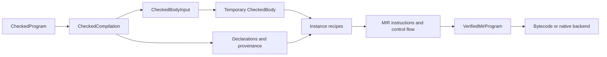

# Reading HIR Data and Analysis

`kagari-hir` owns source and structured declaration meaning and recoverable semantic analysis. `kagari-analyzer`
owns protocol-neutral editor queries; `kagari-lint` owns optional lint projections.
HIR contains more than the `hir/` node model: lowering, import/name resolution, type
checking and snapshot publication have separate owners. The
[architecture overview](../architecture.md#compilation-pipeline) describes the
compiler handoff. Detailed contracts and source-to-field diagrams live beside
the code; [engineering rules](../../AGENTS.md#documentation-maintenance) define
the documentation conventions.

## Choose an entry point

| Reader's question | Start here |
| --- | --- |
| Where do node IDs find their data? | [Storage and IDs](#storage-and-ids), then the matching `Module` or `HirNodes` collection. |
| Where is the field record for `point.y`? | [AggregateCatalog](../../crates/kagari-hir/src/aggregates.rs) traces lookup from a receiver type and field name, then from a resolved field ID. |
| How does a source expression acquire a type and a selected call? | [One function through the tables](#one-function-through-the-tables), then `ModuleFacts` and `TypeTable`. |
| Which work does an editor query trigger or reuse? | [Editor query views and indexes](#editor-query-views-and-indexes), then [semantic query reuse](#query-work-reuse-and-publication). |
| What does the compiler receive? | [Checked handoff](#checked-handoff-and-registered-inputs), then the runnable `CheckedCompilation` rustdoc example. |
| Why do definition references need visitors? | [Storage and IDs](#storage-and-ids): validation of scoped references and explicit import of reusable facts are different capabilities. |

Build the navigable API guide with
`cargo doc -p kagari-hir -p kagari-analyzer --no-deps --document-private-items`;
start at `target/doc/kagari_hir/index.html` or `target/doc/kagari_analyzer/index.html`.
The source links below point to each contract's owner. The [performance record](../performance-baseline.md#hir-architecture-and-candidate-filtering-macos-2026-11-06)
keeps workloads, measurement boundaries and limitations separate from API guarantees.

## Module responsibilities

| Owner | Input and output |
| --- | --- |
| `hir`, `lower`, `native::structured` | Parsed source or owned structured declarations become owner-qualified structural nodes plus source/structured origins; lowering does not infer types. |
| `declarations`, `resolver`, `imports` | Declaration identities, lexical bindings and cross-module namespaces. |
| `aggregates`, `semantic` | Shared nominal/signature contracts and immutable published body facts. |
| `typeck` | Temporary inference and constraint state produces those facts and positive completion evidence. |
| `analysis`, `program` | Staged analysis, snapshots, reuse, diagnostics, cancellation publication and complete checked dependency closures. |
| Analyzer library | Demand-built position/navigation indexes, calls, documentation and completion over matching semantic results. |
| Lint | Usage summaries and attribute-policy scopes over semantic identities and positive eligibility. |
| `compile_input` | Admits matching declaration environments, body roots/facts and provenance for the compiler. |
| `update_source`, `source_inspection` | Authored identities, static-initializer comparison evidence and exact source packaging. |
| Compiler `source::elaborate` | Expands an admitted source body into temporary semantic operations. |
| Compiler `source::lower::instances` | Applies generic arguments and selects implementation/ABI recipes. |
| Compiler `source::lower` emission | Evaluates operands and commits effects in order, building MIR from those operations and recipes. |

HIR publishes semantic results without preparing editor scope histories, reference-token
sites or path-hit collections. Compiler, SDK and HIR production targets do not depend on
analyzer. The analyzer library owns cursor selection, calls, documentation and completion
presentation; its binary owns protocol/document lifecycle. Lint owns private usage and
attribute-policy projections, with no analyzer dependency. See
[query views](#editor-query-views-and-indexes) for the concrete structures.

Private tests live under their owning module's `tests/` or `tests.rs`, using
ordinary Rust modules. Public semantic cases remain in the crate's `tests/`
tree. Production directories no longer mix in flat sibling `*_tests.rs` files;
this organization preserves access to private contracts without widening APIs.

The body node tables are still physically shared at module granularity. Logical body
views enforce owner boundaries; they do not promise per-function allocation or
fine-grained incremental invalidation. Those are separate storage/query decisions.

## Storage and IDs

Start with [LoweredModule](../../crates/kagari-hir/src/lower.rs),
[Module](../../crates/kagari-hir/src/hir/item.rs),
[HirNodes](../../crates/kagari-hir/src/hir/nodes.rs) and
[the ID families](../../crates/kagari-hir/src/hir/ids.rs).

```text
LoweredModule
+-- source: Arc<SourceFile> -> source text/identity/revision, or a logical registration key
+-- module: Module
|   +-- functions, consts, statics, structs, enums, traits, impls, ... -> origin-bearing records
|   +-- generic_params -> authored binder records
|   +-- attributes: Vec<AttributeFact> -> typed declaration/member targets
|   +-- uses: Vec<UseDecl> -> authored identities and contiguous import-leaf ranges
|   `-- nodes: HirNodes
|       +-- exprs:    Vec<(HirOwner, ExprData)>
|       +-- stmts:    Vec<(HirOwner, StmtData)>
|       `-- blocks, places, patterns, types, locals: analogous owner-tagged vectors
`-- input_kind -> authored source or structured registration
```

These arrows describe owned fields except the explicitly shared `Arc`. A body
node's child ID is a reference into a vector, not an owned subtree. `HirNodes` is
shared by the module's declaration syntax and multiple function, constant and
static-initializer owners. `Module.nodes` is module-wide storage, not one callable's
implementation body; `BodyOwner`, `BodyRoot` and `CheckedBodyInput` still name semantic
bodies. Declaration/member collections use Vec<T> explicitly, without plain Vec Buffer aliases. SmallVec-based aliases still centralize
reviewed inline capacities; ID checks and allocation behavior are unchanged.

| Handle | Lookup and validity |
| --- | --- |
| `FunctionId`, `ConstId`, `StaticId`, other plain declaration IDs | Index the matching collection in the same module; no arena is carried. |
| `ExprId`, `StmtId`, `BlockId`, `PlaceId`, `PatternId`, `TypeRefId` | Carry `LoweringId`, owner and an allocation-wide index; `HirNodes` checks lowering/owner and indexes its vector. |
| `ParamId` | Carries lowering/owner and a position in `Function.params`; `Module::parameter` checks the function and stored identity. The record stores its origin and written name range. |
| `LocalId` | Carries lowering/owner and a module-wide slot in `HirNodes.locals`; pattern leaves and closure parameters link to that name record. |
| `GenericParamId` | Indexes an authored binder in `Module.generic_params`. Inherited method lists reuse the enclosing declaration's IDs. |
| `FieldId`, `VariantId`, `TraitMethodId` | Carry lowering, enclosing declaration owner and member slot. Look up the owner's nested field, variant or method vector. |
| `UseId` | Selects one authored declaration in Module.uses, including recovery with no import leaves. Its range selects Module.imports leaves without changing resolution. |
| `AttributeTarget` | Item/member/use identity in the matching module. Methods name FunctionId; inline associated members name trait/impl plus category-list position. It is not a cross-lowering identity. |
| `SourceDeclRef` | Carries a full `SourceUnit` plus a declaration handle for cross-module access. Do not index the importing module with it. |
| `ModuleHandle` | A checked definition-table module root. Resolve through `names.catalog.definitions()` or `ModuleGraph.catalog.definitions()`; membership in the table alone does not declare a source namespace. |
| `DefinitionId` | Interpreted by its matching immutable definition-table prefix; distinct from all lowering-local IDs. Exact owned paths belong to explicit authoring/display queries. |
| `BindingId` | An analysis identity, scoped body definition and resolved local slot. Changing the definition context does not change the binding's owning analysis or source slot. |

Parameter identity comes from its owning function's retained list. Two functions can each
have parameter index zero, with distinct complete IDs. Closure binders remain LocalId.
Other body-node indices remain module-wide category slots.
For `pub const LIMIT: i32 = 10;`, `Module::constant(id)` returns the record carrying
the full declaration in `origin` and the `LIMIT` token in `name_span`. Structured
registration stores a scoped declaration ID and leaves written ranges absent.

Each Param stores its ID, name, type syntax and origin. Resolver bindings and checked source
signatures impose Val rather than reading configurable parameter writeability; object-field
mutation remains distinct from rebinding the parameter.

Cloning/reusing one lowering retains its `LoweringId`; fresh lowering creates a new one.
Existing `arena` fields/accessors name this identity, not a bump allocator. The graph uses
ordinary owned `Vec`/`String` storage; no external-arena or borrowed-HIR redesign is involved.
`SourceUnit` additionally records a context-owned module handle, file key and
revision. For a source-less registration the current graph retains an empty
`SourceFile` at a `kagari-registration://...` logical key; it is not a physical
source document or declaration surface. Even when file/revision/arena are identical,
a handle from an independent context is foreign. Reusing a lowering in that context
requires rebuilding its graph. [NodeOrigin](../../crates/kagari-hir/src/hir/origin.rs)
retains a byte range for source or a scoped declaration ID for structured registration.
Analyzer derives reference-token/path sites from authored syntax. Structured origins yield no
source span.

HIR types, declarations, signatures and checked-call facts use fixed `DefinitionId`
fields. Their Rust models have no parameter selecting paths versus IDs. A
`DefinitionReferences` visitor covers semantic definition references, including binding
body owners and static Native/Host contracts. `DefinitionMetadata::checked` validates
those references against an immutable prefix; it does not validate language meaning.
Resolution inputs retain their own immutable namespace catalog. Metadata
publication checks their local unit/catalog agreement and visits module roots and
dependencies; lookup checks complete source units. These source records do not
support cross-context remapping.

Independently reusable facts implement `RemapDefinitions`: import their referenced
ancestor closure, then rebuild ID fields and unique keys in the destination scope.
For `fn read(p: Player) { val saved = p; }`, importing the `saved` declaration changes
its body definition to the destination's `read` ID while retaining the analysis and
local slot; a binding from another source analysis still cannot identify `saved`.
Collapsed keys, cancellation and identity/traversal limits reject conversion.

Source addresses inside reusable method and import facts participate in this
conversion: `SourceUnit.module` is remapped and checked against the destination
table as a module root. File, revision, arena and local declaration item stay
unchanged. Import indexes remap their source-address keys together with their
values; this does not transfer a namespace catalog or authorize cross-arena lookup.

Whole analyzed/prepared/declaration bundles retain source node tables, name tables and
semantic input versions. They expose reference validation and editable scoped
extraction, not arbitrary representation conversion or whole-bundle import. Their
reusable constituent facts are the remapping boundary. Selected-body queries accept
scoped IDs and use the analysis context for cache keys; callers with an external
path explicitly look it up in the relevant declaration snapshot first. Source,
revision and dependency checks still govern reuse.

## Hash collection policy

[HIR collection aliases](../../crates/kagari-hir/src/collections.rs) own the hasher choice for
HIR's `HashMap` and `HashSet`, including name/type keys, semantic indexes and analysis caches.
They currently use `rustc-hash` 2.1.3's Fx aliases; no feature or per-engine switch is introduced.
Public HIR collection types use the same aliases. Future hasher selection belongs at this owner,
not in scattered semantic modules. This is not a new collection implementation: FxHashMap/FxHashSet
are standard hash collections with a different BuildHasher. Existing ordered maps/sets stay ordered.

This choice explicitly assumes trusted compilation inputs and is not HashDoS-resistant. A future
untrusted-input design must cover source names, recursive type keys, shared identity tables and
independent artifact/tooling entrypoints; changing only an engine flag cannot harden existing maps.
Other crates keep their own current hash policy. Key scope/generation checks, equality, cancellation
and work limits remain unchanged, but do not establish adversarial collision resistance.

Iteration stays unspecified. Semantic selection, diagnostic order and portable fingerprints or
serialized slot ordering must use their actual order owners, not Fx's default seed. Rust's
[Fx collection owner](https://github.com/rust-lang/rust/blob/1.91.0/compiler/rustc_data_structures/src/fx.rs)
similarly distinguishes fast hashing from stable/insertion ordering; the
[rustc-hash documentation](https://docs.rs/rustc-hash/2.1.3/rustc_hash/) states its non-cryptographic
compiler threat assumption. Kagari retains scoped IDs and explicit canonicalization; no speedup
is claimed without a workload measurement.

## Static declaration and initializer ownership

[StaticItem](../../crates/kagari-hir/src/hir/item/storage.rs) belongs to
`Module.statics`; `Item::Static(StaticId)` records its position among module items.
It is not a ConstItem or a source Function record. For example:

```text
pub static var count: i32 = seed();

Module.statics[s] = StaticItem {
    id: s, visibility: Public, name: "count", writeability: Var,
    ty: Some(t), initializer: e
}
Module.items contains Item::Static(s)
t -> HirNodes.type_ref -> Named("i32")
e -> HirNodes.expr -> Call to the resolved seed function
owner(t) = owner(e) = HirOwner::Body(BodyOwner::Static(s))
Module.static_item(s).origin -> declaration extent
Module.static_item(s).initializer_span -> full authored initializer
```

The IDs above are symbolic, lowering-local handles. Lowering allocates the static
record slot, switches the body owner while lowering annotation/initializer
nodes, then restores the previous owner. Missing annotations remain `None` and
missing initializers become `ExprKind::Missing` for recovery; neither is a valid
checked static. The accepted declaration requires a closed, durably storable type.
Unlike ConstItem, StaticItem has no associated trait/impl owner: statics are
module-only.

Resolution uses `ResolvedName::Static(s)` and a `DefinitionKind::Static` declaration
identity; imported aliases retain the supplier's source declaration. Signature
facts carry the declared type in `ModuleSignatures.statics`, and checked body facts
retain it in `typed.statics`. The
[static checker](../../crates/kagari-hir/src/typeck/check/statics.rs) checks the
initializer with ordinary expression inference and the declared result context,
not const evaluation. It publishes expression/call facts and completion evidence,
not a `const_values` entry or an initialized runtime cell. A closure that reads a
static resolves the declaration; it does not capture a local copy of that cell's
current value. Capturing a local previously read from the static is different.

The [source compiler](../../crates/kagari-compiler/src/source/lower/statics.rs)
consumes those facts to emit the semantic storage contract and a hidden synchronous
zero-argument initializer function with the declared result type. That executable
Function identity is distinct from the source static's identity; no synthetic
ConstDef substitutes for it. Imported operands bind to the supplier descriptor,
not another allocation. HIR owns source bodies and checking; the runtime owns
[lazy cells, fixed recipes and generation bindings](../spec/module-activation.md).
Neither analysis nor import resolution executes an initializer.

## Named local function ownership

For `fn outer() { fn inner() {} }`, `Module.functions` stores both records,
while `Module.items` contains only outer. `StmtKind::Function(inner)` links the
local declaration from its block. `FunctionKind::Local { block }` identifies the
declaring block; the block owner identifies the enclosing body, which may be a
function or static initializer. Inner's body
has its own `BodyOwner::Function(inner)`. Methods use the same function table;
closures remain expressions. Traversing an outer statement does not traverse the
local function body as part of outer's return, capture or control-flow analysis.

Lowering reserves each function slot before descending into children,
then fills that exact private `Option<Function>` slot. It reserves block rows before
statements too. Only complete function records enter the published module. For
outer/inner, allocation order is outer then inner even though inner completes first.
Semantic definitions are nested under the enclosing named callable, with per-name
source-order occurrences distinguishing identical spellings in separate blocks.
These are compilation identities, not public or edit-stable paths. Function self
IDs address the reserved rows, which carry their own origins.

Resolution predeclares block functions, then freezes declaration-time `ActiveScope`
frames temporarily within the resolver. A selected local body resolves its ancestor chain
without type-checking ancestors or unrelated bodies. Crossing a named function owner excludes enclosing
value bindings; signatures use only the local's own generic context. Completion
and navigation use the same lexical ownership. Changed-revision signature/body
reuse is conservatively disabled for a logical module containing locals on either
side of the edit; exact-revision caches and unaffected modules retain normal reuse.
Finer dependency invalidation remains R8.

A local function value records ordinary checked specialization/application facts.
`identity::<i32>` retains a PathExpr generic application in Name.explicit_type;
its positional argument types use the same preparation as call type arguments.
The function name is resolved as a callable, not looked up as a type.
The compiler consumes those facts through instance planning and an empty-capture
MakeClosure; no new environment or calling convention is introduced. Imported
trait default bodies retain authored source/binder ownership while executable
identities belong to the receiving module. The receiving planner maps each authored
local declaration to one placement for its lifetime, so recursive value references
reuse the same identity. Runtime values retain existing GC and generation pinning.

The block-wide static-name and independent-generic mechanisms follow the
[Rust Reference scope model](https://doc.rust-lang.org/reference/names/scopes.html);
separate parent links and body records follow the ownership principle documented
by [rustc HIR](https://rustc-dev-guide.rust-lang.org/hir.html). Kagari retains its own
checked execution, GC and reload model. Language behavior is specified in
[blocks and statements](../spec/syntax.md#blocks-and-statements).

## Mapping source syntax to model fields

Read a model's source fragment together with its expanded payload. For example,
`type Item;` names a member but leaves its assigned type absent; `type Item = i32;`
supplies a type-syntax link. A stored ID is an allocated reference, not part of the
written program. Examples use symbolic IDs, show empty buffers and `None` values,
and label recovery, synthetic nodes and unpopulated models explicitly. Contextual
fragments still need suitable declarations and typing; HIR allocation is not proof
of accepted language semantics.

The complete mappings are beside their owners:

| Source question | Model and field examples |
| --- | --- |
| Which declarations does a file contribute, and where are their payloads? | [Module / Item](../../crates/kagari-hir/src/hir/item.rs): source order, per-kind collections, imports and shared body storage. |
| Which function fields come from `pub`, `async`, generics, parameters, `where`, result and body? | [Function / Param / FunctionKind](../../crates/kagari-hir/src/hir/item/function.rs): full signature expansion, omitted annotations/bodies and method links. |
| How do field/variant declarations differ from constructor values and patterns? | [Struct / Field / Enum / Variant / NativeTypeDeclaration](../../crates/kagari-hir/src/hir/item/adt.rs): complete declaration payloads, owner/member slots and native-provider surfaces. |
| What do trait/impl headers, associated items and generic bounds store? | [TraitDef / Impl / associated members / bounds](../../crates/kagari-hir/src/hir/item/behavior.rs): required versus defined members, member input versus output constraints and function/constant links. |
| Where do constant/static initializers, child module bodies and flattened use leaves go? | [Constants and statics](../../crates/kagari-hir/src/hir/item/storage.rs) and [modules/imports](../../crates/kagari-hir/src/hir/item/module.rs): distinct body owners, compile-time versus runtime declarations, header-only children, alias/glob and leaf/root source ranges. |
| Is the final expression also a statement, and how is `+=` represented? | [BlockData / StmtKind](../../crates/kagari-hir/src/hir/stmt.rs): all statement payloads, tail absence, place/loop/pattern links. |
| How does `object.run(41)` differ from calling a named function or closure? | [ExprKind](../../crates/kagari-hir/src/hir/expr.rs): Call-to-Field links, name qualification versus call type arguments, all expression shapes and inline helper records. |
| Which parts of `items[next_index()].count` are places and which are expressions? | [PlaceKind](../../crates/kagari-hir/src/hir/place.rs): root and projection expansion, once-only target structure and later validation. |
| Which names bind in a pattern, and what does shorthand synthesize? | [PatternKind / PatternField / PatternBound](../../crates/kagari-hir/src/hir/pattern.rs): all pattern forms, nested IDs and provisional bindings. |
| How do generic arguments, associated equalities and projections occupy type fields? | [TypeKind](../../crates/kagari-hir/src/hir/ty.rs): every type form, callable normalization, grouping and invalid argument-order retention. |
| Are literals, operators or `val`/`var` already runtime facts? | [Literals](../../crates/kagari-hir/src/hir/expr/literal.rs), [operators](../../crates/kagari-hir/src/hir/expr/ops.rs) and [writeability](../../crates/kagari-hir/src/hir/writeability.rs): spelling/category/policy versus later checked behavior. |
| Who allocates IDs, and can their numerical values change? | [IDs](../../crates/kagari-hir/src/hir/ids.rs) and [HirNodes](../../crates/kagari-hir/src/hir/nodes.rs): full ID fields, row lookup, validity and fresh-lowering boundaries. |

For a concrete associated-member comparison:

```text
trait Reader {
    const LIMIT: i32 = 10;
    type Item;
    fn read(self) -> Self::Item;
}
struct Number { val value: i32 }
impl Reader for Number {
    type Item = i32;
    fn read(self) -> Self::Item { self.value }
}
```

| Fragment | Inline record | Referenced storage |
| --- | --- | --- |
| Trait's `const LIMIT: i32 = 10;` | `AssociatedConst { name: "LIMIT", name_ref: n, ty: t, initializer: Some(c) }` | n is a synthetic name-site type node; t is i32 syntax; c selects a ConstItem whose initializer expression spells 10. |
| Trait's `type Item;` | `AssociatedType { name: "Item", name_ref: n_item, ty: None, generic_params: [], parameter_bounds: [], bounds: [] }` | n_item is a synthetic name-site node; absence of ty requires an implementation definition. |
| Impl's `type Item = i32;` | Same member fields, with a distinct name_ref and `ty: Some(t_impl)` | t_impl selects i32 type syntax, not the trait member's name node. |
| Trait's `fn read(self) -> Self::Item;` | `TraitMethod { has_default: false, id: m, name: "read", function: f_trait }` | f_trait selects Function with kind TraitMethod, a self parameter, result syntax and no body. |
| Impl's method body | `ImplMethod { name: "read", function: f_impl }` | f_impl selects Function with kind ImplMethod; its body links to a block whose tail is a Field expression for self.value. |

The omitted impl constant uses the checked trait default; it does not create an
extra impl AssociatedConst record. The expanded impl/trait header, generic family
and where-clause examples in behavior.rs explain the remaining fields. An
associated type's optional assigned syntax does not enable trait type defaults:
current checking rejects them. Methods belong to trait/impl collections and link
to `Module.functions` through `FunctionId`. Receiver presence comes from the
function parameters; `self` uses ordinary value semantics without a separate
receiver-category tag. ADT `impls` vectors remain unpopulated; use `Module.impls`
and checked lookup facts to find associated implementations.

## One function through the tables

```text
fn add(x: i32) -> i32 {
    val y = x + 1;
    y
}
```

Read [item lowering](../../crates/kagari-hir/src/lower/item.rs), then
[statement lowering](../../crates/kagari-hir/src/lower/stmt.rs) and
[expression lowering](../../crates/kagari-hir/src/lower/expr.rs).
The diagrams below abbreviate complete IDs; positions are illustrative.

```text
Function(f).params = [Param { id: p, name: "x", ty: t, ... }]
Function(f).implementation = Script(b)
Block(b).statements = [s]
Block(b).tail_expr = Some(result)
Stmt(s) = Binding { pattern: binding, initializer: sum, ... }
Pattern(binding) = Name { local: l, name: "y" }
Expr(sum) = Binary { lhs: x, op: Add, rhs: one }
Expr(x) = Name { name: "x", ... }
Expr(one) = Literal(Number, "1")       // literal record abbreviated
Expr(result) = Name { name: "y", ... }
```

`Function.implementation` distinguishes `Required`, `Script(BlockId)` and
`Native(NativeContract)`. Native contracts retain ordered callable requirements,
the concrete result descriptor and caller-visible Host/receiver-access policies,
using the existing scoped declaration vocabulary. They contain no Rust callback,
entry selector, storage adapter or implementation authority. `TypedFunction` remains
a separate checked signature with the same Required/Script/Native distinction;
Native means externally implemented, not already bound. Script defaults retain real
blocks and ordinary checked calls, including calls to declared Native helpers.

The lowerer allocates node IDs from their category rows under
`HirOwner::Body(BodyOwner::Function(f))`. Each row carries its own source or structured origin.
`p` addresses a function parameter and `l` addresses a local in `HirNodes.locals`.
The tail expression is separate from the statement list. Parentheses disappear
as wrappers; constructor shorthand and interpolation can create HIR nodes that
are not in one-to-one correspondence with AST nodes.

```text
stored HIR IDs      independent analysis tables / computed lookups
x                -> ResolvedNames.exprs -> Param(p)
result           -> ResolvedNames.exprs -> Local(l)
sum              -> TypeTable.exprs     -> semantic i32 type
l                -> TypeTable.locals    -> semantic i32 type
t                -> type syntax         -> resolved type facts
sum              -> ExprData.origin    -> first-to-last written token bytes for the addition
```

[ResolvedNames](../../crates/kagari-hir/src/resolver/resolved.rs) records bindings;
[TypeTable](../../crates/kagari-hir/src/typeck/table.rs) records types and selected
operations. `TypeRefId` addresses type syntax; the semantic
[TypeId](../../crates/kagari-hir/src/types.rs) is an enum, not a node index.
Neither name resolution nor a successfully allocated HIR node proves the source
is valid. Facts can remain useful alongside diagnostics.

The runnable examples on `lower_module` and `analyze_source` verify storage/source
ranges and the checked arithmetic type. Declaration metadata lives in
[Declarations](../../crates/kagari-hir/src/declarations.rs); body checking builds
on [ModuleSignatures](../../crates/kagari-hir/src/typeck.rs). Missing facts can
mean an inapplicable operation, a stage not requested or source recovery; each
table's accessor contract explains which applies.

Type checking owns a private
[TypeCheckState](../../crates/kagari-hir/src/typeck/state.rs) while resolving syntax.
It keeps annotation holes and the active type-resolution stack beside the fact
table. For `val items: Vec<_> = Vec::new()`, the written `_` temporarily names an
inference variable; it is not a retained signature fact. Consuming the workspace
extracts only `TypeTable`, so published results and identity mapping cannot carry
those temporary collections. The body checker separately owns its solver and
control-flow stacks. Extracting facts does not grant compilation eligibility:
diagnostics, cancellation and the checked boundary still govern publication.

Declaration checking retains written-type contracts in `ModuleSignatures`. Once
the visible aggregate environment is complete, body preparation normalizes their
parameter, return and static types into
[BodySignatures](../../crates/kagari-hir/src/semantic/signatures.rs). The environment,
constant preparation and selected/full body results share that immutable owner
through `Arc`; the function lookup index stores positions in its declaration-order
sequence rather than duplicate records. These are distinct stages, not independent
sources of truth for the same normalized contract. Local function/parameter/static
IDs still require the matching lowering; sharing does not make IDs portable across
source revisions. Signature recovery may retain error types and grants no executable
qualification.

[ModuleFacts](../../crates/kagari-hir/src/semantic/body.rs) publishes the shared
signatures, constant results and node-keyed facts through read-only accessors.
Writers are internal to HIR.
[FunctionAnalysis](../../crates/kagari-hir/src/analysis/body.rs)
pairs the current query's signature snapshot with shared immutable selected-body
facts: the function, matching lowering/definition table, environment, bindings,
diagnostics and result. `eligibility()` uses positive body evidence and the current
snapshot's shared-input validity, independently of diagnostic display truncation.
Unrequested/bodyless functions return no selected result, recovery returns facts
with unavailable completion evidence, and cancellation returns an error before
publication. A complete selected function is not proof that its entire dependency
closure is executable.

Cancellation has three owners. Analysis checks requests and cache publication;
signature/body stages return `Result<_, Cancelled>`; long algorithms retain their
own internal checkpoints. Cache namespace comparisons propagate cancellation as
an error rather than treating it as a cache miss. The private body checker shares
one counter across ordinary statement/expression visits, polling every 64 visits,
and retains an observed stop flag. Solver cancellation also sets that flag.
`finish` rejects stopped work before any recovery placeholder can escape as a
returned fact. Trait candidate/depth limits, inference rounds and constant budgets
still count every semantic step independently of polling.

Declaration identity forwarding polls at the ID leaf instead of repeating the
same read in both enclosing records and their branch. Mapping still validates
every target and rejects duplicate keys; the shared identity API is unchanged.
Deterministic cancellation tests interrupt ordinary visits, solver constraints,
trait candidates, constant evaluation, namespace comparison and full/selected
publication. They require the previous cached result to retain its identity and
source, and bound ordinary visited nodes after a request. This is a progress
bound, not a wall-clock latency guarantee; destruction and a concurrent request
after the final check still follow cooperative cancellation semantics.

[compile_input](../../crates/kagari-hir/src/compile_input.rs) owns the
HIR-to-compiler handoff. `CheckedCompilation` borrows an already checked complete dependency
closure and admits each module's environment and body directory. `CheckedEnvironment`
exposes declaration contracts, not the imported function, static or constant tables.
For a resolved binding, `static_declaration` returns the static's identity and
`constant_value` returns the evaluated scalar. `CheckedBodyInput` ties source nodes, selected
facts and spans to a `BodyKey { module, arena, owner, closure }`. A nested callable
retains its allocation owner while its closure/async expression selects a distinct
root. Foreign-owner/arena node
lookups return `None`; a missing source body never implies a native implementation.
Admission also requires positive function/static completion evidence, evaluated
constants, matched signature parameters and origins in the admitted lowering.

[Declaration projections](../../crates/kagari-hir/src/compile_input/declarations.rs)
retain header order, visibility, source extents and implementation kind without a
body arena. The aggregate catalog remains the owner of field, variant, trait and
associated-member types. Alias templates stay in the declaration environment;
local constants expose their checked type and evaluated scalar together. Empty
inherent impls retain receiver/binder/bound facts independently of method bodies.
Native static requirements remain on the checked callable contract. Script defaults
use ordinary admitted body roots and call facts; there is no parallel registration
catalog or dedicated default-call table in `CheckedModule`. Implementation entries
and Rust adapters belong to composition/linking, not this handoff.

Elaboration also queries [normal completion](../../crates/kagari-hir/src/compile_input/body/flow.rs)
through the checker's existing work-stack algorithm. For `(loop {})?`, only the
operand executes, so no propagation contract is required. Match continuation uses
the same owner: a refutable pattern may fail; an irrefutable pattern continues only
through a guard that can complete normally and return false. For
`match x { _ if { return 7; } => 1, _ => grow(x) }`, the guard exits the function,
so neither arm value executes and `grow(x)` creates no concrete instance. Source
checking still diagnoses both values independently. The checked-body query validates
the match owner and arm index; elaboration retains only reachable arms, and MIR
consumes that sequence without independently deciding arm reachability. The
short-lived memo is tied to one immutable body; it does not publish solver state or
cross-revision cache entries. Expanded operations retain explicit evaluated
prefixes, selected calls/conversions and structured branches, rather than a flat
execution schedule.

The source compiler accepts only this admitted complete closure. Its
[elaborator](../../crates/kagari-compiler/src/source/elaborate.rs) expands one
reachable function, initializer or closure into an owned, temporary `CheckedBody`.
The [instance planner](../../crates/kagari-compiler/src/source/lower/instances.rs)
substitutes binders and selects method, native/default and interface-construction
recipes using the same bounded HIR catalog queries. The
[MIR builder](../../crates/kagari-compiler/src/source/lower/state.rs) consumes these
operations and recipes; it has no `AnalyzedModule`, `TypeTable` or source resolver.
Generated adapters and async factories have no authored operation tree. Factories
prepare only signatures, parameters and captures; their resume bodies expand the
authored operations when compiled. Each tree is dropped
with its function builder, while admitted source/environment borrows remain valid
for the complete compilation.



For `items[index()] += rhs()`, expansion distinguishes a writable aggregate,
a checked setter and a host path. MIR prepares the selected receiver and index
once, evaluates the RHS, then commits through that prepared target. A terminating
index/RHS retains only the completed prefix and never commits. Host/read-only
projections retain their earlier read/getter position; writable aggregate bounds
checks retain their existing commit position. Planning selects callable evidence
but never evaluates a script operand.

`MethodApplication` retains the receiver, interface, method identity and local type
arguments. Its `MethodPlan` distinguishes a direct/shared/native/dynamic call,
primitive operation, callable-tuple unpacking or structural protocol composition.
Callable syntax such as `f(a, b)` retains flat source operands even though the
selected `Fn::call` declaration receives one argument tuple. Elaboration validates
the authored arity from the applied callable interface; MIR emission packs that
tuple after evaluating each operand once. A script default call retains its
impl-owned member identity while the instance planner selects the checked body
from the declaring trait module. Builtin Debug/Display use their runtime primitive
only after normal explicit/native/dynamic method selection. A result instantiated
to Never terminates the emitted block, including a symbolic generic result.

`InterfacePlan` separates constructing a selected implementation table from adapting
its exact associated outputs to the checked view. Construction requirements retain
the declared constraints; source/target value views fill omitted associated outputs
such as Iterable's bounded iterator before an upcast. Neither recipe owns analysis
state or performs a second type check.

Admission also captures authored owners and static-only provenance once using the
closure's shared source budget. `CheckedModule::provenance` exposes that evidence;
the compiler validates it against its declaration inventory. Exact source packaging
uses the admitted physical sources, including inline/UTF-8/CRLF coordinates. The
definition allocator is shared with the checked input's original scope, so generated
identities do not require cloning or remapping an entire analyzed module.

### Pattern-based declarations

Every ordinary `Binding` owns one `PatternId`, declaration-wide writeability, an
optional whole-value annotation and its initializer; simple names have no separate
statement-level representation. Pattern leaves own local identities. For example,
`var (x, Point { y, .. }) = make_pair();` links a tuple pattern to a name leaf and
a struct pattern, whose field child owns the other local. Rest is a boolean on the
struct pattern, not a field or binding.

Resolution visits the initializer before publishing any leaf. Declaration bare
names always bind; other pattern contexts retain their constructor policy. The
shared checker records nominal field identities and leaf types, checks access and
completeness recursively, and requires conservative declaration irrefutability.
The whole annotation contextualizes the initializer rather than converting leaves.
Usage/navigation consume those same leaf identities; `HirNodes::pattern_bindings`
selects canonical declaration leaves, with the first alternative representing an
Or pattern's consistent binding set.

Compiler lowering consumes checked facts through the shared pattern extractor.
Declarations have no failure continuation; refutable constructs require a real
match/condition/iteration failure edge, not an added declaration trap. Extraction
stages values in pattern source order, skips ignored projections, and selects the
successful alternative's values before allocating captured-variable cells. All
leaf stores precede debug-local publication. Captures, lexical scope exit and GC
roots retain their existing owners; backends neither re-resolve fields nor infer
leaf types. See [declaration semantics](../spec/syntax.md#blocks-and-statements).

### Struct update facts

For `Player { health: value, ..base }`, StructInit retains explicit fields in source
order and `base: Some(base_expr)`. The dedicated AST update-base node distinguishes
no marker from a marker with a missing operand; recovery retains the latter as a
missing HIR expression. Resolver, completion and constant validation visit the base
after explicit fields. The base is not a synthetic FieldInit or a range.

ResolvedStructInit.fields remains aligned with written labels, including recovery
holes; base_fields separately stores omitted checked definition IDs in declaration
order. Navigation must not pair omitted members with explicit source spans. Both
field lists participate in definition remapping, while base expression facts retain
ordinary body/snapshot identity. Constructor inference includes the base before
finalizing type arguments and checks all-field visibility and normalized nominal
identity. Compiler lowering evaluates explicit operands and the base, reads only
those checked omitted fields and emits the existing complete MakeStruct contract.
No backend resolves source fields or introduces a special update/default operation.

## Structured import paths and source sites

[Import](../../crates/kagari-hir/src/hir/item/module.rs) and
[ImportDirective](../../crates/kagari-hir/src/imports.rs) retain flattened
written paths as `segments: Vec<String>`. For example, inside module `pkg::app`:

```text
use super::api::{sum as add, ops::*};

Module.imports[0]: segments = ["super", "api", "sum"], Named { alias: Some("add") }
Module.imports[1]: segments = ["super", "api", "ops"], Glob
```

[Item lowering](../../crates/kagari-hir/src/lower/item.rs) copies accumulated
segments at group branches, preserving leaf order. Each leaf becomes
one directive identified by its `SourceUnit` and import slot. The alias is not a
path segment: `local_name()` selects it, otherwise the named terminal; a glob has
no local name and excludes `*` from its path. Glob expansion contributes bindings,
not additional HIR leaves or directives.

Keep three representations distinct:

- **Written:** HIR leaves and directives retain `super`, `self`, `crate` and package
  aliases exactly as written. Resolution does not overwrite these segments.
- **Normalized lookup input:** the
  [catalog](../../crates/kagari-hir/src/imports/catalog.rs) selects candidate packages
  and components relative to the importing module. Here `super::api::sum` selects
  package `pkg` with components `["api", "sum"]`. Components can name members, not
  only physical modules. `crate` starts at the package root, `self` at the current
  module, and repeated leading `super` ascends parents; root underflow fails lookup.
  Dependency and installed/native aliases follow the catalog's package-selection
  rules; ambiguity and physical module collisions are not resolved arbitrarily.
- **Resolved:** `ResolvedTarget`, `NamespaceId` and `SourceDeclRef` identify semantic
  destinations; binding origins independently retain how they were reached. An
  `api` re-export can target a declaration in `math`, not the written facade. See
  [the alias/glob example](#an-alias-through-a-public-glob).

Analyzer's [SourceSites](../../crates/kagari-analyzer/src/sites.rs) derives
`imports: Vec<Vec<(usize, Span)>>` from the retained `UseTree` syntax, aligned with
flattened import slots. HIR does not retain this reference-token index:

| Site | Exclusive prefix end | Prefix selected from that leaf | Physical span |
| --- | --- | --- | --- |
| Both leaves' `super` | 1 | `segments[..1]` = `["super"]` | Original `super` token |
| Both leaves' `api` | 2 | `segments[..2]` = `["super", "api"]` | Original shared `api` token |
| Named leaf's `sum` | 3 | `segments[..3]` = `["super", "api", "sum"]` | Original `sum` token, excluding `as add` |
| Glob leaf's `ops` | 3 | `segments[..3]` = `["super", "api", "ops"]` | Original `ops` token, excluding `::*` |

Every derived end is nonzero and bounded by the leaf's **written** segment count,
never the normalized component count. Each span covers only that physical segment,
not the whole prefix. Shared group ancestors repeat per leaf; aliases and stars
add no site. The leaf `span` includes alias syntax (`sum as add`); `root_span`
covers the outer `super::api::{sum as add, ops::*}` tree, excluding `use` and `;`.
Ranges remain source byte offsets, including UTF-8/CRLF and inline-module routing.

[Import resolution](../../crates/kagari-hir/src/imports/resolve.rs) still visits written
prefixes to record semantic namespace observations, including failed/pending lookups.
Those observations drive watchers and convergence; they are not navigation hits.
After settlement, analyzer [navigation](../../crates/kagari-analyzer/src/navigation.rs)
uses the shared catalog lookup and checks terminal agreement with the selected directive.
Intermediate navigation uses Type; a named terminal retains eligible Type/Value results,
while a glob selects Type. Generated native imports retain their category restrictions.
`SnapshotQueries::source_targets_at` preserves categories and origins at the most specific
site; `source_target_at` does not choose between dual-category hits.

Recovery retains only available syntax: no root tree means no leaf, and recovered
empty leaves can have no sites. An empty unaliased path has `local_name() == None`;
a usable explicit alias still takes precedence. Missing aliases, trailing separators
and empty groups retain their parser/lowering diagnostics and recovered structure,
not fabricated segments or unchecked terminal assumptions.

Import normalization, traversal and syntactic dependency-prefix matching consume
segments directly. Joined text belongs only at diagnostic payloads or necessary
existing text lookup boundaries; text callers adapt to the shared traversal rather
than defining another resolver. Syntactic facade dependencies remain distinct from
canonical target/provenance edges and failed/pending lookup observations. Reuse
compares written segments alongside kind, visibility, dependencies and outcomes;
equal canonical targets alone do not authorize reuse across source revisions or
HIR arenas. Retained snapshots keep their matching records, origins and immutable catalogs;
see [query reuse and publication](#query-work-reuse-and-publication).

The segment separation follows Rust HIR's
[Path](https://doc.rust-lang.org/nightly/nightly-rustc/rustc_hir/hir/struct.Path.html)
and [PathSegment](https://doc.rust-lang.org/nightly/nightly-rustc/rustc_hir/hir/struct.PathSegment.html)
model (rolling nightly API documentation consulted on 2026-10-19). Kagari instead
owns its strings and snapshot resolution facts; this does not adopt Rust arena
lifetimes or symbol interning, or establish a measured performance improvement.

## An alias through a public glob

Bind these source units using `SourceDatabase::bind_module` with package
`PackageId("pkg")` and paths `["math"]`, `["api"]` and `["app"]`, then supply their
text using `SourceDatabase::set`. Filenames alone do not establish this layout.
The runnable example on `AnalysisSnapshot::check_program` in
[program.rs](../../crates/kagari-hir/src/program.rs) includes this setup.

```text
// math
pub fn sum(x: i32) -> i32 { x + 1 }
// api
pub use pkg::math::*;
// app
use pkg::api::sum as add;
fn main() -> i32 { add(41) }
```

[Item lowering](../../crates/kagari-hir/src/lower/item.rs) flattens each real `use`
leaf. The [import builder](../../crates/kagari-hir/src/imports/builder.rs) turns
these leaves into directives and binding candidates. The following is a lookup
outline; arrows to `S` denote equal canonical targets, not extra owned functions:

```text
S = SourceDeclRef { unit: math's SourceUnit, item: Function(sum_id) }

math NameTable["sum"][Value].strong -> Declaration(S), target Source(S), public
api  directive              -> Glob, resolved Namespace(math)
api  NameTable["sum"][Value].globs  -> GlobImport(api_directive), target Source(S), public
app  directive              -> Named { Type: Absent, Value: Resolved(Source(S)) }
app  NameTable["add"][Value].strong -> NamedImport(app_directive), target Source(S)
```

Each candidate also retains its owner, visibility and source site. Provenance says
which declaration/import introduced it; the target says where the declaration
actually lives. A glob's directive targets a namespace, while its contributed
bindings target eligible members. Public re-exports become candidates with public
visibility in that module's table; the catalog filters access for each importer.
Public members derive from these namespace candidates, including glob expansion.
There is no parallel HIR export list. Portable native `ModuleDecl.exports` remains
authoritative authored metadata, keyed by category and alias; generated native
imports retain its validated category. Ordinary source use leaves resolve both
categories.

[NameTable](../../crates/kagari-hir/src/resolver/table.rs) selects the first nonempty
tier: strong, glob, then implicit. Conflicting strong entries are ambiguous;
equal-target glob candidates can coexist with their origins preserved. These are
precedence tiers independently inside each Type/Value slot. Path prefixes select
Type and terminal lookups explicitly select their use-site category. Navigation
retains that category; a dual import has two `source_targets_at` results and no
arbitrary `source_target_at` winner. See
[import records](../../crates/kagari-hir/src/imports.rs) for the concrete fields.

The [solver](../../crates/kagari-hir/src/imports/solver.rs) seeds declarations once
and replaces one module's contributions at a time. Namespace observations include
missing/pending lookups and glob membership; reverse watchers schedule affected
modules independently of linking dependencies. Draft named slots reserve their
category. While a `use api::*` may still contribute a name, the solver keeps a
temporary barrier in its draft state. If lookup has no strong candidate and the
glob could supply that name, lookup stays pending rather than reporting it
missing or selecting a glob or implicit candidate. Published `NameTable`s contain
only settled bindings and outcomes, including errors; neither readers nor cache
equality need to consult these barriers.

At quiescence it closes the union of pending dependencies, releases justified
reservations and resumes propagation. Finite acyclic derivations prevent aliases
from proving themselves through cyclic forwarding; equal-target origins remain
available for navigation. Publication requires a drained queue and no pending
candidate or directive. Exact bounded state history detects repetition; a separate
input-sized work bound reports exhaustion. These are distinct from cancellation
and ordinary unresolved source diagnostics. No failed draft enters analysis caches;
old snapshots retain their immutable catalog.

Draft candidates retain the full LookupOutcome, so ambiguity and access failures
cannot become absence. Each selected candidate carries a finite derivation of
real `(DirectiveId, NameNamespace)` keys; lookup excludes a derivation containing
its own directive/category. Type and Value are distinct here: a Value lookup may
legitimately use a Type alias from the same import. Prefix/glob proofs compose;
equal-target origins remain available, with the shortest valid derivation retained.
Proofs are solver evidence, not definition identity or cache equivalence. Binding provenance
and physical locations are separate: source-less structured re-exports retain directives and
resolved targets but have no leaf/root source sites. Only source-backed records contribute
physical candidate locations; a zero-width source recovery site is still a real range.

The work limit counts module evaluations and produced binding contributions,
derived from input modules, use leaves and seeded spellings. An eight-entry
history compares exact facts, observations, queue and closed keys rather than
trusting hash equality. Cancellation, exhaustion and non-convergence preserve
bounded physical import sites and never publish successful graph/cache entries.

At the call site, lexical resolution checks local bindings before module names:

```text
Expr(callee) = Name { name: "add", ... }
ResolvedNames.expr_resolution(callee) -> ResolvedName::Source(S)
ImportedFunctions.get(binding)        -> canonical signature + definition identity
Expr(call) = Call { callee, args: [argument], ... }
TypeTable.call_resolution(call)       -> ResolvedCall
  target = CallTarget::SourceFunction(definition identity for math::sum)
  signature = applied parameter/result types; type_arguments = []
TypeTable.expr_type(call)             -> semantic i32
```

The call target uses a semantic definition identity, not `SourceDeclRef` itself.
`FunctionId` in `S` is meaningful only in math's matching lowering. The checked
program's `source_function(&S)` verifies the complete source unit, finds math's
checked module, then selects its typed function. The example asserts this lookup.

For `use pkg::math as m; m::nested::value()`, the resolver selects `m`, obtains its
namespace with `NamespaceCatalog::namespace_of`, and follows each suffix with
`lookup_member`. This requires a visible `nested` module containing `value`;
entering it does not create another import directive. See
[namespace lookup](../../crates/kagari-hir/src/imports/catalog.rs) and
[body resolution](../../crates/kagari-hir/src/resolver/resolve.rs).

## Editor query views and indexes

Import `kagari_analyzer::AnalyzerQueries` and call `.queries()` on a retained semantic
result. These are borrowing adapters, not analysis stages or HIR compatibility methods:

| Semantic owner | Analyzer view | Available scope |
| --- | --- | --- |
| `FileDeclarations` / `DeclarationSnapshot` | `DeclarationFileQueries` / `DeclarationSnapshotQueries` | Declaration-site and documentation queries without signatures/bodies. |
| `FileSignatures` | `SignatureQueries` | Checked signature types and definitions; no body checking. |
| `FunctionAnalysis` | `FunctionQueries` | Types and receivers within the selected function only. |
| `FileAnalysis` | `FileQueries` | Types, definitions, fields, visible bindings, signature help and completion presentation. |
| `AnalysisSnapshot` | `SnapshotQueries` | Physical-to-inline routing, cross-file definitions, namespace navigation and documentation. |

Opening a view does not check source or build an index. A query constructs the projections
it needs; `SnapshotQueries` retains per-logical-file navigation indexes for that view's
lifetime. File, staged and declaration-site queries build their temporary projections when
needed, not a persistent shared IDE cache. Keep the semantic owner alive and never reuse
an index with another lowering, definition context or source revision.

```text
HIR ResolvedNames
+-- bindings: HashMap<ResolvedName, Binding>
|   `-- Binding { name, resolved, owner: BodyOwner, writeability }
+-- exprs / places / pattern_variants -> selected semantic identities
`-- closure_captures -> canonical binding identities

Analyzer projections over matching source + HIR + facts
+-- ScopeIndex -> structural scopes; entries borrow canonical Binding records
+-- DeclarationSiteIndex -> analysis-coordinate ranges + canonical declarations
+-- SourceSites -> CST reference/member/type/import token sites
`-- NavigationIndex -> FileAnalysis borrow + Vec<(Span, LookupHit)>
```

The [binding directory](../../crates/kagari-hir/src/resolver/resolved.rs) includes unused
and shadowed binders. `binding` reads by identity; `bindings` enumerates without promising
order. Compiler/declaration/lint consumers use it without cursor lookup. Resolver
[`ActiveScope`](../../crates/kagari-hir/src/resolver/resolve.rs) holds only the current
name-to-identity map and owner; its stack and named-local declaration-time copies are
work state discarded after resolution, not published editor history.

For `val x = 1; val x = x + 1; x`, resolution selects the first `x` inside the second
initializer and the second at the tail. Both declarations remain in the directory.
Analyzer's [ScopeIndex](../../crates/kagari-analyzer/src/scope.rs) derives visibility starts
and shadow order from structure and these identities; it does not resolve names again.
Parent declaration prefixes are frozen for nested scopes/local functions, and crossing a
named function excludes enclosing value bindings. The
[declaration-site index](../../crates/kagari-analyzer/src/declarations.rs) selects in analysis
coordinates, separately from a declaration's copied/native physical location.

[SourceSites](../../crates/kagari-analyzer/src/sites.rs) recovers reference-token boundaries
from the exact retained syntax and whole-node HIR origins, preserving UTF-8/CRLF and inline
coordinates. [NavigationIndex](../../crates/kagari-analyzer/src/navigation.rs) derives type,
expression and import prefixes after semantic settlement/remapping. Shared catalog lookups
must agree with selected targets; a lexical shadow cannot acquire module provenance merely
because the spelling matches. Type/Value categories and equal-target glob origins survive.
Cancellation returns no partially built navigation index.

HIR retains diagnostic/debug/declaration/static-initializer origins and semantic import
observations; it does not construct editor lookup/path-hit vectors or joined-prefix indexes.
`ResolvedTypeRef { ty, target: Option<ResolvedTypeTarget> }` remains semantic: aliases,
generic/Self constraints and reload evidence need the selected declaration/binder independently
of the resulting type. Moving cursor lookup does not remove that relation.

Receiver/interface eligibility is shared through HIR
[`typeck::members`](../../crates/kagari-hir/src/typeck/members.rs). Analyzer owns
`VisibleBinding` and `CompletionCandidate` presentation, ordering and deduplication; checking
retains its full argument/bound validation. Signature help and written documentation live in
analyzer [calls](../../crates/kagari-analyzer/src/calls.rs) and
[documentation](../../crates/kagari-analyzer/src/documentation.rs), not compiler call facts.
The library does not imply new LSP capabilities, hover composition or references/rename support.

This boundary follows [rust-analyzer's architecture at Rust 5f4effd57950](https://github.com/rust-lang/rust/blob/5f4effd57950/src/tools/rust-analyzer/docs/book/src/contributing/architecture.md):
semantic facade, offset/presentation services and LSP transport have separate owners.
Kagari does not adopt Salsa, arena lifetimes or that IDE-only frontend's execution assumptions;
it also owns checked compiler/reload admission. No speedup is claimed.

## Query work, reuse and publication

The [frontend benchmark guide](../frontend-benchmarks.md#hir-workloads-and-query-routes)
measures these entry points through independent staged, direct, warm, edited and
selected-body routes, plus snapshot retention/release. It owns commands and
measurement caveats; [recorded results](../performance-baseline.md) are
revision-specific evidence, not additional query or reuse guarantees.

[AnalysisDatabase](../../crates/kagari-hir/src/analysis.rs) owns mutable caches;
returned snapshots retain immutable source and facts through `Arc`. These are the
actual entrypoint dependencies, not phases repeated by every position query:

```text
declarations(source) -> prepare_declarations -> publish DeclarationSnapshot
signatures(source)   -> prepare_signatures
                         `-> prepare_declarations
                      -> publish SignatureSnapshot + declarations
body(source, owner)  -> prepare_signatures -> selected function + constant prerequisites
                      -> publish FunctionAnalysis + signatures
snapshot(source)     -> prepare_signatures -> check/reuse ALL file bodies
                      -> publish AnalysisSnapshot + signatures

result.queries().type_at / definition_at / completion -> analyzer reads facts + derives indexes
snapshot.check_program(root) -> validate reachable checked source closure
```

Read [declaration queries](../../crates/kagari-hir/src/analysis/declarations.rs),
[signature queries](../../crates/kagari-hir/src/analysis/signatures.rs) and
[selected body queries](../../crates/kagari-hir/src/analysis/body.rs) in that
order. Internal `PreparedSignatures` carries signature-stage preparation, not an editor
session or public query view. Declarations include parse/lowering and import resolution;
signatures check type annotations and aggregate contracts; bodies add local bindings, expression
types and selected operations. Syntax errors can still leave useful facts and
diagnostics. Cancellation is an error, checked before publishing completed results.
Older requests do not replace newer published revision caches.

Internal traversal can still return temporary values while stopping. In
[block lowering](../../crates/kagari-hir/src/lower/stmt.rs), cancellation stops the
statement loop; the optional tail is lowered afterward, the partial block is
finalized and the enclosing block restored. `lower_module_controlled` returns
structural HIR, so its analysis caller must check the shared token before accepting
it. In [closure inference](../../crates/kagari-hir/src/typeck/body/closures.rs), a
completion-query error sets the checker's sticky stop flag; its temporary `false`
is not evidence that the script diverges. Return, async and loop contexts are
restored before leaving the closure, and `BodyChecker::finish` rejects the stopped
checker's facts. For `val f = || { return 1; }; 2`, the closure's return belongs to
its own context and `2` remains the enclosing block's tail; cancelling analysis
must not publish a partial type for `f` as though divergence had been proved.

Selected-body reuse separates the query context from its body payload. If an
unrelated signature becomes invalid while the selected file and body environment
remain unchanged, a new result shares the existing body facts but retains the new
signature snapshot and reports unavailable eligibility, just like a fresh query.
Previously returned results keep their original context. Reusing the entire result
requires the same source revision and identical retained signature files, including
the complete file set; rebuilding map containers alone does not invalidate it.
Refreshing context does not rerun body checking or copy its tables. The selected-body
cache strongly owns semantic facts but keeps only weak handles to their file graph and
last returned query. Returned queries own their exact file/signature context. Reuse upgrades
the matching old graph temporarily; if it has expired, checking starts fresh rather than
interpreting cached IDs against a new lowering. The cache alone pins no HIR graph.

Declaration/signature caches share authoritative owned records with live query views, keeping
only weak graph/query handles. Signature records retain their checked imported types and
updated definition prefix, not the earlier declaration-stage environment. Full-file results
are weakly indexed; their expired bundles are rechecked. Native preparation strongly caches
validated adopted registrations and any explicitly supplied source/parse, then reconstructs
fresh graph-local attachments. Structured inputs require neither rendering nor parsing;
source-backed inputs reuse their retained parse. Neither database caches nor database clones strongly retain HIR. Reuse
requires a live exact old graph; retaining IDs/records alone cannot establish compatibility.
With no retained result, the next standalone query rebuilds/checks graphs. This is the current
cache policy, not a requirement of HIR ownership. The completed responsibility/identity
cleanup preserves owned category tables and this retention behavior. Further retention
changes require a [separate workload-driven decision](../hir-model-review.md#cache-policy-is-separate).

Source preparation has three steps: get the physical parse, discover logical modules and
assign parser diagnostics, then get each module's lowering. Discovery does not access a
parse or HIR cache. Two separate input contracts govern reuse:

| Result | Exact input and retention contract |
| --- | --- |
| Physical parse | The exact immutable `Arc<SourceFile>` and `ParseLimits`. The parse owner prefers a matching published parse, then its latest cache, and parses only on a miss. Equal text or revision alone does not establish copied-source provenance. |
| Source lowering | The logical `FileId`, `ModuleLocation` and optional root library sidecar identity. `ModuleLocation` compares the original parse and its module slot, not a byte range. Lowering reuses a matching live weak entry; otherwise it builds the HIR and attaches metadata before sharing it. |

Library sidecars use an immutable inventory identity and entry slot, held weakly by the
key. Child modules do not inherit a root's sidecar. This makes sidecar changes independent
of parse reuse and does not grant library installation authority. Structured registrations
remain on their separate input path. Declaration, signature and body reuse still check their
own semantic inputs.

Completed syntax publication does not publish semantic success. A retained published parse
can still match after a newer syntax batch succeeds but semantic analysis is cancelled;
older requests cannot replace newer parse cache contents. Preparation uses explicit mutable
database access with no `RefCell` or additional strong HIR retention.

Inline modules share physical text, line indexing and one retained parse. Each
logical source keeps a stable synthetic FileId and its own ModuleHandle, revision
and lowering identity. [Source preparation](../../crates/kagari-hir/src/analysis/source_preparation.rs)
lowers attached ModuleBlock items directly; it neither masks text nor invokes the
parser for a child. Position queries retain original UTF-8/CRLF offsets and route
them to the corresponding logical analysis.

`FileDeclarations::syntax`, `FileSignatures::syntax` and `FileAnalysis::syntax` return
`Option<ModuleSyntax>`: a matching root-or-inline view for source-backed inputs, or
`None` for structured registrations. [ModuleSyntax](../../crates/kagari-syntax/src/ast/module.rs)
item/descendant traversal includes child headers and excludes child bodies.
Attributes, documentation and lint use that boundary; signature/body surface
comparisons use logical extents and explicitly translate physical offsets.
An independently supplied inline source must match a body extent in its retained
text. Analysis rejects inconsistent extents with InvalidSourceRange; the low-level
lower_module convenience documents this caller invariant.

Physical parser limits apply once, including recovery. Missing closing braces do
not discard the final token; unparsed error-node suffixes are not reparsed as child
items. Logical diagnostic projections preserve each original occurrence once.
Ambiguous missing-end errors and parser limits stay with the physical owner.
Complete physical diagnostics remain shared executable-validation evidence:
direct into_codegen and check_program reject invalid source even when the visible
error belongs to another logical module. Program checks collect physical errors
once per origin/revision and retain each module's semantic errors.

Analysis pairs syntax locators with the exact retained parse; old locators never
resolve against a newer revision. New physical revisions rebuild child lowerings;
sharing syntax does not weaken source-unit/context-prefix checks. Existing foreign
namespace revision/arena checks can still force body rechecking after an inline
edit, even when signature surfaces match. Finer invalidation remains separate.

| Change | Actual reuse boundary |
| --- | --- |
| Unchanged source and dependencies | A file result can retain its `Arc` when revision/arena, imports, reachable namespaces, imported types/functions and aggregate facts match. Installed native declarations participate through these ordinary facts. |
| Body-only edit | Changed source receives fresh node tables and a lowering identity. Signature reuse compares the source surface with eligible function bodies removed and remaps local IDs. Other bodies may reuse facts if environment tokens, diagnostics, body contents and matching owners and ordered relative ranges permit it. |
| Signature/export edit | Imports/namespaces and imported type/callable/aggregate contracts are compared again; failed reuse predicates force checking. This is not guaranteed minimal dependency invalidation. |
| Semantic input/policy change | Replacing declarations, external sidecars or explicit import scopes invalidates dependent semantic caches and the environment fingerprint. Parse policy clears parse-dependent caches; body/constant limits clear body/file caches. Runtime binding replacement is validated at its own installation boundary. |

[File cache predicates](../../crates/kagari-hir/src/analysis/cache.rs),
[signature remapping](../../crates/kagari-hir/src/typeck/signature_reuse.rs) and
[body remapping](../../crates/kagari-hir/src/typeck/reuse.rs) own these checks.
Retaining an old snapshot remains safe because its IDs still refer to its old
arena/definition tables; remapped facts must use the new owners.

Imported type inputs also carry this unit's refined trait surfaces, so local alias
and supertrait resolution observe the same preparation as foreign imports. For
signature/body remapping, `ImportedTypes::same_reuse_inputs` permits fresh navigation
revision/ranges only for surfaces belonging to the exact old and new local units,
with the same module/file, declaration identity and semantic contract. Namespace,
native representation, associated arities, methods, members, supertraits and alias
checks remain. Foreign addresses, explicit type/variant resolutions and canonical
alias templates retain exact comparison; an inherited foreign trait is not local
merely because its contract is unchanged. Current declarations supply navigation,
and whole-file/unchanged-query sharing still requires exact revision/arena equality.

## Native declaration inputs and origins

Native and Script declarations share the owned HIR category tables, ordinary
function/parameter/member links, resolution and checking. The input paths differ,
not the type checker:

```text
ModuleDecl + scoped provider records -> direct HIR construction --+
real exported .kgr + static sidecars -> parse and lower ----------+-> shared checking
ordinary user source ----------------> parse and lower ----------+
```

[Structured lowering](../../crates/kagari-hir/src/native/structured.rs) records
`DefinitionId` to HIR-item correspondence during allocation. The default
`AnalysisDatabase::set_native_modules` path does not render declarations or invoke
the parser. [PreparedRegistration](../../crates/kagari-hir/src/native/api/preparation.rs)
retains owned inputs and only weak handles to live lowerings; rebuilding an expired
graph allocates fresh node tables rather than reusing old graph-local maps.
Explicit `set_native_sources` instead checks supplied complete documents against
registration, parses/lowers them and attaches the corresponding static contracts.
Rendering is an optional presentation mechanism, not mandatory declaration authority.

### Callable and type ownership

[FunctionImplementation](../../crates/kagari-hir/src/hir/item/function.rs) has exactly
three structural forms: `Required`, `Script(BlockId)` and `Native(NativeContract)`.
A required trait member is not a Native stub. Native free functions, receiver methods
and associated functions use ordinary `Function` records and trait/impl ownership;
parameters, generic binders, bounds and result syntax stay on those records.
`NativeContract` retains ordered operation requirements, an optional concrete
result and caller-visible Host/receiver-access policy using scoped declaration
records. Shared recursive checking validates category, arity, binder scope, bounds,
associated-member ownership and concrete-result conformance; an exact ID is not
prechecked semantic success. Rust callbacks, entry selectors, storage implementations
and internal adapter loans remain outside HIR. [Checked signatures](../../crates/kagari-hir/src/semantic/signatures.rs)
have one Native kind regardless of input representation or implementation availability.
Trait override policy belongs to the trait member, forward conversion metadata
to the declaring trait, and failure-origin flags to enum variants.

Structured `TypeKind::Definition` inputs retain a requested
[DefinitionExposure](../../crates/kagari-hir/src/hir/ty.rs), and resolution records
the selected route. For a public re-export `api::Public` of private
`api::hidden::Secret`, the reference must use an accessible route to that exact
identity, not bypass privacy by supplying Secret's ID. Without an explicit route,
resolution may select a unique reachable public exposure. Dependency membership,
visibility, category, exact arity and bounds still apply in the common checker.

[NativeTypeDeclaration](../../crates/kagari-hir/src/hir/item/adt.rs) owns nominal
interface fields with ordinary `FieldId`, visibility, type and `Var`/`Val` writeability.
Field reads preserve the declared value type: a scalar remains a scalar, while an
ordinary managed object field yields an object handle.
These frontend facts supply no Rust offsets or field adapters. Unsupported Native
field execution remains rejected by executable lowering/admission; existing checked
Host path routes remain distinct. Declaring a field does not enable a new Runtime route.

Builtin interpretation belongs to the [language/type owner](../../crates/kagari-hir/src/language/types.rs),
not a mixed registration/storage classification. Exact canonical constructor
identities select String and Range semantics.
[Common declaration preparation](../../crates/kagari-hir/src/analysis/declarations.rs)
checks constructor arity, fields and Host-category conflicts even without a sidecar.
Ordinary nominal types do not acquire borrowing semantics. Independent Host access
and escape rules still apply to their own checked values.

### Offline source and scoped static sidecars

[ExternalModule](../../crates/kagari-hir/src/analysis/external.rs), supplied through
`set_external_modules`, owns a real `.kgr` source with its semantic module identity,
optional alias/prelude and explicit dependencies. One grammar and common semantic
rules admit Native declarations without looking up an implementation. Complete Script
definitions, including default bodies, remain Script even when authored in Rust or
distributed beside Native signatures. Structured `ModuleDecl.script_bodies` retains
ordinary [ScriptExpr](../../crates/kagari-types/src/declaration/script.rs) expression
bodies (names, declaration references and calls with explicit type/value arguments);
complete parsed source supports ordinary blocks. Missing bodies are errors, not stubs.
Module-qualified declaration references prevent parameters from capturing helper calls.

Source owns declarations, fields, bounds and bodies. The sidecars encode only static
facts absent from syntax:

- `ExternalType` selects a checked canonical constructor or Host category; ordinary
  nominal Native types need no storage-layout sidecar. A same-named user type gains
  no builtin interpretation.
- Forward conversion metadata identifies the static method, associated error and
  result enum; reverse forwarding is an impl with a body, not a sidecar. Reserved
  language roles require canonical owning identities, visibility, uniqueness, completeness and an
  [independent required-shape check](../../crates/kagari-hir/src/language/items/shapes.rs),
  not a producer-supplied copy of a trait or a foundation-admission flag. Conversion
  validation checks exposure and the supported forward signature and bounds.
- [ExternalHost](../../crates/kagari-hir/src/analysis/external/evidence.rs) carries an
  explicit Host root and complete schema/path closure. It preserves Host identity,
  field/path access and Host-specific escape and suspension restrictions instead of treating
  Host values as ordinary owning Native objects. Parsed fields must match the schema;
  shared schemas must agree across the mixed scope.
- Exceptional method policies and scoped `NativeContract` records preserve receiver/
  override restrictions, ordered operations and concrete results. Enum failure flags
  and namespace-qualified import selectors attach to the actual variants/import leaves.
  Definition scopes are explicitly imported before attachment; sidecar IDs are not
  ambient authority.

[ImportEnvironment and ModuleScope](../../crates/kagari-hir/src/imports/environment.rs)
carry package aliases, explicit dependency edges and selected preludes separately
from lowered nodes. [Input normalization](../../crates/kagari-hir/src/analysis/environment.rs)
combines explicit scopes with producer/package defaults before graph construction;
explicit aliases take precedence over dependency-derived package spellings. Inferred cross-provider
type dependencies use the selected provider's portable module identity: original provider metadata
may have independent definition scopes, so another provider's type must not be looked up in the
requesting module's retained table. Common identity, shape and access checks still validate actual
type uses. Dependencies grant reachability, never private member access. Selected preludes contribute accessible
implicit bindings; multiple selections conflict. Coherence uses actual defining
identities, not registration/external origin privileges. Immutable
[AnalysisInputs](../../crates/kagari-hir/src/analysis/inputs.rs) captures explicit scopes
for replay; scopes and non-syntactic contracts participate in invalidation/fingerprints.

These inputs support common analysis and checked compiler admission without an
execution registry. Successful analysis alone is not a checked complete program;
compilation still requires complete error-free facts and supported executable
operations. Linking separately requires matching demanded implementations. The caller
supplies the inputs: this API does not discover, publish or watch an export directory.

### Origins and the same call through each input path

For example, consider the same `api::answer()` call against a hypothetical registered
`pub native fn answer() -> i32;`:

| Input path | Work and observable source metadata |
| --- | --- |
| Former mandatory generated view | Render registration to `.kgr`, parse it, lower and check the call; generated text was required even without a navigation consumer. |
| Current default structured registration | Construct HIR directly from `ModuleDecl`, then resolve/check the call. There is no render/parse step in HIR and no physical declaration source to navigate to. |
| Offline library input | Parse a real exported `.kgr` file, attach any required static sidecars, then resolve/check the same call. Navigation points into that exact retained file, but no executable binding is acquired. |

The parameter/result and call checks are preserved; omitting source metadata is not
omitting validation. [DeclarationOrigin](../../crates/kagari-hir/src/declarations.rs)
is the canonical declaration attribution: `Source(FileSpan)` or
`Structured { declaration }`. `Declaration::source_location()` returns `None` for
the latter. Each HIR record's [NodeOrigin](../../crates/kagari-hir/src/hir/origin.rs)
preserves the matching attribution.
`LoweredModule::source_surface()` and syntax queries are likewise optional. An
empty logical registration key is not a zero-length physical declaration. Diagnostics
and documentation retain structured identity without fabricated file locations;
source navigation and debug capture use only real source spans. A separately rendered
SDK view does not silently replace the structured declaration's canonical origin.

This separation follows matching Rust mechanisms, not Rust's lifetime model:
[ForeignItemKind and TraitFn](https://github.com/rust-lang/rust/blob/5f4effd579500175af844241eb179e756190f1e7/compiler/rustc_hir/src/hir.rs)
separate bodyless foreign signatures from required/provided trait members, and
[AST lowering](https://github.com/rust-lang/rust/blob/5f4effd579500175af844241eb179e756190f1e7/compiler/rustc_ast_lowering/src/lib.rs)
records definition correspondence during construction. Kagari retains its own owned
category tables, scoped identities, GC and explicit execution/binding checks.

## Checked handoff and registered inputs

[CheckedAnalysis](../../crates/kagari-hir/src/lib.rs) represents the checked
single-module boundary. [CheckedProgram](../../crates/kagari-hir/src/program.rs)
captures the root's reachable import closure from one snapshot, rejects error
diagnostics and retains each module once, including cycles/diamonds. Its order is
deterministic, not a topological execution order. Compilation admission borrows this
closure to produce `CheckedCompilation`; a checked single module alone is not a
compiler input. HIR does not generate bytecode, verify MIR or run functions/static
initializers.

[Native input ownership](#native-declaration-inputs-and-origins) distinguishes direct
registrations, optional checked source views and offline declarations. Follow
[native registration attachment](../../crates/kagari-hir/src/native/api.rs),
[validated language roles](../../crates/kagari-hir/src/language/items.rs) and
[builtin bridges](../../crates/kagari-hir/src/builtin.rs) for the implementation.
HIR checks the [packaged core modules](../../library/core/src/lib.rs) as ordinary
source; resolving `core::cmp::PartialEq` needs no stdlib registration. To analyze
calls to optional native methods, supply their declarations to HIR. Those static
inputs do not install Rust callbacks or storage/access adapters; the host must
install the matching bindings for execution.

Ordinary Script defaults follow the same body/call path as other functions:

```text
ModuleDecl.script_bodies or complete source -> Script(BlockId)
FunctionId -> BlockId -> ordinary expressions and checked ResolvedCall facts
CheckedBodyInput -> ordinary generic instance planning -> executable body/calls
```

The implementing type receives no synthetic HIR function. Compiler materialization
applies trait, receiver, method and associated-output arguments to the selected
trait-owned body. Required members remain required; genuine Native defaults remain
Native declarations with separate implementation requirements. Signature queries
expose contracts without claiming body validation. SDK preparation checks closed
source-independent providers, including unused defaults; source-dependent providers
are checked with the user's source. Retained snapshots keep checked facts and node
tables together.

Interface tables retain `method_origins` linking an impl-owned placement to its
canonical authored trait member. [Contract verification](../../crates/kagari-contract/src/types/verify.rs)
checks that relationship and final override policy; [body materialization validation](../../crates/kagari-contract/src/types/materialization.rs)
checks emitted Script identities against portable source/body records already validated
against instructions by [bytecode program verification](../../crates/kagari-bytecode/src/program.rs).
These establish internal consistency and materialization provenance, not installed
library semantics: an artifact can change a body and its carried evidence together.
The records require neither a physical source file nor a complete authored-source manifest.

[Runtime Script authentication](../../crates/kagari-runtime/src/native/registry/scripts.rs)
uses the independently installed canonical ScriptExpr and function contract as its
authority. It compares actual bytecode callee identities, ordered calls, argument/value
flow, applied types/signatures and returned value with that expression. Trait, receiver
and method binders are applied, and associated projections/families normalize through
the checked applied impl's outputs; unrelated projections remain symbolic and invalid/
cyclic transforms reject. Final Script library methods without an installed canonical
expression fail closed. Origins, matching Script signatures and product-supplied
digests are not substitutes. Authentication is limited to the current ScriptExpr
grammar; unsupported trace instructions/effects reject. For qualified trait calls,
Runtime checks the selected member and applied signature against the installed
expression, proving closed impl bounds within the executable dependency closure
without HIR. Native materializations instead apply ordinary Native declaration
contracts and match installed implementations at linking. Neither path restores a
dedicated default recipe or forwarding-call table.

Executable compilation does not require complete authored source. If any module lacks
`source_surface()`, the compiler omits the complete source manifest rather than treating
logical registration keys or rendered presentation as authored documents. Ordinary
executable preparation/export remains valid. Exact source-package construction and SDK
`retain_source`/exact-splice requests require the original complete checked manifest;
otherwise they report `SourcePackageError::MissingManifest`. Rendering files later cannot
retrofit evidence onto that executable. See
[source package ownership](../architecture.md#source-package-inputs).


Ordinary interface relationships are owned by
[AggregateCatalog](../../crates/kagari-hir/src/aggregates/relationships.rs).
Inference and member lookup enumerate applicable native/script implementations and
parent applications under caller bounds. If/match inference intersects candidates
across all normally completing arms before choosing a unique most-specific result;
ambiguous intermediate pairs cannot discard a candidate needed by a later arm.

For a [conditional blanket impl](../spec/traits.md#blanket-trait-implementations),
method inference uses call arguments and the expected result to form the requested
trait application. The matcher binds the receiver and ordered trait arguments
together, proves the substituted bounds and normalizes associated outputs.
For `value.try_into()`, HIR records the selected library impl method, not a call
to `try_from`. Its structured body lowers to the ordinary qualified trait call;
impl arguments precede method arguments at materialization.

Method selection and implementation counts use the catalog's shared bounded search.
The aggregate matcher charges each visited candidate, then rejects a different
trait identity or argument arity before canonicalizing nested value types. That
canonicalization cannot change either root property. Matching headers still use
the shared precise matcher, including generic/blanket constraints, associated
outputs and ambiguity checks. There is no persistent result cache or receiver
index; the optimization changes preparation cost, not candidate order or budgets.

`ImplementationSearchContext` carries the caller's generic assumptions, candidate/
depth limits and cancellation token. Searches check cancellation even when there
are no candidates, and distinguish no unique match from cancellation or exhaustion.
Application/body checking reports exhaustion as a compilation limit, while analysis
owners reject cancellation before publishing signatures, snapshots or body caches.
Lowering retains instantiated caller assumptions and propagates cancellation and
search exhaustion as distinct errors. Local method lookup in `TypeTable` maps the
catalog's selected implementation to a local function; it does not run another
recursive solver or substitute a fresh uncancellable context.

[TypeTable](../../crates/kagari-hir/src/typeck/table.rs) records interface
construction/upcast decisions and the exact applied interface/setter identity for
indexed writes. For `values[0] = next`, checking resolves Index's output and the
installed MutableList setter contract; lowering consumes that checked selection
without rediscovering members or storage capabilities. Builtin Array element context
and mutation stay independent. Registered readonly Map/Set occurrences describe
host/storage types only; trait signatures carry no collection-access field.

## Optional source-tool facts

`FileAnalysis::body_eligibility` returns positive evidence owned by the body checker,
not a judgment based on whether a retained diagnostic happens to overlap a function.
The checker records completed function IDs before diagnostic truncation. Restored
body facts must carry that evidence and satisfy the existing environment/arena
mapping contracts. Parser, declaration/import and shared-signature validity is
computed before bodies and travels with each retained file analysis. An invalid
shared snapshot disables semantic optional queries conservatively; a local body
error does not invalidate another successfully checked body. This evidence never
authorizes compilation: `AnalysisSnapshot::check_program` retains the strict gate.

`FileAnalysis::static_initializer_eligibility` supplies the corresponding completion
evidence for a static initializer. Invalid initializers cannot supply optional
semantic facts merely because their source nodes were lowered successfully.

Lint's private [usage projection](../../crates/kagari-lint/src/usage.rs) walks eligible
canonical bindings, expressions, places and resolver-owned captures, including closures
and async blocks. It enumerates the binding directory, not an editor visibility index.
Closure parameters retain their separate parameter classification. Shadowed
bindings keep distinct declaration identities;
member/index writes read the receiver without rebinding its slot, while direct and
compound assignments count slot writes. Rule consumers decide whether those facts
warrant a diagnostic. HIR does not own rule names, severity or suppressions.

Module owns [attribute facts](../../crates/kagari-hir/src/hir/attribute.rs). Lowering binds
each fact directly to its declaration/member ID and preserves source order; it does not
collect a second AST walk or recover targets by matching spans. Associated requirements
without defaults keep their member target, and grouped uses keep one authored target.
Typed target lookup follows the declaration, member or authored use record and reads its
full origin. Separate name ranges support navigation and name diagnostics.

Declaration preparation owns generic attribute-name diagnostics, including for local
declarations. For example, report `UnsupportedAttribute` for `#[reflect]` and
`UnknownAttribute` for `#[unknown]` at the authored attribute span. Carry the error
in the signature snapshot, not the selected body's own diagnostics: an invalid
header makes bodies in that file unavailable. Full analysis must aggregate the same
error once rather than rechecking names in `analyze_parsed`. Preserve `tool::*`
metadata and the existing authority of installed native attributes.

Lint's private [attribute projection](../../crates/kagari-lint/src/attributes.rs) pairs
the typed fact with its declaration range and an optional logical child-module identity
selected directly by `ModuleId`. An attribute on
`mod child;` therefore identifies the same module as an external `child.kgr`, rather than
relying on physical range containment. Inline child contents belong to their own analysis.
The linter owns supported target kinds and argument/ID validation without rewalking AST;
ranges still delimit lexical effects. Ordinary language checking preserves tool metadata.
