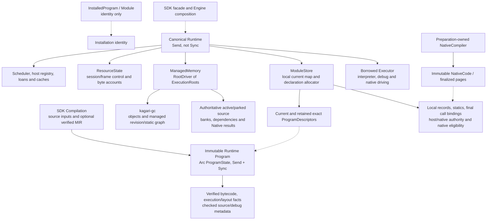
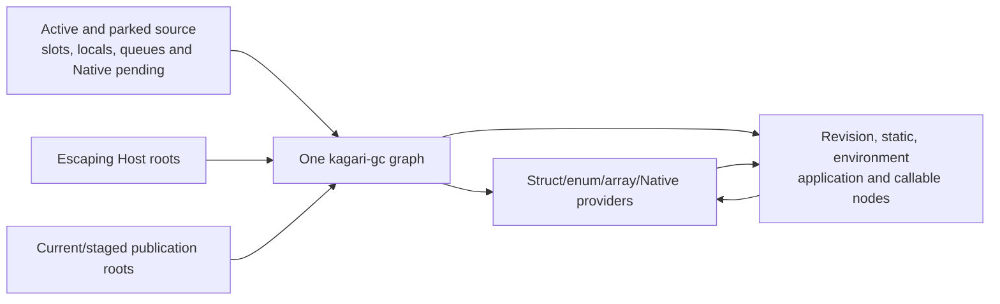
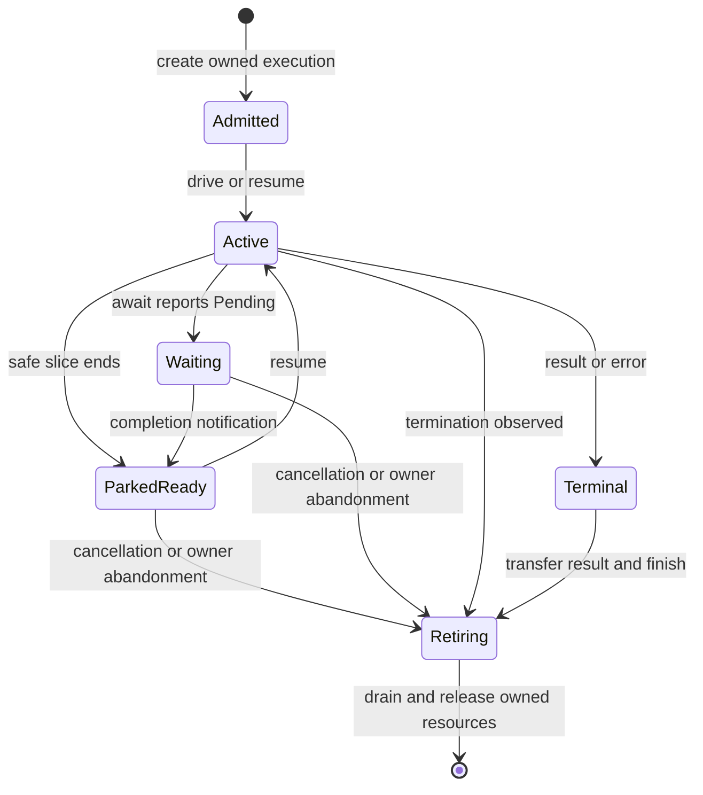

# Reading the Runtime Execution Model

This map describes the implemented exclusive Runtime, prepared calls and single
kagari-gc managed graph, including compact execution storage and scalar self-tail calls. The [architecture overview](../architecture.md),
[execution specification](../spec/execution.md) and
[activation specification](../spec/module-activation.md) own the contracts.
Read the [call walkthrough](runtime/calls.md) for entry/return costs and the
[reload walkthrough](runtime/reload.md) for preparation, publication and retention.
The [scalar execution guide](runtime/scalar-execution.md) maps the readable
instruction loop, explicit source generation and bounded structural exceptions.
Measurements and their limits belong in the [performance record](../performance-baseline.md).

Runtime/SDK construction installs no libraries. Hosts explicitly compose checked
Native providers. Fixed arrays, String/ranges, enum/async execution and generic
payload safety remain core; privileged collection storage/cursors/host adapters
are withdrawn pending [library reconstruction](../native-collections-plan.md).
The general public managed-payload contract is available; full-library acceptance
remains separate from Runtime integration.

## Physical ownership



Solid arrows show containment; dashed arrows show shared references, not script GC
reachability. `ModuleStore.current` is Runtime-local `RefCell` state. Installation
handles contain no current pointer or executable lease. Live queries borrow the
supplying Runtime; immutable source snapshots can be copied independently.
Publication requires `&mut Runtime`, and synchronous admission excludes publication,
close and conflicting loans during active execution. Scoped backend/NativeContext
views retain dynamic admission and borrow checks; they do not permit concurrent
heap access. Moving Runtime between host threads is an ownership transfer.

Execution, collection, binding preparation and scheduler mutation require the same
exclusive Runtime borrow. ExecutionSession/ExecutionStack and Host/Native service
scopes lend it for synchronous reentry, then retire their checked suffix/loan
marks on every exit. Active scopes stay on their admission thread; only an idle
Runtime may move between threads. Scheduler, Task/Group stores and binding caches
are ordinary Runtime fields. The observer's bounded mutable slot receives only
a read-only Runtime view, with recursive observation checked dynamically.

ResourceState owns control records and uncommon frame state separately from
ManagedMemory. ExecutionRoots owns the actual scalar/managed/local/queued/pending
banks and typed dependencies; the collector scans this source directly. All
reachability-bearing object, environment, application, revision and static state
uses ordinary managed nodes. Arc pins retain immutable Rust code/backing, while
source edges and genuine roots determine managed reachability.

Sources: [Runtime Program](../../crates/kagari-runtime/src/program.rs),
[SDK Compilation](../../crates/kagari/src/program.rs),
[SDK facade](../../crates/kagari/src/runtime.rs), [execution entry](../../crates/kagari-runtime/src/execution.rs),
[core Runtime](../../crates/kagari-runtime/src/lib.rs),
[ModuleStore](../../crates/kagari-runtime/src/module.rs),
[Installation](../../crates/kagari-runtime/src/module/installation.rs),
[ResourceState](../../crates/kagari-runtime/src/resource.rs).

## Single Runtime and preparation boundary

`kagari-runtime::Runtime` is the sole persistent execution owner. Its `execution`
modules own typed/scoped calls, owned driving, scheduler orchestration, reentry and
prepared-native invocation; `executor` is a private activation borrowing that Runtime.
`debug` and `debug_protocol` observe the same frames and sessions. Public installed
entrypoints admit context/root authority once; internal stack/session guards reuse
that root and preserve loans, cancellation, trace and cleanup. The existing scalar
kernels consume the same admitted scalar/managed banks. FrameStorage owns linear
source suffixes; VM-byte accounting and verified scalar self-tail replacement are
part of this execution model.

The `kagari` SDK exposes exact intentional facades: `runtime.rs` exports Runtime
and loading options, `context.rs` exports invocation policy, and `program.rs`
exports Program/preparation errors alongside SDK Compilation. SDK, CLI, web and
embedding examples consume the same types; none owns a second Runtime or uses a
backend/runtime accessor to reach one. These exact declarations are the narrow
re-export-whitelist exceptions. Compilation retains optional source/MIR inputs;
NativeCompiler prepares/cache-checks products outside Runtime. NativeCode::install
checks a recipient and transfers finalized pages/evidence, after which execution
needs neither compiler nor frontend. Programs are Send + Sync; Runtime is Send and
not Sync, transferable only between exclusive synchronous activations.

For `runtime.call(&add, (1, 2))`, bind_function first checks the exported signature.
Invocation snapshots the default context, admits host values into one
session and enters the borrowed executor.
Script calls continue through its prepared bindings and frame transitions; Native
callbacks/reentry preserve that same active root. The returned value leaves through
the canonical RuntimeError/result path, without SDK-to-VM-to-Runtime forwarding.
Checked-module entry remains a distinct capability for candidate initialization
and backend work; raw instruction-slot fixtures are test-only.

Ordinary inner calls select current implementations; created closures/Futures and
admitted work retain exact bodies/environments. Publication and retirement retain
their existing ownership checks. No cross-version lookup is added to new code.
An artifact host can use Runtime/Program directly; the SDK without source/native
features composes that same runtime with no compiler dependency. Runtime neither
depends on nor installs stdlib. ManagedMemory integrates kagari-gc without a
second collector, copied frame root packs or a separate metadata tracing graph.

Mechanism reference: Lua 5.4.9 keeps [API entry](https://github.com/lua/lua/blob/v5.4.9/lapi.c),
[execution state](https://github.com/lua/lua/blob/v5.4.9/lstate.h) and
[interpreter driving](https://github.com/lua/lua/blob/v5.4.9/lvm.c) under one runtime
owner. Kagari adopts cohesive state/activation ownership, preserving its own typed
contracts, precise roots, Rust cleanup and exclusive publication. This does not
establish that crate removal improves speed. The
[paired call measurements](../performance-baseline.md#runtime-consolidation-core-call-comparison-windows-2026-11-11)
record the observed costs and limits.

## Test ownership

Runtime has no standard-library dependency, including build/dev dependencies,
examples and unit tests. Its generic storage, frame, reload, borrowing and cleanup
witnesses author small application Native providers where necessary; Runtime tests
never compile standard-provider implementation sources. Raw private instruction
fixtures adopt identities into their receiving Runtime. External Program/artifact
consumers retain detached preparation and its separate identity scope.

Standard-provider source scenarios, Native/Serde consumer expansion, allocation
contracts, library measurements and the host-trait example belong to kagari-stdlib.
They use public Runtime entrypoints and ordinary provider installation. The
provider-independent core_calls measurement remains in Runtime. Generic bytecode
fixture builders/counters can be shared toward stdlib as test helpers; no reverse
source sharing, Runtime facade for standard modules or conditional production child
paths are required. Private assertions about the withdrawn standard bundle were
retired at the user's direction; library reconstruction must use public provider
behavior. These changes do not restore the queued NC collection functionality.

## Error reasons and diagnostic context

[RuntimeError](../../crates/kagari-runtime/src/error.rs) owns one typed
[ErrorReason](../../crates/kagari-runtime/src/error/reason.rs) and optional boxed
context. Its category and stable KG_* code are derived from the reason. There is
no independently assignable `(kind, message)` constructor or cached formatted
message. Display produces text when a diagnostic consumer requests it.

```rust
use kagari_runtime::error::{RuntimeError, context::ErrorLocation, reason::ErrorReason};
use kagari_types::scalar::error::ScalarError;

let error = RuntimeError::from(ScalarError::ShiftOutOfRange)
    .at(ErrorLocation::Field("count".into()));
assert_eq!(error.reason(), &ErrorReason::Scalar(ScalarError::ShiftOutOfRange));
assert_eq!(error.code(), "KG_RUNTIME_SCRIPT_TRAP");
assert_eq!(error.to_string(), "field count: integer shift out of range");
```

Numeric leaves, fixed Runtime traps, cancellation, stale handles, index failures
and quarantine invariants retain typed reasons. Existing loading/declaration/borrow/
resource diagnostics still carry owned details within their named families; their
finer owner-specific error migration is queued in the
[roadmap](../implementation-roadmap.md#runtime-execution-model-review).
HostError retains the current custom text/trace contract and implements Error;
Native/library providers can supply trap or index diagnostics through their explicit
provider variants. Runtime does not acquire Vec/String implementation policies.

Field, variant and element coordinates own their labels/data. Positions attach
from inner to outer and display in reverse order. Core builtin bridges append a
RuntimePrimitive coordinate to the original error. Reflective read/write wrapping
preserves the original RuntimeError as a typed source, including its positions and
execution provenance. Interpreter/builtin/backend boundaries preserve the canonical
RuntimeError reason, trace and task origin. There is no VmError or SDK execution-kind
translation. Compact internal operation failures remain local until their cold exit;
separate source/artifact/backend preparation errors stay with their preparation owner.

Trace capture stays at the failing program point, independently of eventual text
formatting. The first populated trace/task origin survives annotation and transport;
async provenance and bounded/incomplete trace rules are unchanged. Diagnostics own
no script values or program leases. Retained-task accounting includes owned reason
payloads, nested source errors, context boxes and position backing/labels; shared
trace metadata remains excluded. A context-free scalar failure allocates neither
a message nor a context box. Rich failure context is allocated on failure only.

A 2026-11-10 standalone layout probe used the same Windows i9-12900K machine and
rustc 1.99.1 toolchain recorded in the
[scalar guide](runtime/scalar-execution.md), default Runtime features, workspace dev
opt-level 1 library products, warm default target cache and default Cargo parallelism.
The probe itself used `rustc --edition 2024 -O` and size_of, with no timed workload.
The previous kind/String/trace/task-origin field model occupies 72 bytes under this
toolchain; ErrorReason is 40 bytes and RuntimeError is 48 bytes. Corresponding
Result<u64, E> shallow sizes are 72 and 48 bytes. The old value is a reconstruction
of the previous fields, not an old execution image. Rich context/source allocations
are additional owned storage and are counted separately; this is not a total error
memory or speedup claim. Rust layouts are not a stable ABI. Reproduce with size_of
for these types and the former field record; no ignored probe file is required.

## From a program product to execution

1. Source services check/lower a package, or artifact preparation independently
   verifies portable executable contracts. Optional retained source is diagnostic
   metadata; it does not replace verification or supply a compilation capsule.
2. Runtime `Program` shares immutable bytecode, checked call/layout facts, bounded
   historical demands, optional immutable checked source/debug metadata.
   Preparation has no Runtime, script effects or installed Rust captures.
3. Loading adopts declaration identities into the recipient scope without remapping
   a complete executable image. Runtime checks its own installed providers and builds
   local state, type admissions and final call bindings. Lazy statics stay lazy.
4. Publication commits current and prepared function links together. Host entry or
   resume admits authority; ordinary direct bytecode calls consume final entries.
5. Each Runtime retains independent heap, statics, providers, scheduler and native
   eligibility even when products, native pages or preparation inputs are shared.

Sources: [identity admission](../../crates/kagari-runtime/src/module/admission.rs),
[load/publication](../../crates/kagari-runtime/src/loading.rs),
[dispatch facts](../../crates/kagari-runtime/src/module/dispatch/facts.rs),
[linked execution](../../crates/kagari-runtime/src/module/linked_execution.rs).

## Core data structures

### Program product, installation and publication

```text
Program { state: Arc<ProgramState> }              Runtime immutable executable product
ProgramState {
    bytecode: VerifiedProgram,                    no owner back-reference
    history: Arc<RetainedDemands>,                metadata, not executable ancestry
    expected_base: Option<Weak<ProgramState>>,
}
Compilation {                                    SDK preparation, not an executable
    program: Program,
    compilation: optional Arc<CompilationInputs>,
    mir: optional Arc<VerifiedMirProgram>
}
InstalledProgram { installation: Arc<Installation> }
Module { installation: Arc<Installation>, namespace: ModuleIdentity }
Installation { registry_owner, id, root }         identity only
ModuleStore {
    current: RefCell<HashMap<InstallationId, CurrentPublication>>,
    next_declaration: Cell<u64>,
    inner: RefCell<ModuleStoreInner>, ...
}
CurrentPublication { program: Arc<ProgramDescriptor>, root: Root<InstallationState> }
ExecutableModule { program: Arc<ProgramDescriptor>, slot: ModuleRef }
ProgramDescriptor {
    code: VerifiedProgram,                       typed executable product association, no SDK downcast
    definitions: Arc<DefinitionAdmission>,
    dispatch: Arc<PublicationDispatch>,
    retained_demands, layouts, layout_admissions, source,
    installation, root, modules, ...
}
PreparedSelection { owner: ModuleKey, target, mapping: Arc<PublicationMapping> }
```

These sketches omit fields and are not binary layout promises. `ExecutableModule`
retains an exact descriptor; physical registration, owner/generation and installation
liveness still govern execution. A surviving descriptor cannot revive a closed
Runtime. `Runtime::program(&InstalledProgram)` clones its exact canonical product.
Staging bare VerifiedProgram backing adopts the already checked history once and
saves that owner, so repeated queries preserve identity and exact-base replacement.
It never fabricates Compilation inputs or an SDK preparation owner.

Product DefinitionIds remain lexical. `DefinitionAdmission` supplies checked
product/local correspondence; closed Runtime types and lexical binders keep explicit
provenance. Shared pure dispatch/layout facts grant no recipient provider authority.
Operation requirements and associated-output lookup compare admitted Runtime keys;
their lexical witnesses and supplying type environments remain separate. Native
selected calls retain their prepared scoped signatures, including native types
without script nominal origins. Enum value equality and hashing normalize the same
nominal arguments and variant IDs; payload/layout admission still checks provenance.
Local call entries contain generational keys and metadata, not strong predecessor
code references. The weak route registry lets saved host bindings follow current
implementations without retaining obsolete executable bodies. Expired identities are
pruned at the next publication; their metadata can remain until then, but current
Direct calls never consult this registry.

### Cache ownership

| Owner | Validity and lifetime |
| --- | --- |
| VerifiedProgram | Shared pure execution/layout/dispatch facts and successful initial historical demands, exact immutable product lifetime; cancellation does not poison preparation |
| Module records | Local linked calls, applied function/environment views, layouts and installed Native bindings; prepared/replaced with publication and traced with their actual owners |
| Native dependency validation | Temporary exact immutable required-catalog map identities, one callback-free link/revalidation pass against one product/recipient; registry owns keyed Arcs and each pass starts empty |
| NativeCompiler | At most 4096 exact revision/function/configuration/runtime-ABI/helper-ABI decisions; no Runtime access or execution-time cache lookup |
| NativeCode and installed entries | Immutable finalized page owners; each recipient checks exact revision and local policy/authority before installation |

A successful publication does not mean all old payload is immediately collectible.
Whole versions remain for actual closures, Futures, frames, queues, roots and type/
layout provenance. The unresolved [R13 finding](../review.md#r13--type-and-layout-provenance-retains-retired-code)
can retain an initial whole Program for inherited statics/types. There is no strong
executable predecessor chain, per-body unloading guarantee or Future-only lifetime.

### Session, active scope, frame and source storage

These sketches identify owners and omit implementation fields:

```text
Runtime {
    memory: ManagedMemory { driver: RootDriver<ExecutionRoots>, policy },
    resources: ResourceState { sessions, uncommon_frames, limits, control },
    modules, host, native_entries, host_borrows, scheduler, ...
}
SessionStore {
    records: RefCell<SessionState slots>,
    frames: RefCell<Vec<Vec<ExecutionFrame>>>,
    retirement_notice: Arc<AtomicBool>,
}
SessionState { id, root, body: DependencyId<RevisionState>, space, options, ... }
ExecutionStack<'runtime> { session: ExecutionSession<'runtime>, stack: Option<FrameStack> }
FrameStack { session: SessionId, base, id, parked, thread_affinity }
ExecutionFrame {
    loaded, target, links, admitted_environment,
    ip, executing, completed, native_entry, tail_elided,
    storage: Option<FrameStorage>, return_to, uncommon: Option<UncommonId>, ...
}
FrameStorage { mark: FrameMark, body: DependencyId<RevisionState> }
FrameSlots { banks: FrameBanks, body: DependencyId<RevisionState> }
ExecutionRoots { owner, generational entries, reusable: ExecutionStorage }
ExecutionStorage {
    space,
    banks: [Managed, Local, Queued, Pending], // Vec<StoredValue>
    scalars: Vec<u64>, initialized: Vec<bool>,
    native_calls, dependencies: Vec<Edge<AnyObject>>, returns, queue, ...
}
```

The persistent session owns scheduling/control and the selected executable origin.
ExecutionSession/ExecutionStack exclusively activate it; FrameStack names the suffix
that this scope must unwind. Nested synchronous reentry shares the execution and
owns only its new suffix. Independent owned executions have separate identities,
frames, cancellation, accounts and retained data, including while parked.

FrameMark is linear retirement ownership; FrameSlots is a non-owning coordinate,
never a pointer into Vec backing. There is no duplicate Window directory or
per-frame generation. FrameLayout maps logical slots to scalar/managed locations.
Complete execution owner/index/generation admission precedes access. Retirement
clears outgoing edges before backing reuse; at most the most recent retired
source is retained as inaccessible, edge-free reusable capacity.

The byte account charges committed frame/source/control capacity including
reservations. The default max_stack_bytes is 8 MiB per execution. It does not
measure managed heap, fixed directories, code, allocator internals or OS stack.
Native depth defaults to 32 with additional OS-stack protection on supported
hosts. Logical depth is diagnostic, with no script-call count quota.

ExecutionState phase is Ready/Closed/Committing/Collecting/Quarantined. NativeEntryState
is separately Script/Pending/Running/Complete; task state and execution-owner
readiness describe scheduling. These are distinct responsibilities.

Sources: [sessions](../../crates/kagari-runtime/src/session.rs),
[control store](../../crates/kagari-runtime/src/session/store.rs),
[frames](../../crates/kagari-runtime/src/frame.rs),
[frame storage](../../crates/kagari-runtime/src/frame/values.rs),
[source](../../crates/kagari-runtime/src/execution/roots.rs),
[byte accounting](../../crates/kagari-runtime/src/execution/space.rs).

## Values and roots

Three carriers express different lifetimes:

| Carrier | Authority and lifetime |
| --- | --- |
| ScopedValue<'gc> | Same-scope Gc access or inline bits; cannot escape the paired memory/source scope |
| StoredValue | Private traced Edge or inline bits in actual managed/execution storage; copying requires publication through its owner |
| RootedValue | Genuine Root retention for a Host lifetime across collecting operations; scalar values stay inline |
| ValueView<'view> | Public pointer-free protected location/root view; access uses mutable Runtime/NativeCall and validates its supplying source |

Managed tags alone do not establish a script nominal type. The collector admits
physical references; Runtime checks nominal/layout/application provenance and
Host capabilities. Eight-byte scalar banks and initialization flags remain
separate from StoredValue banks. Option/Result still use managed enum objects;
[enum layout changes](../enum-layout-design.md) remain deferred.



There is no old object/metadata-store joint marker, persistent root per variable or
mirrored frame RootSet. Providers trace actual private managed fields; managed
metadata traces actual captures, receivers, statics and selected executable state.
A rootless object/callback/revision/static cycle is collectible. Immutable code in
Arc is backing, not a tracing substitute. R13 type/layout provenance can still
retain whole code and remains an explicitly separate finding.

Publication precedes retirement of old protection. Internal returns use a closed
handoff and activation-owned result cells; escaping results acquire a genuine
Host root before activation cleanup. A temporary unrooted Rust value grants no
retention. Source/payload loans end before arbitrary Native callbacks, collection,
observation and synchronous reentry, then are reacquired afterward.

Rust Host state remains outside the script heap behind installed interfaces,
typed paths and scoped borrow authority. Registered Native payloads have ordinary
managed-field and fixed-data providers; read/edit loans do not transfer payload
ownership out of Runtime. There is no Native payload extraction/taken state.

Sources: [carriers](../../crates/kagari-runtime/src/value/carriers.rs),
[protected views](../../crates/kagari-runtime/src/value/view.rs),
[memory integration](../../crates/kagari-runtime/src/execution/memory.rs),
[Native storage](../../crates/kagari-runtime/src/native/storage.rs),
[GC guide](../../crates/kagari-gc/README.md),
[Host boundary](../spec/host-interop.md).

## Execution lifetime

The following states are explanatory lifecycle labels, not a proposed Rust enum.



| Boundary | Concrete work and retained state |
| --- | --- |
| Enter/resume | CHECK idle driver, runtime/owner identity and no conflicting native loan; enter SynchronousActivation; select the active session and restore depth |
| Drive | VM polls termination, dispatches Script/Await/NativeEntry/NativeReturn actions, invokes safepoints/observers and executes a closed region |
| Park | CHECK owned root, no conflicting scopes/initializers/mutations or Running Native frame, and storable retained values; keep frames and actual source banks, end the active scope |
| Wait | Session PendingWait owns the native/Task/group wait, destination, output type and awaitable root; it is not a saved Rust stack frame |
| Wake | ExecutionOwner readiness/cancellation atomics and Waker notify the driver; the notifying thread does not enter Runtime |
| Return | Adapt while dependencies remain protected; retire/publish within a closed transition; root an escaping result through the driver/SDK |
| Error | Preserve trace/termination and completed effects; unwind the active scope's frame suffix and release its source/control marks |
| Abandon owned handle | Drop requests retirement; the Runtime driver later drains it. Drop is not immediate arbitrary-thread heap destruction |
| Close/drop Runtime | Revoke live installation authority, close task/scheduler ownership and drain resources; surviving descriptors/handles do not grant post-close execution |

Synchronous Native callbacks cannot park arbitrary Rust locals. Parking is denied
while a Native frame is Running. Async Native providers instead retain explicit
Future/wait state. Publication also counts callbacks/reentry/cleanup as active
even when an active-session pointer is temporarily hidden.

The VM driver carries established actions directly across internal calls/returns;
it does not necessarily perform a fresh general action lookup at every frame
transition. Closed scalar regions reuse admitted bank borrows and release them
before allocating preparation or callbacks. This is existing optimization to
preserve, not another universal entry check to introduce.

Sources: [VM driver](../../crates/kagari-runtime/src/executor/driver.rs),
[runtime actions](../../crates/kagari-runtime/src/frame/driver.rs),
[closed regions](../../crates/kagari-runtime/src/frame/cursor.rs),
[parking](../../crates/kagari-runtime/src/frame/owned.rs),
[waits](../../crates/kagari-runtime/src/frame/waiting.rs),
[owned execution](../../crates/kagari-runtime/src/session/owned.rs),
[close](../../crates/kagari-runtime/src/scheduler/lifecycle.rs),
[Runtime drop](../../crates/kagari-runtime/src/task/cleanup.rs).

## Remaining review scope

Source initialization, value transfer, interface computation metadata, actual
Native conversion and collection retain measured execution costs. Their owners
and follow-up scope are in the [roadmap](../implementation-roadmap.md#runtime-execution-model-review).
Local call/root gates and allocator-event peak checks pass; exhaustive CI and
NC-dependent integrated workloads remain explicit. General tails, collector
optimization, enum layouts, backend deoptimization and R13 retain separate owners.
