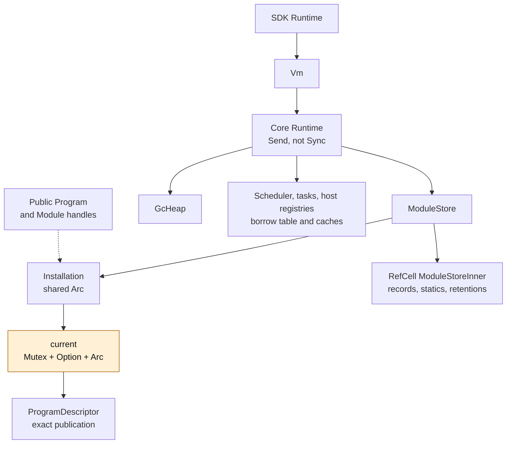
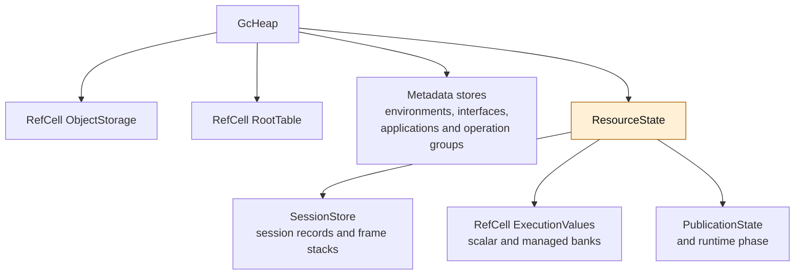
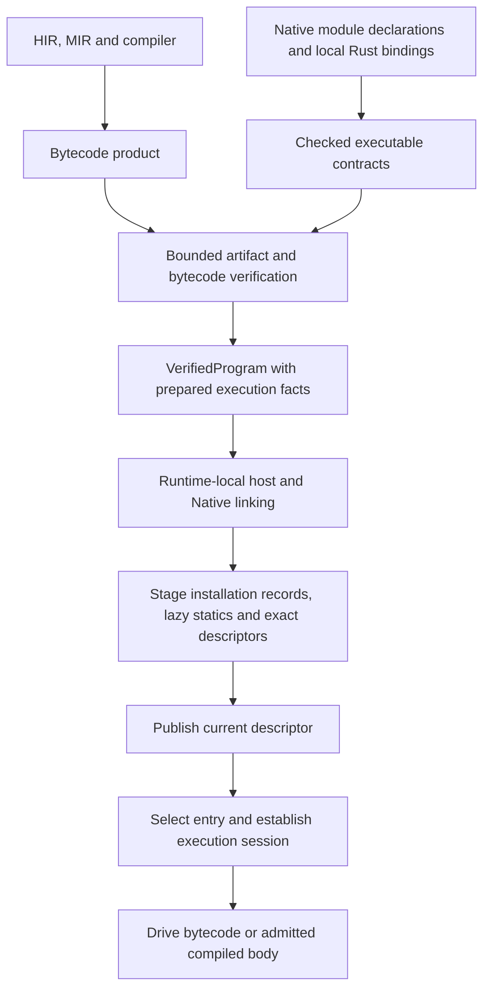
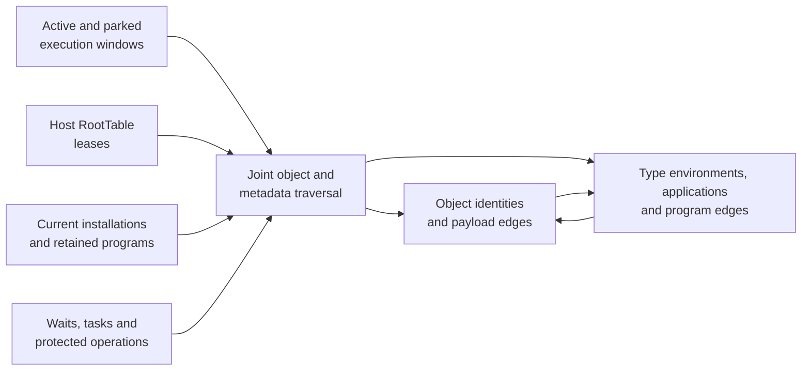
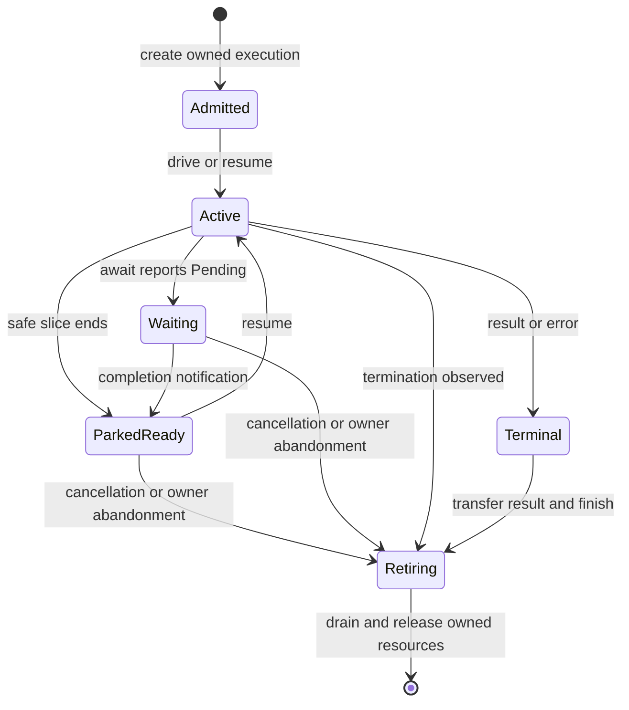

# Reading the Runtime Execution Model

This is an implementation map of `48d79b2a`, reviewed on 2026-11-08. It describes
the code that exists, including locks, interior mutation and collection-specific
paths. It is not the proposed replacement architecture. The
[architecture overview](../architecture.md), [execution specification](../spec/execution.md)
and [activation specification](../spec/module-activation.md) remain the contract owners.
The [Runtime refactor design](../runtime-refactor-design.md) records the target
architecture separately, starting with hot reload.

Read a complete operation without opening Rust source:

| Question | Start here |
| --- | --- |
| What owns execution, objects and program versions? | [Physical ownership](#physical-ownership), then [data structures](#core-data-structures) |
| What happens for one bytecode Call, including repeated locks? | [Call walkthrough](runtime/calls.md) |
| How is a new program prepared and published? What happens to old frames? | [Reload walkthrough](runtime/reload.md) |
| Where are values stored, and what keeps them alive? | [Values and roots](#values-and-roots) |
| What survives suspension or an error? | [Execution lifetime](#execution-lifetime) |
| Which existing choices conflict with the requested direction? | [Review findings](#review-findings) |

## Reading conventions and scope

Diagrams show actual owners and transitions, rather than source-directory names.
Structure sketches retain relevant field names/types but omit unrelated fields;
they are not complete Rust declarations or binary layout promises.

| Marker | Meaning |
| --- | --- |
| `LOCK` | Acquire/release a Mutex; distinguish it from an exclusive Rust borrow |
| `BORROW` | Dynamically acquire a RefCell-backed view; this is not a thread lock |
| `LOOKUP` | Resolve an ID, route, contract or cache entry |
| `CHECK` | Validate a value, owner, generation, type, phase or operation authority |
| `RESERVE` | Check/grow Rust backing capacity; warmed spare capacity may avoid allocator calls |
| `INIT` / `COPY` | Initialize storage or transfer already represented data |
| `ROOT` | Publish protection or traced dependencies; an Arc clone alone is not a script GC root |
| `CALLBACK` | Invoke Rust/script user code; temporary conflicting borrows must have ended |
| `COMMIT` | Publish a prepared state change; preserve its completed effects on later failure |

A source-visible check or lock is concrete work, not a measured percentage of
elapsed time. Branch-specific counts are bounded to the scenario stated beside
the diagram. Timing assertions belong to the [performance record](../performance-baseline.md),
not to the number of diagram boxes. The latest full Lua comparison there measures
`19aa9570`, not this implementation-map revision.

The requested direction for the next design is: an immutable compiled Program,
exclusive Runtime access for driving/updating, Send for host thread migration,
and independent stdlib providers. Shared versus exclusive code ownership is a
storage choice whose benefit must be measured. Cross-thread live metadata queries
are not a requirement of that direction. Existing public contracts described
below have not yet been replaced.

## Physical ownership

Solid arrows show primary containment. Dashed arrows show references/shared
handles, which can include strong Arc ownership; they do not imply GC reachability.



Expand GcHeap to see the actual execution-state containment:



Two facts are intentionally visible rather than corrected in the drawing:

1. Execution records and value banks are physically below GcHeap, through
   ResourceState. A logical sketch placing execution beside the heap would hide
   this current ownership choice.
2. Runtime is exclusively driven, but public live Program/Module metadata handles
   share an Installation whose current publication is Mutex-protected.

The core Runtime stores services and registries; `kagari-vm` drives interpreter
transitions. The SDK Runtime wraps Vm and adds host-facing preparation/call
orchestration. These are different Rust types with the same short name, not three
independent script heaps. Native compiled execution uses the shared runtime/ABI
bridge; it is not the same thing as a Rust Native callback.

Sources: [SDK Runtime](../../crates/kagari/src/runtime.rs),
[Vm](../../crates/kagari-vm/src/vm.rs),
[core Runtime](../../crates/kagari-runtime/src/lib.rs),
[GcHeap](../../crates/kagari-runtime/src/gc.rs),
[ResourceState](../../crates/kagari-runtime/src/resource.rs).

## From a program product to execution



Declarations can be consumed before execution; local Rust closures are attached
implementations, not serialized executable contracts. Runtime links verified
bytecode/contracts without source analysis. Optional machine-code preparation
consumes verified MIR/native input separately, and execution uses the native ABI
bridge. Refactoring internal frames need not change compiler output; changing
that ABI or portable contracts has cross-layer consumers.

Initial load reserves a fresh installation, stages linked records, then publishes
from an empty current cell. Each independent load gets its own runtime state even
for shared prepared code. Reload instead stages against an existing installation
and must preserve its current/static contracts. Neither load forces lazy statics.
The [reload walkthrough](runtime/reload.md) expands the latter transition.

Source: [verification/preparation](../../crates/kagari-runtime/src/module.rs),
[loading/linking/publication](../../crates/kagari-runtime/src/loading.rs).

## Core data structures

### Program product, installation and publication

The current type named Program is a live installation handle, not simply a
compiled bytecode package. The requested replacement terminology must account
for this difference explicitly.

```text
PreparedProgram {                         // Preparation-side SDK owner; !Send/!Sync.
    state: Rc<ProgramState>
}
ProgramState {
    bytecode: VerifiedProgram,
    compilation: optional retained inputs,
    mir: optional verified native input,
    native: RefCell<compiled-product cache>
}
VerifiedProgram {                         // Immutable, verified executable product.
    modules: Arc<[Arc<BytecodeModule>]>,
    execution: Arc<[ExecutionModule]>,
    definitions, update evidence, exports, dependencies, ...
}

Program { installation: Arc<Installation> }
Module  { installation: Arc<Installation>, namespace: ModuleIdentity }
Installation {
    registry_owner: HostRegistryId,
    id: InstallationId,
    current: Mutex<Option<Arc<ProgramDescriptor>>>,
    next_declaration: AtomicU64,
    ...
}
ExecutableModule { program: Arc<ProgramDescriptor>, slot: ModuleRef }
ProgramDescriptor {
    installation: InstallationId,
    code: VerifiedProgram,
    dispatch: Arc<PublicationDispatch>,
    retained_demands, layouts, layout_admissions,
    root: ModuleRef,
    modules: Vec<LinkedModule>, ...
}
```

VerifiedProgram includes prepared interpreter descriptions as well as portable
bytecode. It does not own an installation's mutable statics or player heap.
PreparedProgram additionally retains source/native preparation facilities; the
loaded Runtime does not retain that Rc-backed SDK owner.

Program and Module follow the installation's current publication. ExecutableModule
identifies one exact publication/member. Its Arc keeps the descriptor available,
but runtime registration, liveness and explicit retention still govern execution
authority and runtime state. A descriptor surviving shutdown cannot revive them.
Installation.current is None before initial publication and after retirement;
the installation identity can outlive its executable authority.

Runtime-local ModuleRecord entries hold static-cell bindings, constants, native
bindings, linked execution and descriptor/layout caches. ModuleStoreInner holds
the records and static cells separately from the immutable descriptor. Replacing
current therefore does not mean replacing or zeroing all mutable state.

Sources: [prepared products](../../crates/kagari/src/program.rs),
[module data](../../crates/kagari-runtime/src/module.rs),
[runtime-local records](../../crates/kagari-runtime/src/module/records.rs).

### Session, active scope, frame and value window

```text
SessionStore {
    records: RefCell<generational SessionState slots>,
    frames: RefCell<Vec<Vec<ExecutionFrame>>>, ...
}
SessionState {
    id: SessionId,
    root: ExecutableModule,
    options: ExecutionOptions,
    owner: RefCell<Option<Arc<ExecutionOwner>>>,
    pending: RefCell<Option<PendingWait>>,
    queued_future, queued_factory,
    host_scopes, frame_scopes, termination, ...
}
ExecutionSession<'runtime> {
    id: SessionId,
    resources: &'runtime ResourceState,
    _activation: SynchronousActivation<'runtime>
}
ExecutionStack<'runtime> {
    session: ExecutionSession<'runtime>,
    base: usize, id: u64, parked: bool
}
ExecutionFrame {
    loaded: ExecutableModule,
    target: CallableTarget,
    environment: Option<TypeEnvironment>,
    links: Option<Arc<LinkedFunction>>,
    native_entry: NativeEntryState,
    ip, executing, completed,
    slots: FrameSlots,
    slot_layout: Option<Arc<FrameLayout>>,
    return_to: ReturnDestination,
    invocation, mutations, initializer, ...
}
FrameSlots { owner: u64, index: usize, generation: u64 }
ExecutionValues {
    payloads: Vec<u64>,
    initialized: Vec<bool>,
    values: Vec<Value>,
    windows, allocation_order, ...
}
Window {
    generation, ranges,
    program: ExecutableModule,
    environment, invocation, native_application,
    slot_layout, ...
}
```

The persistent session record owns the computation's state; ExecutionSession and
ExecutionStack are active scoped access to it. Stack `base` identifies the suffix
that this scope must unwind. An ordinary synchronous nested call adds a frame to
the existing execution; synchronous host reentry shares that execution where
admitted. An owned asynchronous execution can keep its frames after the active
scope ends. Spawned Tasks have their own scheduling/ownership relationships.

FrameSlots is a checked locator, not a pointer into Vec backing. FrameLayout maps
logical slots to physical scalar/managed locations, including scalar slot reuse.
Window records carry dependencies alongside protected values. Frame and window
metadata both retain relevant owners; these shared references and publication
steps must remain visible when reviewing per-call costs.

Do not read ExecutionState as a per-task Running/Waiting enum. Its actual phase
is Ready/Closed/Committing/Collecting/Quarantined. NativeEntryState is separately
Script/Pending/Running/Complete, while TaskState and execution-owner readiness
describe scheduling. Current execution status is distributed across these owners.

Sources: [sessions](../../crates/kagari-runtime/src/session.rs),
[session storage](../../crates/kagari-runtime/src/session/store.rs),
[frames/scopes](../../crates/kagari-runtime/src/frame.rs),
[value windows](../../crates/kagari-runtime/src/frame/values.rs),
[physical layouts](../../crates/kagari-runtime/src/module/execution/layout.rs),
[runtime phase](../../crates/kagari-runtime/src/execution_state.rs).

## Values and roots

Value, storage location and object identity are separate concepts:

```text
Value::I32(7)             scalar transport value
FrameSlots + Location    where a logical frame value is currently stored
HeapObjectId             owner + slot + generation of a shared heap object
RootedValue              lease on a runtime-owned root-table entry
```

Current Value is a Copy tagged transport. Scalars can stay as bits in the scalar
bank; managed locations use Value records. Struct, enum, string and other managed
variants refer to heap identities. Option/Result enums still use heap objects;
the deferred enum-layout model has not changed production storage.

Copying Value does not copy its object graph or register a root. Arc cloning
similarly concerns Rust ownership and does not, by itself, publish a script root.



The root graph can cross object/program/metadata stores. The current collector
marks the joint graph before detaching unreachable storage; it does not scan
arbitrary Rust locals. NativePayload tracing reports internal edges, while public
Object/ScriptValue handles establish explicit retention. One external root per
collection element is not the native collection ownership model.

An ordinary return can retire the callee window before writing the caller only
inside a closed, non-collecting transition. A root return must be protected by its
caller/driver before any later collecting operation. These ordering guarantees,
not a temporary Rust Value local, prevent a retention gap.

ObjectStorage uses checked directory identities and concrete payload stores.
Mutable Rust host state stays outside the script heap and is accessed through
installed host scopes; registered Native payloads have a separate traced-object
contract. Temporary payload loans prohibit conflicting execution/collection.

Sources: [Value](../../crates/kagari-runtime/src/value.rs),
[roots](../../crates/kagari-runtime/src/gc/roots.rs),
[collection](../../crates/kagari-runtime/src/gc/collection.rs),
[native storage](../../crates/kagari-runtime/src/native/storage.rs),
[host ownership](../runtime-ownership-and-host-api-design.md#gc-boundaries-and-extension).

## Execution lifetime

The following states are explanatory lifecycle labels, not a proposed Rust enum.



| Boundary | Concrete work and retained state |
| --- | --- |
| Enter/resume | CHECK idle driver, runtime/owner identity and no conflicting native loan; enter SynchronousActivation; select the active session and restore depth |
| Drive | VM polls termination, dispatches Script/Await/NativeEntry/NativeReturn actions, invokes safepoints/observers and executes a closed region |
| Park | CHECK owned root, no conflicting scopes/initializers/mutations or Running Native frame, and storable retained values; keep frames/windows, end the active scope |
| Wait | Session PendingWait owns the native/Task/group wait, destination, output type and awaitable root; it is not a saved Rust stack frame |
| Wake | ExecutionOwner readiness/cancellation atomics and Waker notify the driver; the notifying thread does not enter Runtime |
| Return | Adapt while dependencies remain protected; retire/publish within a closed transition; root an escaping result through the driver/SDK |
| Error | Preserve trace/termination and completed effects; unwind the active scope's frame suffix and release its windows/guards |
| Abandon owned handle | Drop requests retirement; the Runtime driver later drains it. Drop is not immediate arbitrary-thread heap destruction |
| Close/drop Runtime | Revoke live installation authority, close task/scheduler ownership and drain resources; surviving descriptors/handles do not grant post-close execution |

Synchronous Native callbacks cannot park arbitrary Rust locals. Parking is denied
while a Native frame is Running. Async Native providers instead retain explicit
Future/wait state. Publication also counts callbacks/reentry/cleanup as active
even when an active-session pointer is temporarily hidden.

The VM driver carries established actions directly across internal calls/returns;
it does not necessarily perform a fresh general action lookup at every frame
transition. Closed scalar regions reuse admitted bank borrows and release them
before allocating preparation or callbacks. This is existing optimization to
preserve, not another universal entry check to introduce.

Sources: [VM driver](../../crates/kagari-vm/src/executor/driver.rs),
[runtime actions](../../crates/kagari-runtime/src/frame/driver.rs),
[closed regions](../../crates/kagari-runtime/src/frame/cursor.rs),
[parking](../../crates/kagari-runtime/src/frame/owned.rs),
[waits](../../crates/kagari-runtime/src/frame/waiting.rs),
[owned execution](../../crates/kagari-runtime/src/session/owned.rs),
[close](../../crates/kagari-runtime/src/scheduler/lifecycle.rs),
[Runtime drop](../../crates/kagari-runtime/src/task/cleanup.rs).

## Review findings

These are source-backed review points, not proof that each cost dominates timing.
They do not authorize removing validation or implementing a replacement API.

| Finding | Visible mechanism | Question for the replacement design |
| --- | --- | --- |
| R1: shared live metadata reaches execution | Installation.current is a Mutex-backed Arc cell; ordinary Call selection and liveness validation read it repeatedly | Can runtime-owned current selection use exclusive activation authority, with cross-thread metadata limited to explicit snapshots/identity? |
| R2: execution is below the heap | GcHeap owns ResourceState, which owns sessions and operand banks | Should execution and object storage be peer owners, with the collector consuming explicit root views? |
| R3: short method computations enter GC metadata storage | MethodInvocation::admit allocates MethodComputation for a newly admitted selection | Which selected facts can a frame own directly, and which actually escape into persistent computations? |
| R4: multiple layers reacquire call facts | Selection, metadata admission, argument transfer, typed conversion and return handling have distinct validation/ownership steps | For each fact, identify its producer, validity interval and invalidating events; preserve checks at real external/resume/mutation boundaries |
| R5: library operations retain engine authority | Vec primitive variants, Sequence/Map/Set codecs and concrete heap payload operations remain | Can stdlib and independent providers use one general protocol with efficient admitted calls and storage access? |
| R6: unified selection has a heavy physical path | prepare_calls rewrites Native imports to general Call and clears native_calls | How can current-provider selection coexist with lightweight logical argument/result windows? |
| R7: Program means different things at different layers | PreparedProgram, VerifiedProgram, live Program and exact ExecutableModule have different lifetimes | Make immutable product, installation state and selected computation distinct before renaming types |

The [call walkthrough](runtime/calls.md) and [reload walkthrough](runtime/reload.md)
connect these findings to full operations. The [roadmap review entry](../implementation-roadmap.md#runtime-execution-model-review)
owns follow-up scope. MIR/compiler reorganization, enum layout, collector
replacement and shared-program implementation are not activated by this map.

This document should change with the execution owners: update a structure and
its operation walkthrough together. Keep semantic requirements, current work,
conditional branches and proposed changes distinguishable. Source links are
audit anchors; understanding the sequence should not require following them.
