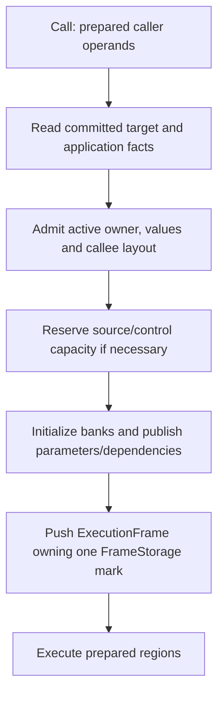
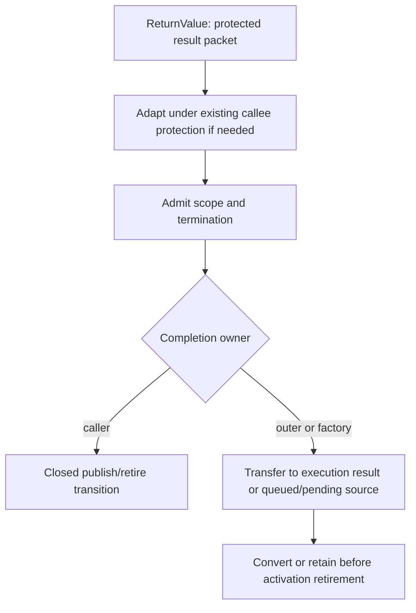

# One Call through the Runtime

Start with the [Runtime model](../runtime.md). For `state = step(state)`, a verified
call consumes prepared target/slot facts. Runtime owns control; its one
`ManagedMemory` owns `RootDriver<ExecutionRoots>`, including all active and parked
managed operands. The [execution contract](../../spec/execution.md) owns observable
polling, traps, stack limits and scalar self-tail behavior.

## Prepared facts and the actual entry path

```text
PreparedCall { pc, target, arguments: Box<[Location]>, destination }
LinkedCall::Direct(BoundRoute)
BoundRoute { route: CallRoute, selected: Arc<PreparedSelection> }
PreparedSelection { owner: ModuleKey, target: CallableTarget, mapping }
```

The immutable Program supplies verified instructions, layouts and locations.
Installation prepares recipient authority, exact targets and Native bindings.
Ordinary Direct execution reads its committed selection without public lookup,
a correspondence solver or a version-chain traversal. Publication is excluded
throughout synchronous activation. Actual owner/generation, phase, operands,
loans, capacity and cancellation checks remain dynamic at their owning boundary.

For `runtime.call(&add, (1, 2))`, binding first checks the Rust signature.
Invocation selects the current route, establishes one exclusive execution session
and converts actual arguments into its authoritative source. `PreparedHostCall`
retains its exact prepared body/mapping; callers cannot replace that mapping at
execution. Fixed mappings are prepared once per closed binding/application, while
custom conversion effects and actual supplied-value checks still run. Escaping
results use genuine Host roots; scalar roots remain inline.

Sources: [Host execution](../../../crates/kagari-runtime/src/execution.rs),
[prepared Host calls](../../../crates/kagari-runtime/src/native/function_handle.rs),
[prepared calls](../../../crates/kagari-runtime/src/module/execution/calls.rs),
[final bindings](../../../crates/kagari-runtime/src/module/linked_execution/calls.rs).

## Selection and frame entry



`FrameStorage` owns a linear `FrameMark`; borrowed `FrameSlots` derives checked
bank coordinates from it. There is no independent Window registry or per-frame
generation. Complete execution IDs check owner, index and generation. Source
backing may grow without invalidating coordinates. One most-recent retired
execution may donate cleared, edge-free backing to a new identity.

`ExecutionFrame` retains immutable body/layout/link facts and hot control. Managed
environments and executable dependencies are actual source edges. Optional
initializer/mutation/method state lives in the Runtime-owned uncommon-frame pool;
its linear lease retires with the frame. Arc code pins preserve Rust backing but
are not substitutes for managed reachability.

Internal eligible scalar leaf calls and returns can remain in the same paired
access interval. They still create actual frames, initialize source storage,
transfer arguments and publish returns; public/manual entry checks independently.
Prepared facts do not permit a borrow across callbacks, GC or observation.

## Work performed at each boundary

| Stage | Work and owner | Allocation/root implications |
| --- | --- | --- |
| Select | Committed target plus checked installation/application authority | Immutable descriptors may be pinned; ordinary Direct calls do not rebuild mappings |
| Admit | Check actual values, initializer/suspension policy, candidate ownership and layout | All checks precede publication; no source analysis occurs |
| Reserve | ExecutionSpace admits fallible frame/source/control capacity growth | Warm capacity avoids allocator requests; committed capacity still counts |
| Transfer | Initialize scalar bits/flags and managed Unit cells; publish parameters and exact dependencies | Incoming edges publish before source protection ends; no copied per-frame RootSet |
| Execute | Prepared regions borrow admitted banks and GC scope | End physical loans before callback, observation, collection or reentry |
| Return | Adapt while callee dependencies remain live, then publish and retire in a closed handoff | Internal results stay source-protected; only escaping results need Host retention |

The byte account covers committed per-execution frame, source and associated
control capacity, including reservations. The default is 8 MiB; `StackOverflow`
and fallible allocation failure are distinct. It excludes managed payloads,
immutable code, fixed Runtime directories, allocator internals and OS stack.
Logical call depth remains diagnostic, with no per-script-call depth quota.
Native/compiled entries separately guard nested Rust/OS stack use.

Sources: [frame admission](../../../crates/kagari-runtime/src/frame/admission.rs),
[source-backed frame storage](../../../crates/kagari-runtime/src/frame/values.rs),
[execution space](../../../crates/kagari-runtime/src/execution/space.rs).

## Return and error paths



Return packets name protected source state or an authenticated existing Host root,
not an unrooted managed pointer. Adaptation may allocate while original values
and dependencies remain protected. No callback/collection observes a gap between
source retirement and destination publication. Static initializers and Future
factories have explicit completion owners.

Before frame publication, failures release preparation marks and restore entered
control. Later traps preserve completed mutations and the original error/trace
precedence. Activation Drop retires only its admitted frame/source suffix, including
uncommon leases and Native scratch, on success, error, cancellation or unwind.
Quarantine revokes further execution after an internal/provider invariant failure;
cleanup still drains independent roots and detached owners.

Sources: [returns](../../../crates/kagari-runtime/src/frame/returns.rs),
[result packets](../../../crates/kagari-runtime/src/frame/transfer.rs),
[activation cleanup](../../../crates/kagari-runtime/src/frame/activation.rs).

## Native call: prepared slots and mutable services

All Rust callbacks use `NativeCall` and one prepared binding protocol. Ordinary
synchronous Native-import calls borrow caller operands and use a logical
`NativeActivation`; they require no physical callee script frame. Explicit Native
entry/observer/driver routes may still need Pending/Running/Complete frame state.
These routes share invocation, post-call checks, result placement and cleanup.

```text
NativeCall<'call> {
    runtime: &'call mut Runtime,
    owner: &'call ExecutableModule,
    function: &'call LinkedNativeFunction,
    arguments: ArgumentValues<'call>,
    pending: ReturnSource<'call>,
    locals: Option<LocalMark>,
    native_stack: Option<NativeStackMark>,
    invoke_script: ScriptInvoker,
}
PendingReturn {
    native: Option<NativeSourceMark>,
    body: DependencyId<RevisionState>,
    application: Option<DependencyId<ApplicationObject>>,
    staged: Unset | Scalar { representation, bits } | Source,
    invoked: bool,
}
```

`ArgumentValues` borrows prepared locations, a contiguous admitted range or sealed
scalar bits. Typed monomorphized adapters decode this same pack rather than copying
and rooting it again. Formal shared narrowing uses scoped protected aliases when
required. Actual nominal/borrow/domain checks remain; fixed Rust mappings do not
rebuild per callback.

```mermaid
sequenceDiagram
    participant Script as Script caller/source
    participant Call as NativeCall
    participant Rust as Prepared Rust adapter/body
    participant Nested as Nested script and GC
    Script->>Call: Admit original operands, revision/application and Native suffix
    Call->>Rust: Poll and decode protected views
    Rust->>Nested: Reborrow exclusive services after physical loans end
    Nested-->>Rust: Return protected result; caller source survives GC
    Rust-->>Call: Stage result once
    Call->>Call: Post-call poll and result/candidate validation
    Call->>Script: Publish ResultPlace, then retire Native suffix
```

Managed pending results live in the Native source's cell before conversion scratch
is retired. Scalars stay inline, while the source still reserves a Unit result
cell; this optimization does not erase its capacity. A result staged before nested
scratch/reentry remains protected. Reentry lends the same Runtime and session;
no GC scope, payload loan, frame borrow or mutable registry guard crosses it.
Borrowed scratch shares the admitting call's pending owner and cannot retire it.

A failed post-call poll retains completed Rust effects and prevents result commit.
Saved async completion is consumed once, never reinvoked after a slice exit.
Synchronous Running Native work cannot park; cold Future/wait state represents
asynchronous work. `max_native_depth` defaults to 32, and supported native hosts
also require OS-stack reserve before Native/compiled entry.

Sources: [direct Native route](../../../crates/kagari-runtime/src/frame/native.rs),
[logical activation](../../../crates/kagari-runtime/src/session/native.rs),
[NativeCall](../../../crates/kagari-runtime/src/native/context.rs),
[pending result](../../../crates/kagari-runtime/src/native/context/result.rs),
[typed adapter](../../../crates/kagari-runtime/src/native/typed.rs).

## Park, resume and reload

An owned execution retains the same source identity and byte account while parked.
Ready parking checks control/loans and inspects actual retained data in one closed
transition. A bounded revision-only, inline-scalar source needs no payload walk;
managed values or additional dependencies use fresh physical traversal, including
private Native edges and application-owned receivers. No graph admission is cached
across mutation, callback or a later parking attempt.

Parking detaches every frame's link views. Resume keeps exact bodies, PCs, captures,
lexical environments and return destinations, while refreshing required ordinary
call links from current publication. A retirement notice coalesces off-thread
abandonment requests; only the idle Runtime driver validates and retires records.
See [reload](reload.md) and [owned driving](../../spec/execution.md#owned-interpreter-driving).

Eligible verified synchronous scalar self-tail calls replace the same physical
frame using prepared parallel argument moves. Original caller return destination
and cleanup remain; bounded trace metadata records elision. Retained bodies fall
back to an ordinary call when the selected current target differs. Managed,
mutual, async and compiled tail replacement remain deferred.

## Alternate call kinds and measured costs

Shared generics, interfaces and created closures/Futures retain their checked
application/environment facts and actual receiver/capture edges. Named function
values follow current routes; created computations keep selected bodies/providers.
Static initialization uses its own authority and managed state cells. Compiled
script entry consumes verified native ABI/evidence and the same safety helpers;
it is distinct from a registered Rust callback.

Warm capacity avoids allocation, not initialization, publication or validation.
Whole Host entry, internal script, raw/typed Native, borrowed payload and owned
converters have different costs. The [matched measurements](../../performance-baseline.md#rr05-ordinary-call-regression-check)
and [allocation diagnostics](../../performance-baseline.md#rr05-final-call-allocation-and-preparation-diagnostics)
record those actual routes, frozen gates and limits. They do not establish restored
collection-library acceptance, all-platform performance or zero whole-entry cost.

Mechanism references: [Lua 5.4.9 call/stack handling](https://github.com/lua/lua/blob/v5.4.9/ldo.c)
separates reusable VM storage from nested C calls. Kagari uses that ownership
separation with precise roots and Rust cleanup, without Lua's missing-argument or
longjmp semantics. [JNI 25 local/global references](https://docs.oracle.com/en/java/javase/25/docs/specs/jni/design.html#global-and-local-references)
distinguish call-duration protection from escaping Native retention; Kagari's
argument source supplies the former without a global lease per value.
[OpenJDK jdk-25+36 oop maps](https://github.com/openjdk/jdk/blob/jdk-25%2B36/src/hotspot/share/compiler/oopMap.hpp)
distinguish references from nonreference locations using compiled-PC maps. Kagari's
bounded parking path instead checks current inline tags and actual source/control
dependencies; the analogy neither replaces that proof nor establishes speed.
