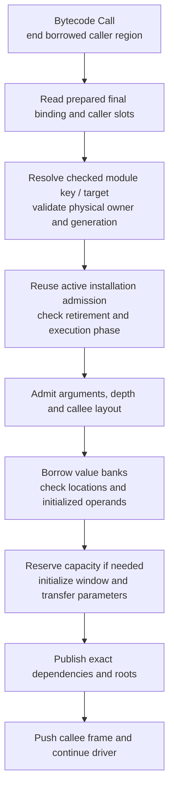
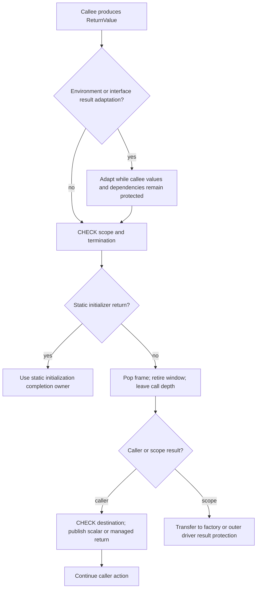

# One Bytecode Call through the Runtime

Start with the [Runtime model](../runtime.md). For `state = step(state)`, the
ordinary nongeneric bytecode call uses a final binding prepared before publication.
The same entry mechanism serves current code and retained old callers; their
supplying call tables have already been bound directly to current implementations.

## Prepared facts and the actual entry path

```text
PreparedCall { pc, target, arguments: Box<[Location]>, destination }
LinkedCall::Direct(BoundRoute)
BoundRoute { route: CallRoute, selected: Arc<PreparedSelection> }
PreparedSelection { owner: ModuleKey, target: CallableTarget, mapping }
```

The shared product prepares locations and checked callable facts. Installation
resolves recipient authority and creates the final generational module key/target.
`CallRoute` is metadata identity for publication and saved host bindings. Ordinary
Direct execution reads `selected` without a current-version test or route-registry
lookup. It does not clone the unused generic transport mapping.

## Selection and frame entry



There is no Installation current-cell Mutex, per-call publication correspondence
solver, old-version chain or retired-table lookup here. Publication is excluded
throughout synchronous activation. Entry/resume and cross-installation admission
still check the supplying installation; explicit retirement revokes the active
proof. Actual object identities, loans, cancellation, capacity, depth and argument/
result validity remain dynamic where required.

Host named bindings differ: invocation resolves their metadata route through the
Runtime's current prepared selection. Interface receivers and captured closures
also have their own checked selection behavior. They do not make the ordinary
Direct path perform public lookup or infer types.

`Function<A, R>` checks the Rust mapping when it is bound or decoded. Its
`prepare_call` returns `PreparedHostCall<A, R>`, a sealed witness retaining one
exact `PreparedFunction`; callers cannot choose another argument/result mapping
at execution. Ordinary calls create a current selection, while explicitly retained
prepared calls and queued factories keep their selected body. Fixed Rust mapping
checks do not repeat on execution; actual value conversion effects do. Weak
binding-cache entries reuse the same checked mapping and never retain code on
their own. Reload signature transport and dynamic value/authority checks remain.

Parking clears function-link views on every frame, including parents waiting on a
child. Resume refreshes the entire stack from committed tables. Bodies, PCs,
captures, values, return destinations and lexical environments remain exact.
See the [reload sequence](reload.md) for publication and repeated updates.

Sources: [prepared calls](../../../crates/kagari-runtime/src/module/execution/calls.rs),
[final bindings](../../../crates/kagari-runtime/src/module/linked_execution/calls.rs),
[target entry](../../../crates/kagari-runtime/src/module/dispatch.rs),
[call transition](../../../crates/kagari-runtime/src/frame/calls.rs),
[parking/resume](../../../crates/kagari-runtime/src/frame/owned.rs),
[executable validation](../../../crates/kagari-runtime/src/loading.rs).

## Work performed at each boundary

| Stage | Operations and data changes | Callback / collection boundary |
| --- | --- | --- |
| Read call site | BORROW caller stack; obtain exact owner, slots, links and environment; LOOKUP prepared call/route; clone relevant shared owners | Temporary caller borrow ends before later transitions |
| Select target | Read final checked module key/target; validate physical record/generation and reuse active installation authority; shared calls use prepared mapping metadata | No user callback or collection in this internal selection |
| Admit frame | Reject invalid initializer/suspending entry; inspect managed argument ownership/candidate membership; RESERVE frame capacity; enter checked call depth; LOOKUP callee layout; validate parameter count and program metadata | Error order and rollback of entered depth are preserved |
| Allocate window | BORROW banks; CHECK source window owner/generation, initialized operands and destination representations; RESERVE managed/scalar/initialization/window/order storage | RESERVE can allocate Rust backing; it does not imply a script GC cycle |
| Initialize/transfer | INIT scalar payloads to zero, scalar flags to false and managed records to Unit; COPY parameters into admitted destinations | Warm capacity avoids allocator requests, not these initialization/copy operations |
| Publish | Insert Window with exact program/type/invocation dependencies; append allocation order; push ExecutionFrame with return destination | ROOT publication completes before arbitrary execution can collect |
| Execute callee | Driver polls/observes/safepoints; borrow the admitted frame/banks; execute prepared regions | Borrowed regions end before allocating operations, callbacks and other transitions |
| Return | Adapt environment/interface result where needed; poll; retire frame/window; leave depth; publish result or finish root/factory | See the closed return transition below |

The window allocator reserves five backing owners, not necessarily five new heap
allocations on each call. Owner/generation IDs are checked locators; no borrowed
pointer is kept across Vec growth. The current all-scalar transfer avoids walking
a heap graph, but still checks initialized scalar contents and representation.

Source: [window allocation and transfer](../../../crates/kagari-runtime/src/frame/values.rs).

## Return and error paths



Optional result adaptation may allocate and runs before retiring its dependencies.
Retirement and publication to an internal caller are then a closed transition:
no callback, allocation or collection observes a managed result between removal
of the callee root and publication in the caller. A return without a destination
still retires the callee; static initializers and Future factories have explicit
completion owners.

On failure before frame publication, admission rolls back entered depth and
publishes no partial parameter window. Later errors preserve already committed
script/host mutations. ExecutionStack drop unwinds only its suffix from `base`,
releasing frames/windows and guards; it does not roll back all effects or tear
down an unrelated suspended execution. Quarantine handles invalid internal state.

Sources: [return handling](../../../crates/kagari-runtime/src/frame/returns.rs),
[return packet](../../../crates/kagari-runtime/src/frame/transfer.rs),
[activation cleanup](../../../crates/kagari-runtime/src/frame/activation.rs) and
[stack suffix retirement](../../../crates/kagari-runtime/src/frame/stack.rs).

## Native call: what an empty body still pays for

An ordinary Native-import Call consumes its prepared binding and the common frame-admission path.
Its frame starts Pending and has logical result slot 0 and parameter slots after
it. The callback-facing structures expose the current mutation boundary:

```text
NativeCall<'call> {
    runtime: &'call mut Runtime,
    owner: &'call ExecutableModule,
    function: &'call LinkedNativeFunction,
    arguments: ArgumentView<'call>,
    pending: Unset | Unit | Scalar(Value) | Managed(RootedValue),
    invoke_script: ScriptInvoker
}
ArgumentView<'call> {
    frame: Option<FrameSlots>,
    slots: prepared locations | contiguous frame range | sealed scalars,
    narrowed: Option<RootSet>
}
ErasedNativeEntry = Fn(&mut NativeCall) -> Result<(), Box<RuntimeError>>
```

NativeCall lends the same exclusive Runtime for synchronous script reentry.
No frame/bank or mutable registry borrow spans the callback. Immutable entry
descriptors may be pinned across it. The remaining sequence is:

```mermaid
sequenceDiagram
    participant Driver as VM driver
    participant Frame as Native frame
    participant Binding as LinkedNativeFunction
    participant Adapter as Optional typed Rust adapter
    participant Body as Rust callback
    Driver->>Frame: Pending to Running, capture owner, slots<br/>and environment
    Frame->>Binding: LOOKUP binding, prepare or reuse generic<br/>application if needed
    Frame->>Binding: invoke NativeCall over rooted argument<br/>slots
    Binding->>Binding: CHECK arity, poll, narrow shared<br/>capabilities where needed
    Binding->>Adapter: Invoke registered entry
    Adapter->>Adapter: Optional RESERVE argument pack, ROOT,<br/>check actual values and decode
    Adapter->>Body: CALLBACK
    Body-->>Adapter: Rust result
    Adapter->>Adapter: Optional encode result, release conversion<br/>roots
    Adapter-->>Binding: Stage result in NativeCall; small status
    Binding->>Binding: Poll, CHECK or adapt result as required
    Binding-->>Frame: Publish slot 0, Running to Complete
    Frame-->>Driver: NativeReturn action
    Driver->>Frame: Shared finish_return transition
```

Low-level callbacks do not necessarily use the typed adapter pack. The existing
owned typed adapter specifically materializes a Vec of argument Values, clones
the pack for execution-root protection, checks actual values/receiver loans,
decodes arguments and encodes the result. Rust type/codec mappings are prepared
by the immutable binding or its actual closed application before callbacks run. Zero parameters can change allocation behavior;
do not label every box as an unconditional allocation in an empty Native call.
Formal shared receiver narrowing creates additional protected aliases only when
the actual argument requires it.
The [empty-call measurement](../../performance-baseline.md#empty-call-attribution-windows-2026-11-08)
distinguishes these routes: raw/flat callbacks have no proportional allocator
traffic, while that revision's zero-argument Unit owned adapter created two result mappings
and two empty root leases per call. RR02 removes the repeated fixed mappings;
the old-heap root leases remain until the execution-root cutover. Its allocation and calibrated timing evidence
must not be generalized to every Native adapter. Current matched measurements
retain their own revision and denominator in the performance record.

ArgumentView and ValueHandle carry protected locations and immutable type facts,
not heap references. Reads and payload access use the current NativeCall. A guarded
payload operation owns a mutable call scope and releases its operation mark on
return, error or unwind; script reentry borrows that same call. Collection still
checks actual payload loans. Pending results stage once in NativeCall before the
post-call poll and destination commit; managed results currently use an old-heap
root lease until RR03 replaces it with a managed local slot.

Before invoking Rust, frame and operand-bank borrows are released. Rust may
allocate or synchronously call script through the supplied invoker. Its arguments
remain protected by the frame/temporary packs. An ordinary Running callback cannot
be parked; asynchronous Native work uses explicit factory/Future/wait state.

Runtime preparation currently rewrites Native-import sites to general Call and
sets `prepared.native_calls = 0`. Existing special transition code does not prove
that a normal import bypasses this path. The registered body can itself be a
sealed primitive; that alone does not eliminate route selection and Native frame
handling. Efficient independent-library calls must address that distinction.

Sources: [Native frame execution](../../../crates/kagari-runtime/src/frame/native.rs),
[binding checks](../../../crates/kagari-runtime/src/native/binding.rs),
[typed adapter](../../../crates/kagari-runtime/src/native/typed.rs),
[shared narrowing](../../../crates/kagari-runtime/src/native/context/references.rs),
[import rewriting](../../../crates/kagari-runtime/src/module/execution/calls.rs).

## Alternate call kinds

| Kind | Additional selection/lifetime work |
| --- | --- |
| Concrete named call | The main scenario above; committed binding already identifies the current implementation |
| Shared generic named call | Prepared final target, plus prepared environment transport and concrete argument/receiver compatibility checks |
| Interface/required method | Resolve receiver and checked protocol evidence; apply generic facts where needed; admit the selected invocation and validate arguments; use the common frame allocator |
| Interface computation retention | A newly admitted MethodInvocation allocates MethodComputation containing selected body/environment in the metadata ApplicationStore; a warm reusable application cache does not remove this distinct short-lived record |
| Created closure/Future body | Select its retained exact computation and environment; validate captures/arguments and use common admission; ordinary named calls inside it still select current implementations |
| Named function value | Follow its live route to current implementation rather than treating it as a created closure snapshot |
| Static initializer | Enter only through runtime initialization authority; completion/failure updates its shared static cell |
| Compiled script body | Consume verified native ABI/contracts through the runtime bridge; this is distinct from calling a registered Rust callback |

Sources: [interface selection](../../../crates/kagari-runtime/src/objects/invocation.rs),
[generic applications](../../../crates/kagari-runtime/src/objects/application.rs),
[closure admission](../../../crates/kagari-runtime/src/frame/closures.rs),
[Native ABI bridge](../../../crates/kagari-runtime/src/jit_abi.rs).

## Cost boundaries

Window initialization/transfer, roots, interface computation records and typed
Native adapters remain ordinary costs. Warm backing capacity avoids allocator
requests, not all initialization or checks. Historical timings below are tied to
their recorded revision; current migration measurements are in the
[performance record](../../performance-baseline.md). A source-path diagram alone
cannot establish a speedup or authorize removing validation.
