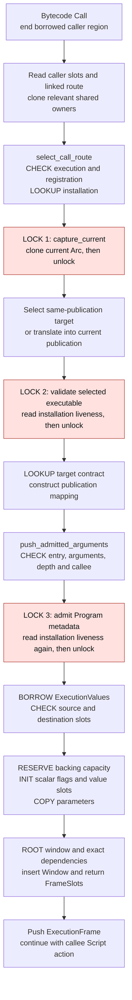
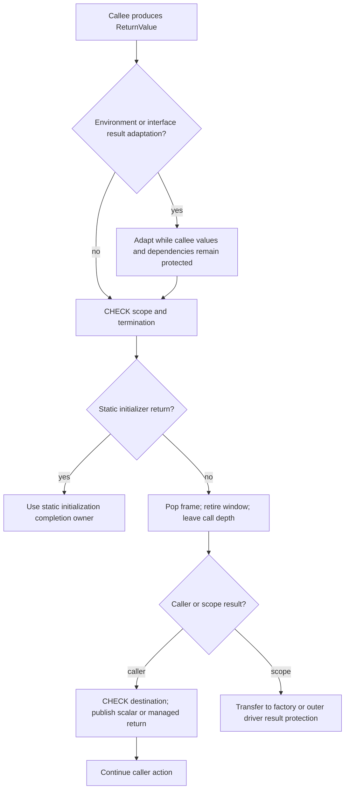
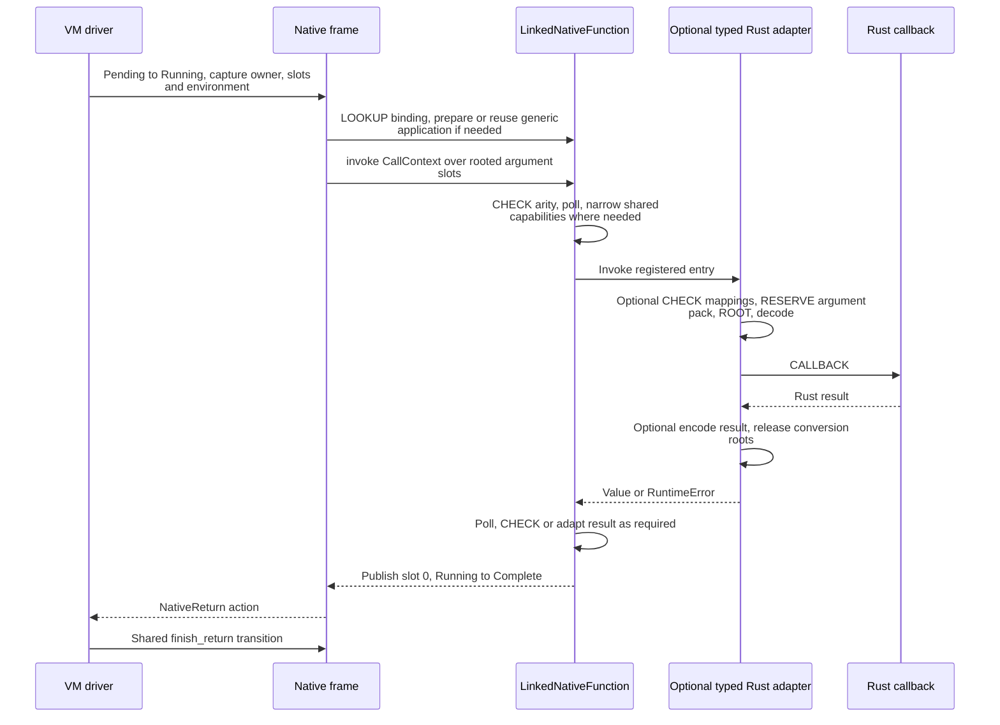

# One Bytecode Call through the Runtime

Implementation map of `48d79b2a`; start with the [Runtime model](../runtime.md).
This page expands one successful, ordinary named script-function call with scalar
arguments, no generic environment, no candidate initialization and no reload during
the active synchronous scope. Alternate kinds are covered separately below.

For example, `state = step(state)` calls `step(i32) -> i32`. The workload can be
fully warmed: no preparation cache miss, new script object or GC cycle is required
for the following selection, validation, initialization and transfer work to run.

## Prepared facts and the actual entry path

Before execution, portable bytecode describes the callee, logical argument/result
slots, semantic contracts and source origins. Runtime preparation creates:

```text
PreparedCall {
    pc,
    target: Static | Shared | Interface | Closure,
    arguments: Box<[Location]>,
    destination: Option<Location>
}
LinkedCall::Direct(CallRoute)
CallRoute {
    scope: Arc<PublicationDefinitions>,
    origin: ModuleKey,
    target: CallableTarget,
    selection: named application | native import | retained body
}
```

Location already identifies a physical bank slot. CallRoute already binds an
installation and callable identity; execution still selects its current or
retained implementation. Binding once is therefore not the same as pinning the
old body forever.

The scalar region encounters the prepared Call and exits its temporary frame/bank
borrows. `complete_transition` invokes `push_prepared_call`. This is an internal
transition in the same execution, not another root host session.

Sources: [call preparation](../../../crates/kagari-runtime/src/module/execution/calls.rs),
[linked calls](../../../crates/kagari-runtime/src/module/linked_execution/calls.rs),
[region transition](../../../crates/kagari-runtime/src/frame/cursor/transitions.rs),
[call transition](../../../crates/kagari-runtime/src/frame/calls.rs).

## Selection and frame entry, including locks



This shows **at least three separate acquisitions** on the ordinary successful
path before the callee body. It is a static source-path count, not instrumentation
of every transitive helper or a universal lock count for every call kind. A local
same-installation call reads the same Installation cell at these sites.
The [current-cell lock measurement](../../performance-baseline.md#installation-current-cell-mutex-measurement-windows-2026-11-08)
separately measures uncontended operations and fixed-publication interpreter paths;
its timing differences do not establish an exact dynamic lock count.

| Lock | Why the current code takes it | Path |
| --- | --- | --- |
| 1 | Obtain the current publication and clone its Arc | select_call_route -> Installation::capture_current |
| 2 | Establish that the selected exact executable still belongs to a live installation | select_call_route -> validate_executable_module -> validate_executable_installation |
| 3 | Admit the selected program as a frame metadata edge | push_admitted_arguments -> validate_metadata(Program) -> inspect_metadata -> validate_executable_module -> validate_executable_installation |

Every guard ends before the function body. The locks protect a shared metadata
cell, not concurrent script execution. Neither a hot reload nor lock contention
is necessary for an uncontended lock/unlock sequence to occur. Candidate sessions
skip the ordinary capture-current branch; interfaces/closures follow other paths.

Sources: [selection](../../../crates/kagari-runtime/src/module/dispatch.rs),
[current cell and liveness](../../../crates/kagari-runtime/src/module/installation.rs),
[executable validation](../../../crates/kagari-runtime/src/loading.rs),
[metadata validation](../../../crates/kagari-runtime/src/execution_metadata.rs),
[frame admission](../../../crates/kagari-runtime/src/frame/admission.rs).

## Work performed at each boundary

| Stage | Operations and data changes | Callback / collection boundary |
| --- | --- | --- |
| Read call site | BORROW caller stack; obtain exact owner, slots, links and environment; LOOKUP prepared call/route; clone relevant shared owners | Temporary caller borrow ends before later transitions |
| Select target | CHECK runtime phase; LOOKUP and validate installation; inspect candidate session; LOCK current; choose target; validate executable; LOOKUP target contract; create scope mapping | No user callback or collection in this internal selection |
| Admit frame | Reject invalid initializer/suspending entry; inspect managed argument ownership/candidate membership; RESERVE frame capacity; enter checked call depth; LOOKUP callee layout; validate parameter count and program metadata | Error order and rollback of entered depth are preserved |
| Allocate window | BORROW banks; CHECK source window owner/generation, initialized operands and destination representations; RESERVE managed/scalar/initialization/window/order storage | RESERVE can allocate Rust backing; it does not imply a script GC cycle |
| Initialize/transfer | INIT scalar payloads to zero, scalar flags to false and managed records to Unit; COPY parameters into admitted destinations | Warm capacity avoids allocator requests, not these initialization/copy operations |
| Publish | Insert Window with exact program/type/invocation dependencies; append allocation order; push ExecutionFrame with return destination | ROOT publication completes before arbitrary execution can collect |
| Execute callee | Driver polls/observes/safepoints; borrow the admitted frame/banks; execute prepared regions | Borrowed regions end before allocating operations, callbacks and other transitions |
| Return | Adapt environment/interface result where needed; poll; retire frame/window; leave depth; publish result or finish root/factory | See the closed return transition below |

The window allocator reserves five backing owners, not necessarily five new heap
allocations on each call. Owner/generation IDs are checked locators; no borrowed
pointer is kept across Vec growth. The current all-scalar transfer avoids walking
a heap graph, but still checks initialized scalar contents and representation.

Source: [window allocation and transfer](../../../crates/kagari-runtime/src/frame/values.rs).

## Return and error paths



Optional result adaptation may allocate and runs before retiring its dependencies.
Retirement and publication to an internal caller are then a closed transition:
no callback, allocation or collection observes a managed result between removal
of the callee root and publication in the caller. A return without a destination
still retires the callee; static initializers and Future factories have explicit
completion owners.

On failure before frame publication, admission rolls back entered depth and
publishes no partial parameter window. Later errors preserve already committed
script/host mutations. ExecutionStack drop unwinds only its suffix from `base`,
releasing frames/windows and guards; it does not roll back all effects or tear
down an unrelated suspended execution. Quarantine handles invalid internal state.

Sources: [return handling](../../../crates/kagari-runtime/src/frame/returns.rs),
[return packet](../../../crates/kagari-runtime/src/frame/transfer.rs),
[scope cleanup](../../../crates/kagari-runtime/src/frame.rs).

## Native call: what an empty body still pays for

An ordinary Native-import Call shares the route-selection/frame-admission path.
Its frame starts Pending and has logical result slot 0 and parameter slots after
it. The callback-facing structures expose the current mutation boundary:

```text
CallContext<'call> {
    runtime: &'call Runtime,
    owner: &'call ExecutableModule,
    function: &'call LinkedNativeFunction,
    arguments: ArgumentView<'call>,
    invoke_script: ScriptInvoker
}
ArgumentView<'call> {
    heap, frame: Option<FrameSlots>,
    slots: prepared locations | contiguous frame range | sealed scalars,
    narrowed: Option<RootSet>
}
NativeEntry = Fn(&mut CallContext) -> NativeResult<Value>
```

Mutably borrowing CallContext does not provide an exclusive `&mut Runtime`;
the context points to shared Runtime access whose owners use dynamic checks and
interior mutation. The remaining sequence is:



Low-level callbacks do not necessarily use the typed adapter pack. The existing
owned typed adapter specifically materializes a Vec of argument Values, clones
the pack for execution-root protection, checks mappings/receiver loans, decodes
arguments and encodes the result. Zero parameters can change allocation behavior;
do not label every box as an unconditional allocation in an empty Native call.
Formal shared receiver narrowing creates additional protected aliases only when
the actual argument requires it.
The [empty-call measurement](../../performance-baseline.md#empty-call-attribution-windows-2026-11-08)
distinguishes these routes: raw/flat callbacks have no proportional allocator
traffic, while the zero-argument Unit owned adapter creates two result mappings
and two empty root leases per call. Its allocation and calibrated timing evidence
must not be generalized to every Native adapter.

Before invoking Rust, frame and operand-bank borrows are released. Rust may
allocate or synchronously call script through the supplied invoker. Its arguments
remain protected by the frame/temporary packs. An ordinary Running callback cannot
be parked; asynchronous Native work uses explicit factory/Future/wait state.

Runtime preparation currently rewrites Native-import sites to general Call and
sets `prepared.native_calls = 0`. Existing special transition code does not prove
that a normal import bypasses this path. The registered body can itself be a
sealed primitive; that alone does not eliminate route selection and Native frame
handling. Efficient independent-library calls must address that distinction.

Sources: [Native frame execution](../../../crates/kagari-runtime/src/frame/native.rs),
[binding checks](../../../crates/kagari-runtime/src/native/binding.rs),
[typed adapter](../../../crates/kagari-runtime/src/native/typed.rs),
[shared narrowing](../../../crates/kagari-runtime/src/native/context/references.rs),
[import rewriting](../../../crates/kagari-runtime/src/module/execution/calls.rs).

## Alternate call kinds

| Kind | Additional selection/lifetime work |
| --- | --- |
| Concrete named call | The main scenario above; already linked route still selects the current publication |
| Shared generic named call | Same route selection, plus prepared environment transport and concrete argument/receiver compatibility checks |
| Interface/required method | Resolve receiver and checked protocol evidence; apply generic facts where needed; admit the selected invocation and validate arguments; use the common frame allocator |
| Interface computation retention | A newly admitted MethodInvocation allocates MethodComputation containing selected body/environment in the metadata ApplicationStore; a warm reusable application cache does not remove this distinct short-lived record |
| Created closure/Future body | Select its retained exact computation and environment; validate captures/arguments and use common admission; ordinary named calls inside it still select current implementations |
| Named function value | Follow its live route to current implementation rather than treating it as a created closure snapshot |
| Static initializer | Enter only through runtime initialization authority; completion/failure updates its shared static cell |
| Compiled script body | Consume verified native ABI/contracts through the runtime bridge; this is distinct from calling a registered Rust callback |

Sources: [interface selection](../../../crates/kagari-runtime/src/objects/invocation.rs),
[generic applications](../../../crates/kagari-runtime/src/objects/application.rs),
[closure admission](../../../crates/kagari-runtime/src/frame/closures.rs),
[Native ABI bridge](../../../crates/kagari-runtime/src/jit_abi.rs).

## What this exposes for review

- The three highlighted lock acquisitions concern the same current/liveness
  facts during an activation where publication is prohibited. Their present
  producer/consumer boundaries are visible; their measured time share is not.
- Initialization, transfer and metadata retention can cost time with zero warmed
  allocator requests. A no-allocation result does not certify a cheap call.
- A short interface invocation currently creates collectible computation metadata.
  Keeping a selected body alive is required; its allocation owner is reviewable.
- One semantic call protocol need not require the same heavy physical transition
  for every small library operation. Any reduced path must preserve current-body
  selection, rooted arguments/results, errors, reentry and cancellation.

The [Runtime review findings](../runtime.md#review-findings) own the question map;
the [performance record](../../performance-baseline.md#bo17-bo19-scalar-dispatch-windows-2026-10-27)
owns historical timing. No source-backed diagram alone establishes a predicted
speedup or permission to remove a check.
