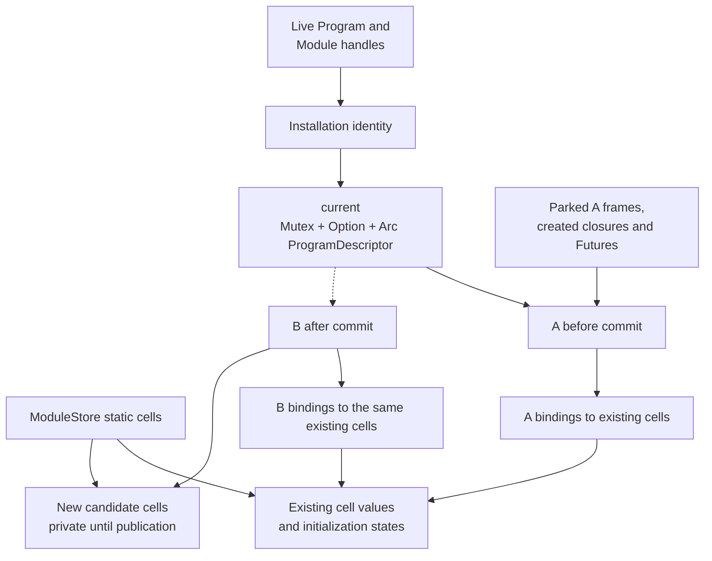
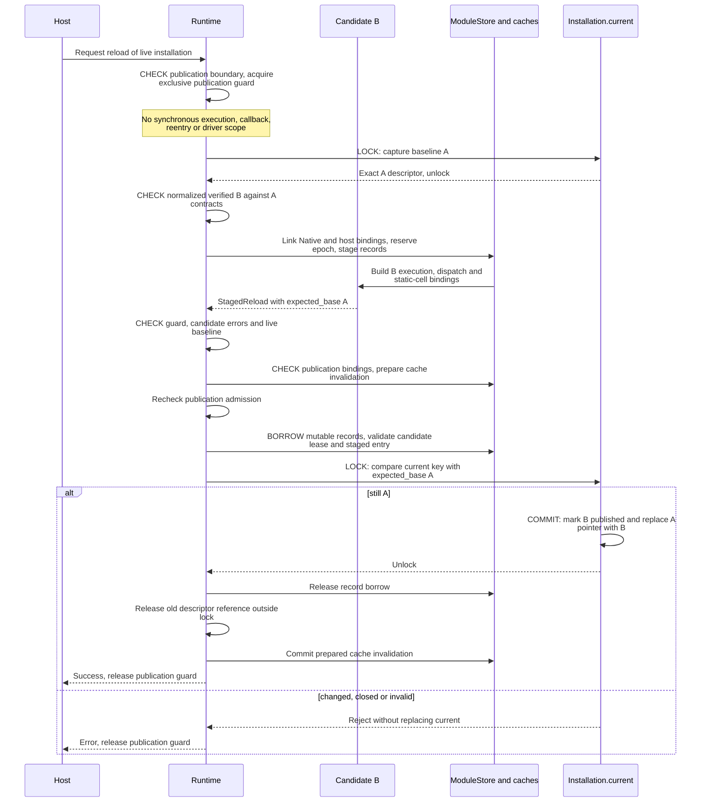

# One Hot Reload through the Runtime

Implementation map of `48d79b2a`; start with the [Runtime model](../runtime.md).
The scenario is an ordinary update from published version A to compatible version
B in one existing installation. It does not run a candidate initializer or migrate
arbitrary live data. The [activation specification](../../spec/module-activation.md)
owns the full compatibility/publication contract.
For the replacement ownership and preparation model, see the
[Runtime refactor design](../../runtime-refactor-design.md); the walkthrough below
continues to describe the current implementation.

## Data being replaced and data being retained



The commit replaces the installation's current descriptor pointer. Existing
statics are shared through checked cell bindings, not overwritten with the new
initializer's value. Their original lazy initialization recipes/states are
preserved. Additions receive candidate bindings; loading and ordinary reload do
not execute initializers. Existing object layouts and other retained contracts
must pass compatibility; None or an empty container does not waive that check.

Key records are:

```text
PreparedReload {
    installation,
    baseline: ExecutableModule,             // Exact A.
    admission, name, program: VerifiedProgram,
    bindings: Vec<LinkedHostBindings>
}
StagedReload {
    target: Program, baseline: ExecutableModule,
    initialization_error,
    program: StagedProgram
}
StagedProgram {
    installation: Arc<Installation>,
    module: ExecutableModule,               // Exact candidate B.
    lease: Arc<CandidateLease>,
    expected_base: Option<ModuleKey>        // Must still be A at commit.
}
PublicationState {
    synchronous: Cell<usize>,
    publishing: Cell<bool>
}
```

Sources: [reload preparation](../../../crates/kagari-runtime/src/loading.rs),
[candidate/publication records](../../../crates/kagari-runtime/src/module/staging.rs),
[static-cell bindings](../../../crates/kagari-runtime/src/module/state/cells.rs),
[publication admission](../../../crates/kagari-runtime/src/publication.rs).

## Prepare, stage, admit and commit



The drawing combines the ordinary guarded update with its commit. SDK preparation
may precede a prepared-product reload; the core also exposes staging separately
from publication. A separately staged candidate still needs publication admission
and baseline rechecks at commit. This distinction explains why preparation stores
expected_base rather than assuming the first baseline read will always remain
valid until a later host publication request.
The guarded path defers abandoned-storage collection. Separately invoked,
unguarded core staging can service an abandonment safepoint before staging; it
must not be confused with the guarded metadata-only preparation window.

The sequence's lock labels identify categories, not an exact full reload lock
count: validation/capture helpers can read the cell again during cold preparation.
The [ordinary Call walkthrough](calls.md#selection-and-frame-entry-including-locks)
separately traces repeated reads in the hot execution path.

The actual commit is short and has no fallible suffix after its final baseline
check: mark the dispatch scope/lease published, remove the prepared staged entry,
replace current, release both guards, then drop the previous descriptor/stage
references. Interpreter invalidation was prepared before this point and its commit
is non-failing. No user callback or old-descriptor destruction occurs under the
current-cell guard.

## When publication is allowed

| Runtime condition | Publication |
| --- | --- |
| Host top level with no synchronous activation or conflicting Native loan | Admissible after target/runtime checks |
| Running script, Native callback, observer, synchronous reentry or their cleanup | Rejected, even if an active-session pointer is hidden |
| Retained/parked frames or waiting Tasks, with no active drive scope | Permitted |
| Another PublicationGuard is live | Rejected |
| Closed/quarantined Runtime or retired/foreign installation | Rejected through the existing error boundary |

While PublicationGuard is held, script entry, resumption, driver consumption and
another publication reject. Producer-side completion notifications may still mark
owned work ready; they do not execute code or publish a version.

These are dynamic checks in the current `&Runtime` implementation. They are not
currently expressed solely by requiring `&mut Runtime` on reload. A guard does
not hold the Installation Mutex throughout preparation.

## Which body executes after the swap

```text
Before publication:
    current = A
    an old Future has selected resume_body@A and is parked

Commit:
    current = B

After publication:
    a new ordinary named call selects its body@B
    the old Future resumes its retained resume_body@A
    an ordinary helper() call inside that old body selects helper@B
```

Current selection uses a CallRoute's installation/declaration/application identity.
Same-publication calls retain an existing target placement; crossing publications
uses the new dispatch table and transports checked scope/binder correspondence.
It is not an in-place overwrite of A's instruction bytes or a permanent rewrite
of every A frame to B.

Created closures, cold Futures, admitted frames and admitted queued invocations
retain selected bodies/providers and matching environments. Live named Function
bindings follow current implementations. Already selected computations retain
what they need; merely keeping a live Program/Module handle does not pin A as the
current version. A suspended old computation must not freeze its ordinary inner
calls to A.

Sources: [route selection](../../../crates/kagari-runtime/src/module/dispatch.rs),
[dispatch tables](../../../crates/kagari-runtime/src/module/dispatch/tables.rs),
[call-selection contract](../../spec/module-activation.md#live-installations-and-call-selection).

## Failure, retirement and why the current Mutex exists

| Event | Observable outcome |
| --- | --- |
| Compatibility/linking/binding/admission fails before commit | Current installation and authoritative static state remain at A |
| Candidate was prepared against A but current is no longer A | Reject stale candidate; do not overwrite a newer publication |
| Unpublished candidate is abandoned | Last candidate lease marks abandonment; ordinary cleanup/collection later retires candidate storage |
| B is published while A has live computations/layout dependencies | Retain required old code/state edges until their references disappear |
| Runtime closes | Clear live metadata authority and retire executions; surviving Arc descriptors cannot authorize new execution |

An immutable descriptor's Arc lifetime and the Runtime's object/program graph
reachability are separate. Swapping current releases one shared reference, not
every old executable/runtime record. The collector considers current installations,
explicit retentions and object/metadata dependencies before reclaiming old state.

The current API allows `Program::module` / `Module::module` to navigate live
metadata without borrowing Runtime. Those handles are Send + Sync. A host thread
may query the shared current cell while the exclusive Runtime driver on another
thread publishes or closes it. Mutex protects that pointer read/swap; it does not
permit concurrent script execution. Arc alone cannot synchronize replacement of
the enclosing Option.

This is a concrete mismatch with the requested direction: Send is needed to move
Runtime between host threads, while shared live metadata queries were not requested.
Whether to retain that API, restrict queries to Runtime or expose explicit immutable
snapshots is a design decision. Replacing Mutex mechanically would not settle the
ownership contract. Independently, the publication rules establish a stable
current-version interval during synchronous execution that the hot call path does
not currently fully exploit.

Sources: [live metadata access](../../../crates/kagari-runtime/src/module/exports.rs),
[current cell and retirement](../../../crates/kagari-runtime/src/module/installation.rs),
[joint collection](../../../crates/kagari-runtime/src/gc/collection.rs).
