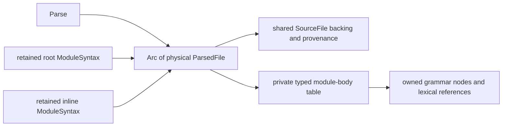

# Syntax Architecture

`kagari-syntax` directly constructs a strongly typed, lossless and recoverable AST
for one physical source file. Rust fields own grammar roles; HIR determines names,
types and executable eligibility afterward. A successful recoverable parse does
not authorize compilation.

The [workspace architecture](../architecture.md) owns crate boundaries. The
[syntax specification](../spec/syntax.md), [grammar](../kagari.ebnf) and
[coverage audit](../syntax-coverage.md) own language behavior and its inventory.

## Responsibilities and entrypoints

The lexer recognizes token kinds and UTF-8 byte ranges. The parser owns grammar,
precedence, diagnostics, recovery, cancellation and resource limits. Filesystem
acquisition, module discovery, name resolution, typing, execution and reload stay
with their existing owners. Production dependencies are `kagari-common`,
`kagari-source` and `smallvec`; syntax has no compiler/runtime dependency.

| Entrypoint | Result policy |
| --- | --- |
| `lex` / `lex_with_cancellation` | Lexical sequence, including trivia, unknown input and EOF |
| `parse(source, options, cancel)` | Recoverable syntax snapshot, or `Err(Cancelled)` when cancellation is observed |

`ParseOptions { mode, limits }` groups grammar configuration. Defaults select
`ParseMode::Source` and the existing `ParseLimits`; declaration consumers explicitly
select `ParseMode::Declarations`. Cancellation is a borrowed argument for one
operation, not reusable configuration. The Engine's `set_parse_limits` still uses
`ParseLimits` and invalidates affected analysis caches when those limits change.

Syntax errors and resource exhaustion remain in `Parse::diagnostics()`. Consumers
such as the CLI, formatter and package loader decide whether diagnostics prevent
their operation; there is no separate strict parsing entrypoint. Test helpers may
assert that a fixture has no diagnostics before taking its retained module view.

`ParseMode::{Source, Declarations}` survives retention. Declaration mode admits
native signatures and opaque types, without establishing executable acceptance.
HIR native ingestion checks the written view against authoritative installed
contracts. Ordinary source analysis still carries physical syntax diagnostics
into its strict checked-program gate.

## Grammar fields and recovered roles

[AST declarations](../../crates/kagari-syntax/src/ast/mod.rs) are the structural
owner. `Expr`, `Stmt`, `Item`, `Member`, `Pattern` and `TypeSyntax` have explicit
alternatives. Concrete nodes store typed children and punctuation, rather than
selecting matching positions from an untyped tree. `ExprView`, `StmtView`,
`ItemView` and `TypeView` borrow these alternatives for consumers.

The AST module's rustdoc explains the notation used in source-to-field examples.
Concrete declarations in `ast/{item,expr,stmt,ty,misc}.rs` keep these mappings next
to their definitions, distinguishing child syntax from lexical tokens and
explaining optional clauses and recovery where their roles differ. Shared missing
slot and separated-list rules remain with `Required` and `SeparatedList`; examples
describe parsed structure, not successful name resolution or semantic admission.

For example, `1 + 2 * 3` produces an outer `BinaryExpr` with a literal `lhs`, an
`Add` operator and a binary `rhs`. That right child stores `Multiply`. Neither
accessor walks descendants to infer a role; HIR matches the parsed operator and
lowers those exact children.

```text
BinaryExpr {
    site,
    lhs: Required<Expr>,
    operator: Required<OperatorToken<BinaryOp>>,
    rhs: Required<Expr>,
}
Expr = Literal(Literal) | BinaryExpr(Box<BinaryExpr>) | ... | Error(SyntaxSite)
Required<T> = Present(T) | Missing { at: UTF-8 byte offset }
```

Boxed recursive alternatives keep ordinary Rust ownership and bounded enum sizes.
Large optional clauses are boxed so an absent `where` clause or trait application
does not reserve its full payload in every node. Immutable separated lists retain
boxed slices; temporary parser builders use vectors. Attached attributes use a
thin optional owner, avoiding a vector header on every unannotated declaration.
There is no custom allocator, node interning or universal node database.

`IfExpr` distinguishes `condition`, `then_body` and an optional `else_clause`.
For `if {}`, the condition is missing and the braces belong to `then_body`.
For `if ready {} else`, the else clause is present with a missing body. Recovery
cannot substitute a later matching expression for the missing field.
Block expressions remain valid conditions: `if { ready } { work(); }` retains
the first block as its condition. If a plain block condition has no following
body block, recovery assigns that lone block to the body and marks the condition
missing. The same rule applies to `while`.

`SeparatedList` stores ordered required elements and optional required separators.
For `f(a,,b,)`, the middle element is missing and the last entry retains a comma.
Filtered child iterators omit missing entries. Consumers whose semantics depend
on positions must retain required slots: enum payload lowering uses
`TuplePayload::type_entries()` so `Hole(, Point)` keeps an error slot before
`Point`. Likewise, `UseTree::is_glob()` requires a written star; a recovered
`use a::;` retains its path without importing namespace members.
Skipped tokens have a parser-assigned owner, named field, list entry and
`RecoveryPart::{Element, Separator}`. Consumers can inspect that location through
`Ast::unexpected`; ownership is not guessed from overlapping spans. A struct
update is a final entry: `Point { ..base, x: 1 }` retains `x: 1` as unexpected
content, without admitting it as an ordinary field.
Malformed static tails belong to the `terminator` slot, after the initializer.
In struct patterns, repeated rest markers and fields following `..` belong to
the `close` slot, after the retained rest marker. Rejected pattern fields retain
their source coverage rather than entering the earlier typed field list. These
positions keep recovery traversal in authored order.
Range-pattern endpoints admit only literals and paths. If a parsed wildcard or
compound pattern is followed by `..` or `..=`, its rejected lexical coverage
belongs to `RangePattern.start`, before the operator; the required start remains
missing. For example, `Point { v }..3` retains `Point { v }` as unexpected input
without treating it as a valid bound or losing it during traversal.
Declaration keywords following attributes/visibility and import-group opening
braces use `Required<Token<_>>`: prefix diagnostics can exhaust the parser budget
before those tokens are consumed. In that case the slot is missing and the token
stays exclusively in the unparsed suffix, rather than appearing in both places.
When grammar parses a first entry separately, continuation parsing records
recovery positions relative to the complete owning list, including that entry.

Typed convenience list accessors filter out missing elements. For `f(a,,b,)`,
`args()` yields `a, b`, while `data().arguments.entries` retains all three slots
and all three commas. A recovery entry index uses the unfiltered slots. An optional
getter can also hide a missing required child or a different grammar alternative;
inspect the stored named field when that distinction matters. The
[recovery types](../../crates/kagari-syntax/src/ast/site.rs) own the detailed states.

An `Error(SyntaxSite)` alternative has no retained typed children. Its traversal
emits every lexical token in its resolved coverage exactly once, including tokens
that parsed successfully before the construct was rejected in its enclosing
context. Sparse unexpected-token records alone cannot reconstruct such a node;
for example, a static declaration rejected inside a trait still retains its full
spelling through grammar traversal.

Type lowering exhaustively matches `TypeView`, including grouped, tuple, array,
function, applied and qualified types. Interpolation exposes ordered text/hole
parts. Attributes belong directly to declarations/members; HIR and lint do not
search parents to determine their target. Type aliases retain whether a `where`
clause was written before or after `=`, so traversal preserves either order.

Local functions reuse `FnDef` through `Stmt::FnDef`. Async blocks have a distinct
keyword wrapper and required block body; they do not fabricate closure parameters.
Postfix construction wraps the whole preceding expression exactly once.

## Source storage, spans and traversal

`Parse` owns `Arc<ParsedFile>`. The file retains a `SourceFile` clone sharing its
existing text, identity, revision, line index and projection metadata. It also
owns mode, diagnostics, typed module bodies, lexical records and sparse recovery
records. There is no second text copy, line index or stored CST.

The lexer buffer becomes one source-backed lexical table. Token kinds and starts
are retained separately; ends follow from the next start, including zero-width
EOF. Starts use 16 bits when the complete source length fits, otherwise 32 bits.
Both paths expose the same checked UTF-8 byte coordinates. Present typed token
references use one-based nonzero indices, allowing optional tokens to occupy four
bytes. These indices are private to the physical parse.

Each `Token<K>` marker names a fixed token spelling (`Plus`, `Star`, `PipePipe`)
or a specific grammar category (`LiteralToken`, `BindingKeywordToken`,
`VisibilityScopeToken`). For example, `pub(crate)` stores the `crate` keyword as
`Token<VisibilityScopeToken>` and its parentheses as separate fixed tokens.
The [marker declarations](../../crates/kagari-syntax/src/ast/tokens.rs) document
the admitted categories. Parser branches enforce them during construction;
markers add no stored tag or runtime check, and there is no generic fallback
marker. Missing required tokens retain the existing `Required::Missing` state.

A `SyntaxSite` normally contains an ordered pair of 32-bit lexical coordinates.
A reversed pair instead identifies a sparse recovery record containing the real
coverage and unexpected contents. This private encoding keeps ordinary sites at
eight bytes and does not create syntax/semantic IDs shared across parses.
Coordinates are checked before narrowing; this representation requires source
length and lexical record count to fit 32 bits.

HIR source maps use `body_span` for semantic locations and complete authored
declaration replacement extents. Outer trivia belongs to syntax layout, not the
instruction location or replaceable declaration. Recovery can leave a grouped
pattern without its required child; lowering retains a missing-pattern placeholder
and the syntax diagnostics rather than assuming that child exists.

`body_span` covers the construct's first through last written token, excluding
outer trivia. `full_span` assigns a trivia gap deterministically: the first
newline belongs to the preceding token, following indentation/comments to the
next. A multiline block comment remains atomic. Initial trivia belongs to the
first token; a physical module's full extent is the complete file. Empty
constructs use their anchor. Non-default trivia splits live in an immutable,
parse-owned sparse hash table, with expected constant-time lookup and no repeated
source scan. Ordinary body spans and field access use direct coordinates.

For example, after `fn f(){} // tail\r\n\r\n// next\r\nfn g(){}`, `f` owns the
first CRLF and `g` owns the remaining gap. Token spans still partition the entire
original text exactly once; missing syntax consumes no bytes.

`Ast<'a, T>` pairs a borrow of actual stored data with its owning parse. Copying it
copies borrows, without cloning nodes or an `Arc`. Its `data()` exposes immutable
typed fields; source text, body/full sites and documentation resolve through the
same retained source. Constructors and mutation remain parser-owned.

`NodeRef` is a derived readonly visitor over actual node families. Field walking
comes from the same Rust declarations, in authored order. Generic consumers may
request children, descendants, tokens or a preorder callback; temporary visitor
vectors are not another retained tree. There are no stored parent links. Operator
visits preserve the interpreted operator together with its contiguous lexical
pieces, so expression shifts remain distinct from generic angle delimiters.

| Access | Coverage and work |
| --- | --- |
| Typed named fields | Direct roles; list helpers may filter missing entries |
| `NodeRef::elements()` | Allocates direct nodes/tokens/operators/missing anchors, with trivia and owned unexpected input |
| `NodeRef::children()` | Collects elements and filters to direct nodes |
| `NodeRef::tokens()` | Reads physical lexical coverage directly; no synthetic missing tokens or combined shift tokens |
| `NodeRef::descendants()` | Preorder including self and inline bodies; pending vector plus per-node child collection |
| `NodeRef::visit()` | Recursive preorder including self and inline bodies; no per-node child vectors; false prunes only that subtree |
| `ModuleSyntax::visit_owned()` | Same callback model, excluding nested inline bodies but retaining their headers |
| `ModuleSyntax::descendants()` | Eagerly collects the logical-module walk before returning an iterator |

An empty recovered child has an insertion anchor but no lexical coverage. It does
not advance `elements()`' trivia cursor or claim trivia preceding that anchor.
After a parser stop, such trivia can belong to the enclosing unparsed suffix;
emitting it for the empty child as well would duplicate source tokens.
Similarly, a rejected entry's unexpected coverage stops at its last written
token. Parsing may already have skipped trailing trivia, but that gap still
belongs to the enclosing traversal, including when the closing delimiter is absent.

Traversal does not poll cancellation. Source spelling accessors returning `&str`
borrow the original bytes; helpers returning `String` allocate. In particular,
`Path::text()` joins present names with `::` and omits trivia/missing segments,
whereas `source_text()` retains exact spelling. Literal text access does not decode
escapes or remove delimiters; literal decoding belongs to kagari-source.

## Retained logical modules and analysis reuse



`ModuleSyntax` is the owning syntax view. It pairs the physical file with a private
module ID; an inline view can outlive the root and `Parse` wrappers. Its items are
immediate declarations. `visit_owned`/`descendants` include nested module headers
and attributes but skip their independently owned bodies. Full physical traversal
starts from `NodeRef::ModuleBody(module.body())`.

`ModuleLocation` holds a weak reference plus private module ID. Resolution requires
the exact retained `Parse`; an independently reparsed file is rejected even when
its source text is identical. A locator establishes no cross-revision identity.
Analysis owns unchanged-physical-parse reuse. Syntax performs a complete lex and
parse after a changed source; it supplies no incremental reparse or cross-call
cache. Retained snapshots continue to use their original source and syntax.

Inline views retain physical coordinates: `source()` is the complete file, `text()`
uses the selected body's full extent, and `content_range()` excludes inline braces.
`at_content_range()` searches for an exact body extent, not any overlapping node.
Physical diagnostics also include inline modules. `Parse::shared_diagnostics()`
retains the diagnostic buffer alone; consumers presenting spans after dropping the
parse must separately retain the source snapshot.

Dropping the final owner releases ordinary Rust resources. Syntax owns no script
roots or host registrations and invokes no host callbacks.

## Failure and resource boundaries

| Condition | Observable behavior |
| --- | --- |
| Malformed grammar or unknown lexeme | Diagnostics, explicit missing roles and owned unexpected coverage |
| Diagnostic budget exhausted | Additional limit diagnostic and lossless unparsed suffix |
| Recursive nesting/tree-depth limit | Stop grammar growth, diagnose the resource and retain remaining text |
| Cancellation | Controlled entrypoint returns `Err(Cancelled)`; no partial success is published |
| Internal invariant violation | May panic; source diagnostics do not excuse implementation faults |

Defaults remain 256 ordinary diagnostics, 64 active recursive grammar entries and
completed tree depth 128. The limit diagnostic is additional; zero ordinary
budget still accepts valid source. Each construction frame accumulates maximum
child depth, including names/signatures and iterative expression wrappers. Sibling
width does not consume nesting. A limit stops further growth; it does not promise
that already completed outer recovery wrappers fit the exact threshold.

If an expression wrapper is abandoned after reading children, its operator or
postfix suffix is retained only in the root's unparsed suffix. The parser restores
the cursor to that suffix boundary when dropping the wrapper. Enclosing source
sites and rejected-entry coverage must stop there too; otherwise an outer error
node can emit the discarded reads a second time.

Cancellation is cooperative and coarse. Public entry/phase handoffs and the final
successful handoff check immediately. Grammar sequence loops call one parser
checkpoint; observing cancellation sets the existing stop position. Ordinary token
predicates consult only lexical data and that local stop state. Active scopes close
through their ordinary missing-child/EOF paths, and the outer entrypoint returns
`Err(Cancelled)` instead of publishing the private construction.

Long character scans check about every 4 KiB of source progress. Nested string,
comment and escape scanners share the lexer's checked iterator; independent
literal-decoding passes own their own cadence. Long lexical/lookahead/trivia passes
check about every 1024 physical records. These are implementation choices, not
public tuning knobs or hard latency bounds. Buffer conversion, validation, recovery
scope closure and destruction can still delay return after a request. Cancellation
does not batch or weaken exact nesting, tree-depth or diagnostic-limit accounting.

Limits do not bound total source bytes, lexical storage, memory or
elapsed time. Caller admission still owns those policies. The fixed depth default
also bounds ordinary recursive destruction; arbitrarily raising it weakens stack
protection.

### Design rationale

Grammar loops own cancellation observations while token queries read only the local
stop state. Active scopes can close normally before the private parse is discarded;
this avoids cancellation-only Result propagation through every grammar function or
panic/unwind cancellation. Parser options describe reusable grammar configuration,
the borrowed token controls one operation, and diagnostics remain a result policy
for consumers. No resumable parser, shared polling framework or public cadence
configuration is needed for the physical-snapshot ownership model.

Primary comparisons inspected 2026-11-05 support these responsibility boundaries:

- [Roslyn LanguageParser, main](https://raw.githubusercontent.com/dotnet/roslyn/main/src/Compilers/CSharp/Portable/Parser/LanguageParser.cs)
  checks cancellation at type/member entrypoints; Kagari does not copy its managed
  exception mechanism. [Roslyn 4.13 ParseText](https://learn.microsoft.com/en-us/dotnet/api/microsoft.codeanalysis.csharp.csharpsyntaxtree.parsetext?view=roslyn-dotnet-4.13.0)
  separates parse options from cancellation.
- [rustc Parser, 1.101.0-nightly, 3e92e1a2d](https://doc.rust-lang.org/nightly/nightly-rustc/rustc_parse/parser/struct.Parser.html)
  demonstrates explicit recursive PResult propagation as an alternative, not a
  cancellation contract. [rust-analyzer syntax, master](https://github.com/rust-lang/rust-analyzer/blob/master/crates/syntax/src/lib.rs)
  separates recovered trees/errors from strict result conversion; Kagari retains
  its own typed AST storage rather than copying Rowan ownership.
- [Tree-sitter 0.27.0 parser](https://raw.githubusercontent.com/tree-sitter/tree-sitter/v0.27.0/lib/src/parser.c)
  centralizes progress observations, but its operation counter and resumable
  callback machinery do not fit Kagari's discard-on-cancel snapshot operation.

These comparisons justify API ownership, not performance claims. The
[measurements](../performance-baseline.md#coarse-syntax-cancellation-first-version)
record the actual throughput noise and selected response/cleanup timings.

## Formatting

[`kagari-format`](../../crates/kagari-format/src/lib.rs) consumes typed syntax
without HIR, dependency resolution, runtime or filesystem access. The
[tool contract](../spec/toolchain-tools.md#formatting-guarantees-and-writeback)
owns style and guarded writeback.

`comments.rs` classifies original token attachments. `syntax.rs` maps typed node
families and punctuation into layout documents. `layout.rs` owns printing and
width. Complete interpolated strings retain their original source text verbatim.
Comments and literal spellings remain exact.

The library rejects syntax diagnostics, prints, reparses, compares every
non-whitespace lexical token including comments, then compares canonical typed
enter/leave/token/operator shape. Shifts and nested generic arguments retain their
interpretation. Expected output establishes style; token/shape equivalence and
idempotence establish preservation. The ignored complete grammar inventory belongs
to CI; local iteration selects representative affected fixtures.

## Implementation and verification

[Syntax fuzzing](../../fuzz/README.md) checks parser recovery, lexical losslessness,
source coordinates, AST traversal and retained module lifetimes through one shared
oracle. Stable tests replay seeds and generated growth/coordinate boundaries;
the optional libFuzzer target mutates source under bounded runner limits. Neither
path treats successful parsing as semantic acceptance.

| Contract | Owner |
| --- | --- |
| Modes, limits and result | [Parser facade](../../crates/kagari-syntax/src/parser/mod.rs) |
| Cursor, recovery and depth | [Parser core](../../crates/kagari-syntax/src/parser/core.rs) |
| Lexical backing and trivia | [Lexical table](../../crates/kagari-syntax/src/lexical.rs) |
| Grammar and field layout | [AST](../../crates/kagari-syntax/src/ast/mod.rs), [grammar](../../crates/kagari-syntax/src/parser/grammar/mod.rs) |
| Borrowed sites and visits | [Borrows](../../crates/kagari-syntax/src/ast/borrow.rs), [visitor](../../crates/kagari-syntax/src/ast/visit.rs) |
| Physical reuse/projection | [Source preparation](../../crates/kagari-hir/src/analysis/source_preparation.rs) |
| Recovered roles and lifetimes | [Typed contracts](../../crates/kagari-syntax/tests/typed_fields.rs) |
| Resource limits | [Limit tests](../../crates/kagari-syntax/src/tests/limits.rs) |
| Declaration provenance | [Declaration tests](../../crates/kagari-syntax/src/tests/declarations.rs) |
| Performance method/results | [Measurements](../performance-baseline.md) |

Changes must preserve lexical partitioning, grammar grouping, explicit recovery,
physical diagnostics/provenance, retained module lifetimes and cancellation/limit
behavior. Use focused contract tests and required local structure/fmt/Clippy
checks. Full workspace and complete feature/backend/platform validation remain CI.
