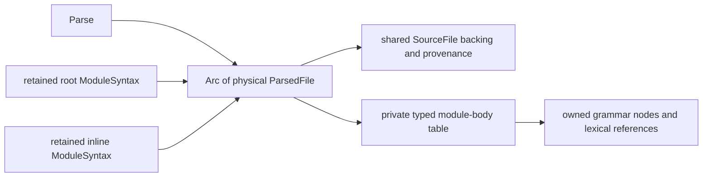

# Syntax Architecture

`kagari-syntax` directly constructs a strongly typed, lossless and recoverable AST
for one physical source file. Rust fields own grammar roles; HIR determines names,
types and executable eligibility afterward. A successful recoverable parse does
not authorize compilation.

The [workspace architecture](../architecture.md) owns crate boundaries. The
[syntax specification](../spec/syntax.md), [grammar](../kagari.ebnf) and
[coverage audit](../syntax-coverage.md) own language behavior and its inventory.

## Responsibilities and entrypoints

The lexer recognizes token kinds and UTF-8 byte ranges. The parser owns grammar,
precedence, diagnostics, recovery, cancellation and resource limits. Filesystem
acquisition, module discovery, name resolution, typing, execution and reload stay
with their existing owners. Production dependencies are `kagari-common`,
`kagari-source` and `smallvec`; syntax has no compiler/runtime dependency.

| Entrypoint | Result policy |
| --- | --- |
| `lex` / `lex_with_cancellation` | Lexical sequence, including trivia, unknown input and EOF |
| `parse` | Ordinary source with default limits and a fresh cancellation token |
| `parse_with_cancellation` / `parse_with_limits` | Ordinary source with caller cancellation and optional limits |
| `parse_declarations` | The same grammar machinery with explicit declaration mode |
| `parse_module` | Retained module only when syntax diagnostics are empty |

`ParseMode::{Source, Declarations}` survives retention. Declaration mode admits
native signatures and opaque types, without establishing executable acceptance.
HIR native ingestion checks the written view against authoritative installed
contracts. Ordinary source analysis still carries physical syntax diagnostics
into its strict checked-program gate.

## Grammar fields and recovered roles

[AST declarations](../../crates/kagari-syntax/src/ast/mod.rs) are the structural
owner. `Expr`, `Stmt`, `Item`, `Member`, `Pattern` and `TypeSyntax` have explicit
alternatives. Concrete nodes store typed children and punctuation, rather than
selecting matching positions from an untyped tree. `ExprView`, `StmtView`,
`ItemView` and `TypeView` borrow these alternatives for consumers.

For example, `1 + 2 * 3` produces an outer `BinaryExpr` with a literal `lhs`, an
`Add` operator and a binary `rhs`. That right child stores `Multiply`. Neither
accessor walks descendants to infer a role; HIR matches the parsed operator and
lowers those exact children.

```text
BinaryExpr {
    site,
    lhs: Required<Expr>,
    operator: Required<OperatorToken<BinaryOp>>,
    rhs: Required<Expr>,
}
Expr = Literal(Literal) | BinaryExpr(Box<BinaryExpr>) | ... | Error(SyntaxSite)
Required<T> = Present(T) | Missing { at: UTF-8 byte offset }
```

Boxed recursive alternatives keep ordinary Rust ownership and bounded enum sizes.
Large optional clauses are boxed so an absent `where` clause or trait application
does not reserve its full payload in every node. Immutable separated lists retain
boxed slices; temporary parser builders use vectors. Attached attributes use a
thin optional owner, avoiding a vector header on every unannotated declaration.
There is no custom allocator, node interning or universal node database.

`IfExpr` distinguishes `condition`, `then_body` and an optional `else_clause`.
For `if {}`, the condition is missing and the braces belong to `then_body`.
For `if ready {} else`, the else clause is present with a missing body. Recovery
cannot substitute a later matching expression for the missing field.
Block expressions remain valid conditions: `if { ready } { work(); }` retains
the first block as its condition. If a plain block condition has no following
body block, recovery assigns that lone block to the body and marks the condition
missing. The same rule applies to `while`.

`SeparatedList` stores ordered required elements and optional required separators.
For `f(a,,b,)`, the middle element is missing and the last entry retains a comma.
Skipped tokens have a parser-assigned owner, named field, list entry and
`RecoveryPart::{Element, Separator}`. Consumers can inspect that location through
`Ast::unexpected`; ownership is not guessed from overlapping spans. A struct
update is a final entry: `Point { ..base, x: 1 }` retains `x: 1` as unexpected
content, without admitting it as an ordinary field.
When grammar parses a first entry separately, continuation parsing records
recovery positions relative to the complete owning list, including that entry.

Type lowering exhaustively matches `TypeView`, including grouped, tuple, array,
function, applied and qualified types. Interpolation exposes ordered text/hole
parts. Attributes belong directly to declarations/members; HIR and lint do not
search parents to determine their target. Type aliases retain whether a `where`
clause was written before or after `=`, so traversal preserves either order.

Local functions reuse `FnDef` through `Stmt::FnDef`. Async blocks have a distinct
keyword wrapper and required block body; they do not fabricate closure parameters.
Postfix construction wraps the whole preceding expression exactly once.

## Source storage, spans and traversal

`Parse` owns `Arc<ParsedFile>`. The file retains a `SourceFile` clone sharing its
existing text, identity, revision, line index and projection metadata. It also
owns mode, diagnostics, typed module bodies, lexical records and sparse recovery
records. There is no second text copy, line index or stored CST.

The lexer buffer becomes one source-backed lexical table. Token kinds and starts
are retained separately; ends follow from the next start, including zero-width
EOF. Starts use 16 bits when the complete source length fits, otherwise 32 bits.
Both paths expose the same checked UTF-8 byte coordinates. Present typed token
references use one-based nonzero indices, allowing optional tokens to occupy four
bytes. These indices are private to the physical parse.

A `SyntaxSite` normally contains an ordered pair of 32-bit lexical coordinates.
A reversed pair instead identifies a sparse recovery record containing the real
coverage and unexpected contents. This private encoding keeps ordinary sites at
eight bytes and does not create syntax/semantic IDs shared across parses.
Coordinates are checked before narrowing; this representation requires source
length and lexical record count to fit 32 bits.

HIR source maps use `body_span` for semantic locations and complete authored
declaration replacement extents. Outer trivia belongs to syntax layout, not the
instruction location or replaceable declaration. Recovery can leave a grouped
pattern without its required child; lowering retains a missing-pattern placeholder
and the syntax diagnostics rather than assuming that child exists.

`body_span` covers the construct's first through last written token, excluding
outer trivia. `full_span` assigns a trivia gap deterministically: the first
newline belongs to the preceding token, following indentation/comments to the
next. A multiline block comment remains atomic. Initial trivia belongs to the
first token; a physical module's full extent is the complete file. Empty
constructs use their anchor. Non-default trivia splits live in an immutable,
parse-owned sparse hash table, with expected constant-time lookup and no repeated
source scan. Ordinary body spans and field access use direct coordinates.

For example, after `fn f(){} // tail\r\n\r\n// next\r\nfn g(){}`, `f` owns the
first CRLF and `g` owns the remaining gap. Token spans still partition the entire
original text exactly once; missing syntax consumes no bytes.

`Ast<'a, T>` pairs a borrow of actual stored data with its owning parse. Copying it
copies borrows, without cloning nodes or an `Arc`. Its `data()` exposes immutable
typed fields; source text, body/full sites and documentation resolve through the
same retained source. Constructors and mutation remain parser-owned.

`NodeRef` is a derived readonly visitor over actual node families. Field walking
comes from the same Rust declarations, in authored order. Generic consumers may
request children, descendants, tokens or enter/leave traversal; temporary visitor
vectors are not another retained tree. There are no stored parent links. Operator
visits preserve the interpreted operator together with its contiguous lexical
pieces, so expression shifts remain distinct from generic angle delimiters.

## Retained logical modules and analysis reuse



`ModuleSyntax` is the owning syntax view. It pairs the physical file with a private
module ID; an inline view can outlive the root and `Parse` wrappers. Its items are
immediate declarations. `visit_owned`/`descendants` include nested module headers
and attributes but skip their independently owned bodies. Full physical traversal
starts from `NodeRef::ModuleBody(module.body())`.

`ModuleLocation` holds a weak reference plus private module ID. Resolution requires
the exact retained `Parse`; an independently reparsed file is rejected even when
its source text is identical. A locator establishes no cross-revision identity.
Analysis owns unchanged-physical-parse reuse. Syntax performs a complete lex and
parse after a changed source; it supplies no incremental reparse or cross-call
cache. Retained snapshots continue to use their original source and syntax.

Dropping the final owner releases ordinary Rust resources. Syntax owns no script
roots or host registrations and invokes no host callbacks.

## Failure and resource boundaries

| Condition | Observable behavior |
| --- | --- |
| Malformed grammar or unknown lexeme | Diagnostics, explicit missing roles and owned unexpected coverage |
| Diagnostic budget exhausted | Additional limit diagnostic and lossless unparsed suffix |
| Recursive nesting/tree-depth limit | Stop grammar growth, diagnose the resource and retain remaining text |
| Cancellation | Controlled entrypoint returns `Err(Cancelled)`; no partial success is published |
| Internal invariant violation | May panic; source diagnostics do not excuse implementation faults |

Defaults remain 256 ordinary diagnostics, 64 active recursive grammar entries and
completed tree depth 128. The limit diagnostic is additional; zero ordinary
budget still accepts valid source. Each construction frame accumulates maximum
child depth, including names/signatures and iterative expression wrappers. Sibling
width does not consume nesting. A limit stops further growth; it does not promise
that already completed outer recovery wrappers fit the exact threshold.

Lexing, lexical-table conversion, recursive parsing and recovery observe
cancellation. Limits do not bound total source bytes, lexical storage, memory or
elapsed time. Caller admission still owns those policies. The fixed depth default
also bounds ordinary recursive destruction; arbitrarily raising it weakens stack
protection.

## Formatting

[`kagari-format`](../../crates/kagari-format/src/lib.rs) consumes typed syntax
without HIR, dependency resolution, runtime or filesystem access. The
[tool contract](../spec/toolchain-tools.md#formatting-guarantees-and-writeback)
owns style and guarded writeback.

`comments.rs` classifies original token attachments. `syntax.rs` maps typed node
families and punctuation into layout documents. `layout.rs` owns printing and
width. Complete interpolated strings retain their original source text verbatim.
Comments and literal spellings remain exact.

The library rejects syntax diagnostics, prints, reparses, compares every
non-whitespace lexical token including comments, then compares canonical typed
enter/leave/token/operator shape. Shifts and nested generic arguments retain their
interpretation. Expected output establishes style; token/shape equivalence and
idempotence establish preservation. The ignored complete grammar inventory belongs
to CI; local iteration selects representative affected fixtures.

## Implementation and verification

| Contract | Owner |
| --- | --- |
| Modes, limits and result | [Parser facade](../../crates/kagari-syntax/src/parser/mod.rs) |
| Cursor, recovery and depth | [Parser core](../../crates/kagari-syntax/src/parser/core.rs) |
| Lexical backing and trivia | [Lexical table](../../crates/kagari-syntax/src/lexical.rs) |
| Grammar and field layout | [AST](../../crates/kagari-syntax/src/ast/mod.rs), [grammar](../../crates/kagari-syntax/src/parser/grammar/mod.rs) |
| Borrowed sites and visits | [Borrows](../../crates/kagari-syntax/src/ast/borrow.rs), [visitor](../../crates/kagari-syntax/src/ast/visit.rs) |
| Physical reuse/projection | [Source preparation](../../crates/kagari-hir/src/analysis/source_preparation.rs) |
| Recovered roles and lifetimes | [Typed contracts](../../crates/kagari-syntax/tests/typed_fields.rs) |
| Resource limits | [Limit tests](../../crates/kagari-syntax/src/tests/limits.rs) |
| Declaration provenance | [Declaration tests](../../crates/kagari-syntax/src/tests/declarations.rs) |
| Performance method/results | [Measurements](../performance-baseline.md) |

Changes must preserve lexical partitioning, grammar grouping, explicit recovery,
physical diagnostics/provenance, retained module lifetimes and cancellation/limit
behavior. Use focused contract tests and required local structure/fmt/Clippy
checks. Full workspace and complete feature/backend/platform validation remain CI.
