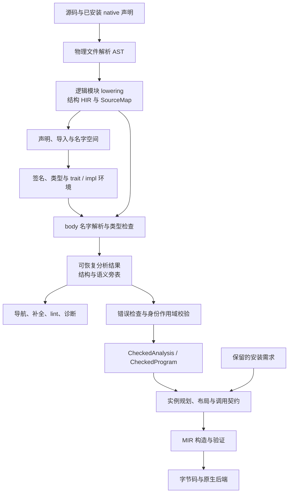
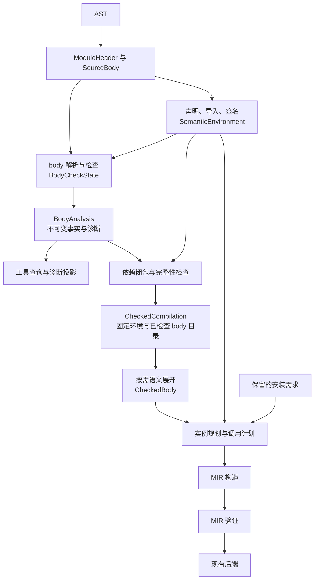
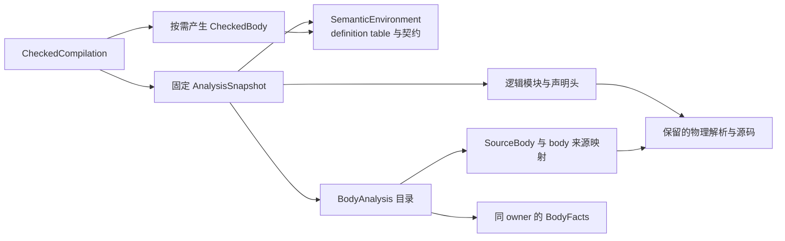

# HIR 架构与编译交接设计

状态：用户已启动 HA0–HA5 goal，HA0–HA1 已完成，HA2 执行中。2026-11-05–06 核对代码基线为
`2c1fcf9b`，工作分支为 `refactor/hir-architecture`；HA0 契约及基线见第 7.4、8.4 节，实施状态以第 7.3 节为准。
本次按用户要求使用中文。文中的新类型名和数据结构均为设计示意，不是已经存在的 API，
也不是已批准的存储布局。实现启动与范围由[路线图](implementation-roadmap.md#other-queued-designs)管理。

目标是让 `kagari-hir` 的数据所有权、分析阶段和编译交接边界明确：保留可恢复的结构 HIR
和独立语义事实，为编译提供经过完整性检查、显式表达语义操作的 body。
下游根据这些结果规划实例、生成控制流和执行表示，不重新解释源代码的名字或推导类型。

当前行为仍以 [HIR 阅读指南](architecture/hir.md)、[总体架构](architecture.md)
和[语言规范](spec/syntax.md)为准。本草案只定义重构方向，不改变语言、宿主、GC 或热更新语义。

## 1. 范围与设计原则

本次整理覆盖：

- `kagari-hir` 的结构节点、声明和签名、body 事实、分析快照及编译输入。
- `kagari-compiler::source` 消费 HIR 的入口，以及语义展开、实例规划和 MIR 构造的分工。
- 各类 ID、来源映射和结果有效性的归属；复用必须依赖哪些输入。
- HIR 的 crate/module 导览、核心模型与 API rustdoc，以及直接编译交接处的说明；
  参考 Rust 标准库文档组织方式，帮助读者从源码例子定位数据、职责和调用流程。

以下工作不随本设计启动：新的语言特性、trait 求解算法替换、全量增量数据库、持久化缓存、
AST 存储改造、通用类型 interner、运行时调用模型迁移、GC 重构、后端扩展。
[R8](review.md#architecture-findings) 继续负责细粒度失效问题；这里定义它所需的边界，
不另建一份失效缺陷清单，也不宣称已解决它。

执行分成必做的 HA0–HA3 架构迁移、HA4 有条件的测量实验和 HA5 收尾评估。
HA4 最多选择一个局部算法或存储实验，不把参考资料中的全部机制变成实现任务。
直接查看[评审结论](#61-第二轮评审结论)、[算法取舍](#62-算法与数据结构的借鉴)
和[阶段执行计划](#72-阶段执行计划)。本队列现已进入执行状态，按第 7.3 节记录继续推进。

设计遵循五条原则：

1. **以职责定义数据，以所有者解释 ID。** 同名类型或同值下标不代表同一个语义对象。
2. **检查过程与检查结果分开。** 推导变量、递归守卫和候选集属于一次检查，不属于发布结果。
3. **恢复性与编译资格分开。** 编辑器可以使用不完整事实；代码生成只能使用满足相应阶段契约的输入。
4. **阶段之间交付决定及其依据。** 下游不得通过重新搜索名字、猜测类型或回退分支补齐缺失事实。
5. **每种语义只有一个负责实现。** 新交接表示消费已有检查结果，不引入第二个类型检查器或 trait 求解器。

## 2. 当前架构与具体问题

### 2.1 当前交给下一层的数据

当前下一层是 `kagari-compiler` 的 source lowering，入口接受
[`CheckedAnalysis`](../crates/kagari-hir/src/lib.rs) 或
[`CheckedProgram`](../crates/kagari-hir/src/program.rs)。后端消费的是随后产生的已验证 MIR。

```text
CheckedProgram
├─ root / modules / dependencies / exports
└─ CheckedAnalysis[]
   └─ DefinitionMetadata<AnalyzedModule>
      ├─ lowered: Arc<LoweredModule>
      │  ├─ source
      │  ├─ module: Module
      │  │  ├─ functions / consts / statics / structs / enums / traits / impls / ...
      │  │  └─ body: Body
      │  │     └─ exprs / stmts / blocks / places / patterns / types
      │  └─ source_map
      ├─ names: ResolvedNames
      ├─ declarations: Declarations
      ├─ signatures: AnalysisResult<ModuleSignatures>
      ├─ typed: TypedModule
      │  ├─ typed functions / constants / statics
      │  └─ TypeTable
      ├─ AggregateCatalog
      └─ imported functions / constants / statics
```

`CheckedAnalysis` 的封装限制外部修改，并保留身份作用域；它不是一棵新生成的 typed tree。
`TypedModule` 仍通过 ID 旁表补充原始 HIR。编译入口会提取带作用域的内部数据用于后续处理，
不能把提取出来的可编辑数据继续当成原有 checked 证据。

物理文件与逻辑模块也必须区分：`ParsedFile` 持有一次物理解析；内联模块共享这个解析，
但当前 HIR 为逻辑模块建立各自的分析身份与 lowering。一个文件不是天然只有一个 HIR 模块。

### 2.2 当前处理流程



这是依赖图，不是每次查询都执行全部阶段。声明、签名、选定 body 和完整快照已有不同入口。
模块导入可以有环；签名准备需要整个相关声明环境，不能把图误读为“按文件拓扑顺序检查”。

### 2.3 复杂度的证据与分类

| 观察 | 当前代码证据 | 原因与处理方向 |
| --- | --- | --- |
| 结构、绑定、类型和调用事实分开 | [ExprData](../crates/kagari-hir/src/hir/expr/mod.rs)、[TypeTable](../crates/kagari-hir/src/typeck/table.rs) | 是可恢复分析的合理基础；编译消费者需要更窄的组合边界。 |
| `Body` 存储整个逻辑模块的节点 | [Body](../crates/kagari-hir/src/hir/body.rs)、[ID](../crates/kagari-hir/src/hir/ids.rs) | 检查和复用却经常以函数为单位，产生 owner 过滤和局部事实重映射。逻辑上先统一 body 所有权。 |
| 临时状态和发布事实共用 `TypeTable` | `inference_holes`、`resolving_types` 与调用、类型、模式等表共存 | 当前会清理临时状态，但类型层面没有隔开生命周期；拆分工作状态与不可变结果。 |
| 缺少表项有多种含义 | `TypeTable` 文档明确区分不适用、未访问、出错，查询有时会折叠状态 | 工具入口允许不完整；编译转换必须按操作种类验证完整性。 |
| MIR lowerer 能访问完整分析包 | [FunctionLowerer](../crates/kagari-compiler/src/source/lower/state.rs) 持有 `&AnalyzedModule` | 下游依赖解析和分析内部组织；用明确的 body 与声明契约替换宽接口。 |
| 调用处理交错多种策略 | [lower_call](../crates/kagari-compiler/src/source/lower/expr/calls.rs) | 同时处理求值、协议、native default、实例选择和 MIR 发射；按语义决定、实例落实、控制流构造分工。 |
| 跨版本复用需要比较并重映射 | [cache](../crates/kagari-hir/src/analysis/cache.rs)、[reuse](../crates/kagari-hir/src/typeck/reuse.rs) | 安全检查必须保留；导航身份与语义依赖的分离需要明确有效性契约。 |
| body 推导重复整棵遍历并复制状态 | [solve_root](../crates/kagari-hir/src/typeck/body/solving.rs) 每轮重置环境、克隆初始类型表，最多 128 轮，最后再执行诊断遍历 | 已确认存在重复工作，但尚无耗时占比。先拆工作状态，再测实际轮数与复制量；不在架构迁移中顺手重写求解算法。 |
| 替换链与实现候选扫描 | [Solver::resolve](../crates/kagari-hir/src/typeck/solver.rs) 反复结构替换；[实现搜索](../crates/kagari-hir/src/aggregates/implementations.rs) 多处扫描实现集合 | 是局部算法候选；需要区分变量链、结构类型遍历和 trait 搜索各自成本。 |

泛型与关联类型、共享对象与宿主借用、闭包与 async、热更新身份均是真实语义成本。
这些成本不能靠合并结构体消失。泛型代入后才能选择具体实现，也不等于重复类型检查。
本轮判断来自代码结构，没有性能剖析；不能将表数量、文件数量或分支数量直接解释为耗时。

## 3. 目标职责与总体流程

### 3.1 分层职责

| 层 | 负责 | 不应承担 |
| --- | --- | --- |
| Syntax | token、语法结构、恢复、物理源码范围 | 名字解析、类型推导、执行资格 |
| 结构 HIR | 逻辑声明与 body、局部节点身份、有限语法归一化 | 具体布局、可执行实例、运行时句柄 |
| 语义环境 | 声明身份、可见性、签名、trait / impl、安装的 native 契约 | 当前函数的临时推导状态、编辑器显示位置的有效性判断 |
| body 分析 | 绑定、推导、调用选择、转换、模式、捕获与控制流语义 | MIR 基本块、ABI 寄存器、运行时分配 |
| 编译用语义展开 | 将完整事实转换成明确操作，保留来源与泛型约束依据 | 重新解析或运行第二套求解器 |
| 实例规划 | 泛型代入、共享/具体实例选择、布局和桥接需求 | 重新解析源名字、用历史代码填补当前声明缺失 |
| MIR 构造与验证 | once-only 求值、控制流、执行表示及独立正确性检查 | 推测缺失的 HIR 事实、放宽宿主或身份检查 |

这些是模块职责，不要求一层一个 crate。先在现有 `kagari-hir` 与
`kagari-compiler::source` 内明确所有者；不得为示意层次创建空壳 crate 或转发模块。

### 3.2 目标数据流



`CheckedBody` 是有实际语义展开工作的短期表示，不是 AST 的完整复制，也不是永久保留的第三份全程序树。
按已检查 body 生成；处理完当前需求后释放。先不增加独立缓存。

`CheckedCompilation` 的 body 获取不得偷偷运行新的类型检查或读取更新后的数据库。
它绑定一个固定快照：可以延迟展开已验证结果，不可以延迟决定输入是否满足语言要求。
展开发现缺少必须事实时报告内部契约错误；取消和资源耗尽仍是独立失败，不发布半成品。

### 3.3 目标模块布局与阅读路径

本节为目标职责布局，不代表立即创建全部目录或新增 crate。目录移动应随所属职责的迁移完成，
已有模块由新所有者直接接管；不保留转发模块。2026-11-05 的目录检查中，`analysis/` 有
57 个 Rust 文件，其中 31 个属于 `tests` 目录、`tests.rs` 或 `*_tests.rs`；`imports/` 的
24 个文件中有 9 个属于这些测试路径。这个统计描述文件浏览干扰，不是有效 LOC 或复杂度指标。

当前更深的问题是所有者重叠：`lib.rs` 同时定义阶段结果并编排检查，`analysis/` 同时包含
数据库、查询投影和复用，`typeck/` 同时持有推导工作状态与公开结果。仅重命名目录不能消除这些依赖。

建议在现有 `kagari-hir` 内形成以下边界。子文件仅展示核心阅读入口，实际拆分以职责为依据：

```text
crates/kagari-hir/
├── src/
│   ├── lib.rs                 # crate 说明、模块声明和少量高层入口
│   ├── hir/                   # 结构数据；不进行名字解析或类型检查
│   │   ├── ids.rs
│   │   ├── module.rs          # 逻辑模块与声明头
│   │   ├── body.rs            # body 所有权与节点存储
│   │   ├── expr.rs / stmt.rs / pattern.rs / place.rs
│   │   └── source_map.rs
│   ├── lower/                 # typed AST → 结构 HIR 与来源映射
│   ├── semantic/              # 已产出的语义数据及其不变量
│   │   ├── declarations.rs    # 定义、绑定和声明目录
│   │   ├── environment.rs     # 不可变声明环境及共享目录
│   │   ├── signatures.rs      # 签名事实的唯一所有者
│   │   ├── body.rs            # BodyAnalysis 与 body 事实
│   │   └── types.rs           # HIR 专用语义类型；不复制 kagari-types 契约
│   ├── resolve/               # 模块、导入及 body 名字解析算法
│   │   ├── modules.rs
│   │   ├── imports/
│   │   └── body.rs
│   ├── typeck/                # 产生语义事实的检查算法和临时状态
│   │   ├── signatures/
│   │   ├── body/
│   │   ├── inference/
│   │   └── const_eval/
│   ├── analysis/              # 请求编排、输入、快照、缓存和复用
│   │   ├── database.rs
│   │   ├── snapshot.rs
│   │   ├── pipeline.rs
│   │   └── reuse/
│   ├── queries/               # 位置导航、类型显示、补全、文档等查询投影
│   ├── compile_input/         # 固定快照的编译交接与完整性检查
│   │   ├── program.rs         # CheckedCompilation
│   │   └── admission.rs
│   ├── native/                # 已安装宿主声明适配与来源关联
│   ├── language/              # builtin / lang item 的语言规则与契约
│   └── tests/                 # crate 级语义契约、UI 驱动与共享测试支持
├── tests/
│   ├── api.rs                 # 仅在有外部公共 API 契约时设置集成测试入口
│   └── fixtures/              # 复用现有源码、诊断等测试数据
└── Cargo.toml
```

各生产模块可按需要拥有一个 `tests/` 子目录，具体约定见下一节；这里省略重复画法。
`semantic/` 按明确记录拆分，不接收检查算法、缓存或任意跨模块辅助函数。当前
`aggregates`、`callable`、导入类型等记录按照实际所有权迁入环境、签名或 body 事实，
不可形成旧记录与新记录长期并存的两套事实源。

关键依赖约束：

- `hir/` 与 `semantic/` 的模型不反向依赖 `analysis/` 数据库或 `typeck/` 工作状态。
- `resolve/` 读取声明输入并产出绑定事实；`typeck/` 读取结构、绑定及语义环境，产出签名或 body 结果。
  声明收集、循环导入求解、签名检查及 body 检查仍按现有语义分阶段执行，不要求依赖图无环。
- `analysis/` 编排上述阶段并发布快照；签名复用、body 复用的有效性由它管理。
  检查器不负责判断数据库缓存是否命中，已发布记录不带可变检查器。
- `queries/` 通过分析入口取得快照或所需结果，然后投影事实；数据库不依赖查询展示逻辑。
  查询不得另写类型推导或调用选择规则。
- `compile_input/` 读取固定分析结果和语义环境，验证依赖闭包、物理语法错误及 body 完整性。
  编译器消费这个边界，不能通过它返回可变数据库或重新进入 IDE 查询。
- `native/` 将安装契约适配为声明输入；`language/` 持有语言特有规则。二者不负责宿主运行时执行，
  也不建立绕过普通解析和检查的第二套语义。

签名检查需要可恢复的准备状态；它留在 `typeck/signatures/` 的工作状态中，完成一个发布边界后
才形成 `semantic/` 的不可变环境。不能为了画出分层图而把未完成事实标成完整结果。

编译器侧对应的目标职责仍在 `kagari-compiler::source`：

```text
source/
├── elaborate/     # CheckedCompilation → 短期 CheckedBody
├── instances/     # 泛型代入与实例需求、调用及布局计划
└── mir/           # 消费明确操作并构建 MIR
```

这里是现有代码的归属方向，不新增空壳子系统。实例选择所需的声明查询通过编译契约提供；
MIR 构造不能再读取整个 `AnalyzedModule` 并补做名字解析或类型推导。

建议阅读顺序是 `hir` → `semantic` → `compile_input`，先理解输入和输出；再读
`lower` → `resolve` → `typeck`，了解如何产生结果；最后读 `analysis` 的缓存复用和
`queries` 的工具投影。`lib.rs` 只给出这条阅读路径，不再容纳所有阶段结构和长流程。
目录归属不意味着模块一律公开；公开范围由实际调用方决定，不新增广泛 re-export。

`DefinitionReferences` / `RemapDefinitions` 的通用机制继续属于 `kagari-common::identity`。
记录的具体遍历实现保留在记录所有者的私有 `mapping` 子模块，发布时的检查入口归
`analysis` 或 `compile_input`。不要把不同模型的字段遍历全部堆入一个公共 `identity` 模块，
也不要让每个正常阶段交接都自动导入一份新的定义表。derive 能否替代样板代码另行按实际重复量评估，
本次不新增宏框架。

### 3.4 测试布局：保留模块归属，降低浏览干扰

用户偏好是允许测试留在源码树内，但避免大量 `*_tests.rs` 和生产文件平铺。默认采用
“所属模块下一个测试入口，内部按契约分文件”的形式：

```text
analysis/
├── mod.rs
├── database.rs
├── snapshot.rs
├── pipeline.rs
├── reuse/
└── tests/
    ├── mod.rs
    ├── snapshots.rs
    ├── identities.rs
    ├── signature_reuse.rs
    └── body_reuse.rs
```

生产模块只保留普通 Rust 模块声明：

```rust
#[cfg(test)]
mod tests;
```

该声明使用 `analysis/tests/mod.rs` 作为测试入口。测试仍是所属模块的后代，保留相应私有访问能力；
内部测试的普通导入依照仓库规则使用明确路径。不得为文件搬迁扩大生产可见性，也不使用手写
`include!` 或批量 `#[path]` 将零散文件重新挂回来。

| 测试性质 | 归属 |
| --- | --- |
| 依赖私有状态的缓存、推导器、身份或求解规则 | 最近的语义所有者下 `tests/`；需要更窄私有字段时，保留该私有模块自己的测试入口。 |
| 跨多个内部阶段的语言契约、诊断 UI 用例 | 现有 `src/tests/` 按契约归类，复用现有驱动。 |
| 必须证明外部用户只能通过公共 API 完成的契约 | crate 根的 `tests/` 集成测试；仅为真实外部边界设置入口。 |
| 源码、诊断快照等数据 | 继续使用现有 `tests/fixtures/`，不复制到每个测试模块。 |
| 简短、紧贴算法且阅读有帮助的例子 | 可保留局部测试或 rustdoc；不要求机械搬迁。 |

`analysis` 下的 callable、completion、documentation 等测试，在查询实现移入 `queries/` 时
跟随其语义所有者迁移；缓存、快照、身份有效性测试留在 `analysis/tests/`。`imports` 的测试
随导入算法进入 `resolve/imports/tests/`。不按旧文件名原样造一棵重复的生产目录镜像。

像 `ModuleSignatures::assert_same_source_facts` 这样的较长测试专用比较代码也应移入测试模块，
避免生产模型说明被测试实现打断。能保留私有访问的比较逻辑留在模型的后代测试模块；只有多个契约
确实共享的构造器和断言才放入 `src/tests/support/`，并保持 `cfg(test)`，不新增公开测试 API。

迁移时区分文件整理和职责修改：先以有限提交移动批量测试并调整模块声明、fixture 路径及已有
CI 过滤器，保持用例和断言；随后在 HA1–HA3 中随所有者拆分移动生产代码与对应测试。
无需为目录整理新增测试或重写现有覆盖。选取受移动入口影响的少量契约确认能发现并执行测试，
完整测试发现与平台矩阵仍由 CI 验证。

这与 Rust 的两类测试边界一致：子模块单元测试可以访问祖先私有实现，集成测试通过公共 API。
rustc 也将单元测试放入独立测试文件，并将 compiletest 套件集中在测试目录。
Kagari 在此基础上选择模块内 `tests/` 文件夹，以适应当前大量测试文件的浏览需求。
参考：[Rust 测试组织](https://doc.rust-lang.org/book/ch11-03-test-organization.html)、
[rustc 测试组织](https://rustc-dev-guide.rust-lang.org/tests/intro.html)，核对日期 2026-11-05；
采用其归属机制，不引入 compiletest 或新的测试框架。

### 3.5 HIR 协作取消的简化方向

本节回应 2026-11-05 的取消复杂度讨论，仅提出 HIR 改造中的职责调整。AST 已落地的
[粗粒度取消](architecture/syntax.md#failure-and-resource-boundaries)继续使用；共享 token 的
waker/订阅、脚本运行时取消、宿主长操作以及此前推迟的编译器/update-budget 整合不在本节实施范围。

取消需要分开看三个问题：在哪里读取共享标志、观察后如何停止当前工作、哪些结果可以发布。
减少读取次数只解决其中一个问题。当前可直接看到的复杂度来源如下：

| 位置 | 当前行为 | 简化方向 |
| --- | --- | --- |
| [声明身份遍历](../crates/kagari-hir/src/declarations/mapping.rs) | `Declaration`、`DeclarationId` 及其分支连续检查取消，随后才访问一个 ID。 | 由一次遍历的所有者控制检查节奏，简单字段转发不重复读取共享标志。 |
| [身份重映射](../crates/kagari-common/src/identity/mapping.rs) | 记录实现可能先 `mapper.check()`，每个 `reference()` 又检查一次。 | 保留目标身份校验、重复键检查和大小限制，合并相邻取消检查。共享 API 变更须另列受影响调用方，不能只改 HIR 后留下双版本入口。 |
| [body 类型检查](../crates/kagari-hir/src/typeck/body.rs) | 语句和表达式入口检查取消；部分路径返回 `Unknown`，靠外围拒绝结果。 | 检查工作状态持有停止状态，阶段出口明确返回取消，临时占位不得进入发布数据。 |
| [缓存兼容性判断](../crates/kagari-hir/src/analysis/cache.rs) | 可取消比较通过 `unwrap_or(false)` 表达为不能复用。 | 在可能长时间运行的比较边界区分“不匹配”和“取消”，避免取消被当作 cache miss 后继续重算。 |
| [body 发布](../crates/kagari-hir/src/analysis/body_queries.rs) | 在写入 body/signature 缓存前再次检查取消。 | 保留这一边界，并与固定快照及旧结果保留规则一起集中说明。 |

这些是源码中的职责问题，不是已测得的性能热点。当前没有 HIR 取消延迟或吞吐量基线，
不能据此声称删除若干调用就能获得确定的速度提升。

建议只保留三类检查点：

1. **请求、阶段与发布边界立即检查。** 包括缓存命中返回、lowering、签名/body 检查的入口与成功出口，
   以及结果进入共享缓存之前。阶段参数只借用同一个请求 token，不为普通子步骤另建 token。
2. **工作序列按批次检查。** 在现有声明、语句/表达式遍历、导入工作队列、元数据集合等
   工作循环中集中检查。一个序列的递归子调用共享其进度，避免每个小 helper 重置计数。
   getter、普通字段投影、短小纯函数不承担取消职责。
3. **可能长时间独占执行的算法拥有内部检查点。** 导入不动点、trait 搜索、约束求解、常量求值、
   大类型/模式遍历和大容器转换不能只依赖外层每文件或每函数检查。按实际工作进度布点，
   不按递归每一层机械布点；一次候选展开可能很大时，内部仍须覆盖。

批量间隔是实现细节，待测量选择，不增加公开调参项。工作计数只能调节轮询节奏；精确的
深度、候选数、诊断数和常量求值限制继续由原语义所有者逐步计量，不能随取消轮询一起抽样。
身份、owner、来源和宿主契约检查也不因检查点合并而减少。

错误传播采用阶段边界明确、内部状态集中的方式：

```text
analysis 请求：固定输入 + 一个 CancellationToken
    ↓
阶段私有工作状态：lowerer / signature checker / body checker
    ├── checkpoint：在指定边界或工作批次观察取消
    ├── observed cancellation：记录停止，停止继续添加工作
    └── finish：先检查停止/取消，再构造可发布结果
    ↓
Result<阶段结果, AnalysisError>
    ↓
analysis：发布前检查 → 替换缓存/返回快照
```

这是所有权示意，不要求新建一个通用的任务执行框架。每个阶段保持明确的工作状态和终结入口：

- 对可正常关闭的私有递归构造，可以借鉴 AST 的停止标记；只有该阶段的成功出口能发布结果。
  不要求所有表达式访问器为了取消改成 `Result`。若内部仍用恢复占位完成退栈，其含义只限于
  待丢弃的私有状态，`finish` 必须先拒绝取消，再做完成性断言或封装结果。
- 已经具有 `Result` 的求解器、身份转换和长比较保留显式传播，尤其不能把取消解释为
  “没有实现”“类型不匹配”或“缓存不命中”。真实身份/契约错误仍保留具体原因。
- 跨阶段统一映射为已有 `AnalysisError::Cancelled`；不新增层层重复包装的取消错误种类，
  也不为了减少 `?` 改用 panic/unwind。是否需要更窄的阶段错误类型由真实非取消错误决定。
- 一旦观察取消，停止扩展工作队列；只完成释放私有资源或安全关闭所必需的步骤。
  缺失函数槽等中间状态直接丢弃，不能运行只适用于成功构造的 `finish` 断言。
- 取消后的未完成结果不得替换旧快照或进入成功缓存。已经在更早独立提交点完成验证的
  不可变子结果，以及 append-only 身份表中已驻留的名字，不要求为了取消回滚；它们不能充当
  当前请求成功的证据。复用及发布时间顺序仍保留既有版本规则。

最后一次检查与成功返回之间仍可能并发收到取消请求；沿用协作取消语义，不把一次原子读取
描述为“取消与提交完全互斥”的协议。本设计也不承诺固定毫秒内返回，清理和销毁可能延迟退出。

参考机制核对日期为 2026-11-05：

- [rust-analyzer cancellation](https://rust-analyzer.github.io/book/contributing/architecture.html#cancellation)
  在分析边界捕获取消；其内部依赖特殊 panic/unwind。借鉴“计算结果可丢弃、外部错误统一”的边界，
  Kagari 保留正常错误返回和私有状态清理，不引入 Salsa 或异常式退出。
- [Salsa tuning](https://salsa-rs.github.io/salsa/tuning.html#cancellation)说明查询调用提供取消机会，
  但不调用其他查询的长循环仍需主动检查。借鉴工作所有者负责长循环的规则，不能把“阶段边界集中”
  理解为删除所有内部检查点。资料为在线文档，不作为特定 Salsa 版本的 API 移植依据。

实施顺序并入既有 HA0–HA1：HA0 列出阶段入口、发布点和可能长时间独占执行的循环，
在已支持的代表性源码上记录正常分析成本、取消观察进度及清理时间；HA1 随检查工作状态分离
先收紧取消出口，再合并冗余检查。共享身份遍历接口若需要改变，必须先明确所有消费者及有限切换范围，
在该契约定稿前保持共享层行为，不顺带改运行时或可执行产物转换策略。

验证优先复用已有签名/body 缓存、导入求解和 trait 搜索取消测试；补充的独立边界为
计算中途、缓存命中返回及发布前取消，并验证取消不被当作未找到/不能复用。
用确定性测试检查点触发取消，避免依赖 sleep 和线程调度；大 body、深类型、宽导入、零候选搜索
以及清理路径分别检验其工作覆盖。不能仅靠“预先取消 token”证明长计算具有取消响应能力。

### 3.6 定义身份遍历：先收紧能力，再处理样板

2026-11-05 对 `update_source/mapping.rs` 的检查表明，需要区别“字段包含 DefinitionId”
和“这个类型必须提供通用跨上下文转换”。前者不自动要求后者；同一上下文的内部工作记录
可以由其构造、使用及最终发布边界保证归属。

具体证据：

- [update_source 数据](../crates/kagari-hir/src/update_source.rs)含 `SourceFact`、`SourceBody`、
  `SourceInitializer` 和 `SourceEvidence`；基线中的 `mapping.rs` 为四种类型分别手写只读遍历和
  重建转换。HA1a 已删除这些无生产需求的实现；`SourceBody` 原遍历只处理 `declaration` 和 `facts`。
- 仓库当前生产调用位于[编译器收集入口](../crates/kagari-compiler/src/source/program/update_records.rs)：
  从 `CheckedProgram` 成员收集证据，按定义身份排序，再转换成 `SourceRecord` 等产物记录。
  这条路径没有对 `SourceEvidence` 调用 `DefinitionMetadata::import_into()`。
- 基线中唯一的 `SourceEvidence` 导入发生在[静态初始化器比较测试](../crates/kagari-hir/src/update_source/tests.rs)：
  原测试分别创建独立分析，再把结果导入同一上下文以比较；HA1a 已改为同一数据库的连续快照。
  这里证明的业务契约是空白与被调函数实现变化
  不改变本地初始化表达式证据，而改变表达式会改变证据；独立定义表是该测试构造方式带来的需求。

建议的精简顺序：

1. **按真实消费者决定能力。** 对上述证据类型，先把比较测试放到同一个分析数据库的不同源码快照中，
   保留原来的正反断言。核对全部调用方后，若没有独立导入需求，可删除四种类型的通用遍历/重映射实现及
   整个 `update_source/mapping.rs`，不把同等转换代码搬进测试工具。字段中的 `Ty` 仍可使用自己的遍历能力。
2. **同一分析流程共享定义身份。** HIR、语义事实及该次编译的临时证据延续已经匹配的上下文；
   按发布点验证不可变前缀。源版本、body owner 和局部 arena 仍独立校验，不能因为定义表相同就共享全部事实。
3. **真正跨上下文的边界保留转换。** 宿主契约接入、独立产物导入、可复用元数据等保留精确身份映射。
   发布类型仍须覆盖字段和映射键中的所有身份引用，并拒绝外来/缺失 ID 及转换后重复键。
4. **对剩余机械实现使用有限的自动生成。** 若调用方审计后仍有大量必须支持的记录，优先考虑
   类型定义旁的 derive；访问与转换分别选择，快照专属数据不能因为生成方便就自动获得搬迁能力。

第 1 点移除的是生产流程未使用的能力，不能用作其他可执行/元数据边界删除校验的理由。
产物转换继续执行其语义、身份和来源验证；若调整临时证据构造可见性，必须让外部调用者无法
把任意修改的数据冒充受检输入，不新增只做包装的“已检查”标记。跨上下文身份拒绝与产物导入测试
仍留在真实契约所有者，不能以同上下文比较替换这些独立覆盖。

可选方案的取舍：

| 方案 | 适用性与代价 |
| --- | --- |
| 收紧类型能力与转换边界 | 本次优先；可以直接消除没有生产调用的实现，需要先证明构造/消费路径的归属约束。 |
| derive 生成字段遍历和转换 | 用于确实需要这些能力的记录；减少手写遗漏，不自动减少运行时遍历次数。新增字段默认参与检查；跳过字段须能证明不含身份。容器映射键、重复键、大小限制及取消仍由明确实现承担，不能使用全类型空实现。 |
| 单一可变 visitor 同时做检查与转换 | 暂不采用。只读验证会被迫获取可变访问或复制；包含身份的 map key、共享 `Arc` 和失败时半修改状态仍需专门处理，复杂度只是转移。 |
| 所有 ID 改成字符串路径或进程全局 ID | 本次不采用。它改变身份存储、生命周期及产物边界，无法自动证明声明可见性、所属版本或执行资格；没有必要为减少这份样板引入全局模型迁移。 |

生成后的代码可以保持普通模型声明，下面仅表示拟议 derive 的使用方式，当前宏尚未实现：

```text
#[derive(DefinitionReferences)]                    // 只读引用检查
struct SnapshotFacts { ... }

#[derive(DefinitionReferences, RemapDefinitions)]  // 确有独立导入需求的记录
struct ReusableSignature { ... }
```

只读与重建能力分离可参考 rustc 的
[TypeVisitable](https://doc.rust-lang.org/nightly/nightly-rustc/rustc_type_ir/trait.TypeVisitable.html)
和 [TypeFoldable](https://doc.rust-lang.org/nightly/nightly-rustc/rustc_type_ir/trait.TypeFoldable.html)：
二者提供派生实现，且允许数据可访问而不可转换。核对的 rustdoc 页面分别标注
1.101.0-nightly `2d20b42b8`（2026-11-04）和 `822182db4`（2026-10-13）。
它们主要遍历类型/生命周期等语义对象，并非 Kagari 定义表重映射的直接替代；借鉴的是生成和能力分离机制。

通用导入当前有收集 ID、重建记录、验证目标引用等步骤。把它合成一遍需要证明输入已验证、
转换器完整、容器不丢键、输出前缀匹配及失败发布规则，不能仅删除最后一次检查。本设计先解决
能力和样板问题，不同时承诺单遍导入或吞吐量改善。取消职责继续遵循第 3.5 节。

本节为 HA0 的消费者审计和 HA1 的有限精简依据；宏是否值得引入，以审计后剩余的真实重复量决定。
现有 `kagari-derive` 面向宿主 DTO schema/value，不能仅因它是 proc-macro crate 就混入编译器身份策略。
当前不新建宏 crate，也不把本设计扩展成全仓库映射框架替换。

### 3.7 文档：以 Rust 标准库风格降低理解成本

本次重构同时完善 HIR 文档，不把文档补全推迟成独立清理任务。已有 `lib.rs`、`Body`、
ID 和 lowering 示例是可保留的基础；随新模型更新失效部分，避免重新堆砌相同内容。
本设计与执行计划继续使用中文；代码 rustdoc、注释和最终架构阅读指南遵循仓库约定使用英文。

风格参考 [Rust 标准库 HashMap 文档](https://doc.rust-lang.org/std/collections/struct.HashMap.html)
及 [rustdoc 写作指南](https://doc.rust-lang.org/rustdoc/how-to-write-documentation.html)：
先用简短摘要说明用途，再解释行为和约束，提供能帮助读者使用或理解模型的例子，
按需列出错误和 panic，并链接相关接口。2026-11-06 核对的标准库页面为
1.99.1（`58cf8f9c3`）；借鉴的是写作组织方式，不要求复制标准库的实现细节或每节标题。

| 文档层级 | 应帮助读者回答的问题 | 本次交付要求 |
| --- | --- | --- |
| crate 与主要模块 `//!` | 这一层做什么？输入输出是什么？先读哪个入口？ | `lib.rs` 提供最短阅读路径、阶段概览和一个真实入口示例；主要模块说明职责、关键类型与上下游。通过链接继续阅读，不在每个模块复制全局架构。 |
| 核心结构与枚举 `///` | 这份数据代表什么？由谁创建、持有和消费？ | 用具体 Kagari 片段映射字段、变体与子节点，说明结构信息和语义事实的区别；字段文档解释角色、单位、顺序及 `None`/空集合的含义，避免仅复述名字。 |
| ID、句柄、旁表与快照 | ID 去哪张表取？能保存多久？可以混用吗？ | 写明 owner、索引目标、有效范围、克隆/修订后的含义，以及外来身份的拒绝方式；链接拥有者和查找 API，不把 arena index 描述成持久身份。 |
| 查询、转换与编译入口 | 调用需要什么？返回结果证明什么？失败以后保留什么？ | 摘要描述行为；正文区分缺失、恢复错误、未检查、取消和耗尽，注明是否触发分析及是否发布/复用结果。真正会返回错误的入口写 `Errors`，会 panic 的入口写 `Panics`。 |
| 内部算法与阶段边界 | 为什么采用这个过程？哪些不变量保证结果成立？ | 重要私有类型/函数也写说明；为求解、复用、重映射、取消发布等解释关键状态与终止条件。行内注释解释非显然的原因，不逐行翻译代码。 |
| `architecture/hir.md` | 如何从一个源程序走到 HIR、事实与编译交接？ | 保留紧凑的职责图、数据流和源码到字段示例，连接 rustdoc 所有者。架构指南解释全局关系，字段/函数契约只在其定义处维护。 |

核心模型至少覆盖声明/模块、body/表达式/place/pattern、语义类型与签名、绑定/调用事实、
环境/快照、身份/来源及 checked 输入。范围包括保留的现有 API，不能只给新命名的类型加注释。
HA0 在消费者矩阵中增加“文档所有者与缺口”列；普通私有辅助函数按理解成本补充，
不以所有函数都加模板注释或 `missing_docs` 全绿代替内容评审。

统一写作规则：

- 第一段能够独立出现在 rustdoc 搜索结果中；先说明行为，再展开原因和边界。
  简单 accessor 一句准确说明即可；复杂模型采用有层次的正文，避免首屏被历史和实现细节占满。
- `Examples` 优先展示最短、有意义的使用过程和可观察结果。Rust 示例用真实 API，
  可运行的纳入 doctest；Kagari 源码、树图和概念结构使用 `text`，明确示意索引并非固定值。
  不用 `ignore` 掩盖过时示例，也不为使私有接口的示例能编译而扩大可见性。
- 示例至少贯通一次“源码 → 声明/body → 节点 ID 查找 → 语义事实”，并在编译入口展示
  可恢复分析与 checked 输入的不同资格。方法调用、泛型约束及 malformed source 选用现有例子，
  在所属文档解释，不为每个字段重复同一整段程序。
- 用可解析的 intra-doc links 连接相关类型、构造入口、查找方法及共享契约。
  只有实际存在相关行为时才添加 `Errors`、`Panics`、`Safety` 或复杂度说明；
  未经证明不承诺渐近复杂度，未经测量不声称更快。
- 最终文档描述当前实现，不保留“将来会迁移”“旧入口兼容”等已完成过程说明。
  图中的节点、箭头和字段名称与最终代码一致；源码内使用 rustdoc 能直接阅读的文本图，
  Mermaid 总体图放在支持它的架构 Markdown 中。

验收以读者能完成任务为准：从 crate 首页能找到分析入口；从一个 `ExprId` 能找到其存储和
有效期；从调用事实能知道检查期与实例期各决定什么；从 `DefinitionReferences` 的实际剩余
消费者能理解为什么需要引用验证、什么时候需要重映射。读者不应先通读所有实现才能回答这些问题。
HA1–HA4 同步完成变更所有者的文档，HA5 检查保留 API 的缺口、阅读路径和渲染结果。

## 4. 核心数据结构

下面的结构用 `text` 表示概念字段。容器可以按实际访问需求选择，`Arc`、哈希表、数组或局部索引
的物理布局不由示意图强制决定。新表示必须替换对应旧职责，不能形成长期双份事实源。

### 4.1 身份与所有权

需要区分四类身份：

| 身份 | 标识什么 | 有效范围与约束 |
| --- | --- | --- |
| `DefinitionId` | 函数、类型、成员、泛型参数等语义声明 | 由对应 definition table 的不可变前缀解释；不承诺下标跨会话或编辑稳定。 |
| `BodyKey` | 固定快照内某个语义所有者的 body 及角色 | 包含足以确认作用域、owner、body 身份的上下文；不能仅凭函数名字构造。 |
| `ExprId` / `LocalId` 等 | 一个 body 内的节点或绑定 | 必须随 body 上下文使用；局部下标不能索引其他 body。 |
| `OriginId` | 节点与源码/生成来源的对应关系 | 由来源表解释，包含物理文件、修订及必要的生成来源关系。 |

`BodyKey` 的具体编码留在后续设计检查点确定。现有 arena/owner 校验不能因改为局部下标而消失：
私有局部索引可以由 body 句柄限定使用，跨 API 保存的引用仍需携带并验证其所属上下文。

闭包和 async block 的作者身份、父 body、捕获绑定需要显式关联。它们不因为变成可执行函数，
就获得可跨修订复用的普通顶层声明身份。静态变量声明与其生成的初始化函数也必须保持不同身份。



箭头表示拥有或保留依赖，不代表每条边都必须是单独的 `Arc`。保留一个旧快照不会把其局部 ID
升级为新快照的 ID。生成新的编译定义需要受控的身份分配和新前缀验证，不修改已封存记录的含义。

### 4.2 声明头与结构 body

```text
ModuleHeader
  unit                 逻辑模块身份与来源上下文
  declarations         源顺序的声明，以及按种类查找的索引
  imports              导入声明及其来源
  child_modules        子模块声明身份；不内嵌子模块全部 body

Declaration
  identity             DefinitionId，进入环境后确定
  kind                 Function / Struct / Enum / Trait / Impl / Const / Static / ...
  signature_syntax     参数、类型引用、泛型、约束等结构
  body                 可选 BodyKey
  origin               来源

SourceBody
  owner                BodyKey
  parameters / locals  局部绑定定义
  expressions          未附最终类型的结构表达式
  statements / blocks
  places / patterns / type_syntax
  root
  source_map           与本 body 的节点身份匹配
```

声明头与 body 的逻辑分离应覆盖函数、方法、常量初始化器、静态初始化器和嵌套 callable。
签名中的类型语法属于声明所有者；body 内的注解属于 body，不能为了统一存储强制挂到任意函数下。
常量求值仍属于语义分析，静态初始化器仍是运行时代码，两者不能合成一个初始化执行路径。

结构 HIR 允许 `Missing` 和错误节点，以服务编辑中的源码。去掉括号包装、展开字段简写等
不依赖类型的归一化可以留在这里；依赖已选方法、接口转换或宿主契约的变换留到语义展开。

第一步可以继续使用现有模块 arena，实现这些逻辑所有权。只有验证了迁移收益与代价，
才将节点向量物理拆成按 body 分配；不以降低 LOC 或缩小类型名字作为拆分依据。

### 4.3 声明语义环境

```text
SemanticEnvironment
  definitions          有作用域的声明身份表
  declarations         名字、可见性、声明种类及拥有关系
  signatures           参数、结果、泛型 binder、约束
  nominal_contracts    struct / enum / trait / associated type / impl
  native_contracts     已安装绑定及其受验证契约
  namespaces           模块与导入解析结果
  dependencies         已捕获的语义依赖及版本关系
```

工具可通过独立来源索引查找导航位置；编译契约比较不应把显示位置当成语义内容。
但“语义相等”不授权将旧节点映射到新源码：来源索引和 node owner 仍需独立验证。

`SemanticEnvironment` 是逻辑所有者，不要求把现有目录全部复制进一个巨型结构体。
先确定声明、签名、实现关系的唯一事实源，再按消费者提供明确借用。
它不能成为任何模块都能写入的 `common` 容器。

native 声明继续通过现有安装、生成声明源和契约校验流程进入统一环境。
本设计不创建一份可绕过普通名字解析和静态检查的宿主 callable 目录。

### 4.4 检查工作状态与发布结果

```text
BodyCheckState                         仅在检查过程中存在
  inference_variables                  推导变量与解
  obligations / candidates             待验证约束与候选
  recursion_guards                     递归和循环检测
  mutable_bindings / types             正在计算的事实
  diagnostics / cancellation / limits

BodyAnalysis                          固定快照中的不可变结果
  owner: BodyKey
  source_body
  resolved_bindings
  facts: BodyFacts
  completion                          完整通过 / 存在错误 / 未完成检查
  diagnostics
  dependency_inputs                   复用所依赖的输入

BodyFacts
  value_types / local_types / place_types
  calls / conversions
  field_access / index_access / host_access
  patterns / iteration / propagation
  constants / captures / completion_facts
```

签名的最终事实与 body 的最终事实分开；两者不再包含临时推导守卫。
`BodyFacts` 可以使用按节点的旁表，没必要为了整齐给每个节点附上所有字段。

事实状态必须有文档约束：

- 不适用的事实不需要表项，例如 literal 不需要调用选择。
- 应有但没有的事实，在恢复分析中保留失败或未完成状态，在编译转换中拒绝。
- `Error` 类型和缺少类型事实不是同一状态；工具入口不得据此推断可执行资格。
- 诊断展示截断不能把失败结果变成成功；资格来自检查完成状态和完整错误证据。
- 取消不发布 `BodyAnalysis` 的部分成功，也不覆盖之前的有效快照。

不要求为每个表项增加统一的多态状态包装；使用 body 完成状态、按操作划分的结果以及完整性验证
表达必要区别，避免把状态组合扩散到所有普通查询。

### 4.5 编译交接对象

```text
CheckedCompilation
  environment           固定且已验证的声明/语义环境
  module_graph          完整可达依赖闭包，允许环与菱形
  exports               已检查的导出及根入口
  checked_body_inputs   owner -> 已通过检查的不可变输入
  origins               诊断、调试及更新对应关系

CheckedBodyInput                         概念上的受检视图，不要求复制存储
  owner: BodyKey
  source_body                            固定来源与节点所有权的结构 body
  facts: BodyFacts                        与该 body、签名和环境匹配的完整事实

CheckedBody
  owner
  parameters / locals   确定的语义类型与绑定角色
  expressions           CheckedExpr { kind, ty, origin }
  blocks / statements / patterns / places
  captures              与源绑定相连的捕获事实
  root
```

这里有两个不同交接点：HIR 对编译器交付的是 `CheckedCompilation`，其中每个源码 body
提供 `CheckedBodyInput`；编译器的 `source/elaborate` 再将它展开成短期 `CheckedBody`，交给
实例规划和 MIR 构造。结构 body 加语义旁表已经可以表达完整语义，不要求 HIR 先生成另一棵
永久 typed tree。示意结构的字段由受限构造和只读访问器提供，不是可由外部自由拼装的 public 字段。

工具消费者则读取 `AnalysisSnapshot` / `BodyAnalysis`，允许存在恢复节点、错误事实和诊断。
编译交接不携带可变检查工作状态、缓存调度器或整套工具查询 API。环境和 body 数据可以共享
已有不可变存储；收紧的是可访问契约，不是要求整份复制数据。

`CheckedCompilation` 的外部构造受限；不能由“用户清空了 diagnostics 的分析包”创建。
既检查逻辑模块的语义结果，也保留物理解析错误证据，不能漏掉同物理文件的内联模块错误。
要求检查的范围沿用当前完整依赖闭包契约，不能通过仅展开可达函数跳过应拒绝的无效声明或 body。

`checked_body_inputs` 是固定数据，不是可变 `AnalysisDatabase` 回调。
按需展开只减少临时表示的驻留，不改变既有检查范围。body 的缺席必须能区分 native 实现、
trait requirement、源码 body 等合法类别，不能把查找失败当成其中任一类别。

`CheckedBody` 的每个值表达式具有合法语义类型。泛型 binder 与有依据的投影仍合法；
`Unknown`、`Error`、未解决推导变量以及 `Missing` 不可进入该表示。
类型可继续复用现有语义类型模型及其校验；无需顺带把当前实际上是枚举的 `TypeId` 改造成 interner 索引。

来源映射可以与执行节点分开存储，但不能丢失函数、局部变量、生成代码和原始源码的对应关系。
HIR 可以保留源码；源无关的执行产品边界仍在 contract、MIR 与字节码，不在这里强行提前。

### 4.6 明确的语义操作

```text
CheckedExprKind                       示例集合，不是完整枚举
  Constant(value)
  ReadBinding(binding)
  ReadPlace(place)
  Call(CheckedCall)
  Convert { value, conversion }
  Construct { declaration, fields_in_source_order, update_base }
  If / Match / Loop / Block
  Propagate { value, selected_protocol }
  Await { future, selected_contract }
  Closure { body, captures }

CheckedCall
  Direct { declaration, type_arguments, signature, operands }
  Interface { method, applied_interface, signature, operands }
  Bound { obligation, method, type_arguments, signature, operands }
  CallableValue { callee, signature, arguments }
  RuntimeHelper { helper_contract, operands }
```

这个划分的目的，是让每个分支携带它必须拥有的数据。普通调用不能缺少 signature；
helper 使用自己的操作数契约，不能借普通调用的 `None` 表示多种不同含义。

`operands` 明确求值顺序和接收者角色，不能同时把同一接收者当作 callee 子树和独立参数再次求值。
若 callee 本身终止执行，展开结果保留该求值及终止事实，不构造一个参数仍会执行的普通调用。

转换应明确记录已选接口实现、upcast 或 callable 适配；字段与索引访问携带已选成员和访问契约。
原生绑定由目标声明的实现记录解释，是否经 ABI 桥接属于后续执行表示决定。

`Bound` 表示类型检查已证明约束，但尚需按实例参数落实的调用。它保留调用者 binder、应用后的
trait、成员和签名，不能在实例化时按方法字符串重新搜索。共享泛型代码可以保留显式字典/接口
调用所需契约，不要求所有调用最终静态化。

### 4.7 实例规划与 MIR 构造

```text
CheckedBody + TypeSubstitution + 已验证环境 + 安装需求
  -> 实例规划
       具体/共享实例身份
       通过同一个语义机制落实的调用计划
       布局、native 入口、接口桥接与依赖需求
  -> MIR 构造
       基本块、临时值、显式控制流、调用和访问指令
  -> MIR 验证
```

语义展开负责决定“源码中的操作是什么意思”；实例规划负责决定“在本次应用下使用哪个实现和表示”；
MIR 构造负责将确定的操作转为执行步骤。实现选择仍复用当前受限、可取消的语义查询，
不复制另一套候选枚举、优先级或关联类型求解。

调用计划应是当前实例上下文的产物，其生命周期不得超出对应替换、环境与需求集合。
先由实例处理过程持有，不增加全局缓存。递归和跨模块实例继续使用现有有界工作队列；
签名闭包、实例需求闭包与源码文件顺序是三种不同关系。

MIR 仍独立验证类型/调用/访问/控制流等契约。编译输入已 checked 不表示可以取消这些检查。
GC roots、宿主借用和清理的具体执行机制仍归现有编译及运行时所有者；前端只提供相应的类型、
访问和控制流依据，不复制一份运行时安全策略。

## 5. 用同一段源码看各层差异

### 5.1 普通方法调用

假设 `object` 的类型有一个合法的 `run(i32) -> i32` 方法：

```text
object.run(41)
```

| 阶段 | 表示及工作 |
| --- | --- |
| AST | 保留 `object`、`.`、`run`、括号和参数语法。 |
| 结构 HIR | `Call { callee: Field { receiver: object, name: run }, args: [41] }`，子节点通过局部 ID 连接。 |
| body 分析 | 确定 `object` 的绑定和类型，区分方法与 callable 字段，选择成员、应用签名及必要转换。 |
| 语义展开 | 方法分支携带目标、接收者和实参；callable 字段分支明确先读取 callable 再调用，不混用两个模型。 |
| 实例规划 | 对泛型参数做替换，选择已有契约允许的直接、接口、native 或共享调用表示。 |
| MIR 构造 | 生成接收者和实参的 once-only 求值、所需转换与调用；不再搜索 `run` 字符串。 |

若 `object` 改为 `make_object()`，该表达式只能执行一次。若它终止执行，则后续参数不执行。
这种保证应由显式操作数和控制流共同表达，不能依赖多个 lowerer 分支恰巧做相同的事。

### 5.2 泛型约束调用

以下是语义示例，省略导入：

```text
trait Read {
    fn read(self) -> i32;
}

fn load<T: Read>(value: T) -> i32 {
    value.read()
}
```

检查 `load` 时并不知道所有未来实参类型，但已经可以确认：调用的是 `Read.read`，
接收者是 `value`，调用由 `T: Read` 允许，结果是 `i32`。

```text
CheckedBody(load)
  BoundCall
    receiver: binding(value)
    obligation: T implements Read
    method: DefinitionId(Read.read)
    signature: (T) -> i32
    result: i32
```

实例规划遇到 `load<File>` 时，用 `File` 替换 `T`，在已验证环境内落实相同 trait 应用。
若生成共享代码，保留该约束的显式调用机制。不得把这一步写成“再检查一遍 `value.read()`”。

关联类型投影也遵循同一分工：前端保留合法应用及其约束；需要具体布局的位置由实例阶段落实。
若仍不能满足执行契约，应在拥有该决定的阶段明确失败，不用 `Unknown` 替代后继续生成代码。

### 5.3 带副作用的赋值目标

```text
items[next_index()] = make_value();
```

结构 HIR 保留 place 的根与索引。语义检查确定它是 builtin Array、已选索引接口还是声明的宿主路径，
并记录写入类型和权限。编译用表示必须让目标准备与值求值可分辨：

```text
目标结构与访问契约
  root: items 的绑定
  index: next_index() 的表达式
  access: 已选数组/接口/宿主访问方式

执行展开
  捕获目标根与动态索引一次
  按既有语义求值 RHS
  按既有语义执行检查与写入
```

这里没有规定新的检查时点。边界检查、getter/setter 调用、宿主借用、trap 和提交位置必须逐条
对齐[现有值语义](spec/value-semantics.md)与[宿主互操作](spec/host-interop.md)。
特别是 RHS 能通过另一个别名修改对象时，不能提前缓存本应随后读取的内容，或为了预先“验证”
将现有 trap 提前到 RHS 之前。复合赋值还需要保留旧值读取和操作符调用的既定顺序。

### 5.4 修改一个函数后的复用

```text
旧快照：fn a() -> i32 { 1 }   fn b() -> i32 { 2 }
新快照：fn a() -> i32 { 3 }   fn b() -> i32 { 2 }
```

目标是允许 `b` 的语义结果在输入满足复用契约时继续使用，而不是承诺任何同文本 body 都可直接复用。
必须同时检查其声明签名、名字绑定、可见实现、native 输入、常量依赖和分析策略。

来源偏移变化与语义未变可以分开处理：复用的是经验证的语义内容，新快照导航必须使用对应的新来源。
若仍采用新模块 arena，必须完整重映射所有局部 ID；若将来独立保留 body，则由新的所有权规则
证明哪些节点身份可以保持。两种方案不能混合成“复用旧事实但随意配上新 SourceMap”。

包含 local function 的保守失效规则在其专门迁移前继续保留。此次分层本身不授权放宽 R8 的检查。

## 6. 参考实现与适用差异

参考资料核对日期为 2026-11-05–06。下面使用官方在线开发文档；除另有说明外并未固定某个发布版或
仓库 commit，因此它们用于说明机制，不作为逐字段复制的版本契约。实际移植代码前须固定对应源码版本。

| 实现与资料 | 借鉴的机制 | Kagari 的适用规则与不同假设 |
| --- | --- | --- |
| [rustc HIR](https://rustc-dev-guide.rust-lang.org/hir.html)，在线开发指南 | item/body 通过身份分开存储；访问边界可记录依赖；定义身份与局部节点身份不同。 | 保留当前身份分工并强化 body 所有权。Rust 的 crate 内身份与 Kagari 的物理/逻辑模块、跨快照作用域不等同，不能直接使用数值下标替换校验。 |
| [rustc TypeckResults](https://doc.rust-lang.org/beta/nightly-rustc/rustc_middle/ty/struct.TypeckResults.html)，beta 编译器内部 rustdoc | 节点类型、类型相关定义和 adjustments 使用 owner 关联的旁表。 | 旁表可以保留；重构目标是其生命周期和消费契约。不能从“有旁表”推导必须合成一棵长期 typed tree。 |
| [rustc THIR](https://rustc-dev-guide.rust-lang.org/thir.html)，页面标注示例为 2026-10 | 类型检查后显式化隐式操作；只表达 body；临时构建并释放。 | 借鉴短期语义展开表示。Kagari 的 GC、宿主 scoped borrow 和热更新不同于 Rust 的借用/析构模型，不复制其 lifetime 或 destruction scope 语义。 |
| [rust-analyzer 架构](https://rust-analyzer.github.io/book/contributing/architecture.html)，在线开发文档 | ItemTree、DefMap、Body 分离；函数体编辑尽量不使全局事实失效。 | 借鉴声明与 body 的依赖粒度。它主要服务 IDE，不能替代 Kagari 的编译资格门、可执行契约和完整程序检查。暂不引入 Salsa 或新的查询框架。 |
| [Swift 编译器架构](https://www.swift.org/documentation/swift-compiler/) 与 [SIL 设计](https://github.com/swiftlang/swift/blob/main/docs/SIL/SIL.md)，当前文档与 main 文档 | 已类型检查 AST、raw SIL、canonical SIL 有不同阶段保证；语义类型与执行类型分开。 | 借鉴明确阶段契约。Kagari 保留既有 MIR 验证归属，不机械地将源错误检查后移；Swift ARC/OSSA 不能替代 Kagari 的 GC roots 与宿主借用契约。 |

本方案需要自己的编译交接表示，是因为 Kagari 同时具有可恢复工具查询、受安装契约约束的 native
声明、共享/具体泛型执行路径和热更新实例需求。参考实现分别提供分层机制，没有一个可直接替代
这些已有语义。这里没有据参考实现推导任何速度或内存收益。

运行时和 GC 机制不在本次重新设计范围，因此不提出 OpenJDK 式栈映射或执行器替换；
若范围扩展到这些边界，必须另行对照成熟托管运行时的具体实现和版本。

### 6.1 第二轮评审结论

方向保留，但执行方案需要收紧以下边界。这里的结论是代码审查结果，不是性能测试结果。

| 结论 | 修正后的设计与完成证据 | 所属阶段 |
| --- | --- | --- |
| `CheckedBody` 容易变成又一份长期事实副本 | HIR 发布固定环境、来源和 `CheckedBodyInput`；compiler 按需展开短期 body。先验证所有真实消费者需要的字段，再确定枚举；不把整个分析包换个名字包进去。峰值测量包含输入与展开结果同时存活的成本。 | HA0、HA2–HA3 |
| 模块目录清晰不等于依赖清晰 | `lower` 只产结构，`typeck` 独占检查过程，查询投影事实；compiler 的 MIR lowerer 不能依赖 `AnalyzedModule`、`TypeTable` 或检查器私有状态。按实际职责移动文件，避免大规模纯改名先行。 | HA1–HA3 |
| `DefinitionReferences` 的问题先是能力过宽 | 先改写仅为独立上下文比较而导入 SourceEvidence 的测试，再删除无生产需求的四组遍历/重映射实现；真正跨上下文的声明导入仍保留验证。仅靠 derive 会隐藏重复职责，不能消除它。 | HA1 |
| 发布事实的所属快照必须能证明 | 私有构造器检查 body、环境、来源和依赖闭包的共同身份；checked 视图不可任意组装，也不能提取可变数据后继续沿用 checked 资格。错误恢复结果仍单独可查询。 | HA0–HA2 |
| 取消简化要覆盖传播，而不只是少读原子变量 | 先让取消到达阶段出口并拒绝发布，再合并重复轮询。缓存比较中的取消不可被 `false` 吞掉；`Unknown` 不能同时代表合法恢复和被取消的成功结果。大循环仍需有界工作批次。 | HA1 |
| 泛型成本不能通过前端“全解析”消除 | 检查阶段保留约束证据和绑定身份；实例阶段落实替换相关选择。沿用同一求解所有者，MIR 只消费已确定的计划。 | HA2–HA3 |
| 原 HA2 的“迁移部分操作”容易产生双生产模型 | HA2 先完成资格门与仅供验证的展开实现；HA3 按完整消费者闭包切换，无法独立切换的 body 操作一起迁移。禁止新路径遇到未支持操作时自动走旧 lowerer。 | HA2–HA3 |

例如把 `object.run(41)` 交给 compiler：交接结果必须已经区分方法调用和 callable 字段调用，
同时携带接收者、实参、已选签名及来源。展开层将其转成明确操作；实例层落实泛型决定；
MIR 层安排一次求值。若新接口仍要求 MIR 层读取原始 `Field.name` 来猜是哪种调用，
说明交接边界尚未完成，不能以文件已拆分作为验收。

### 6.2 算法与数据结构的借鉴

以下资料均为实现方文档或源码。ena 使用固定版本 0.14.4；rustc 内部文档此次返回的
`ObligationForest` 版本为 1.98.1（`48a229cea`，2026-09-01）。其他可变 URL 按本节核对日期解释；
若 HA4 选择移植某项实现，须在该阶段记录中固定相应源码 commit，不能以 `latest` 作为复现版本。

| 机制与来源 | 当前 Kagari 证据及拟议用途 | 取舍与约束 |
| --- | --- | --- |
| [ena 0.14.4 的 union-find](https://docs.rs/ena/0.14.4/ena/unify/index.html) 与[路径压缩实现](https://docs.rs/ena/0.14.4/src/ena/unify/mod.rs.html) | 推导变量的等价关系可用父指针、rank 和根绑定，减少 `resolve` 反复展开变量别名链。变量仍属于单次 body 检查。 | HA4 候选。近常数摊还成本只适用于并查集操作，不能代表整个推导过程；结构类型匹配、occurs check 和 trait obligations 仍需处理。保留整数/浮点约束及默认化顺序；代表元变化不能改变结果。 |
| [rustc 推导上下文与 snapshot/probe](https://rustc-dev-guide.rust-lang.org/type-inference.html) | 可借鉴工作状态隔离。当前 `solve_root` 克隆的是环境和类型表，同时让 solver 的进展跨轮保留，并不是一次候选事务。 | HA1 拆生命周期；不把整表克隆机械替换成 solver rollback。只有存在明确候选试探需要时才引入撤销日志，并同时覆盖路径压缩写入、诊断与旁表；本轮不新增通用事务框架。 |
| [rustc TraitImpls](https://doc.rust-lang.org/stable/nightly-rustc/src/rustc_middle/ty/trait_def.rs.html) 按简化 self type 分组，并保留 blanket impl | 当前实现搜索多处扫描整个集合。可以先按 trait 身份，再按 receiver 的保守类型头索引，交给原搜索器做精确匹配。索引由固定语义环境拥有。 | HA4 候选。保留泛型/未知类型 fallback、别名处理、歧义检测和确定顺序；类型头只能排除确定不可能的候选。不得缓存脱离 binder、assumptions 和环境的最终答案。 |
| [rustc ObligationForest](https://doc.rust-lang.org/stable/nightly-rustc/rustc_data_structures/obligation_forest/index.html) 的 pending、子义务与原因链 | 可借鉴“约束已处理但子义务未完成”的显式状态，避免把暂未解决当作失败。未来可令变量变化唤醒依赖约束，减少整个 body 重访。 | 本轮只在 HA0 记录轮数/依赖缺口，完整 body 工作队列替换不纳入实现。现有多轮过程还处理期望类型、默认化、恢复及诊断，不能将它当作简单单调传播。此结构也不自动等于只唤醒受影响变量的调度器。 |
| [rust-analyzer ItemTree/DefMap/Body](https://rust-analyzer.github.io/book/contributing/architecture.html) | 声明形状和 body 事实分离，查询 API 隐藏内部数据表示。 | HA1–HA3 采用所有权分离；物理 body 存储至 HA4 再评估。暂不引入 Salsa、全量查询图或新的跨版本缓存。 |
| [rustc THIR](https://rustc-dev-guide.rust-lang.org/thir.html) 的短期、按 body 展开及索引存储 | `CheckedBody` 可持有合成操作与来源映射，用完释放；局部稠密 ID 对应的密集事实可考虑数组。 | 短期表示属于 HA2–HA3；数组替换只是 HA4 候选，需要实测稠密度和占用。稀疏的错误恢复事实不应盲目变成大量 `Option` 槽位；外来 owner 校验不省略。 |

现有[导入求解器](../crates/kagari-hir/src/imports/solver.rs)已经使用确定顺序的工作队列、
观察依赖和 watchers，只在相关名字空间变化时重新排队。它还处理强导入与 glob 的非单调选择、
pending 闭合和有界循环检测。本次保留这些基础；不为套用 SCC 或工作队列术语重新实现一遍。
队列为空不自动证明成功，也不能删除现有显式工作上限。

例如推导产生 `?a = ?b, ?b = ?c, ?c = i32` 时，当前结构替换可能反复跟随整条链。
并查集让变量别名共享一个代表元，之后从根读取绑定；对于 `?a = Array<?a>`，仍必须执行
occurs check 并拒绝循环。这是有明确作用范围的算法候选，不是将类型系统换成另一种算法。

候选索引还会改变“扫描了多少候选”，必须审计现有 search budget 的计数契约。
默认保留原有逻辑工作计数与耗尽行为；若这使索引收益不足，就放弃此次实验。
需要改变上限含义、默认化策略或可接受程序集合时，另记原有问题所有者并退出该实验，不能以优化名义放宽限制。

## 7. 迁移边界与移除要求

### 7.1 旧职责如何迁入新模型

| 当前入口或结构 | 目标处理 |
| --- | --- |
| `LoweredModule.module.body` | 明确声明所有者与 body 所有者；先保留可验证的存储，物理 arena 拆分单独决策。 |
| `TypeTable` 临时字段 | 移入 `BodyCheckState` 或签名检查工作状态，发布结果不再依赖清空约定。 |
| `ModuleSignatures` 与 `TypedModule` 中的签名信息 | 确定不可变签名的唯一所有者；body 结果引用同一契约，消除无目的的复制和独立可变版本。 |
| `ResolvedNames` 与各类语义旁表 | 继续服务工具与检查，编译展开按 owner 消费其完整结果。 |
| `CheckedAnalysis` / `CheckedProgram` | 在完成消费迁移后由收紧的编译交接接口替换对应职责；不要保留两个长期等价的编译入口。 |
| `FunctionLowerer.analyzed` | 改为编译用 body、声明/实例上下文和来源映射；禁止继续绕回完整分析包读语义。 |
| `lower_call` 中的混合分支 | 已选语义在展开时明确；代入相关决定集中到实例规划；MIR 只实现对应控制流与执行表示。 |
| 签名/body 复用逻辑 | 按新事实所有者调整依赖与重映射，保留旧快照及外来身份拒绝规则；细粒度失效仍由 R8 管理。 |

转换期间可以存在旧实现与新实现供差分验证，但只允许一个生产消费路径；不能靠生产 fallback
长期掩盖新边界漏掉的语义。每个迁移阶段必须明确被替换代码的删除点。
不引入兼容别名、转发 crate、第二套 public entrypoint 或临时格式读取器。

### 7.2 阶段执行计划

以下是已启动 goal 的有限执行队列。阶段按依赖顺序推进；每阶段完成后按同一输入
检查结构效果、正确性和测量结果，再决定下一阶段的具体实现。修复本阶段问题不另开一份队列。
HA0 必须先完成消费者清单和测量基线，但无需再做一次泛化的架构研究。

| 阶段 | 主要交付 | 完成判据 | 删除点与停止扩展条件 |
| --- | --- | --- | --- |
| HA0 契约与基线 | 消费者矩阵、事实/身份/来源清单、代表性工作负载和当前成本 | 第 9 节标记 HA0 的问题均已定稿；每个现有语义有负责层和验证所有者；基线可复现 | 未完成清单前不启动新模型；发现无关缺陷交回原所有者 |
| HA1 分离工作状态与事实 | 不可变发布事实、收紧取消、删除无需求身份能力、归拢相关测试 | 临时推导状态不再进入发布类型；取消有显式出口；旧快照和恢复查询不退化 | 删除旧临时字段/重复轮询/冗余 mapping 实现，不留兼容入口 |
| HA2 建立编译资格边界 | `CheckedCompilation` / `CheckedBodyInput` 契约，按 body 的验证性展开 | 构造资格不能伪造；操作清单覆盖现有语义；来源和泛型证据完整 | 新展开暂仅测试调用；不新增第二个 public 编译入口，不复制类型检查 |
| HA3 切换所有生产消费者 | compiler 语义展开、实例规划、MIR 构造职责分离 | 单一生产路径；MIR lowerer 不访问宽分析包；代表性执行和来源契约通过 | 删除旧入口、旧语义解释和临时差分路径；不得靠 fallback 收尾 |
| HA4 一项有条件实验 | 迁移后测量、至多一个局部算法或物理存储实验 | 达到预定目标则保留；无热点或无净收益则跳过/撤销，并说明原因 | 不同时做 union-find、索引、body arena 和工作队列改造；不启动 R8 |
| HA5 交付评估 | 前后对照、最终依赖图/模型、验证与剩余限制 | 本地验收完成；完整 CI 状态单列；最终行为归入架构文档 | 清除实验设施和废弃模型；未解决事项交现有 roadmap/review；完成后移除此执行文档 |

第 3.7 节的文档要求属于各阶段完成条件：HA0 建立文档缺口清单；HA1 补齐状态、身份和取消契约；
HA2–HA3 完善 checked 输入、展开与实例接口；HA4 为保留算法说明不变量；HA5 完成全体 HIR
核心模型与公共入口的文档复查、导览整合和示例验证。无关模块不随之扩展重写。

#### HA0：冻结交接契约和比较方法

1. 从 compiler source、工具查询、analysis cache 和 update_source 的实际读取点建立矩阵：
   消费者 → 当前所读事实 → 新所有者 → 完整性要求 → 来源/身份 → 测试所有者 → 文档所有者与缺口。
   覆盖顶层/局部函数、方法、默认方法、闭包/async、const/static 初始化器及无源码 native 声明。
2. 逐类列出 call、conversion、place、pattern、propagation、await、capture 的已选决定。
   明确哪些在检查期确定，哪些只能在实例替换后落实；每项都标明旧代码最终删除位置。
   若两项共享不可拆分的求值流程，将它们划成同一迁移闭包。
3. 确定 `BodyKey`、合成节点 ID、来源映射及 checked 构造器的不变量；明确缺失、不适用、
   恢复错误、取消、耗尽之间的区别。先采用逻辑 body 视图，不在这里提前拆 arena。
4. 用第 8.3 节的方法记录固定输入、命令、基线和噪声；测整轮 body 数、状态复制量、变量替换、
   实现候选数和展开成本。已有测试和探针优先，不为了测量构造新的通用 benchmark 框架。

验收：本节矩阵与第 9 节的定稿结果补在本文件；每个消费者都有去向，无悬空语义分支。
文档/探针检查即可，不要求全面运行既有测试。基线尚未测得时明确标记，不能用估计填表。

#### HA1：先减少复杂度，再搬动所有者

拆成三个可构建检查点：

- **HA1a 能力与测试整理：** 审计 `SourceEvidence` 四组引用/重映射 trait 的生产调用。
  用同一个分析数据库的修订快照表达 trivia、callee body 与 initializer expression 的比较，
  保留原语义断言后删除无需求实现。将受影响的平铺 `*_tests.rs` 收入相应模块的 `tests/`，
  使用普通 `mod`，确认测试仍被发现；不把内部覆盖强行变成只能测试 public API 的集成测试。
- **HA1b 状态分离：** 将 inference holes、递归守卫、暂存候选及 solver 放入检查状态；
  发布 `BodyAnalysis` 及其只读事实。签名事实只有一个不可变所有者，环境通过共享引用连接，
  不给每个 body 深拷贝目录。工具查询保持原有恢复能力和来源对应。
- **HA1c 取消收敛：** 先修复取消被当作 cache miss/恢复值吞掉的路径，保证阶段出口拒绝发布；
  再将重复轮询合并为入口、出口和批次检查。保留长循环内部检查、精确工作计数与清理。
  不引入 panic 取消或公共 cancellation framework，不改运行时取消政策。

局部验证选择现有 source-fact 比较、恢复、owner/arena、旧快照和取消缓存覆盖。
每个检查点运行实现验收检查；不为纯文件移动添加镜像测试。
验收不以减少行数为唯一标准：若减少 trait 实现却丢失跨上下文验证，视为失败。

#### HA2：建立资格门并验证语义展开

1. 构造固定的环境和 body 目录；只有完整依赖闭包、无阻断错误、身份一致的结果才能生成
   `CheckedCompilation`。限制构造/可变访问，不通过公开字段重新开放宽分析包。
2. 在 compiler source 内实现展开，输入仅为 `CheckedBodyInput` 和相应的只读环境契约。
   为合成操作记录来源；明确普通方法/callable 字段、转换、访问及带约束调用。
   无源码 body 的声明有明确种类，不能把找不到 body 当成 native 成功路径。
3. 对 HA0 清单逐项验证完整性与事实消费，不修改现有编译入口的生产选择。
   可以有私有、仅供测试调用的新展开路径；差分比较已选目标、签名、操作数角色和来源，
   不比较无语义保证的数字 ID，也不生成第二套类型检查结果。

局部验证选择有效/错误输入的资格门、方法与 callable 字段、泛型约束及一次带副作用的 place。
新增测试只填真实契约空缺；非泛型样例通过不代表完整阶段通过。
HA2 结束时，原生产链仍可用，新路径已经覆盖完整操作清单，HA3 的切换与删除清单明确。

#### HA3：让下游只消费交接契约

1. 按 HA0 确定的消费者闭包切换 source 编译入口；相互依赖的操作在一个可构建检查点完成。
   同一消费路径不能按“支持/不支持”临时选择新旧 lowerer。
2. 将替换相关的实现选择和实例需求交给实例规划；MIR lowerer 仅消费明确操作与调用计划。
   继续复用现有受限语义查询；不在 compiler 内复制候选枚举或重新按名字选择 trait 成员。
3. 迁移程序编译、工具到编译的入口、更新来源记录和直接 SDK 消费者。
   保留完整程序资格门、MIR 验证、source-free 边界及既有热更新需求。
4. 删除旧 `CheckedAnalysis` / `CheckedProgram` 的对应生产职责与宽访问入口、旧分支和测试桥接。
   新类型名称最终以职责为准；不保留兼容 alias，也不因改名破坏仍有用途的工具分析接口。

检查 `FunctionLowerer` 及其子模块不再读取 `AnalyzedModule` / `TypeTable`；合法的受限语义查询
从实例规划入口调用，不能以偷偷保存完整分析包的方式绕过检查。
局部测试选跨模块泛型调用、默认方法来源、once-only/trap 顺序、native 路径、async/闭包及
一项更新契约；保留现有 source-free 验证归属，完整 backend/platform 矩阵交 CI。

#### HA4：测量后至多做一个实验

先以相同输入比较 HA0 与 HA3：若结构迁移存在显著回退，先诊断事实复制、生命周期和重复展开，
修复归属问题后再测。不能用额外缓存掩盖新架构引入的重复准备。

候选选择顺序由实测热点决定：变量替换占主导可选 union-find；实现筛选占主导可选保守索引；
若 owner 过滤/重映射和内存保留占主导，可选一个有限的 body 存储实验。没有明确热点则跳过实现。
稠密旁表也占用同一个实验名额；完整约束工作队列、通用 interner 和 R8 不在本轮候选内。

选中后，先在阶段记录中写明基线、目标、有效性/生命周期、语义限制、固定参考版本和测试集，
再实现。未达目标时撤销实验代码，保留测量结论；不继续叠加第二种优化来追逐结果。
达到收益也必须通过 occurs check、默认化、歧义、预算或 owner 等相应正确性检查。
跳过或撤销有完整证据的实验可以完成 HA4，不等于目标失败。

#### HA5：效果评估和文档归位

交付前后依赖图与核心数据结构，回答：检查状态是否隔离、下游是否仍读宽分析包、
SourceEvidence 是否还有无需求能力、取消是否有明确出口、旧入口是否删净、临时 body 是否及时释放。
性能单独列出时间、分配/保留量、噪声和适用工作负载；不能用文件变短推导变快。

按第 3.7 节复查 HIR rustdoc 与阅读指南，包括保留的旧 API。抽查 crate 首页、一个模型页、
一个查询/checked 入口及其示例的实际渲染，确认摘要、层次、链接和代码块可读；
用上述读者任务走通导航，不能只以文档能生成作为完成证据。

复用已通过且未受后续修改影响的检查；只重跑最终变化对应的测试。
本地通过与 CI 待运行/失败分别报告，完整验收仍要求 CI 完成，不能把待运行写成通过。
最终结构、边界和必要的测量结论归入 `architecture/hir.md` 等现有所有者；未完成优化归既有路线图，
本文件随执行结束移除，阶段历史由提交保留。后续调整基于测量和使用反馈单独确定范围。

### 7.3 构建、记录与后续 goal 入口

默认所有实施检查点保持可构建；必要的切换做成完整闭包，不主动安排长期 broken build。
若出现中间失败，在下方记录命令、代表诊断、原因和负责阶段，修复后继续；构建失败导致测试
未运行必须标为未运行。阶段提交使用 Conventional Commits，并在提交体写 `Plan-Phase: HA1a`
等实际阶段标记；保持提交范围单一，不改写用户提交。

后续可以使用下面的 goal 描述；这段文本本身不启动 goal：

```text
目标：在 refactor/hir-architecture 分支执行 docs/hir-architecture-design.md 的 HA0–HA5，
完成 HIR 所有权、检查事实和编译交接重构，并提交有证据的前后效果评估。
同步按第 3.7 节完善 HIR 文档，参考 Rust 标准库 rustdoc 风格；覆盖现有与新核心模型、
模块导览、公共入口及重要内部不变量，完成示例、链接和阅读路径验证。
先读取当前工作区、提交与阶段记录，从未完成阶段继续；不要重做已完成工作。
按消费者闭包迁移，保留恢复、身份、来源、预算、取消及所有执行语义。
HA4 最多做一个测量支持的实验；收益不足则撤销并记录，不扩展为类型系统或增量框架重写。
每阶段更新同一计划并形成范围明确的提交，完成受影响测试、结构/fmt/Clippy/diff 检查。
完整 workspace/feature/backend/platform 测试仅由 CI 执行；分别报告本地与 CI 状态。
不要推送、创建 PR 或合并，除非另有授权。最终契约归入现有文档，移除完成的执行计划。
```

| 阶段 | 当前状态 | 实际交付/验证/测量 | 未解决问题与负责阶段 |
| --- | --- | --- | --- |
| 方案评审 | 完成 | 已审查代码、成熟实现与迁移风险；三个文档的 327 个本地链接/锚点与代码围栏检查通过，diff 检查通过 | 无生产变更；无性能测量；文档变更未运行构建/测试 |
| HA0 | 完成 | 第 7.4 节定稿消费者/身份/操作契约；第 8.4 节记录基线、计数与限制 | 新旧配对比较归 HA3–HA4；长算法取消验证归 HA1c |
| HA1a–HA1c | 完成 | 删除非必要身份能力、整理测试；分离工作状态/事实，共享归一化签名；显式取消出口、批次轮询及中途取消不发布验证通过 | 性能整体对照归 HA3–HA4；不承诺固定取消毫秒数 |
| HA2 | 执行中 | 已开始核对现有 checked gate、编译器 body/实例输入与完整操作清单 | 更窄的 checked 输入与仅供测试的完整展开待实现 |
| HA3 | 未启动 | — | 依赖 HA2 |
| HA4 | 未启动 | — | 依赖 HA3 的对照测量 |
| HA5 | 未启动 | — | 本地最终验收与完整 CI 均未执行 |


HA1a 验证记录：`cargo test -p kagari-hir --lib -- --list` 在搬迁前后均发现 637 个测试，
按实际文件移动对应的模块路径归一化后，完整名称 multiset 一致；这只是发现检查，未运行全套测试。
局部执行 `update_source::tests::` 的 5 个测试，以及跨 body owner 拒绝、取消 signature cache、
失败 import solve 恢复、nominal 身份、scoped reference 和 bounded trait search 各 1 个，共 11 个通过。
这些覆盖本次能力删除及六个测试所属目录，完整语言/平台矩阵仍留 CI。
`cargo clippy --workspace --all-targets -- -D warnings`、fmt、diff 通过；structure 检查 1815 个
Rust 文件，零违规/例外。初次搬迁发现 `static`/`type` 是模块名关键字，已改为 `statics`/`types`，
重新构建与测试通过，无遗留构建错误。生产代码未增加 re-export、可见性、include 或路径挂载；
测试内保留允许的 glob，样例字符串中的 Kagari 导入不属于 Rust production imports。

HA1b 首个检查点：私有 `typeck::state::TypeCheckState` 拥有正在构造的 TypeTable、annotation
holes 与 active type-resolution guard；签名、常量和 body 出口只提取事实。工作状态不再出现在
TypeTable 字段、引用遍历或重映射中。内部 Deref 仅借用事实表以复用读写算法，不是公开兼容入口；
`into_facts` 不授予 checked 资格。BodyChecker 原有 solver/控制流状态继续归检查过程。
较长的 ModuleSignatures/TypeTable 测试比较实现移入各自 tests/，不扩大可见性。
9 个恢复/旧快照签名/类型上下文测试和 2 个递归别名测试通过；workspace all-target Clippy、
结构（1818 文件，零违规/例外）、fmt、diff 与带 broken-link/invalid-codeblock 拒绝的 private rustdoc
构建通过。局部编译曾报告工作状态赋值类型和关联类型插入借用冲突，均已修复，无遗留错误。

HA1b 第二个检查点：原 `check_bodies_controlled` 把 `ModuleSignatures.functions` 克隆后按完整
aggregate 环境归一化，再克隆到 FunctionTypeIndex；constants 预备与 body 检查会分别执行。
现已将归一化契约放入 `semantic::signatures::BodySignatures`，由 BodyEnvironment、常量准备和
body 结果共享 `Arc`，函数索引只持有位置。删除 FunctionTypeIndex 及重复 static 类型副本。
声明阶段原始契约与完整环境下的归一化契约仍区分；二者不是兼容入口，适用阶段不同。
搬迁后编译曾发现残留旧 import，已统一修正；不保留旧类型重导出。
6 个 HIR 定向测试通过，覆盖签名重用、约束变化、身份归属、错误恢复及 static 契约失效。
2 个 compiler 定向测试通过，覆盖 static 描述符及 source-free 产品、关联类型签名穿过两种 artifact。
workspace all-target Clippy、结构（1821 文件，零违规/例外）、fmt、diff 和严格 private rustdoc 通过。
完整测试矩阵仍留给 CI。

HA1b 第三个检查点：删除 `typeck::TypedModule`，由 `semantic::body::ModuleFacts` 拥有保留的
body 事实，对外只提供读取方法；TypeTable 剩余四个公开写入方法收为 crate 内部。
继续使用已有 FunctionAnalysis 作为计划中的 BodyAnalysis，避免再建一层重复包装；它已绑定
function、lowering、签名快照、环境、绑定、诊断及只读事实。新增 `eligibility()` 与全文件分析
共享同一个共享输入有效性判定，完成证据取自诊断截断前的 body 检查结果。bodyless/不存在的
选中目标返回 None；错误恢复保留事实并给出 Unavailable；取消由查询返回 Err，不发布部分结果。
此状态不授权完整依赖闭包编译；HA2 仍须建立更窄的资格门。
5 个定向测试覆盖选中函数独立检查、共享签名错误、恢复、旧 arena 重映射和诊断截断；
workspace all-target Clippy、结构（1823 文件，零违规/例外）、严格 private rustdoc 通过。
Clippy 曾发现 foundation_baseline 示例仍访问旧字段，已迁移读接口，无遗留错误。
本阶段未改 MIR 的宽输入，消费者闭包迁移仍明确属于 HA2–HA3。

HA1c：签名检查、归一化签名准备、body/constant-only 检查及内部分析阶段均以 Result 显式返回
取消；缓存命名空间比较传播取消，不再吞成 cache miss。BodyChecker 持有停止状态和共享节点
计数，普通 statement/expression 每 64 次访问轮询，阶段 `finish` 拒绝待丢弃的恢复占位。
求解器取消记录到同一停止状态；推导轮次、trait 候选/深度、常量步骤/深度仍逐项计量。
Declaration/DeclarationId 的简单转发删除重复轮询，每个 ID 仍经原检查、映射及目标验证；
常量 expression_inner 删除紧邻入口的重复读取。共享 identity/token API、运行时和 host 取消未改。
新增确定性中途取消覆盖节点、约束、trait 候选、常量、命名空间比较、全文件发布及 selected-body
发布，断言旧缓存 Arc/源码保留，普通节点请求触发后总访问不超过 65（请求在第 2 次访问触发）。
这证明遍历进度界限与不发布契约，不是固定时间延迟或吞吐量收益；64 是内部有界批次，未宣称最优。
7 个定向测试通过，另覆盖旧版本/取消缓存、trait search limit、宽常量依赖/错误恢复和泛型约束复用。
workspace all-target Clippy、结构（1824 文件，零违规/例外）、fmt、diff 及严格 private rustdoc 通过。
中间构建曾发现恢复 lowerer 被机械加上 `?`、Cancelled 到 identity error 的转换缺失，均已修复；
测试 hook 曾位于 namespace 遍历而非兼容性比较，已移到比较循环并重跑验证，无遗留错误。
全量 workspace/backend/platform 测试未在本地执行；整体正常路径对照在 HA3–HA4 沿用 HA0 方法。

### 7.4 HA0 消费者审计与已定稿契约

核对基线 `2c1fcf9b`。下列矩阵按真实读取点合并同类消费者，作为 HA2–HA3 的完整切换清单；
不是仅以新类型替换旧类型名称的任务。`typeck/table.rs` 的公共读接口与 `ExprKind`、`StmtKind`、
`PlaceKind`、`PatternKind` 的全部变体共同限定清单，后续修改这几类枚举时同步更新对应展开分支。

| 消费者/旧读取点 | 必须交付的事实与新所有者 | 完整性、身份和来源要求 | 验证与文档所有者 |
| --- | --- | --- | --- |
| `lower/expr/calls.rs`、`native_calls.rs`、`local_functions.rs` | 明确的直接/方法/接口/约束/value/helper/终止调用，接收者、参数顺序、应用签名与类型参数；选择事实归 HIR，代入计划归 instances | 方法 callee 的 `Field` 节点不一定是独立可执行值，不要求每个语法节点都有 value type；展开后每个实际值操作必须有合法类型。接收者只能求值一次 | 既有 callable、trait、local function 与跨模块调用契约；call 操作和实例查询 rustdoc |
| `lower/expr/interfaces.rs`、`shared.rs`、`operators.rs`、`standard.rs`、`equality.rs` | 显式 callable/interface/coercion、已选协议与运算目标；环境提供声明契约 | 保留 generic binder、projection 依据，具体布局依赖的决定留在实例阶段；共享分派不退回字符串搜索 | 泛型/关联类型、接口与标准协议测试；转换及 BoundCall 文档 |
| `lower/place.rs`、`stmt.rs`、`expr/aggregates.rs` | 字段身份、索引读/写协议、host path、目标及 RHS 顺序；struct/enum 构造及 update-base 字段 | 显式区分准备目标、读取、RHS、检查和提交；按原 trap 时点执行；base 即使没有补字段也要按原语义求值 | 值语义与宿主路径契约；place 和构造节点示例 |
| `lower/expr/patterns.rs`、`stmt.rs`、`expr.rs` | 模式字段/variant/scalar/range、绑定、迭代契约、结构化分支和循环、终止事实 | or-pattern 的绑定对应一致；guard 与分支按原顺序；不在语义展开再建一套 MIR 基本块 | pattern、match、循环和恢复测试；pattern/iteration 与控制流文档 |
| `lower/expr/propagation.rs`、`future.rs`、`function.rs` | Result/Option 传播契约、await/Future 结果、closure captures、async/resume 对应 | nested callable root 与父 owner 显式关联；捕获的可变 local cell 与源 binding 相连；生成实例归 planner | propagation、closure、async 与生命周期契约；捕获和生成来源文档 |
| `lower/expr.rs`、`support.rs`、`debug.rs` | literal、tuple、array/repeat、range、字符串格式化、local/param/const/static 绑定，节点类型与来源 | 字面值解析不再由下游重复；所有生成操作保留对应源范围，UTF-8 偏移仍由物理源解释 | 既有类型/字符串/值语义与调试来源覆盖；基础表达式和 ID 查找文档 |
| `lower/abi.rs`、`layouts.rs`、`instances/*` | 唯一签名、nominal/associated/native 契约、默认方法来源、const 值与实例需求 | ABI/layout 仍受已检查类型和独立 verifier 约束；全程序 root catalog 可见 caller-private 泛型实参，不缩成单模块环境 | source_programs、ABI/布局与 default method 契约；环境和实例接口文档 |
| `source/program.rs`、`program/scheduler.rs`、`source_package` | 固定模块图/exports/依赖闭包与 checked body 目录；替换当前先 `to_unverified` 克隆整包再消费的路径 | 保留完整物理 parse 错误和全依赖闭包检查；保留需求用原有有界调度处理，不引入历史源码 fallback | 程序闭包、模块身份、missing dependency 与 update 契约；CheckedCompilation 和入口示例 |
| `program/update_records.rs`、`update_source` | 按源 owner 收集静态初始化表达式、绑定/类型事实及 token 对应；只读 checked 输入 | 直接 initializer 比较保持，普通 callee body 改动仍不冻结；删除无生产用途的 SourceEvidence 导入能力，不删除真实跨上下文声明映射 | 既有 static evidence 与 provenance 测试；SourceEvidence 能力和生命周期说明 |
| HIR `analysis/*_queries`、`cache`、`typeck/reuse` | 可恢复只读事实、诊断、独立 source map 和签名环境；不从编译用展开结果反向查询 | 旧快照可读，外来 arena/owner 拒绝；取消/耗尽不能成为可发布成功；R8 的保守失效规则不在本轮放宽 | arena/owner、signature/body reuse、取消与查询测试；模块导览、恢复值及快照契约 |

定稿选择：

1. **逻辑 body 身份。** 保留当前 `HirArenaId` + `BodyOwner` 的校验，函数、const、static 为
   原始 owner 类别；闭包/async 子 body 额外用其 `ExprId` root 区分，并保留父 owner/captures。
   本轮不把全模块 arena 下标假装成 body 内下标。`BodyKey` 的 Rust 名称可随实际 API 调整，
   但上述身份组成与校验不可丢失。
2. **声明与源码 body 不一一对应。** native 声明和无默认 body 的 trait requirement 是明确的
   实现类别；const 值归检查结果，static 初始化器仍需执行 body。planner 产生的 adapter/resume
   实例继续使用其生成身份，不伪造普通源函数身份或因 body 查找失败默认为 native。
3. **展开节点身份。** 源节点保留现有 scoped ID；一个源节点产生多个操作时使用展开 body 拥有的
   独立局部操作索引，并携带原 source ID/span。不存在固定的一对一 ID 转换，也不发布跨快照稳定索引。
4. **展开粒度。** 显式化已选 call、conversion、access 和协议；保留结构化 block/if/match/loop、
   pattern、propagation 和 await，MIR 负责其控制流与清理。静态标量/目标 facts 来自唯一检查所有者。
   完整性按操作类别验证，不能遍历所有 HIR 节点并简单要求每个可选表都非空。
5. **泛型证据。** 普通/默认/native/共享调用都保留已选声明、binder、trait 应用、签名及操作数角色；
   替换后的实现查询统一归实例规划，调用现有 HIR 语义机制。MIR lowerer 不得重新决定调用类别。
6. **迁移闭包。** expr/place/pattern、closure/async 与 statement 共用 `FunctionLowerer` 状态，
   作为 HA3 一个完整 source-body 消费闭包切换；program/ABI/instances 配套改用同一 checked 环境。
   HA2 新展开仅作私有验证，HA3 删除旧解读分支，不逐个操作添加生产 fallback。

文档缺口已明确：现有模型页多数已有字段/源码示例，优先更新生命周期与新交接关系；
`FunctionLowerer`/实例查询缺少清楚的职责分工说明，checked wrapper 仍暴露整包 `Deref`，
SourceEvidence 映射说明没有解释真实消费需求。HA1–HA3 在上述所有者处补齐，HA5 核对完整阅读路径。

## 8. 验证与评估

### 8.1 正确性验收

优先复用现有契约，只为尚未覆盖的边界增加测试。按阶段选择少量相关用例，不把下面的清单
变成每次本地迭代必须全跑的矩阵。

| 边界 | 必须保留的行为 | 当前可复用所有者 |
| --- | --- | --- |
| 分析与编译资格 | 缺失语法、错误类型、诊断截断不授权编译；有效局部事实仍可查询。 | [恢复测试](../crates/kagari-hir/src/tests/typeck/recovery.rs)、[类型事实](../crates/kagari-hir/src/tests/typeck/typed_facts.rs) |
| 身份与来源 | 外来 arena/owner/快照被拒绝；内联模块保留物理偏移；旧快照可继续读取。 | [arena 测试](../crates/kagari-hir/src/analysis/tests/arena.rs)、[owner 测试](../crates/kagari-hir/src/analysis/tests/owner.rs)、[跨模块编译测试](../crates/kagari-compiler/src/tests/source_programs.rs) |
| 调用与类型 | 泛型、关联类型、接口转换、native default、闭包调用在迁移前后选择相同契约。 | [trait 测试](../crates/kagari-hir/src/tests/typeck/traits.rs)、[callable 查询](../crates/kagari-hir/src/analysis/tests/callable.rs)、跨模块编译测试 |
| 可观察执行 | 接收者/索引只求值一次，短路、trap、写入和已完成副作用次序不变。 | [值语义](spec/value-semantics.md)及其现有编译/运行时契约测试 |
| 宿主与生命周期 | scoped borrow、声明访问、GC roots、取消、同步重入及错误清理不弱化。 | [宿主互操作](spec/host-interop.md)、[执行规范](spec/execution.md) |
| 泛型与热更新 | 普通调用选择当前实现；已有闭包/Future/执行保留其对应计算；实例与保留需求不丢失。 | [更新契约](spec/module-activation.md)、[跨模块编译测试](../crates/kagari-compiler/src/tests/source_programs.rs) |
| 源无关产品 | 产物加载与验证不依赖 HIR、AST 或新的分析服务。 | 现有 SDK source-free、artifact/ABI 与后端 CI |

变更编译边界时，应比较可观察行为与最终契约，不能只断言新结构体里填了几个字段。
已有 MIR 验证、身份作用域校验和保留需求校验继续独立执行。

### 8.2 本地与 CI 分工

文档阶段只检查内容、链接、流程图和 diff，不构建整个 workspace。
实施阶段本地选择受影响的契约测试，并运行仓库要求的轻量检查与 workspace Clippy：

```text
uv run --locked scripts/check_structure.py
cargo fmt --all -- --check
cargo clippy --workspace --all-targets -- -D warnings
git diff --check
```

全 workspace 测试、完整 feature/backend/platform、SDK 独立 source-free 消费者和完整工具清单属于 CI。
本地代表性通过与 CI 全面验收分别记录，不能相互替代。

实现阶段涉及 rustdoc 时，另做 HIR 范围的文档构建与相关示例验证：

```text
RUSTDOCFLAGS="-D rustdoc::broken_intra_doc_links -D rustdoc::invalid_codeblock_attributes" cargo doc -p kagari-hir --no-deps --document-private-items
cargo test -p kagari-hir --doc
```

日常修改可按示例名称过滤 doctest；HA5 检查 HIR 的完整 doctest 集，仍不运行全 workspace 测试。
直接编译交接文档若含新增可执行示例，则对 `kagari-compiler` 的受影响示例做同等验证。
私有实现的说明可以使用明确标记的模型图，不能用伪造 public API 作为 doctest。
方案评审阶段仅修改设计 Markdown，未运行上述命令；实现阶段按变更内容执行，实际结果记录于第 7.3 节。

### 8.3 性能与资源评估

固定工作负载至少覆盖下列四种；它们是有限测量集，不是额外全仓库测试矩阵。
优先截取已有 fixture，并记录相对路径、内容版本及生成规则，避免只能在个人机器复现。

| 工作负载 | 要分开的时间与计数 | 要观察的生命周期 |
| --- | --- | --- |
| 多函数模块的首次检查与编译 | parse/lower、声明/签名、body、展开、实例规划、MIR 分开计时；记录 body 数、节点数与展开次数 | 同时存活的结构 HIR、事实、临时 body 及最终释放 |
| 单个函数体编辑，其他签名不变 | 热查询与新快照分析分别测；区分重检查、事实复用、身份/来源重映射 | 同时保留新旧快照，与释放旧快照后的占用分别记录 |
| 带泛型/方法/关联类型的固定输入 | 推导轮数、类型表复制次数/规模、变量解析访问量、候选检查数 | solver 工作状态是否在发布前释放；环境是否被每 body 深拷贝 |
| 大 body 或多导入的取消 | 固定阶段/工作位置触发取消；统计到出口的额外工作量、轮询数和耗时 | 不发布部分 checked 结果；丢弃请求后无意外保留 |

测量协议：

1. 记录 `rustc -Vv`、机器/OS、源码 revision、Cargo profile、features、默认并行度和输入规模。
   使用仓库现有 profile 与默认 target；不把 Rust 工程编译耗时混入 Kagari 源码分析时间。
2. 首次分析使用新分析数据库；warm query 使用明确的同一数据库/快照。旧快照是否保留必须显式控制。
   顺序交替测基线和新实现，预热后至少 7 对重复；中位数和离散程度同时报告，噪声大则增加采样。
3. 计时与计数型探针分开运行，避免 instrumentation 扭曲时间。内存指标区分进程峰值、分配次数
   和仍存活对象/字节；拿不到某指标就标未测，不能以单次 RSS 或释放后分配器未归还内存推断泄漏。
4. 仅保留方法、命令、关键数值和限制在本计划及最终所有者中；临时脚本、原始记录放 ignored
   `target/`。必要的输入生成方法必须在正文可复现，文档不能依赖这些临时文件继续存在。

HA0 基线完成后、HA1 实现前固定回退门槛；建议默认调查线为相关端到端时间或保留内存
中位数恶化超过 5%，且超出配对测量的噪声范围。这是待基线校准的验收政策，不是测得的数字。
超过调查线时先解释成本并修正模型，不能默认将架构整洁视为无限性能回退的理由。

HA4 在实验前另外固定一个目标，例如目标阶段时间改善至少 10% 且超过噪声，或分配量下降
至少 15% 且端到端无显著回退；具体选择由已测热点决定，并保留解释。最多一次候选实验，
未达标就撤销，不能测试后降低门槛。性能目标不替代语义验证，也不承诺整个编译器获得同等加速。

取消只承诺协作检查和有界批次工作，不承诺某个硬实时毫秒上限。一次复杂操作可能比普通节点慢；
同时审查批次内算法是否还存在无界内循环，必要时保留内部检查。工作预算的精确计数仍独立于轮询频率。


### 8.4 HA0 基线记录（2026-11-06）

代码基线 `2c1fcf9b`；Apple M1 Max、10 logical CPUs、32 GiB、macOS 26.6.2（25G83），
`rustc 1.99.1 (58cf8f9c3 2026-10-13)`、LLVM 23.1.1、aarch64-apple-darwin。
使用 workspace 默认 release profile、默认 target/构建并行度，compiler 默认 source feature。
计时 driver 为单线程，标准库 `catalog::shared()` 在计时前准备；Rust 编译不计入时间。
未修改产品代码或加入常驻 metrics API，临时插桩和 example 已移除。

可复现输入：在 `SourceDatabase` 中创建 `profile.kgr`，生成 `i = 0..96` 的以下声明：

```text
pub fn f{i}(x: i32) -> i32 {
    val a = x + 0; val b = a + 1; val c = b + 2;
    val d = c + 3; val e = d + 4; val f = e + 5; f
}
```

generic 组增加以下声明，并将每个 `f{i}` 的尾表达式改为 `read(Boxed { n: f })`：

```text
trait Read { fn read(self) -> i32; }
struct Boxed { val n: i32 }
impl Read for Boxed { fn read(self) -> i32 { self.n } }
fn read<T: Read>(x: T) -> i32 { x.read() }
```

每个样本使用全新 `AnalysisDatabase` 并安装相同的 shared catalog，依次计时
`declarations`、`signatures`、`snapshot`、`check_program`、`lower_program_to_mir`。
前两阶段的缓存保留供后续阶段使用；这些是阶段增量时间，不是独立冷启动入口时间。
随后再次 `snapshot` 测 warm query，只将源码中第一处 `x + 0` 替换为 `x + 9`，
在保留旧 snapshot 和 checked program 的情况下测新 snapshot。检查无诊断，编辑后仅 1 个
body 重检；plain/generic 分别复用 95/97 个 body，根源码分别有 1824/2117 个表达式节点。
使用临时 compiler example 执行 `cargo build -p kagari-compiler --example hir_profile --release`，
单独运行产出的 executable；每组 8 次，第 0 次预热剔除。HA3 对照时以同样生成规则重建 driver，
按第 8.3 节与基线代码交替运行；当前尚无新实现，不伪称已经完成配对比较。

| 阶段，毫秒（中位数 ± MAD，7 次） | plain | generic |
| --- | --- | --- |
| 声明/parse/lower/import | 19.848 ± 0.343 | 19.060 ± 0.128 |
| 签名准备 | 88.613 ± 1.508 | 86.914 ± 0.898 |
| 完整 snapshot/body 检查 | 4143.074 ± 12.923 | 4398.513 ± 45.633 |
| checked program 资格门 | 10.196 ± 0.594 | 10.016 ± 0.282 |
| 实例/MIR/验证合计 | 326.853 ± 4.775 | 323.832 ± 2.013 |
| 未改动 warm snapshot | 135.149 ± 1.679 | 133.536 ± 0.654 |
| 单 body 编辑后的 snapshot | 179.269 ± 1.913 | 179.973 ± 0.945 |

独立计数运行不用于时间比较：在 `solve_root` 每轮累加 rounds，每次初始/每轮类型表克隆前
累加所有 map/set 的 `len()`；在 `Solver::resolve` 入口及其结构替换回调分别计数；
在 `SearchBudget::check_candidate` 入口计数。计数范围从设置 providers 到首次 snapshot 完成，
包含标准库的相关工作，不能解释为仅 96 个用户函数的成本。

| 计数 | plain | generic |
| --- | --- | --- |
| 推导轮数 | 248 | 252 |
| resolve 调用 / 替换节点访问 | 51,948 / 66,276 | 60,418 / 75,928 |
| 类型表复制累计条目（非字节） | 624,192 | 685,623 |
| 实现搜索预算检查（含递归，非不同 impl 数） | 7,431,746 | 8,001,026 |

同一个计数 driver 通过 `System` 包装 allocator 记录成功分配请求、live requested bytes 和 peak；
alloc 增加 layout size，dealloc 减去 layout size，realloc 由包装 allocator 的默认实现拆成
分配/释放。因此分配数受该计数实现影响，不能直接当作生产系统 allocator 调用数。
此处报告相对于 providers 初始化后的起点增加的字节，覆盖首次检查、MIR、warm 和 edit 全过程：

| requested bytes / 计数（单次，尚未建立内存噪声范围） | plain | generic |
| --- | --- | --- |
| 峰值增加 | 111,636,543 | 113,222,247 |
| 保留新旧快照及 checked 输入 | 76,251,036 | 78,108,276 |
| 释放旧 snapshot 与 checked 输入后 | 46,014,454 | 46,904,456 |
| 再释放新 snapshot 与 analysis DB 后 | 13,792 | 13,321 |
| 全过程成功分配请求 | 133,317,193 | 139,804,042 |

最后的少量存活量仍包含 source database 的新源码、输出和进程共享设施；不据此判断泄漏。
计数数据说明需要检查重复搜索、事实复制及同时保留的生命周期，尚未证明任何优化的耗时收益。
当前规划/展开/MIR 在旧实现交错，只记录整体时间；HA3 分层后增加相应阶段计时。

取消探针：plain 输入先完成 signatures，再在 snapshot 请求中的第 10,000 次 token check
触发该 token 取消；结果返回错误，共观察 10,004 次 check。总请求时间 2.8554 ms，
包含触发前工作，不是取消响应延迟。该点位于复用准备路径，不代表所有长算法已覆盖；
HA1c 仍需验证 body/循环内部检查和拒绝发布。此探针不修改运行时 token 的最终实现。

回退调查线现固定为：相关端到端时间或保留内存恶化超过 5%，且超过配对样本噪声，必须诊断。
内存对照补充重复采样后才作显著性判断。HA4 的独立收益目标仍须在选中候选后、实现前固定。

## 9. 待定问题与设计状态

第二轮评审保留以下执行方向，尚不是已经落地的实现：

- 保留结构 HIR 与语义旁表，将临时检查状态从发布结果分离。
- 以声明环境和按 body 的编译输入收紧交接，采用有实际展开职责的短期表示。
- 将泛型代入后的实现选择留在实例阶段，复用同一语义机制，与 MIR 发射分开。
- 保留所有现有身份、来源、执行与宿主边界；不借重构改变语言或降低验证强度。

启动实施前需要定稿的问题集中在这里：

| 问题 | 当前建议 | 定稿检查点 |
| --- | --- | --- |
| body 的确切种类与 closure 归属 | 覆盖函数、方法、const/static 初始化器，显式关联嵌套 callable 与捕获；对齐现有生成函数所有权。 | HA0 |
| `CheckedBody` 用新局部 ID 还是沿用源 HIR ID | 新的合成节点需要独立身份及多对一来源映射；不假设与 AST/HIR 一一对应。具体复用策略以消费者验证。 | HA0 |
| typed 操作的展开粒度 | 调用/转换/访问选择明确；保留结构化控制流，不在此层再造一份 MIR。模式与传播展开位置需逐项确定。 | HA0 |
| 签名和 body 契约的不可变拥有者 | 签名事实单一来源；body 事实绑定其环境。实际共享方式避免每个 body 克隆整个目录。 | HA1 |
| trait obligation 与共享代码的调用计划 | 保留 binder、应用及已证明约束；实例计划显式选择静态或共享分派，不强制全部具体化。 | HA0，HA2 验证 |
| 物理 body arena 拆分 | 逻辑分离先行；基于测量和迁移复杂度决定是否拆分，不承诺普遍减小 ID 或提高速度。 | HA4 |
| 局部算法候选 | HA0 记录实际轮数/复制/替换/候选成本；HA4 至多选一项，不将完整约束工作队列纳入本轮。 | HA0 测量，HA4 决策 |
| 更细的失效与复用 | 本设计只提供依赖/来源分离前提，具体失效改进仍归 R8。 | 单独启动 R8 时 |

进度：

- [x] 梳理当前交接数据、流程和复杂度证据。
- [x] 提出核心数据模型、目标流程、所有权及有限迁移方向。
- [x] 记录参考机制、适用差异、验收边界与待定问题。
- [x] 补充目标模块布局、依赖约束与模块内集中测试的组织规则；尚未搬动源码。
- [x] 对照 AST 简化，记录 HIR 取消检查、停止传播与发布边界的收敛方向；尚未修改取消实现。
- [x] 审计 SourceEvidence 的遍历/导入用途，提出先删除非必要能力、再生成剩余样板的方向；尚未修改身份实现。
- [x] 完成第二轮代码与成熟实现评审，区分现有工作队列、局部算法候选和本轮不做的算法替换。
- [x] 写出 HA0–HA5 执行依赖、检查点、移除点、测量门槛及后续 goal 入口。
- [x] 纳入 Rust 标准库风格的 HIR 文档要求，并明确各阶段所有者、示例验证和阅读任务验收。
- [x] 定稿 HA0 契约、消费者清单和代表性基线；测量限制见第 8.4 节。
- [x] HA1a：删除非必要 SourceEvidence 身份能力，归拢平铺测试文件并完成本地验收。
- [x] HA1b：分离检查工作状态，统一归一化签名所有者，发布只读 body 事实及完成证据。
- [x] HA1c：阶段取消错误、检查器停止状态、批次轮询及中途取消拒绝发布完成。
- [ ] 完成 HA2–HA5；HA2 checked 输入及完整语义展开正在进行。

实施完成后，将最终行为迁入现有架构/规范，将未完成事项保留在路线图或已有 review 所有者，
移除本设计执行文档；Git 历史保留阶段记录。本文件是这一重构提案的唯一细化队列，
不会在阅读指南中复制另一份迁移计划。
