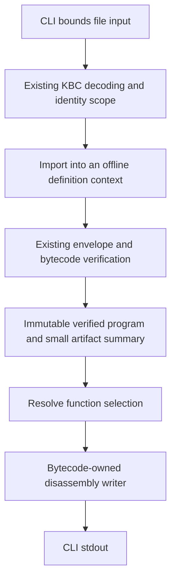

# KBC disassembler plan

Status: implementation authorized; DA01 complete, DA02 next. The selected scope is
**bytecode instruction inspection**, not source decompilation. The
[roadmap](implementation-roadmap.md#kbc-disassembly) owns activation and queue
placement; this document owns DA01-DA03, output decisions, acceptance and the
progress ledger. Proposed commands and APIs below are not implemented behavior.

## Outcome and scope

Provide an offline `kg disasm` command that opens a `.kbc` file and displays its
bytecode by module and function. A reader must be able to determine which operation
executes, its exact operands, its call/layout/constant references and its jump
targets without installing the artifact's host providers or possessing its source.

Required scope:

- A concise artifact summary, module/function identities and typed function headers.
- Every current bytecode instruction and nested operand/target variant, including
  generated functions, closures, interfaces, host paths and async instructions.
- Function-local instruction indices and explicit jump labels.
- Raw scoped references accompanied by resolved names, types and constant values.
- A function directory and selection by name or an unambiguous module/function slot pair.
- Source/debug annotations when present; useful output when they are absent.
- Reusable bytecode-owned rendering with a thin CLI adapter and bounded input IO.

Explicitly exclude source reconstruction, expression folding, control-flow
structuring, CFG visualization, an assembler/text round trip, bytecode editing,
execution, runtime linking, native image disassembly, MIR browsing, GUI/editor/web
integration, JSON output, a separate `inspect` command, and old-format migration
readers. No new KBC fields, format/ABI bump, dependency or crate is required by this
scope. A future decompiler is a separately authorized task, not a later phase here.

## Baseline and implementation evidence

Planning baseline: `86fb2e8b`, on `feat/kbc-disassembler` (renamed from
`feat/kbc-decompiler`). Source and contract inspection was read-only; no runtime
or throughput result is claimed by this plan.

| Existing owner | Evidence and intended reuse |
| --- | --- |
| [Artifact envelope and codec](../crates/kagari-bytecode/src/artifact.rs) | `KbcArtifact` contains a program, header, tables, verification metadata, optional debug/signatures and optional portable MIR. `from_bytes` bounds decoding but is not complete executable verification. Reuse the existing codec and envelope checks. |
| [Module/function model](../crates/kagari-bytecode/src/module.rs) | `BytecodeModule` already owns function, constant, layout, native import and interface tables. `BytecodeFunction` already has boundaries, names, counts, instructions and metadata. Do not infer function boundaries from raw bytes. |
| [Instruction model](../crates/kagari-bytecode/src/instruction.rs) | Explicit register/local operands and `Jump`, `Branch`, `Return`, `Unreachable` targets. `JumpTarget::index()` is an instruction index, not an encoded byte position. |
| [Semantic slots](../crates/kagari-contract/src/slots.rs) | Language type facts are distinct from physical `ValueType` layouts. Show retained semantic facts without mistaking a heap representation for its nominal source type. |
| [Verified program](../crates/kagari-bytecode/src/program/verified.rs) | `VerifiedBytecodeProgram` retains immutable verified records and their definition scope. Use that evidence for the instruction renderer. |
| [Identity metadata](../crates/kagari-common/src/identity/metadata.rs) | `DefinitionMetadata` retains an immutable table and provides explicit import into a context. Scoped IDs cannot be interpreted using an unrelated context. |
| [Portable MIR](../crates/kagari-bytecode/src/native_input.rs) | Optional opaque bytes; their presence is not correspondence or native-eligibility evidence. Do not decode them for disassembly. |
| [CLI arguments](../crates/kagari-cli/src/args.rs) and [dispatch](../crates/kagari-cli/src/main.rs) | Current artifact mode prepares and executes through an engine. Add a separate offline command, not a flag on `run-artifact`. |

Current CLI dependencies already include bytecode/common. The CLI as a whole also
contains source/runtime functionality; this plan does not remove those features.
The disassembly library and command path must not require source analysis, runtime
construction, provider installation or code generation. See the existing
[architecture boundaries](architecture.md#compilation-pipeline),
[bytecode](spec/bytecode.md) and [artifact](spec/artifacts.md) contracts.

## CLI contract

```text
kg disasm <artifact.kbc>
kg disasm <artifact.kbc> --list-functions
kg disasm <artifact.kbc> --function <selector>
```

- One explicit local file; no source compilation, project discovery, package
  resolution, directory recursion, stdin, URLs or implicit execution.
- Without a selector, print all script bytecode functions in program module order
  and function buffer order, including private and generated bodies.
- `--list-functions` prints the artifact summary and one entry per script function:
  slot selector, qualified name, concrete instance arguments, signature, instruction
  count and `may_suspend`. It omits bodies, constant pools and detailed slot/debug
  tables. Use the same validated program and selection/name logic, not another
  loading path. It is mutually exclusive with `--function`.
- A selector is either an exact qualified function name or
  `@<module-index>:<function-index>`, for example `@0:3`. Numeric selectors address
  slots in this artifact, not persistent IDs across rebuilds or reloads. Examples
  should quote them for shell portability: `--function '@0:3'`. Name matching uses
  the underlying qualified text, not display escape sequences; numeric selectors
  remain usable for generated names with punctuation or nonprinting characters.
- A qualified name must identify exactly one function. On ambiguity, including
  generic instances sharing a name, fail and list deterministic candidate slot
  selectors with identities/type arguments. Do not silently pick the first or
  perform substring/regex matching. An absent name or invalid numeric slot fails.
- Resolve displayed names using the carried definition scope and module identity;
  qualify package/module ownership where needed. Retain concrete instance identity
  and arguments when present. Generated names are not asserted to be original
  source spellings. DA01 freezes the escaping/spelling rules in output fixtures.
- Native imports have declared signatures and targets, not KBC function bodies.
  Show their contracts when referenced; do not invent a body or attempt provider IO.
- Output is plain UTF-8 text on stdout, with no ANSI sequences by default.
  Diagnostics go to stderr. Shell redirection supplies file output; no `-o` in v1.
- Reject repeated selectors/list switches, incompatible selection modes, extra
  operands and unrelated flags such as `--jit`,
  project options or formatting/lint policy options. Use the existing CLI usage
  error convention: status 2 for invalid command arguments; status 1 for IO,
  decode/validation or function-selection failure; status 0 for successful output.
  Report write failures rather than panicking; a write failure may leave partial text.

## Output contract

The following is an illustrative layout, not a captured compiler result or a
promise about register allocation. DA01 freezes concrete mnemonics before broad
renderer implementation; DA02 must cover the whole current instruction model.

```text
artifact: format=<encoded version> language=<encoded language> validation=bytecode
portable_mir: absent

module @0: game
fn @0:3 game::add_one(arg0: i32) -> i32
  locals: 1, registers: 3
  0000  load_local       r0, l0
  0001  load_const       r1, const#0       ; i32 1
  0002  numeric.add.i32  r2, r0, r1
  0003  return           r2
```

The artifact summary identifies the encoded format, language, compiler fingerprint,
runtime/helper ABI requirements, content hash, root module and module/function
counts. The content hash identifies the artifact, not its authenticity or a live
runtime generation. Mark the root module separately from public exports; do not
assume the first function or a function called `main` is an exported entry. Report
envelope/bytecode validation and optional MIR presence accurately without retaining
or interpreting the MIR payload. No timestamp, host address or current-directory
prefix belongs in deterministic output.

For a full function body, also show `argN -> lN`, every local/register's physical
layout and available semantic type, plus a fixed-order `recorded_effects` summary.
The short example above omits these extra header lines for readability. Function
listing intentionally uses the compact header described in the CLI contract.

### Instructions and references

- Every instruction is emitted exactly once, in stored order, including unreachable
  instructions. Rendering does not optimize, execute or restructure code.
- Instruction numbering restarts per function. Use minimum four-digit decimal
  indices, expanding rather than truncating when needed. Label jump destinations
  as `L<instruction-index>`; keep the numeric target visible. No encoded file byte
  offsets or machine PCs are implied by this numbering.
- Print destination/source registers, locals, constants, branch arms, optional
  results, argument order, field slots, generic arguments, captures, call targets,
  path arguments and all other execution-relevant operands explicitly. Preserve
  distinctions such as identity versus value equality, numeric conversion modes,
  shared versus ordinary calls and native versus script targets.
- Resolve table references through their actual owning module and definition table.
  A target in another module is not indexed into the current module's tables.
  Interface dispatch remains interface dispatch: do not invent a statically known
  receiver implementation when the instruction does not provide one.
- Keep artifact-local slot references alongside annotations; process-local
  DefinitionIds are not artifact offsets. Print referenced import/layout/interface/
  path descriptors once in deterministic owning-module/table-slot order, with
  readable field/variant/member identities, types and declared access as relevant.
  At each use retain the owning slot and selected field/variant/member ordinal.
  Instruction-owned nested contracts may use indented continuation lines. No
  exhaustive dump of unrelated tables and no recursive expansion of callee bodies:
  a recursive call must remain a finite reference, not trigger recursive rendering.
- Print constants with their actual type. Emit referenced constant-pool entries
  once per module, in slot order; short scalar values may also be annotated inline.
  Do not expand a large string at every use, turning a bounded input into repeated
  copies of its largest literal. Escape strings, names, source URIs and other
  artifact-owned text so newlines, control characters and escape sequences cannot
  masquerade as instructions or terminal commands. Preserve signed zero and NaN
  payloads; include float bit patterns where decimal text loses identity.
- Use explicit, exhaustively matched rendering, not `Debug` dumps, wildcard
  `unsupported` placeholders or discriminant numbers as instruction names. Canonical
  text must not collapse distinct instruction/target variants into indistinguishable
  pseudo-instructions. Adding an instruction or operand variant must require a
  renderer review at compile time; explicitly destructure execution operand fields
  rather than hiding new fields behind `..`. This does not require printing every
  unrelated metadata field or introducing a second opcode schema/generator.

### Types and debug annotations

- Prefer retained semantic signatures and type arguments. When only physical facts
  are available, label them as physical representation rather than guessing a
  nominal source type. For full bodies, list physical local/register layouts and
  available semantic types separately; missing semantic facts mean unknown, not Any.
- Explicitly show that argument N enters local `lN`, for the first `parameter_count`
  locals. This follows `verify_metadata_counts`, not debug `is_parameter` flags.
  `load_local r3, l0` is an individual transfer, not a permanent `l0 -> r3` alias;
  local names must not become register names through speculative dataflow analysis.
- Print all set `FunctionMetadata.effects` fields in a fixed documented order,
  including `may_suspend`, and explicitly represent an empty set. Label these as
  recorded summaries, not recomputed transitive effects, permissions or execution
  cost guarantees. A false field alone is not proof that a called function cannot
  allocate or mutate. The suspension flag is an execution-entry fact, not evidence
  that the original source necessarily used a particular spelling of `async`.
- Source URI and line/column annotations use artifact metadata only; do not open
  source paths, contact servers or require source files to exist.
- Associate location records by explicit `instruction_offset`, never by their
  position in a metadata vector. If line/column is absent, display an available
  source byte span/offset and source-module reference as such; do not derive line
  numbers by reading source. A default/empty span alone is not proof of a location.
- Local names are annotations on `lN`, valid in their half-open `[start, end)` ranges.
  Do not assign one name to a reused slot for the whole function or invent parameter
  names from unrelated entries. Missing names use explicit generated names.
- Verification does not promise sorted/unique debug records, nonoverlapping names,
  or agreement of debug types/frame-layout copies with execution metadata. Retain
  multiple matching annotations in stable order and mark ambiguity rather than
  silently overwriting them. Display executable types/parameter roles from
  `FunctionMetadata`; debug names/types are only annotations. A conflicting debug
  claim must not replace an execution fact or turn a valid program into a new
  renderer-specific validation failure. Escape bidi/format controls as well as
  ordinary control characters in artifact-owned text, including diagnostics.
- Debug stripping or missing locations must not prevent instruction inspection.
  Do not infer that the optional envelope debug section controls every per-function
  debug record; inspect the actual metadata present in the verified function.
- Output is deterministic for the same artifact and options, independent of fresh
  process-local DefinitionIds, hash-map iteration, current directory or runtime
  registration order. Display portable names and artifact-local slots instead.
  This text is a human-readable format, not a promised stable machine protocol.

## Ownership and validation path



### Validation is not execution

1. Read no more than the existing artifact byte limit plus a sentinel byte. A
   metadata length check alone is insufficient if the file changes while reading.
   Reject over-limit input before unbounded allocation; reuse existing count/depth
   budgets for nested records. Do not add a second KBC decoder.
2. Decode with `KbcArtifact::from_bytes`. Retain `DefinitionMetadata`; import through
   its existing scope-preserving API into an offline `DefinitionContext` before
   supplying that context to artifact verification. Do not discard the source scope
   and reinterpret its numeric IDs in a new table.
3. Use `KbcArtifact::into_verified` with current `ArtifactCompatibility` defaults
   and the matching context. Preserve header, content-hash, metadata consistency,
   graph, type, reference and resource validation. Do not trust the serialized
   verification flag or implement another simplified verifier in the renderer.
4. Retain only the small summary needed for display before consuming the envelope;
   render the resulting verified bytecode without cloning the whole program merely
   to keep the header. Keep optional MIR opaque and release its buffer when no
   longer needed. State `present, not semantically checked` if reporting it.
5. Validate the complete artifact even when selecting or listing functions. Perform
   validation and selector resolution before emitting normal disassembly. Do not
   bypass a malformed unselected function. No unchecked/raw mode in this scope.
   This deliberately means the first version cannot disassemble a semantically
   invalid but decodable compiler output. Mature object dumpers may allow more
   permissive inspection; that is not evidence Kagari must weaken this boundary.
   If compiler-failure forensics becomes a concrete requirement, design a separate
   bounded unverified view without manufacturing a verification seal; it is deferred.

This establishes artifact/bytecode validity under current offline requirements,
not host linkability, signature authentication, safe arbitrary machine code or MIR
correspondence. Custom native declarations can be inspected without installing the
Rust implementations; the tool must say what it verified, not claim it can run them.

Use version constants from implementation rather than duplicating version literals
from prose. Incompatible products fail clearly; do not synthesize matching
compatibility requirements from the untrusted header to force acceptance.

### Module responsibilities

- Add focused ordinary modules under `kagari-bytecode` for disassembly selection,
  identity/type presentation and instruction rendering. The conceptual renderer
  accepts a borrowed `VerifiedBytecodeProgram`, options and an output writer;
  exact Rust signatures are decided in DA01, not asserted as existing APIs here.
- The bytecode library owns instruction meaning and resolution. CLI supplies path
  IO, flags, diagnostics and writer selection, with `main.rs` limited to dispatch.
- Borrow existing records. Before full-body output, make a lightweight pass over
  selected functions to collect labels and referenced descriptor/constant slots.
  Index debug locations by instruction and use per-function range events/indexes
  for names, rather than rescanning every debug row for every instruction. Resolve
  ordinary table operands by their scoped slots. Do not recursively traverse the
  executable call graph merely to print selected bodies.
- This presentation state belongs to one immutable program/output operation and is
  discarded afterward. A second decoded-program tree, semantic inference engine,
  CFG/dominator analysis or persistent cache is unnecessary. Avoid repeated decoding,
  remapping or verification per function; the existing offline identity import is
  allowed, not an excuse for another cloned presentation graph.
- Stream through a caller-owned fallible writer and stop immediately on its first
  error, including a closed pipe; preserve the CLI's status-1 IO policy and never
  panic or continue formatting discarded output. CLI owns buffering, final flush
  and error reporting; the library does not own stdout or flush an arbitrary caller's
  writer. No arbitrary silent truncation of instructions/operands.
- Keep production dependencies source/compiler/MIR/runtime-free at the library
  boundary. Do not move bytecode presentation into generic `common`, create a
  forwarding crate, widen unrelated APIs or add broad re-exports for convenience.
- The existing CLI binary may still link other subsystems for its other commands.
  Verify the reusable disassembly boundary independently; CLI success alone does
  not prove source-free dependency isolation.

## Mature implementation references and design review

Primary documents/source consulted on 2026-10-18. The LLVM and WABT links are fixed
release tags; the Lua source page identifies itself as 5.4.9, but its 5.4 URL is a
rolling patch-version page. These establish mechanisms, not Kagari performance
results or a claim that every tool enforces the same input validation policy.

| Source/version | Specific mechanism | Adopt / do not copy |
| --- | --- | --- |
| [JDK 25 javap](https://docs.oracle.com/en/java/javase/25/docs/specs/man/javap.html) | Method listings without code; `-c` instructions; `-s` signatures; `-l` line/local tables; `-v` additional facts | Add a compact function directory and separate execution facts from debug annotations. Do not copy JVM stack simulation, Java classpath loading, or public/protected-only default visibility. Kagari must show private/generated bytecode too. |
| [LLVM 22.1.0 llvm-objdump](https://github.com/llvm/llvm-project/blob/llvmorg-22.1.0/llvm/docs/CommandGuide/llvm-objdump.rst) | Symbol-table views, explicit symbol filtering, raw versus symbolized operands, labels, line numbers and headers | Keep exact artifact slot selectors beside human names, canonical operations and clear artifact provenance. Do not equate instruction indices with machine addresses/encoded bytes, add target-ISA options, or adopt automatic external debug/source lookup. Unknown-machine-opcode fallback is not needed for a current-version verified Rust enum. |
| [Lua 5.4.9 luac source](https://www.lua.org/source/5.4/luac.c.html) and [5.4 manual](https://www.lua.org/manual/5.4/luac.html) | `PrintHeader` shows params/slots/upvalues; `PrintCode` prints operands, constant explanations and computed jump destinations; `PrintDebug` shows local ranges/constants/upvalues; stripped line data displays as missing | Register-VM listings should explain entry slots, captures and missing debug information, not just opcode names. Lua constructs a Lua state and prints some host addresses; Kagari reuses an offline immutable verified program and must not reproduce runtime construction, pointer-based identities or Lua's 1-based displayed PC convention. |
| [WABT 1.0.37 wasm-objdump](https://github.com/WebAssembly/wabt/blob/1.0.37/src/tools/wasm-objdump.cc) and [ObjdumpState](https://github.com/WebAssembly/wabt/blob/1.0.37/include/wabt/binary-reader-objdump.h) | A prepass retains names, function types/parameter counts and symbols for later body/details output; file versus section offsets are explicit | Use a small output-owned reference/debug index before rendering. Kagari already has decoded verified records, so do not copy repeated binary passes, introduce another decoded IR or construct a CFG. |

### Review resolutions within DA01-DA03

These are changes to this plan, not runtime defects or another review queue.

| Priority | Gap found in the first draft | Resolution and evidence |
| --- | --- | --- |
| P1 | Treating verified debug records as ordered, unique or type-authoritative could print a false location/name/signature | [verify_debug_metadata](../crates/kagari-bytecode/src/verifier.rs) validates offsets/range bounds, not those stronger properties. Key annotations by explicit offsets, preserve ambiguous matches and use execution metadata for types/argument roles. [Origin-free lowering coverage](../crates/kagari-compiler/src/tests/origins.rs) also retains spans without URI/line data; use an explicit span fallback. |
| P2 | Counts and a source-like signature do not explain `l0`/`r0`, or distinguish a resumable body | `verify_metadata_counts` places parameters in the initial locals; [effects](../crates/kagari-contract/src/effects.rs) carries the owned-driver `may_suspend` fact. Require entry-slot mapping, physical/semantic slot tables and recorded effects, without new inference. |
| P2 | Function filtering had no cheap way for a user to discover exact names or generic instance slots | Add only `--list-functions` to the same command and validated data path. This is the review's single additional CLI capability; it avoids dumping all bodies just to select one. |
| P2 | Constant pooling alone did not bound repeated descriptor expansion or per-instruction debug searches | Gather referenced descriptors/labels once, index locations/ranges, and print referenced table entries once. Do not expand recursive call bodies. State is output-owned and discarded, not a persistent cache. No elapsed-time claim is made. |
| P2 | An exhaustive enum match can still omit added fields or hide a variant behind an alias | Require explicit execution-operand fields and distinguishable canonical operations; combine exhaustive matching with output contract tests for nested targets/operands. A second opcode schema or assembler is not necessary. |

The existing decode/import/verification ownership is sound for the selected
valid-artifact product: no host installation, runtime or MIR decoding is required.
Strict validation intentionally limits compiler-error forensics. Retain that limit
explicitly rather than either accidentally promising a general raw dumper or adding
an unchecked mode now. Broken-pipe handling, escaping and deterministic ordering are
part of ordinary streaming output, not reasons for a generic rendering framework.
Source decompilers' CFG/statement reconstruction remains outside this plan.

## Execution phases

Keep each phase buildable. No implementation is authorized merely by recording
this plan; when implementation begins, use these checkpoints rather than creating
another progress document. Do not carry known validation bypasses or placeholders
into a claimed complete phase. Authorized implementation commits use `Phase: DA01`,
`Phase: DA02` or `Phase: DA03` trailers.

### DA01 — Offline boundary and output vocabulary

- Refresh codec, verification, identities and CLI policy against the active revision.
- Freeze renderer API ownership, compact directory mode, exact name/slot selectors,
  escaping, mnemonic families and header/annotation spelling in illustrative fixtures.
  Include entry-slot mapping, recorded effects and authoritative-versus-debug facts.
- Inventory every instruction and nested target/operand family from the Rust enums;
  keep the finite implementation inventory here if coverage must be carried across
  checkpoints, not in a separate queue. Do not infer coverage from source syntax.
- Implement verified-program presentation/selection foundations, per-output
  bounded offline artifact preparation without
  exposing an incomplete CLI command.
- Acceptance: source-free preparation, retained identity scope, deterministic
  selection, custom-native contracts without registration, and malformed input
  rejection are covered. No runtime is created or optional MIR interpreted.

### DA02 — Complete instruction renderer and CLI

- Implement all instruction/operand families and owning-table name/type resolution.
- Implement per-output reference/debug indexing together with its renderer consumers;
  this was moved from DA01 to avoid unused scaffolding at that checkpoint.
- Render function headers/entry slots/effects, referenced descriptors and constants,
  cross-module targets, labels, semantic/physical slot tables and robust debug
  annotations. Reuse this header/identity logic for the compact function directory.
- Add `kg disasm`, function listing/filtering to ordinary CLI parser/dispatch/help;
  reject execution/project-only options without changing their existing behavior.
- Acceptance: every current instruction is rendered deliberately, and no variant
  is hidden behind a fallback Debug/unsupported arm. Selected and unselected modes
  use the same verified program and writer, including no-debug artifacts.

### DA03 — Contract acceptance and documentation handoff

- Finish focused coverage of source-free inspection, reference scope, ambiguous
  names/generic instances, instruction completeness, deterministic output, escaped
  artifact text, special float constants and IO/validation failures.
- Demonstrate `emit/build -> .kbc -> disasm` using existing fixtures; separately
  remove source availability and avoid provider installation for offline cases.
  Compiler optimization must not erase an instruction used to claim renderer coverage.
- Move delivered command/output behavior to [toolchain tools](spec/toolchain-tools.md),
  the relevant artifact/bytecode documentation and CLI-facing guide/help. Preserve
  the architecture dependency direction, without documenting future decompilation
  as an implemented capability.
- Record remaining CI acceptance in the roadmap, then remove this completed plan.
  Git history owns its phase ledger. No benchmark or speedup target is required.

## Validation policy

Reuse existing codec/verifier and CLI parsing/artifact fixtures. Add renderer tests
for distinct output contracts, not a duplicate language-conformance suite. Combine
instruction cases into cohesive fixtures while keeping failure boundaries separate.

Selected local coverage during implementation:

- Bytecode renderer/selection tests for all operation and target families, same-name
  functions across modules, multiple generic instances and stable slot identifiers.
- Codec/envelope regressions selected for truncation/version/hash/reference failures;
  check that filtering cannot hide invalid code and decode success is not mistaken
  for verification. Reuse rejection tests where unchanged validation already owns it.
- No-debug, span-only locations, unsorted/duplicate location records, overlapping
  local names and debug claims that disagree with execution types/parameter roles.
  Assert entry slots and recorded effects, including a suspending function.
- Escaped names/strings/URIs and bidi/format controls, signed zero/NaN bits,
  forward/backward labels, finite recursive call references and repeated uses of a
  large constant/descriptor. Assert table entries are emitted once; no benchmark
  is needed to establish this output property.
- Directory/filter agreement and ambiguity diagnostics; writer failure stops
  further output immediately, while CLI flush failures return an IO error.
- CLI argument policy plus one real emit/disassemble case and one source-free
  custom-native artifact case. The latter must succeed without engine/provider setup.
- A focused production dependency inspection or existing standalone-consumer
  mechanism to establish that the library has no source/runtime/MIR dependency.

Select test names/targets once implemented; do not invent runnable test commands
for nonexistent tests. Run only affected contracts plus a small direct regression
set, with `--no-fail-fast` when combining selected targets. Full workspace tests
and the complete platform/feature matrix remain CI-only, not a local completion gate.

Implementation checkpoint/final lightweight checks follow AGENTS.md:

```text
uv run --locked scripts/check_structure.py
cargo fmt --all -- --check
cargo clippy --workspace --all-targets -- -D warnings
git diff --check
```

This planning-only change needs content/link/diff checks, not Cargo tests or Clippy.
Do not rerun unchanged passing runtime suites for a fresh transcript. Temporary
fixtures/logs belong under `target/`; retain necessary decisions and failure causes
in this ledger rather than relying on ignored files.

## Progress ledger

- [x] Scope fixed to KBC instruction disassembly; source decompilation excluded.
- [x] Baseline owners, CLI contract, reference mechanisms and validation policy recorded.
- [x] Design review against JDK 25, LLVM 22.1.0, Lua 5.4.9 and WABT 1.0.37;
  resolved scope/metadata/reference-work gaps within DA01-DA03 without production edits.
- [x] DA01: offline boundary and output vocabulary.
- [ ] DA02: complete renderer and CLI.
- [ ] DA03: focused acceptance and documentation handoff.

DA01: `PreparedDisassembly::from_bytes` owns offline decode/import/full verification
and releases optional MIR. `program`, `select`, `write_summary` and `write_directory`
borrow immutable evidence; writers stop on errors and never flush. Directory output
also includes the fixed-order recorded effect summary. Exact raw names and `@m:f`
selectors, portable identities, semantic/physical vocabulary and escaping are frozen
by source-free fixtures. Full-body entry mappings and indexes are implemented with
their consumers in DA02 rather than introducing unused scaffolding in DA01.

Finite DA02 inventory: await/conversion/numeric/iteration; constant/local/module
loads and stores/move; unary/binary; all nine call target variants and nested
shared/interface/native contracts; tuple/range/array; future/closure/cell;
interface upcast/construction; struct/enum construction and reads; aggregate
field/index access; four path operations; jump/branch/return/unreachable.
Mnemonic roots follow explicit snake-case instruction variants; nested numeric,
iteration and call kinds remain distinct. No Debug fallback is permitted.

DA01 local validation: `cargo test -p kagari-bytecode disassembly --lib` passed
13 tests (source-free scopes/custom native declarations, selection, malformed
input, MIR opacity, writer failures and presentation). An initial directory
snapshot mismatch after adding recorded effects was corrected; all 13 pass.
`uv run --locked scripts/check_structure.py` passed (1321 files, no exceptions),
`cargo fmt --all -- --check`, workspace all-target Clippy with `-D warnings`, and
`git diff --check` passed. No known carried build failures. Full test/backend/
platform coverage remains CI-only. No runtime or performance claim is made.
