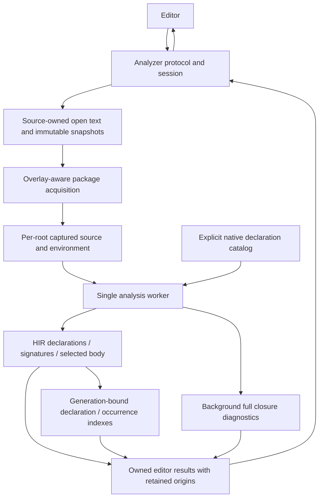

# Kagari language server design

Status: implementation authorized through LSP04 on 2026-11-07, with a commit at
each implementation phase. The LSP00-LSP04 pilot and selected local Gate A
acceptance are complete on `feat/lsp`. Full-workspace/exhaustive CI acceptance
remains separate; later phases are queued. The Lattice transport foundation
replaces the original synchronous stdio scaffold; diagnostics, hover, definition,
implementation and basic completion are advertised. This document owns the LSP scope,
decisions and implementation checkpoints; the [roadmap](implementation-roadmap.md#language-server)
owns activation. Current contracts remain in [architecture](architecture.md#language-server-foundation),
the [HIR guide](architecture/hir.md) and [package specification](spec/packages.md).

## Decision

Extend `kagari-analyzer` with an editor session over the existing source, package
and HIR services. Keep protocol conversion in the analyzer, semantic queries in
HIR, and acquisition in package/source owners. One analysis worker owns mutable
analysis state; the protocol loop continues accepting edits and cancellation.
Use retained inputs and explicit generations to separate request results from
background publications. Do not introduce a second typechecker, a new database
framework, an SDK engine per request, or another server entrypoint.

Use `lattice-actor` directly for `Actor`, `Message`, `Handler<M>`, `ActorHandle`,
mailboxes, dispatch, scoped work and actor lifecycle. Kagari owns its concrete
messages, LSP state and handlers; it does not implement another actor kernel or
application-wide Event enum. One Lattice `ActorRuntime` owns the Tokio executor;
TCP IO and timer adapters run as actor-scoped work on that executor. Acquisition
and HIR analysis retain dedicated synchronous workers, and stdio uses blocking IO
threads. Remove `lsp-server` in LSP00; retain `lsp-types` and own the bounded framing
codec, JSON-RPC envelopes and LSP request lifecycle. Actor envelopes and JSON-RPC
wire envelopes are distinct: the former belong to Lattice, the latter to Kagari.
Stdio and single-connection TCP are alternative transports for the same session
core. The execution model below specifies transport, state and scheduling
contracts; the checkpoint section distinguishes implemented owners from queued work.

Design for the complete Kagari editor feature set below, then implement it in
batches. The pilot delivers five user features: diagnostics, hover, go to
definition, go to implementation and basic completion, plus a real VS Code client.
Implementation navigation deliberately exercises reverse semantic relationships;
the pilot must test more than independent position queries. Local projects,
standalone buffers and generated standard-library navigation share the same core.

References, rename, the other go-to operations, workspace indexes, editing and
editor presentation are planned parts of this design. They are not advertised
until their batch passes acceptance. LSP04 is an explicit architecture review
gate before expansion; LSP06 adds a second gate for workspace edits. The authorized
implementation batch ends at LSP04; later inventory rows are explicit follow-up
scope. General incremental compilation and persistent indexes are not required.

Performance baselines and fuzz contracts land with the owning phases, starting
at LSP00. Gate A requires measured pilot results and targeted fuzz evidence;
gate B adds index/edit workloads and semantic edit fuzzing. Performance targets
and regression thresholds below are proposed acceptance policy, not measurements
of the current product. Only recorded phase measurements establish evidence.

Automated verification uses semantic-owner tests, an in-process real server,
independent headless protocol clients and a small real-editor contract suite.
Feature behavior does not require launching VS Code per test. The
[testing architecture](#automated-lsp-testing-and-feedback-time),
[benchmark policy](#benchmark-baselines-and-regression-policy) and
[fuzz contracts](#fuzzing-and-adversarial-state-sequences) specify distinct evidence;
none substitutes for the others.

## Feature inventory and delivery batches

The inventory describes the intended Kagari language server, not every optional
LSP message irrespective of language relevance. Each row owns a finite behavior,
its semantic dependency and its earliest phase. The five pilot rows are implemented
through LSP04; later rows remain queued. Register only the implemented subset of
each capability; for example,
completion in the pilot does not imply completion resolve or automatic imports.

| Batch | Purpose | Phases |
| --- | --- | --- |
| Pilot | Prove transport, capture, selected-body queries, reverse relations, cancellation and publication with five features in a real editor | LSP00-LSP04, then architecture gate A |
| Navigation | Complete navigation and search using shared declaration/occurrence projections | LSP05 |
| Editing | Add versioned semantic edits, formatting, lints and a finite code-action set | LSP06, then edit gate B |
| Rich presentation | Reuse accepted facts for semantic styling, hints, hierarchies and richer completion | LSP07 |
| Workspace operation | Extend synchronization, diagnostics delivery and editor/workspace lifecycle | LSP08 |

### Navigation, search and inspection

| ID | Feature / protocol method | Defined behavior and prerequisite | First phase |
| --- | --- | --- | --- |
| N01 | Hover: `textDocument/hover` | Type, signature and documentation from the resolved declaration or selected body; no fabricated type for recovery holes | LSP03, pilot |
| N02 | Go to definition: `textDocument/definition` | Resolve locals, members, types, imports and calls to defining source, including generated native declarations | LSP03, pilot |
| N03 | Go to implementation: `textDocument/implementation` | Trait to implementing blocks; trait member to overrides/default bodies; type to applicable impl blocks; requires the declaration relation index | LSP03, pilot |
| N04 | Go to declaration: `textDocument/declaration` | Preserve the declared contract or alias binding where it differs from the resolved implementation/definition | LSP05 |
| N05 | Go to type definition: `textDocument/typeDefinition` | Navigate the inferred/resolved type of a value or expression to its nominal declaration; explicit primitive/composite policy below | LSP05 |
| N06 | Find references: `textDocument/references` | Exact semantic occurrences in the captured search scope, with `includeDeclaration`; complete occurrence coverage, not read/write counts | LSP05 |
| N07 | Document highlights: `textDocument/documentHighlight` | Same-document occurrences distinguished as read/write/text using HIR access facts | LSP05 |
| N08 | Document outline: `textDocument/documentSymbol` | Hierarchical declarations and exact selection/extent ranges, including inline modules; syntax fallback when imports fail | LSP05 |
| N09 | Workspace symbols: `workspace/symbol`, `workspaceSymbol/resolve` | Search captured workspace declarations; bounded result delivery and deferred location resolution with expiring handles | LSP05 |
| N10 | Signature help: `textDocument/signatureHelp` | Selected callable, candidates, parameter docs and active argument for incomplete calls | LSP05 |
| N11 | Call hierarchy: `textDocument/prepareCallHierarchy`, `callHierarchy/incomingCalls`, `callHierarchy/outgoingCalls` | Static HIR call edges with caller/callee source; incoming queries need complete scope coverage | LSP07 |
| N12 | Type hierarchy: `textDocument/prepareTypeHierarchy`, `typeHierarchy/supertypes`, `typeHierarchy/subtypes` | Kagari trait inheritance and implementation relationships; no invented class inheritance | LSP07 |
| N13 | Document links: `textDocument/documentLink`, `documentLink/resolve` | Resolved source/module imports with validated origin URIs; not arbitrary string-literal URLs | LSP05 |

### Editing and source transformations

| ID | Feature / protocol method | Defined behavior and prerequisite | First phase |
| --- | --- | --- | --- |
| E01 | Basic completion: `textDocument/completion` | Visible local/path/member candidates, deterministic replacement range, incomplete `receiver.` recovery; plain edits | LSP03, pilot |
| E02 | Rich completion: `completionItem/resolve` and negotiated completion options | Lazy documentation, snippets and automatic imports; import edits use the same validated edit planner as code actions | LSP07 |
| E03 | Prepare/perform rename: `textDocument/prepareRename`, `textDocument/rename` | Eligible semantic identity, complete references, collision/shadowing checks and versioned workspace edits | LSP06 |
| E04 | Quick fixes: `textDocument/codeAction`, `codeAction/resolve` | Start with missing-import fixes and fixes justified by existing diagnostics/lints; advertise only implemented kinds | LSP06 |
| E05 | Organize imports: `source.organizeImports` code action | Preserve aliases, comments, visibility and resolution; remove imports only with complete usage evidence | LSP06 |
| E06 | Refactorings: `refactor.*` code actions | Finite initial set: extract local binding and inline local binding when evaluation order, once-only effects and capture remain equivalent | LSP07 |
| E07 | Document formatting: `textDocument/formatting` | Existing formatter over captured source and shared CLI configuration; no edits on invalid source or cancellation | LSP06 |
| E08 | Range/on-type formatting: `textDocument/rangeFormatting`, `textDocument/onTypeFormatting` | Formatter-owned safe region expansion and cursor-local indentation; no whole-file replacement disguised as a range edit | LSP08 |
| E09 | File operations: `workspace/willCreateFiles`, `willRenameFiles`, `willDeleteFiles`, corresponding `did*` notifications | Negotiate supported operations individually; rename plans repair module/import references, `did*` invalidates/reacquires input; no direct filesystem mutation by a semantic query | LSP08 |

### Diagnostics and visual presentation

| ID | Feature / protocol method | Defined behavior and prerequisite | First phase |
| --- | --- | --- | --- |
| D01 | Push diagnostics: `textDocument/publishDiagnostics` | Acquisition, parse and HIR diagnostics with current-generation publication, exact ranges and clearing | LSP02, pilot |
| D02 | Optional lint diagnostics | Existing six lint rules, shared configuration and eligibility; separate contribution to D01/D03 | LSP06 |
| D03 | Pull diagnostics: `textDocument/diagnostic`, `workspace/diagnostic` | Reuse diagnostic computation/ownership, retain bounded result IDs and report unchanged results without duplicate push publication | LSP08 |
| V01 | Semantic tokens: `textDocument/semanticTokens/full`, `/range`, `/full/delta` | HIR-based classifications/modifiers, negotiated legend and revision-bound token results; delta only after full/range correctness | LSP07 |
| V02 | Inlay hints: `textDocument/inlayHint`, `inlayHint/resolve` | Known inferred types and parameter names over the requested range; bounded lazy docs/edits | LSP07 |
| V03 | Folding and selection: `textDocument/foldingRange`, `textDocument/selectionRange` | Syntax-owned regions and strictly enclosing selection chains, even with broken bodies | LSP05 |
| V04 | Code lenses: `textDocument/codeLens`, `codeLens/resolve` | Reference/implementation counts and navigation using existing indexes; no execution/test-runtime integration in this scope | LSP07 |

### Session, workspace and client support

| ID | Capability | Defined behavior and prerequisite | First phase |
| --- | --- | --- | --- |
| S01 | Lifecycle, cancellation, errors, stdio/TCP | Shared session, bounded framing/queues, ordered input, request retirement and shutdown; no transport-specific feature handlers | LSP00 |
| S02 | Text and project inputs | UTF-16 full sync, open/save/close, overlays before acquisition, initial multiple roots, standalone buffers and generated sources | LSP01-LSP02 |
| S03 | Client integration and configuration | VS Code launch/restart, initialization settings and selected feature toggles; settings changes replace the relevant generation | LSP04; broader live configuration in LSP08 |
| S04 | Progress and partial results | Negotiate work-done progress for long captures/index builds; cancellable bounded chunks for supported methods; partial delivery never means silently incomplete coverage | LSP03 for implementation search; other methods with their feature |
| S05 | Incremental text synchronization | Apply ordered range changes through source transactions against the preceding text; reuse all downstream capture contracts | LSP08 |
| S06 | Live workspace folders and watching | Root add/remove, client file-change notifications, overflow recovery and configuration invalidation; retain request captures across changes | LSP08; required basic invalidation in LSP01 |
| S07 | Additional editor integration | Minimal Zed launch/sync/diagnostic interoperability after the VS Code pilot; full configuration/lifecycle and feature acceptance later | Minimal check at the end of LSP04; full integration in LSP08 |

Notebook synchronization, color pickers and linked-tag editing have no current
Kagari language requirement and are not promised. DAP/debugging, runtime testing,
hot reload, remote multi-client hosting and host declaration-bundle distribution
retain their separate owners. Durable/on-disk indexes, a new incremental database
and automatic server downloads are implementation/product decisions outside these
batches, not missing prerequisites for the listed features.

## Baseline and gaps

| Owner | Implemented pilot contract | Queued integration work |
| --- | --- | --- |
| [Analyzer session](../crates/kagari-analyzer/src/session.rs) and [transport](../crates/kagari-analyzer/src/server.rs) | Typed actor lifecycle, stdio/TCP, bounded jobs, cancellation/progress and five capabilities | Semantic edit commitment (LSP06), broader configuration/live roots (LSP08) |
| [Documents](../crates/kagari-analyzer/src/documents.rs) | Original URI/version/incarnation, atomic full synchronization and bounded metadata | Ranged synchronization and broader workspace lifecycle (LSP08) |
| [Source database](../crates/kagari-source/src/source_database.rs) | Atomic overlay capture, immutable revisions, deletion/origin mapping and retained source leases | Closed-file edit revalidation (LSP06) |
| [Project discovery](../crates/kagari-package/src/project.rs) | Overlay-aware acquisition, approved-root containment, recovering graph and explicit completeness | Broader workspace/configuration invalidation (LSP08) |
| [HIR analysis](../crates/kagari-hir/src/analysis.rs) | Selected-body editor facts, shared projections, relation snapshots, bounded reuse and cancellation | Occurrences/coverage (LSP05), semantic transformations (LSP06) |
| [HIR queries](../crates/kagari-hir/src/queries) | Types, definitions, namespaces, documentation, methods, calls and binding usage | Complete reference occurrences (LSP05), actual call-site projection (LSP07) |
| [Formatter](../crates/kagari-format/src/lib.rs) / [linter](../crates/kagari-lint/src/lib.rs) | Pure formatting; optional rules over retained analysis | LSP translation and shared configuration currently private to CLI |
| [Editor adapters](../editors/README.md) | Bundled VS Code client/recovery and installed acceptance; thin Zed launch/sync checkpoint; independent grammars | Broader Zed/configuration/lifecycle acceptance (LSP08) |

Three existing distinctions are essential:

* `ProgramInputs::source_snapshot` uses `package://.../source.kgr` keys, while
  open documents use physical file paths. A file overlay is not automatically a
  package overlay. One file may participate in several independent root contexts.
* `AnalysisDatabase::snapshot` checks all included bodies. `editor` shares fact
  projection with `FileAnalysis` while selecting the containing function; actual
  const/static initializer extents retain the documented full-snapshot fallback.
  Routing every hover through a full snapshot would discard the staged design.
* `SourceDatabase::replace_captured` replaces the complete document set and resets
  overlays. Publishing a disk capture and then restoring buffers would expose an
  incorrect intermediate world, even if the eventual text is correct.

Gate A's review of the implemented pilot leaves concrete follow-up boundaries:

* **LSP05, HIR occurrence projection and `analysis/indexes`:** the current complete
  implementation index covers signatures, not references. `binding_usage` returns
  local counts and omits unavailable bodies; it cannot prove an exhaustive empty
  reference result. Add source-site occurrences and explicit signature/body
  coverage, preserving analysis/body-qualified locals, alias-binding versus
  underlying-target roles, and both field/local targets at shorthand sites.
  Reuse provider/source provenance for cross-root joins and keep unmappable caller
  binders an explicit coverage failure. Occurrence work must yield between bounded
  body units; copying the signature index's whole-context turn into a full root
  body scan would lose interactive scheduling.
* **LSP06, HIR transformations, acquisition and session edit validation:** pilot
  `FeatureOutput` is owned JSON for retained read results; an admitted older capture
  can legitimately finish after a newer capture. That route does not validate an
  edit against live text. Rename needs an owned semantic `EditPlan`, complete
  affected coverage, alias/trait/shorthand handling and collision checks, followed
  by live stamp/version/incarnation checks and acquisition-owned closed-file
  fingerprint validation before response commitment. Reject generated/read-only
  destinations and incompatible client edit capabilities. `prepareRename` cannot
  authorize reuse of its earlier capture for `rename`.
* **LSP05 identity/coverage groundwork, then LSP07 HIR call edges:** selected call
  facts exist, but no complete caller/call-site projection or incoming-call index
  exists. The type table also records protocol/operator applications and callable
  specializations without an explicit call. The hierarchy producer must select
  actual source call sites, define caller ownership/presentation for nested
  functions, closures and initializers, preserve interface-contract targets, and distinguish
  intentionally indirect/helper calls from unavailable semantic coverage. Incoming
  results require candidate caller-body coverage; declaration-index completeness
  and implementation fan-out are not substitutes. Hierarchy item lifetimes also
  need the bounded instance-qualified handle owner planned below.

These extensions fit the established HIR/worker/session boundaries. Read-only
navigation evidence does not establish occurrence completeness or edit safety;
those remain acceptance obligations of their owning phases.

## User scenario and data flow

Consider a workspace with `combat` importing `rules`. An editor opens a file in
`rules`, changes a function's return type without saving, then asks for hover on
its call in `combat`. Disk-only checking would describe the old return type;
checking only the open caller would miss the dependency change. A late background
check could also publish diagnostics for text that the user has already replaced.

The proposed path captures the overlay before package discovery, resolves each
root against that capture, and routes the hover to its retained semantic context.
It uses the same visibility/type rules as CLI analysis. Background diagnostics
publish only if their complete input generation is still current. An unfinished
function may yield partial editor information but never checked compilation input.



There is no compiler, MIR, bytecode execution or hot-reload step in this path.
LSP input generations are editor state, not runtime installation generations.

## Responsibility and dependency boundaries

Keep one `kagari-analyzer` crate. At LSP00, move its production modules into a
library target and retain one small executable entrypoint. The concrete additional
consumers are in-process fuzzing/corpus replay and benchmark probes; production
and verification must run the same codec, source and session transition code.
This replaces the earlier binary-only plan, without adding an IDE facade crate.
Give the library ordinary focused modules:

| Module | Owns |
| --- | --- |
| `server` | Lattice runtime setup, component composition, process observer and final shutdown |
| `session` | Concrete SessionActor, request admission, LSP lifecycle, job scheduling and publication |
| `transport` | Shared bounded codec, stdio/TCP endpoint construction, reader/writer ownership and stop control |
| `protocol` | URI validation, protocol positions, LSP request/response conversion |
| `documents` | Open-document protocol metadata over source-owned text |
| `workspace` | Configured roots, acquisition scheduling, physical-to-semantic origin maps |
| `analysis` | Worker lifecycle, per-context HIR databases, retained inputs and generation-bound workspace indexes |
| `features` and children | Editor presentation for hover, completion, diagnostics and other implemented features |

`features` consumes typed HIR projections; it does not implement overload lookup,
trait search, name resolution or type inference. Internal editor results use byte
spans and owned labels/documentation, with no `lsp_types` inside HIR/source/package.
Do not expose raw HIR arena indices in JSON or reinterpret an ID in another context.
No separate `kagari-ide` crate is needed for these consumers. A future extraction
requires a concrete consumer and moves this boundary rather than wrapping it.

Retain `lsp-types` 0.97.0 until a required protocol feature demonstrates a gap.
The feature contract targets the supported LSP 3.17 subset, not a claim that 3.17
is the latest specification. The original scaffold used `lsp-server` 0.10.0;
LSP00 replaces its transport, envelope and handshake consumers together, updates
the existing tests, and removes the dependency. Do not keep two transport stacks
or retain that crate solely for its small JSON-RPC message structs.

The analyzer may depend on HIR, package, syntax and standard-library declarations.
`kagari_stdlib::catalog::shared()` projects the production catalog without native
preparation. Its crate currently has transitive runtime/bytecode dependencies;
the guarantee is **no Kagari execution runtime construction or user-code execution**,
not physical dependency isolation. Extracting a declaration-only stdlib product is separate
work if deployment size makes it necessary. The analyzer must not pull in the SDK
engine to compile a program or shell out to `kg check` for semantic answers.

### Concrete module layout

The following is the target layout across the delivery batches, not a claim
that the files already exist. Keep one crate with library and executable targets.
Create a file when its
responsibility is implemented; do not add empty modules for later phases. A
`foo.rs` entry owns definitions/orchestration and declares children in `foo/`;
there are no `mod.rs` files or forwarding re-exports.

```text
crates/kagari-analyzer/
  Cargo.toml
  src/
    main.rs                         # Small executable entry and final exit status
    lib.rs                          # Analyzer composition entry; private production modules
    server.rs                       # Lattice ActorRuntime construction and component wiring
    server/
      options.rs                    # Stdio/TCP options and validated server limits
      executors.rs                  # Process observer, worker threads and bounded shutdown

    transport.rs                    # Endpoint ports and transport construction
    transport/
      codec.rs                      # Shared bounded Content-Length state machine
      tcp.rs                        # Connect/listen and async socket drivers
      stdio.rs                      # Dedicated blocking stdin/stdout bridges
      writer.rs                     # WriteFrame, encoding/progress and acknowledgements

    protocol.rs                     # Existing URI validation and child declarations
    protocol/
      rpc.rs                        # JSON-RPC envelopes, IDs and shape validation
      router.rs                     # Frozen method-to-typed-message decoding table
      positions.rs                  # LSP coordinates through source-owned indexes
      capabilities.rs               # Capability negotiation and wire representation

    session.rs                      # SessionActor fields and narrow state operations
    session/
      tasks.rs                      # Fixed transport/worker bridges using Lattice scoped work
      lifecycle.rs                  # Initialize/initialized/shutdown/exit handlers
      inputs.rs                     # Ordered document and capture-completion handlers
      requests.rs                   # Incoming/outgoing requests, cancellation, one reply
      scheduler.rs                  # Capture barriers, job metadata, queues and credits
      publications.rs               # Generation checks and per-URI diagnostic merging
      outbox.rs                     # Reliable responses and replaceable output intents
      timers.rs                     # Replaceable deadlines and due-message construction
      resolve.rs                    # Bounded opaque handles for resolve/hierarchy requests
      edits.rs                      # Edit-plan input validation and client capability checks

    documents.rs                    # Open metadata and source-owned overlay transactions

    workspace.rs                    # Session-owned roots and context generations
    workspace/
      acquisition.rs                # Acquisition worker and its dedicated thread
      capture.rs                    # Retained input captures and recovery handoff
      origins.rs                    # Physical URI/package/context source mapping

    analysis.rs                     # Analysis worker, owned jobs and typed result handoff
    analysis/
      context.rs                    # Per-context HIR databases and retained query inputs
      environment.rs                # Native declaration bootstrap and environment epochs
      indexes.rs                    # Worker-owned coverage, immutable shards and build cursors
      indexes/
        declarations.rs             # Workspace symbols and trait/implementation relations
        occurrences.rs              # HIR-projected occurrences and static call edges

    features.rs                     # Feature registration and supported-capability assembly
    features/
      hover.rs                      # Typed messages, handlers and hover presentation
      definition.rs
      declaration.rs
      type_definition.rs
      implementation.rs
      references.rs
      highlights.rs
      completion.rs
      symbols.rs
      signature_help.rs
      diagnostics.rs                # Diagnostic computation and owned contributions
      rename.rs                     # Semantic rename query and owned edit-plan presentation
      code_actions.rs               # Finite quick-fix/refactoring registration
      formatting.rs
      semantic_tokens.rs
      inlay_hints.rs
      call_hierarchy.rs
      type_hierarchy.rs
      document_links.rs
      folding.rs
      selection.rs
      code_lens.rs
      file_operations.rs

    logging.rs                      # Bounded stderr sink; no protocol/source dumps
    verification.rs                 # Non-default verification entrypoints; no duplicate engine
    verification/
      codec.rs                      # Production codec oracle and corpus replay
      session.rs                    # Production state owners against an independent model
      peer.rs                       # Bounded wire peer, response demultiplexing and services
      control.rs                    # Observation and worker/deadline gates; no wire test API
    tests.rs                        # Internal contract-test module declarations
    tests/
      protocol.rs                   # Existing URI/protocol coverage, extended at its owner
      session.rs                    # Real actor/codec/worker integration over memory ports
      features.rs                   # Focused feature scenarios; semantic edge cases stay in HIR
  tests/
    stdio.rs                        # Existing process suite; extend transport acceptance
```

Only the pilot modules are created in LSP00-LSP04. Later modules, occurrence
indexes, resolve handles and edit validation arrive with their owning feature
phase. LSP06 adds shared tool configuration at its established owners. Semantic
occurrence extraction, implementation matching and rename safety belong in HIR;
the analyzer index modules aggregate their owned projections without re-resolving
names. Further test files follow actual
contracts; the tree does not prescribe a new test binary per module. Fixed complete
Kagari programs go under the owning crate's `tests/fixtures/` when needed.

`main.rs`, `lib.rs` and `server.rs` stay orchestration-only. Keep implementation
modules private; the library exposes the executable composition entry and, under
the non-default `verification` feature, narrow byte-input/probe entrypoints. Do not
make SessionActor internals or HIR arenas public merely for a harness. Ordinary
module tests can exercise the same oracles under `cfg(test)`. Lattice runs the mailbox loop;
there is no analyzer `actor/` implementation or `session/drive.rs`. `session.rs`
owns state and focused operations, rather than collecting all feature handlers.
`session/requests.rs` owns request completion and `session/publications.rs` owns
diagnostic validity. `session/tasks.rs` wires a finite set of application IO and
worker bridges using Lattice APIs; it is not another actor scheduler.

### Feature placement and dependency direction

A feature module groups its concrete Lattice messages, session handlers, synchronous
worker query and presentation logic. For example, this is a placement sketch:

```text
features/hover.rs
    HoverRequested { wire_id, params, ingress_permits }  // Lattice Message
    HoverQuery { job_id, retained_input, position, cancellation }
    HoverFinished { job_id, input_stamp, owned_result }  // Lattice Message

    register(router, supported_capabilities)
    Handler<HoverRequested> for SessionActor
    execute_hover(&mut AnalysisState, HoverQuery) -> OwnedHoverResult
    Handler<HoverFinished> for SessionActor
    present_hover(owned_result, retained_origins, negotiated_capabilities)
```

The first handler records the request, binds its input and queues work or waits
for capture. When its worker credit is available, it prepares a bounded owned job
and a typed oneshot result channel. Register the result wait with
`ctx.pipe_to_self(..., HoverFinished)` before dispatching the job, so a deferred
capacity failure cannot leave untracked work running. The session handler returns;
the synchronous worker borrows its own HIR state and sends the owned result through
the oneshot. The completion handler resolves JobId to the original request serial
and calls the single terminal-response operation. It cannot write directly to IO.
Cancellation may already have won when this completion arrives.

The worker job is a bounded, analyzer-owned operation such as an owned
`FnOnce(&mut AnalysisState) + Send` closure capturing query arguments and the typed
result sender. The worker creates and retains AnalysisState on its dedicated
thread; that state never moves through the closure or a Lattice mailbox. This is
a CPU-work boundary, not a second actor runtime or heterogeneous actor envelope.
Acquisition follows the same pattern with its own state and capture result.

Handlers outside `session` use focused `pub(crate)` operations. Keep request
tables, source stores and database maps private. A borrowed HIR query context
never crosses a mailbox. Larger features may grow children such as
`features/hover/query.rs` and `features/hover/presentation.rs`; no application-wide
messages/handlers/results directories are needed.

The scheduler stores identity, priority, context, cancellation and input requirements
alongside an owned work preparation object. It does not add a global JobKind variant
for every feature. Preparation constructs the job only after its input capture is
ready and never retains a mutable borrow of session state while waiting.

Dependency direction and composition are explicit:

* Import Lattice's public types from their owning modules. Do not introduce local
  Handler, ActorRef, Envelope or Mailbox aliases/re-exports to hide the dependency.
* Transport knows the codec and injected ingress/status adapters, not SessionActor
  internals. The protocol router registers typed parameter decoders and send
  functions that call `ActorHandle::tell`; the heterogeneous method lookup does
  not implement another actor envelope or dispatch loop.
* Feature modules register through `features::register`; the composition root
  also registers lifecycle/document messages. Freeze registration before readers
  start. The single reader awaits admission of one decoded message before sending
  the next, preserving wire order. LSP lifecycle checks run in the session handler.
* Session state owners do not import feature implementations. Features implement
  Lattice Handler for the session and call existing HIR queries on the worker.
  Adding a feature changes its module and registration, not a mailbox loop.
* Documents use `kagari-source`; acquisition uses package/source services; analysis
  uses HIR projections. These semantic crates do not acquire actor, Tokio or LSP
  dependencies merely to support the server.

For a hover following an edit, the path is:

```text
transport/{tcp,stdio} + codec
  -> protocol router -> ActorHandle<SessionActor>.tell(HoverRequested)
  -> features/hover: Lattice Handler<HoverRequested>
  -> session admission + workspace capture barrier
  -> analysis worker: execute_hover against retained input
  -> typed oneshot result -> Lattice pipe_to_self -> HoverFinished
  -> features/hover: Lattice Handler<HoverFinished>
  -> session/requests terminal decision -> outbox -> transport/writer -> editor
```

Document/capture handlers live in `session/inputs.rs`. Diagnostic computation
finishes through `session/publication`, which validates input generations and
merges root contributions. Runtime dispatch remains entirely Lattice-owned.

### Dependency inventory

Versions below describe the current lockfile or the matching existing manifest
requirement, not a request to upgrade packages. Declare every directly used crate
in the analyzer manifest even when it is already present transitively. Tokio is
currently locked at 1.54.1 with fewer features; enabling the selected features may
add their required packages to the lockfile at implementation time.

| External dependency | Use and introduction |
| --- | --- |
| `lattice-actor` | Add at LSP00 from the reviewed Git revision `10df090d7912df233e28fbe2c2ef3f223dafcdbb`; owns typed actors, mailboxes, dispatch, scoped work and actor lifecycle |
| `tokio` 1 | Direct IO/bridge dependency with `rt-multi-thread`, `macros`, `net`, `io-util`, `sync`, `time`; Lattice owns the executor; currently locked at 1.54.1 |
| `lsp-types` 0.97.0 | Existing protocol parameter/result types, method names and capabilities |
| `serde` 1 / `serde_json` 1 | Existing typed parameter decoding and JSON envelopes; lock currently resolves 1.0.229 / 1.0.154 |
| Logging | LSP00 uses an explicit bounded process sink; no unused facade dependency or blocking default logger |
| `getrandom` 0.4 | Add when opaque result handles arrive in LSP05; OS-random server-instance namespace; already locked at 0.4.3 |
| `thiserror` 2 | Reuse workspace dependency for typed transport/acquisition/query errors; currently locked at 2.0.21 |
| `rstest` 0.28 | Existing development dependency; fake workers/streams and real process tests otherwise use standard-library facilities |

Use Lattice ActorHandle for actor messaging. Tokio bounded `mpsc` is limited to
fixed worker/writer handoffs; `watch` carries latched stop/deadline updates,
`Semaphore` provides application count/byte admission and `oneshot` returns typed
worker results. Keep the LSP pending table as the authority for wire replies.
Use `std::thread` for acquisition, analysis and stdio/log IO; synchronous workers
can consume Tokio receivers using `blocking_recv` outside runtime tasks. The
bounded logger implements the `log` facade over its queue. No direct
`crossbeam-channel` or `lsp-server` dependency remains in the target analyzer.

Internal direct dependencies are `kagari-source`, `kagari-common`,
`kagari-package`, `kagari-hir`, `kagari-types` and `kagari-stdlib` as their owning
features arrive. `kagari-types` owns the native `ModuleDecl` retained by environment
setup; do not add a HIR re-export to hide that owner. Add `kagari-syntax` only if
analyzer code actually consumes its structural APIs; a projection wholly owned
by HIR does not require an extra direct dependency. At LSP06 add `kagari-format`,
`kagari-lint` and the implemented `kagari-tool-config`; TOML parsing belongs in
the shared configuration crate. Generated-source hashing stays in its publication
owner, reusing the existing Blake3 scheme, rather than in LSP handlers.

First delivery uses client file-watching registration with save/reload fallback;
no `notify` dependency is required yet. `lattice-actor-distributed`, tower-lsp, Rayon, Salsa,
extra VFS, rope and URI libraries are outside the selected dependency set.
The later feature inventory does not by itself require SQLite, a full-text search
engine or another executor: declaration/occurrence shards start as ordinary
worker-owned Rust data structures over existing HIR facts.
Reuse the existing cargo-fuzz/libFuzzer infrastructure for verification. The
optional `arbitrary` crate may decode bounded test operations; it and libfuzzer-sys
are harness dependencies, not runtime dependencies. The analyzer's verification
feature provides access to real code without changing validation or semantics.
Use the existing Python/Rust benchmark reporting patterns rather than adding
Criterion, a histogram library or another benchmark framework without a concrete
missing capability.
`tokio-util::codec` is optional, not required for the shared codec state machine;
no generic length-delimited codec implements LSP headers by itself. The selected
stdio bridge does not use Tokio `io-std`. Use `lsp_types::Uri` and the
existing source normalization owner. The small transport option set can use
explicit `std::env` parsing with unknown/conflicting options rejected.

The local Lattice checkout is an inspection/development source, not an absolute
path to commit into Cargo.toml. Pin the reviewed public Git revision for the
initial integration; verify its workspace dependencies and Tokio feature resolution
in LSP00. Kagari pins the reviewed revision; the Lattice repository itself is
not modified by this implementation.

LSP04 uses Microsoft's
[`vscode-languageclient`](https://github.com/microsoft/vscode-languageserver-node/tree/main/client)
to the editor extension instead of implementing another client protocol stack.
The pinned client is 11.0.0, bundled with esbuild 0.28.2 for VS Code >=1.142.0
and the provisioned Node environment. The extension uses JavaScript, without an
additional TypeScript toolchain.
The independent headless interoperability suite uses `vscode-languageserver-protocol`
as an editor-tooling development dependency, with a version aligned to the selected
client stack. Its Node protocol connection does not require the VS Code host.
It tests wire compatibility, not the full `vscode-languageclient` registration path;
that path remains covered by the real extension-host suite. Do not shim the
`vscode` module and count the shim as actual editor integration.

### Client delivery and recovery contracts

LSP04 owns a working installed client, not just a development-host connection.
The [VSIX packaging script](../editors/scripts/package-vscode.mjs) builds the
bundle before packaging without a development dependency tree. The explicit
[payload allowlist](../editors/vscode/.vscodeignore) includes grammar assets,
the built client entrypoint and required dependency notices. Installed-artifact
acceptance proves that this closure runs without a development fallback.

Bundle the Node extension entry and its `vscode-languageclient` dependencies with
esbuild at LSP04, keeping the host-provided `vscode` module external. Add esbuild
as an editor-tooling development dependency at that phase; set the manifest entry
to the built output and explicitly include that output and required licenses in
the VSIX. If TypeScript is used, run type checking separately from bundling.
Retain `--no-dependencies` only because the needed runtime dependencies are bundled,
not because the development checkout supplies them. H05 runs the installed artifact
from an isolated directory without repository/node_modules fallback and proves
activation plus one semantic query. This follows the supported
[VS Code bundling pattern](https://code.visualstudio.com/api/working-with-extensions/bundling-extension).

The pilot uses an explicitly configured absolute analyzer path; an unset/missing
path produces an actionable setup error. It does not silently execute a binary
from the current workspace, run Cargo or download a server. Resolve the executable
once per launch and pass arguments as an argument vector, without shell command
construction. LSP00 provides a non-LSP `--version` operation and initialize
`serverInfo`; the client output records the resolved path, build identity and
negotiated capabilities. Capabilities govern support; this unpublished project
does not acquire a speculative extension/server version-compatibility matrix.
Changing the configured binary requires a clean restart, not mixing old providers
with a newly launched process.

VS Code client recovery has one owner, integrated with the selected language
client's error/close hooks, not an additional competing process supervisor.
The initial policy permits at most three automatic restarts in a rolling minute,
with delays of 250 ms, one second and four seconds. Repeated failure then leaves
the client stopped with a useful error and explicit restart action. Missing
executable/configuration and intentional stop/deactivation do not enter that loop.
Cancel pending restart timers on deactivation, binary/configuration replacement
or manual restart; no stale timer may spawn a second server. These are Kagari
client policy values to test with controlled time, not assumed library defaults.

On connection loss, retire old pending requests, client registrations/progress
and diagnostics according to the client lifecycle. Reinitialize and synchronize
current complete open-buffer text through the client's normal document-sync path;
preserve unsaved content and do not send duplicate didOpen messages. Pending
rename/apply-edit/command operations are not automatically replayed against changed
input. New read requests may be issued after their new-session prerequisites hold.
H04 covers restoration and the restart ceiling; T1 covers late work and stale
opaque handles independently of the editor.

Initialize success means the protocol is connected, not that every project is
analyzable. Acquisition failures, missing host declarations, oversized buffers and
incomplete index coverage keep their documented error/degraded behavior. Report
the affected root/reason through existing diagnostics, progress or client output;
avoid an endless ready-looking empty result or repeated dialogs on every keystroke.
Bounded diagnostic metadata includes build/provider/settings identity and the
last failed stage; it does not require a new telemetry service or test-only LSP API.

After the VS Code pilot gate, perform a small Zed interoperability checkpoint
within LSP04: launch the same analyzer, capture actual capability negotiation,
open/change a buffer and observe the corresponding diagnostics. Keep its extension
to launch/configuration adaptation, with no duplicated language semantics. Feed
the observed capability differences into focused T2 profiles. This is an early
second-client check, not full Zed feature acceptance; full provider/lifecycle
coverage remains LSP08. Do not postpone all evidence from a second client until
every advanced feature is implemented.

## Inputs, identities and workspace lifetime

### Roots and contexts

Use initialization `workspaceFolders`, then `rootUri` as the fallback. Ignore
deprecated path strings when a URI is supplied. With neither, operate on explicit
open documents only. The process cwd remains the captured normalization fallback,
not an implicit request to crawl a project. Support multiple initial workspace
folders; live folder addition/removal arrives in LSP08 and is not advertised
initially.

Each configured folder supplies an approved acquisition root. Discover manifests
through `kagari-package`, respecting its containment, symlink and duplicate-source
rules. Its current workspace loader starts at a directory containing `Kagari.toml`;
the analyzer must first locate an open file's nearest owning manifest by bounded
ancestor search within that root, then let the package loader resolve workspace
ownership. A folder with no root manifest is not recursively searched: opening
a file in a nested package discovers that package; other files stay standalone.
Never silently widen the root to follow an outside path dependency; report
the acquisition failure and allow explicit input-root configuration at restart.
Load workspace membership once and analyze selected member roots independently.
Schedule open-document roots first, then unopened members in the background.
Do not scan arbitrary directories for symbols or resolve registries over the network.

An analysis context consists of a workspace identity, selected package root and
explicit provider/settings generation. Each owns a HIR database and source capture
on the same worker. Bare `FileId`, path spelling or package display name cannot
identify a context. Prefer a file's owning member context for interactive queries;
for a shared dependency use a deterministic configured root order when no owning
member is selected. Record that choice in the request. Never combine symbols from
different root contexts. Background diagnostics retain context provenance even
when their displayed URI is shared.

Unattached local files and `untitled:`/other supported virtual documents get an
explicit standalone context with standard declarations. Virtual identities remain
opaque and cause no disk IO. A loose local file can discover declared sibling
modules within its approved root; an untitled buffer has no implicit project imports.
Saving it under a new URI is a new association, not a rename of a semantic identity.

### Overlay-aware capture

Build an immutable overlay adapter implementing the existing `SourceInput` and
`InputTree` contracts. It reads source buffers before disk, including newly created
unsaved files, and reports overlay directories for module discovery. Keep source
bytes and line indexes in source-owned snapshots; the adapter stores references
and origin mappings, not a second mutable text store. Apply file limits before
parsing. Preserve filesystem containment checks for existing files and validate
new paths through their existing parent; lexical paths must not bypass symlinks.

All open Kagari buffers participate, including dependency files. An unsaved
`mod extra;` changes discovery immediately. TOML manifests, lockfiles and tool
configuration are disk inputs in this first scope; unsaved TOML edits are not
claimed as supported. Refresh them on save/watch or explicit reload. The analyzer
reads locks and may hold candidate resolution in memory, but never publishes a
lockfile or invokes a build/download command.

Package acquisition must expose physical provider keys and their module/source
registration provenance. At capture commit, analyzer `workspace` combines that
provenance with source-allocated FileIds and protocol metadata to own the mapping
from URI to `(context, ModuleIdentity, semantic FileId)` and its inverse. Package
code does not acquire a dependency on protocol URIs or analyzer contexts. Inline
modules reuse physical text but route through HIR's logical module ownership.
Never manufacture `package://` keys in LSP handlers or return them as editor
navigation targets. Use `SourceText.key`/origin provenance from acquisition rather
than guessing identity from display strings. If two simultaneously open aliases
resolve to the same provider key with different text, report the conflict and
withhold that context's semantic publication instead of choosing silently.

Capture into staging, then commit text, package environment and origin mapping
together. Preserve stable FileIds and monotonically increasing source revisions
within each context; staging must not recreate a database with revisions starting
over. Provide a source-owned transaction for this boundary rather than reconstructing
private document state in the analyzer. Tag acquisition work with its overlay generation; if
edits arrive during acquisition, discard its background candidate and recapture.
Requests waiting for acquisition retain their ordered overlay snapshot; their
acquisition result remains eligible for that request even when background publication
is obsolete. Once acquired, retain the complete source/environment/origin set for
the request. Disk IO is not an OS snapshot: watched
changes dirty the candidate and trigger another capture; provide explicit reload
when watchers are unavailable. A watcher event updates the disk base under an open
overlay; it must never overwrite the open text. Close re-acquires the latest base,
including deletion, before producing the new analysis input.

### Recovery without weakening compile admission

Add a tooling capture projection at `kagari-package`, over `ProjectDiscovery`,
`ProgramCapture` and `ModuleDiscovery`. It carries available source units, resolved
package scopes, acquisition diagnostics and explicit incomplete-root status.
It has no conversion that pretends to be `ProgramInputs` or `CheckedProgram`.
Missing modules remain unavailable graph nodes, not fabricated empty modules.

When graph/manifest resolution succeeds but a source module is missing or malformed,
retain independent modules and their valid facts. When graph resolution itself
fails, publish the acquisition error and offer syntax/document symbols/formatting
for open files; do not reuse an old graph as current semantic evidence. Required
checks remain strict in CLI/compiler. Complete bodies in an incomplete project
can support local editor facts only where HIR proves the needed environment exists.

## Server execution model

### Runtime, task and thread ownership

Use the locally inspected `lattice-actor` at commit `10df090d7912df233e28fbe2c2ef3f223dafcdbb`.
Its ActorRuntime owns a dedicated Tokio runtime for TaskPerActor; it does not
attach actors to an arbitrary ambient runtime. Synchronous `main` owns one
ActorRuntime and spawns SessionActor on it with idle passivation disabled. No additional `#[tokio::main]` runtime
or custom session event loop is introduced.

The local [task runtime implementation](https://github.com/realm-labs/lattice/blob/10df090d7912df233e28fbe2c2ef3f223dafcdbb/crates/lattice-actor/src/runtime/task_runtime.rs)
uses Tokio's multi-thread builder with `enable_all`. The analyzer's direct Tokio
net/io features enable TCP operations on that same executor. Actor startup creates
transport and timer work through ActorContext scoped/deferred APIs. Capture
`tokio::runtime::Handle::current()` there only when a dedicated stdio thread needs
an async reservation bridge; do not construct another runtime on that thread.

```text
main owns Lattice ActorRuntime (TaskPerActor -> its Tokio executor)
    |
    +-- SessionActor: Lattice mailbox and typed Handler<M> dispatch
           |
           +-- scoped TCP reader/writer, startup and deadline adapters
           +-- bounded handoff -> acquisition thread -> typed result
           +-- bounded handoff -> analysis thread    -> typed result
           +-- stdio/log threads when required
```

| Execution owner | Owns | Must not do |
| --- | --- | --- |
| Lattice ActorRuntime | Actor mailbox dispatch, scoped tasks and actor termination | Replace LSP request/diagnostic policy |
| SessionActor | Open text, generations, request/job maps, scheduling and publication | Run HIR or wait for worker/IO capacity during a handler |
| Reader/writer adapters | Byte streams, codec state, ordered ingress and write acknowledgements | Own semantic state or choose publishable results |
| Acquisition worker thread | Filesystem reads, discovery and captured input transactions | Mutate open-buffer authority or send protocol responses |
| Analysis worker thread | Per-context HIR databases, queries and owned result projections | Move databases/raw HIR handles into a Lattice actor or read current disk |
| Log thread | Bounded stderr output | Block handlers or prevent process exit |

Acquisition and analysis are concrete synchronous workers, not custom actor
implementations pretending to implement Lattice's Actor trait. Their job ports
retain database/source ownership without requiring those states to be Send.
Only their owned inputs/results and the actual SessionActor must satisfy the
library's Send bounds. RefCell alone neither proves nor disproves those bounds.

Lattice Handler methods return Send futures. Session handlers perform short
state transitions and return without awaiting long operations; async syntax does
not make the actor reentrant. Work waiting on a worker runs through pipe_to_self.
Do not put HIR inside an async handler, share a database behind a mutex, or launch
one spawn_blocking computation with a fresh database per request.

Below, session means the Lattice actor; there is no analyzer-owned reactor.
Stdio uses dedicated blocking threads outside Tokio's blocking pool. The
[Tokio stdin contract](https://docs.rs/tokio/1.54.1/tokio/io/fn.stdin.html) cannot
promise cancellation of a blocked read. Thread cleanup remains process-owned
and bounded, independently of actor/scoped-task termination.

### Transport ports, stdio and TCP

The executable accepts these proposed mutually exclusive modes:

```text
kagari-analyzer                         # same as --stdio
kagari-analyzer --stdio
kagari-analyzer --tcp-connect 127.0.0.1:9257
kagari-analyzer --tcp-listen 127.0.0.1:9257
```

`tcp-connect` connects to an editor-owned listener. `tcp-listen` binds, accepts one
client, closes the listener and runs one session; disconnect ends the process.
Use parsed numeric loopback socket addresses initially, including IPv6 loopback.
There is no implicit DNS lookup, reconnection, shared daemon, authentication or
remote workspace service. A configured connect/accept deadline applies before the
session begins. `--tcp-listen ...:0` reports the assigned address to stderr for
tests/tooling; stdout remains reserved and is never an address-discovery channel.
Use `tokio::net::TcpStream::connect` or `TcpListener::bind`/`accept` with one
absolute startup deadline and a stop branch. Accepted TCP IO is nonblocking;
[`accept`](https://docs.rs/tokio/1.54.1/tokio/net/struct.TcpListener.html#method.accept)
can participate in `tokio::select!` without consuming a connection on a losing
branch. Timeout ends startup; it does not start a polling thread or leave a
listener task detached. Use `TcpStream::into_split` for owned read/write halves.

Both TCP directions use the same Content-Length codec as stdio. The composition
root injects a typed protocol router and ActorHandle<SessionActor> into the reader
adapter. The reader decodes one frame and awaits `tell` before admitting the next;
that await is outside the actor handler. Writer status also returns as typed
Lattice messages. No custom SessionEnvelope channel sits in front of the actor.

The remaining application ports are narrow and concrete:

```text
TransportControl {
    stop: latched watch signal,
    input_budget: ingress-count and byte permits,
    write: bounded Sender<WriteFrame>, // one frame credit
}
WriteFrame = { sequence, rpc_message, request_serial?, wire_generation? }
Status messages: WriterReady, FrameWritten, EncodeRejected, WriteFailed, DriverExited
```

These are IO adapters, not another actor library. The writer has one command type;
its bounded channel does not replace a heterogeneous Lattice mailbox. TCP drivers
run through ActorContext scoped work on the Lattice-owned Tokio executor. Each
fixed driver has a terminal-report channel bridged by pipe_to_self, so an
unexpected exit/panic is surfaced as a session fault rather than only a framework
log. All driver waits are stop-aware. The session waits for cooperative IO completion
while still running, before asking Lattice to stop it.

Stdio performs blocking reads/writes on explicit std threads. The shared codec
has no IO dependency. A stdio thread may use a Handle captured during actor startup
to bridge cancellable budget/tell waits, but never creates another runtime or runs
its blocking stream operation inside an async task. TCP keeps owned read/write
halves in its scoped drivers, sets TCP_NODELAY and flushes each complete frame.
Endpoint/IO errors are typed outcomes, never unwrap paths.

The existing lsp-server scaffold is removed at LSP00 after migrating all
production/test consumers. Lattice supplies actor messaging; Tokio supplies IO;
Kagari still owns the LSP framing, JSON-RPC validation and lifecycle described below.

The first implementation accepts one session per process in the selected transport
mode. Simultaneous stdio/TCP clients would require distinct sessions, request spaces,
document stores and HIR contexts; that daemon lifecycle remains outside this plan.
Blocking stdio is not a disposable connection API for a long-lived supervisor.

### Framing and envelope validation

Use one codec for both transports and memory/fake-stream tests. Its state is
Header -> AwaitBodyBudget -> Body -> Complete; it retains partial headers/body
offsets across reads and resets only after admitting a complete frame. Read headers
with a bounded scanner, including across arbitrary read boundaries. Require one valid
decimal `Content-Length`, check overflow and body budget before allocation, and
consume exactly that many UTF-8 bytes. Reject duplicate lengths and unsupported
content encodings. EOF between frames is `InputClosed`; EOF inside a header/body
is a transport error. Once framing is lost, end the session rather than guessing
where another JSON object begins.

The TCP reader uses bounded scratch space and only expands a body after acquiring
its byte permit. One read may contain part of a frame or several frames; retain
unconsumed bytes within the same budget and admit complete messages in wire order.
Do not wrap a fresh `read_exact`/`write_all` in a repeatedly recreated `select!`
branch: cancellation may leave partial progress. Keep codec state outside a
cancel-safe `read` wait. The writer retains its current frame and write offset;
if timeout/stop interrupts a partial frame, close the connection rather than
retrying it. The [Tokio cancellation-safety contract](https://docs.rs/tokio/1.54.1/tokio/macro.select.html#cancellation-safety)
distinguishes these operations. `Content-Length` counts UTF-8 bytes, not characters,
as specified by the [LSP base protocol](https://github.com/microsoft/language-server-protocol/blob/gh-pages/_specifications/lsp/3.17/specification.md#base-protocol).

The protocol module owns small JSON-RPC envelope types:

```text
RequestId = Integer(i32) | String(bounded UTF-8 string)
Request = { id: RequestId, method, params? }
Notification = { method, params? }
Response = Success { id: RequestId, result }
         | Failure { id: RequestId or null, error: { code, message, data? } }
```

The encoder always writes `jsonrpc: "2.0"`; `result: null` is a present success
result. The decoder validates field presence and shape before constructing these
types. An absent request ID denotes a notification; a null ID is not an ordinary
request. Responses contain exactly one of result/error. The finite wire-message
classification does not grow when an LSP feature is added. Method-specific params
and results continue to use `lsp-types`.

Validate `jsonrpc == "2.0"`, message shape and ID type before typed dispatch.
Reject batch arrays in this LSP endpoint. A correctly framed malformed JSON
body can produce `ParseError` with `id: null`; an invalid request envelope produces
`InvalidRequest` with the recoverable ID, or null when no valid ID is available.
The owned error response supports that null ID directly. Invalid typed parameters
use `InvalidParams`. Never respond to a valid notification, and never send a
response in reply to a malformed response;
log/drop the latter or terminate on an unrecoverable envelope error.

Reader events retain wire order, including final EOF. Writer errors use a separate
status channel so a full input queue cannot hide an output failure. After forwarding
an `exit` notification, the reader stops without another blocking read; the core
still validates its lifecycle and parameters. Log bounded error descriptions to
stderr, not full source buffers.

Writer encoding uses a capped buffer and completes serialization before writing
the header. Do not call an unbounded string serializer and check its size afterward.
`EncodeRejected` returns the write credit without sending bytes: for a response the
session actor substitutes a small `RequestFailed` in the same serial-owned response slot;
for diagnostics it schedules a bounded set with an explicit omitted-count notice.
It never silently truncates a text edit.
Partial stream-write failure ends the connection, because retrying the frame would
duplicate its prefix. `FrameWritten` acknowledges write+flush, not editor application.

### Lattice messages, dispatch and deferred operations

Use the public library contracts directly:

| Lattice owner | Reused capability |
| --- | --- |
| `traits::{Actor, Message, Handler, Request, Responder}` | Typed messages, handlers and optional internal request/reply |
| `handle::ActorHandle` | Typed tell/try_tell/ask and lifecycle observation |
| `mailbox::MailboxConfig` | Bounded normal/system lanes, turn budget and deferred-work capacity |
| `context::{ActorContext, HandlerContext}` | Scoped IO, deferred results and actor-owned work |
| `runtime::{ActorRuntime, ActorSpawnOptions}` | Executor, actor startup and shutdown |

The source is the clean local checkout at commit `10df090d7912df233e28fbe2c2ef3f223dafcdbb`,
inspected on 2026-11-07. Public references are the pinned
[traits](https://github.com/realm-labs/lattice/blob/10df090d7912df233e28fbe2c2ef3f223dafcdbb/crates/lattice-actor/src/traits.rs),
[handles](https://github.com/realm-labs/lattice/blob/10df090d7912df233e28fbe2c2ef3f223dafcdbb/crates/lattice-actor/src/handle.rs)
and [mailbox](https://github.com/realm-labs/lattice/blob/10df090d7912df233e28fbe2c2ef3f223dafcdbb/crates/lattice-actor/src/mailbox.rs).
The local kernel is separate from `lattice-actor-distributed`; no NATS, etcd,
Kubernetes, remoting, service framework or distributed registry is needed here.

Delete the proposed local actor.rs, actor/envelope.rs, actor/mailbox.rs and
session/drive.rs from the implementation plan. Lattice already owns heterogeneous
envelopes, their erasure and mailbox dispatch. Do not wrap ActorHandle in a parallel
ActorRef abstraction, copy its pooled envelopes or implement another select-based
actor loop. JSON-RPC wire envelopes remain in protocol/rpc.rs.

SessionActor composes Documents, WorkspaceState, pending incoming/outgoing requests,
job records, acquisition/analysis scheduling, diagnostic publication, outbox,
deadlines, credits and limits. These states remain analyzer-owned. Implement a
separate Handler for each concrete message at its feature/domain owner:

```text
Handler<DidChange> for SessionActor
Handler<HoverRequested> for SessionActor
Handler<HoverFinished> for SessionActor
Handler<CaptureFinished> for SessionActor
Handler<CancelRequest> for SessionActor
Handler<FrameWritten> for SessionActor
```

Use Lattice `Stateless` behavior initially and retain the explicit LSP lifecycle
inside SessionActor. That allows even an out-of-phase request to reach its handler
and produce the required protocol error instead of being rejected only inside the
actor library. Expected user/protocol errors are handled outcomes, not unexplained
actor errors. Internal invariant failures initiate session fault cleanup; do not
assume Lattice's default on_error hook automatically stops an erroneous actor.

The reader submits incoming wire requests as typed Message values. A JSON-RPC
request is not automatically a Lattice Request: the former retains its wire ID,
cancellation and terminal response in the LSP pending table. Responder/ReplyTo may
serve concrete internal asks but cannot bypass that table or the outbox.

For computation, create a typed result oneshot and register
`ctx.pipe_to_self(result_wait, map_to_HoverFinished)` before dispatch. This wait
owns its inputs/identity and is bounded by deferred capacity. It never borrows
mutable SessionActor. The handler then returns; the later completion checks JobId,
input stamps and the original pending request. On client cancellation, signal
the HIR token and finish the wire request, but retain the worker completion wait
until actual completion restores worker credit. Aborting that wait does not stop
the synchronous computation.

Lattice's [deferred APIs](https://github.com/realm-labs/lattice/blob/10df090d7912df233e28fbe2c2ef3f223dafcdbb/crates/lattice-actor/src/context/deferred.rs)
provide pipe_to_self, continue_with and defer_reply. Prefer explicit completion
messages for observable LSP workflows. Scoped delivery failure or actor termination
must end the session and retire pending wire ownership; it is not successful reply
delivery. A library ask deadline likewise does not cancel HIR by itself.

RequestSerial, JobId, ContextEpoch, InputGeneration, DocumentIncarnation and
WriteSequence remain distinct checked monotonic identities. Wire RequestId is
not a job ID, and FileId/Revision remain source-owned. Exhaustion faults the session
rather than wrapping into live identity. None of these policies belong in Lattice.

### Channels, credits and backpressure

These are proposed starting limits, to be verified at LSP00, not measured memory
guarantees. Put them in one validated `SessionLimits`; configuration cannot raise
source sizes beyond parser representation limits.

| Boundary | Initial limit/policy |
| --- | --- |
| Header / body | 8 KiB header; 32 MiB encoded JSON body, checked before allocation |
| Reader to SessionActor | At most 8 framed messages and 64 MiB charged encoded bodies, including the body being read |
| Lattice mailbox | Normal capacity 32, system capacity 8, deferred capacity 8, turn budget 8; application permits also cover prefetched messages |
| Open documents | 4 MiB/file, 64 MiB total open source; excess marks affected synchronization unavailable |
| Captured closure | Existing 64 MiB/closure; at most 256 MiB charged retained source inputs across queued/active generations |
| Incoming requests | At most 64 semantic/syntax requests pending, including response-pending entries; lifecycle remains serviceable |
| Server-originated requests | At most 16 outstanding; 10 s default deadline for optional client services |
| Worker dispatch | One active job per worker, one typed result oneshot and one deferred completion wait; logical queues remain in SessionActor |
| Diagnostic work | One replaceable background generation per context; 150 ms debounce |
| Outbox | 256 envelopes and 64 MiB charged result payloads; one frame in writer ownership; reserve three small frames per admitted request for progress begin/end and its terminal response |
| Result construction / error reserve | 8 MiB presentation payload per job, bounded collection counts; 4 KiB reserved terminal-error bytes per accepted request; inbound string IDs at most 256 UTF-8 bytes |
| Logging | 32 queued lines, at most 1 KiB/line; drop nonessential logs on congestion |
| Timeouts | 10 s startup connection/initialization; 5 s uncompleted write; 2 s cleanup grace; 10 s waiting for exit after shutdown |

Count and byte bounds are both necessary. Four MiB of source can expand substantially
under JSON escaping, hence the separate frame allowance. Encoded bytes do not bound
serde's allocations, HIR caches or total RSS. Charge retained immutable buffers by
their allocation identity, not just filenames; return leases on cancellation,
completion and root retirement. Inspect historic HIR retention independently.

Lattice bounds mailbox entries, not bytes, and its turn processing may prefetch
messages that no longer occupy a channel slot. Retain application ingress-count
and byte permits inside each wire-origin message until its handler finishes. The
reader acquires a count permit before constructing another frame and a byte permit
after parsing its bounded header but before body allocation. Admission through
ActorHandle::tell waits outside the actor; stop releases reservations and ends the
connection. Do not drop a failed message and continue reading later wire messages.

Only one reader posts client-origin traffic, awaiting each admission sequentially.
Put all client messages, including cancellation, on Lattice's normal lane. Never
use a priority/system lane to let cancellation overtake its request or a query
overtake didChange. Worker results, driver reports and deadline notices also use
normal typed messages; system-lane lifecycle control remains library-owned.

Application permits limit ingress to eight in-flight frames even across library
prefetch. Internal producers are finite: two active worker results, one pending
writer acknowledgement, one coalesced deadline notice, one watch-dirty notice and
fixed startup/driver reports. Normal capacity 32 leaves room for these reports;
never spawn unbounded producers waiting on tell or rely solely on queue length.
LSP00 must verify these bounds across active, prefetched and queued messages.

Only dispatch a worker job with a free credit. Its one-slot command channel uses
try_send; Full despite valid credit is an invariant failure and Closed is a worker
failure. A typed oneshot returns the result without blocking the worker. Keep its
pipe_to_self wait alive until the completion handler releases credit, even if the
wire request has already been cancelled. Register the deferred wait before dispatch;
on registration failure no job starts. Retiring the session drops receivers and
late worker results release their owned inputs. Drop the last command sender to
wake an idle worker's blocking_recv; active computation uses its direct HIR token.
These Tokio channels are only fixed worker/IO bridges, not actor mailboxes.

Reserve a terminal-response slot and its small-error byte budget when accepting a
request. `try_admit_result` checks payload/encoding charges against remaining outbox
capacity before retaining a completed result. If it cannot fit, release the large
result and use the reserved bytes for `RequestFailed`; do not wait for writer
encoding to discover unbounded pending results. Presentation builders enforce their
own result/count limits before allocation grows beyond the job's budget. Reject additional work
with `RequestFailed` without preparing it. Reserve a small control-output margin
for shutdown and errors. If a peer floods even that margin or stops reading until
the write deadline expires, terminate the failed session; bounded delivery cannot
be promised to a non-consuming peer. Responses cannot be silently dropped. Unsent
diagnostics may be replaced by a newer complete set for the same URI.
The session actor logs only through nonblocking `try_send` to the bounded log sink, which
owns stderr. Even a short `eprintln!` can block on a full pipe, so handlers and
cleanup must not call it directly. The sink is process-owned like stdio IO and is
not joined while blocked. Keep at most one pending critical startup endpoint line;
failure to deliver it cannot extend the startup deadline.
Count accepted requests through the serial-keyed table, including Responding
records, not just unresolved wire IDs. An ID exceeding the input limit terminates
before admission; do not invent an unrelated short ID to fit an error response.

### Library dispatch and application deadlines

Lattice owns polling, system/normal lanes, prefetch and turn budgeting. There is
no session/drive.rs or custom select loop over business messages. Configure a
small turn budget, retain the application admission bounds above, and keep every
session handler short. The LSP scheduler chooses ready acquisition/analysis jobs
and output intents; it does not choose which actor message Lattice dispatches next.

After a relevant state transition, perform a bounded local scheduling pass: submit
at most one job per idle worker and at most one frame to an idle writer. Missing
capture prerequisites remain in the LSP scheduler until CaptureFinished. No handler
awaits worker completion, tell capacity to its own actor, or writer progress.

Timers still need application semantics: Diagnostics(context), ClientRequest(serial),
Writer(sequence) and Cleanup are replaceable deadline keys. Keep one ordered set
and key map, plus one actor-scoped timer adapter watching the nearest deadline.
Changing a key replaces its entry and wakes that adapter; it does not spawn a timer
for each keystroke. The adapter sends a typed DeadlineElapsed via awaited tell
outside the actor turn. A generation stamp makes an already-queued stale notice
harmless, and each notice processes all currently due keys.

The inspected [timer implementation](https://github.com/realm-labs/lattice/blob/10df090d7912df233e28fbe2c2ef3f223dafcdbb/crates/lattice-actor/src/context/tasks.rs)
uses try_tell_internal in notify_after and can lose a notification on a full mailbox.
Do not use that convenience helper as the only enforcement of write/cleanup
deadlines. The single reliable timer adapter reuses Lattice scoped lifetime; it
implements LSP keyed-deadline policy, not another generic timer/actor framework.

Watcher ingress retains a bounded coalesced set of dirty roots and at most one
wake notice. Overflow marks configured roots for rediscovery on the acquisition
worker. Results and notifications can interleave with edits; handlers still check
identity and input generations before changing request/publication state.

Test pure admission, scheduling and publication operations with explicit time and
fake worker/IO ports. Test actor integration by spawning the real local Lattice
runtime and using typed messages, barriers and observable output; do not construct
a fake HandlerContext or retest Lattice's envelope internals in Kagari.

### Message routing responsibilities

| Input | Core transition and effect |
| --- | --- |
| `initialize` | Validate capabilities/settings without disk IO; establish session limits and roots; queue initialize result; enter AwaitingInitialized |
| `initialized` | Enter Running; schedule acquisition; send optional watcher/configuration registration only if supported |
| `didOpen` / `didChange` | Atomically validate/install source overlay and protocol version; dirty affected contexts; withdraw obsolete diagnostic contributions; replace debounce timer |
| `didClose` | Retire open incarnation; schedule disk re-acquisition or untitled removal; clear/recompute diagnostic ownership |
| Position request | Validate method/params/document state; capture position and generation; register serial; use retained inputs or join required capture barrier |
| `$/cancelRequest` | Resolve the incoming request only; remove queued work/dependency or cancel its running token; claim one terminal response |
| File-watch/config event | Coalesce root dirtiness; update base/config input generation; never replace an open overlay with disk text |
| Capture completion | Validate job/epoch, retain or reject candidate, wake dependent requests; publish current capture only if still current |
| Analysis completion | Release job credit and leases; complete its pending request or update current diagnostic contribution; stale background work produces no publication |
| Client response | Match outgoing request ID and typed continuation, cancel its deadline; unknown/stale response is logged and discarded |
| IO/worker failure | Stop admission and follow explicit fault cleanup; do not keep using a possibly inconsistent mutable database |

Full-text buffer mutation/line-index creation remains source-owned synchronous
work on the session actor. Its admitted size is bounded, but that is not proof of a
constant-time event loop. Measure this cost; if it dominates, move ordered text
transactions behind a dedicated owner while preserving the same admission barrier,
rather than silently moving URI/version mutation into worker callbacks.

## Worker, scheduling and publication

### Context ownership and input barriers

`AnalysisDatabase` contains `RefCell`/`OnceCell` and is not `Sync`. Create and use
it on one analysis worker, with caches retained across jobs for that context.
Cloning a database forks cache state; cloning once per request is not the proposed
reuse mechanism. `AnalysisInputs` already supplies immutable portable analysis
inputs, but does not by itself make every reachable result thread-safe.

The session actor's source database owns open-buffer authority. The acquisition worker's
per-context source database owns package-keyed captured inputs; these are different
identity domains with shared immutable text, not independently editable copies.
Origin maps bridge them. Add source APIs that admit retained text/index owners so
forming a capture does not require an analyzer-owned duplicate text store.
Analysis receives immutable captured snapshots; it does not mutate either source
database. Prove `Send` for channel payloads in implementation; do not add unsafe
traits or share mutable analysis behind a global lock.

Per-context acquisition is FIFO by admitted `InputGeneration`. A request after
edit G5 attaches to G5's overlay/config capture barrier. Edit G6 can replace a
background-only G5 candidate, but cannot erase G5 if a live request depends on it.
Complete/commit retained captures in that context's generation order, then allocate
source revisions. Never let a slow G5 capture commit after G6 and obtain a numerically
newer Revision; that would defeat HIR's stale-publication guards. The single
acquisition worker simplifies this first implementation; unrelated contexts may
be serviced round-robin without reordering a context's dependent generations.

Acquisition does not promise disk content at the exact instant of request arrival.
It promises exact admitted open-buffer bytes plus the bounded disk content read
during that capture. Watch changes mark current work dirty; already retained
requests keep their capture. A request arriving before initial discovery waits on
that barrier while lifecycle/cancellation continue to work. Capture errors wake
all waiters: semantic requests get unavailable/error according to the feature,
while document-only requests remain eligible for syntax/formatting fallback.

Provider or semantic-settings changes replace a `ContextEpoch` and create a new
HIR database. Retain the old database only while its accepted requests need it;
otherwise retire it after the running job stops. Do not run an old request with
new providers by calling setters on its database. If epoch retention exceeds the
budget, cancel affected old-context requests with `ContentModified` and release
the epoch after worker acknowledgement. Ordinary source edits stay within an epoch
and use existing reuse predicates. Lint/format policy is outside semantic epochs.

### Request and job state machines

A job records its context, input generation, provider/settings generation and
source snapshot. Position requests also capture URI, document-open incarnation,
client version and byte offset after all preceding document events are applied.
Client versions can restart after close/reopen and can change without text changing;
they are not source revisions. A dependency/configuration edit invalidates a
background job even when its target document version is unchanged.
Retained old requests may run after newer inputs have updated the HIR database;
preserve HIR's revision publication guards so they cannot replace newer caches.

Use two identities for a client request: its wire `RequestId` and a fresh internal
`RequestSerial`. The serial-keyed table records the method, input lease, state,
cancel token, associated JobId and reserved output slot. A later request may reuse
its wire ID after terminal commitment; an old completion cannot answer it because its serial
and JobId differ. Remove its wire-ID mapping when a terminal response is committed
to the outbox, while the serial-keyed record retains output/job ownership until
acknowledgement. A client can receive the response and reuse its ID before the
session actor observes `FrameWritten`; this must not be rejected as a duplicate. Only a second
request with an unresolved wire ID is a fatal ambiguity; never overwrite it.
Keep incoming and outgoing ID maps separate.

```text
Admitted -> WaitingForCapture -> Queued -> Running -> Responding -> Retired
     |             |              |          |
     +-------------+--------------+----------+----> Responding(error/cancel)

Job: Queued -> Running -> Finished
                |
                +-> CancelSignalled -> Finished
```

`Responding` means one terminal decision has won and is in the outbox or writer;
`Retired` follows writer acknowledgement. The response entry no longer retains
unneeded input snapshots once all source ranges have been converted. Job ownership
can outlive the response, because cooperative cancellation is not thread termination.
Release the worker credit only when its matching completion arrives.

Indexed features also have `WaitingForCoverage` between input/target resolution
and their final query job. A preliminary typed query may return an owned coverage
requirement; its worker job ends, and the session attaches the request as a build
consumer. On coverage readiness, queue the feature's continuation against the
same retained input. Cancellation works in this waiting state exactly as in
WaitingForCapture; no worker blocks on another job in its own queue.

Centralize response completion in one operation:

```text
finish_request(serial, outcome):
    find the matching live entry
    if absent or already Responding: ignore late completion
    translate outcome using its retained source/origin map
    admit bounded result or substitute the reserved small error
    mark Responding, detach unneeded input/capture dependencies
    remove wire-ID occupancy, retain serial-keyed output ownership
    enqueue exactly one terminal response in the reserved slot
```

Cancellation observed before completion calls this with `RequestCancelled` and
signals the running job's token. Queued jobs are removed immediately. A cancelled
request waiting for a shared capture only removes its own waiter; cancel that
capture only when no request/background owner needs it. The cancelled worker may
finish later, but its result cannot send a second response. If completion wins
first, later cancellation is ignored. Unknown cancellation IDs are harmless.
This promises one terminal response decision while the connection is healthy;
transport loss retires unsent responses as undeliverable, not falsely delivered.

The analyzer-owned request registry checks wire-ID occupancy before insertion;
inserting a duplicate must never replace a live request. The registry retains
Kagari job cancellation handles and serial ownership through output retirement.

### Scheduling policy

The session actor holds per-context FIFO request queues and a round-robin list of ready
contexts. Work with pending client requests precedes background-only captures and
analysis. Within a context preserve request arrival order once prerequisites are
ready; an unavailable capture must not block document-only queries in another
context. One worker executes one job, so there is no pretend CPU parallelism.
Coverage-dependent requests become ready only when their required view is ready.
Index-build continuations return to the scheduler after each chunk, allowing ready
interactive queries between chunks; a long search does not reserve the worker
while it waits for further coverage. This is explicit continuation scheduling,
not preemption of a running HIR stack.

After 150 ms without further relevant edits, a context is eligible for background
diagnostics. An arriving interactive request signals a running background job's
token and waits for its completion; it cannot forcibly take over that stack. Do
not interrupt a running ordinary request merely because a newer edit/request
exists. Continuous edits or client requests may postpone background diagnostics;
report that limit rather than promising starvation freedom for background work.
Round-robin prevents one root's queued requests from monopolizing admission, but
one slow non-preempted query can still delay others. Measure it and improve the
query's bounded work/cancellation points at its semantic owner.

Use one background slot per context, replacing obsolete generations before
dispatch. Do not coalesce away accepted client requests. If a filesystem watcher
overflows, mark its root for full rediscovery; do not assume the surviving event
subset describes all changes. With no watcher support, recheck disk on save,
explicit reload and new acquisition; no continuous external-change guarantee.

### Server-originated requests

Watching files and fetching client configuration are outbound requests, not
notifications that can be assumed successful. Use a separate outgoing table with
IDs such as `server:<counter>`, a deadline and a typed response adapter for each
request. The adapter owns the expected result decoder and constructs a session
message such as `WatchersRegistered`, `ConfigurationReceived` or `ProgressCreated`.
Erase only this protocol-specific reply adapter in the pending entry; actor message
dispatch remains Lattice-owned. Retain the initiating context epoch.
Responses resume their handler only if the epoch is still relevant.
Client error/timeout selects a documented fallback: static initialization settings,
save/reload-based discovery, or no progress UI. No handler blocks waiting for a reply.
Send only methods supported by negotiated client capabilities. Initialize must not
wait for these optional services; register them after `initialized`.

### Responses are different from diagnostics

| Event/result | Policy |
| --- | --- |
| Client `$/cancelRequest` | Signal the exact pending job and send exactly one terminal response; cancellation is not a semantic error |
| New edit while background diagnostics run | Cancel obsolete background work; discard any late publication |
| New edit after an ordinary request was accepted | Keep that request's original snapshot; do not rebase offsets or cancel solely because an edit is queued; transformations additionally revalidate edit prerequisites before returning edits |
| Project/provider context becomes invalid | Finish against retained evidence when meaningful, otherwise return `ContentModified` for that context change |
| Shutdown/EOF | Stop admission, cancel jobs, retire pending ownership and join/terminate transport according to lifecycle; never wait indefinitely for an editor to close stdin |

LSP distinguishes client cancellation from ordinary editing and internal context
invalidation; `ContentModified` is not a general stale-edit error. A cancelled
request still needs a response. These rules follow the [LSP 3.17 cancellation and
implementation guidance](https://github.com/microsoft/language-server-protocol/blob/gh-pages/_specifications/lsp/3.17/specification.md).
First-phase completion returns self-contained items, without resolve tokens that
would create additional snapshot leases. Clients must discard obsolete text edits;
formatting computes against the captured request version and checks its current
applicability before replying, never rebasing offsets onto changed text. Plain
formatting/completion responses carry no document version, so the client must also
reject a response overtaken by a later edit. Workspace transformations use the
stronger edit-plan checks described below. A stale transformation may fail with
a method-appropriate error; it does not change retained-read semantics for hover.

Required background diagnostics are computed once per retained closure and grouped
by physical URI. Merge root contributions server-side, deduplicate exact diagnostic
records and preserve differing root provenance in messages/related information.
A single publisher replaces the entire set for a URI. Publish versioned diagnostics
when supported, and check the context generation regardless of client support.
Filter every stored root contribution against its current generation before merging;
one fresh root must not republish another root's stale contribution with a new version.
Clear previous records on successful repair, removal or loss of their owning root;
closing an untitled document clears it, while closing a project document recomputes
from disk. A failed new capture must withdraw obsolete semantic contributions and
publish its acquisition failure, not leave old errors looking current. [LSP publish
diagnostics](https://github.com/microsoft/language-server-protocol/blob/gh-pages/_specifications/lsp/3.17/language/publishDiagnostics.md)
defines replacement and empty-set clearing.

### Outbox and diagnostic publication order

Maintain two logical output classes: reliable FIFO envelopes for responses,
server requests, partial-result chunks and progress begin/end, and replaceable
publication intents for diagnostics and progress reports. A diagnostic
intent records the current root-contribution generations, document incarnation,
version and publication serial. Revalidate it immediately before granting writer
credit. Invalid intents are removed/rebuilt; workers never send directly.
Prefer reliable output, but after eight reliable frames allow one eligible
publication frame so results are not indefinitely hidden behind normal traffic.
Clear diagnostics through the same URI slot; a clear supersedes an older unsent set.

Work-done progress is coalesced by its negotiated token, with at most one pending
report; emit begin before reports and end last, removing unsent reports on end.
Partial-result chunks are lossless and consume ordinary outbox count/byte credits;
grant another result-producing chunk only with capacity for its bounded output.
Keep the request's reserved terminal-response slot separate. Worker completions
carry each chunk through the existing fixed bridge, with no extra producer task
per progress update. A slow client pauses result production while cancellation
and transport deadlines remain active. The terminal result follows all accepted
chunks according to that method's aggregation rules and never repeats them.
On cancellation/failure, discard unsent chunks and retire the stream through its
single terminal response; no late chunk may follow it. Methods without partial
result support must fit their bounded result or fail explicitly.
Encoding rejection before any bytes are written drops an optional progress frame
and disables that progress stream; rejection of a partial-result frame fails its
owning request through the reserved error path. It cannot become an unrelated
null-ID error or a fabricated successful search. Any partial write faults the
transport under the existing framing contract.

Granting an envelope to the writer is the publication ordering point. There is
at most one granted frame. An edit arriving afterward cannot revoke bytes already
being encoded/written; schedule a newer set/clear behind it. Thus a new diagnostic
set is never followed by a logically older set, but bytes granted before a later
edit may finish afterward. Document versions let capable clients reject that old
frame. Do not claim atomic observation across an editor, socket and session actor.
`FrameWritten(sequence)` releases credit and retires the corresponding response; a
stale completion or duplicate ack is an internal error, not permission to release
another frame's budget.
`on_encode_rejected(sequence)` is a separate output-repair path, not another call
to `finish_request` (which ignores Responding entries). Replace that zero-byte-sent
envelope in its existing serial-owned slot, cancel its old write timer, allocate a
fresh WriteSequence and await the fallback frame's FrameWritten. If even the reserved
error cannot encode, fail the session. No second competing terminal response is
created, and a partial write is never eligible for this replacement.

Optional lint contributions use a distinct policy generation but the same URI
publisher. A lint-setting change cannot accidentally relabel old mandatory
diagnostics as new semantic evidence. Convert all labels through their own
retained source/origin map before releasing that input lease. Missing/unmappable
locations are reported as acquisition/presentation failures, never arbitrary
zero-offset locations in an unrelated file.

### Lifecycle, stopping and failure ownership

Model lifecycle independently of worker status:

```text
AwaitInitialize -> AwaitInitialized -> Running
                                      |
                                      v
                                ShuttingDown -> AwaitExit
                                      |             |
                                      +------v------+
                                           Stopping -> Finished

Any live state -- EOF / transport failure / worker failure --> Stopping(fault)
```

| State/event | Required action |
| --- | --- |
| AwaitInitialize | Only valid initialize starts the session; other requests get ServerNotInitialized; exit is abnormal termination |
| AwaitInitialized | Initialize result is pending/sent; semantic requests remain unavailable; no project work or client registration before initialized |
| Running + shutdown | Stop work admission, invalidate diagnostic intents, signal job cancellation, finish still-live incoming requests with RequestFailed due to shutdown, then queue shutdown's null response |
| ShuttingDown | Process IO/completions and cancellation cleanup; reject new requests; do not publish diagnostics or initiate optional client requests |
| Shutdown response FrameWritten | If exit_received, enter normal Stopping; otherwise enter AwaitExit and start the exit deadline. HIR cancellation cleanup may still be completing |
| AwaitExit + exit | Enter normal Stopping; no response to exit |
| Exit while ShuttingDown | Remember exit_received; drain committed replies within the cleanup deadline; success requires shutdown's null response to be written, even if its ack arrives after exit |
| Exit with no accepted shutdown | Stop with failure |
| AwaitExit deadline / unexpected EOF | Fault cleanup and nonzero process status; do not wait forever |

The session actor classifies cancellation cause. Only a client cancellation maps to
`RequestCancelled`; internal context replacement maps to `ContentModified` when
applicable; shutdown/resource failure maps to `RequestFailed`. HIR returning
`Cancelled` does not by itself choose the protocol error. If a response has already
won the terminal race, shutdown cannot replace it with a second response.

LSP shutdown is not an immediate ActorHandle::stop. The actor must continue
receiving completions and writer acknowledgements until protocol cleanup finishes.
Lattice cancels and joins scoped/deferred work before invoking Actor::stopping;
therefore that hook cannot be used to flush a writer task already cancelled by the
framework. The inspected [actor loop](https://github.com/realm-labs/lattice/blob/10df090d7912df233e28fbe2c2ef3f223dafcdbb/crates/lattice-actor/src/runtime/actor.rs)
establishes that ordering.

1. While SessionActor is still running, stop semantic admission, cancel active HIR
   tokens, release queued work and retire optional outgoing requests. Keep active
   worker waits and request-owned output records until completion or the deadline.
2. Drain committed reliable output for orderly shutdown; on transport failure mark
   it undeliverable. Stop reader admission and IO at the appropriate protocol boundary.
   Close input budgets and drop worker-command senders to wake bridge/worker waits.
3. Consume typed DriverExited and worker completion messages. For std threads join
   only after is_finished, with bounded cleanup rechecks. A blocked stdin/stdout
   operation cannot be killed by an actor stop and may survive until process exit.
4. Once cleanup is done, or its grace expires, record the process result and request
   actor stop through Lattice. Its lifecycle owns cancellation/joining of scoped
   futures. Actor::stopping performs only final local cleanup that does not require
   more session messages or already-cancelled IO tasks.
5. The process owner observes actor lifecycle through a nonblocking ActorObserver
   adapter and retained termination/lifecycle state. It also owns thread handles
   and a latched cleanup deadline outside the actor, so a stuck actor cannot be the
   only authority for process exit. After actor cleanup, consume ActorRuntime.
   Runtime shutdown is an execution fallback, not an LSP shutdown handshake.

The process can wait on a bounded synchronous status/wake channel; it needs no
second Tokio runtime merely to observe the actor. Framework observer callbacks
must not block. A terminal lifecycle report is checked against the actor's state;
normal completion requires the LSP shutdown response to have been written. On
unrecoverable actor/worker/driver failure, retire undeliverable requests and exit
with failure rather than restarting mutable analysis invisibly.

Lattice ActorRuntime::shutdown cancels executor work without running graceful
stopping hooks. Do not claim it is a timeout API or that it kills a blocked Rust
thread. The process-owned deadline remains the final fault boundary; normal
completion releases owners, while forced process termination makes no destructor
guarantee. If actor cleanup misses that deadline, the process owner terminates
without waiting indefinitely for ActorRuntime destruction. The local runtime/library
itself is not modified by this design.

For TCP, IO stop ends the connection: finish and flush the granted frame on orderly
stop, then shutdown/drop owned halves. A partial frame interrupted by failure is
never retried. The reader stops after forwarding exit even if its peer leaves the
socket open. Stdio follows the same protocol, but its independent blocking threads
are outside Tokio's pool and are not joined while stuck. Bounded logging cannot
extend the exit deadline.

### Concrete execution traces

**Edit followed by a hover:** reader forwards `didChange(v12)` then `hover(id=7)`.
The session actor commits v12 and generation G12, then records serial R31 for id=7 against
G12. If G12 is not captured, R31 waits on its capture barrier. `didChange(v13)` may
arrive meanwhile, but cannot remove request-owned G12. Acquisition commits G12
before G13; analysis answers R31 with G12 source and origins. The client can cancel
R31 if it no longer needs that result. G12 background diagnostics cannot publish
after G13 becomes current.

**Cancellation races completion:** job J8 for R31 is running. The session actor handles
cancel first, signals J8 and queues one cancellation response. The worker later
returns a successful result because it passed its last poll; that event only
retires J8 and its leases. If the completion event was handled first, the success
response wins and cancel is ignored. Reusing wire id=7 for R32 after R31 retires
does not allow J8 to answer R32.

**Client stops reading:** writer owns frame W9. The session actor keeps processing
bounded input/completions and replaces unsent diagnostic intents, but grants no
second frame. Pending request limits reject excess work while control-output
capacity remains. If W9 does not finish within the write deadline, the session actor
faults the connection, cancels work and performs bounded cleanup. There is no
blocking `.send()` that prevents the deadline from being handled.

**Changing transport:** a stdio subprocess and a loopback TCP connection feed the
same initialize/open/change/request/shutdown/exit transcript into the same core.
Only endpoint construction and stop behavior differ. Document routing, request
serials, cancellation, diagnostics and handler selection do not branch on transport.

## Coordinates and synchronization

Retain full-text synchronization for the first semantic delivery. Incremental LSP
edits, incremental parsing and incremental semantic reuse are three independent
mechanisms. Full sync does not require rechecking every body, and ranged edits do
not make the compiler incremental.

Use UTF-16 initially, with `kagari-source` as the sole line-index owner and byte
ranges internally. The protocol adapter clamps overlong character positions to the
line end, as required by [LSP positions](https://github.com/microsoft/language-server-protocol/blob/gh-pages/_specifications/lsp/3.17/types/position.md),
then uses the strict source converter. Reject invalid lines and split scalar/surrogate
positions; never round a position into a different token. Conversion always borrows
the result's source revision. Extend the source-owned line index to recognize
lone CR as a line boundary and CRLF as one boundary; current indexing only handles
LF/CRLF. Add owner-level tests before semantic positions are advertised and verify
diagnostic consumers against the same index. Preserve original bytes, including
malformed text; fixing coordinate support must not normalize string contents.

If ranged sync is later enabled, apply each change against the preceding change's
text in array order, validate the whole notification and commit atomically. Retain
full replacement support; recover from a rejected ranged update by requiring a
fresh full document/open lifecycle, not by guessing offsets. This ordering follows
[LSP didChange](https://github.com/microsoft/language-server-protocol/blob/gh-pages/_specifications/lsp/3.17/textDocument/didChange.md).

Before worker admission, enforce document and aggregate source limits using the
package limits as initial defaults (4 MiB/file and 64 MiB/closure), with an explicit
session budget for many open buffers. The shared codec enforces frame budgets
before allocation; post-deserialization checks cannot establish that bound.
Parser representation uses `u32`; oversized
input must produce a reported unavailable document, never a parser assertion.
Oversized open/change notifications retire current semantic publication for that
document until a valid full replacement arrives; old text must not look synchronized.

Keep existing local file URI restrictions, including rejection of UNC/remote file
authorities. Do not claim complete filesystem case/symlink equivalence from lexical
URI normalization. The package acquisition layer resolves physical aliases within
approved roots. Virtual sources are explicitly supplied and never fetched.

## Semantic feature contract

### Handler dispatch and error boundaries

Use an explicit typed registration table keyed by `lsp_types` method constants.
Each registration couples one parameter decoder to one message constructor and
checks that its target actor implements the corresponding handler. Freeze the
table at startup and reject duplicate method registration. The table performs
protocol lookup only; it is not a runtime plugin/service registry. Decode each
method's parameter type once, then classify it as lifecycle/control, document-only
query or context query. A semantic handler receives its typed request, retained input and
cancel token through the worker; it does not receive `&mut SessionActor`, transport
handles or filesystem access. Its output is an owned editor result. Conversion to
LSP shape uses negotiated capabilities at the protocol boundary. Do not create a
runtime-mutable registry or generic async middleware chain for the method set.

Negotiate UTF-16/full sync initially and only implemented feature flags. Honor
hover markup formats, each navigation method's location-link support, hierarchical
document-symbol support and diagnostic related-information/version support when
choosing response shape. Completion initially returns plain insertion edits with
resolve/snippets disabled. Later phases negotiate resolve properties, edit/resource
operations, semantic-token modes, diagnostic delivery and workspace change support
independently. Capability construction and method registration use the same feature
configuration; an inventory row alone never enables a provider.
Missing optional client capabilities select simpler standard results, not a new
custom protocol. Root/environment failure is reported per context and does not
fabricate working semantics merely because initialize advertised a feature.

| Condition | Result owner and behavior |
| --- | --- |
| Unknown request method | Protocol: MethodNotFound; unsupported notifications have no reply |
| Wrong parameter shape/invalid position | Protocol: InvalidParams before worker admission |
| Known query with no definition/type/candidate | Feature: null or empty result according to that method; no invented semantic fact |
| Missing environment/desynchronized document | Session/feature: explicit RequestFailed where semantic prerequisites are required; syntax fallback only where specified |
| Client cancellation / retired environment | Session: RequestCancelled / ContentModified using the recorded cause |
| Query/result budget exhaustion | Feature/session: explicit failure or a method-supported incomplete result; never silently present an exhaustive empty answer |
| Ordinary source error | HIR: recoverable facts plus diagnostics; not an InternalError |
| Worker panic/invariant failure | Fault the session; never disguise it as invalid user source |

### Query inputs and outputs

| Feature | Cheapest sound input and behavior | Required extension |
| --- | --- | --- |
| Document symbols | Parsed declarations, nested inline modules, exact name/extent ranges; available with broken bodies | Shared HIR declaration projection; no full typecheck |
| Hover | Declaration/type/docs at a position; selected enclosing body only when needed; unknown facts give no invented type | Position-to-owner routing and selected-body type/doc projection |
| Definition/declaration/type definition | Resolved local/member/type/import identity, declared contract and inferred nominal type; follow ordinary visibility | Distinct projections over shared position resolution; physical/inline/generated origin translation |
| Implementation | Trait/type/member identity plus checked declaration/signature relations across the captured scope | Reverse trait/type-to-impl projection, generic applicability and override/default mappings |
| References/highlights | Identity-based source occurrences, including import bindings and read/write categories | HIR occurrence projection with per-scope coverage; same-file highlights can use narrower coverage |
| Workspace symbols | Captured declaration shards and source origins | Search ranking and bounded result delivery; no body analysis merely for names |
| Completion | Visible bindings, namespace items and eligible receiver members; deterministic ranking and replacement range | Shared selected-body queries and caller cancellation token |
| Signature help | HIR-selected callable, parameter names/types/docs and active argument from syntax | Selected-body call projection; incomplete calls may return no signature |
| Diagnostics | Acquisition + physical syntax + shared semantic + body diagnostics for reachable inputs | Snapshot-bound aggregation and background publication |
| Formatting | Captured open text through `kagari_format::format`; whole-document edit only when changed | Config handoff; return no edit on invalid syntax/cancellation |
| Optional lint | Existing `kagari_lint::lint` and positive eligibility over the same full snapshot | Shared policy/config and separate optional diagnostic contribution |
| Rename/code actions | Resolved identity plus complete affected scope and retained editable source | HIR semantic transformation/safety checks and versioned edit plans |
| Tokens/hints/hierarchies | Syntax extents, known type/access facts, trait relations and static call edges | Reuse shared projections; bounded resolve and result-ID lifetimes |

Document symbols need a syntax/structural projection independent of successful
import resolution: the current `AnalysisDatabase::declarations` also prepares the
import graph and may fail. Its complete declaration snapshot cannot be the only
route for the promised graph-failure fallback.

Reuse query logic at HIR rather than copying `FileAnalysis` internals into the
analyzer. Introduce a common read-only projection over the matching signatures,
body facts and source maps, then expose it from full and selected-body results.
Module-level const/static expressions need their proper owner route; do not pretend
every cursor belongs to a function. Where only full analysis is initially available,
record the fallback and measure it, rather than claiming a selected-body path.

`method_completions` currently creates a default cancellation token internally.
Change that query boundary to accept the caller's token and distinguish cancellation,
budget exhaustion and no candidate. Extend polling through expensive candidate
search and result construction. Errors/recovery may preserve useful known facts;
lint's positive eligibility is not a blanket requirement for every editor query.

Completion covers local names, declaration paths and members, including after an
unfinished `receiver.`. Any recovery probe or temporary completion marker belongs
inside HIR/syntax, is ephemeral, maps back to the original source and cannot enter
checked compilation or diagnostics as authored text. Start with plain insertion
and replacement edits; no automatic imports or speculative workspace candidates.
Use HIR-selected identities for overloads and traits, including docs from the
actual declaration. The editor grammar never supplies semantic classifications.

`binding_usage` is a local read/write-count projection, not an occurrence index.
The existing receiver-oriented `method_completions`/implementation lookup is also
not an index of all implementations in a workspace. LSP03 introduces declaration
relations, LSP05 introduces occurrence coverage, and LSP06 consumes those facts
for rename. Text matching alone cannot establish any of these relationships.

### Distinct go-to semantics

All four operations share position-to-semantic-target resolution, retained source
origins and byte-to-protocol conversion. They have different query contracts; do
not implement them as aliases to one `goto` function or infer targets by spelling.

| Cursor target | Definition | Declaration | Type definition | Implementation |
| --- | --- | --- | --- | --- |
| Local value or parameter | Binding site | Binding site | Inferred/declared nominal type | Applicable implementations of its known receiver type |
| Concrete method call | HIR-selected method body/declaration | Associated trait contract when there is one, otherwise method declaration | Return value's nominal type when a typed value target is selected | Selected concrete body; a trait-contract target uses the relation query |
| Interface method call | Statically resolved trait member | Trait member contract | Known return type, respecting associated-type resolution | In-scope implementing member bodies consistent with the known receiver/bounds |
| Trait name or trait member | Trait/member definition | Trait/member contract | Declared trait/type target when applicable | Implementing blocks or member bodies, respectively |
| Nominal type name | Type definition | Type declaration | Same nominal declaration | Applicable inherent and trait impl blocks |
| Import alias/re-export use | Resolved underlying target(s) | Explicit alias/import binding when present | Resolved value/type target's type | Relations for the underlying target, retaining category distinctions |

Kagari often has one source site for both a declaration and definition; returning
the same location in that case is correct. For ambiguous recovered syntax or
type/value namespace imports, preserve HIR's category-aware target set rather
than taking whichever name match appears first. If the syntax cannot select a
sound target, return the method's empty result.

Type definition navigates a nominal instance such as `Vec<Item>` to `Vec`.
An explicitly selected type alias can navigate to its alias declaration; a value
whose type has already normalized through that alias navigates to the resulting
nominal type. Primitive types navigate only when the declaration catalog provides
a real source anchor. Tuple/function/anonymous composite types without a declared
owner have no invented target; do not arbitrarily choose their first component.

Implementation search enumerates checked source declarations, not runtime
instances. Generic impl templates appear once at their source definition; use
HIR's applicability/bound solver when a concrete receiver is known. A trait-name
query enumerates its declared implementing templates in scope. A trait-member
query maps each implementation to its override, or the trait default body when
inherited, and deduplicates identical destinations. Associated types/constants
use their own mapped definitions. Intrinsic/native implementations without a
source anchor produce no fictitious file; generated validated declarations can
provide a navigable anchor. Supertraits and defaults follow the existing
[trait contract](spec/traits.md), not a separate LSP solver.

The wire contracts are the LSP 3.17
[implementation](https://github.com/microsoft/language-server-protocol/blob/gh-pages/_specifications/lsp/3.17/language/implementation.md),
[references](https://github.com/microsoft/language-server-protocol/blob/gh-pages/_specifications/lsp/3.17/language/references.md)
and other navigation requests. Use `LocationLink` only where the particular
client capability permits it; retain separate source selection and target extent
ranges. The language-specific target policy above is Kagari's design choice.

### Shared workspace indexes and completeness

Indexes live on the existing analysis worker. They are derived views over captured
HIR facts, with no new actor, database framework, disk crawler or global mutable
registry. They exist for concrete reverse queries and search; hover continues to
use the cheapest selected-body projection without waiting for a workspace index.

```text
retained workspace capture + provider/settings epoch
    -> HIR declarations/signatures -> declaration and implementation shards
    -> HIR selected bodies        -> occurrence and static-call shards
    -> analysis/indexes           -> immutable scope view + coverage certificate
    -> feature query              -> owned targets, occurrences or edit plan
    -> SessionActor               -> validity/capability checks -> protocol output
```

| Derived view | Semantic producer | Consumers and coverage unit |
| --- | --- | --- |
| Declaration search | HIR structural declarations with names, kinds, container and source anchors | Workspace symbols/links/completion; all declaration-bearing modules in scope |
| Implementation relations | HIR checked trait/type/impl signatures, generic receiver patterns and member mappings | Implementation, type hierarchy, lenses; all relevant declaration/signature units, without checking unrelated bodies |
| Occurrences | HIR resolution of declaration/import/type/member/value sites and body accesses | References, highlights, rename, import usage; module signatures plus relevant bodies |
| Static call edges | HIR selected callable and calling source owner at each explicit call | Call hierarchy; caller bodies for outgoing, all candidate caller bodies for incoming |

An occurrence records a semantic target, source URI identity, retained byte range,
context/input stamp, access role and any alias/trait-contract relationship. Local
bindings include their body owner and binding identity; equal names in separate
scopes are never equal symbols. Keep both field and local targets for shorthand
syntax so rename can expand the spelling when only one side changes. Do not
reconstruct these facts from diagnostic strings or `BindingUsage.reads/writes`.

Semantic IDs are interpreted only with their retained definition table/body owner.
An index shard belongs to one root context, ContextEpoch, InputGeneration and
definition scope. Even within an epoch, never join bare IDs from separate captures.
Cross-root search translates the selected declaration through package/provider
identity and validated source provenance into each root's own definition scope.
For source declarations, exact captured source revision and declaration anchor
participate in that translation; native declarations use the retained catalog
identity. Name equality, a URI alone or coincident numeric IDs are insufficient.
If roots disagree about a declaration's meaning, keep results context-qualified;
do not merge them into an editable identity. Deduplicate identical final locations
only after each context's semantic match has been established.

Two physical project copies may deliberately declare the same namespace, package
and member paths. They remain distinct providers. Preflight every required anchor's
physical provider before translating its scoped ID; a root with another provider
is unrelated to that anchor. When the provider is common, mismatched captured
bytes, source modules or declaration ranges are a coverage failure, never permission
to merge the contexts or silently ignore a stale shard.

LSP03 pilot limit: a root may be excluded only when it does not contain the
query's actual semantic anchor (the selected declaration or known nominal receiver).
When that anchor is present but a caller-owned generic binder cannot be translated
into the root's retained definition scope, implementation search returns an explicit
incomplete-coverage `RequestFailed`; it must not skip the root and return a partial
list. Local generic queries, concrete generic receivers across roots and applied
interface/template matching remain supported. General open caller binders across
independent root closures need an explicit HIR-owned query identity/import contract
before that case is expanded. The follow-up owners are HIR identity projection and
`analysis/indexes`; Gate A records this limit rather than claiming exhaustive
generic cross-root support.

Search scope is part of the query, not an implicit process-global universe:

* Position resolution uses the selected root/context under the workspace routing
  rules. A local reference search can be restricted to the containing lexical body.
* Project-wide implementation/reference queries include admitted workspace roots
  that use the selected package/provider identity and their captured dependency
  closures. This includes reverse dependents inside the configured workspace;
  searching only the defining package's imports would miss callers/implementors.
* Standalone buffers use their standalone context. Unopened unrelated directories,
  remote repositories and unknown external dependents are outside the scope.
  Initialization/configuration and progress text identify the searched workspace.
* Capture the relevant roots and their stamp vector before scanning. Root removal,
  provider changes and dependency edits cannot silently splice a new root's facts
  into that result. A newly discovered incomplete root is an unavailable part of
  the search until acquired, not an empty root with no matches.

Each view carries coverage: required roots/modules/body owners, their revisions,
fact kind, and outstanding/unavailable units. A unit with recoverable source errors
can contribute sound known facts; unresolved identities remain explicit gaps for
queries that require exhaustive matching. No-matches and incomplete-coverage are
different outcomes. References and implementation responses have no completion
flag: finish the required scope or return an explicit failure/cancellation when
limits or missing inputs prevent a complete answer. LSP partial-result streaming
is a delivery mechanism, not permission to silently omit the unscanned tail.
Completion may use its standard incomplete flag. Document symbols/folding retain
their documented syntax fallback, independently of workspace completeness.

Build one bounded index chunk as an ordinary analysis job, then return its owned
completion before admitting another chunk. Keep the build cursor/shards on the
worker and only scheduling metadata on the session. Interactive selected-body
work may run between chunks; initial indexing never monopolizes the session or
creates a second CPU executor. Poll the HIR cancellation token during each unit;
large bodies still need internal polling because chunk boundaries alone do not
bound cancellation latency. Background indexing is coalesced by scope/generation.
An explicitly requested search can raise the needed build's priority. If several
requests share a build, cancel its work only when no live consumer/background
owner remains; cancelling one request still terminates that request immediately.

Publish a completed immutable shard/view atomically. A changed dependency or
provider invalidates coverage even if a matching document's own version did not
change. Start with conservative generation invalidation; reuse a shard only when
HIR certifies all its dependencies valid. Older views survive only for retained
requests and bounded resolve handles. Charge partial builds, retained views and
owned result arrays to explicit memory budgets; on exhaustion cancel/retire work
with an explicit error rather than silently dropping matches. LSP03 sets measured
declaration-index limits; LSP05 sets occurrence limits and LSP07 sets call coverage
limits before those providers are enabled. Persistent indexes are not part of
these contracts.

### Workspace edits and rename safety

All transformations produce an owned `EditPlan` over retained sources. HIR owns
semantic rename/refactoring eligibility and collision analysis; formatter/linter
owners produce their own justified edits. The analyzer owns client versions,
URI mapping, capability negotiation and final stale-input checks. No feature
mutates editor files or applies its proposal directly to live source state.

An edit plan contains its root/input stamp vector, per-file source revision and
open incarnation/version or captured disk fingerprint, byte edits with expected
old text, and supported resource operations. The common validation path checks:

1. Every target is editable source in the configured scope. Generated native
   views and external read-only dependencies cannot be rewritten.
2. All required semantic coverage is complete. Resolve aliases, trait-member
   families and field shorthand deliberately; never replace every equal spelling.
3. The new identifier parses in that syntactic role, and semantic lookup after the
   proposed change preserves binding/visibility and avoids capture or collisions.
   Check affected scopes and dependency relationships through HIR, including
   unqualified references that could become shadowed by the new declaration name.
4. Text edits are nonoverlapping and their expected old spans match the retained
   source. Any overlap must be composed by the semantic transformation or rejected,
   not arbitrarily sorted away. All offsets convert using that file's line index.
5. Revalidate the live stamp vector before response commitment. Open documents use
   versioned `TextDocumentEdit`s and incarnation checks; a same-text version update
   still needs the current compatible client version. Closed files are reacquired
   through acquisition for fingerprint validation, without filesystem IO in HIR.
   Cancellation/staleness after that work produces no partial edit response.
6. Check the client's `documentChanges`, resource-operation and failure-handling
   capabilities. Require versioned edit support for open/multi-file semantic
   transformations. Never silently discard file operations or downgrade their
   guarantees to an unversioned edit set the client cannot safely represent.

`prepareRename` validates the selected identity/range and basic editability;
`rename` repeats all required checks for its own captured input. A prepare result
is not permission to reuse an old snapshot. Renaming an explicit import alias
changes that binding and its uses; renaming an exported declaration updates the
resolved import target while preserving independent alias names. Trait-contract
members and their implementations form an explicitly checked rename family;
unsupported or incomplete families are rejected with a useful reason.

The guarantee is consistency within the captured configured workspace. Unknown
external consumers are not discoverable and public API rename does not claim to
update them. Closed files have no client document version: LSP permits a null
version, so even a pre-response disk check cannot prevent an external write after
the response. Client application failure/transactionality must be reported as the
client provides it, not claimed as server-side filesystem atomicity. The wire
result follows [LSP rename](https://github.com/microsoft/language-server-protocol/blob/gh-pages/_specifications/lsp/3.17/language/rename.md)
and [workspace edits](https://github.com/microsoft/language-server-protocol/blob/gh-pages/_specifications/lsp/3.17/types/workspaceEdit.md).

Code actions and automatic import completion reuse this path. Each refactoring
defines its own proof obligations: extracting/inlining a local must preserve
left-to-right once-only evaluation, effects, trap order, mutation and captures.
Do not advertise generic extract-function or arbitrary code movement based on a
text rewrite. LSP06 initially enables only existing justified fixes and import
organization; LSP07 adds the two binding refactorings when their eligibility checks
are implemented. Commands, if needed for client interaction, use a finite
registered command set and the same request/edit validation.

File rename is different from symbol rename. A `willRenameFiles` request computes
import/module edits against old paths and proposed destinations without committing
them. The corresponding `didRenameFiles` notification, or an observed file change,
updates origin mapping and triggers acquisition; affected open documents retain
their own protocol lifecycle. A rejected client edit or unrelated filesystem
notification cannot be interpreted as successful application of a pending plan.

### Resolve, presentation and incremental result lifetimes

Completion items, workspace symbols, code actions, hints, lenses and hierarchy
items may carry a small opaque `data` handle. `session/resolve` owns a bounded
table keyed by a server-instance namespace, checked local identity, feature kind,
context/input stamp and expiration. Create the instance namespace from 128 OS-random
bits at startup when handles are supported; entropy failure fails startup rather
than falling back to a timestamp/PID. A process restart must not make an old
client-held `data` value alias a new object with the same local counter. Verification
supplies explicit distinct namespaces for deterministic restart witnesses.
Payloads contain owned query recipes and necessary leases;
they do not expose arena indices, serialize borrowed HIR state or retain an entire
result history. Validate the kind and source generation on every resolve. On
expiry/staleness, recompute only if the original identity can be proven in current
input; otherwise use the method-appropriate explicit failure or safe unresolved
presentation. Never apply an old item's edits to current text by offset alone.
Validate the instance namespace before any lookup/recomputation. An item from a
retired process fails as expired; it is not rescued by a coincidentally equal URI,
document version or local counter. This applies to hierarchy/lazy edit handles and
to token/pull-diagnostic result IDs as those features arrive. For delta/report bases,
an old instance is an unknown base and takes the method's full-result fallback.

Semantic tokens and pull diagnostics have distinct result-ID stores and owners;
their IDs are not wire RequestIds or generic resolve handles. Keep a bounded number
of previous token arrays keyed by URI, source generation and negotiated legend.
An unknown/evicted delta base produces a new full token result. Tokens are sorted,
nonoverlapping and converted from retained byte extents with negotiated multiline
support. Unknown/recovered types do not acquire invented semantic classifications.
Inlay hints similarly require known facts; missing inference is not rendered as
an authoritative type.

Call hierarchy reports source-level static calls, not observed runtime execution.
Interface calls point to their statically selected contract; implementation search
is the explicit route to possible concrete bodies. Do not count every possible
dispatch destination as an actual incoming call. Type hierarchy uses direct trait
parents and declared implementing types/child traits, with generic templates shown
once; it does not assert structural subtyping or class inheritance. All hierarchy
edges and lazy expansions retain scope and input validity like other reverse queries.

Pull and push diagnostics share computation and generation validation. Select one
delivery mode for a document/session after capability negotiation. Pull result IDs
include semantic/settings dependencies, so an unchanged target document alone
cannot yield an `unchanged` report after a dependency change. Removed files/roots
must still clear diagnostics through the negotiated protocol. Range/on-type
formatting and incremental sync extend their existing source/formatter owners;
they do not create a second text model inside the LSP feature modules.

## Native declarations and source tools

Bootstrap standard declarations once per environment from the production semantic
catalog. Render with HIR's existing `declaration_source` and validate correspondence
through native declaration analysis. `set_native_sources` checks inventory length
and installs inputs; it does not itself establish source/registration correspondence.
Compute final content paths/origins, register those views, run native analysis and
check its diagnostics, then atomically publish files. Preserve the SDK's validation
before filesystem publication. Arbitrary `.kgr` files are not authoritative native
registration. The registered set, generated content and source locations form one
immutable provider generation. Updating it invalidates dependent analysis.

Environment bootstrap is a two-worker dependency chain. The analysis worker obtains
the explicit catalog, renders views at their final planned cache paths and validates
them. It retains the prepared context and returns only immutable publication bytes
and identities. The acquisition worker publishes those exact bytes through the
shared source service. On success the session actor marks that context Ready and admits
waiting semantic jobs. On failure it records an environment error and exposes no
unpublished navigation target. Context state is `Preparing -> Publishing -> Ready`
or Failed; a changed epoch makes an old completion ineligible for activation.
Do not perform the filesystem publication inside a HIR query or on the session actor.

Publish generated files at stable content-addressed local paths before returning
navigation targets. Move only the existing SDK cache-path/publication mechanism
from [engine declarations](../crates/kagari/src/engine/declarations.rs) into a focused
`kagari-source` generated-document service accepting rendered bytes and a renderer
namespace. SDK/analyzer keep catalog rendering and validation orchestration. This
is a real two-consumer extraction; source must not depend on HIR/types/runtime.
Preserve atomic publication, hash verification, precise IO errors and renderer
identity. Old files stay available while requests/snapshots can reference them;
do not delete the cache during a session. Generated-buffer edits never change the
catalog; withhold semantic results for modified generated views until restored.

Application host packages (`ProjectOptions::hosts`) and native declarations are
different inputs. Keep explicit injection boundaries in the analysis host for
testing/embedded tooling. The stock first server ships the standard environment;
unconfigured application host keys produce a visible environment/acquisition error.
No dynamic Rust plugin loading, application execution or invented serialization
format is implied. Delivery of application-specific declaration bundles requires
a separately specified export/import identity contract before it can be advertised.

For formatting/lint, extract the strict, pure `Kagari.tools.toml` schema/validation
from [CLI tool configuration](../crates/kagari-cli/src/tool_config.rs) into a small
`kagari-tool-config` crate at the tools checkpoint. Both actual consumers replace
their parser with it; no empty crate is created in advance. File discovery and IO
remain in CLI/analyzer. The crate owns only tool configuration, returning formatter
options and lint policy without `CliError`, filesystem or protocol dependencies.
Unknown fields remain errors. Configuration failures must not silently become
defaults. Preserve explicit field presence through parsing: each explicit project
formatter field takes precedence over supported LSP options, then tool defaults.
The current CLI parser eagerly fills defaults and must change to support that merge.
Preserve existing newline behavior. Unsupported tab-only indentation
gets an explicit formatting failure rather than a false claim of honoring it.

Lint-level changes rerun lint/presentation, not parsing or typing. Formatting policy
changes do not invalidate HIR. Required language diagnostics cannot be disabled by
lint settings. LSP06 adds only individually justified fixes and import organization
through the shared edit planner; a lint diagnostic does not automatically have a
safe fix. Range/on-type formatting remains the separate LSP08 formatter extension.

## Cache policy and performance evidence

| State | Owner and validity | Retirement |
| --- | --- | --- |
| Open source/line index | Source database; exact text revision | Close/removal, except retained snapshots |
| Package capture/origin map | Per-root acquisition; overlays, manifest/lock/provider inputs | New capture; outstanding requests retain their own map |
| Parse/declaration/signature/body facts | HIR database; existing context/arena/dependency checks | HIR invalidation plus measured cache-retention policy |
| Pending request/result | Analyzer; one captured input and open incarnation | Exactly one terminal response or session teardown |
| Diagnostic contribution | Publisher; root and complete input generation | Replacement, failed acquisition or root/file removal |
| Declaration/relation/occurrence view | Analysis worker; scope, input stamp vector, definition scopes and certified coverage | Generation/dependency invalidation; old leases charged and bounded |
| Partial index build | Analysis worker; fixed scope/generation cursor and consumer set | Completion, cancellation of last owner, invalidation or memory limit |
| Resolve handle | Session resolve table; feature kind, captured identity, input lease and expiration | Explicit TTL/capacity eviction, context retirement or session end |
| Token/pull-diagnostic result ID | Feature owner; source plus semantic/configuration generation and client options | Bounded history eviction, document/root removal or mode change |
| Generated documents | Source publication service; content and renderer identity | Explicit cache cleanup outside live sessions |

Do not cache response JSON, clone a database per hover, or use only document version
as a semantic cache key. Keep conservative HIR invalidation until measurement shows
its cost. [R8](review.md#architecture-findings) concerns semantic versus navigation
invalidation; [historical body-cache retention](review.md#historical-body-cache-retention-confirmed-mechanism-impact-still-to-measure)
can retain old whole-file signatures. Both stay with their existing owners. The
LSP checkpoint measures repeated editing across different functions; a justified
cache-capacity fix belongs in HIR and preserves explicitly retained snapshots.
The server's bounded job queue alone does not prove bounded HIR memory history.

The measurement contract below separates input/index construction from warm
queries, protocol responsiveness from worker release, and live ownership from
allocator/RSS retention. If targets fail, diagnose eager work, invalidation and
ownership before adding caches or importing Salsa. Full incremental compilation
is not a prerequisite.

## Automated LSP testing and feedback time

The main behavioral suite must be fast enough to run while implementing a feature.
Real-editor tests cover editor-specific integration, while lower layers exercise
most semantic combinations and adversarial schedules. A useful protocol suite
runs actual handlers/analysis and validates observable results; a collection of
mock handlers returning canned JSON would not prevent editor failures.

### Current evidence and gaps

The [process tests](../crates/kagari-analyzer/tests/stdio.rs) demultiplex replies
by request ID and keep bounded notification/history queues. They cover stdio,
TCP-connect/listen, blocked output and process cleanup. The real in-process actor
peer carries detailed semantic scheduling; the independent Node peer checks wire
interoperability and a representative semantic transcript.

The [VS Code host suite](../editors/tests/vscode-host/index.cjs) selects H01-H05
and a separate grammar route, proves actual development/installed load origins,
and preserves syntax functionality when the server is disabled. Per-case and
outer deadlines retain failure/unrun reports and bound owned-process cleanup.
The current checkpoint records measured setup/host/installation durations and
the minimal actual Zed interoperability witness. Exhaustive editor/platform
behavior remains CI/follow-up scope; ordinary semantic regressions stay below
the editor layer.

### Four layers with distinct responsibilities

| Layer | Actual path under test | Primary coverage and exclusions |
| --- | --- | --- |
| T0 Semantic owners | Real source/package/HIR/formatter operations, fresh small inputs | Typing, lookup, trait/default/alias/shadowing rules, coordinate conversion, edit safety and invalidation; no actor/editor startup for these combinations |
| T1 In-process server | Bounded byte ports -> production codec/router -> real Lattice SessionActor -> real capture/HIR workers -> production outbox/codec | Main LSP behavioral suite: capabilities, edits/queries, cancellation, publication, errors and lifecycle; no OS pipe/socket or editor claim |
| T2 Process/interoperability | Actual analyzer executable over stdio/TCP; independent raw-wire assertions and Microsoft's Node protocol client | Executable/options, framing, EOF/disconnect, stderr isolation, packaging path, capability negotiation and a representative semantic transcript; no VS Code provider-registration claim |
| T3 Editor contract | Actual extension host -> registered VS Code providers/client -> actual analyzer -> editor-visible result/application | Activation, document selection/sync, provider registration, result conversion, edit application, restart and installed package behavior |

Most language-rule combinations belong to T0; most protocol combinations belong
to T1. T2 samples the real process/transport boundary, and T3 samples each distinct
editor integration mechanism. Do not require a fixed percentage of tests per
layer or duplicate every T0 case at every layer. A new test must name the contract
and plausible failure its lower-layer coverage cannot detect. Every advertised
feature needs a T1 wire-contract witness; a feature introducing a new provider or
client conversion path also needs a small T3 witness. Later data-only variations
do not automatically create more editor tests.

Benchmark/fuzz suites run beside these layers: benchmarks measure accepted work,
and fuzzing explores inputs/schedules around their oracles. Neither replaces the
small deterministic regression that explains a known bug.

### T1: real server core with a capable test peer

`verification/peer` is a test client, not another server or actor runtime. The
production composition accepts transport ports and explicit environment inputs;
the harness supplies bounded in-memory byte ports and observes the same codec,
router, typed handlers, capture barriers and workers used by the executable.
Semantic feature tests execute real HIR. Focused request-lifecycle tests may use
controlled worker results only when their contract is delivery/cancellation, with
real-worker integration sampled separately.

The test peer owns a continuously running reader, bounded output/history and:

* Pending response slots indexed by the exact JSON-RPC ID and direction. Numeric
  and string IDs remain distinct; install the slot before sending. An arbitrary
  notification or another request's response never satisfies `await_response(id)`.
* Notification subscriptions indexed by method plus a case-specific predicate,
  such as URI and expected document version. Retain unmatched frames within the
  bounded transcript instead of silently throwing them away.
* Explicit client-service handlers for configuration, watcher registration,
  progress creation and later workspace/applyEdit. Each scenario selects supported,
  rejected or timed-out behavior. An unexpected server request fails the test;
  always replying `null` would conceal missing client interactions.
* Concurrent request handles, cancellation and deliberate slow-reader/disconnect
  controls. The peer continues reading while a request waits, so server requests
  cannot deadlock behind a client that only reads its own response.
* Per-operation deadlines and one case deadline. Unexpected errors, duplicate
  responses, exhausted transcript capacity and premature EOF fail immediately.

Retain an independent raw frame encoder/decoder only where it supplies a wire
oracle; do not use the production codec for both expected and actual frames.
Microsoft's separate T2 client also guards against matching bugs in a custom peer.
Assertions match the contractual partial order, not one accidental total ordering
of responses and asynchronous notifications. Preserve relevant array ordering,
URI spelling/escaping, UTF-16 positions and error categories when normalizing
temporary roots or generated IDs for reports.

Each T1 case gets a fresh SessionActor, request tables, source state, HIR context
and temporary filesystem root when acquisition is involved. Reuse a process-scoped
Lattice runtime and immutable fixture/catalog bytes where sound; do not share
mutable analysis caches or use a production `resetForTest` protocol method.
Runtime-construction/shutdown tests use a dedicated runtime because that lifetime
is their contract. A bounded harness permit limits simultaneous server/worker
instances without changing workspace Cargo build parallelism. Start with two
heavy T1 cases in flight and measure before increasing it; spawning a multi-thread
executor and two workers for every unconstrained test is not free parallelism.

Prepare immutable standard-library inputs once where the production ownership
contract permits sharing, retaining scope-specific validation and fresh mutable
state. Do not repeatedly scan the repository, build the binary or render the
stdlib inside each ordinary query case. Keep one explicit cold-bootstrap route
and representative full-standard-environment cases; lighter source-only owner
tests do not establish standard-library integration.

### Deterministic ordering instead of sleep-based tests

The verification boundary exposes bounded observations such as input admitted,
capture ready, job started/finished, terminal response committed, frame granted,
worker credit released and stale publication rejected. It identifies request/job
serials and input generations, not just a global idle flag. Worker-result and
deadline ports can be gated to choose the schedule. Gates sit outside actor turns;
no handler blocks while waiting for a test to release it. Failed/overflowed
observation delivery fails the harness rather than silently losing its oracle.

For example, a deterministic stale-diagnostic test has this shape (planned test
operations, not an implemented helper API):

```text
open document at version 7
run real diagnostic work for generation 7; hold its completed result at the bridge
change document to version 8; observe generation 8 admitted
release the result for generation 7
assert generation 7 rejected before granting a diagnostic frame
run generation 8 work; await its exact diagnostic result and publication
drain known work; assert retired job/credit ownership and no later generation 7 frame
```

This catches a real race without hoping that a sleep makes one job slower. The
ordering point matters: a frame already granted to the writer before an edit
cannot be revoked, and the test must honor that production contract. Add the
opposite ordering only where it establishes that distinct rule.

A response to a request after didChange establishes only the corresponding input
and request ordering; it is not a universal barrier for background diagnostics,
watchers or all other jobs. Await the exact generation/job event or final observable
result required by the scenario. Negative assertions inspect a controlled drained
event prefix; do not pay a multi-second "nothing arrived" timeout for every case.

Inject time at the application deadline/debounce boundary for T1. Preserve real
timeouts/debounce in selected T2/T3 tests and benchmark workloads. Calling
`tokio::time::pause` on the test's runtime does not control Lattice's executor.
Do not reduce production debounce or remove cancellation polls solely to make
tests fast. Tests for pending timers explicitly advance controlled time and prove
which generation becomes eligible.

### T2: independent headless clients and capability contracts

Extend the existing stdio process target for the selected raw transcripts and TCP
boundary cases. Add focused Node tests under `editors/tests/lsp/`, using
[`vscode-languageserver-protocol/node`](https://github.com/microsoft/vscode-languageserver-node/blob/main/protocol/src/node/main.ts)
and its protocol connection over child streams or a loopback socket. This library
supplies independent JSON-RPC/LSP transport; it does not activate VS Code. Use the
existing Node test runner and assertions, not an Electron host or a new end-to-end
framework for these cases.

Test a few mechanism-driven client capability profiles: minimal capabilities,
the selected VS Code profile and focused variants for location links, resolve,
versioned edits, partial results and diagnostic mode as those features land.
Do not build the Cartesian product of every optional flag. T1 covers the detailed
fallback branches; T2 validates representative interoperability. Unsupported
features stay absent from initialize, and optional client-service refusal exercises
the documented fallback rather than hanging startup.

Build the analyzer once per job and discover/verify the exact artifact before
tests. Use fresh processes for lifecycle/disconnect cases and fresh sessions for
independent mutable scenarios; share one live process only for the explicitly
ordered operations of a single scenario. Bind OS-assigned ports with an owned
listener/readiness handoff; probing then releasing a supposedly free port is a
race. Keep readers and stderr drains alive and bounded during shutdown. Both
transports run the selected common transcript; semantic tables are not multiplied
by transport. A small scenario uses the normal release/product build, so the
verification feature cannot hide a product-only wiring defect.

### T3: small automatic editor contracts

Use the existing `@vscode/test-electron` and installed-VSIX harness with the actual
supported editor executable. Tests use VS Code's public document/provider APIs and
commands, rather than mouse coordinates or screenshots for semantic behavior.
The [documented provider commands](https://code.visualstudio.com/api/references/commands)
include hover, definition, implementation, completion and rename. Invoke these
providers through VS Code; directly calling `LanguageClient.sendRequest` alone
would bypass registration/document selectors and fail to test editor integration.

| Host contract | Minimal observable evidence | Phase |
| --- | --- | --- |
| H01 Activation/selection | Open a `.kgr` through normal language recognition; correct client/server starts, a non-Kagari document is excluded, and server-disabled syntax still works | LSP04 |
| H02 Edit/query round trip | Open/edit unsaved text, obtain hover/definition/implementation/completion through registered providers, and observe diagnostics update/clear | LSP04 |
| H03 Source navigation | A cross-file and generated-native destination opens with the expected text/range; include a Unicode/escaped path witness | LSP04 |
| H04 Lifecycle recovery | Stop/restart or terminate the harness-owned analyzer; assert restart limits, restored unsaved buffers, timer cleanup and no duplicate diagnostics/providers or orphan process | LSP04 |
| H05 Installed artifact | Bundled entry/dependencies load from the installed VSIX and explicit analyzer path without development/node_modules fallback; activation plus one semantic round trip | LSP04 |
| H06 Workspace edits | Obtain a rename/code action through the provider, apply with the editor, inspect all affected documents and undo; ordinary change events drive subsequent diagnostics | LSP06 |
| H07 Rich result consumption | Resolve/accept a representative completion, inspect actual replacement text and snippet behavior; sample registered tokens/hints as introduced | LSP07 |
| H08 Live configuration/roots | Change supported settings/folders and observe the intended provider/diagnostic behavior without stale roots | LSP08 |

H01-H05 are contract groups, not one editor launch per row or a quota that limits
necessary evidence. Run the related cases in one host per selected mode, with
explicit case identities/results. Development mode runs the client contract suite;
installed mode checks package load origin and a small semantic witness, not a second
copy of every semantic case. Keep genuinely distinct installed-mode contracts.
Language semantic cases run with one fixed theme; existing theme/grammar acceptance
stays at its owner and is not multiplied across LSP features.

In the host, await client initialization/provider registration before requesting
results. Subscribe to diagnostic/document/configuration events before the action,
then check current state immediately to avoid missing an already-fired event.
Diagnostic waits filter the exact URI and expected contents for the current case;
the public editor diagnostic collection does not supply the server's input epoch.
Use known fixture outputs and controlled case edits, not invented generation
metadata. If an API has no event, use a narrow bounded predicate wait with recorded
attempts; never blanket sleeps after every command or broad retries that turn a
wrong first result into a passing test.

For H06, `vscode.executeDocumentRenameProvider` returns an editor WorkspaceEdit;
`vscode.workspace.applyEdit` and actual undo establish application behavior. Merely
asserting the server returned edits is T1/T2 evidence. Likewise, a completion-provider
result does not prove widget acceptance/snippet application: keep one uniquely
determined completion acceptance case through the real editor command path and
assert the resulting text/cursor or placeholder behavior. Do not run all ranking
or overload cases through the suggestion widget.

Pin/reuse the tested editor installation and locked Node dependencies. Package
the candidate and test harness once per job; launch with fresh user-data,
extensions and shared-storage roots using the existing isolation rules. Inside a
host, use a new fixture directory per independent case, close documents, restore
configuration, dispose listeners and await cleanup. A failed cleanup makes the
remaining host state untrustworthy: fail the shard and report unrun cases instead
of harvesting misleading passes. Restart the server/host only for the case whose
contract requires it, not in every beforeEach. Do not parallelize editor actions
inside one window or run conflicting instances against one installed editor.

### Shared evidence, regression placement and diagnostics

Share real `.kgr` project fixtures and small expected-result data between selected
T1/T2/T3 witnesses. Keep Rust/Node orchestration and assertions explicit in their
own suites. Named cases refer to ordinary relative fixture files and literal
expected targets/ranges; no embedded-source DSL, general scenario interpreter or
recorded mouse script is needed. Semantic owners retain their full matrices;
cross-layer witnesses assert propagation, conversion or application of selected
results. Preserve independent wire/semantic oracles instead of comparing several
adapters to one incorrect golden generated by production code.

When a bug is discovered in the editor, first capture the bounded wire/event trace
and minimize its source/operation sequence. Place the durable regression at the
lowest layer that reproduces it: incorrect binding at T0, stale publication at T1,
process/encoding failure at T2, provider registration/application at T3. Keep an
additional host witness only when it guards a distinct client-specific cause.
This prevents each editor-discovered bug from permanently increasing the slow
editor suite while preserving the boundary that caused it.

Every case failure should record its name, layer, fixture/input hashes, selected
capabilities, binary/editor versions, bounded incoming/outgoing frames, pending
wire request IDs and stderr. T1 additionally records internal request/job identities
and its last relevant generation/observation; ordinary product processes are not
assumed to expose private state. T3 also records available provider/client state,
active documents/configuration and
installed extension origin. Save reports under ignored `target/` and CI artifacts;
retain necessary reproduction instructions/expected behavior at the test owner.
Normalize temporary paths/timestamps only for readability, not to erase meaningful
URI, version, ordering or result differences. Screenshots are supplemental to
semantic assertions. A successful editor/process exit without the expected case
reports cannot pass the suite.

### Runtime budgets and CI selection

Track test-system performance independently of server benchmark results: build,
dependency/editor setup, packaging, host/server startup, case execution, waits,
teardown, number of launches and top slow cases. Report skipped/unrun cases and
retry counts. As a hypothetical cost example, 300 cases with two fixed 2-second
sleeps spend 20 minutes waiting before doing any useful work; replacing only the
assertion framework does not remove that cost.

Initial feedback targets below apply to the planned pilot after dependencies and
artifacts are available, on the designated CI machine. They are budgets to validate,
not measurements or reasons to delete a contract when a suite grows:

| Suite | Warm execution target | Bound and selection |
| --- | --- | --- |
| Local affected T0/T1 selection | <= 10 s | Select package/target/case contracts; full workspace tests remain CI-only |
| Pilot T1 suite | <= 60 s | Shared executor/immutable preparation, fresh session state, bounded case concurrency |
| Selected T2 interoperability/process suite | <= 30 s | Prebuilt executable, bounded processes; selected stdio/TCP transcripts |
| T3 development semantic suite | <= 60 s including host startup/cleanup | One host run; cases have a 10 s deadline, H04 has 30 s for its complete retry/recovery sequence; no per-case editor launch |
| T3 installed artifact smoke | <= 90 s including host startup/cleanup | One installed host; packaging/install time additionally reported |

Add a five-minute outer watchdog for the combined pilot host job, including setup,
with explicit substep deadlines. A timeout is a failing/incomplete job, not a green
run with remaining tests omitted. Keep compiler/dependency download costs visible
in total CI latency even though warm-suite budgets exclude them. No new automatic
editor download is required; provision/cache the selected executable separately.

H04's 30 s exception covers actual client cleanup, all three prescribed automatic
retry delays (250 ms, 1 s and 4 s), exhaustion and explicit recovery. Its observed
11 s route cannot fit the original generic 10 s case budget. The aggregate host
budget stays 60 s, and failed/timed-out cases retain failed and unrun rows before
the outer watchdog terminates only its owned process tree.

Normal PR CI runs T0/T1 affected contracts and the established repository checks,
the small T2 suite and one supported-editor T3 contract lane. Include installed
smoke when extension packaging/launch/configuration or server-client contracts
change, and at phase acceptance; scheduled CI retains the full supported
editor/platform matrix and broader corpus/soak campaigns. Shared source, protocol,
dependency or build changes invalidate narrow path-only selection; conservatively
run their affected layers. Do not replace periodic complete CI with filename-based
test selection or run that full matrix locally.

If these budgets fail, inspect startup counts, repeated stdlib/project preparation,
fixed waits, queue contention and slow cases before increasing parallelism or
timeouts. Shard independently isolated process suites only after measuring them;
avoid oversubscribing CPU-heavy analysis or violating the editor's process mutex.
Retain the first failure. A controlled retry may diagnose infrastructure noise,
but cannot erase it or make a persistent flaky correctness test acceptable.
Grow coverage at its owner and update measured budgets explicitly rather than
allowing every new semantic case to add another expensive editor session.

Keep ordinary `cargo test` package/target/name filtering and Node's named-case
selection. Extend the existing host runner with explicit semantic/syntax/installed
suite and case filters, rather than adding a second launcher. A filtered report
lists selected, executed, failed and unrun case IDs; an empty selection fails.
Single-case reruns use the same setup/readiness/cleanup contracts as CI and retain
their artifact directory, so a developer can reproduce one editor failure without
running the whole host inventory.

## Benchmark baselines and regression policy

Benchmarks are deliverables of the feature phases, not optional measurements
after rollout. Extend the existing [frontend benchmark procedure](frontend-benchmarks.md)
for semantic-owner measurements and add one LSP process driver. The existing HIR
runner measures operation blocks, not LSP response latency; its values cannot be
relabeled as end-to-end percentiles. No current LSP performance evidence exists.

### Measurement layers and named workloads

| Layer | Owner / planned harness | What it establishes |
| --- | --- | --- |
| Semantic work | Existing HIR bench targets, extended for editor projections; analyzer verification probes for index aggregation | Cold/warm selected-body queries, invalidation, reverse index construction, allocation and retained ownership |
| Session and process | Planned `scripts/benchmark_lsp.py`, driving the actual release executable over stdio or loopback TCP | Input admission, queueing, capture, worker work, serialization, transport and observable latency together |
| Actual editor | Existing VS Code acceptance path, later Zed | Launch/configuration and visible behavior; editor-host timing is reported separately from server performance |

The process driver checks expected values, locations, document versions and result
completeness before accepting timing samples. A wrong/empty result, unsupported
method, error, timeout or dropped request is not a fast successful sample. Capture
and native bootstrap remain inside cold-request measurements when the operation
requires them. Record build time separately; never include Cargo invocation in
server startup or query latency.

| Workload | Fixed operation sequence | Primary measurements / phase |
| --- | --- | --- |
| B01 Startup | Fresh process, initialize, initialized, open the pilot project, receive the expected versioned diagnostics | Spawn-to-initialize response and open-to-first correct diagnostic publication separately; LSP00/LSP02 |
| B02 Warm queries | Prepared unchanged capture; hover, definition, implementation and completion at fixed known sites | Per-method p50/p95, optional sufficiently sampled p99, output evidence and index-ready status; LSP03 |
| B03 Edit invalidation | Body-only edit, then public signature/trait-impl edit; query the edited file and a dependent file; include an unaffected file | Edit-to-query result, diagnostics freshness and semantic work counters, with distinct routes; LSP02-LSP03 |
| B04 Index/search | Request implementation with no index, then repeat with complete coverage; later references, workspace symbols and rename | Cold build plus query, warm lookup, visited units, coverage, result counts and retained index bytes; LSP03/LSP05-LSP06 |
| B05 Interactive load | Fixed-rate edits plus hover/completion while diagnostics or indexing runs; repeat with a bounded slow-reading peer | Offered/completed/error counts, admission/queue delay, response tails, outstanding-work peaks and output bytes; LSP02-LSP04 |
| B06 Cancellation | Cancel a queued request, then a known-running selected-body/index job at controlled milestones | Client cancel-to-terminal-response and server signal-to-worker-credit-release separately; LSP02-LSP03 |
| B07 Retention | Repeated edits in one body, rotating bodies, dependency changes, close/reopen and provider replacement; release all request/history leases | Peak/steady RSS, requested/live allocations in a separate probe, source/index/resolve bytes and retired generation counts; LSP02 onward |
| B08 Rich/edit results | Reference/rename with many matches, token full/delta, hint/resolve and push/pull diagnostics after dependency changes | Completion time, result size, semantic equivalence, cold versus cached results and retained history; LSP05-LSP08 |

Freeze a versioned workload manifest in LSP00, with source hashes, project/provider
identity, expected answers, operation schedule and sizes. Start with three shapes:

* `pilot`: two packages, 20 physical user files, about 10,000 source lines, traits,
  generic impls, defaults, aliases, Unicode/CRLF and incomplete-code sites.
* `workspace`: four packages, 200 files, about 100,000 lines, dependency fan-out
  and many semantic references/implementations; avoid padding with irrelevant text.
* `churn`: the pilot plus 1,000 deterministic edits, with checkpoints after 100,
  500 and 1,000 edits and after explicit history/context retirement. Keep final
  live source size comparable across checkpoints.

These are planned workload shapes; record exact bytes, declarations, bodies,
references and provider sources in the implemented manifest. Keep fixed example
programs under owning `tests/fixtures/`; deterministic scale generation is allowed
for the two benchmark sizes and records its recipe/hash. Generate/load inputs
before timing, except when acquisition itself is the measured operation. Do not
multiply every feature by every transport, scale and mutation: the pilot samples
both transports; larger semantic workloads use one recorded transport, with TCP
differences investigated when evidence warrants it.

### Clocks, sampling and reproducibility

End-to-end request latency starts before writing the request and ends after its
complete response frame is received and decoded. Under fixed-rate load also
record latency from the planned send time, so client-side waiting is visible.
The arrival schedule does not slow down merely because the server is slow. Bound
the driver's outstanding queue; reaching its limit is reported overload, with
offered/completed/missed operations retained in the report, never dropped from
the denominator. Report successful latency alongside failures and throughput.

Diagnostic latency runs from the final relevant edit to the correct versioned
publication for the observed document. Report total delay, including the 150 ms
debounce, and the client-observed remaining budget after subtracting that fixed
interval from the same sample. Separately report server eligibility-to-publication
time when instrumented; timer delays and admission costs remain visible in the
total. B01 measures
the first expected publication, not merely receipt of an empty notification.
The initialize response is a protocol milestone, not a claim that indexing is done.

Client and server use their own monotonic clocks. Optional bounded server counters
separate ingress, ready-queue wait, acquisition, HIR/index work and output; do not
subtract timestamps from unrelated clock domains or subtract independent benchmark
runs to invent phase timings. Correlate by request/job serial. Standard stdout
remains LSP-only. Verification probes export a bounded summary to the harness;
normal product behavior has no benchmark method or source-content telemetry.

Use an idle designated runner, workspace release profiles and default Cargo
parallelism; complete builds before timing. Record CPU/OS/power mode, Rust/Cargo,
profile/features, Lattice revision, lockfile, binary/harness/workload hashes,
transport, limits, provider configuration and exact baseline/candidate commits.
The manifest also records a dirty-tree patch hash if the candidate is not committed.
Distinguish fresh process/HIR/index caches from OS filesystem cache: a fresh process
does not imply cold disk. Do not flush OS caches silently. Normal release-process
timing is authoritative; allocator probes and detailed tracing run separately and
are never speed evidence. Both comparison images use the same instrumentation.

Use seven independent paired process groups, alternating baseline/candidate order.
For warm-query rows, start with 20 unmeasured warmups and at least 200 measured
requests per method per group. Keep cold operations in fresh process/context routes.
Report each group's p50/p95 and the median of paired changes; do not claim that
autocorrelated requests are independent process samples. A p99 requires at least
1,000 observations in each reported group and is otherwise marked insufficient;
few startup/soak runs report medians and ranges, not fabricated tail percentiles.
Record the quantile rule, any deterministic resampling seed and all raw samples.

Keep a frozen accepted baseline as well as the previous accepted checkpoint.
Compare against both to reveal cumulative small regressions. Baseline and candidate
must match workloads, capability subset, toolchain, lockfile and environment. A
dependency/toolchain change is a separately labeled total-product experiment;
it cannot isolate a code-only speedup and starts a new baseline lineage only after
review. New features first establish their own baseline rather than treating
unsupported old methods as zero-time work. Preserve overlapping old rows through
LSP00's lsp-server replacement where the protocol contract remains comparable.

### Metrics and initial gates

The following initial targets apply to the frozen `pilot` on the designated runner
with a responsive client and no overload. Confirm/freeze machine, workload and
threshold policy before implementation acceptance; any revision needs recorded
reasoning here. These are not universal hardware guarantees or measured results.

| Metric | Initial product target | Regression treatment |
| --- | --- | --- |
| Warm hover/definition/completion | p95 <= 100 ms end to end | Per-method latency gate against both baselines |
| Warm implementation lookup, complete index | p95 <= 150 ms | Same gate; report cold-build time separately |
| Diagnostics after edit | p95 <= 650 ms total, including 150 ms debounce; <= 500 ms after debounce | Gate both intervals, never hide a longer debounce |
| Protocol cancellation response | p95 <= 50 ms from sending cancellation | Verify the expected cancellation result, not any terminal response |
| Cooperative worker retirement | p95 <= 250 ms from signal to releasing worker credit in B06 | Separate gate; fast wire cancellation cannot hide lingering work |
| Cold start / capture / index build | Establish the first measured baseline at its owning phase | Median/range and relative gate; do not invent warm-cache results |
| Peak/steady memory | Enforce configured ownership/queue limits; baseline RSS and retained bytes separately | Memory gate plus exact resource/retirement invariants |
| Load behavior | All offered operations accounted for; no stale publication, duplicate reply or unbounded backlog | Correctness failures block acceptance regardless of latency |

For lower-is-better latency rows, flag a regression when the median paired change
exceeds both 10% and 2 ms. For RSS/large retained-byte rows, use both 10% and 8 MiB;
report smaller allocation changes without masking them behind the RSS floor.
For throughput, a drop greater than 10% is a candidate regression only with the
same offered workload, successful result counts and error profile. The 95%
confidence interval of paired process-group changes must exclude zero to call a
direction established; bootstrap at the process-group level, not across individual
requests. These thresholds are an initial LSP policy, not borrowed historical AST
migration budgets.

If the threshold or confidence interval is ambiguous, report `inconclusive` and
repeat the fixed paired campaign once; retain both campaigns. Persistent noise
requires runner/workload diagnosis, not selection of favorable samples or an
automatic pass. Absolute target misses remain misses even when a relative change
is statistically uncertain. A stable latency win does not compensate for incorrect
results, stale outputs or a distinct row's regression. Explain accepted tradeoffs
explicitly in this plan; do not silently rebaseline the candidate.

In B07, application-owned bytes and counts must stay within their configured caps;
after retirement, request/job/output/input and index-view leases with no live owner
must be gone. Inspect HIR historic retention under its existing review owner.
RSS need not return to zero or the initial value because allocators/runtime caches
can retain pages. Record live allocation counters separately and diagnose persistent
growth at comparable checkpoints. Temporary instrumentation must not disable caches,
change cancellation or weaken production bounds to make results pass.

### Reports and automation

Implement `scripts/benchmark_lsp.py` with a small `--check` mode, workload/transport
selection, explicit candidate/baseline executables and a new output directory under
`target/lsp-benchmark/`. Discover built executables from Cargo artifact metadata;
never assume an old target binary matches source. Follow existing runner validation
patterns without creating a generic benchmark framework. Planned commands, not
currently available commands, include:

```text
uv run python scripts/benchmark_lsp.py --check --workload pilot --transport stdio
uv run python scripts/benchmark_lsp.py --workload pilot --transport stdio --baseline PATH --output target/lsp-benchmark/NEW_RUN
```

`--baseline` denotes an immutable prior report/archive containing executable and
metadata. A report contains workload/expected-result hashes, image/environment
metadata, raw per-request and per-process measurements, correctness/error counts,
memory observations and `summary.json` with old/new values, absolute/percentage
changes, uncertainty and pass/regression/inconclusive status for each row. Reject
missing, incompatible or invalid rows. Keep raw logs/images under ignored `target/`
or CI artifacts; record a concise reproducible table and limitations in
[performance measurements](performance-baseline.md) when actual evidence exists.
Do not add a results table full of invented zeroes during design.

Ordinary PR CI runs the bounded benchmark correctness mode and report-validator
tests, not machine-dependent latency thresholds on a shared hosted runner. A
controlled performance runner performs the selected comparison at phase gates,
with scheduled broader campaigns in CI. Locally run only the changed contract's
selected workload/cases; full workspace tests and exhaustive matrices remain CI-only.

## Fuzzing and adversarial state sequences

Extend the existing [cargo-fuzz infrastructure](../fuzz/README.md), retaining its
syntax target and corpus. Syntax fuzzing does not cover LSP framing, JSON-RPC
request ownership, edits, publication or retained analysis. Add focused LSP targets
at the owning phases; do not feed random bytes only to the top-level server and
count early parse failures as semantic coverage. A bounded campaign supplies
evidence, not proof that all interleavings or malformed programs are correct.

### Target contracts and independent oracles

| Target | Input and production boundary | Required oracle | First phase |
| --- | --- | --- | --- |
| FZ01 `lsp_wire` | Raw bytes, fragment schedule, EOF and writer-failure positions through the actual codec and JSON-RPC validator | Fragmentation/coalescing preserves complete frames; independent literal/model expectations for lengths and envelope shapes; no oversized allocation, lost tail, duplicate frame or continuation after fatal framing failure | LSP00 |
| FZ02 `lsp_session` | Bounded lifecycle/request/cancel/completion/ack/deadline sequences through the real request, outbox and publication state owners | Independent per-serial lifecycle model; at most one terminal decision, matching response ID, no stale-generation publication, conserved credits and correct retirement | LSP00, extended in LSP02-LSP03 |
| FZ03 `lsp_documents` | Unicode text, URI/version/open-incarnation operations and position/range requests through source/document APIs | Independent string/UTF-16 model; atomic rejected edits, exact retained snapshots, correct close/reopen and source boundaries | LSP01; ranged changes at LSP08 |
| FZ04 `lsp_analysis` | Small captured projects, edits, selected query positions, provider/context replacement and cancellation through real source/HIR/index services | Reused versus fresh analysis on identical inputs; canonical semantic answers/ranges and index completeness, with immutable old results and no cross-context identity reuse | LSP03, references at LSP05 |
| FZ05 `lsp_edits` | Small editable workspaces, rename/quick-fix plans, stale versions and resolve IDs; later token deltas | Independent application of edits followed by semantic checks; rejected stale plans have no edits, untouched bindings remain equivalent, delta reconstruction equals full tokens | LSP06; rich results at LSP07 |

FZ01 includes invalid UTF-8 and malformed JSON as wire input; it must not copy the
syntax target's UTF-8 prefilter. Keep corpus seeds for empty and concatenated
frames, split CRLF/header/body boundaries, duplicate/overflowing Content-Length,
oversized lengths with tiny bodies, truncated EOF, escaped request IDs, null/missing
fields and success/error shape conflicts. Literal expected frames/error classes
are independent oracles; decoding an encoder's output alone can hide a shared bug.
Use the real codec with scripted byte sources/sinks, not a second network server.

FZ02's generated operation enum exists only in verification code. It does not
become the production message model. Production request/document/outbox methods
remain the system under test, with a small independent ledger keyed by internal
serial plus wire ID/incarnation. The model asserts externally meaningful decisions
and resource accounting, rather than copying private state-machine branches.
Include wire-ID reuse after terminal commitment but before writer acknowledgement,
cancel-before/after-completion, duplicate/stale completions, close/reopen, input
epoch retirement, deferred registration failure, writer rejection and shutdown.
Completion may win before cancellation; the oracle follows the injected order,
not an assumption that every cancellation must win.

Separate reachable environment actions from deliberately forged fault inputs.
A normal completion must reference an actually admitted job; a duplicate or
impossible acknowledgement goes through the documented fault path and asserts
the corresponding failure/cleanup. Do not manufacture impossible states and then
weaken production invariants because the oracle panicked. For each healthy
sequence, a final controlled drain delivers pending completions/acks and verifies
one terminal response for each accepted request. Disconnect cases instead account
for undeliverable responses and released ownership; they do not claim delivery.

The high-throughput session target calls actual focused state-owner operations
with controlled effects. Selected minimized sequences also replay through real
Lattice typed handlers and the transport/worker bridges in ordinary integration
tests. The bridge harness controls completion/ack readiness and observes each
transition through barriers; it does not replace the mailbox with an emulator.
Injected time belongs to the application's deadline port. Pausing an unrelated
Tokio runtime cannot control Lattice's separately owned executor. Never use random
sleeps as the schedule oracle or rebuild Lattice's executor for fuzzing.
This combination tests state logic and wiring, but does not claim exhaustive
thread-schedule exploration or memory-race detection.

FZ03 computes reference positions by walking Unicode scalar values and counting
UTF-16 code units, including supplementary characters and LF/CRLF/lone CR. It
does not call the production line index to obtain its expected values. For valid
boundaries, assert exact text/range conversion; separately test invalid or clamped
positions according to the protocol contract. Full/ranged changes are applied to
an independent plain string, with multiple ranges interpreted sequentially.
Retain earlier snapshots and query them after later edits and close/reopen.

FZ04 starts from bounded valid project fixtures and applies structural edits as
well as malformed fragments, so execution reaches imports, traits, implementations
and selected bodies. Use deterministic in-memory captured inputs, without arbitrary
filesystem crawling, network access, SDK construction or script execution. After
an edit/query sequence, construct a fresh HIR database using the same source and
provider configuration and compare semantic outputs with the reused database.
Compare resolved source anchors, kinds, types and documented ordering; arena IDs
and pointer equality are not portable between these worlds. Compare selected-body
and full-query projections where their contract promises equivalence. Check
retained old results against their old input rather than current source.

Fresh/reused agreement detects invalidation defects, not every typechecker bug:
both routes share semantic code. Existing owner fixtures retain independently
specified targets/types; explicit witnesses distinguish alias and shadowed names,
trait defaults and overrides. Cancellation and exhausted coverage are expected
distinct outcomes, never normalized to an empty successful answer. For tiny
projects, compare an indexed search with a fresh exhaustive HIR projection over
the declared scope; neither uses the other index's candidate set as its oracle.

FZ05 applies returned text edits using an independent plain-text applicator,
checks ordering/nonoverlap and analyzes the changed input freshly. Its bounded
rename cases assert the selected family and unaffected bindings through source
provenance after mapping changed offsets; raw DefinitionIds cannot be compared
across captures. Reject collisions, incomplete scope, generated/read-only sources
and stale resolve/edit generations explicitly. For semantic-token deltas, rebuild
the array from the prior result plus delta operations and compare with a fresh
full result. These checks supplement owner tests for effect-preserving refactorings;
successful reanalysis alone does not prove preservation of evaluation/trap order.

### Harness ownership, limits and corpus lifecycle

The concrete in-process consumers justify the library target described above.
Place analyzer oracles/replay in `src/verification.rs` and focused children,
enabled by `cfg(test)` or the non-default `verification` feature. Expose only the
small harness entrypoints under that feature. Keep source/semantic invariant
checks at their source/HIR owner when an analyzer dependency would invert the
boundary. Move existing binary unit tests with their production modules; preserve
the real stdio/TCP process suites. No handwritten `include!`, duplicate module tree,
production-wide visibility widening or test-only substitute codec is needed.

The existing `fuzz/Cargo.toml` gains thin target binaries and an opt-in LSP harness
dependency/feature that enables analyzer verification. Its existing syntax target
and ordinary syntax corpus replay remain usable independently. Ordinary analyzer
tests replay checked-in LSP seeds without libFuzzer/nightly; coverage-guided targets
invoke the same oracle functions. An optional `arbitrary` dependency can decode
structured operations, with explicit operation/vector/text limits before allocation;
raw wire bytes still use the raw-byte target. Keep corpus decoders narrow, not a
universal fixture or event language used by production.

Start with these bounded campaign inputs, independent of production limits:

* Wire: at most 64 KiB encoded input with at most 256 scripted chunks/actions;
  large header-advertised lengths still exercise production rejection. A huge
  length must not trigger allocation of the advertised body before validation.
* Session/documents: at most 128 operations, eight documents, 16 live requests and
  64 KiB total authored text. Also use validated smaller application limits to
  reach full/empty/overflow behavior with small inputs; retain default-limit cases.
* Semantic/edit: at most two packages, eight files, 32 edits/queries and 32 KiB
  total source, plus fixed shared declarations. Bound nesting/solver work using
  existing production controls, without disabling validation or cancellation.

These small campaigns cannot reach every production-size boundary. Keep focused
ordinary tests at actual frame/document/capacity limits and coordinate-width
transitions; do not construct 32 MiB fuzz seeds solely to cross a size threshold.
Harness length and vector counts are checked before allocating model/project data.
Preserve rejected-input coverage: report inputs rejected by the harness separately
from inputs processed/rejected by production, and investigate a target dominated
by shallow harness rejection.

Use the repository's documented cargo-fuzz/nightly/ASan setup and record the exact
toolchain and libFuzzer configuration for each campaign. Initial CI smoke budget
is 60 seconds per relevant target, with a 10-second per-input timeout and 2 GiB
RSS runner ceiling; target input-size caps above remain separate. Compilation is
outside campaign time. Confirm these runner bounds before enabling each target;
a legitimate semantic case hitting a watchdog is a reproduction to diagnose,
not an ignored result or reason to disable HIR limits. Application deadlines and
the external fuzz watchdog test different boundaries.

An input owns all its state; reset controlled ports and release resources between
iterations. Join any threads/tasks started by actor replay before returning. A
hang is terminated by the external runner and retained as a failure. Normal parse,
protocol and cancellation errors are expected outcomes; panic, invariant failure,
sanitizer finding, unbounded growth or watchdog timeout are failures. Never catch
panics and return success or change semantics under `cfg(fuzzing)` to increase
throughput. ASan does not establish absence of logical races in Tokio/Lattice.

Keep small curated seeds and confirmed minimized regressions under
`fuzz/seeds/lsp_*`; generated corpora belong under `target/fuzz-corpus/`, and crash
artifacts follow the existing ignored `fuzz/artifacts/` convention. Use raw byte
fixtures for malformed wire data, bounded sequence fixtures for state transitions,
and owning `.kgr` fixtures for fixed semantic programs. Do not normalize CRLF or
Unicode bytes. Minimize and replay with the original configuration before repair;
strengthen an existing owner case or retain one distinct regression seed without
duplicating an already-covered contract. Input/model changes may require seed
regeneration with preserved behavioral coverage; this is not a published format.

### Fuzz evidence and CI scope

Record target, revision, toolchain/sanitizer, seed/corpus hashes, campaign duration,
execution count, throughput, timeouts/OOMs/crashes, unique findings and coverage of
relevant production branches. Inspect reaches into semantic/retirement paths rather
than treating corpus size or coverage percentage as a correctness target. Throughput
helps maintain the harness; it is not an LSP performance benchmark, and a changed
oracle can legitimately change executions per second.

Ordinary CI replays curated seeds and focused state/bridge contracts. Add bounded
ASan smoke campaigns to the existing CI workflow as each target lands. Longer
scheduled campaigns and the full supported platform/sanitizer matrix are CI work;
local changes run their affected target/reproductions and selected owner tests.
Archive/minimize failures and keep them blocking until resolved or attributed with
evidence to the owning oracle/environment. A compile/setup failure is not a fuzz
run; a passing short campaign is not exhaustive fuzz acceptance.

## Reference mechanisms and differences

* [rust-analyzer architecture](https://rust-analyzer.github.io/book/contributing/architecture.html),
  rolling documentation consulted 2026-11-07: separate protocol IO, editor-facing
  results and semantic owners; explicit changes and retained analysis snapshots.
  Kagari adopts those boundaries, not its crate count or Salsa database. Kagari
  already has staged HIR and has no Rust macro-expansion/build-script pipeline.
* rust-analyzer's [implementation navigation](https://github.com/rust-lang/rust-analyzer/blob/master/crates/ide/src/goto_implementation.rs)
  and [usage search](https://github.com/rust-lang/rust-analyzer/blob/master/crates/ide-db/src/search.rs),
  rolling source consulted 2026-11-07: semantic target classification selects
  trait/type/member relationships; usage search narrows candidates and confirms
  them through name resolution. Kagari likewise requires semantic confirmation,
  but starts with worker-owned captured shards and explicit coverage rather than
  adopting Rust's macro mapping, Salsa queries or search implementation. Textual
  candidate acceleration may be added only with a proven complete candidate set
  and unchanged identity checks; spelling alone never becomes the match oracle.
* rust-analyzer's [server integration support](https://github.com/rust-lang/rust-analyzer/blob/master/crates/rust-analyzer/tests/slow-tests/support.rs),
  rolling source consulted 2026-11-07: a real server loop is exercised through an
  in-memory connection and protocol assertions without an editor. Kagari adopts
  that boundary with its own byte ports and Lattice core, without restoring
  lsp-server or copying that harness's synchronous response-order assumptions.
* Microsoft's [extension-testing guide](https://code.visualstudio.com/api/working-with-extensions/testing-extension)
  and [provider commands](https://code.visualstudio.com/api/references/commands),
  rolling documentation consulted 2026-11-07: extension-host tests have actual
  VS Code APIs, while provider commands exercise registered language features.
  Kagari reuses its existing isolated launcher and keeps packaging witnesses
  separate from semantic matrices; the independent Node protocol client is not
  treated as a substitute for host registration/application evidence.
* [Three architectures for a responsive IDE](https://rust-analyzer.github.io/blog/2020/07/20/three-architectures-for-responsive-ide.html),
  2020-07-20: reducing required work and selecting invalidation boundaries precede
  choosing a general incremental framework. Kagari's first step is selected-body
  query coverage and measured reuse, retaining existing semantic/arena checks.
* LSP 3.17 source sections linked above define protocol behavior. Capabilities
  negotiate actual support; framework defaults do not establish compliance.
* Lattice at `10df090d`, inspected in the local clean checkout: typed handlers,
  mailbox/prefetch bounds, owned Tokio execution, deferred results and scoped
  shutdown. The linked source owns these mechanisms; Kagari supplies LSP admission,
  request/diagnostic policy and the dedicated HIR worker bridge.
* Tokio 1.54.1 APIs linked in the execution model define IO cancellation and
  sync/async bridging. Task abortion does not replace HIR cooperative cancellation
  or a protocol response.
* The repository's [frontend benchmarks](frontend-benchmarks.md) supply paired
  process sampling, workload/image identity and separate allocation probes. LSP
  adds client-observed latency, load accounting and its own proposed regression
  budgets; existing HIR operation-block measurements remain distinct.
* [LLVM libFuzzer target guidance](https://llvm.org/docs/LibFuzzer.html#fuzz-target)
  and the [Rust Fuzz Book](https://rust-fuzz.github.io/book/cargo-fuzz/structure-aware-fuzzing.html),
  rolling documentation consulted 2026-11-07: deterministic bounded targets,
  structured operation inputs and clean per-input lifetime support reproducible
  coverage-guided testing. Kagari retains production validation and supplements
  fast owner-level targets with real actor/process replay; it does not infer
  exhaustive concurrent behavior from byte fuzzing.

These sources justify architectural mechanisms, not Kagari latency claims. Kagari
runtime GC and reload ownership are unchanged by the analyzer's Tokio executor.

## Implementation sequence and acceptance

LSP00-LSP02 have local functional/ownership checkpoints; diagnostic performance
remains below the Gate A target. Update this document at each checkpoint; do not create a
parallel LSP plan. Each phase must build at its boundary, and only accepted features
are advertised. No intermediate broken-build allowance is proposed.

| Phase | Deliverable | Acceptance boundary |
| --- | --- | --- |
| LSP00 | Establish the same-crate library/executable and verification boundary; integrate the pinned lattice-actor kernel/executor; implement LSP messages/handlers, JSON-RPC, shared stdio/TCP codec and worker bridges; remove lsp-server; implement lifecycle/budgets/deadlines and lone-CR coordinates | Real library lifecycle and verification consumers build; both transports pass the transcript; framing/ownership fuzz targets and benchmark correctness driver run; no actor kernel reimplementation or semantic feature claim |
| LSP01 | Overlay-aware discovery, origin map and tooling recovery projection; root selection and close/delete/reload semantics | Unsaved dependency and `mod` edits reach correct package context; independent roots remain isolated; incomplete input never becomes compile evidence |
| LSP02 | One analysis worker, request table, cancellation, standard declaration bootstrap/materialization, versioned background diagnostics | Protocol stays responsive; obsolete background results cannot publish; every accepted request terminates; native navigation text matches retained ranges |
| LSP03 | N01-N03/E01: selected-body hover, definition and basic completion; declaration relation index and implementation navigation; bounded index progress | Incomplete-code facts, aliases, inline modules, traits/defaults/generic impls and Unicode locations use existing semantics; complete declared search scope; warm local queries do not silently run all bodies |
| LSP04 | VS Code bundled delivery, explicit analyzer path and bounded recovery; pilot editor integration and gate A, followed by a minimal Zed interoperability checkpoint | Five pilot features work together; installed artifact and unsaved-buffer recovery pass; Zed launch/sync/diagnostics expose a second client before expansion; basic grammar works without server; no automatic downloads/publication |
| LSP05 | N04-N10/N13/V03: declaration/type navigation, references/highlights, document/workspace symbols, signature help, links, folding/selection; occurrence coverage and bounded resolve table | Alias/shadowing/category-aware identities, reverse dependents, generated origins and exact ranges; no silent partial reference answers; same core workers/router support the new features |
| LSP06 | E03-E05/E07/D02: prepare/rename, justified quick fixes, organize imports, document formatting and six lints; shared configuration and edit gate B | Collision/coverage checks, versioned multi-file edits and stale rejection; CLI-equivalent formatting/lint policy; no edits on failure or misleading native/external mutation |
| LSP07 | N11-N12/E02/E06/V01-V02/V04: call/type hierarchy, rich completion, two binding refactorings, semantic tokens, hints and lenses | Shared index facts, bounded resolve/result lifetimes, negotiated representations and static dispatch policy; semantic edits preserve effects; token delta equals recomputed full output |
| LSP08 | D03/E08-E09/S05-S07: pull diagnostics, range/on-type formatting, file-operation support, incremental sync, live roots/configuration and Zed integration | Existing input/edit/publication invariants survive lifecycle changes; no duplicate diagnostic modes; file rename does not masquerade as symbol rename; selected real Zed acceptance |

The five-feature pilot ends at LSP04. Later phases consume the reviewed architecture
and their prerequisite feature facts; they are not all part of pilot acceptance.
Record architecture findings and their owning phase here. Fix a failed ownership
boundary before using it in expansion, and revise this plan explicitly if the
feature contract changes. Do not create a parallel backlog or silently move a
listed feature to an unspecified future milestone.

Verification lands within these phases, without a separate testing backlog:

| Phase owner | Fast/server/editor contract evidence | Benchmark deliverable | Fuzz deliverable |
| --- | --- | --- | --- |
| `LSP00` | T1 peer, response demultiplexing, controlled observations/deadlines; selected T2 raw and independent-client stdio/TCP cases | Freeze workload/metric manifests and runner policy; B01 protocol baseline, process-driver `--check` and report validation | FZ01 and request/outbox parts of FZ02; seed replay plus bounded CI smoke |
| `LSP01` | T0 input/coordinate cases and T1 real capture/overlay scenarios | Acquisition component of B01 and capture correctness in B03 | FZ03 full-sync/coordinates; selected real transport/actor sequence replay |
| `LSP02` | Deterministic T1 cancel/completion/publication orders and T2 lifecycle sampling | First diagnostic B01/B03 plus B05-B07 responsiveness, cancellation and retention | Extend FZ02 to worker completion, publication and shutdown |
| `LSP03` | T0 semantic matrices, T1 feature wire witnesses and a T2 semantic round trip | B02/B04 warm versus cold queries/indexes; establish the semantic pilot baseline | FZ04 fresh/reused queries and implementation coverage |
| `LSP04` | Automated T3 H01-H05, installed bundle/recovery limits, case filtering and feedback budgets; then minimal Zed startup/sync evidence | Gate A reviews B01-B07 evidence and baseline comparisons; fixes unresolved regressions | Gate A reviews FZ01-FZ04 findings, deep-path coverage and selected real-actor replay |
| `LSP05` | T1 navigation/reference variants; small witnesses for new provider conversions | Extend B04/B07 to references, symbol search and occurrence retention | Extend FZ04 to exhaustive/indexed occurrence equivalence |
| `LSP06` | T0/T1 edit safety and stale input; automatic T3 H06 apply/undo | B08 rename/edit baseline and multi-file B07 retention; edit gate B | FZ05 edit application, conflicts, stale generation and read-only targets |
| `LSP07-LSP08` | T1 rich/result/lifecycle variants plus H07-H08 and selected Zed client contracts | B08 rich results, delta/resolve and live-workspace workloads as each feature lands | Extend FZ02/FZ03/FZ05 for live roots, ranged sync, deltas, expiry and file operations |

Reuse passing evidence for unchanged images/contracts. Each row requires its
listed new boundary, not a rerun of every earlier timing or fuzz matrix.

### Current implementation checkpoint

LSP04's functional/editor integration, formal performance, retention and bounded
sanitizer checks pass. Selected local Gate A acceptance is complete; later
feature phases remain queued. Lasting server and HIR
contracts live in [architecture](architecture.md#language-server-foundation) and
[the HIR owner](architecture/hir.md#query-work-reuse-and-publication); completed
phase logs remain in Git history.

The five pilot features share production source/package/HIR services. The actor
retains each request's admitted generation and immutable capture, returns only
owned bounded protocol values, and yields implementation work after one context.
Cancellation makes one terminal decision and returns worker credit only on its
matching completion. Coalesced idle maintenance releases obsolete captures and
index cursors without requiring another client request. Canonical aliases retain
unsaved overlays and original navigation URIs, including generated native views.
Modified native aliases withhold dependent semantics until restored.

The implementation index proves complete signature coverage in its declared
scope. Distinct physical roots with the same namespace do not share identities.
An independent root containing the same declaration but an untranslatable caller
binder returns an explicit incomplete/failure result; it never silently omits
matches. This remains the documented pilot boundary in the implementation-search
section, with scope translation owned by LSP05. Module const/static initializer
queries deliberately use the existing full snapshot; ordinary selected-function
and header queries retain their narrower work contracts.

Resource review covers retained source leases, the sixteen-entry selected-body
history, bounded declaration metadata, current-generation index rows and pinned
old cursors. The outbox reserves every admitted terminal/progress lifecycle.
Retained JSON charges include complete BTreeMap nodes, separately from encoded
bytes: Rust 1.99.1's installed allocator source has B=6, eleven key/value slots,
twelve child edges and at least five entries per non-root node. Recheck that
implementation-specific allowance on a toolchain change. Payload accounting is
not an RSS estimate.

Local semantic/ownership evidence includes exact old captures, inline modules,
recovered receiver completion, native destinations, const/static initializer
routing, foreign declaration movement, used/unused callable changes, inherited
trait/associated-type applicability, provider replacement and ambiguity. Actor
witnesses cover admitted generations, work-done and request-ID cancellation,
running selected-body credit retirement, actual implementation continuation
cleanup while idle, blocked output and terminal delivery. Acquisition checks
exercise Windows junction aliases, conflicting overlays and approved-root escape
rejection. Twelve offline benchmark input/report/oracle tests pass.

Final local implementation checks pass: structure (1,958 Rust files, zero
violations), workspace all-target Clippy with warnings denied, formatting and
whitespace checks. Full-workspace tests and exhaustive feature/platform matrices
remain CI-only. No implementation build failure is carried.

**Automated editor evidence.** The independent Node peer passes stdio and TCP on
final image SHA256
`64d0a38f09318ad6b7e654e63372a3ad6a2499eb1b164f1f076fc66578ba8a88`
(release/default, build 20.7565 s excluded). VS Code 1.145 runs H01-H04 in one
host: 464/1,440/139/10,136 ms per case and 14.395 s including host startup/cleanup.
H04's documented 30 s bound covers the complete bounded retry sequence; other
cases use 10 s and the aggregate host bound remains 60 s. The installed H05 route
passes in 582 ms; fixture/install/harness/host phases are 8/677/1,179/3,028 ms.
The actual installed VSIX SHA256 is
`5d5f807048b7e1b1f2db107ad5c1c5590f586ee8d0a5facb8a60324782f3a7a4`;
the bundled client is
`b45f12d175e65d3db07cf3c60bf4e351912d96e5ec3c7fc65b7b34dade38a008`.
It runs without development flags or the dependency tree. Mixed/empty/duplicate
case selection fails before launch; timeout/failure reports preserve unrun cases.

Zed 1.27.0 (`c84af5b99cbc366d675064e52b23664a015b6e35`) passes actual startup,
negotiation, open, applyEdit-triggered full changes at versions 1/2 and changed/
restored diagnostic codes in 3.618 s. Disk text stays unchanged. Grammar and WASI
adapter hashes are respectively
`6e95a6cbe40816941ea9ce83eadc167b0d8b427a1307a740f9b6469e0828b879` and
`ff0579d95cf5db71a701fb97b07e549bbcf81419e4da2151d9a506739858d225`.
All owned host/relay/analyzer PIDs exit. These are correctness feedback durations;
root build/tail-check contention was possible, so they are not speedup evidence.
Selected offline editor assertions also pass after rebuilding the disposable
native grammar binding and replacing obsolete syntax-only adapter expectations;
the optional standalone WASM case was explicitly skipped. Actual Zed exercised
the staged WASM products above. Reproduction and installation scope remain in the
[editor guide](../editors/README.md#validation-scope).

**Performance diagnosis and lineage.** The frozen LSP02 diagnostic baseline uses
Rust/Cargo 1.99.1, Windows 11 Pro 26300, i9-12900K/24 logical CPUs, balanced power,
release/default features, default Cargo parallelism and serial fresh processes.
Generated-document caches are empty per process; OS caches are uncontrolled.
Seven groups establish medians/ranges, not p95: initialize-from-spawn 14.1323 ms,
first exact diagnostics 5,735.4579 ms, body error/repair 3,098.5779/3,104.2235 ms,
signature error/repair 5,626.8249/5,623.7181 ms. Its frozen executable SHA256 is
`8fc37b144d30e10b27a03b6d1b00a2175b4690a19ea4a639b205b1fcd052913c`;
source base is `7643eb99` plus the archived patch. Its sentinel-bearing diagnostic
schedule and source recipe remain unchanged. The
[benchmark guide](../crates/kagari-analyzer/tests/fixtures/benchmark/README.md)
owns reproduction, frozen-input checks, archive validation and paired replay.
New semantic/cancellation/memory rows establish their first baseline in this
batch; unsupported older methods are never zero-time comparison samples.

The final paired replay uses seven fresh baseline/candidate groups in alternating
AB/BA order on the same frozen schedule. Median paired changes reduce body
error/repair by 82.74%/82.43% and signature error/repair by 88.95%/88.99%. Current
medians are 495.593/499.793 ms and 563.510/557.696 ms; replayed baseline medians
are 2,854.039/2,845.916 ms and 5,086.583/5,089.832 ms. The 95% group-bootstrap
intervals for paired changes exclude zero (20,000 resamples, seed 178921).
These are cumulative LSP03-LSP04 improvements against LSP02, not a claim that
the final reachability memo alone produces that change. The earlier independently
collected baseline numbers above are not substituted for this paired replay.
First exact diagnostics improves by median paired 132.828 ms (2.55%). Startup
and initialize RTT changes are approximately 0.028/0.029 ms, below the 10% plus
2 ms regression threshold; their direction is statistically inconclusive and no
startup speedup is claimed. No compared row flags a regression.

HIR diagnosis first removed repeated exact-input preparation and inappropriate
body invalidation after a source revision changed. Existing checked-body
restoration still validates full semantic contracts; actually used imported
callables replace an irrelevant whole-visible-callable-set comparison. Actual
operation counters show a body edit checking two bodies and restoring 993 in app;
a signature edit checks/restores 9/1,980 in app and 4/990 in API. Construction
provenance on a retained result is not current-operation work evidence.

A twenty-repetition LSP03 diagnostic-tail correctness run still reported body p95
716-724 ms and signature p95 827-833 ms against the unchanged 650 ms target.
The exact-input instrumented release probe then found six identical namespace
reachability walks per logical file (348 in app/288 in API). LSP04 shares complete
results under one immutable namespace catalog and exact weak name-table key.
Clones start empty; cancellation checks precede hit/publication, successful body
environments retire the memo, and aggregate scope/capacity/requested-byte limits
are 1,024/65,536/16 MiB. Over-budget results stay complete and uncached. Fixed
source references own no text. The primary precedent is rustc's
[query owner/shared result model](https://rustc-dev-guide.rust-lang.org/query.html)
(rolling guide consulted 2026-11-08); this is a finite exact-input memo rather than
a new incremental framework.

The same release probe reduces actual walks to 58/48. Body repair worker time
changes 554 to 351 ms; signature-edit app/API changes 603/328 to 426/240 ms,
with unchanged checker/restoration counts. This single instrumented operation
sequence proves work elimination, not a tail distribution. Ten focused HIR
contracts cover aggregate reserved capacity, empty scopes, importer/catalog/context
provenance, interrupted traversal, cancelled hits, retained old results and
semantic invalidation. The temporary archive-specific probe is removed.

The formal uninstrumented final-image diagnostic-tail campaign completes seven
quiet fresh process groups, twenty measured edits per route per group (560 edits).
All exact version/code/message/range oracles pass. Per-group nearest-rank p95
medians and ranges are:

| Route | Median group p95 (ms) | Group p95 range (ms) |
| --- | ---: | ---: |
| Body error | 499.485 | 497.035-506.448 |
| Body repair | 501.611 | 497.935-511.631 |
| Signature error | 568.577 | 562.925-583.964 |
| Signature repair | 569.538 | 560.930-575.150 |

Every group meets 650 ms total including the fixed 150 ms debounce, leaving at
most 433.964 ms of that client-observed budget after the configured interval.
This subtraction describes the same observed operation, not a separate worker
phase timer. First exact diagnostics has median 5,076.844 ms (5,018.424-5,249.016);
spawn-to-initialize is 14.089 ms (13.591-27.462). Seven startup observations are
medians/ranges; twenty edit observations support p50/p95 but no p99 claim.
Environment, source recipe and fresh native-cache policy match the frozen
baseline above. No builds, hosts, allocator probes or fuzz campaigns overlap
formal sampling. The earlier simultaneous build/host check is correctness-only
and excluded from performance acceptance.

The seven-group semantic query baseline uses twenty warmups and two hundred
measured requests per method in each process. All four independent answer/range/
edit oracles pass. Median group p95 (and group range) is hover 0.572 ms
(0.468-0.621), definition 0.512 ms (0.476-0.718), implementation 0.256 ms
(0.239-0.293) and completion 0.788 ms (0.704-0.937). Every group meets its warm
product target. Cold complete implementation indexing is 108.478 ms
(105.585-112.033), with HIR already prepared by diagnostics; it is not cold
process readiness. Body/signature edit-to-query medians are 227.213/217.756 ms;
repair routes are 223.705/219.837 ms. These seven observations are medians/ranges.

B05 offers forty requests at 25 Hz in each normal/slow-reader route, one concurrent
implementation request and ten edits per route. All offered requests complete
with the exact admitted semantic answers and current diagnostic witnesses; there
are zero errors or lost responses. Median group p95 is 743.880 ms
(738.747-807.746) normally and 812.233 ms (790.810-826.143) with 40 ms/frame reader
delay. The initial load gate is bounded/accounted correctness, not the no-overload
warm-latency target. Forty-one client pending IDs include already decoded results
and are not a server queue measurement. The raw reports retain planned/write/read
times, canonical result bytes and every response; server admission/queue times
remain unmeasured. The combined suite completes 977 requests per process, 6,839
across seven groups, including warmups, initialization and shutdown. No p99 is
claimed from these sample counts.

B06 runs seven fresh release-test/verification processes, each with twenty fresh
actor/worker samples (140 total). The actual selected-body entry is held while
the client cancels; every terminal is `RequestCancelled` while the worker still
owns its credit. Matching completion retires that credit after release. Group
p95 ranges are 0.098-0.134 ms for client cancel-to-terminal and 3.795-4.066 ms
for client cancel-to-credit completion, both within the 50/250 ms targets. The
latter is a stronger elapsed upper bound than server signal-to-retirement and
includes the controlled pause (group p95 0.114-0.147 ms). Post-release retirement
upper bounds are separately recorded (group p95 3.684-3.981 ms). All timestamps
share one monotonic clock. This is the small-body controlled-entry route, with
no unpaused or large-body intraloop p95 claim. Queued/token cancellation and
actual index continuation retirement remain separate T1 correctness witnesses.
The frozen test image is
`f295ffe6efdde3a43abedb8466fa030426bc214f273eb7ff416750d93aec03e6`;
its 34.433 s build is excluded and native/process caches are shared only within
each group. This instrumented test profile is not compared to default-release
query latency.

B07's 1,000-edit acquisition/analysis component probe passes its retained-old-query,
body/signature changes, close/reopen and provider/context replacement assertions.
It uses release/verification with a global System allocation counter and external
Windows `GetProcessMemoryInfo` checkpoints; there is no actor or transport in
this measurement. Its first memory baseline is:

| Checkpoint | Source leases (B) | Index rows (B) | Definition records | Live requested layouts (MiB) | RSS (MiB) |
| --- | ---: | ---: | ---: | ---: | ---: |
| Native baseline | 530,481 | 0 | 0 | 59.344 | 80.508 |
| Edit 500 | 2,124,370 | 42,680 | 3,417 | 144.099 | 172.000 |
| Edit 1,000 | 2,124,372 | 42,680 | 3,417 | 144.109 | 172.711 |
| Only explicit old query retained | 1,062,187 | 0 | 0 | 92.825 | 169.293 |
| Old query released | 530,481 | 0 | 0 | 59.360 | 89.750 |

The source budget returns exactly to native baseline, with zero current contexts,
rows and definition records. Requested-layout live allocations return within
16,821 B of their native baseline; RSS need not return byte-exactly because the
allocator/OS can retain pages. The 500-to-1,000 plateau, not that within-process
RSS difference, establishes stable retained ownership. Peak live requested layouts
are 185.970 MiB and OS peak RSS is 219.793 MiB. Process-cumulative requested layouts
are 150,051,282,108 B over 1,041,454,776 requests, including native bootstrap;
that records substantial allocation churn separately from live retention. No
allocation-volume reduction or paired RSS regression verdict is claimed from
this first baseline. Compiler preparation remains the owner for future allocation
profiling; live source/index bounds do not measure that transient work.
The image SHA256 is
`ffb7d7db5f19dbdbd3217497d0a2768561b48a446fe281b8b0dca2e2fb481f56`.
The runner explicitly builds with `--profile release` (0.609 s excluded), primes
IO before native baseline, pauses for external sampling, and snapshots allocation
counts before checkpoint IO. Neither pauses nor instrumented run time are speed
evidence. Machine/toolchain/power and default build parallelism match above;
native state is prepared once, user-state churn is retained within the fresh
process, and OS caches are uncontrolled.

**Fuzz acceptance.** FZ01's unchanged framing owner reuses its prior Windows
ASan evidence. The three affected owners complete fresh, serial campaigns:

| Target | Inputs | Duration | Peak ASan RSS (MiB) | Seed |
| --- | ---: | ---: | ---: | ---: |
| FZ01 framing (reused) | 261,928 | 61 s | 514 | 263841550 |
| FZ02 session/publication | 53,819 | 61 s | 525 | 10402026 |
| FZ03 documents/coordinates | 51,626 | 61 s | 528 | 10403026 |
| FZ04 analysis reuse | 528 | 61 s | 507 | 10404026 |

Successful campaigns exit zero with no artifacts, timeouts, assertion failures or
ASan findings. They use nightly 1.101.0 (`249c1e4e3`, 2026-11-05), LLVM 23.1.5,
cargo-fuzz 0.13.2, MSVC ASan, optimized release with line tables, default Cargo
parallelism and one fuzz worker on the machine above. Compilation is excluded;
execution counts are bounded smoke evidence, not throughput comparisons. FZ02/03
use 64 KiB/10 s per-input limits; FZ04 uses 1 KiB/30 s. Each has a 60 s mutation
budget and 2 GiB RSS ceiling, fresh generated corpus plus committed seeds, with
leak checking retained. Final image SHA256 values are:

* FZ02: `8f602e7a8a049742af99d5444e9d3ad9fb5ba021f0e24a04d324efd33c7fa767`.
* FZ03: `41e1a5168e11b89c76216031617ca1c8b5ee47392ec63a1ab12528e3f8653411`.
* FZ04: `98980792099a7584ecfa798f119c82ff39e167c1e7483df5d59e761a9c7f3ab2`.

Per-build/campaign provenance proves stable owner/build/corpus inputs (647 files).
Intentional verification repairs between revisions are recorded separately; there
is no claim of unchanged source across those edits. FZ02/03 source and images are
retained from their passing revision because the subsequent analysis-oracle setup
change cannot execute on their paths. FZ04 rebuild cost is 79.251 s; final FZ02/03
compile costs are 78.694/1.879 s, excluded from campaign time. All child PIDs exit.

FZ02's first empty input exposed obsolete verifier limits after terminal/progress
reservation changed. The request model now reserves three outbox frames per slot
plus control capacity. The publication model has no request registry, so its
unused request limit is one; its twelve-frame saturation model and original
full-queue seed remain unchanged. Empty plus seven curated inputs replay before
the successful campaign. Production limits and invariant assertions are preserved.

FZ04's initial full-standard-library setup timed out on its first empty input at
32 s. Isolated fixed-image replay completes the full oracle and exact retirement
assertions under a diagnostic 120 s bound. File-mode timings of 53.430/32.869 s
for the same empty file twice include optional LSan callback reruns (four units
for two files), so they are not single-input measurements. The fixture uses only
intrinsic types and a source-defined trait, while full standard inventories were
repeatedly prepared in fresh contexts. Its final setup installs a closed empty
provider generation through production environment validation, actual publication
plans and source leases. Acquisition, selected HIR, all four feature outputs,
relation/index coverage, old-capture queries and exact cleanup assertions remain
unchanged; no mocked facts or test wire method is introduced.

Empty plus all five unchanged curated semantic seeds replay in 0.03 s in the
ordinary test profile (prior full-standard setup 13 s; build 9.86 s excluded).
This measures verification efficiency, not product speed. The final ASan run
executes all seeds and reaches mutations within the unchanged 60 s/30 s limits.
Full-standard/generated-native combinations are sampled separately by the fixed
ASan replay, deterministic owner tests, B07 and actual editor integration; this
fuzzer does not combine those providers with generated edits. Sampling is an
explicit coverage boundary. Linux sanitizers, longer campaigns, exhaustive
schedules and broader editor/platform matrices remain CI/follow-up scope.
Commands and oracle limits live in
[fuzz/README.md](../fuzz/README.md#lsp-framing-and-lifecycle-targets).

The repairs touch three verification-only files. Default-release behavior and the
exercised B06/B07 paths are unchanged, so their passing measurements are retained.
A current-source release rebuild has SHA256
`73bdec74f2a7992888a40517530726aaf250626537fe75d2e1cf535e1f5f6e1c`.
Its `.text`, `.data`, `.pdata` and `.reloc` sections equal the measured image;
only 24 bytes within COFF/debug timestamps and the `.rdata` CodeView PDB
identifier differ. Comparing
all remaining bytes after identifying those fields using the
[Microsoft PE layout](https://learn.microsoft.com/en-us/windows/win32/debug/pe-format#debug-directory-image-only)
proves program equivalence without modifying either image. The source proof
records all three changed verification files and stable before/after inputs.
Workspace and verification-scoped Clippy, structure (1,958 files/zero violations),
formatting, local documentation links and diff checks pass after the repairs.

Gate A's selected local functional, performance, ownership and fuzz evidence is
complete. The only measured case-budget adjustment is H04's explicit 30 s retry
sequence; aggregate feedback targets and product latency targets are preserved.
Later occurrence/edit/call-hierarchy work remains with LSP05/LSP06/LSP07 at the
boundaries reviewed in [Baseline and gaps](#baseline-and-gaps). No broader feature
phase is activated by this checkpoint. Full-workspace and exhaustive CI results
remain unrun locally and are not claimed as passed.

### Gate A: validate the architecture with the pilot

| Pilot feature | Architectural path it must exercise |
| --- | --- |
| Diagnostics | Background full analysis, debounce, complete dependency stamps and stale-publication rejection |
| Hover | Selected-body query, cheap routing, cancellation and owned result conversion |
| Definition | Cross-file/import/inline/generated origins and exact retained coordinates |
| Implementation | Reverse declaration relationships, multiple roots, complete search scope and chunked index work |
| Basic completion | Incomplete syntax, receiver/member lookup, caller cancellation and correct replacement edits |

Use a small two-package workspace: `app` consumes a trait from `api`, one type
overrides a method, another inherits its default, and a local has the same spelling
as a trait member. Open a dependency unsaved, change a signature/default/impl,
then request hover, definition, implementation and completion from `app` while
diagnostics are pending. Expected results come from the captured unsaved graph;
an unrelated same-name local is not an implementation, inherited defaults navigate
to the actual body, and obsolete diagnostics cannot overwrite the current result.
Include generated standard declarations and an incomplete member access in the
same representative fixture when they exercise distinct boundaries.

Gate A requires recorded evidence, not a checkbox for each visible feature:

1. Automated T3 H01-H05 reports establish the five pilot paths and installed
   artifact witness; manual clicking is not functional acceptance. T1 carries
   detailed behavior and schedule coverage, and the selected T2 transcript runs
   over both stdio and TCP with blocked-output/disconnect/shutdown cases. Record
   suite startup/wait/execution/cleanup time and unresolved feedback-budget misses.
2. Cancel work during selected-body analysis and relation-index construction; a
   later request reusing the wire ID cannot receive the old job's result. Test
   retained captures, close/reopen and provider replacement with deterministic
   barriers instead of sleep-based ordering.
3. Review imports and ownership: no HIR/database state crosses actor messages;
   no IO or heavy semantic work runs in session turns; no feature copies name
   resolution or introduces another actor kernel/global message enum. The
   implementation feature must fit feature registration plus shared HIR/index
   owners without modifying transport dispatch or request lifetime machinery.
4. Record B01-B07 cold/warm timing, load/cancellation and memory evidence for the
   frozen pilot, with comparable baselines, uncertainty and the gates above.
   Resolve regressions/target misses or record an explicit reviewed tradeoff;
   missing or inconclusive evidence is not a claimed pass. Diagnose failed targets
   and unbounded retention before adding caches or more feature providers.
5. Review the later references/rename/call-hierarchy paths against the actual
   pilot identity, scope and result contracts. Write down gaps with LSP05/LSP06
   owners; do not claim that read-only navigation proves edit correctness.
6. Replay curated FZ01-FZ04 seeds and affected actor/process sequences, run their
   bounded campaigns and inspect meaningful production-path coverage. No known
   crash, stale-answer/duplicate-reply defect, unexplained timeout or credit leak
   may be left as a passing gate. Report platform/sanitizer/long-campaign CI scope
   separately from selected local evidence.

Only after these checks and material architecture findings are resolved does the
plan advance to navigation expansion. A failed gate calls for an architecture
repair at its owner, not an accumulation of per-feature exceptions.

### Gate B: validate semantic edits before expansion

LSP06 adds focused evidence for references and edit safety: nested shadowing,
import aliases, shorthand fields, trait defaults/overrides, open and closed files,
multiple roots, read-only generated dependencies, a stale dependency change and
cancellation before edit publication. Validate transformed programs through the
existing semantic owner and assert the intended bindings/effects, not merely that
the produced text contains the new spelling. Unsupported client edit capabilities
must produce a useful failure rather than a truncated or unversioned proposal.

Automate H06 in the real client to obtain/apply one multi-file rename, undo it and
observe the resulting ordinary document/file events. The server updates state from those
events; it cannot assume its returned edit was applied. Record the closed-file
race and client transaction limits above. Only accepted edit primitives are then
reused by automatic imports and binding refactorings in LSP07.

Gate B also requires B04/B07/B08 index/edit measurements against the applicable
baseline and FZ05 corpus/campaign evidence. A faster edit that omits references or
skips collision checks fails correctness regardless of its timing. Retain the
same evidence and unresolved-failure rules as gate A.

### Validation ownership

Strengthen existing tests at the semantic owner; analyzer tests sample integration:

| Contract | Focused evidence |
| --- | --- |
| Source synchronization | Existing document/source tests: same-text version update, close/reopen, LF/CRLF/Unicode; add lone-CR policy and rejected-size recovery |
| Package inputs | Existing package analysis/recovery tests plus overlay-dependent module discovery, deletion and ambiguous alias mapping |
| HIR queries | Existing body/signature/completion/namespace/owner tests; prove equivalent selected/full answers and request-token cancellation |
| Reverse indexes/search | Trait templates, overrides/defaults, alias and shadowed identities; reverse dependents across roots; coverage gaps distinguish unavailable from no matches; cancelled builds release retained views |
| Workspace edits | Semantic collision/capture and shorthand rules at HIR; analyzer samples stale versions/incarnations, closed-file validation and negotiated multi-file edits; client acceptance checks actual apply/undo events |
| Rich results | Full/delta token equivalence, bounded/expired resolve IDs including old-instance/local-counter reuse after restart, static call versus implementation edges, and dependency invalidation of pull result IDs |
| Performance harness | Result correctness, frozen input/image identity, complete row validation, paired summaries and overload accounting; timing acceptance runs on the designated runner |
| Fuzz harness | Shared production-code oracles, deterministic corpus replay and bounded campaigns; real actor/process replay checks wiring that owner-level models cannot establish |
| JSON-RPC envelopes | Literal wire expectations distinguish missing fields from null, success from error and notification from request; invalid shapes reach the protocol validator; a codec round trip alone is not an independent oracle |
| Lattice integration | Real ActorRuntime/Handler/ActorHandle path preserves wire FIFO and permits through prefetch; full/closed admission and deferred-capacity failure retire ownership; framework ReplyTo never bypasses the LSP terminal response |
| Async execution | Busy ingress still admits completion/deadline notices under application bounds; worker cancellation retains its completion wait; LSP output drains before framework stop; scoped TCP and blocking stdio cleanup remain distinct |
| Scheduling/publication | Deterministic barriers for cancel/completion in both orders, wire-ID reuse before writer ack, capture FIFO versus analysis reordering, provider-epoch retirement, multi-root stale contributions and shutdown; no sleep-based ordering oracle |
| Backpressure/codec | Fragmented/coalesced frames, duplicate/oversized lengths, truncated EOF, null-ID errors, result rejection using reserved bytes, EncodeRejected replacement, disconnected-channel handling and watch overflow |
| Presentation | Exact byte-to-UTF16 ranges, native file content, diagnostic clearing and root aggregation |
| Fast integration / process / editor | T1 real actor/worker behavior; T2 independent protocol transcripts over stdio/TCP and process faults; T3 automated provider/application/installed witnesses, without replaying all semantic combinations in the host |

Complete fixed programs belong in owning `.kgr` fixtures. Preserve source-free,
SDK and runtime boundaries with dependency inspection and selected impacted tests;
do not run full workspace tests locally. Before actual-editor acceptance, reconcile
the existing quote-pairing oracle drift recorded in the
[roadmap](implementation-roadmap.md#toolchain-distribution-and-modes); protocol tests
cannot establish editor-host behavior.

Implementation checkpoints run focused affected tests plus:

```text
uv run --locked scripts/check_structure.py
cargo fmt --all -- --check
cargo clippy --workspace --all-targets -- -D warnings
git diff --check
```

Full workspace tests and complete editor/platform/backend matrices remain CI-only.
Actual phase evidence is recorded in the current implementation checkpoint. Full CI, platform and long campaign
coverage is not inferred from local checks.

On completion, move lasting ownership into architecture, protocol behavior into
its tooling specification and installation details into the editor guide. Move
unresolved work to the existing roadmap/review, then retire this plan; Git history
retains the implementation ledger.
