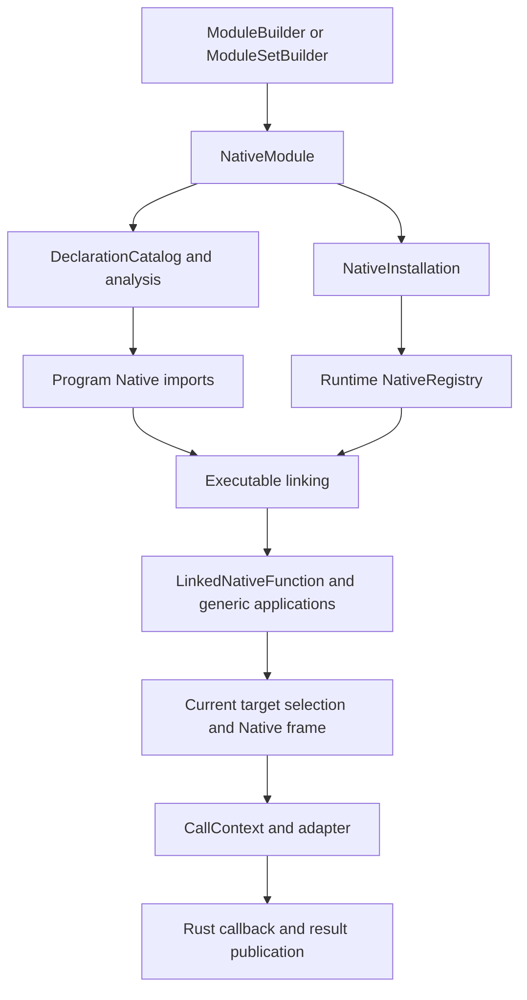
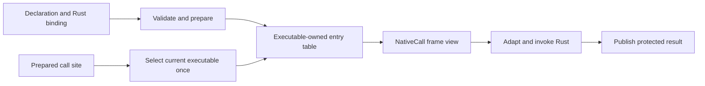

# Native architecture redesign

Status: design and architecture audit active; replacement implementation not started.
The user requested a dedicated redesign on 2026-10-29. This document owns the
Native review, candidate design, unresolved decisions, phase order and progress.
The [roadmap](implementation-roadmap.md#native-architecture-redesign) owns its
activation and the [GC plan](paged-incremental-gc-design.md#whole-path-iteratornative-architecture-review-2026-10-29)
owns the remaining joint GC performance and integration acceptance.

## Objective and scope

Make a Native call execute through a prepared entry and a clearly owned argument/
result frame. Move stable resolution and proof work before repeated execution;
retain changing-state checks at the boundary that owns them. Review the whole path,
not only the iterator operation that exposed its cost.

In scope: authoring and registration, installation, executable linking, generic
applications, ordinary/method/trait calls, argument conversion, Native payload
access, result publication, and removal of superseded mechanisms on these paths.
Preserve ordinary external providers and the standard library on the same model.

This is not a new language feature or a second GC migration. Compact Option
representation, collection-specific VM kernels, a different collector, unrelated
execution-frame rewrites, wider JIT/AOT support and multi-Runtime sharing remain
outside this plan. Existing async producers and host reentry are affected contracts
to preserve, not authorization for a scheduler redesign. Changes to registration
sharing must coordinate with the separate [sharing plan](multi-runtime-sharing-plan.md).

Current behavior remains owned by [architecture](architecture.md#unified-library-registration),
[Native authoring](native-registration.md), [host interoperability](spec/host-interop.md),
[traits](spec/traits.md), [execution](spec/execution.md) and
[module activation](spec/module-activation.md). Proposed names below are sketches,
not published APIs or claims of implemented performance.

## Current architecture and evidence

The inspected tree is `8e58330e`, after history consolidation. Runtime code is
unchanged from the pre-consolidation `7136e1da`; subsequent changes were documentation.
Original measurement commit identities remain historical evidence, not new results.
The `725a4fb5` trial baseline is unchanged. Freeze actual source trees and executable
images again before implementation measurements; history rewriting is not a rerun.



| Owner | Current responsibilities and evidence |
| --- | --- |
| [ModuleBuilder](../crates/kagari-runtime/src/native/builder.rs), [assembly](../crates/kagari-runtime/src/native/assembly.rs) | Explicit declarations and checked Rust associations. Single-module and batch recipes are alternative authoring routes. Batch factories execute once after semantic sealing. |
| [NativeModule](../crates/kagari-runtime/src/native/module.rs), [catalog](../crates/kagari-runtime/src/native/catalog.rs) | Declarations, bindings, owned/available/required catalogs, storage and host paths. Shared immutable records are not necessarily deep copies. |
| [NativeInstallation](../crates/kagari-runtime/src/native/installation.rs), [Engine builder](../crates/kagari/src/engine/builder.rs) | Prepare the installed closure and host maps. Engine installation currently prepares the entire staged set. This is setup cost, not per-element iterator work. |
| [NativeRegistry](../crates/kagari-runtime/src/native/registry.rs), [binding](../crates/kagari-runtime/src/native/binding.rs) | Match installed implementations to independently verified program imports and prepare scoped signatures. |
| [NativeApplication](../crates/kagari-runtime/src/native/application.rs), [TypeArgument](../crates/kagari-runtime/src/frame/types/arguments.rs) | Cache generic applications and type parameter/member facts. Do not describe all generic work as repeated on every call. |
| [Call preparation](../crates/kagari-runtime/src/module/execution/calls.rs), [Native frame](../crates/kagari-runtime/src/frame/native.rs) | Normal Native calls use current selection and explicit frames. Frames carry depth, trace, roots, cleanup and reentry responsibilities. |
| [NativeStorage](../crates/kagari-runtime/src/native/storage.rs) | Shared Rust payload layout/type/scan/access protocol, distinct from a concrete NativeObject's state and the GC physical allocation descriptor. |

Installation clones share registration/callback records, including explicitly
captured host state. They do not share script heaps, active frames, host borrow
states or execution sessions. Registration does not move arbitrary external Rust
state into the script heap.

Supported contracts include ordinary functions, associated functions, instance
methods, generic functions/types/methods, trait bounds/defaults/associated types,
script callbacks and Native async producers. Native object methods receive the
receiver as an argument. Registering a Rust type does not expose all its Rust
methods automatically. See [registration tests](../crates/kagari-runtime/src/native/tests/native_registration.rs)
and the ordinary [Vec provider](../crates/kagari-stdlib/src/foundation/vector.rs).

### Parameter and result transport

The ordinary call path publishes arguments into callee frame slots. A CallContext
initially views those slots. Adapter behavior then differs:

- [Flat scalar adapters](../crates/kagari-runtime/src/native/functions.rs) read slot
  values directly and decode scalar arguments; they do not inherently build the
  complete owning-conversion parameter snapshot.
- The [owning typed adapter](../crates/kagari-runtime/src/native/typed.rs) copies the
  argument pack into a temporary Vec, registers it as an ArgumentView/RootSet,
  checks mappings and decodes Rust arguments, then keeps the pack through callback
  and result conversion. Value copies do not deep-copy script objects.
- [ArgumentView](../crates/kagari-runtime/src/native/context/arguments.rs) shares an
  existing immutable snapshot when snapshotting it again. Do not count that as a
  second full copy. [Shared-capability narrowing](../crates/kagari-runtime/src/native/context/references.rs)
  can separately create a pack when capability changes require one.
- Provider callbacks may use immediate payload access and their own retained
  conversion paths. Do not attribute the owning-adapter sequence to every Native
  function or to every iterator operation without tracing the actual route.

A scalar ScriptValue does not itself require a managed root record. An owning
argument pack can still register a RootSet containing scalars; these are different
costs. Snapshot lifetime currently protects conversions and callbacks that can
allocate, reenter or observe aliases. Elimination requires a replacement lifetime
and mutation proof, not merely the observation that the caller also has roots.

### Known structural questions

- Does one phase repeat a check already established for the same valid interval,
  or validate a genuinely different provider/program/runtime boundary?
- Can one selected invocation carry prepared type, receiver and result authority
  instead of downstream helpers rediscovering its owner and contract?
- Which parameter snapshots protect mutable aliases or arbitrary converters, and
  which duplicate stable invocation-owned storage?
- Can installation reuse immutable preparation without obscuring destination
  provider validation or introducing another cache owner?
- The old LinkedNativeCall/invoke_prepared_native path remains in source, but normal
  preparation rewrites Native calls and clears native_calls. Audit all consumers
  before deleting it. Restoring it unchanged would pin old callbacks in callers.

The formal iterator workload constructs a Vec and traverses 2000 elements. Its
remaining historical-baseline failure is not an isolated next-call measurement.
Physical release gates passed in the latest refreshed scope; do not reopen their
tuning merely to fund this redesign. The GC plan retains exact measurements and
unrefreshed obligations. No speedup or dominant-cost attribution follows from this
structural inventory alone.

## Candidate execution model

Use three semantic owners, replacing overlapping responsibilities rather than
adding wrapper layers. Actual Rust names/layouts remain undecided.

```text
NativeDefinition {                  // Registration lifetime
    declaration: QualifiedIdentity,
    signature: DeclaredSignature,
    implementation: RustCallback,   // May capture explicitly owned host state
}

NativeEntry {                       // Immutable executable/application lifetime
    invoke: NativeThunk,
    contract: PreparedNativeContract,
}

ExecutableModule {
    ...
    natives: [NativeEntry],
}

NativeId(u32)                       // Slot in the selected executable's table

NativeCall<'call> {                 // View of an already selected invocation
    runtime: &'call Runtime,
    entry: &'call NativeEntry,
    frame: FrameHandle,             // Argument/result slots and execution owner
}
```

The registration model also retains type/trait declarations, payload descriptors,
host paths and dependency contracts. The function sketch does not replace that
catalog. PreparedNativeContract holds closed type/access/result facts and operation
routes; it is not a request to interpret the whole declaration on each invocation.
Captured script values must retain explicit roots; an opaque Rust closure is not
automatically a GC-scanned script environment.

The invocation frame retains the exact selected executable. Entries must not create
a strong back-reference cycle to their containing executable. NativeCall reuses
frame storage rather than owning another Vec/RootSet by default. A frame handle is
not permission to hold a Rust slice across stack growth or a payload borrow across
reentry. Escaping host values still use owning handles.



### Preparation versus execution

| Stage | Stable work and remaining limits |
| --- | --- |
| Compilation | Resolve declaration/method identity, static types and trait proofs; lower argument/result locations. Do not serialize Rust pointers or resolve source again in the runtime. |
| Installation and linking | Validate the actual provider closure and artifact contracts; bind Rust callbacks, storage protocols and prepared invocation facts. Preserve source-free rejection. |
| Generic application | Close unresolved types and operations against the exact owner/environment; reuse the existing application cache. An unresolved application still requires preparation before first use. |
| Invocation | Select the correct implementation, protect arguments, enforce changing ownership/borrow/execution state, perform required conversion, invoke and publish the result. |

Rust generics are compiled by Rust; a new Kagari type does not create a new Rust
monomorphization at runtime. Shared callbacks may consume different prepared Kagari
type environments. Trait proof identifies a permitted operation, not authority to
freeze every future ordinary call to an obsolete implementation.

Ordinary calls select current implementations, including calls originating in old
resumed bodies. In-flight selected computations retain their exact owner. Reuse the
existing module routing/publication mechanism; do not add a second global Native
dispatch registry. Slot mappings must be linked for their owner, not assumed equal
across versions. Metadata-only retention must not become an executable lease.

### Concrete examples

For a declared `add(i32, i32) -> i32`, prepare the Rust mapping and scalar contract
before repeated calls. The entry reads two protected parameter slots, invokes the
Rust function and publishes one result. A typed Rust-facing API does not require a
heap-allocated parameter Vec. The candidate does not guarantee zero allocation for
initial frame growth, custom conversion or the function body.

For `values: Vec<i32>; values.push(42)`, compilation identifies the generic method
and its concrete types; linking/application prepares the receiver storage and result
contract. Invocation passes receiver first, obtains checked short-lived payload
access, mutates once and publishes the result. The current inherent push returns the
receiver for fluent calls. A generic `append<T>` can keep T symbolic until application.

For Vec iteration, the existing path reads the cursor and separately accesses its
source, protects the extracted item, advances the cursor and constructs ordinary
Option. The redesign must keep source invalidation, alias-sensitive retention and
mutation/trap order. It does not replace Option representation or hardcode Vec.
Trace another external provider and a script-defined iterator before generalizing.

For custom argument conversion that reenters script, an independent immutable
snapshot may remain necessary. Establish which slots cannot change throughout that
interval before replacing it with a frame view. Native async completion cannot
retain a synchronous frame view after the call returns.

## Preserved invariants and check ownership

| Obligation | Required boundary |
| --- | --- |
| Static signatures, bounds, declared access and artifact structure | Compile/registration/link validation as applicable; independent untrusted input boundaries remain independent. |
| Pre-effect mapping errors and custom converter behavior | Reject known mapping failures before any converter/callback side effect. Generic converters remain capable of fallible execution. |
| Actual raw callback results | Validate at the return boundary; a declared result type alone is not proof of what trusted Rust returned. |
| Runtime identity, generation and host scope | Check at entry/access boundaries whose state can change; pass valid authority through the protected interval. |
| GC liveness and publication | Trace active arguments and protect extracted/returned objects before GC or callback can invalidate the last owner. |
| Payload borrowing and revision checks | Short access scopes; no outstanding Rust payload/slot reference across script reentry. Readonly views do not freeze aliases. |
| Cancellation, depth, traps and cleanup | Keep logical frames and established observable ordering even if physical transfers merge. Preserve completed effects and panic/quarantine policy. |
| Hot reload and selected operations | Current ordinary calls and exact retained computations remain distinct. No stale callback cache or metadata/executable cycle. |

Do not introduce a matrix of skip-check flags or stdlib-only unchecked entrypoints.
Any removed check needs an identified proof owner, scope and invalidation boundary.
Keep type conversion policy out of generic frame loops and collection algorithms
out of the generic runtime. Removing contexts is useful only when responsibility
actually converges, not when the same checks move into more adapters.

## Mature runtime references

| Primary source/version | Mechanism to reuse | Different assumptions |
| --- | --- | --- |
| [Java SE 25 JNI RegisterNatives](https://docs.oracle.com/en/java/javase/25/docs/specs/jni/functions.html#registernatives) | Registration associates names/signatures with function pointers. Separate authored contract from executable callback. | JNI reference rules and JVM native ABI do not provide Kagari's Rust borrowing or reload ownership. Registration shape does not establish invocation performance. |
| [Lua 5.4 manual: stack](https://www.lua.org/manual/5.4/manual.html#4.1), [C functions](https://www.lua.org/manual/5.4/manual.html#lua_CFunction) | Arguments/results use a runtime-owned value window. A convenient typed facade can adapt that window without a mandatory independent parameter container. | The virtual stack is not the CPU stack. Lua is dynamically typed; safe Rust/custom conversion and host capabilities require additional lifetime rules. |
| [Lua 5.4.9 precallC](https://www.lua.org/source/5.4/ldo.c.html#precallC), [CClosure](https://www.lua.org/source/5.4/lobject.h.html#CClosure) | Known function entry plus call state and captured values. Stack capacity/call management remain real costs. | Kagari must also preserve scoped generic applications and current-versus-pinned execution. Do not copy Lua longjmp/error handling into Rust. |

The custom part is integrating prepared entries with Kagari's existing static proof,
runtime ownership and reload contracts. Do not invent an alternative object model or
infer a speed ranking from API style. Machine-register native ABIs are a separate
backend concern, not a prerequisite for simplifying the interpreter boundary.

## Decisions required before implementation

1. Define the exact entry owner and route-to-slot mapping for ordinary, generic,
   trait and retained calls; account for all executable/metadata lifetimes.
2. Inventory which registration/link checks have distinct input authorities and
   which truly repeat preparation. Decide which catalog/context representations merge.
3. Classify every adapter's argument stability, conversion and escape requirements.
   Prove when a frame view suffices and when a snapshot/owning handle is necessary.
4. Assign one owner for prepared receiver access and result conversion/publication,
   including custom converters, raw providers, reentry and cancellation failures.
5. Produce an exact replacement/removal map for existing contexts, old direct-call
   machinery and caches. Retain sound existing mechanisms rather than layering a
   second implementation over them.

## Phased execution and validation

| Phase | Deliverable | Exit condition |
| --- | --- | --- |
| NAR00: audit and freeze | Trace registration through execution for scalar, owning, generic, method, trait, external provider, reentry and async boundaries. Freeze representative source/image baselines. | Check/lifetime owner matrix and measured allocation/copy/lookup attribution; no claim that all adapters share one cost. |
| NAR01: resolve design | Specify entry and frame data flow, slot/reload mapping, generic facts, snapshot rules and exact removal list. Choose a finite implementation slice and selected tests. | Above decisions resolved with concrete failing/valid scenarios and preserved error/effect ordering. |
| NAR02: registration and preparation | Replace unsuitable registration/link/application boundaries and migrate consumers coherently. Reuse the common checked model. | Focused registration, source-free, generics, trait and reload contracts pass; no runtime dependency on source analysis or duplicate semantic pipeline. |
| NAR03: invocation and payload integration | Consolidate argument/result ownership and Native access; migrate ordinary providers/SDK consumers and remove superseded paths. | Scalar and managed calls, custom conversion, reentry, Native methods and representative async/cancellation boundaries pass; obsolete mechanisms removed. |
| NAR04: joint acceptance | Measure complete workloads, inspect memory/retention and run designated local checks; coordinate full CI and GC acceptance. | No carried integration errors, required gates/CI accepted, lasting contracts transferred to their owners. Unmet performance targets trigger architectural diagnosis. |

Keep each implementation slice buildable where practical. Before any unavoidable
intermediate break, name the exact error, reproduction and phase that repairs it;
attempt affected checks once and do not repeat unchanged failures. No production
stubs or weakened assertions. Commit cohesive reviewed checkpoints, not each
conversation, measurement or document update.

Local iteration selects existing contract tests for changed behavior and a small
dependent regression set. Cover distinct boundaries: signature/provider mismatch,
foreign/expired ownership, nominal generic/trait identity, source-free loading,
current reload versus retained computation, custom conversion failure, alias mutation,
GC during callback, host loans, cancellation/depth and cleanup. Reuse existing owners;
do not build a duplicate smoke suite. Select source-free Miri cases when unsafe
transport/lifetime implementation changes; do not route GC-only evidence through
the known unrelated parser dependency issue.

Implementation checkpoints run structure, formatting, workspace all-target Clippy
with warnings denied, and diff checks per [AGENTS.md](../AGENTS.md). Full workspace
tests and exhaustive feature/backend/platform coverage remain CI-only. A docs-only
checkpoint needs content/link/diff checks, not Rust builds. Record focused local
results, known failures and pending CI separately in the ledger below.

Performance separates registration, runtime creation, loading/preparation, first
generic application and steady calls. Diagnose scalar calls, managed arguments,
method mutation, trait dispatch and reentry; track pack allocations, copies, roots
and retained metadata as well as time. Preserve the GC plan's existing limits and
paired workload definitions. New diagnostic budgets must be fixed before trials;
they cannot replace original acceptance. Include the full Vec construction-plus-
iteration workload, release workloads and memory/normal-step obligations. Record
toolchain, machine, profile/features, parallelism, caches, source and image provenance.
No speedup follows merely from deleting a layer or reducing an allocation count.

On completion, move lasting contracts to architecture/specification/authoring owners,
move unresolved work to the roadmap, and remove this completed plan. Git history
owns superseded experiments and checkpoint logs; do not grow a second permanent diary.

## Progress ledger

- [x] Inventory the current registration/installation/linking owners and existing
  generic preparation; distinguish flat scalar and owning snapshot adapters.
- [x] Record the candidate data model, concrete examples, primary references and
  required semantic boundaries in this dedicated plan.
- [ ] Complete NAR00 route/retention audit and matched baseline selection.
- [ ] Resolve NAR01 design decisions and replacement/removal map.
- [ ] Implement NAR02 and NAR03; replacement runtime work has not started.
- [ ] Complete NAR04 and the independent GC/CI acceptance obligations.

Initial handoff: the user authorizes a dedicated redesign document, not an immediate
runtime replacement. The Native audit now precedes further local iterator tuning.
No runtime behavior, test expectation, benchmark threshold or speed claim changes
with this document. The GC plan retains its measurement ledger and final acceptance;
Native design decisions/progress are maintained only here.
