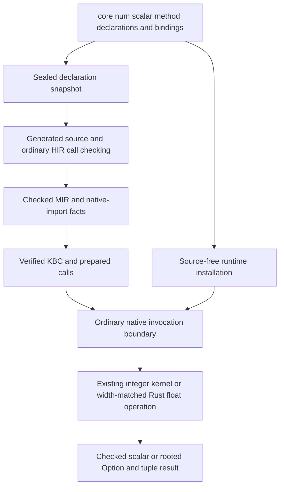

# Numeric standard-library implementation plan

Status: implementation and phase commits authorized; NS01-NS03 complete, NS04 next.
The [roadmap](implementation-roadmap.md#numeric-standard-library) owns activation.
This document owns the finite NS01-NS05 sequence, proposed API/semantics, acceptance
and progress ledger. Proposed methods below are **not installed APIs today**.

## Outcome and scope

Provide ordinary, typed numeric methods sufficient for a small CPU ray tracer and
its deterministic sampling code. Keep the renderer itself in Kagari: Vec3, rays,
intersection, materials, sampling loops and acceleration structures are not native
library features in this task. Preserve checked ordinary arithmetic, explicit
host/GC boundaries and the existing interpreter-first backend contract.

Deliver:

- Explicit integer arithmetic policies across all eight existing integer widths.
- A bounded set of f32/f64 utility, bit-conversion and mathematical methods.
- Ordinary module-owned declarations, documentation and bindings, available through
  source analysis and source-free artifact installation without a second API model.
- A small script-owned, fixed-seed sampling example and analytic numerical acceptance,
  not a public random-number framework or a complete rendering application.

Exclude new numeric types, vector/matrix/SIMD APIs, operator semantic changes,
implicit conversions, numeric-specific syntax, arbitrary precision, complex numbers,
new crates/dependencies, LLVM/JIT expansion, a custom libm, global/cryptographic
randomness, image IO, GUI, full ray tracing and performance-target commitments.
Do not add a parallel `math` free-function catalog for the same scalar methods.

**Constants are explicitly deferred.** The current native declaration/assembly
model has methods but no complete associated-constant authoring path. Supporting
`f64::consts::PI` or `u64::MAX` would involve additional declaration, projection and
validation work. Use named, explicitly typed source-local literal constants in the
example. Do not disguise zero-argument callbacks as compile-time constants or add
compatibility spellings. Const evaluation of these new native method calls is also
out of scope; existing scalar const operations remain unchanged.

## Baseline and implementation evidence

Inspected on 2026-10-21 at `4baef38e` (`origin/main`), on the new
`feat/numeric-stdlib` branch. The working tree was clean before planning. Latest
main has completed module-owned registration; earlier `catalog/strings.rs` and
`bindings/strings.rs` guidance is obsolete. Reuse that completed migration rather
than reopening it. No build, runtime test or performance measurement was run for
this planning change.

| Current owner | Observed facts and consequence |
| --- | --- |
| [Numeric foundation](../crates/kagari-stdlib/src/foundation/numeric.rs) | Registers Default, TryFrom, FromStr, Sum and Product, but no integer-policy or floating-point math inherent methods. Its `constant` helper builds a Default callback, not an associated constant. |
| [String foundation](../crates/kagari-stdlib/src/foundation/string.rs) | Working `ModuleDraft::inherent` / `MethodDecl::instance` pattern co-locates signature, docs and binding. Use this boundary rather than a new name dispatcher. |
| [Foundation routing](../crates/kagari-stdlib/src/foundation.rs) and [receiver ownership](../crates/kagari-types/src/declaration/ownership.rs) | Scalar inherent implementations belong to canonical `core::num`; contributor routing selects the owner. Catalog/generated source are views, not additional semantic owners. |
| [Integer kernels](../crates/kagari-types/src/integer.rs) | `IntegerMethod` and `arithmetic_method` already implement width/sign-aware policies and have Rust-reference tests. They are not proof of an installed script surface. |
| [Integer method contracts](../crates/kagari-contract/src/numeric/method.rs) | `IntegerMethodContract` specifies receiver/RHS/result types, including unsigned signed-offset addition and u32 rotation counts. |
| [Runtime numeric boundary](../crates/kagari-runtime/src/numeric.rs) | `integer_method` checks carriers and invokes the kernel. Its current callers found during inspection are tests, not standard-library bindings. Rust `None` denotes checked failure; a successful checked result is a bare scalar, not script Some. Overflowing results are already heap tuples. |
| [Scalar codecs](../crates/kagari-runtime/src/native/scalar.rs) | f32/f64 transport uses the matching Value variant without widening or intentional NaN canonicalization. Transport guarantees do not imply arithmetic NaN-payload guarantees. |
| [Enum carriers](../crates/kagari-stdlib/src/foundation/enumerations/value.rs) and [numeric conversion](../crates/kagari-stdlib/src/foundation/numeric/conversion.rs) | Existing prepared enum symbols and pinned result types construct Option/Result. Reuse these and established native result/rooting adapters. |
| [Native declarations](spec/standard-declarations.md) and [value semantics](spec/value-semantics.md#explicit-integer-arithmetic) | Registration is explicit; optional integer methods are currently deferred. Old numeric fixture names are not evidence of current support. |
| [Cranelift admission](../crates/kagari-codegen-cranelift/src/emit.rs) and [native preparation](../crates/kagari/src/program/native.rs) | The native subset is narrow; calls and floating/compound slots are not generally supported. Numeric-library additions must not claim native execution when pre-entry fallback handles the body. |

## Target ownership and execution path



Responsibilities:

- `kagari-stdlib` owns public names, documentation, explicit method signatures and
  callbacks under `foundation/numeric`. Split integer, basic float and extended
  math responsibilities into ordinary modules as they grow; the facade orchestrates.
- Reuse integer arithmetic in `kagari-types` and the existing contract/runtime
  checks. Do not copy kernels into stdlib or add a second set of native arithmetic
  rules. Numeric result-carrier policy belongs with library declarations, not in
  a VM opcode or a generic GC loop.
- Reuse module-owned assembly, independent declaration targets per scalar, and
  once-per-binding preparation. Shared Rust bodies do not permit sharing the wrong
  receiver/result identity. Resolve Option symbols at preparation, not by textual
  lookup on every invocation. No new persistent dispatch cache is needed.
- HIR resolves ordinary registered members; lowering retains checked targets.
  Do not teach compiler/VM loops names such as `sqrt` or `wrapping_add`. Float
  operations can use exact typed native bindings without a new opcode schema.
- Use the current artifact verifier, local binding installation and pinned call
  contracts. Do not widen source-free dependencies or bypass signature, width,
  generation, representation or bounds checks.
- Backend eligibility stays explicit. Unsupported bodies fall back before entry;
  traps do not cause replay. Future intrinsic lowering must implement these same
  semantics, but is not built in NS01-NS05.

For example, a proposed `a.checked_add(b)` evaluates receiver and argument once,
checks a concrete i8/i16/... signature, lowers to its ordinary native import, and
returns the pinned standard `Option<T>`. Overflow becomes None, not a trap. A later
allocation must not leave a temporary enum/tuple only in an unrooted Rust value.
Use existing result conversion/safepoints; do not hand-build numeric-only carriers.
In contrast, `a + b` keeps its current overflow trap, evaluation order and mutation
commit rules. This addition must not silently replace ordinary checked operators.

## Proposed finite API and semantic contract

The following inventory is the implementation scope, not a promise to reproduce
all Rust numeric methods. NS01 confirms it against registration and tests before
implementation. Any material expansion requires updating this plan explicitly.

### Integer policies — NS02

For `T` in `i8`, `i16`, `i32`, `i64`, `u8`, `u16`, `u32`, `u64`:

| Instance methods | Explicit arguments | Result and behavior |
| --- | --- | --- |
| `wrapping_add`, `wrapping_sub`, `wrapping_mul` | `rhs: T` | T, modulo 2^width, interpreted at the declared signedness. |
| `checked_add`, `checked_sub`, `checked_mul`, `checked_div`, `checked_rem` | `rhs: T` | Option<T>; None on arithmetic overflow, zero division/remainder, or signed MIN / -1 and MIN % -1. |
| `overflowing_add`, `overflowing_sub`, `overflowing_mul` | `rhs: T` | (T, bool); wrapped result and arithmetic overflow flag. Signed overflow is not an unsigned carry flag. |
| `saturating_add`, `saturating_sub`, `saturating_mul` | `rhs: T` | T, clamped to its mathematical range; unsigned subtraction bottoms at zero. |
| `rotate_left`, `rotate_right` | `count: u32` | T, circular bit-pattern rotation with count modulo width. |

Additionally, unsigned receivers expose `wrapping_add_signed` with the corresponding
signed RHS width (`u8/i8` through `u64/i64`) and unsigned result. It is not installed
on signed receivers. Receiver and operand widths never silently coerce. The
existing `IntegerMethod` inventory is 17 policy variants; do not generalize their
names into unimplemented division, remainder, shift or exponent families.

Ordinary shifts continue to trap on negative/out-of-width counts and are not
rotations. Wrong arity/types reject during source checking or artifact/installation
validation. Malformed direct native carriers reject without a Rust panic. Runtime
errors and allocation failures still propagate through the ordinary boundary.

Proposed usage, not currently executable:

```text
val next = state.wrapping_add(increment);
val narrow = left.checked_mul(right);
val rotated = bits.rotate_left(13u32);
```

### Float utilities — NS03

For `F` in `f32`, `f64`, install these exact methods:

| Methods | Arguments and result |
| --- | --- |
| `abs`, `sqrt`, `floor`, `ceil`, `round`, `trunc`, `fract` | Instance F -> F |
| `min`, `max` | Instance F, `other: F` -> F |
| `clamp` | Instance F, `min: F`, `max: F` -> F |
| `is_nan`, `is_infinite`, `is_finite` | Instance F -> bool |
| `to_bits` | f32 -> u32; f64 -> u64 |
| `from_bits` | Static f32::from_bits(u32) -> f32; f64::from_bits(u64) -> f64 |

- Use width-matched Rust operations: f32 is not widened to f64 and narrowed again.
- `sqrt` follows correctly rounded square-root semantics; negative nonzero values
  return NaN, positive infinity stays infinity, and negative zero remains negative
  zero. Domain results are not converted into integer-style overflow traps.
- `round` rounds halfway away from zero; `floor` goes toward negative infinity,
  `ceil` toward positive infinity, and `trunc` toward zero. Results remain floats.
  `fract` follows the matching Rust primitive, including negative fractions and
  NaN results for infinite inputs. No implicit float-to-integer conversion is added.
- `min/max` follow Rust's NaN-ignoring contract: one NaN returns the other operand;
  two NaNs return NaN. Equal zero operands may select either sign. Do not introduce
  a stronger deterministic zero tie-break or conflate these with Ord/total ordering.
- `clamp` validates bounds before invoking a potentially panicking Rust primitive:
  NaN bounds or min > max produce an ordinary Kagari ScriptTrap, not a host panic.
  Validate even if the receiver is NaN. Infinite bounds are legal; with valid bounds
  a NaN receiver stays NaN. An in-range receiver, including signed zero, is retained.
  Do not substitute `max(min).min(max)`, which changes these rules.
- Bit conversion is reinterpretation, never `as`. An immediate
  `from_bits(bits).to_bits()` preserves every bit, including zero signs and NaN
  payloads. Subsequent arithmetic, casts, formatting and math need not preserve
  NaN payloads; no signaling-NaN exception mode is introduced.
- Classification distinguishes infinities and NaNs without requiring a magic NaN
  constant. No new float trait, overloading framework or generic Float bound is needed.

### Extended math — NS04

For both float widths, install only:

- Unary `sin`, `cos`, `tan`, `asin`, `acos`, `atan`, `exp`, `ln` -> F.
- `atan2(other: F)` -> F, with receiver y and argument x, producing atan2(y, x).
- `powf(exponent: F)` -> F; `powi(exponent: i32)` -> F.

Angles are radians. Use the matching Rust primitive's exceptional-input behavior:
trig of nonfinite inputs, inverse-trig domain limits, logarithm of zero/negative
inputs, and signed zero/infinity cases must be documented and tested. In particular,
`ln(0)` is negative infinity and negative inputs return NaN. Power special cases
must not be replaced by an unconditional NaN-propagation rule: NaN raised to zero
and 1 raised to a NaN floating exponent have defined unit results in the reference.
NS04 must state these cases in method docs, not merely link to a Rust function.

**Precision boundary:** these extended methods inherit the matching Rust operation's
unspecified precision; no universal ULP bound, cross-platform bit identity or
bit-identical repeated approximate result is promised. Do not apply fast-math,
reassociate expressions or add implicit FMA. Finite reference-point tests need
explicit width-specific tolerances justified for those points, not a universal
accuracy claim. A correctly rounded software math library, `mul_add`, hypot,
additional logarithms and trigonometric helpers remain outside this inventory.

## Mature implementation references

Primary sources retrieved on 2026-10-21. Rust links are pinned to **1.90.0** as a
semantic reference, not a requirement to downgrade the repository toolchain.
The planning host reports rustc 1.99.1; implementation must verify behavior on
its actual supported toolchains and record any mismatch before changing the contract.

| Source | Mechanism, fit and limits |
| --- | --- |
| Rust [signed](https://raw.githubusercontent.com/rust-lang/rust/1.90.0/library/core/src/num/int_macros.rs) and [unsigned](https://raw.githubusercontent.com/rust-lang/rust/1.90.0/library/core/src/num/uint_macros.rs) integers | Explicit wrapping/checked/overflowing/saturating/rotation policies independent of ordinary build-mode overflow behavior. Kagari reuses its existing width-aware kernels and checked carriers; Rust Option/tuple return storage is not Kagari's GC representation. Ordinary Kagari operators remain checked in every build. |
| Rust core [f32](https://raw.githubusercontent.com/rust-lang/rust/1.90.0/library/core/src/num/f32.rs) / [f64](https://raw.githubusercontent.com/rust-lang/rust/1.90.0/library/core/src/num/f64.rs) | Bit reinterpretation, classification and min/max/clamp semantics. Adopt the method contracts, but validate clamp bounds into a script trap rather than inheriting Rust panics. These are scalar operations without host callbacks or shared mutable state. |
| Rust std [f32](https://raw.githubusercontent.com/rust-lang/rust/1.90.0/library/std/src/num/f32.rs) / [f64](https://raw.githubusercontent.com/rust-lang/rust/1.90.0/library/std/src/num/f64.rs) | Width-specific math delegates to compiler intrinsics/platform math; square root has a stronger rounding contract than transcendentals/powers. Adopt those distinctions, not a claim of portable libm bit determinism or Rust native speed for Kagari calls. |
| Vigna's [splitmix64.c](https://prng.di.unimi.it/splitmix64.c), authored 2015, unversioned source retrieved on the lookup date | Explicit 64-bit state, modular increment/multiplication and XOR shifts make a small exact-integer acceptance workload. Rust/C unsigned wrapping must be expressed explicitly in Kagari. Keep state script-local; no global entropy, thread safety, statistical certification or cryptographic security claim is imported. |

No custom numeric framework is justified here. The sole deliberate error adaptation
is mapping an invalid clamp domain to Kagari's established script-trap boundary.
Prepared identities, GC result carriers and pre-entry backend fallback remain Kagari
mechanisms; a matching method spelling does not authorize copying Rust ownership.

## Execution phases

Each phase remains buildable; no disabled validation or production placeholders.
When implementation and commits are authorized, use separate coherent checkpoints
with `Phase: NS01` through `Phase: NS05`. A phase is complete only when its selected
checks pass or the ledger explicitly says acceptance is blocked.

### NS01 — Contract and boundary checkpoint

- Recheck the baseline, method inventory, receiver ownership and current tests.
- Freeze the above signatures, exceptional-value behavior, precise/approximate
  distinction and ordinary instance/static syntax. Do not add a second static
  spelling for every instance method or reopen general UFCS resolution.
- Confirm the existing integer helper/carrier path and Float exact codec path;
  specify each allocating result's rooting/return handoff before adding bindings.
- Inspect low-level policy tests and use targeted probes only for unresolved edge
  cases. Record any real defect and its owning phase; no speculative refactoring.
- Acceptance: no unresolved signature/NaN/clamp/width/ownership decisions, a finite
  affected test selection and no accidental constant/RNG/backend expansion.

### NS02 — Installed integer policy methods

- Add the finite methods to core::num's module-owned scalar inherent groups, with
  complete docs and independent concrete targets, using existing arithmetic rules.
- Adapt checked results to the registered Option<T> and return overflowing tuples
  through established rooted native handoff; do not double-wrap existing tuples.
- Cover narrow/wide signed and unsigned boundaries, zero divisors, signed MIN/-1,
  RHS restrictions, rotations modulo width and rejected argument contracts.
- Prove actual script method execution, not merely a call to the Rust helper.
  Include source-free installation and a small low-threshold-GC result-carrier case.
- Acceptance: ordinary +/compound assignment still trap and retain earlier effects;
  explicit policies produce their specified results without leaking roots.

### NS03 — Float utilities and bit-exact transport

- Install the 15 listed method names at each float width using ordinary bindings.
- Cover signed zeros, subnormals, infinities, quiet/signaling NaN bit patterns,
  rounding ties, negative square root and all clamp bound/error branches.
- Check f32/u32 and f64/u64 bit round trips through script locals, native boundaries
  and serialized executable constants. Do not assert arithmetic NaN payloads.
- Check receiver/argument once-only order and cleanup after invalid clamp. Preserve
  distinct failures for malformed native inputs rather than converting all failures
  to a numeric domain result.
- Acceptance: exact methods have bit/classification evidence; methods with allowed
  zero/NaN variation are tested against the allowed set, not one host accident.

### NS04 — Bounded transcendental and power methods

- Install the eleven listed method names at each width, with explicit domains,
  atan2 argument order, exponent types and precision caveats.
- Use analytic reference points and per-point tolerances for finite results, plus
  classification/sign/special-case checks for exceptional inputs. Same-host Rust
  agreement is integration evidence, not an independent accuracy proof.
- Check source and source-free routes; select existing backend fallback coverage
  where affected. Do not claim Cranelift coverage from a request that fell back.
- Acceptance: all listed methods are callable and documented; no host panic escapes
  for expected math domains and no stronger precision guarantee is advertised.

### NS05 — Application-oriented acceptance and handoff

- Add one small runnable Kagari numerical example, not a native ray tracer. Use
  script-owned vector/ray calculations with analytic sphere-intersection and
  normalization checks, plus a fixed-seed SplitMix64 stream exercising wrapping
  add/multiply, XOR, shifts and state updates. Keep sample counts bounded.
- Preserve the reference algorithm/attribution and committed expected vectors.
  For seed zero the reference recurrence yields `e220a8397b1dcdaf`,
  `6e789e6aa1b965f4`, `06c45d188009454f`; these were independently derived during
  planning, not published vectors or an executed C test. Reconfirm against the
  official recurrence in implementation. Rotate testing stays separate because
  SplitMix64 does not exercise rotations.
- If producing unit-interval f64 samples, use the high 53 bits scaled by 2^-53 so
  samples remain in [0, 1); do not divide a rounded full-width u64 by a rounded MAX.
  This is a concrete example algorithm, not a public RNG API/version commitment.
- Execute the same bounded workload from source and encoded .kbc in a fresh runtime;
  retain exact integer/checksum assertions and appropriate float tolerances. Reuse
  existing source-free test harnesses without frontend dependencies in the consumer.
- Move lasting API, edge cases and precision rules to value-semantics/builtins/native
  declarations and the language guide. Update the numeric namespace documentation,
  example index and generated navigation expectations through their actual owners.
- Record unrun CI/platform scope in the roadmap and remove this completed plan.
  Git history owns its phase ledger; no parallel progress or review queue is created.

## Verification and acceptance policy

Reuse existing owners rather than duplicating language conformance:

- [Integer policy tests](../crates/kagari-types/src/integer.rs),
  [method contract tests](../crates/kagari-contract/src/numeric/method/tests.rs),
  and [runtime numeric tests](../crates/kagari-runtime/src/numeric.rs): width,
  exceptional inputs, carrier rejection and allocation-safe outcomes.
- [Script numeric operations](../crates/kagari/src/runtime/tests/language/numeric_operations.rs)
  and [conversion/aggregation](../crates/kagari/src/runtime/tests/language/conversion_traits.rs):
  actual method calls, operator non-regression and typed results. Add focused
  sibling suites only when they establish a distinct new contract.
- [Stdlib registration](../crates/kagari-stdlib/src/tests/registration.rs),
  [documentation](../crates/kagari-stdlib/src/tests/documentation.rs),
  and [scalar target ownership](../crates/kagari-runtime/src/native/assembly/tests/scalar_targets.rs):
  exact declaration targets, generated docs and source-free installation.
- Existing SDK artifact/native tests own fresh-runtime loading, pinned calls and
  fallback. Select representative allocating/nonallocating results, malformed
  imports, cancellation/trap cleanup and version ownership; do not repeat that
  matrix for every arithmetic spelling. Disassembly may inspect ordinary native
  targets, but a readable listing does not prove execution semantics.

Routine local checks use only affected package/target/test-name filters and a small
adjacent regression set. Record exact commands when test names exist; use
`--no-fail-fast` for multiple selected targets. Initial build failure is not passing
coverage. Keep previously passing unaffected results; rerun only repaired/affected
checks. Do not run local workspace tests, even split into many package commands.

Every implementation checkpoint requires:

```text
uv run --locked scripts/check_structure.py
cargo fmt --all -- --check
cargo clippy --workspace --all-targets -- -D warnings
git diff --check
```

Complete workspace/backend/feature/platform validation is CI-only, including Windows,
Linux and browser/WASM float behavior. Leave the existing source-free dependency
and exact-product browser guards intact. Regenerate only affected disposable KBC/
source-free products at coherent checkpoints; do not weaken version/admission checks
or routinely bump unpublished format/runtime/helper ABI identifiers.

No speed target is required for this API task. If measurement becomes necessary,
separate compilation, load/preparation, execution, allocation/GC and host IO; record
machine/toolchain/profile/features/parallelism/cache/workload. Neither intrinsic
spelling nor a small native callback proves a low total script-call cost. General
call-boundary and GC optimizations stay with their existing review/roadmap owners.

## Progress ledger

- [x] Fresh origin/main baseline inspected; branch created at `4baef38e`.
- [x] Current registration owners and retained-but-uninstalled integer machinery checked.
- [x] Primary integer/float/PRNG references checked; finite inventory and exclusions proposed.
- [x] NS01: freeze contracts and boundary acceptance after implementation authorization.
- [x] NS02: installed integer policy methods.
- [x] NS03: float utilities and bit-exact transport.
- [ ] NS04: bounded transcendental and power methods.
- [ ] NS05: application-oriented acceptance and documentation handoff.

NS01 decisions: the finite signatures and edge cases above are frozen. Integer
bindings use `IntegerMethodContract` for RHS/result facts and the runtime's
`integer_method` for execution; checked scalar/None outcomes are wrapped once using
binding-local prepared Option symbols and the pinned result type. Overflowing
results return the existing tuple immediately, with no subsequent allocation or
reentry before the normal native return handoff. Scalar-only outcomes need no
additional GC carrier. Float bindings use width-matched exact codecs; clamp domain
validation produces ScriptTrap before calling Rust. No second opcode/dispatcher,
associated-constant integration, or const-method evaluator is introduced.

NS01 selected baseline checks passed: the integer all-width Rust-reference test
(1), numeric method-contract test (1), and runtime numeric boundary tests (2).
The initial combined command timed out during the runtime test's cold build;
that group alone was rerun and passed. Structure (1424 files, no violations),
format, workspace all-target Clippy with denied warnings and diff checks passed.
No known carried build failures. NS02 selects installed method/Option/tuple and
malformed-call coverage; NS03/NS04 select exact-bit/domain/precision contracts;
NS05 selects one bounded source/source-free application workload. The complete
workspace/backend/platform matrix remains CI-only and unrun locally.

NS02: all 132 concrete integer method bindings are installed under core::num.
Seven installed-method tests passed across the initial five successes and two
repaired generated-depth cases; all eight widths/17 policy variants, invalid
contracts, carrier GC and evaluation order are covered. The generated assertions
were flattened to respect the existing source-depth limit without reducing cases.
Ordinary arithmetic/commit regression selection passed (2). Scoped publication/
installation passed (1) after updating its retained inventory expectation for the
eight new integer inherent groups (226 -> 234); no assertions were removed.
Structure (1428 files), format, workspace all-target Clippy and diff checks passed.
No production kernel or VM/backend changes were needed. Complete CI remains unrun.

NS03: 30 concrete float utility bindings are installed, including static from_bits.
`cargo test -p kagari --lib float_methods` passed 10 tests across source and encoded
routes. Coverage includes signed/subnormal/infinite/NaN transport, literal-constant
serialization, typed native entries, GC fields, permitted min/max variation,
rounding/classification, 104 invalid clamp combinations per route, evaluation order,
trap cleanup and rejected contracts. Initial generated harness compile/work-limit
issues were corrected by bounded grouping, without raising limits or removing cases.
Registration publication/installation passed (1) with its inventory updated for two
new float inherent groups (234 -> 236). Structure (1434 files), format, workspace
all-target Clippy and diff checks passed. No carried errors; cross-platform math
acceptance remains CI-only. No backend, ABI or ordinary operator change was needed.

Planning validation: an independent read-only review found no required corrections
to the inventory, current owner boundaries, float/error semantics or phase scope.
All 226 local Markdown link targets across this plan, docs index and roadmap exist;
new roadmap/index links point to the intended plan and section. `git diff --check`
passed. No production files changed; no Cargo build/test, Clippy, branch push or
commit was requested or performed for this documentation-only checkpoint.
