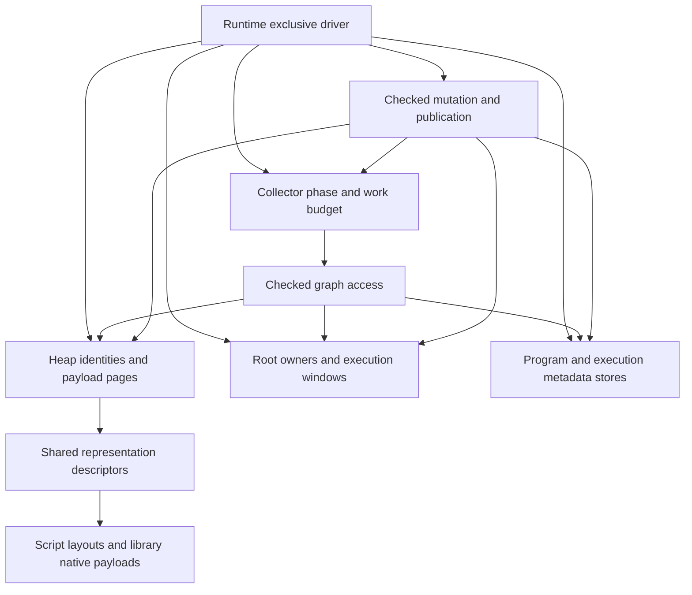

# Paged storage and incremental garbage collection

Status: joint PG00-PG06 migration activated by the user on 2026-10-26 at
`50ab194b30b0218e9befe3176d6b5711ecf17a28`; PG00/NC01 contract closure and baseline
are locally complete (`47be3cb7`). PG01/NC02 is locally complete after coordinated
review and focused/final local validation (commit `fc651b92`). PG02 nonmoving
inline storage is locally complete; focused tests, Miri, memory probes and final
local checks are recorded below (PG02 commit `4d8aa0c1`). PG03/NC03-NC04 is
locally complete and committed at `8d597b93` after final independent review,
selected focused contracts, paired gates and parent local checks. PG04 is locally
complete at commit `fe56b675`, after parent acceptance of final Map/arrays paired gates,
scoped reuse of unaffected timing/memory evidence, repaired review blockers and final
local checks. That checkpoint drains marking and physical sweep synchronously.
PG05/NC05 implementation is now integrated in the worktree but **not complete**:
borrow-preflight and unwind-cleanup regressions are fixed and selected actual-native
proof passes. Budget/cache corrections have final source approval and selected tests/
local quality pass. Ordinary-build collector observations are implemented and locally
validated. The disabled-observation timing/accumulation finding is repaired, preserving
work budgets and public last_pause; the latest focused/quality checkpoint passes.
The trusted actual-root replacement reports **77 ordinary gates passing / 11 failing** and
**19 observed normal-step gates passing / 3 failing**; **34 unobserved rows are not passes**.
All **112 timing processes** completed once with semantic assertions passing. Separately
verified fresh memory passes **55/55**, with **21 zero-net teardowns**. This supersedes older
measurement summaries, not the frozen gates. The contaminated selected 23/6 interpretation
remains withdrawn; other historical artifacts retain their individual audit qualifications.
Subsequent finite source corrections are not yet timed or memory-accepted; these totals remain
prior-image evidence. Numerical closure and CI remain pending. The [PG05 ledger](#pg05-integrated-driver-and-open-acceptance)
owns current progress. PG06/NC06 remains outstanding.
Initial implementation parameters remain selected policy, not measured optima or
acceptance of future performance gates. The execution breakdown
was originally recorded against `bb836eff`, following the design at `8c2a4568`.
The user selected paged storage, precise incremental tracing, unsafe integration
for Opaque payloads containing Value, and collecting Native callbacks. These replace
the provisional counted-Value/cycle-collector proposal and Native-wide GC exclusion.
The activation supersedes the earlier queued/no-authorization status; the
[roadmap](implementation-roadmap.md#library-owned-native-collections) remains the navigation owner.
[Current runtime semantics](spec/runtime.md#gc-heap) remain authoritative until the
corresponding implementation checkpoint changes them.

This document owns the proposed collector/storage architecture, PG00-PG06 execution
order, unresolved decisions and GC progress/error ledger. The
[native collections plan](native-collections-plan.md) continues to own NC01-NC06
and the detailed collection migration ledger.
Opaque registration, the general payload protocol and affected collection integration
belong to the same GC replacement migration. NC retains the collection work breakdown;
its removal of special container paths is part of joint acceptance, not a later
redesign. PG phases reference NC handoffs, not duplicate NC completion records.
Migration authorization does not waive phase dependencies or baseline acceptance.
NC01's provider, collection representation and evidence decisions are selected;
the general provider and collection proofs are locally accepted through PG03/NC04.
Production interleaving and joint incremental acceptance remain with PG05-PG06/
NC05-NC06. PG00-PG04 and NC01-NC04 are closed locally; full-workspace/feature/backend/
platform CI remains unrun.

## Direct-reference trial and API proposal (2026-10-28)

Status: the user accepted the trial direction and started implementation on
2026-10-28. Scoped host inspection is implemented in the first boundary checkpoint
recorded below. Phase 1 boundary migration is locally complete. Phase 2 implements
the struct header, direct transport and prepared field reads/writes, but its first
seven-pair integrated storage comparison FAILED 9 of 29 timing gates. The user
approved the revised struct integration order. Struct allocation, publication,
marking and physical retirement now share direct identity without a legacy struct
slot. The revised candidate passes 24/29 storage timings and 58/60 family-memory
gates; live GC and two empty-heap metadata tails fail. Phase 2 is stopped for the
collector/metadata ownership review below. Phase 3 has not begun; automatic/pressure
and ordinary family timing remain unrun, and no overall acceptance is claimed.
This section owns the proposed change to reference representation and the finite
trial below; the remainder describes the implemented handle-based migration until
replaced by a corresponding checkpoint. PG05/NC05 and PG06/NC06 remain open. Do not
continue speculative handle-path tuning in parallel with this trial or count the
trial as closure of the existing gates.

### Evidence, scope and reference implementations

In the pre-trial baseline, `Value` was public, Copy, and unrooted; managed variants
carried `HeapObjectId { owner, slot, generation }`. A concrete scalar field operation in
`frame/cursor/objects.rs` obtains an admitted layout but still calls the heap with
an object ID and field slot. Heap access resolves identity and physical storage.
The earlier field-read regression was observed with automatic GC disabled; it
does not establish that incremental scheduling or graph locking caused the loss.
Direct references remove this lookup from admitted field accesses, but a speedup
and its magnitude remain hypotheses requiring a fresh combined-source baseline.

Reuse nonmoving pages, single-driver incremental tracing, bounded disposal, exact
roots and library-owned Native collections. Replace internal object transport and
its access boundary; do not add concurrent marking, Go scheduling, moving or
nursery collection, pointer compression, arbitrary reflection, or a second VM.
Module/reload generations and host-borrow identities are separate from heap-slot
generations and retain their existing contracts.

Primary mechanisms reviewed:

- Go 1.26.0 [field lowering](https://github.com/golang/go/blob/go1.26.0/src/cmd/compile/internal/ssagen/ssa.go)
  lowers `ODOTPTR` using a pointer plus a prepared field offset and a load. Its
  [collector](https://github.com/golang/go/blob/go1.26.0/src/runtime/mgc.go) is precise,
  noncompacting mark-sweep. Apply stable internal addresses and prepared layouts.
  Go compiler/runtime cooperation supplies liveness; Rust embedding callers do
  not automatically participate in that cooperation. Do not copy Go's concurrent
  barrier algorithm into Kagari's different single-driver publication protocol.
- V8's [embedding guide](https://v8.dev/docs/embed), whose example identifies
  v13.1, separates local handle scopes from persistent retention. Apply explicit
  external retention and bounded access lifetimes. V8's moving collector and C++
  handle discipline are not Kagari's Rust safety proof or a prescription for its
  internal representation.

Kagari needs a distinct boundary because Rust providers live outside script stack
maps, can call script synchronously, and retain lexical types independently of
executable generations. Existing `RootedValue`, `ScriptValue`, `StorageType` and
payload loans already implement much of that boundary; extend those owners.

### Representation and ownership

| Layer | Proposed representation | Lifetime and validation owner |
| --- | --- | --- |
| VM registers and traced heap edges | Tagged `VmValue` with opaque direct `GcRef` for objects | Runtime/backend admission, frame publication, tracing and write barriers |
| Long-lived host state | Existing `RootedValue`, `ScriptValue`, `Object`, `Opaque<T>` and typed collection/function handles | Root lease, runtime identity, declared type and access checks |
| Temporary host inspection | Invariant `ValueView<'view>` | Scoped loan retaining the source; no raw value or reference escape |
| Unsafe Native payload storage | Opaque `StoredValue` holding scalars or direct edges | Installed provider, checked storage access, scanner and edit protocol |
| Modules, functions and host views | Existing domain-specific checked identities | Existing reload/execution/borrow owners |

`GcRef` points at the start of a stable object allocation with a common header.
The first trial uses that header for shape/scan metadata and physical allocation
identity, with the prepared field offset including the payload displacement.
Alignment and large-object allocation remain explicit. GC consults the header;
admitted scalar field loads do not resolve a global slot table. Keep page occupancy
and allocation bitmaps with their page owner. Current 1 KiB slabs have only their
declared alignment: do not derive a page base by masking an arbitrary address.
Header overhead, size-class changes and retained metadata count in memory gates.
An arena/page address map is deferred unless this measured header design fails a
specific gate; it is not a second implementation to maintain during the trial.

Internal pointers are never owning `Arc`s, public Rust references, serialized
addresses, or independently valid capabilities. Allocation publishes a fully
initialized, scan-valid object before exposing it; failed initialization disposes
only initialized fields. All managed temporaries live in traced frames, roots or
provider work storage before allocation, polling or callbacks can collect. Queued
mark/sweep records cannot survive the retirement of their target storage. Address
reuse starts a new lifetime and cannot revive an old external root. Pointer
identity never replaces language equality, hashing rules or metadata retention.

Runtime and backend crates need one narrow shared transport surface. Rust
cross-crate visibility is not proof that an API is safe: opaque constructors and
trusted dereference operations must enforce or explicitly require live-frame,
heap-owner and prepared-layout evidence. No safe API may accept a freely copied
stale `VmValue` and dereference it. Keep unsafe operations in the owning kernels,
with debug validation where useful; do not create general public pointer access.
No new ABI version is required for unpublished internals; invalidate affected
in-memory products and disposable caches, and keep artifacts address-free.

### Object graph efficiency review (2026-10-28)

The linked `Node` scenario discussed with the user is a correctness workload,
not a proposed universal graph container or evidence of cache-efficient traversal.
Direct references remove identity/storage lookup from admitted accesses; they do
not make separately allocated nodes contiguous or remove dependent memory loads.
Do not introduce a duplicate adjacency graph for ordinary object fields; retain
only the collector work state and metadata dependencies that have distinct owners.

Current `module/layout_storage.rs` already packs scalar fields at their actual
width and stores each managed field as a 13-byte discriminator/owner/slot/generation
encoding. `gc/fields.rs` scans a prepared list of reference fields. Preserve compact
scalar storage and precise reference enumeration; do not replace every stored
field with a general tagged `VmValue`. VM transport and physical field encoding
have separate responsibilities. A pointer-only field is an option only when its
exact admitted representation permits it. Interface/tagged/enum storage must keep
all required information; do not assume `Option<Node>` is already one nullable
pointer or add an enum-layout migration to this trial implicitly.

Go 1.26.0's [heap bitmap implementation](https://github.com/golang/go/blob/go1.26.0/src/runtime/mbitmap.go)
uses span bitmaps for small scannable objects and type metadata for larger ones,
with separate handling for pointer-free objects. This supports separating scan
metadata from hot field loads; it does not prove that Kagari's proposed common
header is optimal. Keep the header as the first trial's chosen model and report
its complete cost, including alignment, size-class rounding, page slack, physical
metadata and shared descriptor retention. Do not promise pointer-width total
values or per-object savings from a smaller reference alone.

The vertical trial must distinguish scalar-only, pointer-rich and mixed layouts,
and shared/cyclic graphs from the single linked-chain example, using existing
workloads where possible. Compare field reads, allocations, scanning and total
memory against the same fixed images. This review refines the existing trial's
interpretation; it adds no independent optimization phase or measured result.

### Recommendation from Kagari's semantic requirements (2026-10-28)

The recommended trial remains nonmoving paged allocation, direct internal
references, prepared typed field access and single-driver incremental tracing,
with a lightweight per-object representation identifier and page-owned allocation
state. This is a recommendation for Kagari's existing contracts, not selection
of an entire Java, Go or Lua runtime model or a measured optimum. No implementation
or phase acceptance is implied by this design discussion.

The [project goals](project_goal.md) and [runtime specification](spec/runtime.md)
require shared object identity, closed typed layouts, nominal interfaces/generics,
exact Native payload mappings, scoped host loans and retained metadata across
compatible reload. Static typing permits prepared offsets and compact scalar
fields; it does not erase runtime layout provenance, turn shared structs into
by-value copies, or remove tracing from cycles. Shallow readonly aliases do not
make the referent immutable. Parked frames, closures and Futures remain roots or
traced state with their exact execution obligations. Host resources and concurrency
remain outside the script heap; Java-style per-object monitors are not required.

For the first trial, evaluate this concrete refinement of the common header:

```text
ObjectHeader {
    descriptor_id: u32,   // Existing descriptor-domain concept, shared layout/scan/drop facts.
    allocation_id: u32,   // Existing physical page/large-allocation directory concept.
}
```

This is an 8-byte logical header candidate, not a proven total allocation overhead.
It replaces the illustrative full descriptor pointer plus page/slot header from
the discussion. For a small page, compute the physical slot from the live object
address, page base and stride when GC needs it; large allocations have their own
geometry. There is no per-field page/descriptor lookup: admitted field operations
use the direct reference and prepared offset. GC and dynamic admission can resolve
these compact IDs through their existing owners. No new global address-to-arena
mapping, pointer compression, per-object GC linked-list pointer or nominal-type
page partition is required by this candidate.

Before implementation, close bounds/exhaustion, descriptor retention through final
disposal, page retirement/reuse and source-free/backend contracts. IDs cannot be
reused while a live allocation or detached disposal still depends on them. Root
owner/generation admission prevents foreign or expired host values from becoming
internal references; no safe unchecked raw transport remains. Remove superseded
identity/descriptor metadata rather than retain duplicates as a performance cache.
Payload alignment may add padding beyond these 8 bytes, especially for Native
payloads. Report complete object/page/table memory and metadata lookup costs; do
not equate compact IDs with a measured speedup or promise uniform 8-byte overhead.

Mature-runtime boundaries motivating this recommendation:

- Go 1.26.0's [allocation header policy](https://github.com/golang/go/blob/go1.26.0/src/internal/runtime/gc/malloc.go)
  varies header use with object size. Adopt selective, accounted metadata costs
  and direct typed access; do not copy Go struct value semantics, scheduler or
  concurrent collector, or assume Kagari already has its arena address mapping.
- HotSpot 25's [mark word](https://github.com/openjdk/jdk/blob/jdk-25-ga/src/hotspot/share/oops/markWord.hpp)
  combines class, hash, locking and GC state. Retain Kagari's exact layout metadata,
  but do not import unrelated monitor/age/forwarding machinery into every object.
- Lua 5.4.8's [object lists](https://github.com/lua/lua/blob/v5.4.8/lstate.h)
  use `next` and selected `gclist` fields. Kagari's page enumeration already owns
  physical sweep; copying those links would duplicate a responsibility.

Keep the four trial steps and existing acceptance gates. The header candidate
needs proof in the integrated vertical trial; fully headerless storage and a new
arena allocator remain deferred. This subsection records the recommendation and
its limits, not a parallel implementation queue.

### Proposed host API shape

The overall boundary migration remains proposed. `RootedValue::inspect`,
`ScriptValue::inspect`, `ValueView` scalar/string access and SDK `Runtime::inspect`
are implemented by the first checkpoint below; other replacement signatures are
still sketches. Keep ordinary typed execution and owning adapters recognizable:

```text
let fields: VecValues<String> = runtime.execute_typed(
    &loaded, "split_text", ("hello,world".to_owned(),), &context,
)?;

let report = runtime.execute(&loaded, "main", &[], &context)?;
let result: RootedValue = report.return_value;
let retained = result.clone();       // Shares a root, does not copy the object.
// Subsequent execution/collection may run while retained remains alive.
let number = retained.inspect(runtime.runtime(), |view| view.as_i64())?;
drop(retained);                      // Releases this retention share.
```

Ordinary owning field reads do not require an inspection closure. The user accepted
`runtime.get_field::<T>(&object, name)` for convenient access and existing
`runtime.field::<T>(object.object_type(), name)` plus `runtime.get(&object, &field)`
for repeated access. Both use existing declared-member binding/conversion owners;
named access repeats name/type binding, while a retained Field reuses that evidence.
No new hidden string cache or unchecked reflection path is selected. Scalars copy,
String conversion owns its bytes, and Object conversion retains the child object.
Inspection remains the bounded borrowing entrypoint, not a mandatory wrapper for
all host reads.

`RootedValue::inspect` provides checked, short, non-reentrant access:

```text
inspect<R>(
    &self,
    runtime: &Runtime,
    read: impl for<'view> FnOnce(ValueView<'view>) -> NativeResult<R>,
) -> NativeResult<R>
```

The source root is kept live for the entire closure. Heap identity and root
validity are checked before any object dereference. The view is invariant and
cannot escape in `R`; it exposes scalar/tag inspection and existing declared
access capabilities, not arbitrary offsets or unrestricted `&T`. An RAII loan
also excludes collection, conflicting mutation and script reentry, including
attempts through captured runtime aliases. Unwind releases the loan. Owned
scalar results can escape. An object that must escape uses existing owning
conversion/retention paths. Do not run user conversions or callbacks inside the
inspection loan; longer decoding retains the root and uses separate bounded
loans around individual reads, with existing cancellation checks.

Replace raw extraction from `RootedValue::value` and `ScriptValue::value`; do not
keep them as safe methods returning a pointer-bearing Copy value. Preserve
`ScriptValue::decode`, declared-type information, owning collection adapters and
typed functions. Root replacement accepts checked rooted/scoped input and retains
publication semantics, never an unchecked internal pointer. Scoped host execution
returns a scope-bound value instead of an escapable raw transport. Conversion
traits and low-level argument/result paths migrate with this boundary; ordinary
`execute_typed` users should not need manual rooting. Untyped entry arguments are
not made newly functional as part of this GC change.

There is no new public `WeakValue` or general unrooted ID API in this trial. Add
one only for an identified consumer, with owner/generation checks before pointer
resolution. Root IDs retain generation checks even though object field accesses
stop using heap-slot generations.

### Proposed Native provider API shape

Ordinary callbacks keep `NativeContext`, typed arguments, `ScriptValue` and owned
return conversions. Unsafe storage providers replace embedded `Value` with opaque
`StoredValue`; scalars do not require a heap allocation. This is not a root per
collection element. Its fields and constructors are controlled by storage access,
and it has no safe standalone dereference. Payloads remain `Any + Send`; do not
pretend a Rust lifetime parameter can brand an entire `'static` provider graph.

Keep resumable scanning, budget charging, shape revision checks and the existing
unsafe provider responsibility. The visitor changes element type:

```text
unsafe trait NativePayload {
    type ScanState;
    fn scan(&self, state, budget, visit: FnMut(&StoredValue)) -> ScanStatus;
    fn charge(&self) -> HeapCharge;
    // Existing begin_scan, scan-kind and storage registration contracts remain.
}
```

A read obtains a loan-bound view from a stored edge under its admitted owner.
A read that needs a callback result first retains that edge as `ScriptValue`.
An edit imports a checked rooted/scoped value through `StorageAccess`, publishes
its edge, then commits the stored slot. Exact method names are implementation
choices; the required sequence is:

```text
retained_item = read_payload(owner, |payload, access| {
    access.retain(&payload.items[index], element_contract)
})?;                                  // Payload loan has ended.
answer = callback.call(cx, retained_item)?; // GC/reentry permitted here.
edit_payload(owner, plan, |payload, access| {
    imported = access.import(&answer, element_contract)?;
    access.replace(&mut payload.items[index], imported)
})?;
```

This is schematic: preserve operation guards, callback mutation detection, access
rights, once-only evaluation, error ordering, edit charge bounds and unwind
reconciliation in the actual APIs. `import`/`replace` cannot smuggle a pointer
between heaps or bypass the incremental publication barrier. Unsafe providers
must scan all installed and temporary edges, cannot expose extracted pointers,
and cannot mutate traced state behind a shared loan. Independent providers use
the same mechanism as stdlib Vec/Map; no builtin-only bypass or permanent roots
inside every element. Release all payload loans before collecting callbacks.

### Prepared field path

For `point.x`, use the same checked source and source-free admission facts:

```text
Current: frame value -> heap owner/slot/generation -> physical object
         -> layout/field resolution -> scalar read
Trial:   admitted frame object reference + prepared concrete field offset
         -> scalar read
```

Prepared access records the exact concrete layout, field representation, offset
and declared access rights. Runtime/backend admission establishes the base's
layout relationship before trusting that record; a tagged pointer alone is not
proof. Dynamic/generic/reflection paths retain required checks or create the same
admitted operation. Layout records stay alive for their exact data/code owners
across reload. Scalar writes preserve checked numeric behavior; managed writes
use the existing publication/barrier owner. No collector safepoint is introduced
between an unrooted temporary extraction and its destination publication.

### Finite trial sequence and acceptance

These four phases refine the existing trial steps within PG05/PG06 and the
corresponding NC work. They are the remaining execution plan, not a second queue
or a restart of completed PG00-PG04. Implement them in order on
`codex/gc-direct-references`. Scope and build status are separate; a committed
checkpoint is not automatically a completed phase.

| Trial phase | Current status | Exit artifact |
| --- | --- | --- |
| 1. Close host/backend value boundaries | Locally complete | One safe retained/scoped public boundary, with all raw consumers classified and migrated |
| 2. Prove an integrated struct path | Stopped: physical graph integrated; live GC and metadata tails fail | Working direct-reference struct graph with correctness and bounded performance evidence |
| 3. Migrate the complete runtime graph | Not started | All managed values use the selected representation; temporary bridges removed |
| 4. Joint acceptance and cleanup | Not started | Required local gates and designated CI pass, final contracts documented |

Already completed: source snapshot `725a4fb5`, single-process baseline observations
with separate memory diagnostics, scoped inspection `68adf9db`, and owning named
field reads `cb160baf`. The later boundary closure below completes phase 1 locally;
none of these checkpoints establishes a speedup. The
[inspection checkpoint](#direct-reference-scoped-inspection-checkpoint-2026-10-28)
owns provenance and baseline limitations; historical PG00/PG05 gates stay binding.

#### Phase 1: close value boundaries before changing storage

**Goal:** host code cannot safely copy an unrooted managed value beyond the
protection that makes it valid. Keep checked-ID storage during this phase.

**Ordered checkpoints and owners:**

1. **Owning conversion and roots.** Audit `gc/roots.rs`, `native/value_handle.rs`,
   `native/conversion/` and their public consumers. Replace `FromKagari` inputs
   and `IntoKagari` outputs with runtime-controlled protected values/scopes;
   establish the destination root or traced owner before releasing the source.
   Update typed adapters, derives/generated consumers and host examples with the
   contract change. Preserve recursion limits, declared types, error order and
   identity-preserving conversion. Remove safe raw extraction/replacement from
   RootedValue, ScriptValue and public RootSet access; do not merely wrap a Copy
   Value with an escaping getter. Reuse existing handles instead of adding another
   root system. Conversions may collect or call script after ending short loans.
2. **Execution, tools and backend access.** Migrate SDK/VM scoped arguments and
   results, synchronous reentry, debugger bindings/watch results and supported
   backend entry/exit paths to the same owning/scoped contract. Inventory executable
   contracts, Native providers, serialization and source-free consumers too.
   Classify each remaining raw use as a traced internal owner, a bounded loan or
   an explicitly unsafe provider/backend obligation. Rust cross-crate visibility
   must not create a safe stale-value dereference API. Keep artifacts address-free.
3. **Close the boundary audit and measurement contract.** Remove obsolete safe
   entrypoints and update all affected callers, including examples and tests.
   Record the finite remaining internal transport sites for phases 2/3. Freeze
   selected phase-2 workload rows, before/after pairing, run counts and applicable
   limits before timing. Reuse the preserved baseline image; if matched repetitions
   are missing, record and run only that required baseline supplement. Do not count
   the existing single-process observations as a paired acceptance baseline.

**Public API outcome:** ordinary typed execution and `get_field` return owned Rust
data or retained Object/collection handles without caller-written inspection
closures. Retained Field bindings remain the repeated-access route. `inspect`
remains available for scoped reads, especially borrowing string bytes. Close the
untyped-result-to-owning-handle path through the conversion owner so callers do
not need raw Value extraction. This is not authorization for new reflection,
automatic object dumps, hidden field caches or a second conversion implementation.

**Exit evidence:** focused root/typed-conversion/host-field contracts, scoped and
debugger escape rejection, one source-free entry path, foreign-runtime rejection,
clone/drop/teardown, cancellation, unwind and collecting synchronous reentry.
Existing compile-fail coverage must prove that views cannot escape. No safe public
raw managed transport remains that would become unsound when IDs become pointers.
The source-to-destination rooting audit and affected consumers must be buildable
and reviewed before phase 2 begins.

#### Phase 2: prove direct references with an integrated struct graph

**Goal:** test the selected architecture on real execution before expanding it to
every value family. A pointer-only load benchmark cannot satisfy this phase.

**Ordered checkpoints and owners:**

1. **Storage and lifetime kernel.** Implement opaque GcRef/internal transport for
   the struct trial, using existing nonmoving page/large-allocation owners and the
   candidate header described above. Specify alignment, initialized-field tracking,
   allocation/descriptor bounds and exhaustion, page retirement, address reuse and
   detached disposal. Retain exact layout/scan/drop metadata through the last use.
   Preserve packed scalar fields and precise reference-field enumeration.
2. **Executable struct path.** Wire allocation, frame/root publication, prepared
   typed scalar/reference reads and writes, tracing, collection and reclamation
   into a representative script graph. Use concrete field offsets after admission;
   do not hide another slot-directory lookup in the load helper. Preserve barrier
   publication and numeric/trap order. Include scalar-only, mixed and reference-rich
   layouts, aliases, cycles, retained reload and a source-free execution case.
   Reuse the existing GC driver; the trial is not a second collector.
3. **Architecture decision checkpoint.** Run selected kernel Miri and contract
   tests, then the frozen integrated measurements: field reads/writes, construction,
   full collection, incremental work where exercised, and complete allocation/page/
   metadata costs. Include aligned Native interaction at the bridge boundary.
   Record which paths actually use direct references and which remain ID-based;
   do not attribute whole-runtime results to unconverted paths.

**Exit evidence:** all selected correctness checks pass, no root gap or stale
collector/disposal reference survives reuse, and the measured struct path meets
its frozen gates. The 8-byte logical header is still a candidate until alignment,
size classes, shared metadata and sparse occupancy are counted. Select the model
based on total costs, not nominal header size. Temporary ID/direct conversions are
internal migration bridges with explicit owners and phase-3 removal points; none
may expose a new safe raw host escape or become a permanent selectable mode.

**Stop condition:** if safety or performance gates fail, record the failed rows,
root cause/uncertainty and one concrete revised model before another experiment.
Do not begin phase 3, weaken limits or repeatedly time unchanged code until green.
If a revised model changes the selected architecture materially, make that scope
change explicit before implementation.

#### Phase 3: migrate every managed owner and remove bridges

**Goal:** one representation and one set of lifetime/publication rules across the
whole supported runtime. Reuse phase 2's accepted kernel rather than inventing
per-family lookup caches or alternate pointer schemes.

**Ordered integration checkpoints:**

1. **Remaining values and execution owners.** Migrate strings, tuple/enum/interface
   representations and their existing storage owners, closures/captures, frames,
   parked execution, Future/Task state, roots, statics and joint module/type edges.
   Keep required discriminants and generic/interface evidence; no enum-layout
   redesign is implied. Update interpreter and supported native/codegen helpers
   with their admission contracts. Source-free validation must still reject invalid
   type/layout/ABI facts; supported native proof must execute native bodies.
2. **Native providers and collections.** Migrate unsafe payload edge storage to
   opaque StoredValue and the selected retain/import/edit protocol. Convert stdlib
   collections, iterators, sorting scratch and the existing independent provider
   through that same public mechanism. Root extracted callback arguments/results,
   release loans before calls and preserve partial-scan/write barriers, mutation
   conflicts, once-only callbacks and allocation-free recovery. Heap-owned edges
   are traced references, not permanent external roots per element.
3. **Incremental lifecycle and removal.** Audit every marker cursor, queue, sweep
   record, metadata edge and detached disposal owner for pointer lifetime. Preserve
   legal safepoints, newborn exclusion, pressure escalation, bounded work and
   cancellation; cover synchronous, reentrant and parked execution. Remove all
   ID/direct bridges and superseded per-access heap-object identity resolution.
   Keep physical page/slot bookkeeping needed for allocation/sweep and generation
   identities still required for roots, modules, reload and host borrowing.

These are ordered integration checkpoints, not independent production engines.
Change representations and directly affected producers/consumers together. If an
indivisible contract switch spans checkpoints, record the precise carried build
errors and next repair owner; do not add stubs, fake values or compatibility aliases.

**Exit evidence:** focused coverage of collecting callbacks, partial scans with
mutation, cycles, trap/cancellation/unwind cleanup, suspension/reentry, retained
reload and source-free/native boundaries. Miri covers newly affected unsafe kernels.
The external provider and stdlib follow the same trace/edit rules. Every phase-2
bridge and every recorded raw public escape is removed; all carried build errors
are resolved. PG05/NC05 integration still requires phase-4 acceptance.

#### Phase 4: joint acceptance, performance decision and documentation

**Goal:** establish whether the complete replacement satisfies GC, embedding,
collection and performance contracts; distinguish local evidence from pending CI.

1. Freeze final source and executable hashes. Run the selected local ownership,
   callback, reload, source-free and actual supported-native regressions, plus
   required structure, formatting, workspace all-target Clippy and diff checks.
   Reuse unaffected passing evidence. Full-workspace tests and exhaustive backend,
   feature and platform matrices belong to CI, never a local sweep in pieces.
2. Run the frozen paired ordinary workloads and separate diagnostic memory images.
   Compare with both the combined-source snapshot and applicable historical gates;
   no rebaseline erases earlier regressions. Include field access, mixed Native,
   iterator, root retirement, cyclic construction, collection and sort families.
   Report throughput, normal-step tails, full-cycle cost, retained/peak requested
   bytes, page slack and metadata; distinguish requested allocation from RSS.
   Unobserved automatic work is unobserved, not a passing pause result.
3. Classify each gate as pass, fail or unmeasured with its image and workload.
   Missed gates require architectural diagnosis and a bounded corrective checkpoint,
   not additional speculative local tuning. Close required failures and complete
   the assigned CI scope before marking joint PG05/PG06/NC acceptance complete.
4. Move lasting contracts to architecture/specification owners, retain open work
   only under its actual roadmap owner, and retire completed plan material according
   to documentation policy. Report source changes, actual validation and limitations.

**Exit evidence:** no required implementation, validation, bridge-removal or
performance gate remains outstanding. Local success alone is not final acceptance.

#### Checkpoint and verification discipline

Each implementation checkpoint names its concrete scope, changed owners, relevant
test selection, actual results, carried failures and next checkpoint in the ledger
below. Keep changes reviewable and prefer buildable checkpoints. No recursive new
checklists, parallel optimization projects, concurrent/generational GC, pointer
compression, general backend expansion or automatic compatibility workflows are
added by this plan. Test existing semantic owners; add cases only for new boundaries.

Freeze measurement rows and run counts before execution. Record source/image
identity, toolchain, machine, profile/features, parallelism and cache state; separate
compilation from execution and diagnostic artifacts from ordinary timing. No speed
claim follows from API shape or fewer lookups alone. If Miri or a required CI target
is unavailable, record the missing evidence and leave its acceptance item open.
Documentation-only updates require content/link/diff checks, not Rust builds.

## Goals and scope

Design a precise, single-driver, incremental mark-sweep collector with paged
payload storage and stable checked handles. Priorities are correctness, bounded
collector work where the object protocol permits it, understandable ownership and
measured memory/throughput costs. Incremental does not mean concurrent or hard
real-time, and paging alone does not establish lower memory use.

The design includes object allocation, roots, mutable edges, program/metadata
reachability, marking, sweeping, disposal and pressure-driven scheduling. It keeps:

- Full heap owner/slot/generation validation and scoped native borrows.
- Explicit host roots, traced execution windows and suspended computation state.
- Joint object/program reachability, including cycles across those domains.
- Current implementation selection for ordinary calls after compatible publication;
  exact owners retain already selected computations and necessary native evidence.
- Checked publication, mutation commits, completed effects and failure cleanup.
- Source-free executable validation and common interpreter/native runtime services.

Non-goals are concurrent or generational collection, automatic moving compaction,
raw host-visible heap references, a general-purpose replacement for the system
allocator, new weak-reference/finalizer language APIs, a hard memory quota, and
changes to cancellation policy. The discussion of removing or redesigning cx.poll
is explicitly deferred: preserve current cancellation and termination contracts,
without adding a cancellation redesign prerequisite to this migration. R13 type-only
code retention, shared-program redesign and general managed-native backend expansion
remain separate work.

## Current implementation and reason for change

At activation, the [heap](../crates/kagari-runtime/src/gc.rs) owned a checked object
directory, dense typed payload stores, roots, executable metadata stores, operation
leases, pressure state and collection-specific descriptor caches. The
former marker completed a temporary worklist in one operation. PG04 now installs
one [phase/epoch marker](../crates/kagari-runtime/src/gc/graph.rs) and owned scan
cursors; [collection](../crates/kagari-runtime/src/gc/collection.rs) drains it
synchronously before sweeping. The old collector helper remains for guarded trace
inspection, not as a second production marker. PG02
[directory storage](../crates/kagari-runtime/src/gc/directory.rs) supplies nonmoving
slabs/large allocations and actual inline native/struct payloads. PG04 brings forward
the 32-total detached-owner bound, but still builds the whole dead-ID inventory.
PG05 owns incremental sweep, dead-list/interface-batch-filter removal and legal
production interleaving. PG04's timing and singleton-static lifecycle blockers
remain open in its ledger below.

At activation, `sequence_storage`, `map_storage`, `set_storage` and `cursor_storage`
were cached NativeStorage descriptors, not element buffers. PG03 removes those
concrete caches together with runtime-owned collection policy, not as an isolated
field deletion. Stdlib owns ordinary nominal payloads, buffers, cursors, host
adapters and Serde conversions through the general provider protocol.

Preserve the useful foundations: compact scalar fields/buffers, identity checks,
release-driven root leases, occupied-object discovery, committed native charges,
scoped access and panic-contained disposal. Replace whole-cycle temporary graph
sets and whole-store relocation only through the new lifecycle owner. Do not
replace compact representations with one boxed `Value` per field or element.

## Design decisions

| Decision | Direction |
| --- | --- |
| Execution | GC steps alternate with script execution under the existing exclusive Runtime driver; no collector thread |
| Algorithm | Precise incremental mark-sweep, with a complete marking closure before sweeping |
| Identity | Keep stable owner/slot/generation handles; payload location is private and separate |
| Storage | Paged small-object storage; separately tracked large allocations; ordinary cycles do not move surviving payloads |
| Page grouping | Independent 1 KiB slabs supersede the initial 4 KiB choice after PG02 memory failures; unchanged stride classes and two edge-capability groups, no pool per nominal type |
| Marking | Runtime-local mark state and resumable work tasks, not new per-cycle hash sets duplicating every live object |
| Mutation | Runtime-owned insertion barriers for roots, payloads and executable metadata; admission pre-reserves work capacity so recovery publication of existing targets cannot allocate |
| Native execution | Native entry does not disable GC; release payload loans and protect temporary references before collecting helpers or script callbacks |
| Opaque admission | Unsafe provider integration permits Value and ordinary Rust containers; no NoGc whitelist or lifetime-brand migration is required |
| Payload policy | Libraries own container data structures; descriptions/scanners expose edges without teaching the collector container names |
| Reclamation | Incremental sweep, at most 32 outstanding retired items, and destruction outside storage borrows; heap interface wrappers retire before snapshot metadata |
| Limits | Work budgets are cooperative; opaque scans, destructors and allocators do not provide a wall-clock deadline |

Size-class pages may hold different types with compatible slot layout. Type-specific
trace/drop information must therefore remain recoverable for each occupied slot.
The selected implementation uses a narrow unsafe storage kernel with checked layout,
initialization, access and destruction, as specified below. This is not permission for
unchecked casts or per-type fallback pools. Its safety proof and focused Miri or
applicable sanitizer coverage belong to PG02; its costs remain baseline-dependent.

## Ownership



- **Heap storage** owns allocation, identity retirement, pages and locators. It
  does not own hash collision handling, sorting or iterator policy.
- **Collector** owns collection epochs/phases, work tasks, marking closure and
  sweep progress. Work queues are internal traversal state, not independent roots.
- **Root owners** retain the actual values and executable evidence. Collector
  cursors do not replace frame/root ownership.
- **Program and metadata stores** retain their present semantic responsibilities;
  checked graph adapters expose their roots, edges and reclamation operations.
- **Representation descriptors** own scan/drop dispatch and relevant storage
  facts. Pure reusable descriptors may be shared; applied runtime identities and
  mark state may not be stored in cross-Runtime immutable products.
- **Native providers** own payload layouts and algorithms. Runtime owns the
  checked access, edge publication, accounting and borrow boundary.

Use ordinary modules under the existing owners first. These responsibilities do
not justify new empty crates or moving mixed policy into `common`.

### Independent-library acceptance boundary

User requirement, 2026-10-26: the standard library must be implementable outside
Runtime using the same public, general Native capabilities available to an
application library. Physical crate separation already exists; it does not prove
this boundary while public APIs still implement concrete collections in Runtime.
Making sequence/map methods public, renaming their storage categories or moving
only payload definitions does not satisfy acceptance.

```text
Standard library or application provider
    owns payload layout, collection methods, algorithms and cursor policy
        -> public checked Native registration, access and publication services
        -> Runtime identity, roots, collector, storage and execution owners
```

The collector must not recognize Vec/HashMap/HashSet or sorting work objects.
Providers describe their edges, storage and scan progress through one protocol.
Opaque<LibraryPayload> is sufficient as the retained object category; a new
VecHandle or a runtime-owned ScriptVec implementation is not required. Libraries
may offer safe functions or extension methods without adding another root owner.
The [NC representation/API contract](native-collections-plan.md#ownership-and-representation)
owns concrete layouts, compact scalar storage and checked element evidence.

This boundary requires general services, not a universal edit closure that can
make arbitrary Rust algorithms GC-safe:

| Engine service | Provider responsibility and boundary |
| --- | --- |
| Checked allocation and scoped access | Register a payload once; preserve nominal application, owner, generation and installed Rust payload identity. No payload loan spans collection or script reentry. |
| Retention and reference publication | Retain extracted results before losing source protection; keep inputs protected until destination publication. Reuse runtime roots and barriers, never permanent external roots per internal edge. |
| Operation protection and revision commits | Protect callback-bearing operations through general access checks. Library policy decides conflicts and iterator invalidation; an operation token is neither a long payload borrow nor a second mutation counter. |
| Scan capability and mutation coordination | Describe edge-free, bounded or resumable scans; maintain initialized ranges and progress across insertions, removals, moves and reallocations. GC owns marking, not container traversal policy. |
| Dynamic accounting and ownership transfer | Prepare fallible changes before commit; account retained capacity, scratch transfers and deferred disposal without a collection-specific heap API. |
| Type and call evidence | Reuse checked actual types, bounds, selected calls and metadata edges for script and host construction alike; no container-name resolver or weakened type admission. |

For example, a library pop prepares result retention while the source still
protects the value, prepares required commit resources, removes the element and
updates scan/revision/accounting state, then ends the loan and returns a retained
result. A library push keeps its argument rooted through checked edge publication.
If either operation needs a sequence-specific heap entrypoint, the general
protocol is incomplete. Short exclusion alone does not supply publication safety.

The [NC capability audit](native-collections-plan.md#proven-capability-gaps-not-replacement-subsystems)
records implemented capabilities and remaining migration owners. PG01/NC02 now
provides dynamic edits and resumable provider scanning through public NativePayload,
Opaque, scoped contracts and retained-call services. The driver is still synchronous;
the external fixture is not proof of standard collection migration or integrated
incremental scanning. Coordinated PG01/NC02 local acceptance is complete.

## Concrete data structures

The following records describe ownership, not public Rust APIs. The physical
parameters below are selected for the initial implementation; exact Rust layouts
must be asserted and measured, not inferred from this sketch.

```text
Heap
    ObjectDirectory
    RegisteredStores / page classes
    RootRegistry

ObjectHandle
    owner
    slot
    generation

DirectoryEntry
    generation
    state: vacant | occupied(locator) | retired

PayloadLocator
    store/class
    page
    slot

SmallObjectPage
    slot size/alignment and slot count
    occupied and retiring bitmaps
    discovered/scanned bitmaps and checked collection epoch
    slot -> object-directory identity association
    descriptor information where not implied by the page
    payload slots

Collector
    phase and collection epoch
    admission-reserved, deduplicated owner-block jobs and singleton identities
    one active owned scan cursor
    root/metadata scan progress
    sweep progress
    bounded detached-disposal batches
    scheduling/work accounting
```

### Directory and generations

The directory maps stable identities to physical storage. Retiring an object
invalidates the locator and advances its generation before reuse. Exhaustion
retires that identity slot; it never wraps. Releasing payload pages must not erase
generation history and allow an old external handle to become valid again.

A locator's page slot may be reused only after all collector work that could name
the old allocation has finished or will reject its full identity. No queued raw
borrow or address survives page reclamation. The page-to-directory association
supports retirement without searching the directory.

PG02's compact directory remains 12 bytes on the measured target: generation plus
private kind, allocation/snapshot index and slot fields. This replaces the initial
two-tag-bit encoding sketch without changing public full handles. Small locations
carry an allocation-table index and slot; large locations name a tracked allocation;
interfaces directly locate snapshots and have a separate occupied-wrapper index,
not slab payloads. Vacant fields carry the next free identity, eliminating the
separate free-identity Vec. Checked admission never truncates indices; saturated
generations remain excluded from the free chain.

PG02 releases backing only after disposal and preserves identity generations;
its synchronous collector has no outstanding interleaved page cursor. For PG04/PG05,
released page-table indices must not be reused while old cycle work can name them.
Object scan work names full identities, not page addresses. Interface occupancy
must gain stable cursors instead of the current synchronous batch-filtered vector. Keep the compact snapshot-index binding only with
heap-wrapper-before-interface-metadata sweep ordering and phase-aware access; a
condemned wrapper cannot resolve a reused metadata slot. Metadata tokens still carry
and validate their own complete identity.

This indirection has a cost. Removing it would require a separate host/lifetime
model decision, not an incidental allocator optimization.

### Pages and large objects

Current physical parameters after the PG02 measured correction (not measured optima):

- Each small page has an independently allocated **1024-byte payload slab**, aligned
  to 16 bytes, with separately accounted side metadata. This explicitly supersedes
  the initial 4096-byte choice; it is not a 1 KiB subpage inside retained 4 KiB backing.
  PG00's historical model and frozen gates are unchanged. Strides, in bytes, are:

  ```text
  8, 16, 24, 32, 40, 48, 56, 64,
  80, 96, 112, 128, 160, 192, 224, 256,
  320, 384, 448, 512, 640, 768, 896, 1024
  ```

- Choose the first stride at least `max(layout.size(), 1)` that is divisible by
  `layout.align()`, provided alignment is at most 16. Thus a 24-byte request with
  16-byte alignment uses stride 32, not 24. A zero-sized payload still occupies an
  identity-associated slot and is destroyed exactly once.
- Each class has two groups: no graph edges, or potential graph edges. Executable
  metadata edges count too. Bounded/resumable/indivisible scanning is per descriptor,
  not another pool per type or scanner. The descriptor must conservatively cover
  edges that later mutation may introduce.
- PG02 page side metadata owns occupied/retiring bitmaps, non-full/active-page links,
  directory back-references and numeric representation descriptor IDs. Allocation
  does not search every page. The smallest class has 128 slots. PG04 instead places
  discovered/scanned bits in 128-slot blocks of the original identity stores, not
  physical slabs. Two color bitmaps use 32 bytes per owner block, excluding its epoch,
  registration/queued state and capacity; this is not total collector backing.
- Release empty slab backing immediately after the last retired slot finishes
  disposal. Initially retain no empty-page cache. Keep page-index reuse separate
  from backing release. Partial-page fragmentation remains a measured cost; release
  to the Rust allocator is not proof of immediate RSS reduction.
- A combined physical layout larger than 1024 bytes or aligned above 16 uses one
  separately tracked allocation with its exact checked Layout, descriptor, identity,
  disposal state; PG04 resolves mark state through its original identity-store block.
  Its compact control has
  no small-page slot array/bitmaps. There is no page-sized rounding requirement on this
  path. Owned container/String backing remains indirect payload-owned storage, not
  a GC object per element; a large Vec buffer does not make its small header large.

These classes explicitly trade dense packing and shared pools against sparse-page
retention. **Historical PG00 4 KiB payload-only model (not the current allocator):**
the [reproducible slab model](../benchmarks/lua-comparison/examples/runtime_storage/slab_model.rs)
retains 24 pages (98,304 bytes) for 1,536 live payload bytes after allocating 4,096
24-byte slots and retaining every 64th: only one of the original 25 pages empties.
The remaining backing includes 96,384 vacant-slot bytes and 384 page-tail bytes.
Stride 896 alone leaves a 512-byte tail per page (12.5%); worst absolute class
rounding in the modeled valid size/alignment domain is 127 bytes at size 513/alignment 1.
Pooling 32 nominal types with four eight-byte payloads each uses one modeled page
rather than 32 nominal-type pages, but does not eliminate sparse retention. These
are payload-only model results, excluding headers, descriptors, directory, bitmaps,
queues and allocator overhead, not measurements of an implemented paged collector.
Immediate empty release is selected, not a low-memory guarantee or speedup claim;
whole-runtime baseline/acceptance remains in the PG00 handoff. PG02's actual
metadata-inclusive correction and measurements are recorded in its ledger below;
the original model remains reproducible as historical evidence, not retuned to 1 KiB.

Normal collection never shifts surviving payloads. PG02 replaces both the dense
struct record and compacting global byte arena: a struct slot contains its initialized
field bytes, and the slot descriptor identifies its shared StructStorageLayout.
Keep the existing native-endian byte-copy codecs, exact scalar widths and 13-byte
managed fields (tag plus complete owner/slot/generation). Point { x: i32, y: i32 }
still contains eight field bytes; directory, side metadata and class slack are separate.

Native allocations contain an identity-local header (revision, committed charge,
nominal/application and selected-operation evidence) plus aligned T, composed with
checked Layout::extend and padding. Page the actual payload, not only NativeObject
while retaining a permanent erased Box for every small T. NativeStorage supplies
sealed TypeId/layout and monomorphized initialize/access/scan/take/drop dispatch.
Factories may produce owned T before final placement; no public pinning API is added.

The narrow unsafe kernel belongs under gc/directory and gc/storage. Safe owner-controlled
entrypoints enforce bounds, alignment, initialization-before-publication, matching
Rust identity, exclusive loans and exactly-once take/drop/deallocation, including
partial initialization and panic. No payload view crosses collection or reentry.
PG02 must cover zero-sized and over-aligned payloads, failed construction, native take,
page reuse and Runtime teardown with Miri or applicable sanitizers.

A runtime-local numeric descriptor table retains shared representation/struct-layout
facts through counted admissions for every live or retiring allocation, avoiding
per-slot Arc ownership. Retired disposal tokens retain dispatch/backing independently.
The existing StructStorageLayouts owner supplies canonical semantic interning;
there is no second structural semantic-key map in the physical descriptor table. Descriptor IDs are checked, non-aliasing tokens;
reuse requires that no allocation, active scan or disposal token can name the old ID.
Pure reusable dispatch may be shared, but applied runtime identities/marks may not.
Keep descriptor/drop code alive through disposal without making immutable type
provenance an executable graph root. PG02 removes the old native Box shallow charge:
payload bytes are part of charged slab/large backing; indirect charge stays disjoint.

### Mark information

Discovered means reachable in this cycle; scanned means all required edges have
been processed successfully. Use a checked u64 collection epoch. PG04's original-owner
slot blocks hold discovered/scanned bitmaps and an epoch; non-reused static cells
hold singleton epoch/color state. This supersedes the proposed physical-page/per-record
placement. Blocks initialize lazily on epoch mismatch; charge their four-word
bitmap reset as work, rather than resetting all blocks at cycle start. New/reused slots explicitly initialize their current-cycle state.
Epoch increment never wraps: exhaustion fails before starting a new cycle, without
sweeping or treating stale marks as current. No routine global reset is required.

During marking, discovery changes white to pending once; scanned becomes true only
after complete successful edge enumeration. During sweep, newborn slots are marked
as survivors for the current epoch and cannot inherit a previous occupant's death.
Their outgoing targets must pass sweep admission. An edge-free object can complete
on discovery only if its descriptor excludes executable edges as well as Values.

Native payload state, mutation revision and generation are different concepts.
Iterator invalidation revisions cannot stand in for GC barriers or mark epochs.

### Value and retained Native handles

Keep the distinction between an internal non-rooting value representation and a
retained Native handle. Copying/moving Value does not establish a GC root. The
provisional non-Copy counted Value, stable control-pointer layout, atomic per-object
ownership counts and cycle-disposal protocol are not selected. Its earlier layout
probe is not evidence for this tracing design and does not require an ABI change.
Preserve compact scalar storage and checked owner/slot/generation identities; exact
public naming/conversions remain an API review item, not a second collector.

Opaque<T>, Object and typed library handles retain objects through the existing
runtime-owned root service. Safe reads/removals return retained results before any
collecting boundary. An internal Vec<Value> in a heap payload contains traced edges,
not a permanent external root per element: otherwise cycles through the container
would remain live. Rust-owned local containers of retained handles are valid external
owners, but embedding those same root leases back into heap payloads is not a general
replacement for tracing internal edges.

Preserve Runtime: Send + !Sync, checked host lifetimes and safe root-lease release
after Runtime teardown. External handles must not keep the whole Runtime storage
alive. Transient host/frame tokens keep their scope checks; retaining a token does
not turn a scoped borrow into persistent access.

## Allocation and access

Allocation proceeds as one checked publication operation:

1. Validate the representation, type environment and incoming references.
2. Reserve directory, page/slot and required collector/accounting capacity.
3. Initialize the payload and its tracing description while it is unpublished.
4. Establish the forward locator and reverse identity association.
5. Apply the current phase's newborn/edge protection rule and commit accounting.
6. Publish the checked handle.

Failure before publication exposes no partial object. Successfully acquired backing
that remains owned must remain charged. Neither allocation nor a borrowed payload
edit invokes collection or script code. Allocation adds pressure; the driver pays
collector work at legal boundaries.

Access validates heap owner, generation, liveness, representation and applicable
type/access contracts before lending a scoped view. No view crosses collection,
page release, callbacks or reentry. Free-list allocation and phase bookkeeping
must remain valid after cancellation or quarantine for cleanup, without admitting
new execution.

## Native-facing GC object operations

The [selected end-to-end Native API](native-collections-plan.md#end-to-end-api-proposal-for-review)
connects registration, host borrowing, retained extraction and the audited
storage-provider boundary. It also identifies the unrestricted raw-Value escape
from current payload read closures. The selected interim direction requires an
explicit unsafe contract for opaque payload integration and unrestricted payload
access, including edge-free custom payloads without an existing proof. New NoGc
whitelists/derives, split opaque types and branded Value admission are deferred.
Retained handles and audited library methods remain safe; providers must preserve
tracing, publication, accounting and extracted-value retention, optionally through
short collection exclusion that ends before callbacks. Performance preservation
requires measurement; unchecked admission or omitted barriers are not
optimizations. PG01/NC02 locally establishes the general provider boundary and
external-provider proof. Later graph/publication and driver phases remain
prerequisites for interleaved production use.

Selected direction, 2026-10-26: Opaque payloads may contain Value and ordinary
Rust containers under an unsafe provider contract. Native entry does not suspend
collection. Short non-collecting payload edits remain permitted, but must end before
script callbacks or other collecting helpers. Providers preserve trace visibility,
barriers, accounting and root coverage for every extracted value. Ordinary safe
Native handles and library methods encapsulate these obligations.

Design clarification, 2026-10-26: a Native function operating on script GC objects
is a different API audience from a provider implementing Rust payload storage.
Ordinary Native code should hold checked, retained object handles and call field
or collection operations directly. It must not need nested `edit` closures,
long-lived payload guards, a caller-maintained `mutations` counter or explicit
collector barriers merely to access several objects.

This builds on existing APIs, not a new registration facade:

- [Object](../crates/kagari-runtime/src/native/objects/mod.rs) owns a rooted script
  object handle, not a Rust reference into payload memory.
- [Object::get/set and Field](../crates/kagari-runtime/src/native/objects/fields.rs)
  provide checked field operations with prepared type/member evidence.
- [ScriptVec](../crates/kagari-stdlib/src/collections/vector.rs) provides retained
  collection handles and direct `get`, `set` and `push` through general Native APIs.
  PG03 moves this owner to stdlib without a runtime facade; Rust owned conversion
  uses VecValues, while script Vec and flat checked access remain unchanged.

The following callback-body sketch uses that existing access shape. `a` and `b`
are compatible object handles; `hp` is an already bound mutable integer field.
Registration and field binding are omitted:

```text
let a_hp = a.get(cx, &hp)?;
let b_hp = b.get(cx, &hp)?;
a.set(cx, &hp, b_hp)?;
b.set(cx, &hp, a_hp)?;
```

Each operation ends its storage borrow before returning. Holding both handles
is not holding two mutable Rust references; aliases of the same object remain
valid and operations execute in order. This sequence is not a transaction: if
its second write fails, the first completed write remains visible.

Reference-bearing operations use the same model. With a compatible object-valued
`target_field` and a collection of matching objects, a callback can use:

```text
player.set(cx, &target_field, enemy.clone())?;
targets.push(cx, enemy)?;
```

Each operation validates owner, identity, type and declared access; protects
references through conversion; prepares fallible accounting; and publishes edges
through the incremental barrier before commit. Runtime owns these mechanisms,
while libraries own collection layouts and algorithms. A fallible destructor or a
full rescan after an arbitrary edit cannot substitute for publication safety.

Reads/removals requested as object handles return retained handles, not bare
payload references. Protection must cover extraction and conversion without a
root gap. Rust-held handles retain their targets; fields and container elements
store traced internal edges, not a persistent external root lease per edge. Otherwise
unreachable cycles could remain alive solely through internal root leases.

No storage borrow may span a collecting boundary, callback, reentry or suspension.
Conversions and collection callbacks that can invoke script code run outside such
borrows, with values protected and existing operation-conflict checks preserved.
Holding an ordinary handle does not itself forbid later allocation or script calls;
it also does not waive execution admission or permit arbitrary reentry. Low-level
allocation still only adds pressure as described above; collection runs at legal
driver boundaries.

Public Native categories remain `Ref<T>` (scoped shared borrowing), `RefMut<T>`
(scoped mutable borrowing) and `Opaque<T>` (a retained opaque object handle).
GC describes the current lifetime mechanism, not a separate public type category.
The [opaque registration adjustment](native-collections-plan.md#opaque-registration-and-public-categories)
owns associating a script type with its Rust payload once and deriving the storage
descriptor without a redundant ordinary `native_storage(...)` declaration. Its
API spelling and implementation are part of this GC replacement, coordinated with
NC01/NC02 rather than deferred until after it. Paging does not create a
`define_gc_type` API or another handle wrapper.

Opaque handles, scoped payload loans and audited storage-provider edit views have
distinct roles. Restrictions on arbitrary `&mut T` for traced payloads do not require
ordinary GC object users to borrow whole objects. Keep `cx` explicit for now;
omitting it is a separate execution-context decision, not a prerequisite for flat
access. More convenient field binding or typed accessors may reuse the existing
checks, but no generated field facade, string-based unchecked access or new field
binding API is selected here. Exact runtime/applied-type/layout evidence remains
checked across reload; paging does not authorize retargeting an old field binding
by slot alone.

### Native retention and temporary extraction inventory

Discussion evidence, 2026-10-26, implementation revision `a24dd361`. Separate
ordinary Native retention, custom payload tracing and temporary extraction.
Rust-held handles need roots; custom heap payloads enumerate internal edges through
`NativePayload::begin_scan`/`scan` (replacing `trace` in PG01). Temporary edits need
additional protection when those edges
leave the scanner-visible representation. The selected policy permits collection
during Native callbacks.

This historical activation inventory executed
[`catalog::declarations`](../crates/kagari-stdlib/src/catalog/mod.rs), then followed
entries into their implementations. Reproduce the count by enumerating public
`ModuleDecl::functions` (resolve IDs and exclude `private_functions`), methods of
`implementations` with `trait_type == None`, and `traits[*].methods`. Include required
trait methods; exclude concrete trait overrides, private templates, aliases,
constants and enum variants. Numeric receiver variants count separately. This is
an API-surface count, not independent algorithms, executed paths or call frequency.
It describes the activation code only and is not a denominator for the future
standard library or evidence that collection suspension will be rare or inexpensive.
PG03 replaces the detached sequence paths below with same-payload library algorithms;
the historical counts are not a fresh post-migration API census.

| Public declaration scope | Total | Bulk extraction paths | Extraction paths allowing script callbacks |
| --- | ---: | ---: | ---: |
| All modules: 5 free functions + 216 inherent methods + 86 trait methods | 307 | 11 (3.6%) | 9 (2.9%) |
| Excluding the 184 declarations owned by `core::num` | 123 | 11 (8.9%) | 9 (7.3%) |
| `alloc::vec` (6), `core::array` (2), `core::iter` (22), `std::collections` (43) | 73 | 11 (15.1%) | 9 (12.3%) |

An API enters the numerator if at least one implementation path has that behavior;
not every element type or receiver needs extraction protection. The 259 concrete
trait-method entries are excluded to avoid counting defaults and overrides twice.

| Operations | Observed activation behavior (superseded where noted above) |
| --- | --- |
| `sort`, `sort_by`, `sort_by_key`, `sorted`, `sorted_by`, `sorted_by_key` (6) | Detach the target buffer; Rust sort may use private scratch storage. Comparisons/key selectors can execute script. |
| `retain`, `dedup`, `distinct` (3) | Concrete sequence paths detach the buffer across predicates/equality. Completed removals survive failures. |
| `reverse`, `reversed` (2) | The shared edit path detaches storage; reversal itself invokes no script. Custom receiver traversal/writeback can call script outside that window. |
| Vec `pop/remove`, Map `remove` | Script entries prepare the Option result before destructive removal; no callback/safepoint occurs between preparation and commit. |
| Hash lookup/insertion/removal | Hash/Eq run outside storage borrows. Candidates remain in the rooted, mutation-guarded table until commit; no whole-table extraction. |
| Iteration, construction and content comparison | Ordinary roots retain intermediate items/results. Zip retains the left item across right.next; fold retains its accumulator; unordered content comparison stores rooted ScriptValue handles in a Rust Vec. |
| Task/Future composition | Existing traced state/root owners retain pending computations and outputs across suspension; a synchronous no-GC scope cannot replace those lifetimes. |

Current successor owners (Git history retains the old detached implementation):
[list algorithms](../crates/kagari-stdlib/src/foundation/lists/algorithms.rs),
[library Vec algorithms](../crates/kagari-stdlib/src/collections/vector/algorithms.rs),
[generic borrowed payloads](../crates/kagari-runtime/src/native/payload/borrowed.rs),
[Vec operations](../crates/kagari-stdlib/src/foundation/vector/operations.rs),
[hash operations](../crates/kagari-stdlib/src/foundation/hash/operations.rs),
[lazy cursors](../crates/kagari-stdlib/src/foundation/iteration/cursor.rs),
[terminal iteration](../crates/kagari-stdlib/src/foundation/iteration/operations.rs),
[content comparison](../crates/kagari-stdlib/src/foundation/comparison/operations.rs)
and [task composition](../crates/kagari-stdlib/src/foundation/tasks/composition.rs).

Separate the existing mechanism from future policy:

- Ordinary Native values use retained handles; heap payloads trace edges without
  an external root lease per element. Custom data also needs checked mutation,
  accounting and trace/drop obligations, regardless of the extraction policy.
- An edit without script calls or collecting helpers can exclude GC while its
  representation is temporarily untraceable. Current single-driver allocation
  already adds pressure without collecting; `CallContext::poll` checks cancellation,
  not GC. Before collection resumes, restore tracing invariants and satisfy
  incremental edge/cursor protection. No-GC alone does not replace barriers.
- Existing callback-bearing bulk edits use one temporary root group: protect original
  traced elements before detachment and restore storage before release. This costs
  O(n) reference storage, not object copies, and avoids tracing Rust sort scratch
  memory or creating another root subsystem. Growing edits must protect new values
  too; the current sorting/removal edit set does not grow. The sorting constraint
  below excludes this preparatory traversal from the replacement design.
- Whole-Native and callback-spanning GC exclusion are rejected as the default
  solution. A for_each callback may allocate on every iteration, accumulating garbage
  until an arbitrarily long outer call returns. Root the current item/accumulator,
  end the storage loan and allow collection during each callback instead. Current
  declaration percentages cannot bound future library coverage, duration or memory.

### Selected sorting implementation

NC01 selects a library-owned fixed-split stable mergesort with shorter-run scratch
and index-based gap restoration; the [NC sorting contract](native-collections-plan.md#concrete-vec-sorting-api-proposal)
owns the kernel and public operations. Main buffer, optional scratch and merge
progress stay in the same already-rooted VecStorage. There is no detach, separately
admitted filled work object, full-root snapshot, index permutation or retention
prepass. Empty scratch is reserved before use and populated only by necessary merge
moves. Newly populated external payload admission may still require O(n) validation;
sort does not admit a new payload to evade that validation.

Preserve stable worst-case O(n log n) comparisons/moves and comparison-time key
evaluation, not an O(n log n) bound on arbitrary callbacks or collector work. This
fixed-split kernel is not adaptive like Rust driftsort; no throughput parity follows.
Keep all main slots initialized, allowing conservative stale copies while numeric
merge state identifies authoritative contents. Scan only initialized scratch, using
main/scratch positions and finite captured extents. Forward-publish every copied or
relocated edge, including destinations behind a gray owner's scan cursor. No raw
scratch pointer, borrowed slice or payload reference survives a callback.

Enter ExclusiveSlots and register same-payload recovery before the first move;
reserve the single invalidate-on-exit revision and cleanup resources then. Short
moves finish publication/accounting and end loans before invoking retained callbacks.
Root both comparator arguments and the first key result across the second key call.
On error, cancellation or unwind, index-based recovery restores the original element
multiset without allocation, new graph identities or further callbacks; partial
reordering and completed callback effects remain observable. Recovery uses the
sealed existing-edge publication path, not fallible ordinary edit admission. Poll
long transfers at scanner-valid states without changing poll semantics. This is
library algorithm state under the general provider contract, not a collector sort
case or permanent external root per element.

Primary references: [Rust 1.99.1 slice sorting](https://doc.rust-lang.org/std/primitive.slice.html#method.sort_by)
uses stable driftsort with worst-case O(n log n), adaptive run handling and
length-dependent scratch allocation. [V8 array sorting](https://chromium.googlesource.com/v8/v8/+/refs/heads/main/third_party/v8/builtins/array-sort.tq),
reviewed 2026-10-26 at source blob `90e36b5cd08715c65f83bae28e96587534a406fe`,
uses PowerSort and a heap SortState containing work/temp arrays. It copies inputs
before sorting, so its complete pipeline does not satisfy the no-prepass constraint.
Only its managed temporary-storage mechanism is relevant here. V8's
Torque/JS object access and mutation behavior are not Kagari's Rust borrowing or
collection conflict contract. Neither source establishes a Kagari speedup.

Measure total time, comparison count, root/barrier work, allocations and peak
temporary memory for random, ordered, reversed and duplicate-heavy inputs. Separate
scalar native ordering, cheap script comparison and allocating script comparison;
reuse existing stable-order/trap/GC contracts for correctness. Custom O(n log n)
sorting alone does not imply parity with Rust's optimized implementation. Review
adaptive behavior on already ordered inputs as well as worst-case bounds. GC
adaptation must not add a retention/index prepass, a second full-input reference
snapshot or repeated whole-container rescans. Require bounded or explicitly
amortized publication/bookkeeping work per necessary move; count actual collector
traversal separately. Scratch keeps the selected element representation rather
than boxing an entire scalar input for convenience. Scalar
sorting with no script callbacks can retain its compact Rust sort path. Long
uninterrupted native kernels still need cancellation/latency review; their lack of
script allocation does not establish a bounded time to the next GC step.

The kernel is a selected design, not an implemented or measured replacement.
PG03/NC03 must prove scan/recovery behavior; PG06/NC06 must measure sorting and
collector costs against the coordinated baseline.

### Runtime comparisons: native storage versus native algorithms

Primary-source review, 2026-10-26. A host allocation/container can store managed
references, but its ordinary move algorithms do not automatically participate in
the runtime's liveness protocol. Established implementations pay for that protocol
through owned references, managed temporary storage or explicit roots:

| Runtime/source | Mechanism and limits of the comparison |
| --- | --- |
| [CPython 3.14.0 list sorting](https://github.com/python/cpython/blob/v3.14.0/Objects/listobject.c), [reference ownership](https://docs.python.org/3.14/c-api/intro.html#reference-counts) | Sort temporarily detaches `ob_item` and makes the list appear empty. Existing owned element references are retained without decrementing them during relocation. Reference counting preserves those elements independently of the list scanner; it does not require registering each move. This is not evidence that the complete sort has no preparatory passes, and its reference-count/cycle-collector model differs from Kagari's tracing-only internal edges. |
| [Lua 5.4.9 table sorting](https://www.lua.org/source/5.4/ltablib.c.html), [GC reachability](https://www.lua.org/manual/5.4/manual.html#2.5) | Library sorting uses table get/set operations and VM-stack values, including its pivot across callbacks. Those values are visible to GC. Its quicksort is not a substitute for Kagari's stable worst-case O(n log n) requirement; the relevant mechanism is temporary rooting. |
| [V8 sorting](https://chromium.googlesource.com/v8/v8/+/refs/heads/main/third_party/v8/builtins/array-sort.tq), source revision reviewed above | Managed work/temp arrays keep temporary references visible; it controls the sorting implementation and copies inputs. It does not demonstrate tracing arbitrary C++ algorithm scratch. |
| [QuickJS 2026-06-04 C API and GC](https://bellard.org/quickjs/quickjs.html#QuickJS-C-API) | Owned JSValues use explicit duplicate/free reference counting, with a separate cycle-removal pass and custom-class edge enumeration. Native code need not report the address of each owned local as a tracing root. This is a different collector/ownership model, not a free adapter for Kagari's current edges. |

Kagari can continue using Rust Vec for storage and ordinary retained handles in
host-local Vecs. Moving an already rooted handle does not unregister its root.
Heap-owned container edges must still be traced internal references rather than
permanent external roots, so tracing can reclaim unreachable cycles. Reusing native storage
and reusing every native algorithm without adaptation are separate requirements.
The selected library-owned sort keeps main/scratch/progress in the same ordinary
opaque payload, satisfying the no-container-special-cases collector boundary.
CPython-style mem::take/detach alone does not retain unrooted Value elements in a
tracing collector. Any detached state must acquire a scanner-visible owner without
a root gap, obey partial-scan barriers and avoid a preparatory retention traversal.

### Lua's public Native boundary

Review of official Lua 5.4 manual and 5.4.9 sources, 2026-10-26. This is the C API
model, not gc-arena's mutation/collection exclusion. The
[Lua stack API](https://www.lua.org/manual/5.4/manual.html#4.1) exchanges values in
VM-owned slots. A table read pushes the result onto this traced stack; removing
the table entry afterwards does not remove that stack reference. A native local
pointer alone is not a GC root. Native code must preserve stack references across
allocating calls or explicitly retain values elsewhere.

For external ownership across calls,
[luaL_ref](https://www.lua.org/manual/5.4/manual.html#luaL_ref) can store a value in
the registry and return an integer key; luaL_unref releases the table entry. The
integer is a lookup key, not an independently traced reference. For internal
ownership, full userdata has raw memory plus associated Lua user values. The
[userdata scanner](https://www.lua.org/source/5.4/lgc.c.html#traverseudata) visits
its metatable and user values, not the raw C bytes. The public API has no arbitrary
userdata scan callback comparable to NativePayload::scan; __gc is a finalizer,
not a tracing hook.

Native structs keep ordinary C state in raw memory and put owned Lua references
in user-value slots or a table stored in a user-value slot. This exposes the edges
to tracing without creating permanent registry roots for every internal
edge. [lua_setiuservalue](https://www.lua.org/source/5.4/lapi.c.html#lua_setiuservalue)
publishes the reference and applies the write barrier; lua_getiuservalue pushes a
retained stack value. Writing an object address into raw userdata does not provide
this protection. The C API relies on caller discipline; it does not statically
prove that native bytes contain no pointers or prevent dangling-pointer mistakes.

[Table sorting](https://www.lua.org/source/5.4/ltablib.c.html#sort_comp) uses its own
algorithm and stack-held comparison operands/pivot, allowing collecting callbacks.
It does not solve tracing arbitrary host-container scratch. This supports a model
of generic managed reference slots beside opaque host data, similar in ownership
to Kagari's existing Managed<T>, while Lua's built-in tables are runtime-owned.
Adopting that public boundary would limit arbitrary reference-bearing Rust layouts;
it is not proof of an efficient ordinary Rust Vec provider or of Kagari's required
stable worst-case sorting bound. No new slot API or representation is selected.

### Future standard-library extraction families

Selected tracing design, 2026-10-26. Review future operation families rather than
using current API percentages as proof that only Hash/Eq need treatment. Script
callouts include Ord, explicit predicates/comparators/key selectors and custom
iter/next. This inventory does not authorize new collection types or rewriting
all standard algorithms.

| Prospective family | Tracing boundary |
| --- | --- |
| Vec/Deque get, pop, remove, insert, growth, swap, reverse/rotate, append | Reuse Rust storage and non-callback kernels under checked short access. Establish result roots before the next safepoint; apply barriers and repair partial-scan progress on writes/reordering |
| Stable sort, retain, dedup and callback-driven compaction/partition | Own/adapt the algorithm where private scratch can contain unrooted elements at callouts. Trace source/scratch valid ranges or use reusable root slots; end loans before callbacks and restore state on every exit |
| HashMap/HashSet lookup, insertion, removal and rebuilding | Hash/Eq execute with rooted candidates and a valid guarded table. Separate lookup/callback/commit. Rebuilding with callouts must preserve all temporary references; do not retry user callbacks after observable side effects |
| Heap sifting and ordered-tree operations, if added | Audit comparison callouts inside holes/node transitions. Use rooted temporaries or traced work state and a callback-compatible algorithm; std Ord does not directly encode fallible context-bearing script execution |
| for_each/map/filter/fold/zip/collect and user-supplied iterator inputs | Root the current items/results/accumulator, release loans and allow collection during next/predicate/body calls. Do not protect the whole loop by disabling GC or snapshotting every input |
| Escaping drain/splice/extract/entry/iterator guards | Use traced owned cursor state and existing invalidation rules. A borrowed Rust guard or no-GC scope cannot span arbitrary script lifetime or suspension |
| clear/truncate/replace and bulk deletion | Maintain valid tracing/accounting state and release outgoing edges. Removing a non-rooting Value does not cause recursive object destruction; actual GC payload destruction follows detached disposal rules |

These families share runtime root/barrier/borrow mechanisms and library-owned
algorithms, never new collector branches per method. Reuse existing Hash/Eq
prepare/call/commit logic and error/cancellation rules. Rust panic-safe sorting or
BinaryHeap hole guards alone do not prove GC-visible liveness. No measured fraction
of future methods or throughput parity is established.

## Incremental tracing and mutation

### Graph and roots

Traverse objects, programs and executable metadata in one reachability cycle.
Physical storage stays with each owner; a universal object representation is not
required. Scan tasks identify their domain and checked identity and carry only
owned continuation state.

Roots include host/debug leases, managed execution windows, suspended frames/tasks,
published/staged programs and actual computation/native leases. Follow static cells,
constants, captures, interfaces and selected-operation environments through their
owning edges. Preserve the existing root table/lease identity owner and PG01's
reserved pending-ID release transport specified below; a delayed release is not
proof that a dead lease is live.

Root scans need stable cursor/revision rules when entries are released or slots are
reused between steps. New root publication must protect its target immediately;
removing a root may conservatively leave its old target alive for this cycle. Values
moved between roots/windows must never cross an unprotected gap. A final full scan
of all historical root slots is not a hidden bounded-work guarantee.

Selected continuation ownership:

- RootTable scans use slot/generation plus value/metadata ordinal and upgrade the
  weak lease for each processed slice. Release notifications remain ID-only and are
  drained in budgeted batches. Reuse invalidates an old cursor; new publication
  covers the replacement, even behind the scan position. Do not retain all leases
  or copy the whole root table merely to enumerate it.
- ExecutionValues scans use full FrameSlots identity and window-relative ordinals,
  resolving current bank ranges each step. Non-tail frame retirement currently
  compacts banks, so absolute bank offsets cannot be persistent cursors. Window
  metadata (program, environment, invocation, native application) is scanned too.
- Host dirty records are roots outside RootTable. Scan a captured prefix with a
  clear/reuse revision; publication covers appended records. Preserve old/new values,
  dynamic arguments and base-view retained values through host commit.
- Existing environment, operation-group, application and interface stores retain
  their checked IDs and gain runtime-local mark/queue state. Operation membership
  scans advance by ordinal; an OperationId resolves its group, whose scanner visits
  each member's edges once rather than recursively building borrowed worklists.
- Shared runtime-local executable descriptions, NativeApplication and scoped call
  records receive stable scan-owner IDs on admission. An owner-local registry maps
  full runtime/slot/generation IDs to the retained records and their mark state;
  edges refer to these owners, not addresses of temporary MetadataEdge views. Inline
  binding/selection data is enumerated by the enclosing owner's field/ordinal cursor.
  Register each shared owner once, before publication, rather than rediscovering it
  from Arc addresses while scanning. Registry lifetime is explicit: live semantic
  owners and pending work retain the record; the registry itself is not a graph root,
  and condemned entries cannot be promoted by cache lookup or an Arc clone.
- ModuleStore owns stable record/scan slots with ModuleKey lookup into those slots;
  this is the record owner, not a second live-set cache. Program nodes enumerate
  members, constants, linked execution/descriptors and static bindings through short
  borrows. No ProgramGraph RefMut or HashMap iterator survives a step. ModuleKey
  lookup still verifies runtime and exact executable identity, not just matching keys.
- Static cells are graph nodes identified by runtime plus non-reused CellId. Module
  bindings reach cells; Ready reaches its Value, and valid Uninitialized/Initializing
  reaches the initializer program. Failed attempts keep their current edge-removal
  semantics. Sweep cells directly instead of rebuilding a global referenced-cell
  HashSet from surviving module records. Reload rebinding publishes cell edges.
- Native take retains inert old full identities in a runtime-owned moved-identity
  ledger with its own mark state, stable occupied scan slots and identity lookup.
  It may coexist with a new generation at the same directory index. Collection
  recognizes inert aliases without admitting new reads/roots; it must not use the
  replacement object's mark bit. Take prepares ledger/work capacity before detaching.

All continuations contain checked owner IDs and owned bounded cursor data, never
borrowed MetadataEdge values, Rust iterators, payload pointers or raw-address identity.
Do not put marks or runtime scan IDs in cross-Runtime VerifiedProgram/type products.
Immutable type provenance remains distinct from actual executable edges; ordinary
calls still select current bodies, while admitted computations retain exact owners.

### Metadata edge continuation map

This closes the PG00 mapping decision for all 15 variants of
[MetadataEdge](../crates/kagari-runtime/src/execution_metadata.rs) at `50ab194b`.
PG04 must implement and prove it before interleaving; borrowed validation views
remain valid only within synchronous admission/inspection. Names of new scan IDs
below are private design roles, not already implemented APIs.

Select three typed runtime-local record IDs: NativeApplicationScanId,
InterfaceCallScanId and InterfaceDescriptionScanId, each runtime/slot/generation.
Their stores belong to execution_metadata, alongside the existing checked stores;
the native application, scoped call and interface-description construction owners
admit each record once and carry its ID on subsequent shared references. Cloning an
Arc does not register another node; do not reconstruct IDs from Arc addresses.
Module descriptor caches, execution links, snapshots and roots publish those IDs.
Immutable verified products never hold these runtime-local IDs.

| MetadataEdge variant | Stable scan owner and numeric continuation | Edges enumerated / implementation owner |
| --- | --- | --- |
| NativeApplication | NativeApplicationScanId; phase, selected-call ordinal, callable field | `native/application.rs`: owner program, environment, then each ready `function.selected` callable's resolved/pinned owner (or caller for Program) and optional environment, matching `LinkedCallable::trace`. |
| Program | ModuleStore runtime/record-slot/generation with exact executable identity; member, section, entry and field ordinals | `module/collection.rs`, `module/descriptors.rs`, `module/linked_execution.rs`: program members, constants, static-cell IDs, linked-call IDs and admitted descriptor entries. No HashMap iterator or ProgramGraph borrow persists. |
| Environment | EnvironmentId; phase, segment ordinal, construction phase/ordinal/field | `frame/types.rs` and `execution_metadata/environments.rs`: optional parent, OperationBindings, ConstructionScope. TypeBindings are provenance, not additional executable roots. |
| EnvironmentView | Candidate-only synchronous view; after admission use EnvironmentId and the Environment cursor | `alloc_environment` validates before exposure; no queue entry can refer to a temporary EnvironmentRecord. Extensions create a new admitted record. |
| InterfaceCall | InterfaceCallScanId; phase, segment ordinal, construction phase/ordinal/field | `execution_metadata/call_contracts.rs`: operations, argument constructions, optional operation. Interface/type argument facts alone add no executable edge. |
| Operation | Validate OperationId's group/member, normalize queued identity to OperationGroupId; member/field ordinal in group cursor | `execution_metadata/groups.rs` and `operation.rs`: group owns non-renumbering members. Scan each member's owner, optional application, generic receiver-table binding and receiver environment. No separate operation job/credit or recursive group/operation worklist. |
| Group | OperationGroupId; member and field ordinals | Same group scanner visits every member's edges once, preserving current whole-group retention when any operation is reached. |
| Interface | InterfaceSnapshotId; phase and parent-view ordinal | `execution_metadata/interfaces.rs`, `gc/interfaces.rs`: receiver Value, InterfaceDescriptionScanId, each initialized parent-view ID. Lazy publication shades after a cursor passes a cell. |
| InterfaceView | Candidate-only synchronous view; after admission use InterfaceSnapshotId and Interface cursor | `objects.rs` validates receiver/metadata before snapshot publication; no persistent reference to an unadmitted stack snapshot. |
| InterfaceDescription | InterfaceDescriptionScanId; phase, parent/method ordinal and binding field | `gc/interfaces.rs`: implementation, receiver-table binding, optional environment, lazy receiver group, each parent binding, each present method's lazy receiver group and optional result-adapter binding. Charge empty method/cache slots too. |
| Application | ApplicationId; variant phase and field | `execution_metadata/applications.rs`: Semantic scans environment and result-adapter binding; Admitted scans selected owner and environment. Ordinary relationship evidence is not silently turned into a pinned computation. |
| Binding | Enclosing stable owner plus explicit binding-field selector and element ordinal; two-field subcursor | `gc/interfaces.rs`: owner program and optional environment. Selectors are group member's generic receiver table; description receiver table/parent binding/method result adapter; semantic application's result adapter; or environment/call construction selection. No separately queued binding or address identity. |
| Closure | Full heap closure identity; metadata field then capture ordinal in heap scanner | `gc/storage.rs`, closure owner: implementation only when `call_route().is_none()`, optional environment, and separately the captures. A pre-allocation ClosureValueSnapshot is synchronous validation only; admitted calls use the existing heap/root/frame owners. |
| Selections | Full native heap identity; selected ordinal and callable field | `native/stored_selection.rs`: stored callable owner selection and optional environment exactly as `LinkedCallable::trace`; inline NativeObject metadata shares its heap job, not a new root or node per selection. |
| Operations | Enclosing EnvironmentId, InterfaceCallScanId or stable module descriptor location; segment ordinal | `frame/types/operations.rs`: Selected and Transported emit their OperationId (normalized to group); Receiver emits OperationGroupId. Associated type facts add no executable edges. No recursion into transported type keys. |

ConstructionScope is a finite inline subcursor: first `programs[i]`, then each
`selections[i].owner`, optional `selection.owner` and `selection.environment`.
A binding takes at most two fields and a callable at most two; cross-owner traversal
enqueues IDs instead of nesting cursors. The active state is a fixed tagged union
of owner/section/field and numeric positions/extents, not an unbounded recursive
path or a continuation allocation per graph object. Count field/slot inspection,
including absent optionals, against the work budget.

ModuleStore must replace descriptor iteration with stable entry slots owned by the
existing LinkedDescriptors/linked-execution records. Hash lookup indexes those slots;
a cursor stores module record ID, descriptor kind, entry slot/generation and field
ordinal, never HashMap iteration order. Immutable linked arrays use function/call
ordinals; dynamic application caches use the same stable-entry rule. `Published`
dependency availability checks advance by dependency ordinal before exposing that
entry's optional retention; do not hide `is_available`'s full vector walk in one unit.
Publication validates the full dependency set and shades newly published targets.
Eviction removes optional graph edges, but an active entry's immutable backing/slot
cannot be destroyed/reused until its cursor is finished or explicitly abandoned.
Already admitted frames/roots retain their own edges independently of cache eviction.
These inline descriptor entries consume their enclosing module's single job, not
extra queue credits; independent shared scan records consume their own credits.

Shared records, groups and environments do not mutate their indexed sequences after
admission. Lazy links use fixed ordinal cells and barriers. Module slots and root
windows use generations/revisions; mutation cannot retarget an old cursor to a new
record. Marked owner records remain resolvable until their job finishes, even if
semantic references disappear; this temporary physical retention is not a permanent
root. Sweep retires the record only after work is impossible and keeps its descriptor
through disposal. Phase-aware cache reuse rejects condemned targets after marking
closure. Unadmitted views must finish synchronous validation or acquire an owning
admitted identity before publication, never turn a borrowed view into a continuation.

The [NC bounded-application witness](native-collections-plan.md#bounded-applications-and-constructor-evidence)
is immutable, nonserialized ProgramVerification evidence keyed by carrier, occurrence,
NominalTy and binder scope. It receives neither runtime marks nor GC scan IDs.
Runtime-linked program/environment/selection owners above retain executable edges.
PG01/NC02 implements this verifier proof chain and bounded host binding with local
acceptance complete; a native-type witness still does not authorize a callable
constructor application.

### Write barrier

Use an incremental-update insertion barrier as the design baseline. During marking,
newly published strong edges cause their targets to be discovered/queued as needed.
Start from the conservative rule that every strong-reference publication participates;
source-color-based elision needs a proof that also covers partially scanned objects.

Example:

```text
A was scanned; B has not been discovered.
The script stores B in A.child and removes B's previous root.
The checked store discovers B before the new edge becomes observable.
A need not be rescanned merely to rediscover that one inserted edge.
```

Validation and preparation precede irreversible commit, but recovery must not depend
on a fresh queue allocation. Select an admission-reserved work-capacity contract:

1. Every admitted traceable identity retains an identity credit and original-owner
   mark, including heap objects, metadata, programs/statics and inert moved identities.
   PG04 separates queue work credits from identity credits: each registered 128-slot
   owner block and live singleton reserves one queue position before publication.
   Failure rejects admission and preserves charges for acquired retained backing.
2. PG04 supersedes the per-identity `Vec<GraphIdentity>` proposal with one private
   pending Vec of `Group(WorkGroup)` or `Singleton(GraphIdentity)` jobs. A block's
   queued bit deduplicates its job while gray identities remain represented by
   discovered-minus-scanned bits. The driver resolves one current full identity at a
   time from its original store and keeps one active cursor. Thus pending jobs are
   bounded by work credits, and gray identities including the active owner by identity
   credits; these are distinct bounds. Original-store generations remain authoritative,
   with no second ID registry. An empty job left by take keeps its registered block
   credit until resolved; moved identities use their own original-owner blocks.
   Singleton retirement must release its credit exactly once. The static reload
   lifecycle repair is still open in the PG04 ledger, so this is not a completed
   proof of all release/reuse paths.
3. Shading an already admitted valid target, including recovery-time restoration,
   cannot allocate, call provider code, or fail for work-queue capacity. Reserve checks
   occur at admission, not after a destructive move. Do not shrink reserved work
   capacity below its credit invariant. An invariant breach is an engine fault, not
   a recoverable enqueue failure after commit.
4. Use one active resumable cursor. Descriptor installation reserves both size and
   alignment of its Copy scan state in a single erased workspace before any instance
   can publish. Growth is transactional: allocate correctly aligned replacement
   workspace, preserve the existing active Copy state and only then commit; failure
   leaves the old state/descriptor intact. No loan or scanner may hold a workspace
   pointer across installation. Builtin/metadata states obey the same reservation
   rule. Begin/resume cannot allocate, copy outgoing edges, admit child identities or
   recurse into a child scan. Root/frame enumeration uses bounded owner cursors, not
   a snapshot. The active graph scan completes before another begins. Synchronous
   payload admission drains the same begin_scan/scan through a descriptor thunk with
   a scoped typed Copy state; it neither overwrites the suspended collector workspace
   nor installs a persistent cursor per object. Admission cannot collect/reenter, and
   scanner callbacks only validate/shade existing targets, not admit nested owners.
5. Restore prepared, already validated edges and initialized ranges before releasing
   temporary roots/work owners. Cleanup after cancellation may use this sealed path
   without admitting new execution. On quarantine, restore storage safety and finish
   detached cleanup, but do not resume sweeping an invalid graph. Recovery may not
   allocate new metadata owners, perform fresh conversions or invoke user callbacks.

Cleanup also releases roots: PG01/NC02 has replaced RootLease::drop's allocating
mpsc transport in gc/roots.rs with a shared mutex-protected pending-ID Vec. Reserve one
notification credit per root registration, not per clone; only final-clone drop
sends once. Reserve free-slot storage at root-slot admission. Drain in place without
`mem::take` losing capacity, releasing credits only after processing. The transport
lock never borrows heap storage or invokes script; final drop cannot grow it or panic
on a poisoned-lock shortcut. Runtime teardown disconnects the transport; late leases
own only IDs/transport state. Preserve full generations and cross-thread release.
Prepare RootedValue/ProgramLease registration before destructive removal; existing
program-token release and Arc deallocation add no allocation. Arbitrary external
Rust destructors are not covered by the provider recovery guarantee.

For example, a comparator may allocate new objects and then cancel. Those identities
already reserved their own credits; restoring a scratch element behind the active
Vec cursor either finds a gray/black target or consumes its existing white owner's
reserved slot. Recovery creates no descriptor, root or identity and cannot grow queue
or continuation storage. New root retention remains fallible before extraction;
existing-root replacement, shading and final release are nonallocating. PG01/NC02
must failure-inject reservation and cleanup paths; PG04 must prove the invariant
across actual epochs, retirement, metadata publication and generation reuse.

The pending-owner capacity is O(admitted graph owners), not O(edges) or a duplicate
whole-graph live set. A new provider requiring multiple simultaneous continuations
must fit this ownership bound or supply a separately reviewed bounded protocol; it
cannot silently weaken recovery. Restoration descriptors/targets and accounting
resources must already be prepared before extraction. Publication remains fallible
for invalid identities/types, new allocation or operation conflicts before commit;
allocation-free shading does not waive validation or authorize resurrection.

Bulk writes, replacement, reference rearrangement and error/panic exits obey the same
rule. The selected baseline shades inserted/moved targets rather than regraying whole
parents. Any future regray optimization must coalesce with the one-owner job and
prove progressing cursors; repeated whole-container rescans are not the default.

Required publication sites include script fields, builtin array elements, cells,
native payload edges, managed frame slots, roots, static state, lazy metadata links,
result/capture transfer and program publication. A provider's arbitrary interior
mutation must not bypass these sites. An unrestricted mutable payload reference is
not a sufficient public contract.

Internal container elements are traced edges, not individual persistent root leases.
Temporary extraction across a callback needs an existing runtime-owned protection
mechanism and correct restoration/commit, not a second root subsystem.

### Publication inventory and implementation owners

Activation audit at `50ab194b`, 2026-10-26. Paths below are relative to
`crates/kagari-runtime/src/`. PG01 establishes the general publication owner and
admission-credit contract; PG04 instruments all retained engine paths. Collection
routes transfer to the same provider protocol in PG03/NC03-NC04 before interleaving.
This is the finite category inventory, not evidence that barriers are implemented.

| Category | Existing publication owner | Required publication boundary |
| --- | --- | --- |
| New heap objects | `gc.rs::alloc_object`; struct/enum/tuple/closure/cell/interface/native constructors | Reserve identity, storage, descriptor/work credit and accounting; publish newborn state and outgoing scan obligations. Preserve candidate-initialization ownership. |
| Struct fields and capture cells | `gc/fields.rs::struct_set_slot`, `gc.rs::cell_set`; reflection and native object setters | Shade managed targets before write. Keep declared access/type checks; scalar-only field kernels need no reference barrier. |
| Builtin fixed Array | `gc/arrays.rs`, `gc/array_access.rs`, `gc/array_storage.rs`, `gc/buffers.rs` | Instrument element writes and bulk moves under the indexed scan contract; retain Array as an engine representation. |
| Managed and custom Native payloads | `gc/native/managed.rs::set_managed_field`, `replace_managed`; general provider access | Checked edges, replacement, charge and revision commits; unsafe provider obligations cover interior mutation, initialized ranges and unwind. |
| Vec/Map/Set and base cursors | Stdlib collection providers through `StorageAccess` | PG03 uses general publication/retention/operation services; PG04 adds their incremental effects without a concrete collection barrier or scanner branch. |
| Root values/metadata | `gc/roots.rs::root_execution_values`, `RootSet::set`, `RootSet::set_metadata`, `root_metadata` | Shade before insert/replace; preserve full root identity and exact Arc-lease checks. Removal may leave conservative current-cycle retention. |
| Frame entry/arguments | `frame/values.rs::ExecutionValues::allocate`; admission/argument/transfer owners | Publish managed arguments and program/environment/invocation edges before exposing a window. No gap during direct window-to-window transfer. |
| Frame writes/results | `FrameSlots::set/set_location`, ExecutionValues, `frame/values/operands.rs::OperandWindow::write_location`, cursor handlers, native completion/returns | Cover optimized direct operand-bank writes as well as checked public writes. Destination publication precedes source retirement or parking. |
| Frame metadata | `FrameSlots::publish_native_application`; invocation/application admission | Protect executable dependencies before installing selection/application edges. |
| Future/task/suspension | `gc/future.rs` capture claims, `gc/task.rs::complete_task`, owned frames and waiting/submission/task root owners | Preserve source-root-destination handoff and successful task-result publication. Sealed error cleanup adds no GC edge and remains available after quarantine. |
| Host scopes/dirty records | Host-scope retention; `host/registry.rs::commit_path_write` | Protect old/new values, dynamic arguments and base-view edges before irreversible host commit; append only after all preparation. Dirty-record clear removes edges. |
| Persistent statics | `module/state.rs::write_module_slot`, `module/state/initialization.rs::StaticInitialization::commit`, `module/state/cells.rs` allocation/reload binding | Publish Ready value, initializer-program or cell-binding edge before commit; preserve once-only initialization, poisoning and completed effects. |
| Lazy constants | `module/constants.rs::ConstantPool::materialize` | Shade before OnceLock::set, including after the program has already been scanned. |
| Metadata allocation | Environment/group/application/interface allocation in `execution_metadata/` | Admit full identities, graph evidence and work credits before publishing the new owner. Plain type provenance is not an executable root. |
| Lazy interface links | `execution_metadata/links.rs::cache_parent_interface`, `cache_receiver_operations` | Prepare targets for both lazy cells before either write; preserve duplicate/invalid rejection and current receiver identity. |
| Descriptor/execution links | `module/descriptors.rs::publish_descriptor`; linked-execution installation | Publish native applications, scoped interface calls, runtime operation witnesses, shared environments and method applications; immutable verifier witnesses are not GC nodes. Eviction removes optional retention, not an admitted frame's edge. |
| Programs and executable leases | `module.rs::stage_verified_program`, `module/staging.rs::StagedProgram::publish`, current installation and `retain_module/retain_program` | Protect staged/current/lease targets before exposure. Cross-thread release can remove retention only; abandoned candidates stay unavailable. |
| Weak/cache reuse | Struct-layout/interface-description weak registries; cached metadata IDs | Weak entries are not roots. Reuse validates runtime/type/generation and phase admission for executable edges; Arc upgrade alone cannot resurrect condemned metadata. |
| Taken-native aliases | `gc/native/take.rs::take_native`, moved-identity ledger | Prepare the old-identity record/credit before detachment; collector-only inert recognition must not admit new access or roots. |

Rooted host/debug values, host conversion intermediates, callback arguments, extracted
results and library work state reuse these owners rather than adding a second root
subsystem. Provider edge publication covers new/reordered scratch references, not a
permanent external root lease for every internal element. New execution paths must
name their category and commit owner before PG04 coverage can close.

### Scanning capability

Descriptors distinguish edge-free data, bounded whole-object scans, resumable scans
and explicitly indivisible provider scans. A bounded scanner declares its maximum
structural work; a resumable scanner receives budget and the single active owned
cursor and reports actual work plus completion/continuation. Neither retains a Rust
iterator/reference. Descriptor capability includes executable edges, not only Values.
Count actual slots/bytes visited as work, including empty hash buckets, rather than
only the number of non-null edges found.

Providers must specify how insertions, removals, reordering and reallocation affect
scan progress. Restarting from the beginning after every edit can prevent progress;
recreating an iterator and skipping an increasing prefix can make scanning quadratic.
Copying all entries into a snapshot merely exchanges pause cost for peak memory.
The descriptor must provide a correct, progressing protocol or explicitly declare
an indivisible scan. Arbitrary Rust containers do not automatically support bounded
incremental scans. No strict pause claim covers an opaque indivisible scanner.

For indexed storage select `(next, end_at_scan_start)`: appended/replaced references
are shaded at publication, removal/reordering shades references moved into the scanned
prefix before commit, and a reallocation preserving logical indices preserves progress.
Shrink can clamp the remaining range; later growth still uses barriers. Do not reset
progress merely because a native mutation revision changes. A slot visit is charged
whether it contains a reference or not.

NC01 selects [library-owned indexed hash entries](native-collections-plan.md#selected-indexed-hash-layout):
dense key/value/cached-hash slots (key/hash for Set), plus a Rust HashMap from cached
hash to scalar slot-index buckets. Per-entry bucket position supports index repair.
Scan with captured entry count and numeric entry/field positions. Swap-removal
republishes the last entry moved into the hole, including behind a gray cursor;
capacity growth preserves logical indices. Retain candidates under ReadOnlyCallbacks,
end loans for Hash/Eq and prepare all fallible work before a callback-free commit.
Preserve structural invalidation versus nonstructural value replacement. No retained
std iterator, `iter().skip(next)`, restart-on-mutation or collector hash case remains.
PG03/NC04 owes implementation and cost evidence, not another layout selection.

Sort scratch starts empty inside the existing VecStorage and is populated only by
necessary algorithm moves. The same payload scanner visits initialized main/scratch
ranges; forward publication covers each transfer. No new work-object admission or
whole-input retention pass occurs at sort entry. NativeStorage admission uses the
same provider scanner for newly populated external payloads and may be O(n); that
validation is not removed or bypassed to implement sorting.

## Collection phases and sweeping

```text
Idle -> MarkRoots -> Mark -> FinishMark -> Sweep -> Idle
                         ^        |
                         +--------+  newly discovered work
```

- **Idle:** accumulate pressure; select a new cycle at a legal driver boundary.
- **MarkRoots:** enumerate roots in resumable batches while barriers protect changes.
- **Mark:** process object and metadata scan tasks within the work budget.
- **FinishMark:** establish root/barrier/work closure before any reclamation. New
  work returns to Mark. Do not hide an unbounded full graph rescan in this phase.
- **Sweep:** advance checked store/page/slot and metadata cursors, detaching only
  allocations eligible for this cycle and not marked reachable.

Selected phase rules:

- Idle admission initializes ordinary occupancy and reserves its work credit.
- During MarkRoots/Mark/FinishMark, a newborn is discovered and pending, not scanned,
  unless its complete graph capability is edge-free. All outgoing edges must be
  processed before closure; merely coloring an unscanned newborn black is insufficient.
- During Sweep, a newborn receives current-epoch survivor state. Each outgoing target
  must already be a current survivor or a sweep newborn; old unmarked targets are
  rejected. New/reused slots cannot inherit a previous occupant's dead status.

FinishMark checks that initial root enumeration is complete, the active cursor and
pending queue are empty, no publication/loan is active, and no trace fault occurred.
This is a short exclusive check, not a full-root, metadata or heap rescan. Publication
before closure can create more pending work; closure and phase transition do not yield.

The end of marking is also an admission boundary for existing allocations. A raw
unrooted handle is not an ownership claim. New roots, weak cache hits, metadata
republishing and host accesses must not resurrect a condemned, not-yet-swept object.
Once closure succeeds, reject public access/publication of any existing unmarked
object, metadata owner, static cell or program, regardless of whether its sweep cursor
has reached it. Apply this to root registration, program leases, weak/cache promotion
and metadata republishing. Internal collector/disposal lookup is separate from public
admission. A failed mark never establishes this condemnation boundary: preserve safe
diagnostic inspection without treating partial marks as authoritative. Strongly
reachable objects and properly rooted handles remain usable throughout the cycle.

Sweep heap objects and all old interface-wrapper occupancy before interface snapshots
may retire or reuse slots. This preserves the current index-only wrapper locator's
proof. Wrappers newly allocated during sweep must name admitted surviving/newborn
snapshots; an unmarked old snapshot cannot be rewrapped. Metadata-only roots can keep
a snapshot alive after every wrapper disappears. Module/static/other metadata owners
use their own checked resumable sweep cursors; no whole-cycle dead inventory is needed.

### A page sweep example

```text
slot:        0 1 2 3 4 5 6 7
occupied:    1 1 0 1 1 0 0 1
reachable:   1 0 0 1 0 0 0 1

Sweep reclaims slots 1 and 4:
occupied:    1 0 0 1 0 0 0 1
```

For each dead slot, validate the identity/state, detach the payload, invalidate its
directory entry, advance the generation and make storage reusable only when the
old payload has been safely transferred out. Live slots do not move. An empty page
can release backing independently of directory generation history.

Keep at most 32 retired items outstanding across all domains, not 32 per store.
Prepare this fixed disposal capacity before retirement. A retired-slot token owns the
descriptor and exclusive slot/allocation lifetime, keeping its page backing alive.
The slot stays retiring and cannot be reused until disposal completes; no borrowed
pointer escapes as a continuation. Destructors run outside all storage-table borrows
under the existing execution-state collection guard and cannot reenter or mutate roots.
The guard covers each step/disposal invocation, not intervening script execution.

A tracing fault, invalid edge or provider panic before marking closure prevents all
sweeping of that cycle. Do not mark an owner scanned early or retry user trace code
as an implicit recovery strategy. Invalid state or destruction panic quarantines the
Runtime while safe detached cleanup continues. Never retry the same destructor or
claim rollback of earlier incremental retirement. Potentially leaked indirect backing
after a panic is not proven physically freed. Teardown must use the same exactly-once
storage disposal owner; current Runtime::drop task closure alone is not sufficient.

Logical retirement, payload destruction, capacity release and allocator/OS release
are separate events. If disposal is deferred, queued payload backing stays accounted
until it is actually released. Arbitrary Rust `Drop` is indivisible and may block;
provider obligations or explicit resource cleanup are required for stronger latency
claims. This proposal adds no user finalizer execution or resurrection mechanism.

## Scheduling and observability

Native entry does not suppress automatic or explicit collection. Drive steps from
existing safepoints outside invalid storage/host borrows. A captured Runtime alias
must not bypass a short active payload-loan exclusion. Script callbacks run only
after that exclusion ends, with all temporary references protected. Keep
ordinary synchronous and owned/async execution, reentry and the accepted native
backend on the same owner-controlled collection service. No interpreter-only root
protocol or machine-register scanning assumption is introduced.

### Selected work and pressure policy

A normal automatic invocation performs at most 1024 structural work units and keeps
at most 32 retired items outstanding. These are selected initial implementation
parameters, not measured pause/throughput gates. A unit is one root/managed slot,
metadata edge/member/constant/static binding, entry/hash slot (including empty slots),
queue/task setup, empty payload header, sweep slot, bitmap word touched, or disposal
dispatch. Charge setup and each inspected field/slot rather than counting an entire
metadata record, program, container or page as one unit. Debit each kind separately
before summing work; do not count only discovered references. Bitmap initialization
and release-queue maintenance consume budget too. Edge-free String bytes are not
scanned simply because they are retained.

Start a bounded whole scan only when its declared work fits the remaining budget;
if its bound exceeds a whole normal step, it must be resumable or explicitly
indivisible. An indivisible scan, destructor, allocator call or final Arc destruction
may overrun; record work and duration rather than claiming a deadline. Stop before
detaching item 33 and dispose pending items before further retirement. The item cap
bounds tokens, not arbitrary indirect bytes retained by one payload.

Keep GcHeapConfig's collection_threshold and retained_byte_threshold entry surface:
None disables automatic starts and assists, including abandonment-triggered work,
but never explicit collection. Preserve the existing threshold trigger and
post-collection `max(floor, 2 * live pressure)` rule. Once a cycle starts, advance it
at legal safepoints even if occupancy falls below its start threshold.

Separate current occupancy/backing, cumulative newly committed positive pressure,
and completed collector work. Capture logical/metadata and byte trigger thresholds
at cycle start; if additional committed positive pressure reaches either corresponding
threshold again before completion, drain the active cycle synchronously at the next
legal boundary. Releases do not erase this escalation debt. Count metadata-only
admission and successful retained-capacity growth, including reserves preceding a
later failed edit. Never collect inside allocation or a borrowed edit. A large
allocation before the next boundary can still outpace collection; this policy is not
a memory quota, hard latency bound or generic execution charging mechanism.

The common driver service is owned by Runtime::gc_safepoint and explicit Runtime
collection, reached by synchronous/owned/async VM boundaries, legal Native callbacks
and reentry, host-scope safepoints and jit_abi::jit_poll_execution. Preserve native
root admission and actual native-body validation; no unreported register roots are
assumed. Keep CallContext::poll cancellation-only: no poll redesign or collecting
behavior is added. Existing publication, payload-loan and execution-state guards
apply equally to aliases invoking explicit collection.

### Explicit completion and reporting

Preserve collect_garbage's completed-collection API. From Idle, run a fresh cycle
through disposal synchronously. If a cycle is active, finish it, then run a fresh
synchronous cycle before returning. A previously marked object may have lost its
last root before this call; finishing the old cycle alone would retain garbage the
current full-collection API reclaims. No script execution is interleaved inside the
explicit call, and no third cleanup cycle is required by this policy.

Return reclamation performed during this call across both cycles, including module
keys, and final live-object counts. Do not replay reclamation from earlier automatic
steps. The returned module-key vector is output-sized and fallibly prepared before
its corresponding retirement, not a hidden whole-dead-object inventory. Automatic
steps need not accumulate discarded module-key reports. Increment collections on
completed cycles, not steps; preserve error/quarantine reporting instead of returning
a successful report for a faulted graph.

GcCollection.pause measures time inside the explicit call. Preserve the existing
public statistics surface: last_pause records the collector service invocation's
pause, not elapsed wall time across script execution. Record completed-cycle work/time
and per-step/maximum/indivisible pauses separately in diagnostics; never silently
label interleaved mutator time as GC pause. Baseline reporting must distinguish these
measurements and the chosen escalation assists.

### Disjoint backing accounting

The current byte ledger is partial. Attribute slab backing (including slack), large
allocations, directory/page/descriptor bookkeeping, reserved collector queue/cursor
capacity, native/String indirect backing, metadata/root/frame backing and detached
storage without double counting. Detached backing stays in its original backing
category with a disposal-state attribution until actually released; it is not an
additional allocation. PG02 removes the old erased-Box shallow native charge for
inline payloads. Use committed charge updates and ownership transfer, not provider rescans
on release. Keep estimates, allocator requests, actual retained capacity and RSS
separate. Measure page occupancy, allocator calls and peak working memory as well
as work, full cycles and pauses.

## Related owners and removals

The replacement has two inseparable acceptance surfaces: the collector lifecycle
below and the [finite NC removal inventory](native-collections-plan.md#finite-removal-inventory).
That inventory includes storage/algorithms, type and value families, registration,
codecs, prepared Vec execution, cursors, host conversions and diagnostics. Moving
storage alone while keeping those privileged routes is not completion.

| Current mechanism and owner | Replacement and removal checkpoint |
| --- | --- |
| NativePayload/storage registration and unrestricted payload read escape in [native/storage.rs](../crates/kagari-runtime/src/native/storage.rs) and Native access adapters | PG01/NC02: unsafe provider/read/edit boundary, retained extraction, dynamic accounting, operation protection and admission-reserved scan/publication services. External raw payload admission stays validated; prepared transfer is not unchecked admission. |
| Dense typed stores and packed struct arena in [directory.rs](../crates/kagari-runtime/src/gc/directory.rs), [fields.rs](../crates/kagari-runtime/src/gc/fields.rs), [storage.rs](../crates/kagari-runtime/src/gc/storage.rs) | PG02: selected pages/large allocations, inline struct field bytes and native payloads; remove swap-remove locator repair, survivor extraction/relocation, global arena compaction and permanent small-native erased Boxes. Route take and teardown through the same storage owner. |
| Whole-traversal collector live/visited sets in [collector.rs](../crates/kagari-runtime/src/gc/collector.rs), [collection.rs](../crates/kagari-runtime/src/gc/collection.rs), [execution_metadata.rs](../crates/kagari-runtime/src/execution_metadata.rs) | PG04: one phase/epoch marker, stable metadata owners, bounded active cursor and admission-reserved block/singleton jobs. Remove MarkedGraph/MetadataLive from collection, not semantic validation. Physical dead-ID inventory removal is complete; PG05 removes remaining metadata/module inventories and sweep adapters. |
| Assignment-only roots, fields, frames and metadata | PG04: instrument every owner in the publication inventory, including direct OperandWindow writes, lazy cells and host dirty-record commit. Preserve lease lifetime, type/access and generation checks. |
| Root/frame/host snapshots and borrowed metadata worklists | PG04: stable root/window/record cursors and the exhaustive MetadataEdge owner/ordinal map above. Replace collector address deduplication and borrowed tasks; preserve synchronous semantic validation. No final whole-root rescan. |
| Root-release transport in [gc/roots.rs](../crates/kagari-runtime/src/gc/roots.rs) | PG01/NC02 implements reserved pending-ID transport and free-slot capacity, replacing allocating mpsc; local acceptance complete. Generations, final-clone and cross-thread release remain checked. This is separate from PG04 marker queue reservations. |
| Runtime descriptor HashMap traversal and Arc-address scan identity | PG04: stable module descriptor slots and typed shared metadata scan-owner IDs. Reserve credits/workspace before admission; remove borrowed cache continuations without putting runtime state into verified products. |
| ProgramGraph full-lifecycle borrow, DeadPrograms and global static referenced-set reconstruction in [module/collection.rs](../crates/kagari-runtime/src/module/collection.rs) | PG04 establishes program/static nodes and short-borrow access; PG05 removes whole dead inventories and detach loops, using stable record/static sweep cursors. Existing module publication, reload and candidate availability remain owners. |
| Inert native-take identities in [gc/native/take.rs](../crates/kagari-runtime/src/gc/native/take.rs) | PG02 preserves take/identity retirement; PG04 adds independent moved-ledger mark/work state; PG05 sweeps its occupied slots. Never remove inert-alias behavior or conflate old and reused generations. |
| Whole-object Native tracing and sequence-edit retention prepass | PG01/NC02 establishes one scanner for admission/full/incremental use. PG03/NC03 replaces detached sorting/root snapshots with same-payload scratch; NC04 installs indexed hash scans. Newly populated external payload validation remains required. Explicit indivisible providers are documented exceptions, not a second collector. |
| Sequence edit snapshots, concrete hash guards/cursors, collection descriptor caches and accounting downcasts | PG03/NC03-NC04 inventory closed at `8d597b93`: stdlib algorithms/storage use the public general protocol; concrete type/value/wire families, Vec primitives, linked Vector execution, host codecs/constructors and diagnostic downcasts are removed. Builtin Array and generic helpers remain. Final independent review passed; this is PG03 local acceptance, not NC06 completion. |
| Full-cycle scheduling and unbounded disposal/pruning in [gc/collection.rs](../crates/kagari-runtime/src/gc/collection.rs), Runtime and driver entrypoints | PG04 brings forward physical page/slot sweep, reusable bounded page/range disposal and the 32-total detached-owner cap under synchronous draining. PG05 still owns the common incremental service, 1024-unit normal work, explicit finish-active-plus-fresh completion and separate pressure/work statistics. Bound or make release-driven weak registry/lease maintenance; HashMap::retain at cycle end is not bounded work. |
| Temporary storage/sweep adapters | PG04 synchronously drains the replacement marker and physical sweep/disposal. PG05 removes remaining metadata/module inventories and interface batch filtering, then enables common-driver interleaving; PG06/NC06 confirms no compatibility routes or second collector remain. |

The collector/storage audit also inspected [roots.rs](../crates/kagari-runtime/src/gc/roots.rs),
[frame banks](../crates/kagari-runtime/src/frame/values.rs), module/static records,
metadata stores, allocation and detached disposal. Preserve public trace inspection,
candidate-value checking and gc/future.rs AsyncValues graph admission: their guarded
visited sets enforce semantic contracts, not a second production collector. Reuse the
same edge enumeration rules; removing collector live sets does not remove validation.

Preserve the already general HeapObject::Native tracing dispatch. PG03 Map/Set
storage uses ordinary nominal native payloads; concrete Value/type tags and
storage/operation privileges are removed. Builtin fixed-length
Array, script fields, closures/cells, host scopes and execution state remain engine
responsibilities. Their references must join the new GC protocol, not be removed
as library-container exceptions. NC01 retains MutableList::set as the checked
declared-interface indexing-write bridge, not a storage privilege or payload downcast.
PG03 preserves that bridge while removing concrete collection routes; this does not
activate a general language-role redesign.

- **NC:** libraries own Vec/HashMap/HashSet layouts, algorithms and base cursors;
  builtin fixed-length `[T]` remains a language representation. Opaque registration,
  unsafe provider access, tracing/barriers/retention and affected collection callers
  share one migration and joint acceptance. NC01/NC02 own collection API details;
  do not finish GC around special container paths and defer their removal. Preserve
  one define_opaque payload association and Ref/RefMut/Opaque categories. The authorized
  joint migration includes these handoffs; NC01-NC06's detailed ledger stays in NC.
- **Existing storage:** retain compact scalar/field representation and validated
  kernels. Replace affected dense-store/packed-arena compaction coherently; remove
  superseded full-cycle hash-set/dead-list paths rather than retain two collectors.
- **Metadata/reload:** reuse checked graph owners and current-call dispatch.
  Incremental GC does not activate R13 type/code separation or freeze method bodies.
- **Future native execution:** collecting helpers require registered, valid roots.
  Paging does not make unreported machine-register references safe.

## Primary references and applicability

Collector references reviewed on 2026-10-25; the Native object access comparison
was added on 2026-10-26. These establish mechanisms, not a measured speedup or an
off-the-shelf implementation of this complete Kagari proposal.

| Source/version | Mechanism to reuse | Different assumptions |
| --- | --- | --- |
| [Go 1.26 release](https://go.dev/doc/go1.26#runtime) and [Green Tea design](https://go.dev/blog/greenteagc) | Size-class/page organization, local discovered/scanned bitmaps and scan locality; Green Tea is default in 1.26 | Direct pointers, compiler-provided pointer layouts, concurrent workers and scheduler cooperation; no requirement to copy its page size, vector kernels or whole-page work scheduling |
| [gc-arena 0.7.0 context](https://docs.rs/crate/gc-arena/0.7.0/source/src/context.rs), [types](https://docs.rs/crate/gc-arena/0.7.0/source/src/types.rs) and [mutation](https://docs.rs/gc-arena/0.7.0/gc_arena/struct.Mutation.html) | Explicit mutation/barriers, collection phases, newborn exclusion during sweep and generic trace/drop descriptors | Intrusive allocation list and direct lifetime-branded pointers; whole-object tracing is not bounded large-object scanning; Kagari retains checked dynamic identities and its failure contract |
| [mlua 0.11.4 Table implementation](https://github.com/mlua-rs/mlua/blob/v0.11.4/src/table.rs) | Retained object handles with direct `get/set/push`; per-operation state access hides storage mechanics from callers | This is the relevant comparison for Native code operating on GC objects, not userdata `borrow_mut`. Lua table operations use Lua APIs and may invoke metamethods; Kagari retains declared fields, static type/access checks, explicit execution context and checked reload identities. This does not provide automatic tracing of arbitrary Rust payloads |
| [Lua 5.4.8 collector definitions](https://github.com/lua/lua/blob/v5.4.8/lgc.h) | Standard color invariants, forward/backward barriers and work-debt scheduling | Lua-specific object families, allocation-time GC and pointer model are not adopted |
| [OpenJDK 25 GA SATB queue](https://github.com/openjdk/jdk/blob/jdk-25-ga/src/hotspot/share/gc/shared/satbMarkQueue.hpp) | Explicit ownership and lifecycle of barrier work buffers | SATB and concurrent thread-local logging are alternatives, not the chosen single-driver insertion-barrier baseline |
| [Boehm collector algorithm overview](https://www.hboehm.info/gc/gcdescr.html) (unversioned) | Size/kind-segregated small-object blocks, mark bits, free-slot reuse and empty-block release | Conservative stack scanning, OS dirty-page tracking and finalization semantics do not fit Kagari's precise roots and checked native boundary |

### PG00 bounded source review at activation

Reviewed on 2026-10-26 for `50ab194b`; the selected parameters are Kagari decisions,
not copied performance evidence. This checkpoint consulted the following primary
sources; older entries above remain background, not claims of a newly repeated review.

| Source/version reviewed | Decision informed | Different assumptions and limits |
| --- | --- | --- |
| [Boehm algorithm overview](https://www.hboehm.info/gc/gcdescr.html), unversioned | Size/kind-segregated blocks, mark bits, large allocation path and empty-block release support the selected mixed-descriptor page model. | No conservative/interior-pointer scanning, OS dirty-page barriers, allocation-time collection or finalization model. The source does not validate Kagari's 4 KiB/classes or sparse-page cost. |
| [gc-arena 0.7.0 context.rs](https://docs.rs/crate/gc-arena/0.7.0/source/src/context.rs) | Forward barriers, sweep-newborn exclusion, trace-fault outstanding-work safety, and the distinction between finishing an active cycle and completing a fresh full cycle. | Direct lifetime-branded pointers, mutation exclusion and whole-object tracing differ. Kagari uses checked runtime identities, collecting callbacks and quarantine, not trace retry. Its allocation-backed queue is not evidence for allocation-free recovery; Kagari reserves credits at admission. |
| [Lua 5.4.8 lgc.c](https://github.com/lua/lua/blob/v5.4.8/lgc.c) | Forward publication, bounded sweep batches, slot-based work/debt and full-collection handling. | Do not copy whole-table scans, atomic stack revisiting, weak/finalizer phases, direct pointers or allocation-time GC. Kagari barriers frame writes and uses legal driver boundaries; 1024 units/32 retired items are initial policy, not Lua-derived timing claims. |

The admission-reserved work bound is specific to Kagari's fallible preparation and
allocation-free algorithm restoration: one job per stable graph owner makes an
existing target enqueueable even after callback allocation fails. None of these
sources supplies that complete provider, dynamic-identity and failure contract.
No performance claim follows from the comparison. Current-runtime family measurements
and a slab model are available; coordinated gates and implementation measurements
remain distinct, with acceptance owned by the PG00 baseline handoff.

This reconciliation also consulted the [NC01 recorded primary-source review](native-collections-plan.md#reviewed-sources-and-applicability),
not a new upstream source audit: Rust 1.99.1 stable `tiny.rs`/`merge.rs` supplies the
fixed-split/shorter-run/gap-restoration skeleton, while `stable/mod.rs` explains why
unchanged private scratch cannot support collecting callbacks. Kagari replaces raw
slice/pointer lifetimes with numeric same-payload scan state and explicit publication;
it does not inherit Rust's borrow-based liveness or driftsort adaptivity. V8 source
blob `90e36b5cd08715c65f83bae28e96587534a406fe` supports collector-visible temporary
state, but its full input copy is excluded. NC's indexed hash adaptation retains
Rust's scalar hash index, not borrowed std hash iterators across mutation. These
sources support ownership mechanisms, not Kagari memory savings or speed parity.

Paging is the selected direction, not evidence that it beats separate allocations
for every workload. A linked allocation-list implementation is simpler and should
remain a comparative cost reference, not a second production collector.

## Decisions required before implementation

This finite list distinguishes selected designs from their implementation and
acceptance obligations. The agent selected the initial allocator/work parameters
under the user's joint-migration authorization, not as user-prescribed constants
or measured optima. Measured timing and requested-memory peaks establish the baseline;
future incremental measurements are not passed by selecting parameters.

1. **Physical representation:** selected in the concrete-data-structures section:
   slab/classes/alignment, large path, descriptor lifetime, inline struct/native
   storage and immediate empty release. PG02 implements the corrected 1 KiB model
   with locally accepted GC/Miri evidence below. Checked marking epochs are now
   implemented and locally accepted in PG04; PG05 production interleaving and PG06
   joint acceptance remain open. No unmeasured performance win is assumed.
2. **Mutation and scan protocol:** selected here and in NC01: unsafe NativePayload,
   read/edit, retained extraction, same-payload sort, indexed hash, checked MutableList
   bridge and verifier-owned bounded-application evidence. The publication inventory,
   exhaustive MetadataEdge map, reserved pending/root-release capacity and aligned
   single continuation close the design choices. PG01/NC02 locally validates synchronous
   provider recovery and isolated scans; PG04 locally validates partial-scan publication,
   newborn/sweep admission and phase-aware access. PG05/NC05 still owes their integrated
   production-driver schedules.
3. **Lifecycle and scheduling surface:** selected 1024-unit normal work, 32 retired
   items, pressure escalation and explicit finish-active-plus-fresh full collection;
   preserve poll and automatic-disable semantics. PG05 owes driver/statistics and
   disposal implementation. Retain 1024 units as the initial policy; the alternative
   256-unit suggestion is not adopted without actual incremental work/latency evidence.
4. **Acceptance and sequencing:** freeze representative workloads and numerical
   memory/pause/throughput gates from the current baseline and accept focused test
   results before closing PG00. NC/storage ownership and the finite phase order are
   selected; their implementation and final integration remain unproven.
   Apply the independent-library boundary to all standard collections and host
   adapters, not just a separate demonstration container. Specify the general
   protocol in NC01 and exercise an external reference-bearing provider in NC02;
   integrate pages, barriers and graph owners with collection migration, then
   remove obsolete routes before joint acceptance. NC01-NC06 remain the collection
   ledger; activation authorizes the joint work, not bypassing its prerequisites
   or adding a parallel phase plan.

## Execution plan

### Phase ownership and dependency order

PG00-PG06 form the GC execution ledger in this document. NC01-NC06 keep their
existing scope and ledger in the [collection plan](native-collections-plan.md#sequencing-and-phases).
A joint checkpoint records each change/error once under its owning phase, with
cross-links for the dependent phase. Do not create another progress document,
parallel collector, collection API implementation or catch-all migration crate.

```text
PG00 + NC01: freeze contracts, baseline and removal ownership
    -> PG01 + NC02: general provider protocol and early external proof
    -> PG02: paged storage under the still-synchronous collection driver
    -> PG03 + NC03/NC04: migrate collections and remove privileged paths
    -> PG04: incremental graph/barriers, initially drained synchronously
    -> PG05 + NC05: incremental sweep and legal driver interleaving
    -> PG06 + NC06: integration, measurements and joint acceptance
```

This order deliberately makes general capabilities and independent collection
implementations prerequisites for production interleaving. Test-only tiny-step
harnesses may exercise new phase logic earlier, but no partially instrumented
runtime may execute scripts between marking steps. NC05 verifies the NC02 fixture
under real incremental schedules; it does not introduce a second fixture.

### PG00: contract closure and baseline

**Entry satisfied:** user authorization at `50ab194b` on 2026-10-26. The activation
audit verified that exact HEAD and the then-clean tree; ongoing NC and baseline
benchmark work formed this checkpoint. NC01 runs with this phase. Its API and
representation decisions, baseline/gates and focused-test selection are accepted.
Design closure does not claim production implementation or replace phase-specific
safety proofs.

**Work:**

- Refresh the [replacement inventory](#related-owners-and-removals) and NC inventory
  against the activation revision. Assign every old path a replacement owner and
  removal checkpoint; distinguish retained Array/execution machinery from library
  exceptions. NC01 selects retaining the checked MutableList::set declaration bridge;
  preserve it without concrete storage privileges or an unrelated role redesign.
- Resolve the four [pre-implementation decisions](#decisions-required-before-implementation).
  Record page classes/alignment, large-object policy, descriptor/epoch layout,
  scan-cursor mutation rules, newborn/sweep admission, failure ordering, work units,
  escalation and explicit collection semantics here. NC01 owns exact provider and
  constructor signatures; this document owns collector invariants.
- Use the [primary references](#primary-references-and-applicability) and sorting
  references for the affected decisions; document applicability and differing
  assumptions. Any newly selected mechanism needs its own bounded source review,
  not an inferred speedup from another runtime.
- Select a small reproducible baseline from the workload families below. Record
  machine/toolchain/profile/features/default parallelism/cache state, workload sizes,
  repetitions, raw-to-summary method and exact commands. Freeze numerical acceptance
  bounds and measurement uncertainty before optimizing; do not fabricate them in
  this plan. Unavailable measurements remain explicitly blocked, not passed.
- Select focused existing semantic owners and precise test filters; record the
  selected local scope and the matrix left to CI. Reuse NC baseline measurements
  for collection work rather than benchmark them a second time.

**Exit:** decisions and baseline gates recorded, API obligations reviewable end to
end, old-path removal owners assigned, and focused validation commands frozen.
Open design questions block their dependent phase, not a waiver of its exit gate.
Initial page/work parameters and NC01 contracts are selected. Representative current
runtime measurements exist; the baseline handoff owns adopted gates, limitations and
validation results. Allocator-event high-water requested bytes are measured with
explicit scope/realloc limits. Actual incremental-step and per-destructor evidence
belongs to the dependent implementation phases. PG00 is locally complete.

#### PG00 baseline handoff — measured baseline and frozen gates (2026-10-26)

**Status:** the representative pre-change timing, retained/peak requested-memory
and script-key Map evidence below is measured. Numerical gates are frozen before
production migration. The coordinated design review closes PG00/NC01, not the
proposed allocator's implementation safety or any future incremental-GC gate.
The normal step budget remains **1,024 work units** as selected above; the earlier
baseline-agent suggestion of 256 is not adopted. Tune only from subsequent measured
work/latency evidence with an explicit decision, not an inferred hard pause bound.

**Owners and scope.** Runtime baseline is
`50ab194b30b0218e9befe3176d6b5711ecf17a28`. Changes during measurement were the
[storage probe](../benchmarks/lua-comparison/examples/runtime_storage/README.md),
its tracked fixtures/summarizer, and opt-in
[scoped allocation counters](../crates/kagari-runtime/src/diagnostics/allocations.rs),
not the production collector. Existing
[Lua comparison tooling](../benchmarks/lua-comparison/README.md) owns Vec/primitive
Map and parked-root controls; NC reuses these measurements. All tracked workload
sources remain with those owners. The slab model is a byte-accounting/safety-boundary
prototype, not an allocator implementation or optimization result.

**Environment/method.** Apple M1 Max, 10 logical CPUs, 32 GiB RAM; macOS 26.6.2
(25G83), aarch64-apple-darwin; rustc 1.99.1 (58cf8f9c3, 2026-10-13), LLVM 23.1.1;
Cargo 1.99.1 (5f94df478). Workspace default release profile (opt-level 3), default
`target` and Cargo parallelism. Kagari `source,native`, mlua 0.12.2 `lua54,vendored`;
execution is interpreter-only, not native-backend proof. Memory builds add existing
`diagnostics`/`execution-diagnostics` and the scoped counting global allocator.
Processes/builds in this task ran sequentially without measurement/build overlap.
No CPU affinity, thermal/power control or OS cache flush; other system activity was
not isolated. Initial ordinary release images were absent, but dependency caches
could be reused. Later builds reused warm release dependencies.

Each timing family used two fresh processes, three warmup lifecycles and eleven
measured samples per process. The summary is the median of the two process medians,
not pooled samples. Ranges/extrema are diagnostics, not confidence intervals or p99
estimates. Result checks occur outside action/GC timers. Storage families use fresh
Runtime instances per lifecycle with automatic GC disabled; explicit GC drains the
current synchronous collector. Original Vec/Map controls retain default automatic
GC. Source compilation/artifact preparation are excluded. Reload's construction row
includes three reload publications and allocation, not compilation. Original storage
and the six extended families were not retimed for the peak-counter addition; only
the new script-key Map timing and changed diagnostic scope were run again.

Initial selected release build: 78.64 s wall; first diagnostics rebuild: 27.39 s.
Extended example-only builds were about 2.2 s with warm dependencies. The final
peak-counter diagnostic rebuild took 28.19 s wall. All are excluded from execution.
Extended family source compilation was 1,420.558/1,422.019 ms and artifact preparation
277.128/280.043 ms; reload products compiled in approximately 684-691 ms each.
Script-key product compilation was 815.829/807.543 ms, preparation 244.344/235.152 ms.

**Measured timing baseline.** All values below are microseconds per complete row.
The original `arrays` workload is Vec, not builtin Array.

| Workload / phase | Size | Median us | Two process-median range us |
| --- | --- | ---: | ---: |
| Vec append/index mutation/sum (`arrays`) | 2,000 i32 | 7,870.001 | 7,858.292-7,881.709 |
| Primitive HashMap insert/read-update/read-sum | 1,000 keys | 5,834.583 | 5,822.000-5,847.166 |
| Field read / write | 50,000 iterations | 2,842.771 / 3,988.438 | 2,823.958-2,861.584 / 3,964.000-4,012.875 |
| Field read-modify-write / float fields | 50,000 iterations | 7,001.104 / 6,833.000 | 6,943.083-7,059.125 / 6,753.917-6,912.083 |
| Point reference traversal / numeric buffer access | 512 elements | 537.562 / 993.667 | 528.667-546.458 / 985.708-1,001.625 |
| Vec growth / growth+iteration / growth+retain+reverse | 2,000 elements | 2,067.875 / 5,417.812 / 14,455.708 | 2,050.750-2,085.000 / 5,357.417-5,478.208 / 14,443.250-14,468.166 |
| 32 owned roots, tail completion: admit / retire / collect | 32 | 57.479 / 29.083 / 3.854 | 57.125-57.833 / 29.000-29.166 / 3.791-3.917 |
| 256 owned roots, random completion: admit / retire / collect | 256 | 661.854 / 447.771 / 4.000 | 658.167-665.541 / 443.333-452.208 / 4.000-4.000 |
| Script-key HashMap insert/read-update/read-sum | 256 keys | **77,429.459** | 77,175.334-77,683.583 |
| Script-key Map live / release GC | 259 / 0 final live objects | 148.354 / 79.604 | 139.750-156.958 / 79.417-79.791 |

Root controls also passed 1-tail and 256-forward, and cancellation for all four
population/order cases (eight cases total, not an exhaustive order cross-product);
random seed is `0x4b4147415249`. The script-key fixture uses 256 nominal keys and
16 hash buckets. Script Hash/Eq update shared counters: at least 1,024 Hash calls
and more than 256 Eq calls are required. The harness verifies sum 32,896, length,
every value after GC, and complete cleanup. This measures collision callbacks and
reference-bearing key storage, not merely primitive keys. Collection during/traps
from Hash/Eq remains the distinct semantic test below, not a timing claim.

| Storage lifecycle | Population | Construct us | Live/dense full GC us | Final release GC us |
| --- | ---: | ---: | ---: | ---: |
| Original Points | 512 | 774.250 | 105.167 | 26.229 |
| Original self-cyclic Nodes | 512 | 2,317.812 | 232.688 | 87.897 |
| Original interfaces / wide interfaces / generic interfaces | 512 each | 1,468.083 / 1,473.854 / 2,501.854 | 314.417 / 321.667 / 311.875 | 50.895 / 54.312 / 52.125 |
| Original scalar buffer | 512 elements, one heap object | 547.520 | 5.917 | 5.625 |
| Sparse nominal types, interface-backed | 32 types x 4 instances | 508.187 | 100.666 | 30.896 |
| Mixed native layouts | 128 x 6 payloads | 1,145.104 | 208.938 | 64.459 |
| Larger scalar buffer | 65,536 i32 (256 KiB) | 64,787.521 | 20.188 | 23.708 |
| Larger reference buffer | 8,192 Points | 11,562.416 | 1,598.104 | 293.312 |
| Sparse retained cycles | 4,096 Nodes, retain 64 | 18,201.250 | 1,831.771 | 22.270 after sparse phase |
| Retained hot reload | 4 generations x 256 Items | 213,419.292 including reload | 243.167 | 34.959 after last closure |

Mixed payload size/alignment pairs are 8/8, 24/8, 48/16, 1024/16, 1056/16 and 64/64;
trace/drop check real addresses and initialized boundary bytes. Sparse cycles retain
exactly 129 objects (64 Nodes, their edges Vecs, and the retaining Vec). Sparsifying
GC: 864.292 us; three equal churn collections: 868.229/876.791/888.271 us; subsequent
sparse-live GC: 34.979 us. Retained closures preserve original bodies while named
helpers select the latest body. Releasing three old generations costs **4,083.584 us**
(process medians 4,024.958-4,142.209; sample maximum 4,410.208), then their program
keys become unavailable. This includes joint metadata/object reclamation, not just
object marking. New-object pause statistics must not conceal that metadata cost.

**Measured backing and required peak baseline.** Diagnostics warm shared owners
once, then measure three complete Runtime lifecycles per family. All 21 final
teardowns return exactly zero net requested bytes; phase net deltas match across
repetitions. The previous six-family deltas are unchanged in the peak run. Original
16 size/workload diagnostic cases likewise passed zero-net teardown and three-cycle
reuse. Counts are calling-thread requested bytes, not allocator overhead or RSS.

The high-water counter updates on each successful allocator event, not periodic
sampling. A successful realloc atomically replaces old requested size in this model;
transient old/new overlap inside System is unobservable. A scope starts before Runtime
creation and ends after teardown, excluding already-prepared engine/products. A
checkpoint returns the preceding interval peak and resets the next interval to the
current net balance, without resetting the lifecycle peak. Setup includes Runtime
creation/load/baseline GC. Post-setup peak includes construction, explicit collections,
verification, root drops, sparse churn, reload publication and final teardown. It is
**not GC-only peak**. Verification between captures belongs to the following interval;
churn intervals include allocation and collection. No reporting allocation occurs
inside the scope. These lifecycles enclose their allocation/release; generic counter
users releasing pre-scope objects can obtain negative balances, not process liveness.

| Family | Live/dense retained delta B | Empty/final delta B | Setup high-water B | Lifecycle high-water B | Post-setup peak delta B |
| --- | ---: | ---: | ---: | ---: | ---: |
| Sparse types | 77,424 | 72,800 | 20,418,925 | 20,491,737 | **148,212** |
| Mixed native | 505,024 | 26,576 | 20,418,925 | 20,959,845 | **616,320** |
| Scalar 65,536 | 269,072 | 5,600 | 20,418,925 | 20,614,421 | **270,896** |
| References 8,192 | 597,604 | 333,756 | 20,418,925 | 22,178,289 | **1,834,764** |
| Cycles 4,096 | 3,222,668 | 334,172 | 20,418,925 | 24,590,361 | **4,246,836** |
| Retained reload | 37,934,828 | 200,152 | 15,815,813 | 70,964,370 | **55,223,957** |
| Script-key Map | 133,340 | 48,768 | 16,304,965 | 16,485,661 | **256,096** |

Every peak in this table was identical across all three final diagnostic repetitions;
that is observed repeatability, not a confidence bound. Post-setup peak delta is
maximum post-setup absolute interval peak minus the setup retained balance. Latest
setup balances are 20,343,525 B for the first five families, 15,740,413 B for reload,
and 16,229,565 B for script keys. Earlier absolute setup captures were 384 B higher;
all corresponding phase deltas are identical. Reload gross allocation counts varied
by ten requests/160 cumulative bytes between earlier builds, so do not require exact
cross-build request-count equality. Sparse cycles settle at 385,356 B after the first
churn and remain there; reload after releasing old generations retains 227,048 B above
setup. These retained capacities are distinct from live objects and final teardown.

Original 512-element live/empty deltas: Points 44,644/26,844 B, interfaces
84,936/76,168 B, cyclic Nodes 409,228/47,164 B, numbers 8,976/5,568 B. Whole-process
maximum RSS was 235,225,088/227,868,672 B for original storage and
330,252,288/329,039,872 B for extended timing; final peak diagnostics used
319,553,536 B. RSS includes compilation, all products/workloads and allocator effects;
it is reported separately, not substituted for the scoped peak gate.

**Slab model, not a speed/memory-win claim.** Using the selected 4 KiB payload slabs,
alignment <=16, the selected 24 strides and separate larger/overaligned allocations:
32 nominal types x4 eight-byte payloads need one shared page/4,096 B versus 32 nominal
pools/131,072 B for 1,024 B payload. Dense 8,192 eight-byte fields occupy 16 pages.
For 4,096 synthetic 24-byte slots with every 64th retained, only one of 25 pages
empties: **98,304 B remains for 1,536 B payload**, with 96,384 B vacant slots and
384 B tails. Mixed native payloads require 290,816 B modeled backing for 284,672 B
payload (36 pooled pages plus 256 separate allocations); the two large buffers use
393,216 B separate backing. Stride 896 leaves a 512-byte page tail. Worst absolute
rounding in the checked size/alignment domain is 127 B at size 513/alignment 1.
All empty model variants release their payload pages. Headers, descriptors, identity
directories, bitmaps, collector queues and allocator overhead are excluded: these are
payload-only accounting bounds, not the actual future Node layout or whole-runtime
savings. Newly introduced page/queue/descriptor categories have zero incremental
baseline cost; their future cost must fit the measured **total** backing/peak gates,
not obtain an independent unmeasured allowance. Existing metadata/storage costs remain
inside the baseline. Physical-layout safety and focused Miri/sanitizer proof remain
PG02 obligations; the byte model does not pass them.

**Frozen numerical gates (future candidate acceptance, not passed measurements).**
Use seven fixed alternating baseline/candidate process pairs, unchanged workload
sizes/features/toolchain and three warmups/eleven timing samples per process. Timing
estimator is the median of per-pair process-median ratios. For additive bounds below,
normalize each candidate to `bound(paired baseline)` and require the median of seven
normalized values <=1; retain all individual results/ranges and investigate noise.
Memory uses the maximum of three measured diagnostic lifecycles per process before
pair normalization. Correctness assertions must pass every run, regardless of timing.
No favorable-sample selection, post-hoc weakening, or claim that two baseline processes
prove a small speedup. The ordinary and diagnostic images remain separate.

| Gate | Frozen bound |
| --- | --- |
| Vec/Map execution, including script-key Map's complete `construct` row, Vec revision controls, owned-root admission/retirement | Candidate/baseline <= **1.05** |
| Other storage construction/access and retained reload publication | Candidate/baseline <= **1.10** |
| Completed full cycle with paired baseline time F | **max(1.20 F, F + 10 us)**, including all cycle work, attributed assists and destruction |
| Selected live/sparse/empty requested backing delta B | **B + max(0.10 B, 4,096 B)** |
| Absolute setup retained backing and setup high-water | **1.10 x paired baseline** |
| Required post-setup peak delta P and whole-lifecycle requested peak | **P + max(0.10 P, 4,096 B)**, applied independently to both metrics |
| Incremental normal-step latency | Median of per-process maximum normal-step durations <= **max(50 us, F/4)** for the corresponding frozen full-cycle scenario; publish every process maximum and the absolute observed maximum |
| Safety/release | Exact results, roots/owners/cleanup, zero-net Runtime teardown, stable repeated backing and immediate empty payload-page release; no tolerance |

For orientation, rounded-up post-setup peak ceilings from the measured table are
163,034 B (sparse types), 677,952 B (mixed native), 297,986 B (scalar), 2,018,241 B
(references), 4,671,520 B (cycles), 60,746,353 B (reload), and 281,706 B (script keys).
The paired bound remains the acceptance calculation; these baseline-derived numbers
are not candidate passes. Incremental targets from current F are 399.526 us for
reference live GC, 457.943 us for dense cycles, and 1,020.896 us for old-generation
reclamation; small cases use the 50 us floor and retain the full-cycle guard.
The 1,024-unit driver must charge root/edge/metadata and sweep inspections/preparation
according to the selected work contract; a whole Vec, page, program graph or retention
prepass cannot silently become one unit. Units are not uniform nanoseconds.

Identify indivisible provider trace, actual Rust Drop, allocator and backing-copy
operations by owner/type/size/count/duration; include their time in completed cycles
and their backing in peaks. Do not exempt all metadata retirement, sorting or callback
execution by label. Record escalation/assist work and frequency separately. Explicit
collection still completes the cycle. This is an empirical acceptance estimator,
**not a hard real-time guarantee**. Per-step, queue, page/descriptor and disposal
instrumentation belongs to implementation; future measurements and exhaustive CI
remain unrun, not waived or passed. A missed required gate blocks joint completion
and triggers architectural diagnosis.

**Exact baseline commands (repository root).** Commands below were actually run,
bounded at 120/180/240 seconds with no timeout. The historical ordinary family runs
preceded the script-key addition; `--script-keys` measured only that new scope.
The changed high-water scope reran diagnostics, not old timing families. `target/`
outputs are disposable raw evidence; all necessary results/limits are recorded here
and reproduction uses tracked source, not ignored helper scripts.

```sh
/usr/bin/time -p cargo build --release --locked -p kagari-lua-benchmark --bin kagari-lua-benchmark --example runtime_storage
uv run python scripts/benchmark_lua.py --interpreter-only --workload arrays --runs 2 --freeze-baseline target/pg00-baseline/arrays-before
uv run python scripts/benchmark_lua.py --interpreter-only --workload maps --runs 2 --freeze-baseline target/pg00-baseline/maps-before
/usr/bin/time -lp target/release/examples/runtime_storage > target/pg00-baseline/storage-0.log 2> target/pg00-baseline/storage-0.process.log
/usr/bin/time -lp target/release/examples/runtime_storage > target/pg00-baseline/storage-1.log 2> target/pg00-baseline/storage-1.process.log
cp -p target/release/examples/runtime_storage target/pg00-baseline/runtime-storage-before
/usr/bin/time -p cargo build --release --locked -p kagari-lua-benchmark --example runtime_storage --features diagnostics
/usr/bin/time -lp target/release/examples/runtime_storage > target/pg00-baseline/storage-memory.log 2> target/pg00-baseline/storage-memory.process.log
uv run python scripts/benchmark_lua.py --execution-controls --runs 2 --freeze-baseline target/pg00-baseline/roots-before
cargo build --release --locked -p kagari-lua-benchmark --example runtime_storage
target/release/examples/runtime_storage --slab-model > target/pg00-baseline/slab-model.log
/usr/bin/time -lp target/release/examples/runtime_storage --families > target/pg00-baseline/families-0.log 2> target/pg00-baseline/families-0.process.log
/usr/bin/time -lp target/release/examples/runtime_storage --families > target/pg00-baseline/families-1.log 2> target/pg00-baseline/families-1.process.log
cp -p target/release/examples/runtime_storage target/pg00-baseline/runtime-storage-families-before
cargo build --release --locked -p kagari-lua-benchmark --example runtime_storage
/usr/bin/time -lp target/release/examples/runtime_storage --script-keys > target/pg00-baseline/script-keys-0.log 2> target/pg00-baseline/script-keys-0.process.log
/usr/bin/time -lp target/release/examples/runtime_storage --script-keys > target/pg00-baseline/script-keys-1.log 2> target/pg00-baseline/script-keys-1.process.log
cp -p target/release/examples/runtime_storage target/pg00-baseline/runtime-storage-script-keys-before
/usr/bin/time -p cargo build --release --locked -p kagari-lua-benchmark --example runtime_storage --features diagnostics
/usr/bin/time -lp target/release/examples/runtime_storage --families > target/pg00-baseline/families-peak-memory.log 2> target/pg00-baseline/families-peak-memory.process.log
uv run python benchmarks/lua-comparison/examples/runtime_storage/summarize.py target/pg00-baseline/families-0.log target/pg00-baseline/families-1.log target/pg00-baseline/script-keys-0.log target/pg00-baseline/script-keys-1.log --memory target/pg00-baseline/families-peak-memory.log --json target/pg00-baseline/pg00-final-summary.json
```

The frozen original collection image SHA256 is
`e7d46a8421226d4f3272b68f15c91a5906d104df24090bd9fb49a625a00ab5f4`;
extended ordinary image
`2cfdd4f60c52413a9cc581807cbca70e0a6740fe1ad65937522d405c2c726c4d`;
script-key image
`b51c7372e0b7ff5dc6dc2aab50269bafc6084484841f7d8b89cf95a0499af5d7`.
The extended image predates diagnostic-only bookkeeping/import cleanup; preserve the
actually measured image rather than claiming byte identity with a later build.
Cargo.lock SHA256 is
`2aef782394020e92bbaf6ff48a254516ba15399d398bddd94eff35a4e49fbd8b`.

**Validation scope and outcomes.** The selected release builds, benchmark assertions,
21 peak-run teardown/plateau checks and tracked summary validation pass. The focused
counter contract actually ran and passed:

```sh
cargo test -p kagari-runtime --features execution-diagnostics --lib diagnostics::allocations::tests::scoped_high_water_tracks_realloc_release_and_intervals -- --exact
```

It covers allocation/realloc/release high water, interval reset, retained scope peak
and negative pre-scope-release balances. An initial invocation without the feature
selected zero tests and is not counted as a pass. The first script-key source used
record literals directly inside conditional/match operands and failed parsing;
binding keys to locals fixed it before any accepted timings. Earlier prototype
specialized-Drop compilation and an unused diagnostic field warning were resolved.
No failing command is carried. Final `uv run --locked scripts/check_structure.py`
passed 1,734 Rust files with zero violations; `cargo fmt --all -- --check`,
`cargo clippy --workspace --all-targets -- -D warnings` and `git diff --check` passed.
An initial Clippy failure in the slab-model assertion was corrected to use
is_multiple_of; the workspace check then passed. Changed responsibilities are confined
to probe modules and opt-in allocation diagnostics; no re-export, visibility exception,
production glob, deep parent path or new structural debt was introduced.

Three representative pre-migration semantic sentinels also passed (one test each):
rooted_clones_keep_values_alive_and_reused_slots_reject_stale_handles,
hash_callbacks_can_collect_and_trap_without_losing_keys_or_lookup_guards, and
comparator_failure_stops_callbacks_and_preserves_original_elements. Their commands
are included below. These establish identity/retention and collecting/failing callback
baselines; they do not validate the forthcoming provider or collector implementation.

The following selected migration contracts form a phase-specific menu, not a package
sweep. Only the three sentinels explicitly reported above ran at PG00; other entries
remain unrun. Reuse their
existing source/fixture owners; add only genuinely new incremental boundaries.

```sh
# Heap identity and pre-commit accounting (PG01/PG02/PG04).
cargo test -p kagari-runtime --lib rooted_clones_keep_values_alive_and_reused_slots_reject_stale_handles
cargo test -p kagari-runtime --lib foreign_executable_edges_abort_collection_before_any_storage_is_detached
cargo test -p kagari-runtime --lib native_charge_is_queried_once_and_never_during_release
cargo test -p kagari-runtime --lib rejected_provider_charge_never_publishes_storage_or_counters
# Native collection callbacks, commit/failure and host conversion (NC/PG03).
cargo test -p kagari-vm --lib hash_callbacks_can_collect_and_trap_without_losing_keys_or_lookup_guards
cargo test -p kagari-vm --lib comparator_failure_stops_callbacks_and_preserves_original_elements
cargo test -p kagari-vm --lib callback_alias_writes_and_nested_edits_are_rejected_without_changing_slots
cargo test -p kagari --lib host_results_preserve_collection_families_through_artifacts_and_binding_checks
# Cursor cycles, retained reload and parked execution (PG04/PG05).
cargo test -p kagari-vm --lib recursive_next_is_rejected_and_unreachable_capture_cycles_are_collected
cargo test -p kagari-vm --lib retained_zip_keeps_sources_and_closures_but_calls_current_methods
cargo test -p kagari --lib persistent_static_hash_comparators_use_current_bodies_and_helpers
cargo test -p kagari --lib lifecycle_reload_contract
# Independent artifact producer, then source-disabled consumers.
cargo run -p kagari --no-default-features --features source --example regenerate_feature_artifact
cargo test -p kagari --no-default-features --test artifact_features source_free_native_bindings_execute_and_release_scopes -- --exact
cargo test -p kagari --no-default-features --test artifact_features source_free_algorithms_and_application_payload_share_the_native_boundary -- --exact
cargo test -p kagari --no-default-features --test artifact_features structurally_valid_library_binding_mismatch_is_rejected_on_load -- --exact
```

The source-free fixture covers Vec/HashMap/HashSet construction, short-circuit/nested
pipelines, traced application payload/callback retention, cleanup and forged bindings.
It is not already proof that all collections use the proposed generic provider API.
`real_cranelift_compiles_portable_artifact_without_source` is a distinct native-feature
sentinel: scalar main must be Native, while collection `required_methods` explicitly
falls back. It cannot prove collecting collection code ran natively. Full workspace
and exhaustive source/native/AOT/wasm/platform matrices remain CI-only and unrun here.

**End of PG00 baseline evidence.**

#### PG00 reconciled decisions and remaining gates

**Closed design handoffs:** NC01 selects unsafe provider/read/edit, fallible
pre-extraction retention, infallible charge/finalization, sealed same-payload recovery,
Copy scanner state, NativeType creation and verifier-owned bounded-application
witnesses. Same-payload stable mergesort, library indexed hash and the checked
MutableList::set bridge are selected, not alternatives awaiting approval. The
[MetadataEdge map](#metadata-edge-continuation-map) selects every stable owner and
ordinal, including temporary-view admission and stable module descriptor entries.
The pending-capacity proof and aligned workspace reservation cover existing-edge
recovery; root-release transport replacement closes the additional cleanup obligation.

**PG00 acceptance:** the baseline subsection above records measurements, frozen gates,
limitations and focused validation selection. The coordinated review accepts these
results and retains the 1024-unit initial policy; changing it requires measured evidence.

No incremental timing, per-destructor attribution, actual queue/workspace high-water
or true transient-peak measurement is supplied by the payload-only slab model.
Record these limitations and their implementation measurement owners, not a pass.

**Dependent implementation proofs, not reopened PG00 API choices:**

- PG01/NC02: implemented verifier evidence, NativeData-only safe typed loans,
  precommit retention, charge/revision finalization, sealed recovery and reserved
  root-release transport passed coordinated local acceptance. Focused results are
  recorded in the ledger, not evidence of incremental interleaving. PG04 owns graph
  admission and active-continuation preservation during descriptor/workspace growth.
  Recovery must not admit new identities, allocate, reacquire cancellation admission
  or lose elements.
- PG02: prove inline layout/alignment, descriptor lifetime, checked identity/epoch
  exhaustion, interface-before-metadata retirement and narrow unsafe-kernel cleanup.
- PG03/NC03-NC04: prove same-payload sort/compaction and indexed-hash relocation under
  partial scans, reentry, error/cancellation/unwind; measure costs without parity claims.
- PG04: implement the selected edge map, phase-aware cache/access admission and every
  publication category. Prove reserved credits survive slot reuse/retirement, snapshot
  and descriptor eviction, and no continuation retains a borrow or raw address.
- PG05-PG06/NC05-NC06: prove actual interleaving, bounded structural work/disposal,
  completed-cycle progress and joint removals; collect remaining implementation
  measurements. Full feature/backend/platform acceptance remains CI-only.

### PG01: general Native protocol and external proof

**Dependency:** PG00 and NC01. NC02 owns implementation of the public provider API;
PG01 owns integrating its obligations with existing heap/root/execution owners.

**Primary surfaces:** native storage/opaque registration and scoped access, roots,
resource accounting, native revisions/leases, type evidence and retained calls.
Reuse existing modules; no Vec/Map-specific service enters the general protocol.

**Work:**

- Complete unsafe payload integration and read/edit boundaries, retained extraction,
  fallible pre-commit preparation, dynamic backing accounting and generic operation
  protection. Keep Ref/RefMut host borrowing distinct from opaque payload access.
- Define scanner capabilities and owned continuation data with exact mutation and
  work-count contracts. Publication services must already have their final owner;
  while the old collector is synchronous there is no active incremental marking,
  but validation, accounting and lifetime effects remain real, not no-op stubs.
- Make script and host constructors obtain equivalent actual-type/bounds/selected-call
  evidence. Close generic conversion gaps without collection-family dispatch.
- Build the early external reference-bearing provider through public APIs only.
  Exercise construction, growth, get/pop handoff, callbacks, invalidation, cycles
  and cleanup using the current full-collection service. Test scanner continuation
  and transfer invariants in isolation without claiming integrated incremental GC.

**Exit:** NC02 capability evidence exists; no private import or privileged codec is
needed by the fixture. Ordinary retained results survive an intervening collection.
Provider API completion does not yet claim interleaved marking or pause bounds.

### PG02: paged physical storage

**Dependency:** PG01. Keep the current collection lifecycle synchronous during the
storage replacement so storage faults are isolated from incremental graph faults.

**Primary surfaces:** gc/directory, gc/storage, gc/fields and their codecs, allocation,
capacity/accounting and descriptor dispatch; apply changes to every affected payload
family rather than paging Native records alone.

**Work:**

- Implement the checked size/alignment/page/large-object model and descriptor
  lifetime, with PG02's explicit 1 KiB correction to PG00's initial 4 KiB choice.
  Retain identity history independently of released payload pages.
- Replace dense locators and both packed struct records/field backing; preserve
  scalar widths, initialization-before-publication and exact destruction.
- Route allocation, access, retirement and disposal through the new store. Retain
  the same observable full-collection service while changing physical storage.
- Remove superseded dense-store relocation/arena compaction once callers migrate.
  An adapter inside this checkpoint may connect the existing synchronous sweeper to
  page storage, but it must not create a second heap or survive as a compatibility API.

**Exit:** allocation/access and full collection use paged storage; identity reuse,
alignment, partial initialization failure, empty-page release and drop/quarantine
coverage pass. Live payloads do not move during collection. Record page slack and
backing accounting against the baseline; do not infer RSS savings from slot counts.

### PG03: remove privileged collection paths

**Dependency:** PG02 and the completed NC02 public boundary. NC03/NC04 own concrete
Vec/HashMap/HashSet layouts, algorithms, cursors and consumer migration.

**Work:**

- Migrate standard collections through the same general public protocol exercised
  in PG01. Preserve compact scalar buffers, existing type evidence and current-call
  semantics; no runtime-owned collection handle or per-element external roots.
- Replace callback-bearing sort/retain/dedup work storage without the old retention
  snapshot. Preserve stable worst-case O(n log n) sorting, comparison-time keys,
  linear retain/dedup and restoration without further user calls or allocation solely
  for recovery. Keep algorithm kernels and their performance evidence in NC.
- Migrate type/value/constructor/layout/codec families, linked Vec primitives, base
  cursors, host conversion/construction, diagnostics and artifact consumers together
  with their callers. Refresh affected disposable fixtures at coherent boundaries.
- Remove each retired route rather than leave forwarding implementations. No new
  core enum branch or stdlib-name recognition may be introduced to complete the
  migration. Retain builtin Array and unrelated language/execution owners.

**Exit:** NC03/NC04 semantic evidence and the removal inventory agree; all three
standard collections run on generic Native objects. Collecting callback tests pass
with the current full collector, including temporary extraction and error cleanup.
The exact incremental-schedule reruns remain PG05/NC05 work, not a reason to keep
privileged storage paths until final acceptance.

### PG04: incremental graph state and complete publication coverage

**Dependency:** PG03. Integrate one replacement marker with existing graph owners;
PG04 production collection drains its work synchronously; PG05 owns opening the
interleaving boundary. PG04 is locally complete at `fe56b675`, with fresh/reused
acceptance evidence in the [PG04 ledger](#pg04-marker-implementation-and-open-acceptance).
Physical page/slot sweep, reusable page/range disposal and the 32-total detached-owner
bound were explicitly brought forward from PG05; remaining metadata/module sweep and
production scheduling are not complete.

**Primary surfaces:** gc/collector, gc/collection, gc/roots, payload/field/cell writes,
frame and argument/result windows, native helpers, statics, module graph and
execution_metadata stores. Preserve joint object/program reachability.

**Work:**

- Implement phase/epoch state, resumable roots and graph tasks, metadata progress,
  newborn protection and marking closure. Collector tasks hold checked identities
  and owned cursors, never borrowed iterators or payload addresses across steps.
- Enumerate and instrument every strong-reference/root publication owner. Enforce
  admission-reserved pending-owner credits and shared active-cursor scratch: existing
  valid targets must remain enqueueable without allocation during restoration.
  Handle reference rearrangement and partial scans without repeated whole rescans.
- Define phase-aware access and root admission, including weak internal caches and
  condemned-but-not-yet-swept identities. Current calls and retained computations
  preserve their existing distinct metadata ownership.
- Replace old mark/visited/live-set construction with the new state machine. The
  synchronous wrapper now drains physical page/slot sweep and bounded page/range
  disposal as well, replacing the whole-heap dead-ID inventory. Remaining metadata/
  module inventories and interface batch filtering stay with PG05.
- Use tiny-step tests with mutations between steps to prove publication, scan
  progress, root replacement, failed admission reservation and trace-fault closure.
  Inject allocation failure after extraction/callback progress and prove restoration
  still shades existing targets without allocation. Cover take/reuse work-credit
  accounting. A full trace fallback after every mutation does not prove these rules.

**Exit:** one production marker exists, all publication owners have a reviewed path,
focused graph/roots/reload tests pass, and no trace fault permits partial-graph sweep.
Do not enable automatic incremental interleaving based only on object-field tests.

### PG05: incremental sweep, disposal and execution driving

**Dependency:** PG04 publication coverage and marking closure (`fe56b675`). NC05
completes the external/cursor proof under the same interleaved service as the standard
library. The integrated implementation and open regressions are recorded in the
[PG05 ledger](#pg05-integrated-driver-and-open-acceptance); this phase is not complete.

**Work:**

- Reuse PG04's physical page/slot cursor, bounded page/range disposal and 32-total
  detached-owner bound. Finish metadata/module sweep cursors and interface pruning,
  remove their remaining inventories/adapters, and integrate safe retirement/reuse,
  newborn exclusion and release-driven accounting with the interleaved driver.
- Wire one phase driver into legal existing safepoints for synchronous, owned/async
  and reentrant execution, and supported native execution helpers. No payload loan
  may be bypassed by a captured Runtime alias; Native entry does not suppress GC.
- Apply PG00 pressure/work escalation and statistics. Explicit collection drains
  to the documented completed-cycle/reporting boundary; disabling automatic work
  does not silently disable explicit collection. Existing cancellation/termination
  semantics stay unchanged, and poll is not redefined as a collecting helper.
- Enable interleaving only after the admission/publication audit closes. Exercise
  collection in allocating comparisons, predicates, Hash/Eq, custom next and long
  consumers; cover suspension, cleanup, slot reuse and failure during sweep/disposal.

**Exit:** all phases operate incrementally through the common driver; NC05's public
provider passes the integrated schedule. Document any indivisible scans/destructors
and measured escalation costs. Supported native execution must run actual native
bodies for its selected coverage; interpreter fallback is not native proof, and
this phase does not expand the native backend's language coverage.

### PG06: joint integration and acceptance

**Dependency:** PG05 and NC05. NC06 closes collection integration; this phase closes
GC lifecycle, performance and shared acceptance without duplicating its ledger.

**Work and exit:**

- Close every GC replacement and NC removal row; inspect imports, registration,
  typed/host access, codecs and optimized paths for remaining collection privileges.
  The real standard library and external provider must use the same public protocol.
- Resolve every carried error and remove every recorded bridge. No obsolete collector,
  detached-snapshot sort, old format reader or second semantic implementation remains.
- Run selected local contracts and final lightweight/Clippy checks, reusing unaffected
  prior passes. Repeat the frozen measurements; compare actual work, throughput,
  peak memory and pauses with uncertainty, not asymptotic bounds alone. A missed
  gate triggers architectural diagnosis, not weaker assertions or an unreported target
  change. Required unresolved gates block completion.
- Complete the designated CI workspace/feature/backend/platform matrix. Report
  locally validated scope separately while CI is pending; do not mark joint final
  acceptance complete on local evidence alone.
- Move lasting contracts to architecture/spec owners and outstanding unrelated work
  to its existing owner. After acceptance, retire completed plan material per the
  documentation policy; preserve relevant uncompleted NC work if any, never erase
  its open status to claim completion.

### Intermediate build and checkpoint policy

Default to buildable, coherent checkpoints. Change a declaration, validation path
and its consumers together when splitting would create a fake intermediate API.
The bounded transitions above allow staging a new mechanism behind the existing
synchronous completion contract; they do not authorize two selectable production
collectors or disabling validation until a later phase.

At each implementation checkpoint, record phase scope separately from build/test
status. A carried failure records the command, representative diagnostic, cause,
owner and next repair checkpoint in this ledger or the NC ledger, not both. Do not
repeat unchanged known failures until their owning repair. No failure is carried
at the current documentation checkpoint. Temporary bridges require an explicit
removal phase and may not escape PG06/NC06.

Use default workspace Cargo profiles, target directory and parallelism. Run focused
contracts plus a small direct-dependent regression set, not workspace test sweeps.
Implementation acceptance also requires:

```text
uv run --locked scripts/check_structure.py
cargo fmt --all -- --check
cargo clippy --workspace --all-targets -- -D warnings
git diff --check
```

Full-workspace tests and the complete feature/backend/platform matrix are CI-only.
PG00 records exact test/measurement commands after inspecting the activation baseline;
planning does not claim those commands or measurements have already run. If a
selected multi-target test command is appropriate, use --no-fail-fast and complete
skipped cases after build repairs. Documentation-only checkpoints use link/content/
diff checks, not builds. Commit only when authorized; implementation checkpoints
use `Plan: paged-incremental-gc-design PG0N`, plus the NC trailer when jointly owned.

## Validation design

The design reconciliation itself runs documentation checks, not implementation
tests or performance probes. The baseline agent-owned PG00 handoff records separately
gathered measurements; the coordinating parent accepts focused test results. Reuse
existing GC ownership, native storage, frame cleanup, async, source-free and reload
contract owners; add only distinct incremental boundaries:

- Tiny-step schedules with mutations between steps: black/partially scanned parents,
  root transfers, new allocation, slot reuse, bulk edits and metadata publication.
- Cycles through objects, statics, closures and retired program/metadata records;
  ordinary calls after reload still select current implementations.
- Large mutable native payloads and sparse containers: correct cursor progress,
  no leaked borrow, no hidden snapshot, and reported indivisible operations.
- Failure before publication, admission work-capacity failure, trace/drop panic,
  cancellation, reentry and cleanup of detached storage. Prove allocation-free
  recovery publication after injected allocation failure: deduplicated queue credits,
  one active cursor, moved old identities and slot reuse must not exhaust enqueue
  capacity. No partial-graph sweep or fresh allocation solely for restoration.
- Native handle operations across multiple objects, including aliases: reference
  reads/removals survive a legal collection before their next use, reference writes
  protect targets between mark steps, and a later failure preserves earlier commits.
  Reuse existing field/type/owner/reload and callback-conflict coverage; no nested
  payload edit scopes or caller-managed barriers should be needed.
- Collection during allocating sort/retain/dedup/Hash/Eq/Ord callbacks and long
  for_each/custom-next loops, with no callback-wide exclusion or root gap; stable
  sort/multiset preservation, alias rejection and cleanup on error/unwind. Include
  roots added during marking, scratch transfers and mutations between partial scans.
- A reference-bearing application container implemented across a crate boundary
  using only public general Native capabilities, with no new core type tag,
  collector branch, private import, installation privilege or persistent root per
  element. Exercise retained extraction, growth/accounting, callbacks, cursor
  invalidation, partial scans, cyclic cleanup, host construction and source-free
  loading through existing contract owners. The same route must implement Vec,
  HashMap, HashSet and their host adapters; an external fixture alongside retained
  privileged standard-library paths does not pass. Reuse NC's external fixture,
  rather than create another extensibility test product.
- Source-free invalid identity/type/metadata cases and actual supported native
  execution at collecting boundaries; fallback does not prove native coverage.

Performance selection must include dense small objects, many sparse types, mixed
sizes/alignment, large pointer-free buffers, large reference containers, cyclic
short-lived graphs, long-lived sparse pages, root churn and retained reload state.
Compare the current implementation against the proposal using equal workloads and
outputs. Report toolchain, machine, profile/features, parallelism and cache state;
separate allocation/access throughput, GC work, longest steps, full cycles, metadata,
page slack, native capacity, deferred disposal and RSS. Do not infer savings solely
from bitmap size or fewer source lines.

Routine implementation validation stays focused. Structure checks, formatting,
workspace all-target Clippy and diff checks follow [repository rules](../AGENTS.md).
Full-workspace tests and the complete feature/backend/platform matrix remain CI-only.
Documentation-only work needs content/link/diff checks, not Rust builds.

## Progress and error ledger

### Cross-language measurement checkpoint (2026-10-28)

The user requested an external performance reference after the phase-2 gate
discussion and authorized running/extending the existing Lua comparison. This is
a bounded measurement task; production runtime source remains `b289797a`, phase 2
still fails its frozen gates, and phase 3 has not started. Cross-language ratios
do not replace the `725a4fb5` before/after acceptance boundary.

**Measurement task complete:** the original and source-form interpreter suites were rerun at clean `361d604c`
on the same M1 Max in seven sequential processes each. All checksums passed.
The new [matched GC harness](../benchmarks/lua-comparison/examples/gc_comparison/README.md)
adds 512/8192 two-field records and 4096 self-cyclic records, separate construction,
live/sparse/released full GC, and 128 automatic-GC batches of 256 records retaining
eight batches. Timing uses three warmups/eleven lifecycles per process; allocation
accounting uses three complete lifecycles per process in a separate diagnostic
image. The driver freezes both images before any timing and alternates engine order.
Each mode uses seven sequential processes. The new suite completed at clean
`aa042097`; full methods, hashes, tables and limitations are retained in
[performance measurements](performance-baseline.md#current-kagarilua-execution-and-gc-macos-2026-10-28).

Measured within-process K/L ratio medians: scalar loops 1.54–1.64, mixed field
recurrence 5.84, ordinary calls 26.53, array/map algorithms 98.37/85.10. New graph
construction is 19.66–37.13; full live GC is 15.68–16.84. An 8192-Point live
collection takes 1539.417 us versus Lua's 97.209 us; sparsifying that graph leaves
128 Points and the subsequent collection takes 364.875 versus 254.334 us (1.44).
Automatic 256-record batch p99 is 941.792/129.541 us for Points and
2702.333/241.167 us for Nodes (Kagari/Lua), with default policies, not equal budgets.

Dense 8192-Point live backing delta is 308,480/983,096 bytes; cyclic 4096-Node
delta is 2,608,952/786,488. The latter includes a Vec/table per Node. After final
root release and GC, these Kagari cases retain 30,792/185,368 bytes above setup;
Lua returns to setup. Kagari setup itself is about 15.79 MB versus Lua's 24 KB,
with the different shared-program/state-owned-code scopes documented in the report.
All 210 measured complete runtime/state lifecycles returned allocator net bytes
to zero. Compact Point storage is a real benefit, not proof of whole-runtime
memory or execution parity. This run adds an external reference; it does not
attribute every gap to GC or alter the phase-2 blocker/next-step sequence below.

The ownership boundary is ordinary SDK rooted calls versus mlua rooted tables;
scripts own construction, traversal and mutation. Values and cyclic alias mutation
are checked, Kagari exact occupancy is asserted, and complete runtime/state
allocator teardown must be zero. Empty/singleton graphs run in check mode. Automatic
latency includes complete allocation calls, not isolated GC pauses. Post-batch
garbage, live/empty deltas and peaks accompany it. Requested allocator bytes are
not RSS. Shared Kagari preparation and Lua state-owned chunks have different setup
owners; graph deltas and setup are reported separately.

Mature reference: PUC Lua 5.4.9 [GC contract](https://www.lua.org/manual/5.4/manual.html#2.5),
mlua 0.12.2 `state.rs`/`memory.rs`. Lua explicitly uses incremental defaults
200/100/13; Kagari keeps its ordinary 1024-unit automatic trigger. Both disable
automatic GC for explicit phases. These policies/representations are not equivalent
budgets; no LuaJIT, generational-Lua, Go or Java result is claimed. mlua routes Lua
allocations through Rust `std::alloc`, covered by the existing diagnostic allocator.
No new cache, runtime mechanism or GC policy is introduced.

Local validation: shared graph/check routines cover normal, empty/singleton, cyclic
alias and root-release behavior; the driver validates exact result matrices and
sample counts. Structure, formatting, workspace all-target Clippy, diagnostic
example Clippy and diff checks pass. Ordinary and diagnostic release smoke checks,
`uv run python scripts/benchmark_gc.py --check`, all seven-process timing runs and
all seven-process memory runs passed. Existing runtime correctness evidence is unchanged;
full-workspace/complete feature/backend/platform acceptance remains CI-only.

### Phase 2 revised gates: field path recovered, collector and metadata blocked (2026-10-28)

**Decision/status:** candidate `b289797a087fef98b39abbc896f307269ca5e06a`
(tree `15a25ff98f4f8e6a6caaaa6e6f1eca38265c19d5`) fails the frozen phase-2
acceptance boundary: **24/29 storage timing gates pass; 5 fail**, all live GC.
Separate family-memory pairing passes **58/60** gates, with two release-tail
failures. Do not enter phase 3 or repeatedly time this unchanged candidate.
The user authorized stopping to discuss blockers; the concrete next model below is
recorded for that discussion, not implemented or accepted.

**Measurement boundary/provenance:** Apple M1 Max, 32 GiB, macOS 26.6.2 (25G83),
arm64; rustc 1.99.1 (`58cf8f9c3`, LLVM 23.1.1), Cargo 1.99.1. Workspace release,
default Cargo parallelism; no build/probe overlapped paired measurement. Ordinary
and diagnostic images were built separately with `cargo build --release --locked
-p kagari-lua-benchmark --example runtime_storage` and the same command plus
`--features diagnostics`. Compilation/setup is separate from execution. Normal OS
cache and unchanged workload warmups apply. Baseline source remains
`725a4fb5a4900c79160d8e7b551e0dd8b4d27048`, which already contains the preceding
paged/incremental collector. The ordinary candidate SHA-256 is
`ed7e990eef0f25ffef76de6a9b85de5733dfe8f039462e43257341b7ac94a999`;
diagnostic SHA-256 is
`867245cf9ecf548e5741b17fc779b1980259cf07350707d076c4a500b841b26f`.

Run seven process pairs per mode, B/C on odd pairs and C/B on even pairs. Ordinary
no-argument `runtime_storage` retains three warmups and eleven samples per row.
Acceptance uses median paired C/bound(B), not ratios of aggregate medians. The
following B/C columns are process-median medians; pair ratios/ranges are independent.

| Row | Baseline (us) | Candidate (us) | Median paired C/B | Pair-ratio range | C/bound(B) |
| --- | ---: | ---: | ---: | ---: | ---: |
| execute/read_fields | 2658.334 | 1909.542 | 0.718117 | 0.712074–0.741410 | 0.652833 |
| execute/write_fields | 2995.042 | 2190.583 | 0.729455 | 0.724044–0.740868 | 0.663141 |
| execute/fields | 6367.750 | 4733.583 | 0.743480 | 0.732025–0.766330 | 0.675891 |
| execute/float_fields | 6427.000 | 4870.625 | 0.758155 | 0.705344–0.764330 | 0.689232 |
| construct/points | 723.084 | 744.625 | 1.029790 | 1.021364–1.068858 | 0.936173 |
| live_gc/points | 55.292 | 103.875 | 1.874141 | 1.832399–1.924312 | 1.561784 |
| live_gc/nodes | 139.375 | 216.625 | 1.551417 | 1.540642–1.559943 | 1.292847 |
| live_gc/interfaces | 130.250 | 184.709 | 1.437205 | 1.394065–1.457601 | 1.197671 |
| live_gc/wide_interfaces | 129.250 | 184.791 | 1.439799 | 1.413315–1.470264 | 1.199832 |
| live_gc/generic_interfaces | 128.291 | 184.958 | 1.441910 | 1.409204–1.482129 | 1.201591 |

Scalar control C/B is 0.9962; traversal and revision/numeric-buffer controls pass.
All construction and release-GC rows pass. This establishes the field-path recovery
for this workload; it does not establish full GC acceptance or explain the whole
before/after difference with one operation.

**Complete-memory boundary:** diagnostic no-argument and `--families` modes each
ran seven alternating pairs. Family mode checks three complete lifecycles per
process, maxima for peaks, 39 backing rows and 21 peak metrics. All repeated backing,
zero-net Runtime teardowns and six Native size/alignment assertions pass. The
no-argument mode also retains its equal-cycle/reuse/zero-teardown assertions; its
single warmed lifecycle rows are supplementary, not substitutes for family maxima.

| Selected metric (bytes) | Baseline | Candidate | Median C/bound(B) | Result |
| --- | ---: | ---: | ---: | --- |
| references_8192/live_gc/backing | 486928 | 308480 | 0.575930 | pass |
| references_8192/post_setup_peak_delta_bytes | 489200 | 310752 | 0.577477 | pass |
| mixed_native_128x6/live_gc/backing | 531160 | 531160 | 0.909091 | pass |
| sparse_types_32x4/release_gc/backing | 60936 | 70856 | 1.057085 | FAIL |
| sparse_cycles_4096_keep64/release_gc/backing | 149008 | 186104 | 1.135412 | FAIL |

The reference-heavy live backing delta is 36.7% lower; all 21 peak metrics pass.
Both failed release phases have zero payload slab/large bytes, so these failures
are retained metadata rather than live payload leakage. Sparse types retain 32
prepared representation descriptors (2304 descriptor bytes versus zero baseline),
while the indexed directory falls from 257 to 129 entries. Sparse cycles reduce
indexed-directory entries 8322→4162 but raise graph work credits 68→226 and pending
capacity 128→256 (32 bytes/entry). Physical mark-block high-water storage and
prepared layout retention remain relevant costs. These observations identify
lifetime owners; they do not yet fully reconcile every residual allocator byte.

**Renewed architecture diagnosis:** the old checked object accessor boundary is
still repeated inside one collector operation. For an edge, `with_edge_mark`
validates the struct and then resolves its physical location again for its mark.
Gray dequeue constructs the direct identity through Pages; begin-scan,
internal/provider classification, field scan and finish-mark each independently
resolve it again. `identity_ref` resolves location and then accesses the same
payload once more. Even a scalar-only Point traverses this complete gray-owner
protocol despite its empty reference map. This is repeated preparation at the
collector/storage boundary, not evidence that direct field loads regressed.

A separate, disposable diagnostic harness retained the unchanged 512-Point workload
and performed 300000 completed full collections after setup. `/usr/bin/sample PID
8 1 -file ...` sampled only that loop (6423 main-thread samples): `Pages::get` was
top of stack in 1563 samples (24.3%), `Pages::struct_location` in 575 (9.0%); the
collector graph-scan subtree accounted for 5761 (89.7%). Samples also include
provider-edge mutex work, so lookup removal is not a promise to erase the full
87% regression. This is one candidate-only repeated-collection profile, not a
paired speed estimate or the one-shot frozen lifecycle. The probe only added a
branch after harness setup, changed no GC code, and was removed; tracked source
and the saved ordinary executable were restored and the worktree checked clean.

**Concrete next model, still phase 2:** make one validated physical struct view the
short-lived owner of an uninterrupted collector slice. Resolve ownership,
occupancy, descriptor and mark once at admission/resume; use that same storage
borrow for exact reference-map scanning and completion. Persist only the traced
identity and numeric progress across yields, never a payload loan or unvalidated
host pointer. Merge the repeated generic accessor/classification paths into this
owner instead of introducing a lookup cache or second collector. For descriptors
with no managed edges, mark black directly under the same budget/epoch/fault rules
rather than enqueue an empty scan. Go 1.26.0
[`greyobject`](https://github.com/golang/go/blob/go1.26.0/src/runtime/mgcmark.go)
uses known span/index mark ownership and a noscan black path; Kagari must retain
its own single-driver budgets, precise roots, candidate isolation and reentry rules,
not copy Go's concurrent heap ownership or treat Native providers as noscan.

Separately, align metadata retention with its actual lifetime: distinguish active
physical-page mark capacity from retired-page history and retire its work credits
only after no pending/active scan can name that page; preserve NativeTake's independent
inert-ID lifetime. Prepared executable fields must retain exact descriptor identity
against reuse, but need not indefinitely pin all retired payload scan/layout backing.
Review that identity-versus-payload-metadata boundary before changing retention;
never drop the current Arc guard without replacing its ABA/lifetime guarantee.
Include both retained backing and queue/mark capacity in the next accounting proof.

Next acceptance must keep the existing root/cycle/foreign-owner/reload/unwind/Miri
contracts, add only uncovered idle-page/credit-reuse coverage, preserve 1024 work and
32 detached owners, and rerun the unchanged frozen paired gates on a new coherent
candidate. Ordinary family timing and automatic/pressure/normal-step latency were
not run after the failed storage gate; no pass is claimed for them. Exhaustive CI
also remains pending. Raw temporary artifacts are disposable; all decisions,
methods, failed metrics and limitations needed to resume are recorded here.

### Phase 2 physical struct graph integration (2026-10-28)

Structs now allocate without `ObjectSlot` generation records and without the small
slab's duplicate per-slot directory/descriptor trailer. The immutable 8-byte header
owns descriptor dispatch and physical allocation location; occupancy bits prove
initialization before its header is read. Indexed and struct slabs share the same
allocator, geometry classes, sweep and disposal owner but use separate allocation
groups because only indexed payloads need the trailer. Different nominal struct
descriptors still share a compatible size/scan group. Large structs keep the common
large-allocation control; its directory sentinel is not a usable heap identity.
Indexed allocation rejects the reserved sentinel, and Pages rejects mismatched
indexed/direct descriptor admission.

The existing GraphState adds a struct identity domain. Pages owns reusable physical
mark blocks indexed by allocation/slot, retaining registration/work capacity across
empty-page release. A pending gray struct cannot be swept or taken; sweep starts
only after gray work closes, and new sweep allocations are black. Remaining
NativeTake/indexed families retain their original directory and moved-identity
marks. No second collector, pointer-to-ID registry or per-object mark record is
introduced. Mark storage is prepared before publishing physical allocations;
nonstruct allocations do not allocate struct marks. Physical-index high-water
capacity is retained and must be counted in complete allocator measurements.

Publication, graph cursors, root enumeration, async retention and conversion cycle
checks carry a mixed `HeapObjectIdentity` directly. Collector validation checks
ownership/representation without importing candidate-initialization read policy;
script reads and candidate boundary admission keep that policy at their owners.
Initialization ownership and retirement bookkeeping now accept direct struct
identity. Bounded retirement still validates all fragments/accounting before any
mutation, preserves the 32-owner bound and prepays disposal/finish work. Tests use
saved physical locations to inspect occupancy after reclamation, never expired
GcRef dereferences. The heterogeneous fragment fixture now mixes two same-sized
nominal struct descriptors, preserving the same exact work/fragment assertions.

Unpublished unsafe backend API change: `trace_roots_transport` returns mixed
identities and `object_kind_transport` accepts them. Safe rooted Object/field APIs
are unchanged. Struct diagnostic previews now use opaque `Struct@0x...` identity
rather than deleted directory ordinals; preview tests still require no user Debug
call, stable error trace and retention across GC. Pointer text is diagnostic only,
not portable identity or retention authority.

Local validation passed: 63 distinct focused cases (42 directory/physical storage,
17 publication/provenance/sparse discovery/field/ownership/root-cycle/reload cases,
one candidate host-result boundary, one diagnostic-preview case and two DTO/Serde
snapshot reentry/unwind cases). The 18 physical retirement contracts also passed
with `execution-diagnostics`, including zero retirement allocations. Both packed
pointer/collection/page-reuse and header/failed-initialization/detached-teardown cases
passed Miri 2026-07-27 with `MIRIFLAGS='-Zmiri-strict-provenance'` and default alias
checks. These source-free kernel fixtures do not resolve the separate Rowan issue.

Reproduce the selected groups with `cargo test -p kagari-runtime --lib
gc::directory::`, the focused filters recorded in the preceding direct-transport
checkpoint, `cargo test -p kagari-runtime --lib --features execution-diagnostics
gc::directory::retirement::`, `cargo test -p kagari-runtime --lib
candidate_host_results_reject_nested_old_objects_but_accept_candidate_allocations`,
`cargo test -p kagari --lib
diagnostic_previews_do_not_call_user_debug_and_cannot_turn_err_into_a_trap`, and
`cargo test -p kagari-runtime --test native_schema --features serde snapshot_survives`.
Miri uses the normal lib filters
`packed_direct_struct_edges_preserve_provenance_and_collection_lifetimes` and
`struct_header_survives_failed_initialization_and_detached_owner_teardown`.
Structure (1840 files, zero findings), formatting, workspace all-target Clippy with
warnings denied and diff checks passed. Initial test/API migration compile errors
and an unused import were repaired; no build failure is carried at this checkpoint.

No performance claim or phase-2 acceptance yet. The previous failed candidate
remains evidence. The revised frozen seven-pair storage, family, automatic/pressure
and separate diagnostic-memory gates are next. Exhaustive workspace/backend/platform
CI remains unrun. Phase 3 remains closed.

### Phase 2 revised struct integration authorized (2026-10-28)

The first checkpoint separates the closed-frame struct copy proof from checked
external/produced-value writes. Idle copies perform no reverse-ID resolution;
active publication and graph fault/poison remain on the existing owner. Checked
publication and collector edge admission now reuse the identity returned by their
validation instead of resolving it twice. NativeTake aliases retain full checking.
The active-cycle physical bridge remains explicitly pending the next checkpoint.
No timing was run and no phase-2 acceptance is claimed.

Local validation: nine cases passed via `cargo test -p kagari-runtime --lib
gc::publication::tests::`, `cargo test -p kagari-runtime --lib
closed_write_regions_revalidate_after_cancellation_or_graph_fault` and
`cargo test -p kagari-vm --lib scalar_field`. The publication tests include a new
struct-specific active-cycle and fault/poison contract; existing checked NativeTake,
foreign-owner and all-or-nothing root admission remain covered. Structure (1840
files, zero findings), formatting, workspace all-target Clippy with warnings denied
and diff checks passed. Exhaustive CI remains unrun. This step adds no raw pointer
dereference; strict-provenance lifetime tests remain required at the physical owner
checkpoint.

Physical-owner review additionally consulted Go 1.26.0
[mbitmap.go](https://github.com/golang/go/blob/go1.26.0/src/runtime/mbitmap.go)
(`objIndex`, `markBitsForAddr`) and
[mgcmark.go](https://github.com/golang/go/blob/go1.26.0/src/runtime/mgcmark.go)
(`greyobject`): resolve an admitted object to its allocation owner/index and use
that owner's mark bits. Kagari retains its single-driver epoch/gray-work protocol,
compact allocation ID and existing page sweep instead of Go's concurrent spans or
arena map. Struct page mark work cannot outlive its payload allocation; reusable
page-index mark blocks stay owned by Pages and must preserve registered work credits
across empty-page release. Remaining takeable ID families retain directory-owned
marks until their separate migration, within the same GraphState driver.

The user accepted moving the complete struct publication/marking/reclamation slice
and removal of its old identity metadata into phase 2, then instructed execution.
The failed candidate and frozen gates remain unchanged evidence. Phase 3 stays
closed until the revised struct slice passes. This resumes implementation, not
acceptance or repeated timing of the rejected candidate.

Implementation checkpoints follow the existing semantic owners: first distinguish
admitted closed-frame struct copies from external admission and remove duplicate
resolution in checked publication; then move struct tracing/mark/sweep ownership
to the physical allocation and remove its legacy identity records. Finally run
focused boundary/Miri checks and the frozen integrated measurements. No compiler
Move elimination, extra object cache, new collector or other-family transport
migration is included.

The closed-copy proof is struct-specific: a retained struct cannot be taken or
invalidated during a callback-free region. NativeTake aliases keep checked admission.
Graph fault/poison and active-cycle publication remain mandatory. Physical mark
integration must preserve pending-work/page-retirement lifetime and existing budget
charges; do not make NativeTake's physical pages the lifetime of its inert IDs.

### Phase 2 architecture stop: field access is direct, publication is not (2026-10-28)

**Decision/status:** stop expansion after the first frozen seven-pair storage mode
failed 9 of 29 timing gates. Candidate implementation `8479746c956c01340177e1cf2456a65c69d5d1bd`
remains a correctness-checked development checkpoint, not an accepted performance
replacement. Do not begin phase 3 or rerun unchanged timings until green. The user
explicitly allowed stopping for discussion on a blocker. The revised finite scope
proposed below is recorded for that discussion, not marked implemented or accepted.

**Method and immutable inputs:** baseline `725a4fb5a4900c79160d8e7b551e0dd8b4d27048`,
candidate source tree `4ab6201eb4bdb143e1cbeac745e48dd4aff90c83`; clean source at build.
Apple M1 Max, 32 GiB, macOS 26.6.2 (25G83), aarch64; rustc 1.99.1
(58cf8f9c3, LLVM 23.1.1), Cargo 1.99.1. Workspace release profile, package defaults,
default build parallelism, normal OS cache, serial processes with no concurrent
builds/probes. Build `cargo build --release --locked -p kagari-lua-benchmark --example
runtime_storage`, adding `--features diagnostics` only for allocation observations.
Ordinary SHA-256: baseline `a0a4b085751d8c04c9a3c98f923c6f20e94e4a1cf9a20a9b64d2e95e25e9168c`,
candidate `bf796da5ad076e13bc856e1ede2666f3ebbda1b2915b58f2cd649a55364d978c`.
Diagnostic candidate SHA-256 `b0fda9e80c580fdced10df6efef13d9932bdebf289be55582096e2b73241499e`.
Cargo.lock SHA-256 `220aa5888cf294b291a8216f8400948bb16b8c29873f952ebda6ecd7761d4ad2`.

Run the unchanged no-argument workload in exactly seven B/C pairs, B,C on odd pairs,
C,B on even pairs. All 14 processes completed their semantic assertions; every one
of the 29 timing rows retained three warmups and eleven raw samples, with checked
sample medians/minima/maxima. Compile/prepare/link are separate and excluded from
these execution/lifecycle rows. The table shows all failures plus the scalar
control. B/C columns are medians of process medians, whereas ratios are medians of
paired ratios. Acceptance uses C/bound(B), including max(1.20 B, B+10 us) for GC;
raw GC ratios alone are not the gate. The other 19 rows passed this comparison.

| Row | Baseline median (us) | Candidate median (us) | Median paired C/B | Pair-ratio range | Median C/bound(B) |
| --- | ---: | ---: | ---: | --- | ---: |
| execute/scalar | 535.500 | 549.583 | 1.011628 | 0.974151–1.082945 | 0.919662 |
| execute/read_fields | 2672.042 | 4093.250 | 1.523838 | 1.494079–1.570039 | 1.385307 |
| execute/write_fields | 3007.042 | 4426.208 | 1.465192 | 1.420235–1.516350 | 1.331992 |
| execute/fields | 6392.542 | 8929.750 | 1.396901 | 1.358299–1.444766 | 1.269910 |
| execute/float_fields | 6385.083 | 8832.958 | 1.385524 | 1.342535–1.405543 | 1.259567 |
| execute/traverse | 461.000 | 567.750 | 1.229643 | 1.203207–1.262950 | 1.117857 |
| execute/traverse_pairs | 460.625 | 569.125 | 1.234035 | 1.198531–1.266395 | 1.121850 |
| construct/points | 720.125 | 825.500 | 1.132964 | 1.114331–1.154025 | 1.029967 |
| live_gc/points | 54.834 | 75.208 | 1.360258 | 1.264197–1.392221 | 1.133548 |
| live_gc/nodes | 140.083 | 177.500 | 1.270281 | 1.242985–1.276316 | 1.058567 |

Numeric-buffer and revision-growth/iterator/callback controls had paired ratios
1.017845, 1.013320, 1.006649 and 1.040588 respectively (all below 1.05).
This combined-snapshot comparison does not erase the earlier PG00/PG05 failures.
The `--families` run was stopped after two completed pairs and a partial third
baseline; none of those partial-mode timings is acceptance evidence. Automatic,
pressure and seven-pair diagnostic modes were not completed. No latency or full
matrix pass is inferred. The planned stop condition supersedes finishing a failed
candidate's remaining performance matrix.

**Diagnosis, with scope of evidence:** a disposable non-timing assertion probe
replaced the prepared read fallback with an exact-header-ID assertion. The complete
no-argument workload passed: repeated prepared reads did not miss their descriptor
and fall back. A separate disposable bytecode dump confirmed the hot loops:

```text
read_fields, each iteration:
  Move receiver_temp <- p
  ReadAggregateField result <- receiver_temp.y
write_fields, each iteration:
  Move receiver_temp <- p
  WriteAggregateField receiver_temp.x <- i
```

`frame/cursor/kernel.rs` implements Move through `OperandWindow::write_location`.
`frame/values/operands.rs` publishes every managed destination through
`gc/graph/owners.rs::publish_value`. That owner first calls `validate_heap_value`
and then `value_identity`; both resolve a struct pointer through the physical
allocation and old directory identity. Thus each receiver Move still performs
**two reverse-identity resolutions**, even though the actual prepared field load
uses no directory. Reference construction/tracing also use this bridge. The
observed repeated path is established by code and actual bytecode; its exact share
of the measured slowdown has not been isolated with a CPU profile. Do not claim
that all 52% is quantitatively attributed or that Go-style references themselves
are disproven. Both diagnostic source edits were restored; neither probe's timings
is included in the seven-pair report.

**Complete-cost evidence, descriptive rather than paired acceptance:** one run of
the preserved candidate diagnostic binary in each existing mode completed, including
zero-net Runtime teardown and repeated backing checks. The family summarizer
validated all three repetitions and full phase/peak coverage. Against the preserved
baseline diagnostic snapshot, references_8192 live backing delta rises from
486,928 to 560,144 B (+73,216 B, about 15%). Initialized header bytes are 65,536 B
(8,192 x 8); payload slabs rise 66,560 -> 132,096 B. The old 65,560 B of slot
metadata remains, while page-directory bytes rise 2,048 -> 4,096 and page metadata
2,600 -> 5,160. The requested post-setup peak delta rises 489,200 -> 562,416 B.
This is concrete duplicated-metadata cost, not just nominal header arithmetic.
Mixed-Native live backing remains 531,160 B, and the existing six alignment/size
classes pass their assertions. Sparse-type post-release backing rises
60,936 -> 72,200 B, consistent with newly retained preparation facts also needing
accounting. These single-process observations cannot satisfy seven-pair memory
acceptance or substitute for the unrun automatic/pressure scenarios.

**One proposed revised integration model before another candidate experiment:**
complete the struct slice through its existing frame/root publication and physical
mark/sweep owner in phase 2, rather than leave those hot bridges and duplicated
struct identity records for phase 3. Keep the selected nonmoving pages, compact
header, exact host roots and one incremental driver. Apply the already-reviewed
Go 1.26 typed-reference/liveness boundary, not its concurrent barrier algorithm.

1. Separate checked external admission from publication of a live struct reference
   already admitted by the closed execution owner. Preserve cancellation/quarantine,
   marking and edge-publication order. Do not skip checks for arbitrary raw values
   or remaining NativeTake/ID families: a rooted moved Native is not a valid value.
2. Give struct publication/tracing one physical-owner resolution and the original
   mark owner, eliminating the repeated pointer-to-ID validation/lookup chain.
   Remove superseded struct directory/slot identity metadata as part of this same
   slice. Keep other families on their current checked path until their own phase;
   do not add per-object caches, a second graph or an unchecked general fast path.
3. Revalidate active-cycle roots, aliases, moved-Native rejection, collecting reentry,
   traps/cancellation, retained reload and strict-provenance reuse/disposal. Then
   run the complete unchanged seven-pair matrix with all total-memory gates.
   No unmeasured speedup or memory saving is promised. Reconsider the 8-byte header
   only from complete ownership costs if the coherent slice still misses its gates.

The defect in the current staging is that the field-access change was isolated
from the interpreter's per-iteration managed publication costs, while new headers
were added before old struct identity metadata could be removed. This requires a
cohesive owner-boundary correction, not speculative compiler Move elimination,
more field caches, relaxed thresholds or unrestricted continuation into phase 3.

### Phase 2 prepared direct struct fields (2026-10-28)

The interpreter now retains physical field operands in its existing runtime-local
LinkedFunction, with fresh preparation cells for each exact generic EnvironmentId.
At the original instruction, outside operand-bank loans, the semantic layout admits
one retained canonical storage descriptor and field offset. No per-object cache or
second root registry is introduced. Retaining the descriptor prevents its header ID
from recycling while an operand can use it. This extends the phase-2 Go-style typed
layout/reference model already sourced above; it does not import concurrent GC.

Subsequent admitted reads and writes compare the live header's descriptor ID and
use the prepared offset directly, without resolving object IDs, pages or slots.
The closed cursor proves same-runtime ownership and receiver/input liveness; the
internal unsafe kernel is not an unchecked host entrypoint. A different descriptor
uses the original nominal/reload compatibility path before accessing payload bytes.
Scalar domain, readonly/type admission, publication barriers and storage-loan
exclusion remain at their existing owners. The first execution retains the checked
field path after preparation. Host reference fields retain their scoped owner.
The obsolete ready-layout lookup was removed instead of kept as a second cache.

Declared struct fields now encode one pointer-width GcRef, including unaligned
packed offsets; their exact type supplies the representation. The temporary tagged
struct arm was removed from the 13-byte codec. Remaining ID-based families keep
that codec until phase 3. Shared field codecs serve checked and prepared access.
The collector, native loans, reflection and first/cross-generation field accesses
still use the explicitly tracked ID bridge; no whole-runtime direct-reference
claim is made.

Local validation passed: 10 selected behavior cases covering packed direct
read/write/replacement and collection, checked scalar boundaries and failed writes,
nominal/generic reload, source-free artifact rejection, scoped barrier retention,
collecting serialization callbacks and mixed native cycles. Existing scalar tests
now repeat the same field sites so both preparation and reuse execute. The packed
source-free kernel passed Miri with strict provenance, including unaligned references,
readonly rejection and a mismatched receiver smaller than the expected payload.

```text
cargo test -p kagari-runtime --lib packed_direct_struct_edges_preserve_provenance_and_collection_lifetimes
cargo test -p kagari-vm --lib scalar_field
cargo test -p kagari-vm --lib shared_aggregate_fields_retain_the_callers_nominal_generation
cargo test -p kagari-vm --lib aggregate_field_instructions_reject_a_different_nominal_receiver
cargo test -p kagari-runtime --lib scoped_field_read_survives_removal_before_parent_scan
cargo test -p kagari-runtime --test native_schema --features serde snapshot_survives
cargo test -p kagari-vm --lib root_scanning_
MIRIFLAGS='-Zmiri-strict-provenance' cargo +nightly-2026-07-27 miri test -p kagari-runtime --lib packed_direct_struct_edges_preserve_provenance_and_collection_lifetimes
uv run --locked scripts/check_structure.py
cargo fmt --all -- --check
cargo clippy --workspace --all-targets -- -D warnings
git diff --check
```

Structure validation reports 1840 files and no violations. Handwritten imports,
visibility, descriptor ownership and internal unsafe call proofs were reviewed.
The full feature/backend/platform matrix remains CI-only and unrun. Phase 2 remains
open for the frozen integrated measurement/architecture decision; phase 3 has not
started. No performance improvement is asserted by this implementation checkpoint.

**Pre-measurement harness clarification:** inspection of the unchanged diagnostic
no-argument binary shows one measured fresh lifecycle after warmup, followed by
three checked reuse cycles, not three fresh measured lifecycles. The earlier
freeze text described family-mode repetition as applying to both modes. Preserve
both frozen binaries/workloads and all seven process pairs; report no-argument
samples as actually emitted. Three-lifecycle maxima apply to `--families`, which
also supplies independently reset post-setup peaks. Do not pretend no-argument
peak counters establish the family-mode post-setup measurement contract.

### Phase 2 direct struct transport and graph bridge (2026-10-28)

Struct Value transport now carries opaque GcRef rather than HeapObjectId. Its
only constructor is runtime-private and unsafe; copying, hashing or formatting
the carrier never dereferences or retains it. Rooted/scoped APIs established in
phase 1 remain the safe host boundary. Frame banks and traced Native/aggregate
edges carry the same Value, so struct references reach the existing collector
without a parallel graph or per-edge owning root. Packed fields copy GcRef with
typed unaligned pointer operations, preserving provenance rather than rebuilding
pointers from integer bytes. The current mixed-format field remains 13 bytes;
remaining checked-ID families still need their tag and full identity.

The temporary collector/dynamic-admission bridge reads the live header, resolves
its physical allocation, checks the original base/stride/occupancy, then obtains
the existing inert directory identity. A foreign live pointer cannot acquire a
local identity through coincident descriptor/page IDs. Only scalars bypass heap
admission; an invalid struct reference cannot be mistaken for a scalar. This
bridge remains in cold field access for now: prepared direct field offsets are
next, and no throughput result is claimed. Descriptor and slot duplication still
have the phase-3 removal checkpoint recorded above.

Retirement tests now save inert identities before reclamation instead of reading
freed struct pointers. Wrong-tag checks use remaining checked-ID variants; a safe
host cannot fabricate GcRef from an arbitrary ID. Native/struct identity assertions
use language identity rather than private allocation ordinals. The 12/42-slot and
heterogeneous-page fixtures adjust scalar payload size for the new header while
preserving their exact batching, work, no-allocation, rollback and release assertions.
Root traversal still checks the complete reachable graph, including cyclic aliases.

Selected local evidence: 29 distinct behavioral cases passed across packed pointer
replacement/collection, 18 physical retirement contracts, sparse page release,
VM root scanning/cycles, DTO/Serde snapshot reentry/unwind, publication before
parent-edge removal, retained nominal reload, wrong-tag/foreign-runtime rejection
and internal-fault classification. Reproduction filters:

```sh
cargo test -p kagari-runtime --lib packed_direct_struct_edges_preserve_provenance_and_collection_lifetimes
cargo test -p kagari-runtime --lib gc::directory::retirement::
cargo test -p kagari-runtime --lib inline_struct_bytes_do_not_move_and_release_the_last_sparse_page
cargo test -p kagari-vm --lib root_scanning_
cargo test -p kagari-runtime --test native_schema --features serde snapshot_survives
cargo test -p kagari-runtime --lib scoped_field_read_survives_removal_before_parent_scan
cargo test -p kagari-vm --lib shared_aggregate_fields_retain_the_callers_nominal_generation
cargo test -p kagari-runtime --lib replacement_errors_preserve_targets_and_internal_fault_categories
cargo test -p kagari-runtime --lib foreign_handles_and_wrong_value_tags_are_rejected_before_mutation_or_accounting
cargo test -p kagari-runtime --lib identity_comparison_rejects_foreign_stale_and_disguised_handles
```

Both the packed direct-edge case and the extended foreign-runtime case passed
Miri 2026-07-27 with `MIRIFLAGS='-Zmiri-strict-provenance'` and otherwise the same
package/lib/filter arguments. This validates source-free admitted layouts, unaligned
pointer copies, collection, replacement and live foreign-owner rejection under
strict provenance and Stacked Borrows. The new fixture errors were repaired using
two nominal declarations in one normally validated source-free program; no input
validation or behavioral assertion was disabled.

**Separate unresolved compiler-side Miri finding:** an initial source-built version
of the packed-edge fixture stopped before heap operations: default isolation rejected
SourceDatabase's getcwd; permitting environment access then reported a Stacked Borrows
retag violation in rowan 0.17.0 `src/arc.rs:264`, reached from Parser::bump while
creating a token. This is a potential dependency/alias-model issue, not evidence
against or for the GC kernel. The final kernel fixture avoids the compiler entirely,
retains strict provenance and default isolation, and passes. Source compilation
under Miri is not accepted by these results. The syntax/dependency owner must assess
that diagnostic separately; do not change Rowan, switch alias models or disable
pointer checks as part of the GC trial merely to get a passing transcript.

Structure (1838 Rust files, zero violations/exceptions), formatting, workspace
all-target Clippy and diff checks passed. Macro/trait visibility, pointer construction,
Send/Sync transport obligations, root publication and source-free carriers were
reviewed manually. No carried runtime build/test error, performance measurement
or CI matrix success is claimed. Phase 2 remains open for direct prepared loads,
its final kernel checks and the frozen integrated comparison.


### Phase 2 struct header kernel checkpoint (2026-10-28)

Actual struct allocations now reserve an aligned 8-byte ObjectHeader before their
packed fields. The header stores the existing nonzero descriptor ID and physical
page/large-allocation ID. Struct payload offsets remain relative to the packed
payload for now; prepared direct offsets are the next integration step. Other
object families, including Native alignment/layout, retain their current storage.
No direct GcRef or field-load speedup is implemented in this checkpoint.

The existing physical allocator owns reservation and rollback. Only successful,
complete payload initialization publishes the header and occupancy; partial encoded
fields contain no Rust Drop owners and are discarded on error/unwind. Header size
and Layout/isize bounds are checked before allocation. Descriptor and allocation
ID limits/reuse remain with the existing directories. Detached single/range tokens
retain descriptor/backing until disposal and finish; headers cannot authorize
access after that lifetime. The new lifecycle case includes zero fields, an ordinary
small payload and a 1,032-byte payload crossing into the large path.

The current checked-ID bridge validates the live header against its slot metadata
before lending the payload. This duplicate identification is a temporary migration
bridge, not a retained lookup cache or final field-read path: phase 2 replaces the
admitted field path, and phase 3 removes obsolete identity/slot descriptor duplication.
Header bytes participate in size-class selection, resource preflight and complete
backing accounting. Diagnostics expose object_header_bytes as a subset of occupied
representation bytes; they must not be added again to requested backing totals.
The two-i32 Point's occupied representation is now 16 bytes rather than 8; no
memory saving is claimed before the complete integrated comparison.

Kernel guidance also follows Rust 1.99.1's
[pointer provenance](https://doc.rust-lang.org/std/ptr/index.html#provenance) and
[unaligned access](https://doc.rust-lang.org/std/ptr/fn.read_unaligned.html) contracts:
retain allocation-derived pointers, never reconstruct a usable pointer from a bare
address, and do not create aligned Rust references to packed fields. This checkpoint
only reads/writes the aligned Copy header through allocation-derived pointers;
the pending managed field codec must preserve pointer provenance through storage.

Selected local validation passed:

```sh
cargo test -p kagari-runtime --lib struct_header_survives_failed_initialization_and_detached_owner_teardown
cargo test -p kagari-runtime --lib inline_struct_bytes_do_not_move_and_release_the_last_sparse_page
cargo test -p kagari-runtime --lib inline_native_small_large_overaligned_and_zero_sized_lifecycles
cargo test -p kagari-vm --lib scalar_fields_transfer_all_checked_integer_domains
cargo test -p kagari-vm --lib shared_aggregate_fields_retain_the_callers_nominal_generation
cargo +nightly-2026-07-27 miri test -p kagari-runtime --lib struct_header_survives_failed_initialization_and_detached_owner_teardown
```

The Miri kernel case passed on miri dc3f85158a (2026-07-26), including initialization
failure/unwind and detached ownership after page-owner teardown. This covers the
new physical lifetime, not future direct field loads or the whole runtime. The
selected VM cases cover packed scalar domains and retained nominal generation
through actual script execution. No timing or CI matrix run is claimed.

The selected diagnostics variant also passed:
`cargo test -p kagari-runtime --lib --features execution-diagnostics inline_struct_bytes_do_not_move_and_release_the_last_sparse_page`.
It verifies that occupied bytes include the header exactly once and that occupied
plus slack equals page/large backing. Structure (1836 Rust files, zero violations
or exceptions), formatting, workspace all-target Clippy and diff checks passed.
There are no carried build/test errors at this checkpoint. Next is opaque direct
struct transport, its collector bridge and prepared field offsets; other managed
families still use checked IDs.


### Phase 1 closure and phase-2 measurement freeze (2026-10-28)

**Phase 1 is locally complete.** The preceding buildable checkpoints close owning
conversion, roots, host scopes, debugger retention, backend entry/exit and native
provider admission while preserving checked-ID storage. Public functions and
traits were reviewed together with their nested carriers and constructor owners.
Raw scalar encoders/decoders and inert transport containers do not dereference
managed storage. PendingNative is crate-private; NativeOutput is sealed and its
raw arm only returns the input. StorageAccess and HostCallContext are created only
inside admitted provider scopes. Public rooted/scoped values have no safe raw
managed getter. Artifact serialization retains semantic identities, never process
addresses. No direct-reference safety or performance result is claimed yet.

Finite remaining transport inventory and migration ownership:

| Current transport owner | Lifetime/publication contract | Follow-up |
| --- | --- | --- |
| `frame/values`, `frame/cursor`, `frame/fields`, VM executor/reentry | Admitted frames retain operands; publish result before observer, callback or safepoint | Phase 2 struct operands/fields; phase 3 remaining families |
| `gc/fields`, `gc/directory`, `module/layout_storage`, prepared field links | Nonmoving bytes with retained exact descriptor; initialized publication; collector owns retirement | Phase 2 header, direct struct refs and prepared offsets |
| `gc/roots`, `gc/graph`, `gc/publication`, module/static and execution owners | Root/edge snapshots and barriers precede source release; queued work cannot outlive reclamation | Phase 2 struct bridges; phase 3 complete transport and queue removal |
| Native storage/scanners, stdlib providers, callback scratch and serialization | Unsafe provider admission; protected source snapshots across callbacks; bounded loans exclude collection | Phase 2 aligned Native bridge checks; phase 3 StoredValue and all Native edges |
| Interfaces, closures, tuples/enums, strings, arrays, Future/Task, scoped host carriers | Current checked identity plus traced/retained owner; exact program and host scope remain independent | Phase 3; phase 2 exercises these ID-based bridges without attributing them to direct storage |
| NativeTake and stale-identity probes | Taking invalidates aliases immediately; current checked IDs reject later use | Before phase 3 direct Native migration, preserve a traceable tombstone until aliases die; never dereference reclaimed test transport |

The existing focused evidence across these checkpoints covers collecting/reentrant
conversion, clone/drop/teardown, root alias replacement, scoped and debugger escape
rejection, foreign runtimes, traps/cancellation/unwind, retained reload and source-free
execution. The last implementation checkpoint passed structure, formatting,
workspace all-target Clippy and diff checks. No exhaustive local suite was run;
CI retains its full workspace/backend/feature/platform scope. The phase-2 kernel
must establish pointer provenance and lifetime independently of this API audit.

**Frozen phase-2 measurements, before any candidate timing:** reuse the unchanged
`runtime_storage` workload and the preserved ordinary/diagnostic images from
`725a4fb5a4900c79160d8e7b551e0dd8b4d27048`, with hashes recorded in the inspection
checkpoint. Existing single-process results are descriptive only. At the integrated
candidate checkpoint, build matching release images with the same toolchain,
features, default parallelism and normal OS cache; preserve candidate source and
binary hashes. Run no builds or other probes concurrently with measurements.

- Ordinary no-argument mode: all 29 rows. Eleven execution rows cover scalar,
  read_fields, write_fields, fields, float_fields, traverse, traverse_pairs,
  numeric_buffer and the three revision controls. Six 512-object families (points,
  nodes, interfaces, wide_interfaces, generic_interfaces, numbers) each retain
  construct/live_gc/release_gc. The first five field/scalar loops use 50,000
  iterations, traversals use 512 elements and revision controls use 2,000.
- Ordinary `--families`: all 39 emitted phase rows for sparse_types_32x4,
  mixed_native_128x6, scalar_65536, references_8192,
  sparse_cycles_4096_keep64, retained_reload_4x256 and script_keys_256. Keep the
  existing complete phase sets, including verification, churn and old-generation
  release. Native payloads keep all six existing size/alignment classes, including
  alignment 64 and the large-allocation cases.
- Ordinary `--automatic-families`, both default and `--pressure`: retain the
  existing sample counts and every emitted scenario/phase/step observation.
  Validate complete output with the existing automatic summarizer; report cases
  with no automatic cycle as unobserved. Do not substitute forced collections for
  missing automatic latency evidence.
- Diagnostic no-argument and `--families` modes: all existing phases, three measured
  lifecycles per process and zero-net teardown assertions. Count complete requested
  backing, setup/whole-lifecycle/post-setup peaks, header/descriptor/page slack and
  bridge metadata. Diagnostic timings are not performance evidence.

For each mode, run exactly seven baseline/candidate process pairs: B,C for pairs
1/3/5/7 and C,B for 2/4/6. This is the required matched baseline supplement, not a
new baseline implementation. Ordinary samples retain three warmups and eleven
measurements where defined by the mode. Use median paired process-median ratios;
retain individual ratios and extrema. Diagnostic normalization uses each process's
maximum of its three lifecycles. Reuse the existing PG00 gates without weakening:
1.05 for Vec/Map/revision/root controls, 1.10 for other construction/access/reload;
full cycles use max(1.20 B, B + 10 us); backing/peak additive and absolute setup
limits and the normal-step bound remain exactly as specified in the frozen table.
Preserve earlier applicable PG00/PG05 comparisons; a pass against the combined
snapshot does not erase an older failed gate. Source compile/prepare timings remain
separate from execution, with no inferred improvement from unconverted controls.

Phase 2 may now begin with the header/lifetime kernel and integrated struct path.
No timing, Miri, direct-pointer implementation or phase-2 acceptance is included
in this handoff. A failed safety/performance gate stops expansion and requires the
architecture decision described in phase 2 before another candidate experiment.


### Phase 1 flat callback admission checkpoint (2026-10-28)

Closed the NativeFunction/Flat trait bypass identified in the preceding audit.
NativeFunction exposes unsafe binding_transport; the safe flat adapter accepts
only sealed NativeScalar outputs. Raw-result flat callbacks require
NativeCallback::new admission, reusing the original argument conversion and
NativeBinding validation. Typed NativeContext callbacks remain unchanged. The
stdlib cursor and independent application provider now declare their existing
capture/result protection at registration; no second conversion or root owner
was added. NativeOutput's raw Value encoding is an inert identity operation,
not a heap read or a safe callback registration route.

Selected local validation passed (four behavioral cases and one compile-fail):

```sh
cargo test -p kagari-vm --lib stored_callbacks_trace_captures_through_an_ordinary_native_payload
cargo test -p kagari-vm --lib ordinary_generic_value_binding_keeps_closed_types_and_shared_values
cargo test -p kagari-vm --lib machine_scalar_conveniences_check_host_range_before_callback_entry
cargo test -p kagari --lib an_embedding_owned_provider_can_allocate_and_chain_checked_callbacks
cargo test -p kagari-runtime --doc native::functions::NativeCallback
```

The selection covers collecting/reentrant callbacks, shared generic values, the
unchanged scalar route, an independently owned provider, and rejection of safe
raw-result adaptation. Structure (1834 files, zero violations/exceptions), format,
workspace all-target Clippy and diff checks passed. Raw-output adapter errors and
redundant nested unsafe blocks during migration were resolved. Manual review
covers macro-generated adapters, wrapper privacy, explicit imports and retained
source-to-result publication; no re-exports or compatibility adapter were added.
No CI, Miri or timing evidence is claimed. Proceed to the final boundary inventory
and frozen phase-2 measurement contract before changing storage.


### Phase 1 VM entry and SDK argument checkpoint (2026-10-28)

VM start/start_future, interface invocation and raw synchronous reentry now expose
unsafe transport entrypoints; their original implementations are crate-private.
The remaining Runtime enum-member assembly helper has the same admission contract.
SDK execute/execute_prepared take RootedValue argument slices while preserving the
existing rejection of nonempty arguments; execute_typed and bound typed calls
remain the supported argument-passing route. Zero-argument calls and rooted reports
retain their existing form. Updated backend consumers, examples and reference docs;
reentry documentation now describes its actual current-route selection followed
by pinned admission, rather than incorrectly claiming old named code is selected.

Four selected behavioral tests passed:

```sh
cargo test -p kagari --lib execute_entry_accepts_args_boundary_and_rejects_unimplemented_arguments
cargo test -p kagari --test async_execution sdk_scheduler_source_free_wake_contract
cargo test -p kagari --lib rooted_host_interfaces_survive_gc_reentry_reload_and_trap_cleanup
cargo test -p kagari --lib enum_values_retain_versions_and_reject_foreign_or_changed_payload_layouts
```

These cover the unchanged unsupported-argument error, source-free wake/drive,
collecting reentry/reload/cleanup, and exact enum payload ownership. Structure
(1834 files, zero violations/exceptions), formatting, workspace all-target Clippy
and diff checks passed; intermediate private-entry, argument-slice and redundant
unsafe diagnostics were resolved. No CI matrix or timing claim.

The all-crate public-function audit leaves scalar-only operations (including the
currently scalar-only native decoder/invocation), inert ReturnValue/dynamic-path
carriers, private implementation/test types, and HostCallContext/StorageAccess
operations reached only through admitted provider scopes. Raw snapshot producers
and managed heap operations are explicit transport. The trait audit found one
remaining admission bypass: NativeFunction.binding and the blanket Flat adapter
still accept raw Value results through NativeOutput. Close that provider-output
route while retaining safe scalar/typed callbacks before final boundary sign-off
and the phase-2 measurement freeze.


### Phase 1 semantic helpers and provider registration checkpoint (2026-10-28)

NativeBinding.new_transport now explicitly admits raw callback implementations;
its internal constructor is crate-private. Typed adapters/declared bindings keep
the protected conversion contract. Public codecs and return validation remain
unchanged and do not substitute for lifetime evidence. Reviewed provider captures:
sealed numeric scalars are inline, symbolic declaration handles carry no raw heap
edges, and collection algorithms retain call inputs/working outputs across their
callbacks. Existing unsafe NativePayload and storage-loan obligations still apply.

Free heap-semantic functions (equality/hash/formatting/reflection, integer methods
that allocate a tuple, and Bound payload decoding) now require transport admission.
Tag-only/scalar-only helpers remain safe. Nested diagnostic/path carriers are also
closed at Runtime's module-instance snapshot, dirty-path snapshot and path-view
construction entries. Lower HostRegistry path construction and dirty-record access,
builtin dispatch and host-borrow escape validation are crate-private; the redundant
HostCallGuard forwarding validator was removed. No validation, publication or error
ordering was replaced. The native registration guide uses the actual unsafe raw
provider API and retains ordinary typed registration guidance.

Five selected behavioral tests and one Send/Sync compile-fail doctest passed:

```sh
cargo test -p kagari-stdlib --lib foreign_path_views_cannot_be_chained_through_matching_local_slots
cargo test -p kagari-vm --lib ordinary_provider_owns_contiguous_scalars_and_identity_keys
cargo test -p kagari-vm --lib intrinsic_formatting_is_bounded_and_does_not_read_mutable_graphs
cargo test -p kagari-vm --lib hash_map_replaces_duplicates_and_accounts_units
cargo test -p kagari --lib allocating_numeric_results_survive_collection_and_traps_release_execution_roots
cargo test -p kagari-runtime --doc 'native::binding::NativeBinding'
```

The compile-fail case still fails on a non-Send callback capture, with raw
registration correctly admitted inside unsafe; it does not pass merely because
an obsolete constructor became private. Intermediate private function/constructor,
unsafe-call and redundant-unsafe diagnostics were resolved. Structure (1834 files,
zero violations/exceptions), formatting, workspace all-target Clippy and diff checks
passed. No timing or complete CI matrix evidence. Remaining literal raw signatures
are VM entry/reentry, one Runtime enum assembly helper, scalar-only operations,
private implementation types, inert carriers, and operations available only inside
admitted provider loans. Close/classify those and finish the transitive export audit
before the phase-2 measurement freeze.


### Phase 1 Runtime and frame transport checkpoint (2026-10-28)

Runtime semantic heap operations and ExecutionFrame/ExecutionStack raw transitions
now admit cross-crate transport explicitly. This includes aggregate/interface/
closure construction, prepared field/frame reads and writes, capture cells, host
paths, static cells/constants, reflection, error-origin transfer, selected calls,
return packets, awaits, owned execution and task operations. RootedInterfaceMethod
receiver extraction has the same obligation. Original implementations are private
to the runtime crate; there is no second semantic implementation. The redundant
Runtime.trace_roots forwarding entry was removed; diagnostics use GcHeap's owner.

Reviewed the VM transfer chain: frame windows protect operand reads; destination
publication precedes source retirement; parked native results stay in the frame;
terminal results reach the existing root/conversion owner before further callbacks.
Successful report_operation does not run observers, while error observation keeps
the existing trap/cleanup path. Native reentry admits its selected target and
arguments before running. Static, host-path and interface checks retain their
original execution-policy, bounds/type, once-only effects and reload order.
No storage or collector algorithm changed, and no transport wrapper establishes
lifetime merely by validating a checked ID.

Seven selected behavioral tests passed:

```sh
cargo test -p kagari-vm --lib interface_frames_and_descendants_select_current_code
cargo test -p kagari-vm --lib async_owned_drive_contract
cargo test -p kagari-vm --lib managed_return_gc_observer_failure_and_cancellation_settle_initializer_frames
cargo test -p kagari --lib rooted_host_interfaces_survive_gc_reentry_reload_and_trap_cleanup
cargo test -p kagari --lib offline_composite_calls_preserve_shapes_and_gc_roots_across_execution_routes
cargo test -p kagari --lib source_multi_index_virtual_and_trailing_field_use_one_host_path
```

The owned-drive filter selects two cases. Coverage includes current versus retained
code, parking/cancellation, collecting returns and observer failures, host reentry,
source-free composite execution and dynamic path evaluation. Intermediate private
method, redundant unsafe and unused forwarding/mutability diagnostics were resolved.
Structure (1834 files, no violations/exceptions), formatting, workspace all-target
Clippy and diff checks passed. No CI matrix or performance claim.

Remaining phase-1 inventory includes VM raw host admission, NativeBinding provider
registration, free heap-semantic functions, and raw values nested in diagnostic/path
carriers (ModuleInstance/StaticState and DynamicPathArguments). These are the same
boundary audit, not new language features. Complete the transitive public-carrier
review as well as literal Value signatures before declaring that audit closed.


### Phase 1 retained debugger results checkpoint (2026-10-28)

DebugBinding.value, DebugPause.evaluate_watch and adapter watch responses now
carry DebugValue, which owns the existing execution-root snapshot. Its immutable
private root pack is the sole value storage; the duplicate publicly copyable Value
field is gone. Clones share retention after session replacement. inspect delegates
to the common storage-loan owner through RootSet.inspect; retain independently
publishes an ordinary RootedValue for host conversion. Scoped host capabilities
remain inspectable by category but cannot become owning script roots or extend
borrowed Rust state. This is a debugger snapshot facade, not another root registry.

RootSet inspection checks owner, generation and slot before the shared loan.
Root aliases cannot replace slots during inspection. Watch selection retains its
existing execution-availability gate, missing-frame/binding errors and validation;
recording still snapshots the active frame before it can retire. The debugger
specification owns the current public contract. Public raw Runtime/frame semantic
operations remain in the following boundary checkpoint.

Six selected behavioral tests and one compile-fail doctest passed:

```sh
cargo test -p kagari-runtime --lib string_inspection_keeps_storage_and_root_aliases_stable
cargo test -p kagari-vm --lib cloned_debug_bindings_keep_inspected_objects_alive_after_the_session_is_replaced
cargo test -p kagari-vm --lib debug_protocol_adapter_smoke_test_attaches_breaks_and_evaluates_watch
cargo test -p kagari-vm --lib nested_breakpoints_and_traps_include_the_suspended_host_caller
cargo test -p kagari-vm --lib interpreter_debug_conformance
cargo test -p kagari-runtime --doc 'gc::inspection::RootSet::inspect'
```

The conformance filter selects two tests. Existing inspection/lifetime cases now
also check root-pack foreign/bounds rejection, alias exclusion and independent
watch/root retention after session replacement. Reentry/traps, stack values,
stepping and run-to-cursor coverage remain intact. Intermediate consumer type and
parenthesis diagnostics were resolved. Structure (1834 files, no violations or
exceptions), formatting, workspace all-target Clippy and diff checks passed.
No carried build errors, performance evidence or complete CI matrix acceptance.


### Phase 1 raw heap access checkpoint (2026-10-28)

GcHeap's cross-crate raw allocation, borrowed reads, snapshots, metadata checks
and field/array mutations now require explicit unsafe transport admission. The
original implementations are crate-private and retain their owner/generation,
kind, bounds, type, storage-loan, publication and resource-accounting checks.
Internal-only trace_value, ephemeral storage and struct_name have no public
transport bridge. Value's aggregate-aware storage/borrow predicates are also
crate-private; the VM's default-payload check has one explicit transport entry.
Tag-only value classification remains safe. No object representation changed.

The existing array fill/copy APIs remain available as unsafe provider operations:
their atomic failure, overlapping-copy and accounting contracts are meaningful
existing behavior, even without a current external production caller. They are
not removed merely to silence intermediate dead-code diagnostics. No new root
registry or duplicate semantic implementation was introduced.

Reviewed transfers: VM source slots protect aggregate construction and immediate
slot publication; standard providers retain call arguments; array equality roots
both copied elements before callbacks; cursor tuples retain extracted children;
Serde retains whole child packs before visitors and keeps serialized children
until aggregate retention. CLI/Web string loans end after copying/printing, before
reentry or collection. Native payload loans retain their existing exclusion rules.
Migrated examples, providers, tests and the storage harness without changing the
measured workloads. Checked-ID stale-rejection probes remain a mandatory inert
identity/retained-wrapper migration item before direct references.

Eight selected tests passed:

```sh
cargo test -p kagari-runtime --lib array_bulk_tests
cargo test -p kagari-runtime --lib black_cell_and_array_bulk_publications_preserve_inserted_targets
cargo test -p kagari-runtime --test native_schema --features serde serde_snapshot_survives_alias_mutation_gc_and_visitor_unwind
cargo test -p kagari-vm --lib executes_tuple_literal_return
cargo test -p kagari-vm --lib executes_array_index_access
```

The first filter selects four array contracts; remaining filters select one each.
This covers failure atomicity, bounds/types, overlapping copy, accounting, writes
during incremental marking, visitor mutation/GC/unwind and VM aggregate execution.
Intermediate visibility, let-else syntax and redundant unsafe diagnostics were
resolved. Structure, formatting, workspace all-target Clippy and diff checks passed.
No performance run or CI matrix claim. Phase 1 remains open for Runtime semantic
operations, frame/execution/debug access and low-level provider registration;
TypeArgument matching and StorageType checked-target admission are already
nonpublic. Finish that finite boundary inventory before freezing phase-2 timings.


### Phase 1 raw root admission checkpoint (2026-10-28)

GcHeap owns the explicit unsafe root_value_transport and
root_execution_values_transport entries. Original registration implementations are
crate-private; Runtime's raw root convenience is also crate-private, without a
second public forwarding entry. Owning root admission still rejects nonstorable
values; execution packs retain scoped capabilities without extending their host
lifetimes. Existing publication, exclusion, owner/generation and root-release
mechanisms remain unchanged. Ordinary host execution/conversion/scoped retention
continues to return safe owning handles.

Migrated VM terminal completion, owned slices, interface argument packs, debugger
snapshots, Serde, standard providers, fixtures and the storage harness. Reviewed
source-to-root transfers: terminal values publish before further callbacks; Serde
protects the whole child snapshot before visitors; iterator working roots precede
later callbacks; array equality retains extracted elements before comparison; Vec
removal roots the constructed Option before deleting the original edge. The harness
still performs the same workload and root operations; no performance run or speed
claim accompanies this API migration.

The current checked-ID implementation retains deliberately invalid-ID rejection
probes, including native take invalidation. This is not permission to dereference
expired direct refs: the phase-2/3 inert-identity/retained-wrapper handoff remains
mandatory. Public raw VM/frame/heap/value-query admission is still being audited
and does not gain pointer safety merely because its root call is now explicit.

Seven selected tests and one root-admission compile-fail doctest passed:

```sh
cargo test -p kagari-runtime --lib rooted_clones_keep_values_alive_and_reused_slots_reject_stale_handles
cargo test -p kagari-runtime --lib roots_reject_foreign_replacement_and_execution_root_sets_release_on_drop
cargo test -p kagari-runtime --test native_schema --features serde serde_snapshot_survives_alias_mutation_gc_and_visitor_unwind
cargo test -p kagari-vm --lib debug_session_resolves_breakpoints_and_inspects_live_locals
cargo test -p kagari-vm --lib async_owned_drive_contract
cargo test -p kagari --lib native_iterators_validate_revisions_and_survive_gc_and_failure
cargo test -p kagari-runtime --doc root_execution_values_transport
```

The owned-drive filter selects two distinct cases. Coverage preserves clone/drop,
foreign replacement, reused slots, visitor mutation/GC/unwind, debug locals, parked
execution and collecting iteration. Intermediate privacy/removed-facade/nested-unsafe
diagnostics were resolved. Structure (1833 files, zero violations/exceptions),
formatting, workspace all-target Clippy and diff checks passed. No carried errors
or CI matrix evidence. Phase 1 continues with raw heap access, value/type/path
queries, frame/debugger access and untyped VM/reentry admission, then freezes the
phase-2 measurement contract before the integrated struct trial.

### Phase 1 external-ID provider admission checkpoint (2026-10-28)

External-ID callbacks now enter the existing NativeAdapter through HostCallback,
whose unsafe constructor owns raw-input, captured-edge and terminal-result lifetime
obligations. HostPathAdapter read/preparation/validation registration likewise uses
explicit unsafe transport entrypoints. The checked policy/signature, borrow, effect,
trace, cancellation, prepared-write and dirty-ledger implementations are unchanged.
Runtime::host_scope_transport is the explicit raw scope entry; its implementation
and HostResourceScope raw retention are crate-private. HostCallContext is available
only inside admitted provider callbacks, so its temporary-retention helper stays
under that outer provider contract, like StorageAccess inside a provider loan.

Migrated native declarations, CLI/Web output, examples and fixture helpers. Ordinary
owned NativeContext callbacks and branded host borrowing keep their safe paths.
CLI printing keeps input bytes under the frame; Web output copies bytes into Rust
storage before returning Unit. Generic fixture helpers now accept admitted
HostCallback rather than silently admitting any supplied raw closure. Existing
reentry keeps owning results through collection or performs immediate terminal
transfer. No additional execution implementation or root registry was introduced.

Removed unnecessary detached transports in affected fixtures: path preparation now
reads the operation's rooted old-value record, a retained-closure callback captures
RootedValue, and temporary cleanup asserts exact reclamation rather than saving an
expired raw value. The original operation ordering, GC, reload and cleanup assertions
remain. Other checked-ID rejection probes remain under the recorded phase-2/3
inert-identity/rooted-wrapper handoff, not permission to pass expired direct refs.

Twelve selected tests passed (the path temporary case has three schedules), plus
two compile-fail doctests rejecting safe raw provider installation:

```sh
cargo test -p kagari-runtime --lib callback_temporaries_survive_nested_collection_and_drop_on_error
cargo test -p kagari-runtime --lib heap_path_temporaries_survive_collection_during_write_preparation
cargo test -p kagari-runtime --lib read_validation_and_preparation_failures_leave_the_target_and_ledger_unchanged
cargo test -p kagari-runtime --lib cancellation_during_a_prepared_commit_is_observed_after_the_atomic_update
cargo test -p kagari-vm --lib host_policy_uses_native_entry_with_rooted_inputs_and_execution_session
cargo test -p kagari-vm --lib host_reentry_keeps_outer_frames_results_and_borrow_scopes_alive
cargo test -p kagari-vm --lib host_reentry_cannot_swallow_root_termination_and_releases_borrows
cargo test -p kagari-vm --lib native_callbacks_invoke_the_retained_closure_generation_after_replacement
cargo test -p kagari --lib rooted_host_interfaces_survive_gc_reentry_reload_and_trap_cleanup
cargo test -p kagari --lib offline_composite_calls_preserve_shapes_and_gc_roots_across_execution_routes
cargo test -p kagari-runtime --doc HostCallback
cargo test -p kagari-runtime --doc HostPathAdapter
```

Intermediate adapter/private-entry/type-inference and nested-unsafe diagnostics were
resolved. Structure (1833 files, zero violations/exceptions), formatting, workspace
all-target Clippy and diff checks passed. No carried errors, new timing or CI matrix
evidence. Remaining phase-1 transport owners are public heap/root admission and
access, raw value/type/path queries, frame/debugger access and untyped VM/reentry;
pointer storage remains gated on their audit and the frozen measurement contract.

### Phase 1 backend service admission checkpoint (2026-10-28)

ScriptInvoker is now an opaque, immutable service with an unsafe constructor,
instead of a publicly constructible raw function-pointer alias. This closes safe
callback installation through both NativeContext::with_invoker and execution-stack
entries in one owner. The contract requires authenticated selected-target entry,
source-to-frame publication, protection across collection/reentry and immediate
live terminal-result transfer. VM integration admits its interpreter service once;
selected, closure and interface paths reuse it without a new execution mechanism
or root registry. Migrated fixture drivers and examples with explicit proofs.

StorageContext::allocate_array_transport is explicitly unsafe provider transport;
its factory consumer uses scalar inputs and publishes the returned edge through its
ordinary payload scanner before collection. StorageAccess was reviewed separately:
its constructors and heap-loan entrypoints are crate-private, and public access is
already inside unsafe CallContext/Opaque/BorrowedPayload/NativeContext provider
loans. Those outer contracts govern raw edge retention and publication. No redundant
second loan API or extra unsafe wrapper was added to each inner helper.

Six selected tests passed, covering stored/current selection and frame roots,
compiler-selected default calls, factory child tracing/drop, collecting closure
callbacks, pinned-native/current-callback reload and interface result adaptation:

```sh
cargo test -p kagari-runtime --lib stored_selections_select_current_with_frame_roots_and_checked_calls
cargo test -p kagari-runtime --lib authored_and_sealed_tokens_execute_the_actual_selected_default_call
cargo test -p kagari-vm --lib registered_nominal_payload_traces_children_and_drops_with_the_heap
cargo test -p kagari-vm --lib stored_callbacks_trace_captures_through_an_ordinary_native_payload
cargo test -p kagari-vm --lib admitted_native_retains_its_frame_while_selected_callbacks_use_current_code
cargo test -p kagari-vm --lib typed_concrete_result_uses_the_compiler_selected_interface_adapter
cargo test -p kagari-runtime --doc ScriptInvoker
```

The final command passed one compile-fail case proving that raw callback admission
requires unsafe. Intermediate constructor/import migration diagnostics were repaired;
no behavioral failures occurred. Structure (1833 files, zero violations/exceptions),
formatting, workspace all-target Clippy and diff checks passed. No carried errors,
CI matrix or new performance evidence. External-ID callbacks/paths and remaining
public heap, frame/debugger and untyped transport still belong to phase 1; this
checkpoint does not claim that every backend boundary has been closed.

### Phase 1 branded scoped execution checkpoint (2026-10-28)

HostScope inputs and results now use invariant ScopedValue rather than safe copied
Value transport. Ref/RefMut expose argument(); scalar inputs need no root slot.
Retained root, typed ScriptValue and execution-slot imports validate their source
and publish independent snapshots into the existing HostResourceScope roots.
Replacing an original root alias cannot invalidate an admitted scoped value. The
VM and SDK execute_scoped entries preserve parameter, policy, session and loan
checks. The raw callback entry is explicitly unsafe backend transport; ordinary
host access reuses the reserved runtime and shared inspection loan.

ScopedValue::retain creates an independent owning root for ordinary script results.
HostRoot/HostPathView remain valid scoped inputs/results but cannot become owning
roots; borrowed/ephemeral execution results remain rejected. This distinction
preserves existing external-ID semantics instead of forcing every scoped result
through RootedValue. No additional root registry or GC mechanism was introduced.
The scope brand prevents wrapper escape; revocation fixtures retain checked wrapper
roots for rejection probes or retain only inert host-frame identities, never
unprotected heap copies or external Rust addresses.

Twelve selected tests and eight host_scope compile-fail doctests passed. Coverage
includes original Rust storage, shared/mutable conflicts, disjoint packs, completed
writes on error/unwind, revocation, inline fields, source-free external adapters,
foreign registries, cancellation and compatible reload. Extended existing fixtures
verify source-root replacement isolation, a String result surviving scope exit and
collection, invalid slots and rejection of owning external capabilities.

```sh
cargo test -p kagari-runtime --lib external_root_actual_pointer_loans_release_and_revoke_on_all_exits
cargo test -p kagari-runtime --lib atomic_generated_path_packs_release_conflicts_errors_and_unwinds
cargo test -p kagari-runtime --lib executable_inline_field_codecs_keep_paths_current_and_results_rooted
cargo test -p kagari-runtime --doc host_scope
cargo test -p kagari-vm --lib native_boundary_conversion::scoped_
cargo test -p kagari-vm --lib external_scopes_use_registered_payload_methods_and_revoke_old_views
cargo test -p kagari-vm --lib shared_root_registration_runs_native_methods_and_explicit_traits_source_free
cargo test -p kagari --lib runtime::tests::embedding::scoped_calls
```

The mixed owned/external fixture initially failed with `Rust type is not registered`:
its manually authored native declaration has an explicit target but no inferred
Opaque Rust mapping. It now uses encode_value with that existing target and
scope.retain_typed; the failing one_registered_pair_method_serves_opaque_and_external_receivers
case passed on rerun. Intermediate imports/API compilation errors were resolved.
Structure (1833 files, zero violations/exceptions), formatting, workspace all-target
Clippy and diff checks passed. Updated the scoped-host example and interoperability
contract. No carried errors, CI matrix or new performance evidence. Phase 1 still
owns the remaining provider/backend, external-ID callback, debugger and public heap
transport audit; direct references remain gated on its completion.

### Phase 1 native allocation and call transport checkpoint (2026-10-28)

CallContext raw result allocation/encoding, enum construction/origin forwarding,
selected/stored calls, iterator results, task admission/cancellation and cold-pair
construction now expose explicitly unsafe provider transport entrypoints. The
internal implementations remain the single owner of existing type, generation,
capability, exclusion, publication and result checks. CallableHandle/StoredCallable
raw calls require the same source-to-destination protection. Scalar callback
conveniences and typed NativeContext/Function APIs retain their safe contracts.

StoredCallable creation is also unsafe provider transport: it creates a traced
edge, not an owning host callback. The creator must protect that edge through scans,
calls and publication into an ordinary traced payload. Merely making invocation
unsafe would leave safe payload scanning/publication able to consume an expired
unrooted descriptor. Reviewed its five consumers: active native argument frames
protect ephemeral fold/terminal descriptors and protect payload descriptors until
scanner publication; retained adapter/Handler payloads protect later invocations.
No global root per stored edge or new scanner path was added.

Migrated provider calls with explicit lifetime proofs. Mutable extracted elements
keep their working roots; iterator result decoding introduces no safepoint before
item rooting; encoded/allocated terminal results are published before further
callbacks. Removed the unused CallContext array constructor (its only consumer was
an allocation-exclusion assertion); the factory's distinct StorageContext route
remains for the subsequent provider audit. That assertion now uses the actual
native-result allocation path and keeps the same exclusion requirement.

Nine selected tests passed (the persistent-provider test has two source/artifact
cases). They cover allocation under a loan, tracing callbacks while a payload
builder collects/reenters, bounded result evidence, shared capability rejection,
pinned native/current callback reload, iterator GC/revisions, persistent provider
captures and source-free propagation:

```sh
cargo test -p kagari-vm --lib registered_nominal_payload_traces_children_and_drops_with_the_heap
cargo test -p kagari-vm --lib stored_callbacks_trace_captures_through_an_ordinary_native_payload
cargo test -p kagari-vm --lib bounded_native_result_adapter_consumes_concrete_import_witness
cargo test -p kagari-vm --lib shared_formal_arguments_cannot_forward_mutable_capabilities
cargo test -p kagari-vm --lib admitted_native_retains_its_frame_while_selected_callbacks_use_current_code
cargo test -p kagari --lib native_iterators_validate_revisions_and_survive_gc_and_failure
cargo test -p kagari --lib persistent_static_native_payload_retains_its_callback_and_shared_state
cargo test -p kagari --lib native_carriers_link_into_a_fresh_artifact_only_runtime
```

The allocation-exclusion fixture initially expected obsolete `native storage
access` wording. GcHeap::ensure_no_storage_borrow already reports `module validation
failed: script reentry during heap storage access`; its exact message is now asserted
and the failing test passed on rerun. Intermediate privacy/nested-unsafe diagnostics
were also resolved. Structure (1832 files, zero violations/exceptions), formatting,
workspace all-target Clippy and diff checks passed. No carried errors, CI matrix
or timing evidence. Phase 1 continues with remaining storage/provider, scoped host,
backend/debugger and public heap boundaries; pointer storage remains gated.

### Phase 1 retained composition policy results checkpoint (2026-10-28)

PairContext::output and field now return independently rooted values. Tuple and
enum construction accept retained inputs, validate their runtime before reading
transport, and preserve input roots through destination publication. Raw extraction
is private. The group keeps its result slots private: cloning RootedValue would
share a mutable slot, so output reads create independent roots instead. The standard
join/try_join policies use this same public path; nominal member/payload checks,
optional error-origin forwarding and scheduler completion order remain unchanged.

The existing source-free policy contract now uses a managed string payload and
checks independent output replacement, pending/out-of-bounds reads, wrong members,
foreign-runtime input rejection, payload survival after group/forwarded-result
release and collection after the final payload root drops. Its original nominal,
malformed-payload and optional-origin assertions remain. Both selected tests passed:

```sh
cargo test -p kagari-runtime --lib composition_preserves_original_optional_origin_and_checks_payload_identity
cargo test -p kagari --lib groups_cold_dual_io_order_and_result_policy
```

Structure (1832 files, zero violations/exceptions), formatting, workspace all-target
Clippy and diff checks passed. The extended fixture initially failed to compile
because it used the wrong string carrier/inspection signatures; these were repaired
and the failing test and Clippy rerun successfully. No carried errors. CI matrix
and performance measurements remain unrun. Native raw allocation/call admission
and scoped/backend/debugger/public-heap boundaries remain in phase 1.

### Phase 1 native argument transport checkpoint (2026-10-28)

CallContext argument reads, checked argument reads, enum payload extraction and
ValueHandle raw copies now require explicit unsafe transport access. Ordinary
host conversion continues to use ArgumentView::retain, owning roots or scalar
copies. PreparedClosure snapshots stay runtime-private; the VM's transport read
is protected by the admitted call's selected closure root until frame publication.
No unused public snapshot bridge was retained. These changes preserve declared
access, argument bounds, owner/generation checks and original host-scope authority.

Reviewed the affected providers from source argument to destination: fluent
returns publish while the native frame is live, input callbacks run under that
frame's complete argument pack, and newly computed children retain their existing
independent roots. Enum payloads are immutable; borrowed host capabilities remain
inside their original scope. The cross-crate provider fixture publishes extracted
edges through its ordinary payload scanner. This checkpoint adds no root table,
callback-wide collection exclusion, changed evaluation order or unchecked type path.

Eleven selected tests passed, reusing capture scanning, scoped capability rejection,
collecting callbacks across reload, numeric result/trap cleanup, iterator revisions
and GC, five serialized enum payload fixtures, and a source-free propagation carrier:

```sh
cargo test -p kagari-vm --lib stored_callbacks_trace_captures_through_an_ordinary_native_payload
cargo test -p kagari-vm --lib shared_formal_arguments_cannot_forward_mutable_capabilities
cargo test -p kagari-vm --lib admitted_native_retains_its_frame_while_selected_callbacks_use_current_code
cargo test -p kagari --lib allocating_numeric_results_survive_collection_and_traps_release_execution_roots
cargo test -p kagari --lib native_iterators_validate_revisions_and_survive_gc_and_failure
cargo test -p kagari --lib native_registered_enums_execute_from_serialized_artifacts_with_traced_payloads
cargo test -p kagari --lib native_carriers_link_into_a_fresh_artifact_only_runtime
```

Structure (1832 files, zero violations/exceptions), formatting, workspace all-target
Clippy and diff checks passed. Intermediate privacy diagnostics and nested-unsafe
warnings were resolved in this checkpoint; no carried build errors. CI/backend
matrix and performance measurements remain unrun. Native result/admission APIs,
composition policies, scoped/backend/debugger and public-heap access still belong
to phase 1; closing these getters alone does not close the boundary audit.

### Phase 1 retained inline field snapshots checkpoint (2026-10-28)

KagariType::snapshot_field and the generated inline projection reader now return
ScriptValue. Scalars retain their slot-free representation; String copies and
Opaque handles own retention independently of the Rust field loan and conversion
context. The host field reader checks the returned declared/access view and value,
then publishes an independent execution root pack before releasing the snapshot.
Structured fields still return scoped locations; no Rust reference escapes and
field writes retain their existing decode-before-exclusive-loan order.

The raw ConversionContext validator is runtime-private. Its two cross-crate users
use the explicit unsafe check_transport contract: HostScope::execute protects the
complete scoped argument pack before VM validation, and the standard vector's
array source protects copied children through result scanner admission. This is
one validation implementation with explicit transport lifetime obligations, not a
second semantic checker. Public retained conversion remains the ordinary path.

Six selected tests passed: conversion-output lifetime (extended with the field
snapshot route), executable inline field codecs/rooting (1), source-free registered
struct loans (2), and mixed owned/external argument pairs (2):

```sh
cargo test -p kagari-runtime --lib converter_results_own_retention_after_the_conversion_context_ends
cargo test -p kagari-runtime --lib executable_inline_field_codecs_keep_paths_current_and_results_rooted
cargo test -p kagari-vm --lib scoped_struct
cargo test -p kagari-vm --lib scoped_pairs
```

Structure (1832 files, zero violations/exceptions), formatting, workspace all-target
Clippy and diff checks passed. No carried errors, full-workspace tests, CI matrix
or performance measurements. Native call/value/callable views and scoped/backend/
debugger/public-heap access are next under phase 1; pointer storage remains gated.

### Phase 1 retained root access checkpoint (2026-10-28)

RootedValue and ScriptValue raw extraction and RootSet raw reads are now runtime
private. The explicit unsafe backend transport getters reuse the same owner,
generation, type and exclusion checks. RootedValue/RootSet replacement accepts
another live RootedValue from the same runtime; aliases still share the target
lease and attached metadata. Raw RootedValue publication remains available only
as an unsafe terminal backend handoff (used by the existing fold accumulator).
RootSet raw mutation stays private; no unused external setter was retained.
ScriptValue decoding now uses retained decoder admission, including Rust mapping
checks before extraction and independent protection before custom callbacks.

Updated workspace consumers together with this unpublished API change. Ordinary
scalar/string assertions use inspection, custom converters retain ScriptValue,
and enum conversion uses the existing retained variant decoder. Provider payloads,
Serde child snapshots, typed VM argument publication and owned web wire conversion
state their source-to-destination retention obligations. Fixed 32 immediate
execution-result-to-data-root handoffs and additional callback/tuple fixtures so
source roots survive publication or observation. Independent data roots still do
not acquire the source report's whole-program metadata; retained reload coverage
checks that distinction. The manual allocation fixture now retains its input
through every sample frame publication, outside measured allocation intervals.

Checked-ID identity/expiry rejection probes remain explicit test/backend transport,
never live-value admission after expiry. Their non-dereferencing diagnostic use is
limited to the current checked-ID representation. The remaining public heap audit
must replace/close those probes before pointer-backed storage can expose them;
this checkpoint does not make the whole raw runtime surface pointer-safe.

Selected local validation passed: **59 distinct tests** plus the host_reentry
example. The initial 49 cover root owner/bounds/replacement (1), retained handles
and mapping/alias replacement (9), scoped inspection (5), stdlib conversion (10),
DTO/Serde schemas including collection/unwind (16), data-only metadata retention
(1), typed host retained conversion (1), root scanning (2), and program cycles
(4). Follow-ups add retained zip/reload (1), complete host argument/borrow contracts
(4), shared native return layout generations (1), removal occupancy (1), cyclic
mark/sweep with shared-root replacement (1), owned web results (1), and the existing
warmed scalar/bulk zero-allocation boundary (1). Repeated affected cases are not
counted twice. Representative commands beyond earlier conversion selections:

```sh
cargo test -p kagari-runtime --lib roots_reject_foreign_replacement_and_execution_root_sets_release_on_drop
cargo test -p kagari-runtime --lib native::value_handle::tests
cargo test -p kagari-runtime --lib gc::inspection::tests
cargo test -p kagari-runtime --features serde --test native_schema
cargo test -p kagari-vm --lib rooted_data_keeps_type_metadata_without_retaining_obsolete_module_state
cargo test -p kagari-vm --lib typed_host_entries_convert_composites_and_retain_returned_handles
cargo test -p kagari-vm --lib root_scanning_
cargo test -p kagari-vm --lib program_cycles
cargo test -p kagari-vm --lib native_boundary_host::
cargo test -p kagari-web --lib main_output_and_rooted_results_cross_the_owned_boundary
cargo test -p kagari-vm --test allocation_contracts warmed_scalar_and_contiguous_i32_boundaries_add_no_allocations
cargo run -p kagari --example host_reentry
```

The example initially failed its obsolete peak-depth assertion (expected 2,
observed 3). A temporary frame probe confirmed `main -> Native notify -> make`;
the unified Native frame already existed and root inspection runs after execution.
Updated the exact expectation to 3, preserving the zero-depth/scope cleanup and
retained-array reclamation assertions; the example then passed. Compiler privacy
errors, unused imports and Clippy assertion fixes from consumer migration are
resolved. Structure (1832 files, zero violations/exceptions), formatting, workspace
all-target Clippy and diff checks passed. No full-workspace tests, Miri, exhaustive
CI or timing gates were run; the existing zero-allocation assertion is not a speedup
claim or PG05 acceptance.

Next in the ordered boundary audit: close KagariType field-snapshot output and the
remaining conversion raw validator, then Native/host callback and scoped/backend/
debugger/public-heap transport. Root closure alone does not finish phase 1. Keep
checked IDs, the existing collector and the four-phase order until those owners
and the frozen measurement contract are complete.

### Phase 1 protected argument packs checkpoint (2026-10-28)

`FromKagariArguments` now receives the existing ArgumentView instead of `&[Value]`.
The view has one private immutable snapshot owner backed by the existing RootSet;
clones and checked slices share that lease. Native invocation, cold producer
submission and enum payload decoding create the complete snapshot before child
conversion. Ordinary receiver/loan adapters take checked ranges from it instead
of rebuilding partial packs. Public root-pack snapshot construction rejects
foreign/expired roots, including empty packs. Retained extraction checks the
runtime, index and declared type and rejects scoped host references.

ArgumentView's raw getter/closure are now runtime-private; the explicit unsafe
provider getter documents publication and host-scope obligations. Moved this
responsibility from context.rs to context/arguments.rs and updated consumers at
the actual owner, without forwarding reexports. Scalar frame packs remain sealed
and frame locations remain checked. This extends the existing rooted-view model;
it introduces no parallel root table or conversion engine. In particular, mixed
borrowed/owned argument packs do not become long-lived ScriptValue arrays.

Selected validation passed (17 tests): stdlib conversion 10, snapshot range/owner/
replacement/lifetime 1, mixed scoped pairs 2, shared-capability forwarding and
owning-escape rejection 1, cold asynchronous completion/capture retention 1,
collecting owned conversion/source-free execution 1, and separate method receiver/
tuple arguments 1. Commands reuse the native-conversion and collecting-argument
selections with:

```sh
cargo test -p kagari-runtime --lib snapshots_preserve_ranges_ownership_and_independent_lifetime
cargo test -p kagari-vm --lib scoped_pairs
cargo test -p kagari-vm --lib shared_formal_arguments_cannot_forward_mutable_capabilities
cargo test -p kagari-vm --lib tests::native_wait::async_native_completion_contract -- --exact
cargo test -p kagari-vm --lib typed_instance_method_receives_its_receiver_separately_from_tuple_arguments
```

The new snapshot test checks nested offsets, empty/inverted/out-of-bounds ranges,
no extra root registrations for slices, source replacement, independent retained
extraction and final reclamation. The existing host-capability fixture additionally
proves a scoped reference cannot be retained as ScriptValue. Initial compilation
found one moved import; Clippy rejected a literal reversed test range, which now
constructs the same invalid bounds from the observed length. All carried errors
are resolved. Structure (1832 files, zero violations/exceptions), formatting,
workspace all-target Clippy and diff checks passed. Exhaustive CI and timings are
not claimed. Next are root/ScriptValue raw extraction/replacement and the remaining
Native/scoped/debugger/backend/public-heap audit; phase 1 still gates pointer work.

### Phase 1 retained schema callbacks checkpoint (2026-10-28)

StructDecoder field callbacks, recursive schema decode scopes and enum-layout
inspection now receive retained ScriptValues instead of raw Value copies. Serde
field/sequence/variant adapters use the same safe entrypoints. The context's
`retain_slot(expected, roots, index)` validates owner, slot and declared type,
then retains the selected value independently of later source-pack replacement.
It reuses existing scalar/managed retention; no new root container is introduced.
Schema decoding retains its existing depth/node/cycle accounting and safepoints.

Local validation passed: all seven Serde schema/snapshot/formatting contracts,
including collecting alias mutation and visitor unwind, and one slot-retention
boundary covering nonzero slot selection, type/bounds/foreign rejection, pack
replacement, independent lifetime and reclamation. The selected commands were:

```sh
cargo test -p kagari-runtime --features serde --test native_schema native_schema_serde
cargo test -p kagari-runtime --lib retained_slots_survive_pack_replacement_and_validate_owner_type_and_bounds
```

The compiler found one remaining Serde newtype-variant raw caller; it was migrated
before these checks. Structure (1831 files, zero violations/exceptions), formatting,
workspace all-target Clippy and diff checks passed. No full-workspace tests, Miri,
CI matrix or performance measurements were run. Additional protection costs remain
part of phase-2 measurement; this checkpoint does not establish a speedup.

Next is the argument-pack boundary. Inspection confirmed that FromKagariArguments
also carries scoped external loan receivers, so replacing the entire pack with
long-lived ScriptValues would reject valid host borrows. Reuse the existing
ArgumentView and root-pack owner with bounded retained extraction instead; preserve
complete-pack protection, slicing, all-type checks before child conversion, and
loan validation before creating Rust references. Root/raw Native/backend closure
and the remaining diagnostics audit still gate phase 2.

### Phase 1 retained decoder admission checkpoint (2026-10-28)

`ConversionContext::decode_value` now accepts `&ScriptValue` and checks its retained
declaration/access view. Untyped root decoding runs custom mapping checks before
extracting transport, then takes independent protection. VM typed returns and
library collection conversions use retained admission. The single hidden unsafe
`decode_transport` entrypoint reuses the existing decoder; its caller must retain
a live source through admission, including user mapping checks. Audited call sites
identify complete argument snapshots, frame-owned field writes, retained iteration
items, immutable tuple packs, or callback-free built-in allocation handoffs. No
second conversion engine or unchecked type path was introduced.

The review found a concrete alias hazard: a public direct tuple converter can
receive a ScriptValue sharing a mutable RootedValue. Its first child converter can
replace that root and collect before later children read their raw copies. Tuple
conversion now roots the complete child snapshot before running adapters, and
Option/Result protect their selected child before custom mapping. Object/interface/
function mapping checks precede raw extraction. The new direct-conversion test
replaces the parent root, collects, reads the later String, and checks reclamation;
existing mutable-root alias semantics remain intact. Tuple snapshots move their
existing field buffer into one root pack rather than clone the buffer. These are
additional protection costs, not measured speedups; phase-2 measurements must
include the final boundary implementation.

The former safe expired-cursor raw decode is no longer a supported operation. Its
fixture still proves checked-ID reclamation with heap diagnostics; the new compile-
fail contract proves raw transport cannot enter safe decoding. Foreign-runtime,
revision and cancellation checks remain in that fixture. Checked-ID diagnostics
are still part of the remaining boundary audit before pointer storage changes.

Local validation passed: ScriptValue contracts 8, native conversion 10, conversion
context compile-fail contracts 3, VM DTO identity 1, collecting owned conversion/
source-free execution 1, primitive sort/shared identity 1, SDK iterator lifetime/
revision/cancellation 1, and Serde nominal cycle rejection 1 (26 distinct tests).
Commands reuse prior checkpoint selections, with these narrower additions:

```sh
cargo test -p kagari-runtime --doc native::conversion::context::ConversionContext
cargo test -p kagari --lib native_iterators_validate_revisions_and_survive_gc_and_failure
cargo test -p kagari-runtime --features serde --test native_schema serde_owned_graph_rejects_cycles_through_nominal_sequences
```

The new tuple case was rerun after eliminating its redundant buffer clone. Structure
(1831 files, zero violations/exceptions), formatting, workspace all-target Clippy and
diff checks passed. No full-workspace tests, exhaustive backend CI, Miri or timings
were run. The preceding input checkpoint also passed the two scoped-pair host-loan
contracts during this audit. Phase 1 remains open: schema callbacks, argument packs,
root replacement/extraction, Native/scoped/debugger and remaining backend/public
heap surfaces must close before phase 2.

### Phase 1 protected converter inputs checkpoint (2026-10-28)

`FromKagari` now takes `&ScriptValue`. Conversion admission creates protection
before safepoints or arbitrary adapters, and the trait's built-in decoders check
the retained declaration/access view before using internal transport. Derives,
Object/interface/payload/function adapters, library collections and Serde consume
the same retained input. Struct and enum decoding entrypoints take retained
values. This does not hold a heap loan across user code: collecting conversions
and synchronous reentry remain legal. Identity-preserving ScriptValue decoding
shares the protected input lease; scalar inputs retain their root-free form.

`ConversionContext::retain(expected, root)` closes the untyped result-to-typed
handle route without extracting a raw value. It checks the runtime and declaration,
shares the existing root lease and preserves mutable-root alias semantics. A new
boundary test covers type/owner rejection, no additional registration, retention
after the source handle/context drop and final reclamation. Existing alias tests
remain unchanged. Public raw context/root, argument-pack, schema callback and
Native/backend transport are still finite phase-1 migration work; storage remains
checked-ID based. No direct pointer, header or performance acceptance is claimed.

Selected local validation passed: ScriptValue retention 7, native conversion 10,
Serde schema/snapshot/formatting 7, VM DTO identity 1, VM collecting owned argument/
source-free result 1, and the FromKagari borrowed-input compile-fail contract 1.
Commands reuse the outbound checkpoint's first four selections plus:

```sh
cargo test -p kagari-vm --lib owned_native_arguments_and_business_results_survive_gc_and_source_free_loading
cargo test -p kagari-runtime --doc native::conversion::FromKagari
```

Intermediate compiler errors were old raw trait callers and stale imports; all
were migrated and resolved. Cycle/alias tests use retained inputs during decode
and release them at the original cleanup boundary without weakening assertions.
Reviewed imports, derives and macro bodies; structure (1831 files, zero violations/
exceptions), formatting, workspace all-target Clippy and diff checks passed.
Exhaustive tests/backend combinations remain CI-only. Continue phase 1 with raw
context/root/schema and Native/backend boundary closure.

### Phase 1 conversion-context output checkpoint (2026-10-28)

`ConversionContext::encode_value` now returns an owning ScriptValue, preserving
type checks, limits, safepoints and error admission through one shared preparation
path. Existing runtime-only transport helpers keep scratch protection until their
documented publication boundary; no new public raw accessor was introduced.
Library vector/hash helpers and Serde consume retained outputs directly, removing
the encode-then-decode/retain bridge recorded in the previous checkpoint. Cursor
and unsafe provider edge publication keep the source handle alive until the traced
destination owns the edge. Raw Native entry, decoder and root APIs remain phase-1
work; no direct pointers or new layout are introduced.

Focused validation passed: ScriptValue lifetime 6 (extended to cover context output
after context teardown), native conversion 10, Serde schema/snapshot/formatting 7,
the independent provider's constructor/retained extraction contract 1, and the
stdlib sort/shared-identity VM contract 1. Reused the first three commands from the
outbound checkpoint plus:

```sh
cargo test -p kagari --test native_storage_provider public_constructor_host_creation_and_retained_extraction
cargo test -p kagari-vm --lib primitive_sort_and_supplied_comparator_preserve_shared_identity
```

The external-provider test initially retained its newly owning source value beyond
the intended release point, so the expected destructor count stayed zero. It now
drops that handle after its last read and before collection; the original teardown
assertion remains unchanged and passes. No production cleanup assertion was weakened.
Intermediate raw consumer/type errors were resolved. Structure (1831 files, zero
violations/exceptions), formatting, workspace all-target Clippy and diff checks
passed. No timing, Miri or exhaustive CI is claimed. Continue with protected decoder
inputs and root/scoped/backend boundary closure; phase 1 is still incomplete.

### Phase 1 outbound converter retention checkpoint (2026-10-28)

The user requested sequential implementation with discussion only for blocking
issues. Started phase 1's conversion/root checkpoint: `IntoKagari` now returns
existing `ScriptValue` retention rather than a copied Value. Struct/enum builders,
derive output, primitive/handle/collection adapters and Serde output migrate with
the trait. Managed return values stay live after their conversion context ends;
scalar ScriptValues keep their no-root-entry representation. Existing object,
interface, payload, task and receiver handles transfer roots, and conversion
frames share the resulting root lease instead of registering a second temporary
root. Admission/type checks and callback error ordering remain enforced.

The public raw input/context/root exits are not yet closed. `FromKagari`,
`encode_value`, `snapshot_field`, argument/decoder hooks and raw root access remain
explicit phase-1 migration bridges. Serde currently re-retains some context outputs
when crossing that bridge; remove this redundant retention when migrating the
context output contract in the next checkpoint. No pointer transport, header change
or performance acceptance is included. Existing internal/tests' explicit raw
extraction continues only under checked-ID storage until the remaining phase-1
owners migrate. No new public raw getter or alternative root subsystem was added.

Selected local checks passed: runtime ScriptValue retention 6 (including one new
converter-return lifetime contract), stdlib native conversion 10, Serde schema/
snapshot/formatting 7, VM nominal DTO conversion 1, VM invalid-output effects and
trap cleanup 1, SDK async output publication 1, and typed handle/reload retention 1.
These exercise the changed return contract and direct consumers rather than a
workspace sweep. Commands:

```sh
cargo test -p kagari-runtime --lib native::value_handle::tests
cargo test -p kagari-stdlib --lib native_conversion
cargo test -p kagari-runtime --features serde --test native_schema native_schema_serde
cargo test -p kagari-vm --lib nominal_dtos_use_typed_callbacks_while_explicit_handles_keep_shared_identity
cargo test -p kagari-vm --lib failed_output_preserves_callback_effects_and_traps_release_conversion_roots
cargo test -p kagari --lib async_output_publication_contract
cargo test -p kagari --lib existing_typed_handles_select_current_implementations_and_keep_closure_bodies
```

Intermediate compilation failures identified old converter/result signatures,
raw test consumers and imports; these were migrated without disabling validation
or weakening assertions. The intentionally invalid converter still returns an
incompatible Boolean through a valid retained handle, so outer result validation
continues to reject it. All selected tests passed. Structure (1831 files, zero
violations/exceptions), formatting, workspace all-target Clippy with denied warnings
and diff checks passed. No full-workspace tests, exhaustive CI, timing or new Miri
run is claimed. Phase 1 remains open; next is the context/decoder input contract.

### Remaining trial phases specified (2026-10-28)

At the user's request, expanded the existing four trial steps into the
[remaining phased plan](#finite-trial-sequence-and-acceptance), with owner-specific
checkpoints, exit evidence and stop conditions. Current implementation remains
at `cb160baf`: baseline, scoped inspection and named owning reads are implemented;
raw-transport closure is incomplete and direct-reference storage has not started.
The next implementation checkpoint is phase 1's owning conversion/root contract,
followed by scoped execution/debugger/backend closure. No phase or historical
performance gate is marked complete by this planning update. Content, local links
and diff checks passed; no builds, tests or new measurements were needed or run.

### Direct-reference host field-read ergonomics checkpoint (2026-10-28)

The user accepted direct owning reads by name, with explicit prepared fields for
repeated access. Added SDK `get_field<T>` and `get_field_with_context<T>` as
composition of existing `field<T>` and `get_with_context`, using the object's exact
applied type/generation. No new lookup cache, reflection authority, conversion
implementation or storage model is introduced. Missing/private members, mismatched
result types, foreign ownership and execution policy remain checked by their
existing owners. User conversions run outside inspection loans. The host-object
example demonstrates a named read alongside retained field binding.

Extended the existing SDK context/retention contract test rather than introducing
a parallel smoke suite. It covers scalar and owned-string reads, child Object
retention after parent release/collection, rejection of missing/private/wrong-type
and foreign accesses, cancellation, and final zero-live-object cleanup. The first
fixture used a script string literal, whose module-owned constant remained live
and violated the existing zero-object assertion. Passing the name as a host-owned
String removes that unrelated constant root; the original cleanup assertion stays
unchanged. The focused command passed after this fixture correction:

```sh
cargo test -p kagari --lib bound_calls_use_the_sdk_execution_context_and_return_retained_values
```

Structure (1831 Rust files, zero violations/exceptions), formatting, workspace
all-target Clippy with warnings denied and diff checks passed. Manual review found
no new unsafe code, re-exports, ownership split or second access implementation.
No performance measurement or direct-reference phase completion is claimed;
the raw-transport migration remains open. Full-workspace and exhaustive backend
testing remain CI-only and were not run for this local API composition.

### Direct-reference scoped inspection checkpoint (2026-10-28)

**Status: first buildable checkpoint of trial step 1; step 1 is not complete.**
Branch `codex/gc-direct-references` preserves the previously uncommitted integrated
PG05 source in `725a4fb5a4900c79160d8e7b551e0dd8b4d27048` (tree
`8a880103dfa1f15063b95a171092a71db52ecf23`). That snapshot includes the earlier
remote scalar merge; it does not assert PG05 acceptance. All baseline binaries
below were built from that clean snapshot, before the inspection implementation.

Implemented ownership boundary:

- `RootedValue::inspect`, `ScriptValue::inspect` and SDK `Runtime::inspect` lend a
  lifetime-bound `ValueView`. Exact scalar access copies the existing representation;
  string access borrows bytes inside the closure. Neither the view nor its string
  borrow can escape. No raw-value getter or dereference escape is added to the view.
- The existing Native loan counter/RAII guard becomes the shared `StorageBorrow`
  owner. Inspection uses the same exclusion as Native payload access, preventing
  collection, competing storage access, source-root replacement and script reentry.
  Callback errors and unwinds release the guard. String inspection reuses the
  existing physical string reader after admission, rather than duplicating storage
  lookup semantics.
- Retained-data inspection stays available after execution closes or a session
  cancels. Collector/commit exclusion and quarantine still reject user callbacks.
  Owning conversions and Native callbacks remain outside inspection loans so they
  can allocate, collect and reenter under their existing contracts.
- SDK host-interface, AOT and scoped-execution examples now inspect returned values;
  existing embedding/reload and ScriptValue tests exercise the new entrypoints.

**Temporary bridge and removal checkpoint:** existing `Value`, `RootedValue::value`,
`RootSet` transport, `ScriptValue::value`, conversion traits, scoped execution and
debugger raw-value consumers remain on checked IDs. They are not safe substitutes
for retained/scoped direct references. The next part of step 1 must migrate those
owners and remove their obsolete safe raw exits before step 2 introduces pointer
transport. This is one migration sequence, not a permanent parallel public model.
No object header, field-load representation, collector policy or ABI identifier
changes in this checkpoint; the 8-byte logical header remains a trial candidate.

Baseline provenance and limits:

| Item | Recorded value |
| --- | --- |
| Toolchain | rustc 1.99.1 (`58cf8f9c3`, LLVM 23.1.1); Cargo 1.99.1 (`5f94df478`) |
| Machine | Apple M1 Max, arm64, 32 GiB; macOS 26.6.2 (25G83) |
| Build | Workspace release profile, locked dependencies, default parallelism; ordinary package defaults without diagnostics |
| Execution | Serial processes, normal OS cache without flushing; compilation separate from execution; existing three warmups and eleven samples where defined by each mode |
| Cargo.lock SHA256 | `220aa5888cf294b291a8216f8400948bb16b8c29873f952ebda6ecd7761d4ad2` |
| Ordinary binary SHA256 | `a0a4b085751d8c04c9a3c98f923c6f20e94e4a1cf9a20a9b64d2e95e25e9168c` |
| Diagnostic binary SHA256 | `a5901bfac3ac8933a4ad06f2a89b8eb533700add0054749398e9f7f0e906ca84` |

Reproduce at the snapshot with
`cargo build --release --locked -p kagari-lua-benchmark --example runtime_storage`.
Keep that ordinary executable separate; run once with each argument selection:
no arguments, `--families`, `--automatic-families`, and
`--automatic-families --pressure`. All four processes exited successfully with
their existing semantic assertions. The selected family summary validates 39
timing rows; the automatic summary validates both default and pressure processes.
These are single-process baseline observations, not paired before/after gates or
evidence of a speedup.

Build diagnostics from a separate clean checkout of the same snapshot with the
same command plus `--features diagnostics`, using that checkout's default target.
Run no arguments and `--families` separately from ordinary timing. Both completed;
the family summary validates 39 memory rows and seven peak families, each with
three repetitions, and all 21 Runtime teardowns have zero net requested bytes.
This is allocator-request accounting, not RSS or a new 55-gate comparison. Local
raw logs/binaries live under ignored `target/gc-direct-reference-baseline`; the
source, method, provenance and conclusions here do not depend on retaining them.

The first family summarization rejected complete output because its phase set
omitted the already emitted `verified` phase. Corrected `summarize.py` to require
that phase, leaving sample, duplicate, repetition and teardown checks intact.
The unchanged baseline logs then validated; a temporary copy missing one `verified`
row was correctly rejected. No measurement row or acceptance threshold was removed.

Focused local validation passed:

```sh
cargo test -p kagari-runtime --lib gc::inspection::tests
cargo test -p kagari-runtime --doc gc::inspection
cargo test -p kagari-runtime --lib native::value_handle::tests
cargo test -p kagari-runtime --lib gc::native::protocol_tests
cargo test -p kagari-runtime --lib gc::roots::tests
cargo test -p kagari --lib compiles_loads_executes_and_reloads_through_embedding_api
cargo test -p kagari-runtime --lib scoped_payload_read_restores_loan_after_error_and_panic_and_excludes_reentry
```

Respectively: 5 inspection tests, 2 compile-fail lifetime examples, 5 retained-value
tests, 10 Native protocol tests, 24 root tests, 1 SDK embedding/reload test and
1 typed-payload error/unwind/reentry test.
This selection covers the new loan boundary plus its directly affected retention,
Native and SDK owners. Initial integration errors from moving the loan guard were
resolved; a new test's incorrect assumption that String has `ScriptOwned` category
was corrected to the existing `Primitive` contract without changing that contract.
No selected test remains skipped or failing.

Structure (1831 Rust files, zero violations/exceptions), formatting, workspace
all-target Clippy with warnings denied and diff checks passed. Manual review covers
the shared loan's admission/drop order, unchanged Native pointer lifetimes, explicit
imports and absence of new re-exports or unsafe code. No Miri run or direct-pointer
kernel validation is claimed at this boundary-only checkpoint. Full-workspace and
complete feature/backend/platform testing remain CI-only and unrun. PG05/NC05,
PG06/NC06 and the remaining trial steps stay open.

### Direct-reference boundary audit started (2026-10-28)

The user accepted the recommended direction and requested the next work item.
Begin step 1 of the finite trial: preserve/freeze the combined source baseline,
close external value lifetimes, and then implement the integrated vertical trial.
The compact header is a trial candidate, not an accepted performance result.

Initial inspection confirms the boundary is wider than result inspection:

| Existing owner | Boundary to migrate before pointer-bearing transport is safe |
| --- | --- |
| `gc/roots.rs` | RootedValue value/set and RootSet get/set expose or accept unrooted values |
| `native/value_handle.rs` | ScriptValue value extraction must become scoped/owning access |
| `native/conversion/mod.rs` | IntoKagari/FromKagari expose raw transport to user conversion implementations |
| SDK scoped execution and VM reentry | Raw arguments/results must carry the actual scope or retention contract |
| VM `debug.rs` | DebugBinding retains roots but its public Value can be copied past that retention |

This is an initial inventory, not closure of all backend, Native storage or
scheduler consumers. Ordinary typed execution keeps owning conversion behavior;
callbacks must remain able to collect after releasing payload loans. Do not put
whole conversions or callbacks under an inspection no-GC guard. A lifetime wrapper
around copied raw transport is insufficient if it offers an escaping safe accessor.

No baseline run or runtime replacement was performed at this checkpoint. Existing
storage workloads already cover reference-rich objects, aligned Native payloads,
scalar backing, cyclic aliases and retained reload; reuse selected existing cases
instead of creating a new benchmark suite. Freeze exact rows and image provenance
before timing; earlier PG05 figures are not measurements of the current source.
Documentation diff checks pass; implementation and performance acceptance remain open.

### Direct-reference proposal handoff (2026-10-28)

The user requested a concrete Go-inspired trial and resulting API shape. The
[proposal](#direct-reference-trial-and-api-proposal-2026-10-28) records current-path
evidence, pinned primary references, header-based direct internal transport,
retained/scoped host APIs, the unsafe provider boundary and four finite trial
steps. No runtime code changed, no benchmarks ran, and no PG/NC phase was closed.
Implementation starts with boundary/baseline closure, not another speculative
PG05 micro-optimization round. Existing uncommitted PG05 work is preserved.

### Remote scalar optimization integration (2026-10-28)

Merged `origin/main` at `47a2d829` into the local GC branch, preserving the five
committed PG checkpoints and restoring the existing uncommitted PG05 worktree.
The architecture conflict retains library-owned collections and incorporates the
remote scalar-segment PC publication and polling contract. No GC policy, acceptance
limit or object-reference model was changed by this integration.

Validation ran on the combined worktree, including uncommitted PG05, not only the
merge commit. Selected existing contracts passed: runtime frame cursor 5, collection
driver 11, compiler placement 2 and VM numeric semantics 11. Selection covers native
completion/managed publication, incremental lifecycle and budgets, scalar placement,
field access, overflow commits, loop effects and numeric domains:

```sh
cargo test -p kagari-runtime --lib frame::cursor::tests
cargo test -p kagari-runtime --lib gc::collection::tests
cargo test -p kagari-compiler --lib tests::bytecode::placement
cargo test -p kagari-vm --lib tests::numeric
```

Structure (1829 Rust files, zero violations/exceptions), formatting, workspace
all-target Clippy with warnings denied and diff checks passed. Full-workspace and
exhaustive feature/backend/platform tests remain CI-only and were not run. No new
performance measurements were made; earlier PG05 image results do not establish
acceptance of this combined source. PG05/NC05 and PG06/NC06 remain incomplete.

- [x] Record the user-selected paged storage direction and incremental GC scope.
- [x] Record ownership, concrete storage/sweep examples and primary references.
- [x] Clarify ordinary Native GC object operations versus storage-provider access,
  with flat handle examples and the mlua Table comparison (2026-10-26).
- [x] Select tracing/incremental GC again on 2026-10-26; supersede counted Value and
  cycle-collection design. Permit Value inside unsafe Opaque providers, retain safe
  ordinary Native handles, and reject Native-wide GC exclusion.
- [x] Couple GC, opaque registration/general storage and affected NC migration;
  preserve one payload association and remove special container paths at acceptance.
- [x] Select library-controlled temporary storage for callback-bearing algorithms,
  with roots/traced work state, stable worst-case O(n log n) sorting and no retention
  prepass. Record future operation families and ordinary per-item callback rooting.
- [x] Preserve incremental scanning/barrier/sweep design and explicitly distinguish
  collecting Native callbacks from a hard pause guarantee.
- [x] Record the independent-library hard acceptance boundary, general capability
  gaps and joint GC/NC removal scope, 2026-10-26. The capability inventory does not
  prove implementation of the subsequently selected public provider protocol.
- [x] Add the PG00-PG06 execution breakdown and NC handoffs on 2026-10-26;
  preserve cancellation policy and distinguish synchronous staging from incremental
  interleaving; implementation acceptance remains phase-specific.
- [x] Record user activation of the joint PG00-PG06 migration at `50ab194b` on
  2026-10-26; audit the clean activation tree, recent history and actual GC/storage,
  roots, frames, module/static/metadata and allocation/destruction owners.
- [x] Select initial 4 KiB/classes/large-object/empty-release parameters, inline
  struct/native storage, checked epochs and descriptor/interface sweep lifetimes.
  PG02 explicitly supersedes slab size with independent 1 KiB backing below;
  historical PG00 measurements/model and frozen gates remain unchanged.
- [x] Record admission-reserved allocation-free recovery barriers, stable graph-owner
  IDs, single-active-cursor progress, publication inventory and removal checkpoints.
- [x] Select 1024-unit normal work, 32-item retired cap, explicit finish-active-plus-fresh
  completion and unchanged poll behavior; record bounded primary-source review.
- [x] Reconcile selected NC01 APIs, same-payload mergesort, indexed hash, MutableList
  bridge and verifier witness; close all MetadataEdge owner/ordinal design mappings.
  Record aligned single-workspace and pending/root-release reservation proofs, with
  implementation validation retained under PG01/NC02 and PG04.
- [x] Accept the measured baseline, frozen gates and focused tests; retain the
  selected 1024-unit initial policy without claiming a measured pause bound.
- [x] PG00: Contract closure and baseline (with NC01).
- [x] PG01: General Native protocol and external proof (with NC02), locally complete.
- [x] PG02: Paged physical storage (locally complete).
- [x] PG03: Remove privileged collection paths (locally complete with NC03/NC04;
  final independent review, selected gates and parent local checks passed).
- [x] PG04: Incremental graph state and complete publication coverage (locally complete
  at `fe56b675`; synchronously drained marker and physical sweep/bounded disposal.
  Fresh Map 1.031376 / arrays 0.920740 pass; scoped timing and 55-memory/21-zero-teardown
  evidence reuse are explicit below. Final focused/quality checks pass; known blockers
  fixed. This is not production interleaving or joint CI acceptance).
- [ ] PG05: Incremental sweep, disposal and execution driving (with NC05; integrated
  worktree implementation; preflight/unwind fixes and selected actual-native proof pass.
  Budget/cache source review, selected tests/Miri/native proof and local quality pass.
  Runtime disabled-observation gating is repaired and focused/quality checks pass.
  Trusted actual-root replacement: 112/112 timing processes complete; ordinary **77 pass /
  11 fail**, observed normal **19 pass / 3 fail**, **34 unobserved**. Fresh memory **55/55**,
  **21 zero teardowns**. Old 78/10 and 22-normal results are historical; contaminated selected
  23/6 is withdrawn. Subsequent source corrections have focused validation but no fresh timing/
  memory acceptance; these totals describe the prior image. Numerical closure/CI remain open).
- [ ] PG06: Joint integration and acceptance (with NC06).

PG00 status: locally complete with NC01 at `47be3cb7`. That checkpoint closed design,
recorded the baseline and numerical gates, added reproducible probes and opt-in
high-water counters, and passed the focused/local checks reported above without
changing production storage/collection. Initial allocator/work parameters are
selected under authorization, not measured optima. No build/test failure was carried
from PG00.

### PG03 collection migration evidence and handoff

**Status, 2026-10-27:** locally complete and committed at `8d597b93` against PG02
`4d8aa0c1`. Final independent review approved that checkpoint; selected focused checks,
all selected numerical gates and parent local checks passed. PG03/NC03/NC04 are
checked complete; the locally complete PG04 checkpoint has separate evidence below. This documentation pass did not rerun builds, tests or timings. The
[NC ledger](native-collections-plan.md#nc03nc04-implementation-handoff-2026-10-27-locally-complete)
owns collection scope and the closed finite removal inventory. PG00's historical
measurements and frozen gates above are unchanged.

#### Architectural corrections and failed iterations

- All three collections and base cursors are ordinary nominal stdlib payloads.
  VecValues owns Rust Vec conversion; Serde schema/conversion also moves to stdlib.
  Runtime collection tags/layouts/codecs/constructors/primitives/caches and facades
  are removed; builtin Array and generic safety owners remain.
- Hash storage uses a uniform prehashed scalar index and dense entries with
  previous/next collision links, not a Vec per bucket. HashMap::Entry avoids a
  failed lookup followed by another insertion search. Selected Hash/Eq semantics,
  candidate order, capacity preflight and relocation publication remain shared.
  Scalar hashing starts from its existing input and allocates traversal backing
  only for compound children. Earlier migration handoffs described lazy Hasher allocation
  and boxed optional algorithm state; those descriptions must not be mistaken for
  final Vec layout: current VecStorage has inline `Option<Work>` and same-payload
  main/scratch buffers, not another admitted work object.
- Generic BorrowedPayload borrows an existing root; fused edit preparation and
  publish_argument remove repeated preparation without weakening value/runtime/
  scoped-type checks. Retained prepared calls consume already-rooted arguments;
  collecting sort retains its active pair, not an O(n) root prepass. Array-to-Vec
  construction uses the rooted input and ordinary result scanner admission.
- The scalar leaf requires exact selected ValueCmp evidence and an actual
  pointer-free representation, at most 512 elements of at most eight bytes. Rust
  1.99.1's stable sort fits its 4096-byte stack workspace; larger scalar inputs use
  bounded merges with same-payload recovery. Cancellation/unordered comparison
  unwinds through permutation restoration, never fake ordering. This dispatch is
  unwind-only; abort targets use the existing fallible general sort. Arbitrary
  callbacks keep collecting general sort, with no Native-wide GC exclusion.
- DefinitionContext stores immutable `id()` beside its mutex in the same shared
  allocation instead of locking/freezing a table solely to compare identity.
  Foreign contexts still snapshot and resolve IDs. Enum construction reuses owner
  proof only from an authenticated CallContext; standalone runtime entry retains
  full executable validation. Dynamic execution, type/member/layout and actual
  value checks remain. These are owner corrections, not validity caches.
- Dead enumeration accumulates checked committed-charge totals once and stores
  indices only (24 to 8 bytes per entry on this target). Separate, exactly reserved
  payload/page retirement queues represent real owners, rather than widening every
  entry for unused page capacity. A full homogeneous dead page can transfer backing
  and one descriptor owner; mixed/partial/already-retiring pages use per-object
  retirement. Destruction consumes initialization before dispatch and quarantines
  on each panic **before the next destructor**; metadata/backing release is outside
  storage borrows. Descriptor-owned `needs_drop` evidence skips only proven no-op
  destruction, never treating GC edge-freedom as that proof. Native payloads retain
  their actual destructor. This remains synchronous dead-list collection, not PG05
  bounded sweeping or its 32-item retirement cap.
- Review reproduced an owning Vec retaining all 40 obsolete module keys through
  Opaque -> NativeType -> RustType's executable lease, while raw roots/ScriptValue
  passed. Opaque now shares only a data record (exact type, lexical owner, storage,
  managed schema); explicit `prepare_native_type(cx)` revalidates executable access
  in the live caller context. Vec retains its exact reclamation assertion while
  alive. Map/Set selected Hash/Eq edges still trace Program even for intrinsic keys;
  their tests establish reclamation after the final root drops, **not** access after
  old-program reclamation. Broader selected-call ownership is outside this finite
  fix. Final review accepted this scope distinction; it remains a coverage limit,
    not evidence for Map/Set access after old-program reclamation.

The initial corrected table still measured Map 1.441310, scalar sort 11.703616,
cheap/allocating sort 2.360297/3.420517 and failed script-key GC gates. Later Map
1.196611/scalar 1.892960 remained failures. A widened retirement-token experiment
failed sparse-type post-setup peak at 168,792 B, then 166,736 B, above 163,033.2 B,
and was reverted; its timing wins were not accepted. The corrected separate queues
and destructor ownership supersede that experiment. Closure rounds still failed
Map 1.06656998 and release-GC normalized 1.00154128, then Map 1.06163844, before
immutable-context/scoped-enum preparation corrections. These were source corrections,
not unchanged-source lucky repeats or relaxed thresholds. Final affected timings
below were repeated after the data-record fix, superseding earlier closure numbers.

The page failure test makes the fourth destructor panic: all remaining 60 observe
quarantine, all 64 run exactly once, repeat disposal runs none, and page reuse and
descriptor/backing lifetimes remain checked. Two gc_ownership tests also reproduced
failures because their forged Array values now had the valid surviving Array tag;
only the invalid expressions changed to Struct tags, retaining all rejection,
accounting and stale/foreign-generation assertions. Missing generic arguments,
invalid test-source bounds/private entrypoints and one needless borrow were repaired
without disabling validation. An initial wasm check omitted the supported `web`
feature; the corrected compile command below passed.

#### Primary mechanisms and applicability

Reviewed mechanisms are not speed evidence:

- [.NET runtime v9.0.0 Dictionary](https://raw.githubusercontent.com/dotnet/runtime/v9.0.0/src/libraries/System.Private.CoreLib/src/System/Collections/Generic/Dictionary.cs):
  scalar bucket positions and entry-owned collision links. Kagari adds back-links
  for dense scanner relocation and preserves selected callback visitation; it does
  not copy the CLR free-list or managed-runtime assumptions.
- Rust **1.99.1** [stable sort](https://doc.rust-lang.org/src/core/slice/sort/stable/mod.rs.html),
  [Entry](https://doc.rust-lang.org/std/collections/hash_map/enum.Entry.html),
  [needs_drop](https://doc.rust-lang.org/std/mem/fn.needs_drop.html),
  [Vec IntoIter](https://doc.rust-lang.org/src/alloc/vec/into_iter.rs.html),
  [resume_unwind](https://doc.rust-lang.org/std/panic/fn.resume_unwind.html) and
  [Arc](https://doc.rust-lang.org/std/sync/struct.Arc.html), reviewed 2026-10-27:
  bounded noncollecting scalar scratch, one lookup/update, destructor evidence,
  consume-before-drop ownership, abort limitations and immutable shared identity.
  Kagari additionally owns checked selected evidence, tracing, scoped identities,
  cancellation, per-destructor quarantine and cleanup. Rust internal scratch cannot
  host collecting script callbacks. Existing Rust/V8 managed-scratch research stays
  applicable to the general kernel, not evidence of equal adaptive behavior.
- [OpenJDK jdk-25+36 GC boundary clocks](https://raw.githubusercontent.com/openjdk/jdk/jdk-25%2B36/src/hotspot/share/gc/shared/gcTraceTime.inline.hpp)
  guided temporary owner-boundary attribution. Nested timings were inclusive and
  strongly perturbed small operations; they were neither summed nor used as gate
  evidence. Temporary clocks were removed. Retained data versus executable owners
  also reuses the prior mlua 0.11.4 handle review, not its runtime lifetime model.

#### Reproduction, baseline provenance and estimator

Environment: Apple M1 Max, 10 logical CPUs, 32 GiB, macOS 26.6.2,
aarch64-apple-darwin; rustc 1.99.1 (`58cf8f9c3`, 2026-10-13), LLVM 23.1.1;
Cargo 1.99.1 (`5f94df478`). Machine/RAM use prior authenticated metadata; current
sysctl and ps were sandbox-denied. Workspace release defaults, default target and
Cargo parallelism; source/native, mlua lua54/vendored. Runtime and stdlib execution
diagnostics are enabled only in the separate diagnostic build. Timings ran
sequentially with no agent build/test overlap; other system processes were not
inventoried. Each fresh process has three warmups and eleven samples. Compilation,
artifact preparation and linking are separate from execution; this is a warmed
execution comparison, not cold-start or cross-platform evidence.

Map/Vec and script-key baselines reuse saved PG00 binaries from `50ab194b`.
**Sort is a reconstructed baseline**, not an original PG00 --sort measurement:
`git archive 50ab194b30b0218e9befe3176d6b5711ecf17a28` supplied isolated old source;
the same tracked runtime_storage `sort.rs`/`sort.kgr` probe and --sort dispatcher were
added, with no old production semantic fix. Its ordinary binary was saved before
separate observational root/prepass instrumentation. The baseline release build used
`cargo build --release -p kagari-lua-benchmark --example runtime_storage --manifest-path target/pg03-gates/baseline/Cargo.toml --target-dir /Users/mikai/CLionProjects/kagari/target`.
Shared-target path-package fingerprint reuse initially mixed source generations;
invalidated release fingerprints forced correct builds. Those failed builds and
missing-dispatch output are excluded. Closure and final retention runs reused the
correct saved binaries; they did not rebuild the sort baseline. Baseline internal
sort moves and scratch-only allocator peaks are unavailable, not zero.

The reproducible candidate harness remains tracked under
[benchmarks/lua-comparison](../benchmarks/lua-comparison/examples/runtime_storage/main.rs).
The final measurement scope used these build/entry commands (save ordinary binaries
before a diagnostic rebuild overwrites outputs):

```text
cargo build --release -p kagari-lua-benchmark --bin kagari-lua-benchmark --example runtime_storage
target/release/kagari-lua-benchmark --interpreter-only --workload=maps
target/release/kagari-lua-benchmark --interpreter-only --workload=arrays
target/release/examples/runtime_storage --sort
target/release/examples/runtime_storage --script-keys
cargo build --release -p kagari-lua-benchmark --features diagnostics --example runtime_storage
target/release/examples/runtime_storage --families
target/release/examples/runtime_storage --sort --check
```

For each ordinary workload run seven baseline/candidate pairs, baseline first on
pairs 1/3/5/7 and candidate first on 2/4/6. For each phase, take each process's median
of eleven samples, then **median of the seven paired C/B ratios**, not the ratio of
aggregate medians. The reported execution/sort/construction rows use 1.05; full GC
uses `median(C / max(1.20*B, B+10000ns)) <= 1`. Apply the unchanged PG00 memory gates
to the maximum of three diagnostic lifecycles. This method and the commands above,
not an ignored orchestration script, define reproduction. Final source/binary hash
checks reported zero mismatches. No individual correction's speedup is isolated.

#### Latest measured results (post-retention correction)

Nanoseconds below are medians of process medians for scale; ratios use the paired
estimator. All eleven selected rows pass their stated gates.

| Workload / phase | Baseline ns | Candidate ns | Paired ratio | Normalized GC bound |
| --- | ---: | ---: | ---: | ---: |
| maps execute | 5,491,542 | 5,682,750 | 1.030554 | — |
| arrays/Vec execute | 7,580,000 | 6,862,167 | 0.897900 | — |
| scalar sort construct | 502,792 | 487,084 | 0.968826 | — |
| scalar sort | 9,250 | 9,708 | 1.036603 | — |
| cheap-script construct | 715,458 | 701,292 | 0.978220 | — |
| cheap-script sort | 17,359,917 | 15,229,500 | 0.876533 | — |
| allocating-script construct | 721,292 | 707,958 | 0.986851 | — |
| allocating-script sort | 36,945,708 | 33,712,708 | 0.912421 | — |
| script-key construct | 74,357,250 | 65,494,834 | 0.880698 | — |
| script-key live GC | 118,917 | 122,833 | 1.032931 | 0.860775443 |
| script-key release GC | 44,584 | 50,459 | 1.128553 | 0.919882403 |

All **55 memory gates** and **21 zero-net teardown observations** pass. Sparse-cycle
live requested delta is **325,384 B <= 351,802 B**. High-water observations are scoped
requested-live allocator bytes, not RSS, usable allocation size or collector pause.
Post-setup peaks reset at the post-setup/GC checkpoint and include construction,
collections, mutation/reload and release until teardown; absolute setup/lifecycle
peaks remain separately checked. Temporary dead lists and both retirement queues
are included, so reducing an endpoint cannot hide their peak cost.

| Family | Baseline post-setup peak B | Candidate peak B | Frozen ceiling B |
| --- | ---: | ---: | ---: |
| sparse nominal types | 148,212 | 156,504 | 163,033.2 |
| mixed native layouts | 616,320 | 651,984 | 677,952 |
| scalar buffer | 270,896 | 271,268 | 297,985.6 |
| reference buffer | 1,834,764 | 1,717,104 | 2,018,240.4 |
| sparse cycles | 4,246,836 | 3,703,640 | 4,671,519.6 |
| retained reload | 55,223,957 | 53,656,504 | 60,746,352.7 |
| script-key map | 256,096 | 191,800 | 281,705.6 |

Sort uses 512 duplicate-heavy values/32 keys, with scalar, cheap script and allocating
script comparators. Diagnostic recovery deliberately fails/unwinds at callback 17,
collects during callbacks and checks the complete multiset, accounting and release;
the caught panic hook is expected, and the process passes. Zero same-payload scalar
copies excludes Rust's internal moves and its 4096-byte stack workspace. Ordered,
reversed/random workload matrices, baseline internal moves and isolated recovery
latency remain unmeasured. These synchronous full-cycle timings do not establish
incremental pauses: the selected 1024-unit budget and future
`max(50us, F/4)` step gate, with explicit indivisible exemptions/work reporting,
remain PG04/PG05 measurement obligations, not a hard deadline or passed gate.

#### Reported focused validation and remaining acceptance

Latest affected commands/results (no sum across overlapping/repeated filters):

| Command | Result |
| --- | --- |
| `cargo test -p kagari-vm --lib rooted_data_keeps_type_metadata_without_retaining_obsolete_module_state` | 1 parameterized test / 15 variants pass, with the Map/Set retention limit above |
| `cargo test -p kagari-vm --lib native_boundary_payload` | 25 pass |
| `cargo test -p kagari-vm --lib native_boundary_hash_handles` | 11 pass |
| `cargo test -p kagari --test native_storage_provider ordered_provider` | 7 pass |
| `cargo test -p kagari-vm --lib native_boundary_payload::managed` | 5 pass; subset of the 25 |
| `cargo test -p kagari-vm --lib recursive_element_contracts_reject_foreign_nested_layouts_after_reload` | 1 pass |
| `cargo test -p kagari-runtime --lib gc::tests::gc_ownership -- --nocapture` | reproduced 2 failures / 4 passes before invalid-tag test repair |
| `cargo test -p kagari-runtime --lib gc::tests::gc_ownership` | 6 pass after repair |

Earlier closure selections remain evidence for unaffected owners; provider/hash
filters above overlap these runs and must not be double-counted:

| Command | Result |
| --- | --- |
| `cargo test -p kagari-runtime --lib native::composition::tests` | 1 pass |
| `cargo test -p kagari-common --lib identity::map::tests` | 2 pass |
| `cargo test -p kagari-runtime --lib frame::types::arguments` | 4 pass |
| `cargo test -p kagari-runtime --lib native::context::tests` | 1 pass |
| `cargo test -p kagari-runtime --lib gc::directory` | 9 pass |
| `cargo test -p kagari-runtime --lib gc::native` | 13 pass |
| `cargo test -p kagari-stdlib --lib collections::` | 5 pass |
| `cargo test -p kagari-vm --lib native_boundary_resources` | 3 pass |
| `cargo test -p kagari-vm --lib collecting_sort` | 1 pass |
| `cargo test -p kagari-vm --lib list_failures` | 4 pass |

The earlier migration also ran
`cargo test -p kagari --no-default-features --features source --test native_storage_provider standard_vector_error_and_unwind_recovery_allocate_nothing`:
one pass, directly checking zero allocator calls during standard Vec sealed recovery.
This is separate from the seven ordered_provider tests and not a new final rerun.

Source-free integration used `cargo run -p kagari --example regenerate_feature_artifact`
(disposable `target/fixtures/feature_artifact.kbc` only), followed by:

```text
cargo test -p kagari --no-default-features --test artifact_features source_free_algorithms_and_application_payload_share_the_native_boundary -- --exact
cargo test -p kagari --no-default-features --test artifact_features source_free_native_enums_retain_nested_payloads -- --exact
```

Each passed one test; the first also passed after the retention correction.
`cargo check -p kagari-stdlib --target wasm32-unknown-unknown --features kagari-runtime/web`
passed compilation, **not wasm execution**. Reported final source checks passed:
`cargo fmt --all -- --check`,
`UV_CACHE_DIR=target/uv-cache uv run --locked scripts/check_structure.py` (1766 files,
zero violations/exceptions), `cargo clippy --workspace --all-targets -- -D warnings`
and `git diff --check`. Miri was not rerun: unavailable on the active stable aarch64
component set. Full workspace tests and the complete backend/feature/platform matrix
remain CI-only and unrun.

**Final independent review and local acceptance (parent/reviewer-reported):** the
reviewer approved the data/executable retention split, indexed hash back-links and
prepared edits, scalar typed-panic unwind/abort routing, immutable DefinitionContext
identity/scoped enum evidence, and full-page disposal. Independent selected runs
passed: stdlib collections **5 tests**, ownership plus page-quarantine **7 tests**,
and retention **15 variants**. These repeat existing contract evidence and are not
added to earlier totals. The parent confirms final structure **1766 files, zero
violations**, formatting, workspace all-target Clippy and diff checks passed.
PG03/NC03/NC04 are therefore locally complete at `8d597b93`. PG04 is subsequently
locally complete at `fe56b675`, with separate evidence below. PG05/NC05 is in progress;
PG06/NC06, incremental pause/interleaving acceptance and the full CI matrix remain
outstanding.

### PG04 marker implementation and open acceptance

**Historical checkpoint: locally complete at commit `fe56b675`**, accepted by the parent
on 2026-10-27 against PG03 `8d597b93fc69f688faf674f847cfdac4b0596ff9` plus the reviewed
PG04 overlay. The worktree was clean after this commit, before PG05 integration. Final fresh Map/arrays gates pass; unaffected timing and authenticated
memory evidence retain the provenance below. Known review blockers are fixed. Parent
reports final focused/quality checks passing. This heading remains stable for incoming
links; **joint acceptance**, not PG04 local closure, remains open. PG05/NC05 progress
is recorded in its own phase entry below; PG06/NC06 and full CI remain outstanding.
PG04 drains marking and physical sweep synchronously: its evidence establishes neither
PG05 production interleaving nor incremental pause acceptance.
This is the single owning PG04 ledger, not a parallel collection correction queue.

#### Implemented model and bounded adaptations

Current contracts live in [runtime architecture](architecture.md#runtime-model) and
[GC semantics](spec/runtime.md#gc-heap). Material decisions and handoff:

- [GraphState/GraphMarker](../crates/kagari-runtime/src/gc/graph.rs) owns authoritative
  phase/epoch state, admission credits and one active owned cursor. Original stores
  keep [128-slot block marks](../crates/kagari-runtime/src/gc/graph/marks.rs), with
  discovered/scanned bitmaps and deduplicated block jobs; static cells have singleton
  jobs. These blocks are not payload slabs. Full generations resolve through original
  owners, not a second ID registry. Identity and block/singleton work credits are
  distinct and reserved before admission; queued empty blocks after take remain counted.
  Root/metadata/object cursors retain owned progress, never borrowed pointers across slices.
  Active Copy scanner state survives aligned workspace growth transactionally. Finite
  external scanner chunks are **256 units**, distinct from the selected normal driver
  budget **1024**, which is not a measured deadline.
- Phase-first service skips inactive graph preparation, not identity validation.
  Original-owner access checks owner, bounds, full generation and occupied kind under
  the same borrow. Generic managed values avoid irrelevant native subtype reads;
  specialized Array values still check the native subtype. New allocation marks use
  the just-published directory index, not reverse physical lookup. Ordinary publication
  validates identity/representation before lazy mark construction. Explicit Faulted
  permits diagnostic reads but rejects publication/admission; terminal Poisoned rejects
  graph access and work acquisition too. One acquire phase load replaces ordinary
  advisory-poison observation, without another field/cache. Every graph mutex acquisition,
  including Debug, is immediately wrapped; unwinding guard Drop publishes Poisoned
  before unlock, even when acquired during unwind. Standard mutex poison remains a
  backstop. Provider scan failures outside the guard explicitly fault/quarantine.
- [Module records](../crates/kagari-runtime/src/module/records/storage.rs) keep compact
  generation slots and `Option<Box<ModuleRecord>>` live backing. This is module backing,
  **not permanent native payload boxes or boxed Vec algorithm state**; VecStorage's
  `Option<Work>` remains inline. `ResolvedRecord` borrows the original compact owner,
  without an eager record/graph tuple. Program-owned current/staged root eligibility
  avoids repeated member discovery (focused case: **2 roots / 80 charged slots**),
  but does not replace all reached-member graph jobs.
- Frame admission retains earlier validation for original error order. `AdmittedExecutable`
  scopes the exact module borrow/candidate pin and existing linked-cache RefCell.
  `ArgumentPublication` is a private exact-argument transaction: successful arguments
  validate/shade once; failures report at their original heap/late graph boundary.
  No callback, phase advance or argument mutation can intervene; abort may conservatively
  shade. It is **not** the removed bulk-frame proof. Managed operand writes always retain
  central identity validation and shading; the sealed `OperandWindow` admits execution
  once per closed region, while standalone writes keep preflight/bounds before permission.
  `admit_active_session` and immediate top-frame validation borrow the same SessionStore
  owner, without cached permission or a borrow across callbacks.
- `ExecutionRetention` names an exact live runtime/program generation.
  `ConversionContext::in_execution` borrows matching authority instead of walking the
  same program again; unmatched owners use owned retention and foreign authority is
  rejected. No registry Ref crosses converters/user code. Even covered conversion calls
  `publish_program` once to reject explicit Faulted admission, without a member walk.
  Root-slice/single-target publication retains concrete owner borrows; the generic
  PublicationSource scaffold and bulk-frame proof were removed.
- **Physical page/slot sweep and reusable bounded page/range disposal moved from PG05
  into PG04 with explicit parent approval.** [Collection](../crates/kagari-runtime/src/gc/collection.rs)
  drains a persistent physical cursor with fixed preparation workspace, not a whole-heap
  dead-ID inventory. Inspected holes and survivors consume work. At most **32 actual
  detached-but-undisposed owners total** exist across domains; a full-page token counts
  every payload. One batch finishes before the next detaches. `SweepGraph` and checked
  physical ranges cover phase, full identities/locations, aggregate credits, free-list
  updates and page finish under original borrows. Cross-store borrows preflight before
  first detach. Preparation is **batch-atomic, not whole-cycle rollback**: later failure
  leaves that batch stored; earlier batches stay retired/accounted, and the runtime
  faults/quarantines. Destruction consumes initialization once, outside storage borrows;
  a panic quarantines before the next destructor while remaining detached cleanup continues.
  Geometry evidence: **1,027 owners -> 66 ranges + 19 individual tokens = 85 tokens**,
  zero preparation allocations. The separate script lifecycle's 71 ranges/72 batches
  is a different workload, not a conflicting geometry count.

**Primary-source applicability:** Go's [Green Tea explanation](https://go.dev/blog/greenteagc)
(Michael Knyszek/Austin Clements, Go 1.25 experiment) supports grouped seen/scanned
work and deduplicated owner-block jobs, not Go's direct pointers, 8 KiB pages,
concurrency or vector kernels. OpenJDK **25 GA**
[`G1BarrierSet.inline.hpp`](https://raw.githubusercontent.com/openjdk/jdk/jdk-25-ga/src/hotspot/share/gc/g1/g1BarrierSet.inline.hpp)
supports phase-first inactive/active service separation, not SATB/deletion barriers,
concurrent thread queues or oop representation. Lua **5.4.8**
[`lgc.c::sweeplist`](https://raw.githubusercontent.com/lua/lua/v5.4.8/lgc.c) supports bounded
cursor progress, not Lua's object layout/finalizers or batch size. Rust **1.99.1**
[`Vec::IntoIter`](https://doc.rust-lang.org/src/alloc/vec/into_iter.rs.html) supports
consume-before-drop and retained backing; Rust **1.90.0**
[`Mutex`](https://raw.githubusercontent.com/rust-lang/rust/1.90.0/library/std/src/sync/poison/mutex.rs)
and [poison flag](https://raw.githubusercontent.com/rust-lang/rust/1.90.0/library/std/src/sync/poison.rs)
explain Debug acquisition and entry/exit panic snapshots. Kagari's terminal phase also
covers acquisition during unwind. These mechanisms preserve checked identities,
precise scanners, joint executable edges and single-driver ownership; none predicts speed.

#### Latest separate memory evidence

Final acceptance **reuses**, rather than reruns, the directory + Poisoned candidate's
**55/55 passing memory gates**, three observations per metric with the maximum tested,
and **21 zero-net requested-byte teardowns**. All original baseline/limit pairs and raw
hashes were authenticated before/after final timing. The final delta is exactly two
attributes in [publication owners](../crates/kagari-runtime/src/gc/graph/owners.rs):
`#[inline]` on `publish_value`, `#[cold]` on existing private `invalid()`. Removing these
lines reproduces the prior owner hash; every other entry in the **2,334-entry** source/
configuration manifest is unchanged. Bodies, call sites, layouts, allocation/capacity,
scanner, retirement and workloads are unchanged. This is **reviewed equivalent allocation
behavior**, not source identity. Executable text/native stack may change and are outside
these allocator-byte gates; the tradeoff below remains explicit.

| Family / phase | PG00 baseline B | PG04 candidate B | Frozen ceiling B |
| --- | ---: | ---: | ---: |
| Sparse nominal types / live GC | 77,424 | **82,612** | 85,166.4 |
| Sparse nominal types / post-setup high-water delta | 148,212 | **116,052** | 163,033.2 |
| Sparse cycles / final sparse-live GC delta | 385,356 | **333,432** | **351,802** |
| Retained reload / release old GC | 227,048 | **72,292** | 249,752.8 |
| Retained reload / release all GC | 200,152 | **48,308** | 220,167.2 |

All three sparse-live observations are 333,432 B. These rows are requested allocator
**deltas relative to each run's post-setup balance**, not RSS/usable size or absolute
balances. Sparse cycles: **20,171,459 absolute − 19,838,027 setup = 333,432 B**. Setup
retained/peak and lifecycle peak are separately gated absolute measurements; post-setup
high-water subtracts that run's setup retained balance. This interval includes subsequent
construction, verification, GC, mutation/reload, root release and teardown, including
collector temporaries. Reload release rows are residuals, not retained-live totals;
retained live delta is **36,897,193 B**.

**Historical cap discrepancy, resolved:** the older PG04 gate file incorrectly used the
generic **423,891.6 B** ceiling for final sparse-live cycles. Authenticated PG03 review-
retention freezes **351,802 B** for that row with the same original 385,356 B baseline.
The old and corrected candidates both pass the stricter cap; no gate was relaxed.
Churn and sparse-nominal rows have different ceilings. All 55 frozen pairs were checked
without rerunning the probe to repair this bookkeeping error. PG00 gates stay unchanged.

Memory reproduction uses the tracked runtime_storage harness, not an ignored script:

```sh
cargo build --release -p kagari-lua-benchmark --features diagnostics --example runtime_storage
target/release/examples/runtime_storage --families
```

These commands describe the **reused** measurement's owner and intervals, not a fresh
final run. Preserved diagnostic SHA256:
`5a6a60d981257e52bdf4ab6c4dd91c24894477c23ca03150db6c9a073e19e654`.

#### Selected timing acceptance: exact evidence and reproduction

Final publication-inline timing freshly measures **exactly two gates**. Seven alternating
baseline/candidate process pairs per workload, three warmups and eleven samples per
fresh process; acceptance is the **median of seven paired process-median C/B ratios**,
not the ratio of the aggregate medians shown below. The frozen limit remains **1.05**.

| Fresh workload | Baseline median ns | Candidate median ns | Paired C/B | Result |
| --- | ---: | ---: | ---: | --- |
| Map execute | 5,593,750 | 5,792,584 | **1.031376340** | PASS |
| Vec/arrays execute | 7,624,416 | 7,065,875 | **0.920739605** | PASS |

All Map pairs, in schedule order: **1.025911179, 1.036590453, 1.031376340,
1.057450928, 1.063010478, 1.030038968, 1.010823151**. Two exceed 1.05 and remain
included. This passes the frozen median gate, **not every pair or environment**. Arrays
ratios: 0.922272867, 0.920582329, 0.928487662, 0.920739605, 0.928341075, 0.910253165,
0.920411233. No retry, omitted sample, favorable-window selection or outlier removal.
All **28 timing processes** succeeded; all 154 Map samples have checksum **47995**, and
all 154 arrays samples checksum **286670**. Compilation/artifact/linking costs remain
separate from execution. No GC, script-key, construction or sort timing ran in this final scope.

**Reused sort/construction evidence:** the six passing rows from the shared-execution
checkpoint retain their original candidate/provenance, rather than becoming fresh passes:

| Reused workload | Baseline median ns | Candidate median ns | Paired C/B |
| --- | ---: | ---: | ---: |
| Scalar construction | 527,292 | 521,792 | 0.984534 |
| Scalar sort | 9,250 | 8,500 | 0.927239 |
| Cheap-script construction | 751,208 | 737,750 | 0.978178 |
| Cheap-script sort | 17,418,042 | 15,598,583 | 0.896541 |
| Allocating construction | 756,584 | 738,125 | 0.974226 |
| Allocating sort | 36,970,750 | 34,621,333 | 0.934422 |

Older admission/roots/sweep evidence is also explicitly reused: script-key construction
**0.936889**, live GC C/B **0.682472** / normalized **0.568726**, release GC **1.012847** /
normalized **0.830214**. GC acceptance remains
`median(C / max(1.2*B, B+10000ns)) <= 1`. Sort uses the **reconstructed/adapted PG00
baseline** documented in the PG03 handoff, not an original PG00 `--sort` run. No baseline
was rebuilt for the final measurement. This is two fresh gates plus scoped evidence
reuse, not eight/eleven fresh passes or complete PG06 acceptance.

**Environment/provenance:** Apple M1 Max / 32 GiB / ten logical CPUs, macOS 26.6.2 arm64
(machine identity inherited from authenticated evidence); rustc **1.99.1**
(`58cf8f9c3`, 2026-10-13), LLVM **23.1.1**, Cargo **1.99.1** (`5f94df478`, 2026-08-27).
Default workspace release profile/target/parallelism, ordinary source/native interpreter,
no diagnostics, warm dependencies, fresh processes. No affinity, cache flush or thermal
control; OS background activity is uncontrolled. Nineteen stable/idle observations over
93.408 s preceded the run; no detected conflicting heavy process or source change.
One release build took **23.020 s**, then the 28-process timing schedule **45.951 s**.
Initial offline authentication stopped before any build/timing because manifest scopes
were 2,261 versus 2,334 entries; all 2,261 matched and the remaining 73 were unchanged.
Correcting this scope assertion did not rerun a benchmark.

- Frozen PG00 revision: `50ab194b30b0218e9befe3176d6b5711ecf17a28`.
- Baseline binary SHA256: `e7d46a8421226d4f3272b68f15c91a5906d104df24090bd9fb49a625a00ab5f4`.
- Final ordinary candidate SHA256: `624548aa18ec4ef1656da64b2998944aed6039f4f275d8a352ce2294bf402765`.
  It is byte-identical to the reviewed publication-codegen candidate, **not** the earlier
  phase/directory image. Final quality/source manifests match all 2,334 entries before/
  after measurement. HEAD alone does not identify the uncommitted PG04 candidate.

Executed build/workload commands from repository root (each workload pair runs seven
times, alternating order, baseline first on pairs 1/3/5/7):

```sh
cargo build --release -p kagari-lua-benchmark --bin kagari-lua-benchmark
target/pg00-baseline/arrays-before --interpreter-only --workload=maps
target/pg04-marker/timing-publication-inline/candidate-maps --interpreter-only --workload=maps
target/pg00-baseline/arrays-before --interpreter-only --workload=arrays
target/pg04-marker/timing-publication-inline/candidate-maps --interpreter-only --workload=arrays
```

The tracked benchmark's `--interpreter-only --workload=maps|arrays` entrypoints and the
estimator above define reproduction without ignored orchestration scripts. Retained
paths identify measured binaries; a new build must preserve/authenticate the intended
baseline and candidate separately. No diagnostics build/probe accompanied this final run.

#### Closed diagnosis and parent-owned closure

**Failed iterations and architectural lessons (history, not current failures):**

- Initial and phase/frame-corrected candidates failed **10/11** selected gates. Eager
  module record/mark tuple construction and arbitrary 32-ID disposal chunks were real
  boundary defects: sampled inclusive module resolution rose PG03 -> early PG04 from
  2.01% -> 13.25% (Map), 4.34% -> 21.41% (arrays); 1,027 retired owners used **697 tokens**
  versus PG03's 73, with **2,054 charge reads**. Compact borrow-scoped resolution and
  physical batching replaced those paths; no Arc synchronization rewrite or collection
  algorithm change was authorized. Resolved-sweep passed 4/11, admission/roots/sweep 7/11
  and closed the selected GC regressions. Remaining metadata/module work stays PG05.
- The bulk-frame/generic PublicationSource proof regressed to **1/8** fresh passes
  despite semantic identity reuse; it was removed. Retain module `AdmittedExecutable`,
  concrete root-slice/single-target borrowing and the later exact-argument transaction,
  not four guards/two visits per source. Those counts were not CPU attribution.
- Shared session ownership reduced admissions **411,271 -> 299,235** and top-frame
  validation **168,054 -> 56,018**; execution checks **187,269**, phase observations
  **46,439** and publications **16,047** were unchanged. Directory correction removed
  **12,046 -> 0** irrelevant native-subtype reads while validations **16,052**, publications
  and phase counts stayed unchanged. No ordinary managed-write exemption was introduced.
- The Option allocation hypothesis was not Map-dominant; frame environment/invocation/
  native-application preparation was absent across **4,003 frames**, and narrowing
  **4,001 calls / 10,000 parameters** matched unchanged PG03 code with no scalar
  read/validation branch. The inline metadata probe's **0.125 us** was not the cause.
  No speculative metadata cache or native conversion rewrite followed.
- A `for_each` probe removed an external iterator boundary but measured only **11.625 us
  / about 0.2%**, insufficient evidence for promotion; **no foreach patch was promoted**.
  Byte-identical short windows ranged across the gate (diagnostic ratio 1.04287 versus
  earlier 1.066), demonstrating variance, not acceptance. Instrumented inclusive timers
  overlap/perturb execution and sometimes invert ordinary ordering; they cannot be added
  or treated as exact residual CPU cost. Cross-run ratios do not isolate patch causality.
- Last formal failures were shared-execution Map **1.088901** and first directory +
  Poisoned Map **1.059518** (all seven pairs **1.052396–1.060892**). The phase correctness
  repair itself showed no diagnostic speedup. Final promotion was **only two attributes**
  on publication/rejection owners. Assembly removed an observed Idle wrapper call and
  eager **12-byte identity stack packing**; the success discriminant remains. Baseline
  success did not copy/allocate a full RuntimeError. The operand-write caller grew
  **380 -> 716 bytes**, local stack **176 -> 336 bytes**; do not infer whole-program
  code/stack savings or attribute every publication's cost to this caller.
  Six fixed diagnostic triplets covering all orders (18 processes, 198 samples) measured
  median candidate/current **0.983000138**, **−97.625 us**, retaining one adverse
  **+138.958 us**. Diagnostic candidate/PG00 **1.033178834** was not acceptance or a
  predicted saving. The separate final seven-pair result above closes the frozen gate.

**Reproduced blockers, repaired and reviewed:** static reload leaked singleton work
credits at reload index **2** (**5**, expected **4**); repeated-static and black-static
publication/reload tests now pass. The 600-slot external provider lost finite continuation
under `usize::MAX` drain (`pending >= 2` failed); 256-unit chunks restored all **seven**
fixtures with unchanged assertions. Covered conversion incorrectly accepted explicit
nonpoison Faulted state and invoked mapping; one authoritative `publish_program` fixed
it, with three conversion cases plus SDK coverage. This was not a public quarantine
bypass: production faults quarantine. Standalone write permission ran before bounds and
could quarantine invalid writes during collection; both paths reproduced and the fix
passed **11 focused cases**. Closed OperandWindow reuse remains approved. Hidden Debug
raw mutex acquisition was wrapped; phase/poison coverage passed **40 focused cases**.
Independent b680 review closed these blockers and approved the actual final two-attribute
patch, not just an isolated probe. Frame early-publication and shared-execution changes
also received source approval. Source review is not a test run.

**Validation provenance:** parent reports final **22 focused tests passed**, structure
**1,794 files / zero violations / zero exceptions**, workspace all-target Clippy with
warnings denied, fmt and diff passed. Final source manifests match the measured 2,334
entries. Earlier focused selections include 29 frame, 31 roots/retention and 19 directory
checks; physical preparation and later batch cases also passed Miri on
**`nightly-2026-07-27`** (three physical and later two batch cases). These overlapping
selections and earlier reviewer reruns are **not summed**, nor relabeled as final fresh
coverage. The isolated two-attribute snapshot passed 55 tests (5 publication + 26 graph +
24 frame-value), with one existing manual timing case ignored; those are tests, not the
55 memory gates. No test/Clippy/Miri was rerun by this documentation pass.

Representative executed focused commands retained from the implementation evidence:

```sh
cargo test -p kagari-runtime --lib --features execution-diagnostics repeated_static_reload_releases_superseded_singleton_work_credits
cargo test -p kagari-runtime --lib black_static_initialization_replacement_and_sweep_reload_preserve_published_edges
cargo test -p kagari --test native_storage_provider indexed_scanner_continuation_and_existing_iteration_adapters
cargo test -p kagari-runtime --lib gc::publication::tests
cargo test -p kagari-runtime --lib gc::graph::
cargo test -p kagari-runtime --lib frame::values::tests
cargo fmt --all -- --check
uv run --locked scripts/check_structure.py
cargo clippy --workspace --all-targets -- -D warnings
git diff --check
```

The three broad filters describe the isolated publication-codegen snapshot selection,
not invented filters/counts for the parent's final 22 tests. Remaining handoff is finite:
**PG05/NC05** owns metadata/module sweep adapters, interface batch filtering, pressure-
driven execution scheduling and production interleaving, reusing PG04 physical sweep/
bounded disposal. **PG06/NC06** owns broader integration/performance and full CI acceptance.
Normal work remains selected **1024**, not a hard pause guarantee. The future incremental
step gate and indivisible exemptions remain as frozen in PG00; no future pause is passed
by synchronous timing. PG04 local closure does not close those obligations.

### PG05 integrated driver and open acceptance

**Status: integrated implementation, not locally complete**, on committed PG04
`fe56b675`. The prior worktree was clean before the coordinated driver, physical sweep,
module/static, metadata and root/cache changes. This entry owns PG05 integration errors
and validation; [NC05](native-collections-plan.md#nc05-interleaved-provider-handoff-in-progress)
owns only the external-provider handoff. **Current trusted result: 77 ordinary pass / 11 fail;
19 observed normal pass / 3 fail, 34 unobserved; fresh memory 55/55 and 21 zero teardowns.**
All 112 replacement timing processes completed once with semantic assertions passing, using
saved binaries from two proved actual-root clean builds; diagnostics were separately rebuilt
and audited. The earlier selected 23/6 interpretation remains **invalid**, not production
acceptance or regression evidence. The 36-path audit qualifies older images individually;
the finite follow-up below is now source-implemented, but its timing/memory remain unmeasured.
The trusted totals therefore describe the prior verified image, not the latest source changes.
820's proved root build and fresh representative checks passed. See
[the owning recovery contract](#pg05-build-provenance-and-recovery) below. Earlier results
(including original 78/10 ordinary, 22 observed normal and 55/55 memory) remain recorded
historical evidence with their scope/provenance, not blanket-invalidated or automatically
reaffirmed for the current tree. Independent source reviews remain distinct from binary
validation; representative correctness checks require fresh proved artifacts. PG00 gates
are unchanged; PG04 history cannot establish the new driver's acceptance. The chronological
handoffs below retain then-current results and uncertainty; only
[the trusted replacement](#pg05-trusted-replacement-results-and-finite-follow-up) is the current
numerical status, not older phrases such as “ten failures remain”.

**Material implemented changes, inspected in the current worktree:**

- [Collection driver](../crates/kagari-runtime/src/gc/collection.rs) retains one owned
  `CollectionCycle` across legal safepoints, including initial roots, graph progress,
  retirement and maintenance. A normal invocation uses **1024 structural work units**
  shared across phases, not 1024 per owner. Setup, task dispatch, inspected slots and
  retirement/disposal work are charged. Positive committed unit/backing growth and
  metadata admissions since cycle start trigger finish-active assistance at captured
  thresholds; releasing temporary growth does not erase that pressure. Current occupancy
  starts cycles but does not suspend an already active cycle below the start threshold.
  This is neither a hard pause bound nor an execution/cancellation charging system.
- Explicit collection **finishes an active cycle, then completes one fresh cycle** over
  current roots. Its report includes only retirements during that invocation, not those
  already reported by automatic service. Automatic-off freezes automatic continuation
  and assistance as well as starts, independently of explicit collection. The same
  phase driver implements both routes: normal service supplies 1024 work units, explicit/
  pressure-assist drains supply `usize::MAX`, with no independent retirement 1024 cutoff.
  Detached-owner/provider limits remain; poll/cancellation policy is unchanged. Selected
  actual-native ABI and Cranelift execution proof now passes, within the scope below.
- [Physical retirement](../crates/kagari-runtime/src/gc/collection/retirement.rs) now
  services PG04's persistent page/slot cursor with the shared budget; moved identities,
  interface-wrapper discovery and maintenance also have owned progress. The cap remains
  **32 actual detached-but-undisposed owners total**, not 32 per domain or per token.
  Complete each batch outside storage borrows before detaching the next. Identity,
  generation, phase, charge and newborn checks are retained; late preparation faults
  do not roll back earlier completed batches. Cross-store conflict preflight now checks
  all **12 stores**, charging **12 units** at destructive admission and on resumed Sweep
  entry after a possible mutator interval. It does not repeat immediately after mark
  closure or between batches under the same exclusion. Guards end before scanners/destructors. The repaired
  regression and subsequent budget/cache review corrections are recorded below.
- [Module collection](../crates/kagari-runtime/src/module/collection.rs) replaces the
  borrowed lifecycle-wide sweep guard/dead inventory with owned `AbandonmentTicket`
  and `ModuleSweep` progress. The ticket consumes only the request observed at entry;
  abort restores it, while successful completion cannot clear a newer release request.
  Stable module slots charge vacancies, survivors and newborns. Static cells remain in
  their **original HashMap**, with occupied previous/next links in the cells and one
  owner-held sweep continuation. Removal repairs that continuation; insertion prepends
  outside its captured chain. This avoids repeated HashMap-capacity scans or a second
  semantic registry, without replacing non-reused static IDs or generation validation.
  Detached modules/cells stay in caller-owned output through errors and dispose only
  after module/graph borrows end. No borrowed iterator survives a service slice.
- [Metadata cursors](../crates/kagari-runtime/src/execution_metadata/scanning.rs) capture
  exact owner/domain and finite slot extents for groups, applications, interfaces,
  environments and shared scan records. **Every inspected slot costs work**, including
  holes and survivors; retirement allowance counts only detached records. Appends are
  outside the captured extent and reused slots still consult current-epoch marks.
  Seven metadata stages reserve output/cache-release/disposal for
  `min(32, remaining_slots)` before detach; remaining extent is a capacity bound, not
  identity proof. Exhausted cursors still validate their owner but require no output
  allocation. Partial error outputs remain with the driver for outside-borrow disposal. This does not authorize late discovery of an
  already-held metadata view after unrelated reclamation.
- [Root release](../crates/kagari-runtime/src/gc/roots.rs) captures a finite notification
  allowance, charging stale IDs and empty probes too. This is LIFO count-bounded work,
  **not a promised original FIFO prefix**; new arrivals do not increase the allowance.
  At most one root record detaches, then disposes outside table/transport borrows before
  the next inspection. Its `values.len + metadata.len + 1` cleanup charge can overrun
  a slice as explicit **indivisible work**; final Arc destruction is not bounded by
  that item count and its duration is measured separately. Panic/reentry quarantines
  before another record detaches. Registration services at most one notification,
  not an unlimited drain; reserved allocation-free last-drop transport is unchanged.
- [Descriptor maintenance](../crates/kagari-runtime/src/gc/directory/maintenance.rs)
  uses captured progress and now transports prepared cache-admission tokens rather than
  semantic Arc keys for release lookup. Failed preparation/allocation also leaves
  reclaimable registrations; exact admission identity protects newer replacements.
  Nonempty initialization-owner maps retain capacity until empty instead of rehashing
  during maintenance. Cache unlink's fixed precharge and token consumers have passed
  the selected tests and final source review below; this is not measured performance
  acceptance. Actual final destruction and allocator-only operations retain their
  explicit limitations.
  Lease entries disappear on final guard release; the full-map lease-prune pass is
  removed, not replaced with another maintenance registry.

The mechanism continues the PG04 reviewed original-owner/bounded-cursor model (Lua
5.4.8 sweep progress) and consume-before-drop disposal (Rust Vec::IntoIter); it does not
adopt concurrent collection or infer a speedup. Static occupied links preserve the
existing lookup owner because resumable iteration over HashMap capacity would otherwise
repeat traversal or retain a borrow. Measured work and explicit indivisible durations,
not the number 1024 alone, must establish the eventual pause gate.

**Reproduced regressions, now repaired (coordinator-confirmed):**

- **Borrow preflight (820):** the earlier dependent selection had **41 passes / 3
  failures**: application, environment and interface borrowed-view tests observed one
  heap object (and sometimes a group) reclaimed before EngineFault. Immutable entry
  borrows did not preflight later mutable access. The driver now checks eleven heap
  stores plus the module/static store under collection exclusion, reserving **12 units
  before all 12 exclusive checks at every Sweep service/resume**, not only first entry.
  The three existing failures now pass, as does
  `resumed_sweep_rechecks_later_store_borrows_before_any_further_detachment`. A new view
  acquired between slices cannot permit further unrelated detach before rejection.
  The batch-atomic late-fault contract remains distinct; assertions were not weakened.
- **Callback unwind (53):** cleanup previously acquired/released a graph guard entirely
  during an existing unwind, then falsely left Poisoned state. `GraphMarker` now captures
  `panicking_on_entry` and poisons on `!panicking_on_entry && thread::panicking()` at
  Drop, matching Rust std's entry/exit panic-state rule. Successful mandatory recovery
  during prior unwind does not create poison; interrupted normally entered graph work
  still poisons before unlock, and acquisition never clears existing terminal poison.
  The applicable primary source is Rust **1.90.0**
  [poison guard accounting](https://raw.githubusercontent.com/rust-lang/rust/1.90.0/library/std/src/sync/poison.rs),
  not a weakening of publication or quarantine checks. Coordinator reports all **seven
  external-provider fixtures pass** after the fix, including callback-unwind cleanup.
  No callback-wide GC exclusion or allocation-permitted recovery was introduced.

**Independent review corrections (0a findings; final source review approved):**

1. **Bitmap work precharging — 820, implemented.** Deferred bitmap debt is removed.
   Collector paths reserve actual lazy reset words before touching them and preserve
   the next edge/cursor when work cannot fit. Coordinator-reported reproduction:
   **five sparse roots, budget 16, actual reset work 8 words** (two blocks), Pending
   with the next unshaded edge preserved; subsequent slices complete without lost edges.
   This checks actual reset counters, not just a later debt total. Provider continuations
   cannot pause independently after emitting an edge, so traced scans reserve worst-case
   provider-plus-edge work before advancing opaque state and refund unused reservation.
   `NativeScanKind::Bounded` now admits at most **204 provider units**: one unit plus up
   to four bitmap-word resets per edge gives **204 × 5 = 1020**, fitting normal **1024**
   work. A bounded scan waits for its complete reservation. Resumable/EdgeFree service
   retains a **256-provider-unit maximum chunk**, but traced normal service adapts to
   remaining budget divided by five; it does not always process 256. Explicit Indivisible
   providers report full provider **and edge-reset** work and their duration, including
   overruns. The normal budget and pause gate are unchanged, not redefined to 204/256.
2. **Nonempty HashMap shrink — 53, implemented.** The rejected path rehashed surviving
   semantic owners under an allocator exception. The one-unit reproduction previously
   reported **6320 work units**. Nonempty initialization-owner map shrinking is removed;
   the replacement tiny-budget test retains survivors/capacity with one-unit bounded
   maintenance and releases backing only once empty. The 4096-entry/128-survivor case
   preserves all survivors and has no nonempty resize allocation. **Tradeoff:** high-water
   capacity remains while any entry survives. This is deliberate finite-scope avoidance
   of unbounded rehash, not a memory improvement; the pending backing/peak gates must
   evaluate it. Vec relocation and empty allocation release remain distinct allocator
   operations, not permission to classify map rehash as indivisible.
3. **Cache locators — 640 + 7917, integrated; selected tests and source review pass.**
   The first hashbrown proposal was rejected: collision predicates still traversed an
   unbounded chain, with work charged **after** lookup. Removing recursive key hashing
   alone did not fix the boundary. The replacement
   [weak cache owner](../crates/kagari-runtime/src/gc/weak_cache.rs) stores sole entry
   records in stable generational slots, a scalar-hash index of chain heads, and intrusive
   previous/next links. Semantic hash/equality and collision walks belong to ordinary
   lookup/admission, not collector unlink. Release tokens validate slot/generation,
   prepared scalar hash and exact key-allocation/Weak identity; they do not root targets.
   Removal **precharges 12 structural units before any slot inspection/unlink**; an
   insufficient budget returns Pending without touching the cache. Unlink updates at
   most neighboring links or a scalar head, then generation/free-list state, without
   semantic-key comparison, chain traversal, allocation or resize. Scalar HashMap probes
   are expected-constant lookup primitives, not a hard worst-case CPU guarantee.
   Struct descriptor maintenance now carries these tokens, not semantic Arc keys as
   lookup requests. The token can retain a key Arc for identity/lifetime, but retirement
   does not traverse its contents; final key/Weak destruction stays outside store borrows
   and separately accounted. Exhausted generations cannot alias replacements; delayed
   old tokens cannot remove newer entries. Four cache tests pass: over-1024 collision/
   wide-key unlink with one precharge; old/foreign/abandoned token replacement safety;
   vacant-slot reuse and old-key ownership; exhausted-generation nonwrap. Stable indices
   belong to the cache's sole entry owner, not an added ID registry. Vacant slots retain
   generation/free links and reuse high-water storage even while old tokens exist;
   retirement does not shrink/rebuild either buffer. The source-informed mechanism
   reuses Kagari's existing generational stores and the ownership principle referenced
   in [slotmap](https://github.com/orlp/slotmap), not hashbrown collision predicates.
   No hashbrown dependency remains; Cargo manifests/lockfile have **no diff**. This
   establishes reviewed ownership and structural work, not a speed or backing win.

Independent reviewer 0a approves the final budget/cache source model. The selected
post-integration results below close those source/correctness findings, but **PG05/NC05
remain incomplete**: the later disabled-observation overhead finding is repaired;
the completed fixed acceptance sequence has **ten ordinary timing failures**; all
observed normal gates pass. The latest owner-footprint correction closes both memory
failures (**55/55**, 21 zero-net teardowns), not the timing failures. Full CI remains unrun. Frozen PG00 gates/exemptions are unchanged. No measured optimization
or future pause guarantee follows from source approval.

**Budget/cache checkpoint validation, not an exhaustive sweep:** the final selected
new-model run passes **14 helper/metadata**, **3 fields**, **11 physical** tests and
**5 physical Miri** cases. The cache helper's **4 passing tests** are separately identified
above, not added to the 14 as another disjoint total. Both actual-native proof tests
below were rerun and pass. Owner 820 reports **2 reservation**, **8 lifecycle** and
**8 scanner** tests passing. The prior **7 external NC05 fixtures** remain passing
evidence at their stated snapshot, not a new rerun. Final local quality passes:
structure **1802 files / zero violations / zero exceptions**, workspace all-target
Clippy with warnings denied, diagnostics-feature Clippy, formatting and diff checks.
These results precede the runtime-observation/harness edits; observation-specific
validation is recorded below and the harness remains in progress. Source review is an independent approval, not another test.

**Earlier evidence, retained without summing:** coordinator reported **7 driver lifecycle
tests** and **7 scanner tests** passing at the earlier
integration checkpoint. The metadata scan-record log has **5 passes**; its earlier
dependent selection was the **41/3** run, with the three failures since repaired above.
Root/cache owner's earlier recorded execution-diagnostics filters pass:
roots **24**, fields **2**, leases **1**, native-take **1**, operation-guard **2**
(termination/quarantine). These are scoped results at their integration snapshots,
not summed, relabeled as rerun after every repair or substituted for final acceptance.

Reproduction commands derived from the actual selected owners (the root/cache owner
explicitly reports the first five invocations; other commands below identify the
focused rerun scopes, not an invented command history):

```sh
cargo test -p kagari-runtime --lib --features execution-diagnostics gc::roots::tests
cargo test -p kagari-runtime --lib --features execution-diagnostics gc::fields::tests
cargo test -p kagari-runtime --lib --features execution-diagnostics gc::leases::tests
cargo test -p kagari-runtime --lib --features execution-diagnostics take_releases_recorded_backing_once_and_keeps_the_inert_identity
cargo test -p kagari-runtime --lib --features execution-diagnostics operation_guard_blocks_aliases_and_recovers_after_execution_is_closed
cargo test -p kagari-runtime --lib gc::collection::tests
cargo test -p kagari-runtime --lib native::storage::scan::tests
cargo test -p kagari-runtime --lib execution_metadata::scan_records::tests
cargo test -p kagari-runtime --lib borrowed_application_view_prevents_allocation_and_any_partial_sweep
cargo test -p kagari-runtime --lib borrowed_view_rejects_allocation_and_sweeping_before_any_detachment
cargo test -p kagari-runtime --lib borrowed_interface_view_prevents_any_partial_reclamation
cargo test -p kagari-runtime --lib resumed_sweep_rechecks_later_store_borrows_before_any_further_detachment
cargo test -p kagari-runtime --lib initial_roots_reserve_bitmap_words_before_reset_and_retry_the_unshaded_edge
cargo test -p kagari-runtime --lib traced_provider_reserves_actual_bitmap_resets_before_advancing_opaque_state
cargo test -p kagari-runtime --lib tiny_budget_preserves_initialization_survivors_and_releases_only_empty_capacity
cargo test -p kagari-runtime --lib gc::weak_cache::tests
cargo test -p kagari --test native_storage_provider callbacks_alias_protection_and_allocation_free_scratch_recovery
```

**Actual native execution proof (7917), both focused tests rerun and passed:**
The concrete observations below retain the original proof's provenance; the latest
rerun confirms passes, not a new timing/observation dataset.

```sh
cargo test -p kagari-runtime --lib --features execution-diagnostics native_body_polls_interleave_bounded_automatic_gc_and_root_mutation -- --nocapture
cargo test -p kagari --lib decoded_scalar_native_body_completes_automatic_gc_through_abi_safepoints -- --nocapture
```

- Runtime native-ABI fixture: **1 pass**, one actual installed native-body entry,
  **2 ABI polls**, step work **[1024, 1024]**, two automatic steps, **0 assists**, and
  one managed allocation/root replacement between polls. The 4096-slot root remains
  valid and cleanup succeeds. This is a statically compiled C-ABI body invoked directly
  with **no interpreter fallback**, not a claim of JIT support for allocating scripts.
- Decoded-artifact Cranelift fixture: **1 pass**, actual `PreparedNativeEntry::Native`
  and `JitExecutionStatus::Native`, **no fallback diagnostics**, result **2080**.
  Its balanced 64-term scalar sum retains **128 ABI safepoints** with MIR optimization
  disabled; emitted helpers complete **1 cycle / 4096 reclaimed objects**, preserving
  4096 rooted values. No host safepoint or explicit collection runs in the invocation
  interval. PreparedProgram/backend temporary owners are dropped before execution.
  This proves actual JIT body execution from decoded portable MIR, not a frontend-
  disabled Cargo build or per-Cranelift-poll work measurement. The latter bound is
  checked by the first fixture. Supported zero-argument, single-block scalar coverage
  is unchanged: no claim for loops, managed-allocation codegen or arbitrary native calls.

Initial left-associated test authoring correctly hit inference depth 32; balancing the
expression fixed the fixture without raising limits. A test-only Clippy finding was
fixed with `as_chunks`. No production/native-backend changes were needed for these tests.
The native-proof owner's earlier 1800-file quality pass was superseded by the
1802-file budget/cache checkpoint and then the 1804-file observation result below,
not combined with either. No exhaustive feature/backend/
platform matrix, source-disabled build or performance measurement ran in that proof.

**Observation implementation and validation (820):** measurement preparation had found
mixed normal/assist/explicit maxima, timers ending before completion bookkeeping,
last-only cycle totals and unattributed indivisible maxima. These were observation
boundary gaps, not measured performance failures. The public ordinary-build
[collector observation contract](spec/runtime.md#collector-observation-windows) now owns
the implemented API and timing/attribution semantics; no duplicate contract ledger is added.
`GcHeap::start_collection_observation`, `collection_observation` and
`finish_collection_observation` use one fixed buffer, with no per-service allocation,
history, callback or retained script roots. Normal/assist/explicit invocations and
new/carried completed cycles are separate. Complete admitted timing includes bookkeeping,
cursor destruction and error normalization, excluding only final telemetry publication
and return instructions. Eleven indivisible categories retain bounded attribution,
including actual per-payload destruction, shallow known bytes/unknown-size counts and
native-provider TypeId where available. Raw pauses include that work; nothing is subtracted.

Coordinator reports **12 lifecycle/observation/retirement tests**, **9 scanner tests**
and the selected actual-native proof passing. Scanner fault/unwind coverage keeps
work charged/settled, including retained prepaid reservation on unwind rather than
pretending failed work cost zero. Local quality passes: structure **1804 files / zero
violations / zero exceptions**, workspace Clippy with warnings denied, formatting and
diff checks. These supersede the earlier observation-gap status and quality count, not
prior distinct test coverage; no aggregate test total or benchmark result is inferred.

**Runtime observation review repaired — 820:** the initial opt-in buffer still paid
per-payload timers/accumulation while disabled. Optional observation work is now gated
**before the operation**, preserving destruction, panic containment, structural budgets
and public `last_pause`. Coordinator reports **13 focused observation/lifecycle/retirement
and 9 scanner tests passing**: disabled observation makes **zero observation-clock reads**;
enabled attribution counts **512 payload drops**. This is targeted overhead/correctness
evidence, not a throughput measurement or removal of the ordinary pause clock. Latest
quality passes at **1807 files / zero violations / zero exceptions**, workspace Clippy,
formatting and diff checks; earlier checkpoint counts are not added to this result.
Start/reset rejects admitted collector service and finish returns None without changing
the window, including in destructor callbacks. The enabled flag therefore cannot change
inside admitted service; no active observation borrow spans a yield. The
[observation contract](spec/runtime.md#collector-observation-windows) owns these rules.

**Automatic harness implemented and check-validated (149):** the existing tracked
[runtime_storage automatic mode](../benchmarks/lua-comparison/examples/runtime_storage/README.md#automatic-family-observations)
uses the public ordinary-build observation API, rejects the counting-allocator build,
and preserves frozen explicit-GC modes. `--automatic-families [--check] [--pressure]`
reuses the seven family populations/assertions, phase-local windows and public
`Runtime::gc_safepoint`; action wall time, normal/assist/explicit service, new/carried
cycles, structural slices and all eleven indivisible categories remain distinct.

Coordinator reports **14 check-mode lifecycles passed** (seven families per policy):
**493 normal steps at default pressure**, **701 at the pressure profile**, with **zero
assists and zero carried cycles observed**. These are correctness/activity checks,
**not latency proof**, a seven-pair timing run or assist-latency coverage. Default
trigger floors remain 1024 units/64 KiB; the separately labeled pressure profile uses
64 units/4096 bytes, not a different 1024-work service allowance or 32-owner disposal
cap. Do not pool the policies or infer assistance merely from the `--pressure` name.
The offline parser rejects check logs as timing evidence and requires corresponding
baselines before paired acceptance. The coordinator reports the harness local quality
checkpoint passing at **1806 files**; the separate 1807-file runtime repair result is
recorded above.

Check-mode reproduction (owner-reported validation, not rerun by this docs update):

```sh
cargo build --release --locked -p kagari-lua-benchmark --example runtime_storage
target/release/examples/runtime_storage --automatic-families --check
target/release/examples/runtime_storage --automatic-families --check --pressure
```

**Frozen measurement complete — gates failed (149):** both eight-scenario check profiles
passed, including forced assist, carried-work reconciliation, retained roots and cleanup.
All **98 ordinary + 14 automatic scheduled inputs** are now complete. Initially a grouped
outer **240-second** deadline interrupted pair 3's family baseline after three families;
this was not a runtime assertion or the original **180-second** individual process bound.
Parent authorized only that missing baseline, which completed independently in
**15.864224 seconds**, exit 0, using the same 180-second bound:

```sh
target/pg00-baseline/runtime-storage-families-before --families
```

The original binary SHA256 remains
`2cfdd4f60c52413a9cc581807cbca70e0a6740fe1ad65937522d405c2c726c4d`.
All other 111 completed logs and frozen images authenticated unchanged. The **whole**
completed process replaces pair 3, including early rows, for both automatic policies;
no favorable row mixing, candidate rerun or failed-gate retry. Original partial evidence
is preserved. Pair 3 baseline/candidate adjacency was necessarily lost across the
reporting interval and remains a limitation. These results describe the preserved
integrated candidate, **not later worktree corrections**; the measurement window is released.

Environment/provenance: integrated PG05 over `fe56b675`, observation gating included;
Rust **1.99.1 / LLVM 23.1.1**, Apple **M1 Max / 32 GiB**, macOS **26.6.2**. Workspace
release profile, default target/parallelism, ordinary timing features; diagnostics/counting
allocator only afterward. Six preserved PG00 images authenticated; sort retains reconstructed
PG00 harness provenance. Frozen source/image/schedule verification passed. Seven alternating
pairs, **3 warmups / 11 samples** per process, no cache flushing, no overlapping builds/tests/
measurements. Offline parsing was corrected for two one-sample setup rows without changing
logs, workloads or gates. Setup rows have no invented timing gate.

**Historical original run, not current acceptance: 78 pass / 10 fail; 17 setup/compilation
rows ungated.** The trusted replacement below supersedes this summary.
Ratios are medians of paired process-median
ratios, not quotients of the separately shown baseline/candidate medians.

| Failed row | Baseline median (ns) | Candidate median (ns) | Paired C/B | Frozen limit |
| --- | ---: | ---: | ---: | ---: |
| singleton root tail-cancel/retire | 1042 | 1208 | 1.119962 | 1.05 |
| Node construction | 2176710 | 4478460 | 2.053324 | 1.10 |
| field reads | 2685170 | 3019460 | 1.118804 | 1.10 |
| revision callback | 13654500 | 15032300 | 1.098340 | 1.05 |
| revision iterator | 5138120 | 14913300 | 2.912736 | 1.05 |

Selected passes: Map **1.028385**, arrays **0.893729**; allocating-script construct/sort
**0.923060 / 0.894557**, cheap-script **0.918869 / 0.864592**, scalar **0.879633 / 0.918658**.
The five additional family failures are now **complete seven-pair gates**, superseding
the interrupted-run diagnostics. GC acceptance statistics are
`median(C_i/max(1.20*F_i,F_i+10000ns))`, with limit 1, not raw C/B.

| Failed family phase | Paired C/B | Acceptance statistic | Frozen limit |
| --- | ---: | ---: | ---: |
| mixed-native release GC | 2.647461 | 2.206217 | 1 (GC-normalized) |
| sparse-cycle construction | 2.104740 | 2.104740 | 1.10 |
| sparse-cycle release GC | 3.097309 | 1.969653 | 1 (GC-normalized) |
| sparse-cycle sparse-live GC | 1.518654 | 1.151235 | 1 (GC-normalized) |
| sparse-type release GC | 1.860863 | 1.357369 | 1 (GC-normalized) |

**Historical original automatic observations, superseded by the trusted replacement:**
**92092 normal invocations**, maximum charged work **1024**;
raw absolute normal maximum **74.167 us** (pressure sparse-cycle churn, pair 2/sample 2).
Default/pressure absolute maxima (us): sparse types **33.625/33.833**, mixed native
**34.666/36.583**, scalar **14.750/20.334**, references **51.167/59.000**, script keys
**32.458/32.708**, sparse cycles **72.667/74.167**, reload **37.459/29.917**. All exclude
warmups. **All 22 observed phase/policy normal gates pass** with the completed seven-pair
same-family baselines; largest median normalized ratio is **0.691660**, pressure mixed-
native construct (median process maximum **34.583 us**, absolute **36.583 us**).
**34 rows have no normal invocation in one or more processes** and remain unobserved,
not zero-cost passes. Every selected family has actual automatic activity. The 74.167 us
absolute maximum remains included under its corresponding same-family `F/4` envelope;
its phase median normalized ratio is **0.242148**, not a comparison to an unrelated 50us floor.

The deliberate host-pressure control supplies **154 assists**, absolute maximum
**367.958 us**; natural families supply none. Default/pressure median process maxima are
**346.750/357.291 us**, absolute maxima **349.791/367.958 us**. Every control lifecycle
observes normal work **1024**, assist **21806**, one carried cycle **22830**, and retained
strings/cleanup passing. Assist/carried totals overlap, not additive disjoint costs.
Largest indivisible sample: **1345.375 us**, `RetiredModule` destruction in **explicit**
retained-reload `release_old_gc` (one item, work 8, shallow known bytes 8), not a normal
pause or transitive-size claim. EmptyMapRelease/QueueCompaction are unobserved, not free.
Raw pauses include indivisible work; nothing is subtracted. Structural 32-owner checks
are still not a measured disposal high-water counter.

**Original frozen candidate memory (historical): 53/55 pass; all 21 teardowns have zero requested net bytes.** Three
complete diagnostics lifecycles, maximum estimator, no PG04 memory reuse. Sparse-type
construct is **90484 B** in each sample versus **85368.8 B**; live-GC is **90292 B** in
each versus **85166.4 B**. Sparse-cycle live **333816 B <= 351802 B** passes. Frozen
caps and peak/net interval attribution are unchanged.

**Initial diagnosis and owners, not established CPU attribution:** 53 owns locator/cache
footprint: sparse-type live grows **82612 -> 90292 B (+7680)** versus PG04; descriptor
directory backing explains **1536 -> 4608 B (+3072)**, while the remaining **4608 B** is
not separately attributed. Preserve bounded nonallocating retirement and exact identity;
no whole-map retain or gate relaxation. 820 owns common construction/root and checked
read/completion paths. Singleton cancel includes backend/error completion and drain,
not only root removal; larger root populations pass. 6ab owns stdlib iteration's repeated
retention/conversion/loans while preserving revision/alias checks. The storage route
**disables automatic GC**: Node construction (512 small Vec/self-reference nodes) and
iteration (2000 scalars) are not evidence of automatic marking cost. PG00 comparisons do
not isolate PG05-introduced regressions. Adverse teardown rows motivate attribution of
retirement/descriptor/cache/bookkeeping, not scanner-budget relaxation or a claimed GC
root cause for mutator regressions.

**Compact-cache correction (53), intermediate memory candidate:** one
`Arc<Admission<K,V>>` now co-owns the inline key, immutable slot/generation/hash and weak
target. Tokens share this allocation; exact allocation identity plus the full u64 slot
generation validates retirement. Descriptor hints are flattened; scalar heads/intrusive
links and **12-unit precharged, nonallocating unlink** remain. No new registry/dependency,
strong target retention or semantic-key lookup during removal. Source basis: installed
[Rust 1.99.1 Arc implementation](https://github.com/rust-lang/rust/blob/58cf8f9c35b355199727627d07ae34a4e2846d67/library/alloc/src/sync.rs),
shared allocation identity/weak destruction, not GC rooting or address-only authority.
Token/slot/directory-entry sizes change **40/96/72 -> 8/40/48 B**; the key's Arc block
also grows **96 -> 128 B**, so size reductions alone are not gate evidence.

Its intermediate diagnostics process passed **53/55 / 21 zero-net teardowns**: construct
**86388 B**, live **86196 B**, still over **85368.8/85166.4 B**. Relative deltas improved
4096 B; absolute backing improved only 3232 B because setup grew 864 B. That historical
positive setup difference remains unreconstructed, not a deterministic token cost.
The later owner-footprint checkpoint below supersedes these memory results; earlier
11 focused/5 Miri passes are not added to the repeated validation as distinct coverage.

**Occupied/vacant owner correction (53), latest fresh memory PASS:** weak-cache slots
now use `Occupied(CacheEntry)` / `Vacant { generation, next_free }`, sharing the occupied
immutable admission's generation rather than storing it twice. Descriptor entries combine
admitted/idle/free state with their valid cache association. Slot size **40 -> 24 B**,
descriptor entry **48 -> 40 B**; actual sparse arrays save
`2*32*(40-24)+64*(48-40) = 1536 B`. Full **u64 generations**, checked **usize indices**,
exhaustion tombstones, exact Arc identity and 12-unit precharged unlink remain. No unsafe
packing, extra allocation/registry, new capacity limit or changed shrink policy.

Fresh measured result: **55/55 unchanged gates pass**, **21 zero-net teardowns**; three
identical samples each: sparse construct **84852 <= 85368.8 B**, live
**84660 <= 85166.4 B**, sparse-cycle live **333432 <= 351802 B**. Directory backing
**2560 B = 64*40** confirms layout. Setup falls 672 B in this process, so absolute
construct/live falls 2208 B; only the 1536 B workload-array reduction is attributed to
the model. This integrated image includes 15 other changed source paths versus the
compact-token image: it is not an isolated two-file A/B timing comparison.

The first release image was stale (old 72-byte descriptor entries / 4608 B backing)
and is excluded as invalid source/binary correspondence, not a failed-gate retry.
Source hashes alone were insufficient. After scoped invalidation, compilation of the
affected packages and disassembly confirmed the 40-byte stride **before** the corrected
candidate ran once, without interposition or concurrent build/workload:

```sh
cargo clean --release -p kagari-runtime -p kagari-stdlib -p kagari-vm -p kagari
cargo build --release --locked -p kagari-lua-benchmark --features diagnostics --example runtime_storage
/usr/bin/time -lp target/pg05-owner-footprint/candidate-diagnostics --families
```

Corrected image SHA256:
`21aed90ddca58db2f34120412a76bf554f911d03fa622f444292edf1a3f35f7b`.
Same Rust 1.99.1/LLVM 23.1.1, M1 Max/32 GiB/macOS 26.6.2, default release target/profile/
parallelism, diagnostics allocator and existing family warmup; no ordinary timing rerun.
Owner reports **11 focused tests + 5 Miri cases** on nightly-2026-07-27, structure
**1807 / zero violations**, fmt/diff passing; no workspace Clippy by this owner.

**Setup attribution limitation:** an allocation interposer on the original saved images
isolated the second runtime lifecycle, excluding shared compilation/preparation. Its
corrected capture found **-864 B**, not the historical +864 B: `NativeRegistry.entries`
BTreeMap cloning used three fewer 192 B leaf nodes and one fewer 288 B internal node;
other grouped setup allocations matched. Rust 1.99.1
[BTreeMap clone_subtree](https://github.com/rust-lang/rust/blob/58cf8f9c35b355199727627d07ae34a4e2846d67/library/alloc/src/collections/btree/map.rs)
preserves tree shape. This identifies process-dependent registry occupancy as a varying
owner, **not the original positive-delta allocation inventory**; historical node counts
and exact insertion-order variation were not captured. Initial capture overruns from an
incorrect executable-image boundary were excluded; corrected tagged captures lost no
entries. Instrumentation alters timing/addresses and supplies no speed evidence. It
also attributes the earlier 4096 B relative reduction across both caches, admission
blocks and existing interface scan-owner slots; setup variation is not credited to GC.

**Bounded retention correction (820), diagnostic not gate:** `ModuleStore::retain_program`
now reuses an **existing exact whole-program registration under the original exclusive
store borrow** instead of repeating member validation. `publish_program` remains first,
including runtime/generation/installed-descriptor and authoritative phase checks; first
registration still validates all members. Member-only retention is not proof. No new
cache/public proof/root or borrow across callbacks is introduced. Rust's
[Arc strong-count contract](https://doc.rust-lang.org/std/sync/struct.Arc.html#method.strong_count)
(Rust 1.99.1 reviewed) warns counts can change: the store borrow, not an Arc count alone,
provides exclusion. Incomplete fallible staging prevents deleting the first member walk.

Exact Node counts: registrations remain **1026**, member inspections **40014 -> 20007**;
root registrations **1030** and factory preparations **513** remain. Isolated ordinary
single-process diagnostics (3 warmups/11 samples, same release environment, automatic GC
off; only the retention correction overlaid) report Node **4.546708 -> 3.686250 ms**
versus diagnostic PG00 **2.222917 ms**. This is not seven-pair acceptance; much of the
regression predates PG05. Inclusive sampled stacks overlap and are not additive CPU
percentages. Field counters show identity checks moved owners, not doubled; authoritative
graph access/publication is not a proven redundant check. A narrower cancellation probe
omits the acceptance fixture's roots vector and observes zero root-drain/retention work
in its timed interval, ruling out that proposed cause there, not explaining the full gate.
No speculative field/cancellation exemption is implemented. **9 tests** pass:

```sh
cargo test -p kagari-runtime --lib module::retention::tests -- --nocapture
cargo test -p kagari-runtime --lib abandonment_invalidates_access_even_with_a_retention_lease
cargo test -p kagari-runtime --lib member_counts_distinguish_local_and_whole_program_leases
cargo test -p kagari-runtime --lib matching_keys_and_copied_bindings_do_not_authorize_an_uninstalled_descriptor
```

The first command passes six tests; each other command passes one. Owner reports structure
**1807 / zero violations/exceptions**, workspace and runtime execution-diagnostics Clippy,
fmt/diff passing. No Miri or frozen acceptance rerun for this correction. Archived diagnostic
build products remain in the default release target: future acceptance must rebuild and
authenticate actual production sources, not reuse probe images.

**Scoped authority follow-up (820), still diagnostic:** `NativeContext::conversion_scope`
and `ConversionContext::scoped` borrow exact same-runtime/program-generation authority,
with fresh conversion limits/scratch and ordinary owned fallback for another generation.
`ScriptValue::decode` retains its owning conversion contract; the separate generic
`ScriptValue::borrow_payload` borrows the existing root via checked Rust/nominal mapping
and actual payload/storage identity, without a new DataRecord, program lease or root.
Private `ConversionRetention` proves the exact existing context lifetime through factory
preparation. Central publication/phase/candidate checks still run; escaping NativeType/
RustType obtains its own lease, remains Send, and stores no borrowed proof. No store
borrow crosses conversion/user code. This extends the existing scoped authority pattern,
not an ambient session flag, cache or ordinary-write exemption.

Isolated Node diagnostics: member walks **20007 -> 0**, registrations **1026**, roots
**1030**, factories **513** unchanged; median **3.686250 -> 3.077833 ms** versus PG00
**2.222917 ms**. Same single-process 3-warmup/11-sample method, automatic GC off; nine
production files overlaid, concurrent cache/stdlib changes excluded. The old standalone
Vec factory conversion remains in this probe, so it does not measure 6ab's adoption.
Counts establish removed work; **the Node gate remains failed**, with no seven-pair rerun.
Owner reports 3 runtime conversion tests, 26 VM payload tests, a subsequent targeted
factory test rerun and 2 compile-fail lifetime proofs passing; workspace/scoped Clippy,
structure 1807/zero and owned-file formatting/diff pass. Its workspace fmt check found
concurrent cache-file formatting; 53 separately reports fmt passing for the footprint
checkpoint, not a new combined final-quality run.

**Stdlib scoped conversion/cursor adoption (6ab), implemented; counts not throughput:**
earlier shared retained compaction reduced callback roots **6012 -> 4012** and allocations
**34261 -> 28261**, with seven selected tests passing. The next nine-file adoption is
measured separately, with that compaction and 820's runtime APIs held fixed on both sides.
Vector/hash cursors retain the source under the cursor loan, then use `borrow_payload`
instead of decoding owning Opaque. Revision checks, escaping-element roots, cursor edits,
exhaustion/cancellation and operation protection remain. Construction uses fresh scoped
conversion and keeps the original shared root alive through cursor publication. Collection
factories borrow exact owner authority; map removal prepares its rooted Option before
commit, preserving failure atomicity and once-only Hash/Eq callbacks.

Diagnostic method: same Rust 1.99.1/LLVM 23.1.1 M1 Max environment, default release target/
parallelism, counting allocator/counters; exact tracked revisions (n=2000) and Node (n=512)
workloads, automatic GC disabled. Three warmups, count the fourth execution, **no explicit
GC between warmups**; compare only this before/after, not totals from older compaction
probes. Iterator source access removes **2001 DataRecords / 4002 duplicate root registrations**;
overall roots/releases **18018 -> 14016**, allocation requests **103006 -> 92998**,
requested bytes **3994222 -> 3625966**, peak net unchanged **261783 B**. Source handle
retention/read checks remain 2001, escaping elements/advances 2000. Node temporary factory
context retentions **513 -> 0**, allocations **18418 -> 17905**; 513 independent factory
retentions/DataRecord preparations and 1030 roots remain. All eight runs balance roots;
read/edit/publication counts are unchanged. These are neither physical-memory gates nor
throughput/interleaving proof; the separate ordinary diagnostic below supplies timing
without converting these count measurements into gate evidence.

One deliberate `ConversionContext::new` remains in hash `from_array`: it owns cumulative
conversion state and source protection across callback-capable inserts. The scoped API's
immutable NativeContext borrow cannot span mutable reentry; per-element resets would
change conversion-limit semantics, and dropping protection early would create a root gap.
No workaround or new API was added. This is outside the measured Node/revision paths.
The existing [Java SE 25 JNI local/global reference distinction](https://docs.oracle.com/en/java/javase/25/docs/specs/jni/design.html#global-and-local-references)
informs call-local versus escaping ownership only; Kagari retains checked generation,
revision/reload and loan semantics. **15 selected VM tests** pass (eight library mapping,
three native factories, dynamic iteration and three storage/revision contracts); the
unchanged compaction's seven tests remain prior evidence, not an added disjoint total.
Owner reports structure **1807 / zero violations**, workspace Clippy, fmt/diff passing;
an owned import-format finding was repaired without rerunning semantic tests.

**Pre-builder ordinary diagnostic (6ab), complete images, not gates:** twelve predeclared
processes completed without retries/timeouts: PG00, PG04 and frozen current image for each
of growth/callback/iterator/Nodes, alternating triplet order across workloads. Each process
used 3 warmups/11 samples; ratios use its freshly measured PG00, not historical absolutes.

| Workload | PG00 median ms | PG04 median ms | Current median ms | Current/PG00 |
| --- | ---: | ---: | ---: | ---: |
| revision growth | 1.976917 | 1.900166 | 1.796750 | 0.908865 |
| revision callback | 14.152042 | 15.126125 | 7.841625 | 0.554098 |
| revision iterator | 5.195041 | 14.902333 | 11.292584 | 2.173724 |
| Nodes | 2.228917 | 4.559083 | 3.050709 | 1.368696 |

Growth/callback are within their diagnostic caps, **not accepted seven-pair gates**;
iterator/Nodes remain above 1.05/1.10. These compare complete implementations including
concurrent runtime/cache remedies; no individual correction owns the timing delta.
The count probes separately establish removed work, not the remaining stack-level cost.
The ten frozen timing failures remain unchanged, including callback's earlier failure.

Exact tracked scripts are byte-identical; revisions use n=2000 with result checks outside
timing, Nodes n=512 with fresh runtime/program per lifecycle. Only execution through
returned ScriptValue construction is timed; compile/prepare/load, initial/live/release GC
and teardown are excluded. Untimed Node checks preserve exactly 1025 extra live objects
and baseline restoration on release. Automatic GC is disabled. Each workload has its own
process rather than running the complete storage suite first. Ordinary builds have no
counters, counting allocator or sampling profiler; no p99/hard-bound or incremental claim.
Rust/Cargo 1.99.1, LLVM 23.1.1, M1 Max/32 GiB/10 CPUs, macOS 26.6.2; workspace release,
default target/parallelism, no cache flush or affinity/thermal tuning. Builds preceded
all measurements; background OS activity was uncontrolled. Each archived build invalidated
only release kagari-runtime/kagari-types products to prevent stale cross-snapshot reuse;
other dependencies remained warm. Source/image manifests were verified around builds/run.
Current image SHA256:
`fbca9a2348c8c6ea7e10d30fd7b546088e0942134e1261d27feb9a4a20bc5396`.
Workload processes had a 60-second bound; none reached it. The measurement window is
released; no acceptance run or source changes were performed by this diagnostic task.

**Lifecycle attribution and correction (0a), implemented; no gate rerun:** five preselected
GC phases ran one warmup/three diagnostic lifecycles with fixed counters and coarse phase/
batch clocks in an ignored source snapshot, no production instrumentation. Same machine/
toolchain/release defaults; no baseline comparison. Before correction, internal steps /
preflights were mixed release **33/34**, sparse-type release **13/14**, reference-live
control **66/11**, sparse-live **6/6**, sparse release **9/10**. Zero-detachment phases
still requested **7*32 = 224 metadata output slots** (reservation calls, not measured
allocations); full-batch reservations refused service with 421/441/568 work remaining.
Preflight medians were **0.166–0.879 us**, insufficient to explain the regression.
Instrumented physical/total medians (us) were mixed release **157.405/196.125**, sparse
release **52.248/71.292**, sparse-type release **29.883/62.375**; sparse-live split mark/
physical **25.916/21.327**, reference-live was marking-dominated. Nested clocks overlap
and instrumentation adds cost: these are attribution, not frozen timings or speedup proof.

The implemented same engine now receives **1024** for normal service and **usize::MAX**
for explicit/pressure-assist drains; retirement obeys the supplied allowance, not a second
hardcoded 1024. Actual detached batches remain **32 total**, bounded provider admission
**204**, resumable chunks **256**. Preflight is retained at destructive admission and
resumed Sweep after a possible mutator interval, not immediately duplicated at closure.
Seven metadata stages reserve the exact `min(32, remaining_slots)` upper bound before
detachment; even empty cursors still validate. Accounting, error order/quarantine and
outside-borrow disposal are preserved. Source basis: [Lua v5.4.8 lgc.c](https://raw.githubusercontent.com/lua/lua/v5.4.8/lgc.c)
`singlestep`/`incstep` versus `luaC_runtilstate`/`fullinc`: one collection engine with
separate scheduling, **not** Lua's atomic/weak/finalizer semantics. Kagari retains explicit
active-plus-fresh behavior and its own identity/publication/provider contracts.

Owner reports **14 lifecycle + 9 scanner tests + 4 Miri cases** passing, including exact
18-work two-owner tail/validated zero-capacity empty cursor, resumed-borrow rejection,
normal <=1024, explicit active+fresh and assist drains. Commands:

```sh
cargo test -p kagari-runtime --lib gc::collection:: -- --nocapture
cargo test -p kagari-runtime --lib native::storage::scan::tests::
cargo +nightly-2026-07-27 miri test -p kagari-runtime --lib gc::collection::retirement::tests::
cargo +nightly-2026-07-27 miri test -p kagari-runtime --lib gc::collection::tests::automatic_budget_spans_mark_sweep_and_disposal_and_reports_only_new_retirements
```

Scoped/workspace Clippy, structure **1807 / zero violations/exceptions**, fmt/diff pass.
Module/static empty-reservation follow-up is now implemented and selected-tested:
owner/phase and continuation validation precede empty completion; module output/report
capacity is capped by captured remaining slots. Static sweep checks the repaired occupied
continuation before reserving, then caps capacity by current occupied count without
traversing/extending the captured chain. Pre-detach reservations and caller-owned partial
output remain. Coordinator reports the **six pending module cases passed**, plus the
prior **11 selected cases: 17 selected passing** for that follow-up, not a new exhaustive
suite or a total to add to the lifecycle/scanner evidence.

**Physical observation ownership correction (53), implemented:** `RetiredRange` no
longer embeds its one **176 B** measurement record (never an eleven-category array).
Range size returns **240 -> 56 B**, SweepBatch **288 -> 96 B**; the 32 optional-identity
workspace remains **512 B** (`Prepared` remains 560 B). Only an enabled disposal caller
owns a call-scoped accumulator in a separate non-inlined helper; the range's single
destruction loop accepts optional observation and stores no borrowed reference. Disabled
emitted code has no observation timer/accumulator initialization/read/copy/merge, though
shared-function frame/control overhead remains. Fallback Drop uses the same loop without
observation. Consume-before-dispatch, each panic's sample/quarantine, remaining cleanup,
retiring bits, descriptor/backing lifetime, charge, normal budget and 32-owner bound are
preserved. No statistics/storage borrow spans a destructor; merging occurs afterward.
Public invocation pause timing is independent and unchanged.

One fixed before/after comparison includes the explicit-unlimited scheduler on **both**
sides and overlays only four physical-observation files. Same M1 Max/32 GiB/macOS 26.6.2,
Rust 1.99.1, workspace release/default features/target/parallelism, warm dependencies;
scoped artifact invalidation prevented stale snapshot reuse. Ordinary mode has one warmup/
seven lifecycles, no attribution counters/clocks except the selected outer timer. All
workload assertions pass. Medians in us (**not seven-pair frozen acceptance**):

| Selected phase | Before | After |
| --- | ---: | ---: |
| mixed-native release | 147.084 | 138.958 |
| sparse-type release | 47.708 | 43.125 |
| reference live control | 794.292 | 784.791 |
| sparse-cycle live | 48.542 | 46.958 |
| sparse-cycle release | 56.500 | 52.625 |

Sparse after-run maxima remain **60.042/69.417 us** for live/release; outliers and movement
in the reference control limit causal timing precision. Separate instrumented runs use
one warmup/three lifecycles; nested region clocks overlap and add substantial short-batch
cost, so do not compare them to ordinary timings. Counts are unchanged: mixed release
**678 dispatches / 293 ranges / 384 individual payloads**; sparse release **130 dispatches /
129 single-owner ranges**; sparse-live **129 dispatches / zero detached owners**; reference
live **65 dispatches / zero detached owners**. Sparse-live cost therefore cannot all be
payload destruction: survivor/page inspection and no-disposal dispatch still occur.
This correction removes demonstrated representation/copy work, not all physical cost.

Owner reports **21 focused tests** (9 pages, 10 retirement, 2 collection), the separate
execution-diagnostics geometry case, and **5 Miri cases** on nightly-2026-07-27 passing.
Enabled payload-drop count stays **512**, disabled clock reads **zero**, public pause and
normal1024 unchanged. Page tests cover observed 32+10 panic cleanup/repeated dispose and
fallback after owner teardown. Structure **1807 / zero violations/exceptions**, fmt/diff
and scoped runtime Clippy pass; no workspace Clippy or fresh memory run by this owner.
Diagnostic release artifacts must not be reused for acceptance: rebuild/authenticate actual
production source with coordinated scoped cleanup. All ten frozen timing failures remain.

**Immediate result builder and borrowed receiver integration — implemented (820/6ab):**
the existing public `CallContext::allocate_result_payload` now has one replacement
signature: `(&self, selected_slots: &[usize], build: impl FnOnce(&CallContext<'_>,
&TypeArgument) -> NativeResult<P>) -> NativeResult<Value>` for `P: NativePayload`.
The [native result contract](spec/host-interop.md#immediate-native-result-construction)
owns exact preflight, builder lifetime/effects, post-builder selected-slot resolution and
common NativeStorage revalidation/publication. No compatibility entrypoint, ABI/version
bump, collector change or mutable-receiver broadening. Immediate allocation borrows existing
call authority instead of constructing owning NativeType/RustType/DataRecord; independently
escaping factories retain their owned lease. Existing flat NativeBinding plus
`CallContext::payload` supplies checked borrowed cursor receivers while preserving result
preflight, Option encoding, roots, revision checks and once-only advancement.

**Intermediate E0596 repaired:** source callbacks had been moved into an immutable builder
while `call_values` requires `&mut CallContext`. 6ab restored the **original** adapter
order: callbacks before allocation, their roots held outside the builder through return,
then moving the prepared payload into the closure. Node/new-Vec payload construction
stays inside preflight. No broader receiver/API or weakened global preflight was needed.

Coordinator reports **22 selected stdlib integration tests passing**. 820 reports all
**38 selected runtime/VM tests passing**, including 5 builder tests, 26 payload tests
(source-free bounded occurrences/adapters, owned and builder modes), collecting/reentrant
stored callback, constructor, composition and four native-wait cases. Exact selection:

```sh
cargo test -p kagari-runtime --lib native::context::tests::payload_builder --no-fail-fast
cargo test -p kagari-vm --lib native_boundary_payload --no-fail-fast
cargo test -p kagari-vm --lib stored_callbacks_trace_captures_through_an_ordinary_native_payload
cargo test -p kagari-vm --lib native_constructor_supplies_a_traced_payload_without_a_default_factory
cargo test -p kagari-runtime --lib native::composition::tests --no-fail-fast
cargo test -p kagari-vm --lib tests::native_wait --no-fail-fast
```

The sets can overlap; do not sum them into unique coverage. Builder tests preserve
pre-effect rejection (including explicit Faulted), selected-slot ordering/completed effects,
post-builder revalidation, no temporary leases/roots and independent result lifetime.
A test initially expected edge-free typed data to pin its old executable. It was corrected
to the stronger intended contract: **old program reclaimed while rooted payload stays
readable, then payload reclaimed after root release**; no production ownership relaxation.
Structure **1807 / zero violations/exceptions**, workspace and execution-diagnostics Clippy,
fmt/diff pass. 0a's six module cases subsequently passed (17 selected with the prior 11,
as recorded above). Independent b680 source review approves builder/cursor root ordering;
that review is not an additional test run or timing result.

**Actual count-only comparison, not timing or memory gates:** same prior scoped/borrowed-
source probe, complete current snapshot (not one-file isolation), automatic GC off, one
fresh process per workload with three warmups then one counted run. Runtime reused, no GC
between warmups; diagnostics allocator and ten fixed runtime hooks, default release target/
parallelism. Compilation/setup excluded. Nodes512 DataRecords **513 -> 0**, registrations
**513 -> 0**, conversion contexts **514 -> 1**, roots/releases **1030 -> 517**, allocations
**17905 -> 14827**; requested bytes **1432732 -> 1235740**, net **354128 B unchanged**.
Iterator2000 DataRecords **2004 -> 2**, roots/releases **14016 -> 6011**, allocations
**92998 -> 72982**; requested bytes **3625966 -> 2969254**, net **260272 B unchanged**.
Remaining iterator ownership includes the owning iter input and escaping cursor factory;
no further removal is authorized by these counts. Root balances end **zero**, peaks remain
4/5. Iterator **4003 reads / 4000 edits / 4001 storage retentions / 2000 publications**
and other execution-owner counts are unchanged. Node edits/publications remain 1024.
These are whole-candidate allocation/work observations, not CPU attribution or RSS/peak
acceptance. Rebuild/authenticate ordinary source after the diagnostic snapshot build.
The subsequent ordinary diagnostic is complete below; these counts remain separate from
timing evidence and do not themselves close a gate.

**Ordinary diagnostic after borrowed receivers/builders (6ab):** all **12 scheduled
processes** completed with matching script/source-image manifests, exact result/liveness/
cleanup assertions, and no retries/timeouts. Same predeclared PG00/PG04/current triplets,
3 warmups/11 samples, n=2000 revisions and n=512 Nodes, per-workload processes and timing
boundaries as the pre-builder diagnostic above. Ratios use freshly measured PG00 medians:

| Workload | PG00 ms | PG04 ms | Current ms | Current/PG00 | Descriptive cap |
| --- | ---: | ---: | ---: | ---: | ---: |
| growth | 1.953042 | 1.863667 | 1.810584 | 0.927058 | 1.05 |
| callback | 13.382667 | 15.225292 | 7.826250 | 0.584805 | 1.05 |
| iterator | 5.201125 | 15.032208 | 9.160958 | 1.761342 | 1.05 |
| Nodes | 2.228042 | 4.624209 | 2.605792 | 1.169543 | 1.10 |

Growth/callback are within descriptive caps; iterator/Nodes remain above. **No formal
seven-pair gate is closed**, including callback's earlier frozen failure. Current image
SHA256 `8113d0fd1aa73d683d9f3652db684313f111c602b69286f38068c2a255182768`
includes the integrated builder, receiver, prior conversion/compaction and runtime/cache/
physical-observer changes: complete-image comparison is not isolated CPU attribution.
Required work counts were not rerun. Same Rust/Cargo 1.99.1, LLVM 23.1.1, M1 Max/32 GiB,
macOS 26.6.2, workspace release/default target/parallelism, ordinary interpreter features;
no counters/allocator instrumentation or sampling profiler. Automatic GC is disabled.
Scoped release invalidation precedes builds; warm dependencies, no cache flush, OS activity
uncontrolled. Images built before measurement; 60-second process bounds were not reached.
The measurement window is released. No new quality/test claim follows from these timings.

**Cursor result adaptation (6ab), implemented after attribution:** Vec/Map/Set next
wrappers retain full Rust result-mapping preflight **before cursor effects**, then call
the same retained-value collection kernel. Shared `converted_option` performs ordinary
child conversion (including tuple children, nominal/readonly validation and conversion
roots) and uses checked `CallContext::allocate_enum` for the outer Option, returned as a
terminal raw native result with no intervening callback/safepoint. Only redundant outer
conversion/result checking/rooting is removed. Advancement still commits **before**
fallible result encoding; no PG00 allocation-before-commit ordering is imported. Source/
item roots, loans, revision checks, guards and existing cancellation boundaries remain.
No runtime/kernel change, unchecked ScriptValue extraction or alternate traversal was added.

Two fixed instrumented before/after processes (2001 next calls, three warmups then one
counted run, automatic GC off, no collection between warmups) isolate five stdlib adapter/
registration files and one VM test; runtime/kernel sources are identical. Result encoding
inclusive diagnostic time **2.640297 -> 0.906458 ms**, allocations **36849 -> 2832**;
whole execution allocations **72982 -> 38965**, roots/releases **6011 -> 4010**, requested
bytes **2969254 -> 1658599**. Net **260272 B**, peak **261783 B**, root balance **zero**,
root peak **5** and all non-root execution counts remain unchanged. Source/item retention
is intentionally unchanged. Nested clocks overlap and perturb timing; these measurements
attribute removed allocation/root work, not CPU savings, RSS or acceptance pauses.

One fresh ordinary iterator process (unchanged source n=2000, 3 warmups/11 samples,
ordinary release without counters/allocator, same M1 Max/Rust 1.99.1 environment) reports
**7.570583 ms**, range **7.531750–7.619875**. Compared with the **saved**, nonadjacent
previous **9.160958 ms**, the median is **17.36% lower**; compared with saved PG00
**5.201125 ms**, ratio **1.455566** still exceeds **1.05**. Neither reference was rerun;
this is not the seven-pair estimator. No Node/other workload rerun. All three diagnostic/
ordinary processes completed once, bounds unreached; no concurrent builds or retry.

**14 selected VM tests pass**, with the existing dynamic-iteration case subsequently
extended and rerun successfully: threshold Some(1), reference-bearing Map tuples/Set
items retained after source clearing, readonly views and **zero-live cleanup** preserved.
An intermediate test used a module-pinned literal and failed zero-live cleanup; replacing
it with a dynamically constructed string fixed the fixture without weakening the assertion.
The final rerun is not an additional distinct test. Workspace Clippy, structure **1807 /
zero violations/exceptions**, fmt/diff pass. Source-free adapter/forged-table and existing
mapping/revision tests retain their selected coverage; no exhaustive CI claim.

**Immutable native preparation correction (820), implemented; review pending:** measured
pre-effect enum mapping had **28014 allocations / 2001 calls** from an owning TypeRef
created only to check installation, then discarded. `check_enum_type` now uses the existing
borrowed catalog lookup, preserving missing-provider error cause, enum discriminator,
exact nominal identity, arity and every Option/Result child mapping, including unselected
arms. No authoring API change, permanent cache or validation moved after effects.

Node admission separately rebuilt a temporary TypeArgument **513 times / 5130 allocations**
only to compare it with the already-prepared linked signature and discard it. Native linking
now resolves the **actual VerifiedProgram carrier/import slot** and checks installed result
and sealed opaque witness (carrier, occurrence, nominal application, binder), including
shared templates/result adapters. Load, reload and publication revalidation supply that
carrier. Each call still checks live owner/environment/binder/import agreement and prepared
runtime validity, then compares scoped TypeViews with the existing prepared result; no
second materialization or new function field/root/cache. Shared symbolic comparisons may
still resolve types. Authoritative publication before builder effects and NativeStorage
revalidation afterward remain. This reuses execution-owned prepared facts, informed by the
[Rust compiler monomorphization guide](https://rustc-dev-guide.rust-lang.org/backend/monomorph.html),
not Rust whole-program specialization or an exemption from Kagari's shared/source-free/
reload checks. Scanner/descriptor/physical-layout and struct-layout owners are unchanged.

Isolated before/after overlays only four production owners and two test files; concurrent
collector changes are excluded. Same M1 Max/32 GiB/macOS 26.6.2, Rust 1.99.1/LLVM 23.1.1,
workspace release/default target/parallelism, warm dependencies, scoped stale-product cleanup.
One ordinary before/after process per workload, 3 warmups/11 samples, automatic GC off:

| Workload | Before ms | After ms | After range ms | After / saved PG00 | Descriptive cap |
| --- | ---: | ---: | --- | ---: | ---: |
| Nodes512 | 2.600125 | 2.397250 | 2.378292–2.466500 | 1.075945 | 1.10 |
| Iterator2000 | 7.587000 | 6.756417 | 6.731666–6.785417 | 1.299030 | 1.05 |

Saved PG00 medians **2.228042/5.201125 ms** were not rerun. Node is now a credible
candidate below its diagnostic cap, **not a formal pass**; iterator remains blocked.
Separate reused-runtime instrumented counts (not ordinary timing) show Node reifications
**513 -> 0**, admission allocations **5130 -> 513**, total allocations **14827 -> 10210**;
iterator mapping allocations **28014 -> 10005**, total **38965 -> 20944**. Net requested
bytes stay **354128/260272 B**, root balances zero, all required execution/loan/publication
counts unchanged. Remaining one allocation per Node admission and five per iterator
preflight are not claimed eliminated or individually attributed. Inclusive clocks overlap;
no inference about future gates or aggregate CPU savings from those clocks.

**36 distinct focused tests pass**: initial 6 runtime + 26 VM; after making installed
provider linking explicitly fail closed, 3 bounded cases rerun plus 4 Future dependents
pass. Selection preserves source-free closed/shared witnesses, result adapters, wrong
prepared results/authority before effects, collecting builders, conversion roots and waits:

```sh
cargo test -p kagari-runtime --lib --no-fail-fast -- native::conversion::composites::tests native::context::tests::payload_builder
cargo test -p kagari-vm --lib --no-fail-fast -- native_boundary_payload::bounded native_boundary_conversion dynamic_iteration_preserves_gc_roots_and_detects_invalidation
cargo test -p kagari-vm --lib --no-fail-fast -- native_boundary_payload::bounded tests::native_wait
```

Structure **1807 / zero violations/exceptions**, workspace and execution-diagnostics Clippy,
diff and all six owned files' formatting pass. That checkpoint's global fmt failed on
concurrent execution-metadata/module-test edits; the subsequent A/B/C checkpoint below
reports workspace fmt passing, without retroactively relabeling the earlier failure. An installed-provider test moved to the existing VM owner
to avoid duplicate runtime-crate instances, without adding a runtime->stdlib dependency.
Independent **b680 review remains pending** for this correction; earlier approvals do not
cover it. Diagnostic count artifacts occupy release target: rebuild/authenticate ordinary
production images before further measurement.

**GC A/B/C implemented and selected-tested (53/640), not gate closure:** zero-owner
physical progress now returns before graph-credit preparation/commit/outstanding ownership;
inspections, status and finish-time live occupancy still advance. Wrapper-only batches
have nonzero owners and still retire; a zero-result disposal cannot finish another batch
or release charges. DescriptorStep/MaintenanceStep are **16 B** status/token results,
WeakCacheToken **8 B**; observation accumulation is caller-stack-only behind the enabled
branch and merges after borrows end. Disabled maintenance has no 176 B accumulator
initialization/copy, not zero total control/stack overhead. Full identities, max32,
12-unit cache unlink precharge, generation history, final key/Weak destruction outside
borrows and fault ordering remain. C's first-dead reservation makes **9 reservations for
288 sparse-type records**, zero in the other selected phases; these are reservation calls,
not allocator counts.

53 reports **11 physical retirement / 3 descriptor / 1 initialization-owner maintenance**
tests plus individual-payload observation, normal-budget and allocation-free geometry cases
passing; enabled observation still counts **512**. **5 Miri cases** pass on
nightly-2026-07-27 (progress cannot finish another batch, maintenance extent/identity,
compaction generation history, pending descriptor ownership, individual drop observations).
Structure **1807 / zero violations/exceptions**, scoped runtime Clippy, workspace fmt and
diff pass; no new workspace Clippy/test sweep. Coordinator separately reports **640's nine
lazy-reservation tests passing**, not inferred from integrated workload success.

**Fresh five-phase PG00/PG04/current attribution:** all selected lifecycle assertions pass.
Exact PG04 already carries most of the remaining mixed/sparse release cost. Ordinary
medians in us, one warmup/seven lifecycles per image:

| Phase | PG00 | PG04 | Current | Median frozen threshold | Current / threshold |
| --- | ---: | ---: | ---: | ---: | ---: |
| mixed-native release | 58.917 | 120.667 | 126.958 | 68.250 | 1.8602 |
| sparse-cycle release | 18.625 | 45.334 | 48.000 | 27.416 | 1.7508 |
| sparse-cycle live | 31.500 | 43.792 | 43.000 | 41.333 | 1.0403 |
| sparse-type release | 27.750 | 38.083 | 41.958 | 37.166 | 1.1289 |
| reference live control | 1528.959 | 752.583 | 782.375 | 1842.000 | 0.4247 |

The last column is a **descriptive projection** against the median saved frozen threshold,
not `median_i(C_i/max(1.20*B_i,B_i+10us))`; fresh PG00 values do not replace frozen paired
B values. Mixed/sparse release are about **5.2%/5.9% above PG04**, not twice PG04. Current
includes A/B/C, explicit-unlimited scheduling and immutable admission changes; earlier
observer-only experiments cannot isolate these corrections or be relabeled as current.
PG00 uses exact `50ab194b` runtime plus its original safe native adapter from `47be3cb7`;
PG04 is exact `fe56b675`. Selected lifecycle/script inputs are identical, native adapters
revision-appropriate. M1 Max/32 GiB/macOS 26.6.2, Rust 1.99.1, workspace release/default
features/target/parallelism. Six ordinary/diagnostic images built before the fixed order
ordinary PG00/PG04/current, then diagnostic PG00/PG04/current; no timing retry or concurrent
build/test. No randomized/paired confidence study. Initial stale PG00 dependencies and a
PG04 probe-field assumption caused build failures before workloads; scoped cleanup/probe
repair preserved historical runtime behavior, not favorable measurement selection.

Coarse diagnostic clocks change only at stage transitions (one warmup/three lifecycles),
not per batch/edge. Current physical medians **118.000 us mixed release / 36.833 us sparse
release** dominate their remaining costs; storage maintenance **0.875/0.708 us** is small.
These regions cannot split destructors versus backing/Arc/identity/dispatch, and medians
are not additive. Physical geometry remains PG04's: mixed **678 calls / 293 ranges / 384
large tokens**, sparse release **130 calls / 129 single-owner ranges**; sparse-live has
**129 zero-owner progress calls**. Sparse-type descriptors inspect **33 captured entries**,
not Vec capacity64. No evidence supports restoring whole-dead inventories, widening owner
batches, changing geometry or adding a second explicit collector.

**Borrowed physical commit proof (53), implemented and measured:** prior ordinary assembly in both
PG04/current copies **560 B Prepared** into each real batch's by-value commit, including
its **512 B fixed identity workspace**. Mixed 677 real batches imply **379120 B** emitted
copy volume; sparse release 129 imply **72240 B**. These are code/count-derived volumes,
not allocator traffic or measured CPU cost. `Prepared::commit(&mut self, ...)` now borrows
the valid prefix in the exclusive transaction, consuming count/summary **before mutation**
to prevent replay even on invariant panic. Full identities, credit/range proof, max32,
exclusion, retiring bits, panic cleanup and the initialized safe array remain; no borrowed
continuation persists. Coordinator reports **12 focused tests + 2 Miri cases passing**.
Matched ordinary assembly now confirms the **560 B copy is gone**: commit receives the
original workspace pointer, consumes count/summary before storage mutation and reads the
prefix in place. Sweep frame **1424 -> 944 B**, commit frame **128 -> 160 B** (including
register saves, not allocations). Prepared's 560 B initialized representation is unchanged;
no MaybeUninit or lost checks. Other inlining/code layout changes preclude assigning every
timing difference to the removed copy.

Fixed before-ordinary / after-ordinary / candidate-diagnostic schedule completed once,
all lifecycle assertions passing. Two source files differ (correction and replay test);
both sides include A/B/C and borrowed identity changes. Same M1 Max/32 GiB/macOS 26.6.2,
Rust 1.99.1, workspace release/default target/parallelism; images built sequentially with
scoped stale-product cleanup before measurements. Ordinary one warmup/seven lifecycles;
diagnostic one warmup/three, coarse transition clocks only. Ordinary medians, us:

| Phase | Before | After | After / saved frozen threshold |
| --- | ---: | ---: | ---: |
| mixed release | 129.500 | 123.500 | 1.8095 |
| sparse-cycle release | 48.250 | 46.209 | 1.6855 |
| sparse-cycle live | 43.583 | 43.167 | 1.0444 |
| sparse-type release | 43.209 | 42.292 | 1.1379 |
| reference live control | 783.208 | 788.541 | 0.4281 |

These are descriptive ratios of medians, **not frozen paired gates**. Sample overlap,
reference-control movement and codegen differences limit causal precision; the major
release gap remained; this diagnostic changed neither earlier PG00/PG04 evidence nor the
initial ten failures. The later selected checkpoint's candidate interpretation was invalidated;
see the build-provenance recovery contract before using any historical image as current evidence.

Candidate-only successful-owner counts: mixed **1354 backing/descriptor Arc clones,
473 raw backing frees (431104 B), 897 payload destructor dispatches**, 89 small controls
with **267 control Boxes** plus 384 large controls. Sparse-cycle release **258 clones,
129 raw frees (132096 B), 65 destructors, 387 control Boxes**; 64 Node structs are trivial,
so one destructor per retired identity would be false. Sparse-live/reference-live have
no detach/clones/backing frees/destructors; sparse-type has two backing frees and one
payload destructor. Counts exclude Arc control deallocation, provider buffers, metadata
and allocator internals; zero new raw backing is not an allocation-free collection.
No percentage of CPU cost follows from these counts or nested diagnostic stage times.

The prior 12 focused/2 Miri and scoped quality results remain evidence for the unchanged
owned code, not new broad integration checks. This measurement added successful builds,
workload assertions and diff check, with no memory/gate rerun. The subsequent physical-ownership authorization is limited to checkpoint 1 below;
these counts alone do not authorize removing safety-required owners, widening batches
or retaining empty pages.

**Borrowed enum identity lookup (820), implemented and locally validated:** common
`DefinitionTable::lookup_components` resolves package/module/definition segments in its
retained table; owned `lookup` and module-path queries delegate to the same traversal.
Option/Result authoring names and borrowed ID queries share symbols; no cached IDs,
second resolver, borrowed identity model or schema/global-state change. Runtime resolves
identity separately in the catalog table (requiring the declaration installed) and expected
argument table (comparing that table's nominal ID), never equating foreign indices.
Nominal/arity/all-child checks and missing-provider-before-child ordering remain. Existing
[HashMap borrowed-key lookup](https://doc.rust-lang.org/std/collections/struct.HashMap.html#method.get)
provides the mechanism; interned prefixes/IDs alone are not installation authority. Child
TypeArgument OnceLock was **already cached** and is unchanged.

Isolated six-file before/after, same M1 Max/32 GiB/macOS 26.6.2, Rust 1.99.1/LLVM 23.1.1,
workspace release/default target/parallelism, warm caches with scoped stale-product cleanup.
Ordinary workloads use 3 warmups/11 samples; counts use reused-runtime 3 warmups/one counted
run, automatic GC off. **2001 warm Option preflights: 10005 allocations / 158079 B -> zero**.
Whole iterator allocations **20944 -> 10939**, requested bytes **889319 -> 731240**; net
**260272 B**, peak **261640 B**, 4010 root registrations/releases and all execution counters
unchanged. Nodes remain 10210 allocations, 517 roots/releases and unchanged net/peak bytes.
Ordinary iterator **6.935458 -> 6.768250 ms**, saved-PG00 ratio **1.301305**, still above
1.05. Nodes **2.410416 -> 2.423125 ms**, ratio **1.087558**, within descriptive 1.10 but
**no Node speedup** (counts unchanged). Saved baseline comparisons are not seven-pair
acceptance; zero preflight allocation does not remove the remaining iterator execution cost.

**13 selected tests pass**: 11 identity-table cases (excluding the unrelated snapshot
capacity matrix), missing/interned-only enum-provider rejection before child mapping, and
installed nominal/arity/Option/Result child mapping. Commands:

```sh
cargo test -p kagari-common --lib identity::table::tests:: -- --skip rl03_snapshot_capacity_matrix
cargo test -p kagari-runtime --lib enum_mapping_requires_installed_provider_before_child_mapping
cargo test -p kagari-vm --lib enum_mapping_preserves_nominal_identity_and_all_child_checks
```

Structure **1807 / zero violations/exceptions**, workspace and runtime execution-diagnostics
Clippy, workspace fmt and diff pass. An initial invalid runtime `diagnostics` feature command
was rejected before compilation; the correct execution-diagnostics check passed. No unresolved
selected test/build failure, fresh memory run or full CI claim. Rebuild/authenticate ordinary
production artifacts after the isolated count image.

**Immutable scalar retention (820), implemented and measured:** crate-private RetainedValue
stores either a copied immutable scalar plus original heap owner or an existing RootedValue.
Only `Unit`, `Bool`, `Char`, `I32`, `I64`, `U64`, `F32`, `F64` qualify; no Primitive/category
or absent-object-ID inference. `from_root` stays **always rooted**, preserving shared mutable
aliases and attached metadata. Managed values use full slot/generation/lease checks;
RuntimeEphemeral is rejected. Creation retains execution/session, native-loan, storable,
type/owner, publication and root-borrow exclusion checks. Scalar reads still check owner
and root-read exclusion; late/closed-runtime reads retain the prior contract. No scalar
slot, Arc, notification or runtime retention is introduced. RootedValue/RootSet remain
unchanged; pending managed/metadata cleanup remains with their existing lifecycle owners,
not triggered merely by scalar copying. ScriptValue keeps its TypeArgument/lexical owner.
Source basis: [JNI 25 primitive copies versus retained references](https://docs.oracle.com/en/java/javase/25/docs/specs/jni/design.html#referencing-java-objects),
with Kagari's additional runtime/type checks, not a mutable-root or unchecked-value model.

Actual layout: RetainedValue **32 B**, RootedValue **32 B**, ScriptValue **56 B**, Value
**16 B**; existing sizes unchanged. Native Vec payloads still store Value slots. Isolated
four-file before/after, same M1 Max/Rust 1.99.1 release/default target/parallelism environment;
ordinary iterator n=2000, 3 warmups/11 samples, automatic GC off, before/after each once.
Separate count runs use 3 warmups/one execution: roots/releases **4010 -> 2010**, allocations
**10939 -> 6939**, requested bytes **731240 -> 507240**. Net **260272 B**, peak **261640 B**,
root balance **zero**, peak **5**, storage retentions **4001**, publications **2000**, reads/
edits **4003/4000** and all execution counters remain unchanged. This is now actual removal
of **2000 scalar root rents/releases and 4000 allocation requests**, not a future estimate.

Ordinary median **6.948042 -> 6.713209 ms** (3.3798% lower in this fixed comparison), saved
PG00 ratio **1.290722**, still above 1.05. The identical before binary measured 6.768250 ms
in the previous window: cross-window variation is explicit, not subtracted as a saving.
No Node run, frozen paired acceptance or fresh memory sweep. Diagnostic artifacts require
ordinary-source rebuild/authentication before further timing.

**31 selected tests pass**: 24 root contracts, 2 value-handle cases, retained extraction,
builder authority, collecting sort recovery, iterator cancellation cleanup and foreign
bounded witness checks. They cover all scalar tags, alias/metadata retention from supplied
roots, loans, closure/quarantine, foreign owners, late/cross-thread drop and no retained
runtime. Structure **1808 / zero violations/exceptions**, workspace and execution-diagnostics
Clippy, fmt/diff pass. No full CI or broader acceptance follows.

**Current cursor-body attribution (6ab), diagnostic only:** one frozen-current-source
instrumented process, exact iterator n=2000, automatic GC off, 3 warmups then one counted
execution with no intervening GC; all results2000 and source/count assertions pass. Same
M1 Max/Rust 1.99.1 release/default target/parallelism with diagnostics/counting allocator;
no ordinary timing run or production change. Whole execution reproduces **6939 allocations /
507240 B / 2010 root registrations/releases**, zero root balance, reads/edits **4003/4000**,
retentions/publications **4001/2000** and unchanged peak/net bytes.

The kernel's **only allocation site** is managed source retention: **2001 roots / 4002
allocations / 224112 B**, with releases inside the kernel envelope. All **2000 scalar item
retentions allocate/root zero**. `borrow_payload`/scoped context, receiver admission, edits
and 2001 mapping preflights allocate zero. Outside the kernel, checked Option construction
still makes **2832 allocations / 260976 B**; 105 requests/22152 B and nine roots belong to
other entry/construction/return work. There are **6002 kernel loans/cleanups** (2001 cursor
reads, 2001 source reads, 2000 edits), not three repeated full nominal checks: receiver/
source nominal admission occurs 2001 times each. These checks have distinct ownership duties.

The counted execution takes **17.458500 ms**, versus the earlier ordinary **6.713209 ms**:
nested clocks/TLS and a copied 15x26 counter matrix are highly intrusive. Inclusive kernel
8.002834 ms and nested source-retention 1.169017 ms are **not** production cost estimates,
additive regions or an explanation of the saved **1.252028 ms** gap. No projection/root
change is shown to recover that gap. No new functional/quality suite was run; the preceding
31-test evidence remains prior evidence, not this probe's execution.

**Unapproved proposal (820), deferred pending usable attribution:** consider scoped child authority under an
existing operation guard, not a new NoGC category or collection-specific unchecked view.
Any design must prove the selected edge remains traced and unchanged for the child's whole
use despite aliases/reentry; an unrelated parent-root lifetime is insufficient. Preserve
child runtime/generation/nominal checks, nonescaping scope and error/cancellation/unwind
cleanup, without overlapping forbidden payload loans or holding one across a callback.
No new API/model, implementation or performance claim is authorized by these counts.

**Coallocated physical controls — checkpoint 1 only (53), locally validated:**
parent approves one finite allocation-layout change. Preserve the independent **1024 B
small-payload area** and existing classes/alignment; compose its selected trailer containing
SmallHeader, slot storage and bitmap words in the same allocation. Large allocations compose
the existing payload layout with a LargeHeader trailer. Keep the **original Arc<Backing>**
ownership allocation: backing+controls and Arc owner remain **two allocations**, not a new
single-allocation ownership model. Payload addresses must remain stable; exact checked
layout/offsets, initialization, failure cleanup and final deallocation belong to this
finite unsafe allocation kernel. Headers must not overlap payload or violate over-alignment.

Approved source basis: [Go 1.26 span ownership](https://go.dev/doc/go1.26#runtime),
[MMTk 0.32 block metadata](https://docs.rs/crate/mmtk/0.32.0/source/) and Rust
[Layout::extend](https://doc.rust-lang.org/std/alloc/struct.Layout.html#method.extend).
Span/block ownership informs colocating controls with their managed allocation; those
runtimes' pooling and lack of Kagari-style immediate empty release are **different
assumptions**, not permission to retain backing or copy their lifetime policies. Rust
Layout composition supplies exact aligned offsets and the allocation/deallocation layout,
not an exemption from provenance, initialized-byte or destruction obligations.

**Not authorized:** final-range/last-owner backing or descriptor ownership transfers, or
follow-ups beyond the separately approved cross-physical transaction below. Retain existing
range/descriptor Arc ownership, max32,
generation/identity checks, budgets, immediate empty release and fault/destructor ordering.
No silent extra implementation, page-size/class change, pooling, second collector or
unchecked lifetime shortcut. Checkpoint 1 is implemented and locally validated; this does
not authorize later ownership transfers or complete PG05.

**Allocation/accounting evidence:** every selected region makes exactly two allocation
requests: composite raw storage and the original Arc owner. On aarch64, SmallHeader is
40 B, LargeHeader 16 B, Arc control 48 B including counters, directory record 16 B and
slot record 8 B. Actual payload, controls and interior alignment padding sum to the exact
raw Layout; Arc/directory bytes are counted separately once. Deallocation uses that same
Layout. Source comments explain Layout::extend's alignment/size composition; trailing
pad_to_align is not assumed or required for this non-array allocation. Typed trailer
access stays with non-Clone Small/Large owners; backing clones retain bytes without granting
typed access. Existing payload destruction, quarantine and last-Arc release remain unchanged.
The runtime resource ledger deliberately preserves historical normalized **payload-only**
backing charges; it is not a whole-runtime requested-memory bound. Allocator diagnostics
and the frozen memory gates include controls, padding and Arc bytes, not just that charge.

**Reported validation:** 25 selected native tests (11 page-kernel, 12 retirement, 2 inline
native/struct integration) and 14 Miri tests (11 page-kernel, native take between slices,
2 integration) pass under nightly-2026-07-27. These cover exact allocation/release balances,
overflow/alignment, initialization failure, disjoint access, detached tokens, generation
reuse and exactly-once panic cleanup. Structure **1809 files / zero violations/exceptions**,
workspace Clippy, fmt and diff pass; an initial diagnostics-only import warning was repaired.
Parent subsequently reports **b680 independent source approval, no blockers**, superseding
the measurement report's then-unavailable audit status. No workspace tests or CI claim.

**Fresh frozen memory:** all **55/55 unchanged gates pass**, with **21 zero-net teardowns**.
The tracked full-family diagnostics harness ran seven families, three repetitions each,
once without retry; limits were checked against the original reviewed set.

| Sensitive net-delta row | Candidate bytes | Unchanged ceiling bytes |
| --- | ---: | ---: |
| Sparse types construction | 84780 | 85368.8 |
| Sparse types live | 84588 | 85166.4 |
| Sparse cycles sparse-live | 329296 | 351802 |

These are fresh whole-allocator backing/transient/high-water checks for checkpoint 1,
not an inference from runtime payload charges. Before release, mixed/sparse-cycle/sparse-type
regions respectively use 946/258/4 raw-plus-Arc allocations; separate control allocations
are gone, but shared-retirement Arc cloning and payload frees remain. No fresh per-batch
clone/free attribution was performed.

**Five-phase ordinary diagnostic, not formal acceptance:** one uninstrumented-runtime
process, one warmup and seven complete lifecycles per case, with clocks at phase boundaries.
Saved historical results are not contemporaneous A/B images; coordinated changes and prior
compile-time-disabled instrumentation preclude an identical-machine-code claim.

| Phase | Current median us | Saved descriptive threshold us | Current/threshold |
| --- | ---: | ---: | ---: |
| Mixed release | 116.250 | 68.250 | 1.7033 |
| Sparse-cycle release | 39.125 | 27.416 | 1.4271 |
| Sparse-cycle live | 42.750 | 41.333 | 1.0343 |
| Sparse-type release | 41.167 | 37.166 | 1.1077 |
| References live control | 764.292 | 1842.000 | 0.4149 |

These ratios divide medians, **not** the frozen median of seven paired ratios. Four
thresholds still exceed one; release/inspection gaps remain. No causal speedup percentage,
formal timing closure or baseline replacement follows. Same M1 Max/32 GiB/10 logical CPUs,
macOS 26.6.2 arm64, Rust 1.99.1/LLVM 23.1.1, workspace release/default target/parallelism.
Authenticated fe56b675 plus worktree snapshot, separate ordinary/diagnostics builds after
scoped dependency cleanup; both processes ran once under 180 s bounds, no timeout. Builds
were excluded, no concurrent heavy work was observed, background OS activity uncontrolled.
Rebuild/authenticate ordinary sources after the diagnostics image before further timing.

**Cross-physical retirement transaction (53), source approved and measured; performance open:** greedily fill
one transaction across physical regions, capped at **32 actual detached owners**, not 32
ranges/pages. Range cuts are permitted to fill remaining owner capacity. The approved
prediction of nonempty transactions **677 -> 29 mixed**, **129 -> 5 sparse cycles**, and
**133 -> 9 sparse types** is now confirmed by counts below. The predicted mixed bound was
at most 56 additional Arc clones; actual growth is 14. Neither establishes CPU savings.

Implemented fixed caller-stack workspace passed by reference and a cleanup guard, **no
per-batch Vec**. All fragments preflight before detach; the numeric preview cursor publishes
only on success. Zero-owner inspection can publish charged progress without identity/accounting
commit; nonzero wrapper batches remain real transactions even with zero physical tokens.
Physical allocation retirement precedes wrapper selection. Precharge **160 workspace units,
8 per owner, 32 per physical fragment and 32 aggregate finish units on the first dead owner**,
plus one per inspected slot and each fragment's preceding-fragment count for overlap checks.
All work fits the admitted normal **1024-unit budget**, so a service may detach fewer than
32 owners. No uncharged pairwise validation, capacity exemption or new indivisible loop.

All-fragment proof and borrowed single-consumption commit preserve batch-atomic preparation,
identity/generation checks, consume-before-dispatch and fault quarantine. Output-prefix cleanup
guards release inner borrows before fallback disposal; accounting is not falsely settled on
abandonment. Earlier successfully disposed batches remain retired on later fault. Assembly
shows workspace passed by reference with **no memcpy/memmove** in the inspected retirement,
seal/commit/proof/detach paths, not copy-free token publication. The enclosing retirement_slice
frame is **13056 B**, including other retirement domains: bounded stack storage is not free
or evidence of a CPU win. Backing/descriptor last-owner and final-range transfers remain
unapproved; existing Arc ownership is retained.

**Reported focused evidence:** 17 retirement and 12 page tests pass, including zero-allocation
production batches, all-fragment rejection before detach and cleanup. The 1027-owner geometry
uses 33 transactions and zero preparation allocations. The **eight selected Miri cases are
now complete** under nightly-2026-07-27: six prior passes plus standalone multi-allocation/
owner-bound and workspace/fragment-reservation cases (383.40 s/600 s bound and 0.43 s/120 s
bound). The earlier combined command's 240 s timeout remains a partial failure, not a suite
pass. Allocation request counts come from native diagnostics, not uninstrumented Miri.
The measured snapshot passes structure **1812 captured files / zero violations/exceptions**,
workspace Clippy, fmt/diff; verified manifest enumeration avoids accepting an empty ignored-
snapshot Git listing. This evidence predates later codec work, not a quality claim for it.
Source mechanism: [Lua 5.4.8 lgc.c](https://www.lua.org/source/5.4/lgc.c.html) bounded
GCSWEEPMAX/sweeplist/sweepstep amortizes sweep entry; Kagari retains different checked identities,
preflight proofs, Arc lifetimes and Rust unwind cleanup, not Lua's immediate-free pointer model.

**Driver failure repaired; independent source approved (0a):** the prior
`gc::collection::tests::active_cycle_continues_below_its_start_threshold` failure assumed
threshold crossing after exactly 32 calls. Its 2000 strings carry 12 logical units each:
step 32 reclaimed 1822 with 2136 units remaining; step 33 crossed with 1877 reclaimed/1476
units, still Sweep; step 37 reached 2000 reclaimed/zero units/Idle and one completed cycle.
The repaired test uses a finite **64-call bound**, preserving active crossing, next-call
progress, eventual completion and no hidden assist/explicit service. Parent reports **three
selected tests pass** and 0a source approval. This repairs an incidental schedule assumption,
not collection policy. Physical service remains within 1024 while objects remain; the later
existing Vec-compaction indivisible exception reaches 2317, not a new exemption (the
2048-object budget case passes). The measured snapshot now passes **all 11 driver tests**
and actual native-entry two-poll proof: installed native code executes once, normal work
**[1024, 1024]**, two automatic steps, zero assists, intervening allocation survives; no
interpreter fallback or active-cycle drain. This is bounded-service evidence, not latency acceptance.

**Fresh cross-batch memory:** **55/55 unchanged gates and 21/21 zero teardowns pass**, seven
families with three repetitions each. Sensitive net deltas remain construction **84780 B**,
live **84588 B**, sparse cycles **329296 B**, against **85368.8/85166.4/351802 B** ceilings.
All controls/Arc backing remain counted; passing allocator gates does not erase the emitted
13056 B stack-frame cost or measure transitive stack high water.

**Scheduled ordinary five-phase diagnostic:** one process, one warmup plus seven complete
lifecycles per family, uninstrumented production/observations off. All samples retained,
including mixed's 145.959 us outlier. Ratios are median(C)/median(frozen per-pair limits),
**not formal seven-pair acceptance**; saved attribution medians are not the gate baseline.

| Phase | Current median us | Frozen descriptive threshold us | Ratio |
| --- | ---: | ---: | ---: |
| Mixed release | 107.792 | 68.250 | 1.5794 |
| Sparse-cycle release | 42.167 | 27.416 | 1.5380 |
| Sparse-cycle live | 40.791 | 41.333 | 0.9869 |
| Sparse-type release | 38.083 | 37.166 | 1.0247 |
| Reference live | 809.708 | 1842.000 | 0.4396 |

Three release thresholds remain exceeded; sparse release is worse than saved coallocation
39.125 us. Transaction reduction alone is not a CPU win or a gate-ready candidate.
Separate scalar-count image, one warmup + three identical counted lifecycles, confirms:

| Release family | Physical / wrapper transactions | Physical owners | Arc clones | Raw region frees | Charged overlap comparisons |
| --- | ---: | ---: | ---: | ---: | ---: |
| Mixed | 29 / 0 | 897 | 1368 | 473 | 8705 |
| Sparse cycles | 5 / 0 | 129 | 258 | 129 | 1984 |
| Sparse types | 5 / 4 | 129 | 258 | 2 | 1984 |

Mixed has 300 range tokens + 384 large tokens: **7 extra ranges / 14 extra Arc clones**,
raw frees unchanged. Sparse types' 257 charge reads cover 129 physical + 128 wrapper
identities, not duplicate reads. Live-only phases have progress-only dispatch and zero
transactions. All overlap comparisons are precharged; counts assign no CPU percentages.
Public observer runs establish explicit-call work/destructor attribution, **not normal
incremental latency**, because these families disable automatic collection.

Same M1 Max/32 GiB/Rust 1.99.1/LLVM 23.1.1 release/default target/parallelism; authenticated
fe56b675 plus immutable worktree, separately saved ordinary/count/observer/memory binaries.
Every workload ran once within 180 s, no retry. No heavy work at ordinary/observer/memory
launch; Cargo/rustc appeared at count-only launch and may overlap memory's end. Count timing
is excluded; allocator counts are process-local. This snapshot predates later binding edits;
physical source hashes match, but results do not automatically accept the later codec candidate.
Rebuild/authenticate ordinary sources after the shared target's count-instrumented image.
**Bounded ordinal overlap proof (53), implemented and measured:** fixed bottom-up mergesort
of at most **32 fragment ordinals**, followed by adjacent `(page, slot)` interval checks.
Only proof ordinals reorder; fragment/payload, detach and destructor order remain unchanged.
All fragment validity checks precede this pure, mutation-free proof. A compile-time monotone
prefix table reserves `ordering_work(n + 1) - ordering_work(n)` before fragment admission.
Full-32 maximum **384 units** includes 64 initialization, 129 key comparisons, 160 index
writes and 31 adjacency checks; zero/one fragments initialize no sort scratch. Normal
1024-unit batches may be smaller, without bypassing any work charge. Two fixed `[u8; 32]`
arrays add no heap scratch, persistent capacity or rollback state. Source rationale: Rust
1.85 general slice sort is adaptive, not an exact collector-work bound; use a fixed merge
schedule instead. Rust's mem::forget contract prevents relying on guard Drop for soundness;
this proof mutates no physical state requiring rollback.

**43 focused tests and six selected Miri cases pass** on rebuilt actual source: 13 pages,
18 retirement, 11 driver and actual native two-poll proof; Miri nightly-2026-07-27 covers all
prefixes, overlap/late-invalid rejection, precharge, mixed pages, unwind cleanup and take/reuse.
An obsolete cached binary lacking the new test was rejected and rebuilt, not accepted as
validation. Structure **1815 files / zero violations/exceptions**, workspace Clippy, fmt/diff
pass. No new memory sweep. Emitted sort has a 112 B frame and no allocator/memcpy/memmove;
enclosing retirement_slice is **6688 B** for this image, not the previous binary's 13056 B.
Neither is total call-chain stack high water or an isolated causal improvement claim.

| Phase | Current median us | Frozen descriptive threshold us | Ratio |
| --- | ---: | ---: | ---: |
| Mixed release | 110.334 | 68.250 | 1.6166 |
| Sparse-cycle release | 43.000 | 27.416 | 1.5684 |
| Sparse-cycle live | 41.166 | 41.333 | 0.9960 |
| Sparse-type release | 39.250 | 37.166 | 1.0561 |
| Reference live | 809.333 | 1842.000 | 0.4394 |

One ordinary process, one warmup + seven lifecycles; same M1 Max/Rust 1.99.1 release/default
target/parallelism and authenticated separate count/observer images, no retries. Saved
cross-batch medians are not matched A/B; **no throughput win is demonstrated**, and all three
release thresholds remain exceeded. This is descriptive, not seven-pair acceptance.
Scalar counters (one warmup + three identical lifecycles) replace mixed's 8705 pairwise checks
with **1672 key comparisons + 655 adjacency checks**, plus 1792 initialization/3364 writes
(**7483 total proof units**). Each sparse release replaces 1984 checks with **320 + 124**,
plus 256 initialization/640 writes (**1340 units**). All work is prepaid; fewer comparisons
alone are not a CPU estimate. Transaction/owner/Arc/free/inspection counts remain unchanged.
Observer results are explicit-only, not incremental latency. Fresh 55-memory validation is
still absent for this proof/access scope; authenticate ordinary sources after count artifacts.

**Sparse stage diagnosis (53), measured without production changes:** fixed three rotations
across dispatch ordinals/four regions, at most **one internal clock pair per full GC**.
Ordinary/stage processes each perform 588 selected collections; each non-live region/ordinal
has three samples. Separate scalar counts use one warmup + three identical lifecycles.
Same M1 Max/32 GiB/Rust 1.99.1 release/default target/parallelism, authenticated separate
images, no concurrent heavy work at launch, no retries; fixed process order and uncontrolled
OS/codegen effects remain limitations. Stage columns are **sums of per-ordinal medians from
different collections**, including clock cost, not directly timed single-cycle totals.

| Phase | Ordinary whole GC us | Instrumented shift | Prepare/commit us | Payload disposal us | Physical finish us | Final owners/accounting us |
| --- | ---: | ---: | ---: | ---: | ---: | ---: |
| Mixed release | 107.958 | +0.77% | 51.251 | 22.122 | 7.753 | 19.415 |
| Sparse-cycle release | 41.625 | +2.75% | 19.792 | 5.125 | 1.834 | 6.001 |
| Sparse-type release | 37.000 | +2.03% | 10.168 | 1.000 | 1.416 | 2.874 |
| Sparse cycles live | 40.833 | +0.61% | 13.625 | — | — | — |
| Reference live | 806.188 | -0.16% | 75.354 | — | — | — |

Prepare/commit is the largest sampled physical region, including inspection/proof/detach/
clones, not pure geometry cost. Final-owner work includes necessary raw frees; payload
destruction also remains necessary. Neither region sums nor counts are removable CPU shares
or saving forecasts. Sparse types crossing its descriptive threshold on this different
schedule is **not acceptance**. No new functional/Miri/quality or memory gates ran.

Strict transfer eligibility was inspected at original detach, before this fragment's clone:
small ranges must cover all occupied slots, have no retiring/reserved bits and sole backing
ownership; large allocations must remain initialized with sole backing ownership. Actual
eligible regions are **mixed 40 small + 384 large = 424**, not its 473 raw frees; sparse
cycles **129**, sparse types **1**, not its two frees. At most one backing clone/decrement
pair per eligible region is exposed; descriptors and final raw frees remain. No state was
mutated. **Backing/descriptor transfer remains unapproved**; immediate unlink/reuse through
existing take_allocation cannot substitute for a reviewed retiring-owner protocol.

Ordinary assembly confirms repeated `1024 / stride` in small get, slot-at, advance, prepare,
detach and finish paths; coallocation replaced formerly stored slice lengths with repeated
immutable reconstruction. Count-to-instruction mapping yields **2451 mixed, 6194 sparse
release, 778 sparse types, 6796 sparse live, 32807 reference live** dynamic udiv executions.
These are scalar branch counts matched to emitted instructions, **not hardware counters**;
get includes marking/lookups, and compiler-merged accessor work is counted only once.
They neither isolate timed prepare cost nor justify restoring separate control Boxes.

**Static class geometry (53), implemented and locally validated; performance open:**
one immutable `ClassGeometry` table for the **24 existing classes**, shared by
edge/no-edge groups. Const checked Layout composition owns stride, slot/bitmap counts,
aligned offsets and trailer Layout; admission and access consume the same facts.
SmallHeader's stride word is replaced with `&'static ClassGeometry`, preserving its **40 B footprint**,
1024 B payload, exact backing/deallocation layout and all existing class/identity/budget
semantics. No dynamic cache, registry, allocation, new root authority or survivor movement.
Initialized extents, alignment and disjoint mutable trailer/payload access are preserved.
The 24 entries are 56 B each: **1344 B static data**, not allocator-observed heap usage.
Footprint-neutral means unchanged per-page allocation/header, not zero binary cost. All
repeated runtime Small-geometry udiv sites are absent in emitted code; unchanged allocation-
selection alignment checks remain. This proves code shape, not saved cycles or a speedup.
Source: [Go 1.24.0 sizeclasses.go](https://raw.githubusercontent.com/golang/go/go1.24.0/src/runtime/sizeclasses.go)
owns immutable class-derived size/page/division facts. Its 8 KiB pages, larger classes,
concurrent spans and reciprocal mapping differ: reuse the ownership principle, **not its
geometry, allocation policy or performance assumptions**. This approval does not authorize
backing transfers. Rebuild/authenticate ordinary artifacts after the diagnostic count image.

**33 selected tests pass** (14 pages, 18 retirement, actual native two-poll proof) and **seven
Miri cases** pass under nightly-2026-07-27. Geometry tests authenticate all 24 classes in both
groups against original header/layout/offset/charge/final-slot facts; allocation tests retain
two allocations, exact byte accounting and zero-net release. Structure **1819 files / zero
violations/exceptions**, workspace Clippy, fmt/diff pass. No fresh 55-memory sweep; exact-layout
proof is not relabeled as a new memory result. Normal native work remains [1024, 1024].

One fixed ordinary process, one warmup + seven lifecycles, same M1 Max/Rust 1.99.1 release/
default target/parallelism, separate scalar/observer images and no retries:

| Phase | Current median us | Frozen descriptive threshold us | Ratio |
| --- | ---: | ---: | ---: |
| Mixed release | 108.583 | 68.250 | 1.5910 |
| Sparse-cycle release | 43.750 | 27.416 | 1.5958 |
| Sparse-cycle live | 41.834 | 41.333 | 1.0121 |
| Sparse-type release | 38.375 | 37.166 | 1.0325 |
| Reference live | 821.958 | 1842.000 | 0.4462 |

**No clear throughput win:** release gaps remain, sparse live also exceeds its descriptive
threshold. Saved runs differ in schedule/window and do not establish a geometry-only causal
regression or improvement; no formal gate closes. Actual transaction/owner/token/Arc/free/
inspection/charge/proof counts remain identical. Read-only follow-up rules out a second full
small-range preflight at detach: mask reconstruction is not repeated validation. Large
selection/preflight/detach each perform generic lookup, but its cost is unmeasured and
standalone callers still require checks. No proof-boundary migration or transfer is approved.

**Iterator sampling (820), blocked attribution:** authenticated PG00 `50ab194b` and current
`fe56b675` plus worktree each completed 3 warmups and 512 checked n=2000 executions, auto GC
off, identical harness. `/usr/bin/sample` requested 4 seconds at 1 ms with a fixed 15-second
deadline per process; **both samplers timed out with no report, output or usable stacks**.
Neither was retried or extended. Workload loop totals were **2.683620500 s PG00** and
**3.434203792 s current**, diagnostic only: sampler attachment is unconfirmed and this is
not the acceptance schedule. Cleanup killed the workloads waiting for STOP, so successful
loop checks do not establish normal teardown. The sampler failure cause remains unknown.
Same M1 Max/32 GiB, macOS 26.6.2, Rust 1.99.1 ordinary release/default target/parallelism;
no production instrumentation or changes, no new functional/quality/memory gate execution.
No stack-based ranking of roots, loans, validation or dispatch is available.

**Separate finite timer-only experiment completed (820):** three coherent integrated-current
images, ordinary/source timers/loan-and-wrapper timers, one process each in fixed order;
3 warmups + 11 measured n=2000 executions per image, **all 42 results valid**. Three scalar
AtomicU64 totals replace copied matrices; no event counter, allocator, sampler retry or
production change. Existing operation counts were not remeasured. An initial fresh snapshot
caught incomplete sweep migration (five E0599 removed-method errors) before any workload ran.
All measured images instead use the authenticated earlier integrated sampling snapshot;
relevant iterator/native/root/frame/module sources match, but **new cross-physical sweep is
not measured**. This is neither clean PG04 nor a rebuilt PG00 region comparison.

| Timer image / span | Median ms per workload |
| --- | ---: |
| Ordinary execution | 7.060042 |
| Source-timer execution | 6.894917 (-2.338867%) |
| Loan/wrapper-timer execution | 7.394125 (+4.732026%) |
| Source retain + owning drop (median of per-sample sums) | 0.451107 |
| Loan admission + cleanup body (median of per-sample sums) | 0.528126 |
| Inclusive next wrapper | 3.150143 |

Source spans include validation/retention/root lifecycle and clocks, not pure allocator cost.
Loan spans cover the whole workload, including growth, but omit some native boundary checks
and post-Drop field cleanup. Wrapper/loan spans **overlap**; do not add/subtract them as disjoint
CPU costs. Both image shifts stay below the predeclared 15% diagnostic distortion threshold,
but the source-timed image being faster proves no exact overhead/removable-cost inference.
Fixed order, one process each and code-layout/system variance remain limitations; no historical
per-region regression or frozen ratio follows. Same release/default-target M1 Max environment,
no diagnostics feature, 300 s build/60 s process bounds, no timeout in successful coherent runs.

Disposition: **leave projection unimplemented**; these timings do not justify a new unsafe
capability to recover the saved approximately 1.25 ms gap, nor bypassing loans/checks. The
wrapper remainder is not a demonstrated bottleneck. No fresh functional/quality/memory or
acceptance run accompanies this diagnostic. The later leaf evidence and narrowly approved
result-contract scope follow; neither retrospectively makes these spans exact removable costs.

**Wrapper-leaf diagnostic (820):** one fresh ordinary control plus three two-leaf timer
images from the same authenticated integrated source, now including cross-physical sweep;
fixed ordinary/setup/borrow/result order, 3 warmups + 11 measured executions each, **all 56
results valid**. Auto GC off, same M1 Max/Rust 1.99.1 ordinary release/default target/parallelism;
no allocator/event counters or production edits. Ordinary median **6.732916 ms**; setup,
borrow and result images shift **+3.104777%, +1.893697%, +4.695841%** respectively. These are
single-process diagnostic comparisons, not PG00 acceptance or confidence intervals.

| Selected leaf | Median ms per n=2000 workload |
| --- | ---: |
| Native context + prepared result argument | 0.067434 |
| Option mapping preflight | 0.538422 |
| Receiver payload admission | 0.083462 |
| Borrowed source admission | 0.421262 |
| Child parameter + encoding | 0.265151 |
| Raw Option construction | 0.559502 |

Each image's two leaves are disjoint; cross-image medians cannot reconstruct exact ordinary
CPU cost or be added to the earlier overlapping wrapper/loan envelopes. Preflight includes
all mapping checks, source borrowing includes scoped preparation and payload/root admission,
and raw Option includes necessary field storage/allocation/publication. None is wholly
removable. Initial context/result setup already borrows the authenticated call owner and
prepared signature; this evidence supports neither context pooling nor another retention cache.
No new functional/quality/memory gates ran. Rebuild/authenticate ordinary live sources after
the result-leaf timer image before later throughput measurements.

**Nominal enum result contract implemented (820), following approved b680 proposal:** prepare
nominal enum codec/result-contract facts at the correct **NativeBinding registration, linking
and generic application** owners, for the **fixed outer enum only**. Preserve installed-provider
validation, scoped nominal identity and arity, adapter semantics, dynamic execution/phase/owner
admission, child conversion and final-result checks. Preserve preflight-before-effects/error
order and observable custom `check_type` effects; the general generic conversion path remains
unchanged. A prepared signature alone is not proof of an arbitrary Rust mapper's behavior.
Parent reports the **NominalEnum API implemented**, nine focused runtime tests and local
quality passing at **1813 files**. Coverage includes rejecting falsely claimed converted
results while retaining scoped installed-provider and child checks. These are coordinator-
reported results, not fresh docs-agent execution or performance acceptance. Separately,
source-payload-view admission is consolidated while preserving dynamic validation/error order,
alias and loan checks; no new cache or projection capability.

**Fixed-Option stdlib adoption (6ab), implemented:** explicit `pending_option` classifies only
fixed Option results (Vec get/pop/remove/next, Map get/next, Set/CollectionCursor next and
Option propagation/default entries). Mixed-purpose generic builders, Result/Bound/ControlFlow
and generic Option/Result conversion remain unchanged. Installed declaration/arity proof
belongs to registration/link/application, not a falsely asserted converted-result flag.
Per-call outer scope and child mapping prechecks still precede receiver admission/advancement;
Map retains exact tuple and both child checks. Child encoding, readonly/reference roots,
revision/cancellation and advancement-before-fallible-result construction remain unchanged.

**24 selected tests pass** (16 VM mapping/iteration contracts, 3 runtime nominal-enum cases,
5 Try ordinary source-free round trips); structure **1813 files / zero violations/exceptions**,
workspace Clippy, fmt/diff pass. External OrderedMap and exhaustive CI were not rerun.
One count process, 3 warmups + one n=2000 execution, auto GC off: **2001 cursor preflights**
perform **zero outer generic enum checks, declaration resolver calls or allocations**; the
**2001 source borrows** make zero temporary conversion contexts, registrations, DataRecords
or allocations. This does not mean all runtime identity resolution disappeared. Reads/edits
**4003/4000**, retentions/publications **4001/2000**, roots/releases **2010/2010**, balance zero
and peak five remain. Total **6438 allocations / 501896 B**, net 254928 B/peak 256296 B;
intervening runtime/physical changes prevent assigning the reduction solely to codec adoption.

Four fresh ordinary processes, fixed growth/callback/iterator/Node order, 3 warmups + 11
samples each, verified unchanged workloads, auto GC off. Same M1 Max/Rust 1.99.1 release,
default target/parallelism; authenticated ordinary and count images, no retries. Growth
**1.846292 ms / saved PG00 0.945342**, callback **7.675416 ms / 0.573534**, iterator
**6.028500 ms / 1.159076**, Node **2.415584 ms / 1.084173**. Iterator still exceeds the saved
1.05 threshold by **0.567319 ms**; Node is within descriptive 1.10. Saved-baseline comparisons
are nonadjacent diagnostics, not formal paired gates, isolated consumer speedups or automatic-
GC evidence. No fresh memory gate run accompanied adoption; the initial ten failures remained
at that handoff. The later selected formal candidate interpretation was subsequently invalidated;
its raw results do not supersede these rows as production acceptance evidence.

**Immediate checked payload access (820), implemented with stdlib/external consumers:**
public unsafe `NativeContext::read_payload<P, R>` taking a raw `Value`, `&StorageType` and
an HRTB closure. This is immediate checked access, **not retention or a new borrowed view**;
the closure-bound payload reference cannot escape through R. Reuse existing `read_native`
as the sole access/loan kernel, not a second semantic path. Preserve full contract/value,
runtime owner/generation, nominal Rust mapping, graph phase, cancellation and recovery
checks, including the old lexical-owner semantics. Runtime admission invokes no callbacks
or GC; the existing payload loan excludes reentry/take while the closure runs. Caller
liveness obligations remain explicit for unsafe raw input; access itself supplies no root.
No NoGcGuard, projection-membership proof, multi-object loan or unchecked authority is added.

Selected evidence representation: clone `StorageType`/evidence via the public
`ScopedTypeArgument` and its immutable owner evidence, allocation-free on that scoped path,
rather than adding an Arc field/allocation. The cold private Unscoped Box may still clone;
this is **not a universal allocation-free clone claim**. Preserve existing layout and root
authority; immutable evidence cloning neither roots the raw value nor extends a payload loan.

Finite consumer scope (6ab): stdlib and external-provider cursors copy raw source plus its
contract between sequential loans. The exact parent call root and traced source edge retain
liveness, with **no callback/collecting gap** between extraction and checked child access;
this is a concrete call sequence, not permission for a reusable projection capability.
Retain escaping results before the child loan ends. Preserve type/identity, alias, revision,
error/cancellation/unwind and result-publication guarantees. No callback-spanning raw handle
or simultaneous parent/child payload loan is authorized.

Implemented at `native/typed/payload.rs`, with shared contract/value admission used by
storage access and shared borrowed-owner mapping admission, then the existing `read_native`
kernel. No new view/root/token or second access semantics. Parent reports **10 distinct unit
tests**, diagnostics proving scoped-contract clone has **zero allocations/root/lease creation**,
reading old lexical data after its executable is reclaimed, and the reference-escape
compile-fail case passing. Local quality passes at **1817 files / zero violations/exceptions**.
These are reported validation, not docs-agent test execution. The actual signature and safety
contract are documented in the [host-interop owner](spec/host-interop.md#immediate-checked-payload-reads)
and linked from the authoring guide, rather than duplicated examples here.

**Stdlib/external cursor adoption (6ab), implemented:** Vec, Hash and existing external
OrderedMap copy raw source/contract under the rooted parent loan, end it, then immediately
read the child with no callback/conversion/collection gap. Provider comments state the traced-
edge liveness obligation; runtime access does not prove edge membership. Escaping items are
retained before child-loan end, then cursor advancement commits. Hash's shared `retain_entry`
body serves both borrowed and immediate paths, preserving revision checks and distinct loans.
The new API's post-admission cancellation poll subsumes the redundant old Hash poll before
source-reader entry; result preflight/encoding and Map tuple protection remain unchanged.

**15 selected tests pass: 12 stdlib + 3 external**, with structure **1817 / zero violations/
exceptions**, workspace Clippy, fmt/diff passing. The external case initially expected reuse
after ExclusiveSlots release; existing finalization deliberately advances revision. The test
now preserves guard rejection, asserts invalidation, and uses a fresh cursor for managed-output
retention; no production policy was changed. External coverage exercises collection/reentry/
nested access/clear rejection inside the real closure, wrong mapping, retained String output
and existing scanner/adapter/recovery contracts. Unselected external cases and CI were not rerun.

One count process, 3 warmups + one n=2000 execution, auto GC off: roots/releases **2010 -> 9**,
balance zero/peak five unchanged; retentions **4001 -> 2000**, allocations **6438 -> 2436**,
requested bytes **501896 -> 277784**. Net/peak remain **254928/256296 B**. Reads/edits
**4003/4000**, publications **2000** and execution counts are unchanged. Preflight, immediate
source read and scoped-contract clone each run **2001 times with zero allocations**, temporary
contexts/registrations/DataRecords or outer enum queries. Exactly 2001 source-root retentions
and 4002 allocation requests/224112 B disappear; required child retention and three sequential
loan operations remain. No separate lease counter was collected in this run.

One fresh ordinary iterator process, 3 warmups + 11 samples, all 14 results valid: median
**5.641708 ms**, min/max **5.624916–5.688084 ms**; saved PG00 **5.201125 ms**, ratio **1.084709**.
Still **0.180527 ms above** the saved 1.05 threshold. Saved prior candidate 6.028500 ms is a
different window/source, not isolated causal or paired-gate evidence. Same verified workload,
M1 Max/Rust 1.99.1 release/default target/parallelism, separately authenticated ordinary/count
images, no retries or other workload measurements. No formal gate or fresh 55-memory pass.
The earlier projection proposal remains unimplemented and is not revived by this access API.

**Selected mutator checkpoint (149), INVALID candidate interpretation:** all 70 processes
completed, but the computed **23/29 pass, six fail** classification is now retained only as
raw historical arithmetic for a contaminated image, **not valid production passes/failures**.
This was the first selected formal schedule after the original 78-pass/10-fail full run,
not a full-112 replay or unchanged-candidate retry. Seven alternating B/C pairs per route,
three warmups/eleven samples each; estimator is **median of seven paired process-median
ratios**, retaining every pair/outlier. Routes in order: main `--interpreter-only --workload=maps`,
`--interpreter-only --workload=arrays`, `--interpreter-only --execution-controls`, storage
no arguments, storage `--sort`. Each child had its own 180 s bound; grouped tool bounds
exceeded all child limits combined. No timeout, retry, sample exclusion or relaxed threshold.

| Raw row above bound (contaminated candidate; not production failure) | Median paired C/B | Frozen bound |
| --- | ---: | ---: |
| Map execution | 1.127442 | 1.05 |
| Singleton cancelled-root retirement | 1.115420 | 1.05 |
| Singleton completed-root admission | 1.052632 | 1.05 |
| Node construction | 1.117749 | 1.10 |
| Field reads | 1.466862 | 1.10 |
| Revision iterator | 1.142775 | 1.05 |

Raw rows below bounds: arrays **1.016364**, revision growth **0.992681**, revision callback
**0.562308**, all six sort rows and **14/16 root cases**; **none is accepted from this image**.
Singleton completed admission numerically exceeds its unchanged bound; that arithmetic is
preserved without rounding, but cannot classify the intended production candidate. All Map
pairs exceed 1.12; favorable Node/iterator pairs and adverse outliers remain retained.
Incidental unselected field RMW **1.391875**, float fields **1.401814**, writes **1.149954**
are also contaminated raw observations, not new production regressions. No GC gate closes.

Source-copy evidence remains true but insufficient: **2484 copied inputs matched precopy
hashes**, including clean immediate-cursor sources; geometry.rs was unreferenced by copied
allocation.rs. The live-tree postcopy stop prevented a mixed source copy. **This did not prove
which runtime source Cargo compiled/reused.** Preserved executable hashes prove image identity,
not correspondence with sealed source. Requested ordinary features, no environment overrides,
verified schedule/checksums and nonoverlapping builds likewise do not remove instrumentation.
Rust 1.99.1/LLVM 23.1.1, M1 Max/32 GiB and shared default target remain the recorded environment.
The prior interpretation of these hashes as an authenticated ordinary candidate is withdrawn.

#### PG05 build provenance and recovery

**Confirmed contamination, not speculative code-layout variance:** the bounded nine-process
geometry/mutator diagnostic completed once, but both its current image and the preserved
selected-formal prefix contain `gc::physical_counts`/COUNTS TLS code absent from their clean
manifests. `Pages::get` executes that instrumentation on ordinary field/native access. Current
code copies a **32-usize counter array** around a TLS update and reserves **320 B** stack;
`struct_scalar` and native payload lookup reach it. Current geometry udiv is absent, but this
is not proof of ordinary code or a geometry speedup. Prefix/current function sizes 372/680 B
are static evidence, not CPU-cost percentages.

The current build log **does not recompile kagari-runtime**. Its dep-info points into the
class-geometry **counts-source**, includes physical_counts, and uses default features/no
rustflags with timestamp rather than checksum freshness. Copied clean source preserved mtimes
older than that shared-target artifact. Cargo reused the instrumented runtime despite a clean
source manifest. Thus source hashes plus output hashes were insufficient. The diagnostic's
Map **1.066548**, field-read **1.284659**, iterator **1.133569** and Node **1.063275** ratios
are preserved contaminated arithmetic only: no remaining-regression, Node-pass or speedup
claim follows. No workload retry occurred; an initial static-disassembly timeout was not a
benchmark retry. PG00 paths inspected here have no physical_counts symbols, but that limited
negative check is not a blanket provenance certification for every historical image.

**Evidence accounting:** the selected 29-gate interpretation is invalidated in full, not just
its six adverse rows. It neither replaces nor adds failures to the original ten historical
full-run results; callback is not newly accepted, nor Map/completed-root admission newly
classified from this contaminated candidate. The five original family failures were not
formally rerun by that schedule. **149's completed 36-path audit:** **4 confirmed contaminated,
6 verified baseline paths, 18 unverifiable, 8 intentionally instrumented controls**. Confirmed
contamination is the selected-formal and geometry-diagnostic Map/storage pairs. Baseline
verification combines preserved PG00 hashes and absence of known markers, not a proof against
arbitrary unknown instrumentation. Unverifiable means no confirmed marker contamination but
insufficient historical source/dependency-to-image proof; it includes original PG05 full-run,
cross-batch ordinary/memory, immediate-cursor ordinary and PG04 final Map images. Intentional
count probes are positive controls, not accidentally contaminated ordinary candidates. This
is **not blanket invalidation**. Keep raw values, identities and failed-attempt provenance.
Source reviews remain valid independent evidence. Count/layout/assembly facts survive only
where actual compiled source and the relevant observation are proved; intention, matching
manifests or successful workload assertions alone are insufficient. Prior Miri/test scopes
remain historical; fresh representative root-built validation now passes as recorded below,
without replaying a full suite. Cross-batch 55/55 memory and 21 zero teardowns remain historical
unverifiable-image evidence, not a fresh verified-clean replacement pass.

**Parent-frozen recovery contract (820/149):** Rust source remained frozen throughout clean
rebuild and replacement measurement; only coordinated documentation changed. That recovery
authorized no optimization, gate change or repeated timing-until-pass. The subsequent finite
follow-up below is the only new source-work authorization.

1. **820 root rebuild completed:** metadata identified all **24 workspace packages**. Cleaned
   their debug and release products plus remaining build-script incremental/Miri artifacts in
   the default target; inspection caught release leftovers after the first clean, so explicit
   release cleanup preceded compilation. Preserved baseline/measurement archives untouched.
   Both ordinary builds ran from the actual repository root using:
   `cargo build --release --locked -vv -p kagari-lua-benchmark --bin kagari-lua-benchmark --example runtime_storage`.
   Logs prove compilation of all 18 selected dependency packages, including runtime and its
   downstream chain. After focused checks, all workspace release products were cleaned and
   rebuilt again; **both builds produced byte-identical binaries**. This is not a workspace
   test/build sweep or a new performance result.
2. **Artifact proof completed:** **165 dep-info, 156 metadata and 26 Miri artifacts**, plus
   both binaries, contain no audited probe markers/ignored source paths; dependencies point
   to actual-root sources. Known-marker inventory covers preserved probes rather than banning
   legitimate diagnostics/observation symbols. Actual `Pages::get`: **228 B / 57 ARM64
   instructions, zero udiv/calls/stack frame/TLS/counter-array copies**. The 2481 frozen
   source/config/workload inputs, metadata, compiler and environment remain unchanged. Rust
   1.99.1/LLVM 23.1.1, default profiles/parallelism/target retained. Hashes plus this compiled-
   path proof establish the handoff; symbol absence alone is never sufficient.
3. **Fresh focused checks completed:** **22 runtime + 6 VM + 4 SDK/provider tests**, one
   `read_payload` compile-fail doctest and **4 Miri cases** (nightly-2026-07-27) pass. Scope
   covers payload/builder authority, phase/budget/scanner cleanup, geometry/aliasing/precharge,
   reentry, cursor protection and the actual external/source-free boundary. Source-free SDK
   coverage uses default features, not the entire no-source/backend matrix. Structure **1819
   files / zero violations/exceptions**, workspace and runtime execution-diagnostics Clippy,
   fmt/diff all pass. No source repair or remaining selected failure; no fresh allocator gate
   or timing run occurred during this build handoff.
4. **149 replacement completed:** all **98 ordinary + 14 automatic processes (112 total)**
   and the fresh 55-gate memory workload ran once under unchanged baseline
   association, seven-pair estimators, thresholds, profiles, target and parallelism. Use the
   saved read-only verified ordinary images, **not mutable shared-target products**; each
   process gets its own **180 s timeout**, with no shorter enclosing grouped deadline.
   Reauthenticate preserved PG00 images without rebuilding them. Separately prove the memory
   diagnostics build; preserve ordinary images first. Raw normal maxima include indivisibles,
   assists remain separate, and sparse cap 351802 B is unchanged. This replaces invalid/
   uncertain evidence, not a lucky retry. Actual trusted results are recorded below.

Verified ordinary handoff SHA256 values (saved binaries, not a claim about later target files):
- Map/main: `aa81397915c8f07d682ef54d642452e29770240523bf8a893d5a3582497acf44`.
- Storage/families/sort/automatic: `f46a83299f8dd69a7dad370c779f881c7c1ee01289936df8cb197e8f5e410967`.
- Frozen source manifest: `701f6800dacf55bfedacb7627745c92547418ca1c34820e96f4689f04530a247`.

**Ongoing artifact contract:** future temporary instrumentation requires a distinct cfg/feature
Cargo metadata identity; injecting probe code under ordinary-default artifact identity is
forbidden. Keep instrumentation explicitly gated and reject probe dependencies/markers in
ordinary builds. A copied source directory, feature request, mtime or source/output hash alone
cannot establish source-to-artifact correspondence. Preserve actual compilation/dep-info,
marker and shared-accessor proof before measurement; invalidate mismatches before execution.
This requirement itself authorizes no source change; later work requires the explicit finite
scope recorded below.

Provenance recovery, representative correctness and replacement measurement are complete.
The trusted numerical failures below remain open; no PG05/NC05 or CI completion follows.
The clean rebuild does not rehabilitate the withdrawn 23/6 ratios.

#### PG05 trusted replacement results and finite follow-up

**Current acceptance: 77 ordinary gates pass / 11 fail; 19 observed normal-step gates pass /
3 fail; 34 phase-policy rows are unobserved, not zero-cost passes. Fresh memory: 55/55 pass,
21/21 exact-zero teardowns.** All 112 scheduled timing processes and the separate memory
workload completed once, with every semantic assertion passing. No skip, timeout, retry,
sample exclusion or gate change. These verified-root results replace the old 78/10 and
22-normal summaries; neither contaminated selected arithmetic nor unverifiable prior images
are substituted for fresh evidence.

Source is the same 2481-input frozen manifest and two saved ordinary image hashes above,
authenticated before/after each pair and diagnostics. The two actual-root clean builds were
byte-identical; ordinary page-accessor/dependency/marker proof remains intact. Six preserved
PG00 paths were reauthenticated, including the already reconstructed sort harness, not rebuilt.
After timing, all 24 workspace packages' release products were cleaned before a root diagnostics
build; logs prove 18 dependency packages compiled. Its **19 dep-info / 17 metadata files**,
probe-marker scans and 228 B/57-instruction accessor passed audit before memory execution.
Diagnostics SHA256: `49c9992ea47ca649e1a75ab92e1f1610ece7d42ff051fb345d261b132240ca1f`.
Actual memory build/run, after all-package release cleanup and audit, from repository root:

```sh
cargo build --release --locked -vv -p kagari-lua-benchmark --features diagnostics --example runtime_storage
target/pg05-clean-replacement/candidate-diagnostics --families
```

Same M1 Max/32 GiB/macOS 26.6.2, Rust 1.99.1/LLVM 23.1.1, root default target/profiles/
parallelism, no overrides. Seven alternating B/C pairs, 3 warmups/11 samples per process;
route order Map, arrays, roots, storage, families, script keys, sort, then both automatic
policies (policy order reverses on odd pairs). Each child had 180 s, with enclosing limits
longer than the sum of child limits. Builds and measured processes did not overlap.
Compilation/setup remains separate. Earlier focused root-built tests/quality were not rerun
or counted as this measurement owner's execution.

**Latest failed gates:** throughput statistic is median paired `C_i/B_i`; full-GC statistic
is median `C_i / max(1.20 F_i, F_i + 10 us)`, not a pure throughput ratio. Completed disposal
and active-plus-fresh explicit semantics stay inside the measured call. Limits are unchanged.

| Ordinary route / phase | Acceptance statistic | Limit |
| --- | ---: | ---: |
| Singleton cancelled-root retirement | 1.079655 | 1.05 |
| Field reads | 1.144413 | 1.10 |
| Revision iterator | 1.077241 | 1.05 |
| Mixed native release GC | 1.563611 GC-normalized | 1.00 |
| Scalar 65536 live GC | 1.064548 GC-normalized | 1.00 |
| Scalar 65536 release GC | 1.061491 GC-normalized | 1.00 |
| Sparse cycles 4096/keep64 construction | 1.107342 | 1.10 |
| Sparse cycles release GC | 1.858555 GC-normalized | 1.00 |
| Sparse cycles sparse-live GC | 1.035750 GC-normalized | 1.00 |
| Sparse types release GC | 1.025157 GC-normalized | 1.00 |
| Script-key Map release GC | 1.039804 GC-normalized | 1.00 |

Selected passes: Map **1.034948**, arrays **0.914874**, 512-Node construction **1.072778**,
revision growth **0.926916**, callback **0.553998**, all six sort rows. Small Node success
cannot replace the distinct 4096-cycle construction failure. Seventeen setup/compilation
rows remain ungated; incidental duplicate script-key output and candidate-only verification
rows receive no additional gate. This table supersedes prior failure lists for current
acceptance, without rewriting their raw historical values or audit classification.

Normal statistic is median `Q_i = M_i / max(50 us, F_i/4)`, with **each process's maximum
complete normal invocation** and the predeclared same-family fresh baseline. No median-of-
steps substitution, different-family F, or indivisible subtraction. **94017 normal invocations**,
maximum charged work **1024**; all 14 automatic processes pass scenario/activity assertions.

| Failed normal phase / policy | Median process max us | Absolute max us | Median Q | Limit |
| --- | ---: | ---: | ---: | ---: |
| Mixed construct / default | 54.167 | 76.958 | 1.083340 | 1.00 |
| Mixed construct / pressure 64/4096 | 70.208 | 93.791 | 1.404160 | 1.00 |
| Scalar construct / pressure 64/4096 | 55.250 | 64.125 | 1.105000 | 1.00 |

Mixed baseline F_i in us: [197.875, 193.333, 188.250, 203.875, 203.625, 201.166, 200.500];
limits [50, 50, 50, 50.96875, 50.90625, 50.2915, 50.125]. Its default maxima are
[54.167, 43.459, 65.375, 73.584, 39.542, 41.042, 76.958], pressure maxima
[70.208, 93.791, 84.000, 50.334, 36.625, 71.709, 46.166]. Scalar F_i are
[20.166, 20.167, 20.500, 18.000, 20.334, 20.167, 19.833], all limits 50 us;
pressure maxima [42.291, 62.583, 64.125, 55.250, 55.250, 41.958, 55.167].
Raw global normal max **293.208 us** belongs to pressure sparse-cycle churn, retaining its
larger same-family F/4 association; it cannot relax these smaller-family limits.

Forced host control records **154 assists**, absolute max **477.416 us**, separate from
normal gates; natural families have zero assists. Each carried-cycle check preserves
1024 initial normal + 21805 assist = 22829 work. Largest indivisible is **1547.500 us**
RetiredModule destruction during explicit reload release, not a normal-pause sample.
Mixed ProviderScan reaches 43.750 us, but phase-window operation maxima do not identify
the cause of any particular maximum invocation. Keep raw pauses; never subtract indivisibles.

Fresh memory uses max of three complete lifecycles per unchanged gate, not reused passes.
Sparse types construction/live are **84780/84588 B** against **85368.8/85166.4 B**; sparse
cycles live **329296 B** against **351802 B**. All 55 limits and 21 zero teardowns pass.
These are requested-byte/backing/peak measurements, **not RSS**.

**Finite source follow-up implemented (53), measured performance pending:** private prepared-
large consumption uses existing batch proof; generic detach and NativeTake retain their
standalone validation. Occupied-bitmap discovery uses **two stack words only under the active
borrow**, retaining no mask across a yield. It checks bitmap planes, tail, free count and the
selected descriptor; no backing/descriptor transfer or weakened all-fragment atomicity.
Reported inspection work changes **42 -> 3**, **128 -> 5**, and **12 occupied in 42 slots ->
14 units**. These are actual structural-work examples, **not timings or CPU savings**. Workspace
precharge increases **160 -> 162** to pay for the two words; the shared normal allowance
remains **1024**, not a larger budget. Parent reports **42 directory + 11 driver + 10 protocol
tests and 7 Miri cases**, with local quality passing; no timing or new memory gate result.

**Common native boundary follow-up implemented (820):** reads use one private checked boundary
for a closed receiver, with no intervening callback, reusable token or cache. Raw-value
admission and error ordering remain; source-path work removes one duplicate permission/session
check and one borrow check, while edits remove one duplicate borrow check. This is check
consolidation under the same authority, not removal of identity/phase/cancellation or loan
exclusion. Parent reports **13 runtime + 4 VM + 3 SDK tests** and local quality at **1820 files /
zero violations/exceptions** passing. These counts are reported focused evidence, not combined
with earlier overlapping suites or treated as a measured speedup.

**0a finite pause attribution completed, diagnostic only:** three fixed processes, control /
Detailed / ServiceOnly, each default then pressure, eight scenarios, 3 warmups + 11 measured
lifecycles. Each passes **16 scenario/policy checks**, observes **13222 normal calls / 9726739
work**, maximum **1024**. All **6160 service/cycle rows per mode** have identical counts,
failures and total/last/max work. No retries, production changes or acceptance run.

Two fixed current/worst records and seven exclusive segments capture the **same invocation**;
segment time/work sums match its public raw duration/work. New cfg metadata identities force
fresh builds, with the control additionally compiling hooks out; each image's 21-package
closure/18 dep-info files and 118 rustc commands were authenticated. Saved binaries, not the
mutable target, ran on the same M1 Max/Rust 1.99.1 release/default-target environment. This
source includes the new bitmap/native-boundary changes and differs from the trusted replacement;
even compileout control is a diagnostic cfg/codegen/harness image, not ordinary acceptance.

| Detailed same-call maximum | Entry -> exit | Raw us | Mark us | Work |
| --- | --- | ---: | ---: | ---: |
| Mixed default construct | Mark -> Mark | 43.125 | 43.041 | 1024 |
| Mixed pressure construct | Mark -> Mark | 35.875 | 35.792 | 1024 |
| Scalar pressure construct | Idle -> Sweep | 45.417 | 43.958 | 970 |
| Global, sparse pressure churn | Mark -> Mark | 71.917 | 71.875 | 1024 |

Mixed maxima contain 194/190 ProviderScan events; scalar and global Detailed maxima contain
**zero indivisible events**. ServiceOnly still reaches **64.250 us**, Mark -> Mark with
64.208 us in Mark; nested events are disabled in that mode, not proven absent by zero counters.
Physical retirement is not universally negligible: another ServiceOnly maximum is physical-
heavy. These observations focus diagnosis on Mark without assigning a particular lock,
lookup, provider, cache effect or preemption as the cause.

Mixed median window maxima change **36.084 -> 27.125 us** default and **35.416 -> 27.125 us**
pressure between Detailed and ServiceOnly. Those are medians of eleven window maxima, **not
seven-process gate statistics**. Removed work includes both production nested observation
and probe hooks; exact production observer cost is not isolated. Fixed process order and
codegen/system variation remain; scalar's central maxima are almost unchanged. No adjusted
gate, observer-contract change or subtraction of nested duration is authorized.

Scalar's Programs reservation refusal is confirmed: **256 required**, **51–54 available**,
**40 captured slots remaining**, after 970/973 work. No detach occurs on refusal. A
`min(32, remaining_slots)` change would do nothing here. Representative setup/admission/
physical fixed work is 200/973 units but only **708 ns (~6.7%)** of its 10.625 us call;
the exceptional pause spends 43.958 us in Mark. Structural units are not fixed CPU costs,
and neither lower reservations nor a smaller normal budget is an evidenced pause remedy.

**Graph-control borrow coalescing (0a), source-implemented:** the driver now retains the
existing `GraphMarker` across owner selection, runtime-owned metadata/static scans, checked
non-Native/non-HostPath scans, and module member/constant/static/function fields. Its private
visitor still resolves every original owner/generation/representation through `with_edge_mark`
and uses the same `shade_scanned` four-word precharge and credit owner. There is no new buffer,
persistent state, second marker, unchecked lookup, unsafe code or budget change. The
non-callback interval rechecks the object's current representation; it does not cache that
classification across slices. The static binding owner uses existing phase-aware
`GraphState::accessible` instead of nesting a control acquisition during Mark; its identity,
lineage, descriptor and initialization checks remain intact.

The call-graph review found two additional release boundaries: module descriptor
`scan_finish` may destroy an evicted entry and its dependencies, and HostPath advancement
replaces an Arc. The driver releases control before the entire descriptor suffix, Native
begin/resume, and HostPath scanning; those visitors retain per-edge acquisitions. Initial
roots/root release, host hooks and sweep/disposal remain unchanged. Pure scan cursors contain
numeric state; only the excluded HostPath cursor carries an Arc. Moved-native abandonment
resets a pointer-free Copy continuation. Borrowed module/member clones cannot be last owners
while their source store/edge remains borrowed. Checked scan failures still fault/quarantine;
provider begin/scan panic tests verify Faulted rather than Poisoned, while existing guarded
unwind/poison and recovery-publication contracts remain unchanged.

Applicable primary mechanism: [gc-arena 0.7.0 Context](https://docs.rs/crate/gc-arena/0.7.0/source/src/context.rs)
passes the single collector's borrowed context through `do_collection`/`mark_one` and tracing,
rather than reacquiring collector state for each edge. Kagari applies that ownership scope
only to audited runtime-owned scans. It does not adopt gc-arena's direct pointers, callback
tracing under that context, allocation-backed gray queue, or trace-panic retry model, nor Go's
concurrent-worker model. Kagari retains dynamic IDs, prepaid credits, bounded continuations,
callback exclusion, terminal poison and quarantine.

Focused cfg(test)-only acquisition counters measured tuple fixtures with 0/8/64 edges:
**3/27/195 -> 1 acquisition**, with unchanged **2/34/258 work** and all reachable objects
surviving closure. The metadata/module/static fixture is **13 -> 2 acquisitions**, unchanged
**25 work**, retaining the descriptor release boundary. Final assertions enforce these counts;
there is no ordinary-build instrumentation and **no CPU-time speed claim**. A borrowed-control
edge test rejects foreign/stale/wrong-kind values before spending work and verifies a
three-unit budget cannot initialize a four-word block; provider tests check that both begin
and scan can independently acquire control and that injected panics do not poison it.

Local validation selection: graph/owner/publication/poison contracts plus module scanning and
static state, and the 11 automatic-driver tests for budgets, assists, lifecycle and observations.
The combined graph/module run passed **68 tests** before its 120-second timeout on
`module::state::tests::black_static_initialization_replacement_and_sweep_reload_preserve_published_edges`.
The fixture's initial budget 1 was below the existing four-word bitmap reset and stalled
before the changed Mark driver. Initial-root setup now uses **64-work slices with a finite
64-slice bound**; the previously pending case passes in **0.01 s**. Production precharge and
semantic assertions are unchanged. Retain the prior 68 passes rather than rerunning them;
the original timed-out command remains historical, not retroactively successful. The separate
automatic-driver selection passes
**11/11**. Initial local compile corrections (test `resources()` call and explicit higher-ranked
visitor argument) and the nested static-access acquisition failure are resolved. Structure,
format, diff and workspace Clippy (`--workspace --all-targets -- -D warnings`) pass;
structure reports 1821 Rust files with zero violations/exceptions. Final source review
confirmed the descriptor/HostPath/provider release boundaries and unchanged cursor work,
per-edge validation and bitmap charging. The object dispatch adds a checked representation
lookup per object scan; reduced acquisition counts alone do not establish a net timing win.
No selected coalescing failure remains after that focused repair. Parent reports **b680 source
approval** for coalescing, 53's bitmap/prepared-large changes and 820's read-admission boundary.
Full-workspace/backend/platform validation remains CI-only, not implied by that review.

**Compact GraphControl error outcome (820), source complete; independent review pending:**
one authoritative locking/phase owner returns compact `ControlError`. Option-returning heap
reads reject it without constructing a discarded rich RuntimeError; surfaced messages,
phase/poison/fault semantics and validation/error order remain. This changes error representation,
not graph admission or locking ownership. Parent reports **22 focused tests**, diagnostic
zero-allocation rejection and local quality at **1821 files / zero violations/exceptions**
passing. Do not extend the other source approvals to this still-pending review or infer a
speedup. Broader field-path work and 53's large-only ownership-transfer investigation remain
**read-only/unapproved** beyond the stated implemented scopes; no projection/transfer authority.

**Parent GO for 149, measurements pending:** actual-root clean rebuild and full artifact audit
before the new limited **70-process schedule**, covering **37 ordinary gates plus 14 automatic
processes**. Up to **14 root-route processes** may be added when source-impact verification
requires them; record the final scope rather than assume those ran. Use saved proved ordinary
binaries and unchanged frozen associations/limits. Memory requires either fresh **55-gate**
evidence or explicitly authenticated unchanged-footprint reuse for the final source, not
unqualified reuse of a prior pass. Authorization is not completed execution, a new result or
acceptance. The already recorded first pause probe remains diagnostic, not ordinary evidence.

**Measurement boundary:** latest trusted **77/11 ordinary, 19/3 observed normal, 34 unobserved,
55/55 memory and 21 zero teardowns** remain evidence for the **prior verified image**, not
acceptance of these source changes. No new measured win is claimed. Use the provenance
contract for every changed image/probe and retain the failed rows until authorized new evidence.
Normal allowance stays 1024 and detached-owner cap 32; no gate relaxation or backing/descriptor
transfer is approved. PG05/NC05 stay unchecked; PG06/NC06 and exhaustive CI/backend/platform
acceptance remain pending and unrun.

Historical original-run measurement recipe (not current acceptance evidence): Map, arrays, owned-root controls, storage/
access/revisions, allocation/reload families, script-key Map and six sort/construction
rows from the authenticated reconstructed PG00 sort harness. Each route uses seven
alternating B/C process pairs, three warmups and eleven samples; no exhaustive backend
matrix. Existing invocation arguments are `--interpreter-only --workload=maps`,
`--interpreter-only --workload=arrays`, `--interpreter-only --execution-controls` for
the main binary, and no arguments, `--families`, `--script-keys`, `--sort` for runtime_storage.
The preserved baseline paths/estimator are documented in PG00/PG03 above. Only common
family phases are paired; candidate-only verification rows get no invented baseline,
and extra family script-key output is not counted again against `--script-keys`.

Measurement build/check commands (run by 149, not this documentation update; preserve
ordinary images before the later diagnostics build):

```sh
cargo build --release --locked -p kagari-lua-benchmark --bin kagari-lua-benchmark --example runtime_storage
cp -p target/release/kagari-lua-benchmark target/pg05-gates/candidate-maps
cp -p target/release/examples/runtime_storage target/pg05-gates/candidate-storage
target/pg05-gates/candidate-storage --automatic-families --check
target/pg05-gates/candidate-storage --automatic-families --check --pressure
cargo build --release --locked -p kagari-lua-benchmark --features diagnostics --example runtime_storage
cp -p target/release/examples/runtime_storage target/pg05-gates/candidate-diagnostics
target/pg05-gates/candidate-diagnostics --families
```

Automatic timing uses `--automatic-families` and `--automatic-families --pressure`
without `--check`, seven processes per policy. Ordinary argv and sampling are listed
above; copied ordinary images were used before the diagnostics build. The measurement
owner also reports workspace/scoped diagnostics Clippy, structure **1807 files / zero
violations**, fmt/diff and offline mapping/arithmetic/rejection checks passing. These
are reported validation, not new docs-agent runs or CI. Interrupted evidence remains
visible; no unchanged successful or failed process is authorized for a favorable retry.

The frozen normal-step gate needs each paired process's freshly measured PG00 full-cycle
`F_i` for the exact scenario and `M_i`, the maximum **complete normal automatic service**
duration over all eleven measured lifecycles (warmups separate). Use
`Q_i = M_i / max(50000ns, F_i / 4)` and `median(Q_i) <= 1` across seven pairs. Publish
all seven F/M/limits/Q values, `median(M_i)` and `max(M_i)`, retaining assist/indivisible
observations separately. Do not substitute a median of step durations, choose the
largest unrelated F, or treat an incomplete family process as accepted. Existing throughput
and full-cycle estimators/gates remain unchanged.

Earlier source reviews, selected correctness results and measurement history remain recorded
above with their own scope. They do not bypass the **artifact-provenance contract** or
constitute a current-image all-green transcript. The invalidated selected run cannot close
historical gates, and no-activity rows remain unobserved. Root-build recovery and trusted
replacement are complete: ordinary 77/11, observed normal 19/3, 34 unobserved, fresh memory
55/55 with 21 zero teardowns. These current results, not historical summaries, govern the
open numerical acceptance for their verified image; later source corrections remain unmeasured.
PG05 and NC05 remain unchecked. This documentation
update ran no Rust tests, Clippy, benchmarks or CI.

### PG01 implementation handoff (2026-10-27; locally complete)

**Historical PG01 checkpoint (`fc651b92`):** the following records that phase's
implementation and validation, not the current PG03 physical/collection model.
PG02 subsequently replaced its boxed short-loan path; PG03 completed standard
collection migration. PG01 integrated the protocol under existing native/heap/root owners:

- Unsafe NativePayload replaces whole-trace/fallible-charge with one scanner and
  infallible constant-time installed charge. Admission and completed general edits
  sample charge, including error/unwind finalization; release uses committed records.
  `define_opaque` makes one representation/mapping association. Typed creation is
  `NativeType::create(cx, payload, selected_slots)`; `create_opaque` is removed.
- Unsafe general read/edit loans expose StorageAccess retention/publication and
  EditPlan preflight. Operation guards enforce alias access and sealed same-payload
  recovery. Safe NativeData read_data/edit_data and typed/paired loans exclude
  arbitrary raw payload exposure; NativeTake alone supplies no shared-loan proof.
  `call_stored_values` now preserves RootedValue rather than dropping its result root.
- The temporary boxed short loan released the directory borrow and blocked escaping
  public string/tuple/enum/closure views until restoration. Internal scoped validation
  still performed real aggregate/type/owner checks. PG02 replaced the physical Box
  path while preserving these checks and error/unwind cleanup.
- Root registration reserves final-release notification and free-slot capacity.
  Final-clone Drop enqueues only the full ID without allocation; in-place draining
  retires identity/credit before dropping contents outside the lock. Poison recovery,
  disconnect and cross-thread late release stay with the existing root owner.
- HIR/lowering preserve opaque bounds; contract and source-free bytecode verification
  issue immutable carrier/occurrence/nominal/binder witnesses after declaration and
  call validation. Bounded host binding consumes closed compatible occurrences;
  native constructors consume their exact import/result witness, including adapter
  receiver and prepared scope checks. Existing-object descriptor reconstruction
  instead validates the actual object's identity/type/representation. No runtime
  trait resolver or callable-constructor authority is inferred from a type witness.

**Historical PG01 synchronous adaptation:** the runtime-local aligned scanner
workspace was reserved on admission and reused by the sole scanner. That driver
drained it completely with internal 256-unit chunks, not the selected
**1024-unit normal incremental driver budget**. Idle growth could replace storage
because no continuation was live. PG04 now implements preserved active Copy state,
graph credits and barriers; its measured backing and open timing/lifecycle acceptance
belong to the PG04 ledger. The old synchronous scanner tests alone do not prove
these later guarantees or production pause bounds. PG05 still owns legal interleaving.
This historical PG01 evidence did not establish post-change performance acceptance;
the subsequent PG03 paired/backing results are recorded in its handoff above.

**Reported focused validation:** implementation-agent results supplied for this
handoff (not rerun by the documentation pass) are: roots 20; provider protocol 5;
scanner 2; VM boxed-loan views 2; operation guard 1; sequence 2; bounded native
applications 3; source-free native-application verifier 6; HIR opaque bounds one
test containing eight cases plus 27 recovery tests; compiler 2. The
[NC02 ledger](native-collections-plan.md#nc02-implementation-handoff-2026-10-27-locally-complete)
owns the external public OrderedMap fixture and its six reported passing tests.
These selections cover changed root, provider, loan and evidence boundaries, not
an exhaustive feature/backend/platform matrix.

**Final local acceptance (parent/reviewer-reported, not rerun by this documentation
pass):** manual source-free fixture regeneration passed with no tracked artifact
diff. The following three actual `artifact_features` tests passed with
`--no-default-features` (one each):

- `source_free_native_bindings_execute_and_release_scopes`
- `source_free_algorithms_and_application_payload_share_the_native_boundary`
- `structurally_valid_library_binding_mismatch_is_rejected_on_load`

The parent also reports one pass each for the directly affected VM regressions
`hash_callbacks_can_collect_and_trap_without_losing_keys_or_lookup_guards`,
`comparator_failure_stops_callbacks_and_preserves_original_elements`, and
`retained_zip_keeps_sources_and_closures_but_calls_current_methods`. These complement
the verifier and public-provider results above with source-free execution, callback
failure and retained-reload evidence. The reviewer reports one passing schema
NativeData diagnostic test and successful benchmark diagnostics compilation after
the storage diagnostic API fix. Final
`cargo clippy --workspace --all-targets -- -D warnings` passed after HIR/compiler
repairs; structure checked 1751 files with
zero findings, and formatting/diff checks passed.

**Repaired review failures:** an escaping-view reproduction triggered SIGABRT during
boxed-loan restoration; public directory-backed views now reject the loan and
restoration/scoped validation are covered. The operation-guard bypass was repaired
and covered. HIR native-bound checking and compiler propagation/validation fixes
closed the bounds failures. Storage diagnostics could panic on loan/borrow conflicts;
`GcHeap::storage_usage() -> Result<StorageUsage, RuntimeError>` now rejects those
conflicts rather than enumerating detached payloads or panicking. The schema
NativeData diagnostic test covers this path and benchmark callers compile against
the fallible API. Earlier reviewer blockers are repaired/covered; no known selected
local failure remains.

**Historical handoff and subsequent closure:** PG01/NC02 completed at `fc651b92`.
Its temporary boxed-loan adaptation was replaced and locally accepted in PG02
(`4d8aa0c1`); legacy Vec/Map/Set paths and host adapters were then removed and
locally accepted in PG03/NC03-NC04. The early external fixture alone did not prove
those later migrations. Current implementation/paired/backing acceptance belongs
to the PG03 handoff above, not these historical PG01 results. PG04 owns persistent
scanner state, graph reservations and complete publication coverage; PG05 owns
actual interleaving. Incremental pause gates and full-workspace/feature/backend/
platform CI remain unrun.

### PG02 physical-model correction and checkpoint evidence

**Status:** locally complete after PG01 `fc651b92`. Actual native T and struct field bytes now occupy
nonmoving slab/large backing. The collector remains synchronous. No post-change
timing, full CI or final seven-alternating-pair performance acceptance was run.

**Failure and architectural diagnosis.** The initial 4 KiB implementation exceeded
PG00's frozen retained-backing comparison on sparse types (108,480 B versus
77,424 B baseline), mixed native layouts (615,088 versus 505,024 B), and sparse cycles
after churn (821,648 versus 385,356 B). This was not addressed by relaxing gates.
Breakdown review identified large allocations carrying full small-page metadata,
per-slot Arc descriptor ownership, unnecessary interface slab wrappers, duplicate
struct semantic descriptor interning, a separate free-identity Vec and sparse
survivors pinning oversized slabs. Those ownership/layout costs were corrected
before selecting independent 1 KiB slabs with the same stride table, alignment 16
and separate >1024/overaligned path. Object generations and exactly-once disposal
remain mandatory; smaller slabs do not permit survivor relocation.

For example, the 32-type/four-instance family still has 128 distinct objects and
128 interface wrappers, but their wrappers now point directly to snapshots rather
than consume slab slots. Canonical struct descriptions are interned once; slots
carry numeric representation IDs whose admission lasts through retirement. A large
native payload uses one exact-layout allocation and compact large control, not a
one-element small page. On this target the large record, backing control and one
allocation-directory entry total **96 B**, excluding spare directory capacity,
shared descriptors and allocator overhead. This is not a claim of 96 B total
per-object runtime cost.

**Reviewed mechanism and tradeoff.** The independent layout audit reused the
[Boehm allocator description](https://www.hboehm.info/gc/gcdescr.html) (unversioned)
for size/kind segregation and a distinct large-object path, and
[gc-arena 0.7.0 types](https://docs.rs/crate/gc-arena/0.7.0/source/src/types.rs) for
separating representation/dispatch facts from object ownership. Kagari retains
precise full-generation identities, checked loans and panic-contained disposal,
not conservative scanning or direct branded pointers. Numeric descriptor tokens
with live/retiring admissions are the local ownership adaptation, not an upstream
speed guarantee. Smaller independent slabs reduce sparse pinning but increase
page/control count: dense-cycle backing rose from 3,024,656 B in the initial 4 KiB
candidate to 3,104,776 B after the complete correction. These changes were made
together; the measurements do not isolate slab size or prove a throughput win.

**Measurement method and reproduction.** The tracked
[storage harness](../benchmarks/lua-comparison/examples/runtime_storage/README.md)
retains the PG00 workloads and allocator interval attribution. The inspected logs
were `target/pg02/families-4k-breakdown.log` and
`target/pg02/families-1k-final.log`; they are disposable provenance, not required
documentation inputs. Reproduce the current candidate with:

```sh
cargo build --release --locked -p kagari-lua-benchmark --example runtime_storage --features diagnostics
target/release/examples/runtime_storage --families
```

The PG00 host is Apple M1 Max/32 GiB; this documentation inspection confirmed the
same macOS 26.6.2 (25G83), rustc 1.99.1 (58cf8f9c3), LLVM 23.1.1, Cargo 1.99.1 and
aarch64 target. Use workspace release/default target/parallelism and existing
source/native plus diagnostics features; execution is interpreter-only. The harness
warms shared owners once, then measures three fresh Runtime lifecycles per family,
with automatic GC disabled and explicit synchronous collections. Compilation and
preparation are outside the Runtime allocation scope. Logs do not independently
stamp build-cache/thermal state or establish paired runs; no timing conclusion is
available. All **21 teardown checks return zero** and all **34 phase rows have
identical deltas across three repetitions**. First-use caches are separate.

All values below are calling-thread requested retained-byte deltas relative to that
Runtime's setup, not payload-only bytes or RSS. Ceilings apply the unchanged PG00
`baseline + max(10%, 4096 B)` formula (rounded up to whole bytes); these are unpaired
checkpoint comparisons, not completion of the required final paired gate.

| Family / phase | PG00 baseline B | Initial 4 KiB B | Corrected 1 KiB B | PG00 ceiling B |
| --- | ---: | ---: | ---: | ---: |
| Sparse types / live | 77,424 | 108,480 | 79,212 | 85,167 |
| Mixed native / live | 505,024 | 615,088 | 539,384 | 555,527 |
| Mixed native / empty | 26,576 | 32,248 | 24,892 | 30,672 |
| Scalar 65,536 / live | 269,072 | 272,444 | 268,996 | 295,980 |
| References 8,192 / live | 597,604 | 540,056 | 479,264 | 657,365 |
| Cycles 4,096 / dense | 3,222,668 | 3,024,656 | 3,104,776 | 3,544,935 |
| Cycles / post-churn plateau | 385,356 | 821,648 | 331,360 | 423,892 |
| Retained reload / retained | 37,934,828 | 38,046,516 | 38,033,424 | 41,728,311 |
| Script-key Map / live | 133,340 | 137,377 | 99,465 | 146,674 |

Corrected cycles first sparsify to 329,824 B, then retain 331,360 B after each of
three churn rounds and the final sparse-live collection. Empty mixed-native backing
is not zero because directory/descriptor capacities and other runtime state remain;
Runtime teardown is separately zero. Final post-setup peak deltas, in the same row
order by family (sparse, mixed, scalar, references, cycles, reload, script-key), are
156,096 / 650,680 / 270,804 / 1,716,424 / 4,128,944 / 55,318,361 / 273,613 B.
Setup high-water is 20,464,213 B for the first five, 15,856,949 B for reload and
16,346,101 B for script keys. Peaks include construction, verification, root drops,
collection, churn/reload and teardown—not GC-only peak—and exclude other threads,
allocator overhead and internal realloc overlap. PG00's baseline, historical 4 KiB
model, setup 1.10 rule, backing/peak bounds, timing gates and seven-pair requirement
are **unchanged**; these diagnostics do not pass future pause/timing gates.

**Validation and remaining ownership.** Parent reports 72 focused GC tests, Miri
7 storage plus 5 protocol tests, structure and formatting passing. This documentation
pass inspected source/logs, not reran those tests. Final parent validation passed:
`cargo clippy --workspace --all-targets -- -D warnings`, formatting/diff checks,
the six public provider tests, two safe NativeData loan-view tests, collecting Hash/Eq
and retained-zip reload sentinels (one each), and the source-disabled
source_free_algorithms_and_application_payload_share_the_native_boundary artifact
test. Independent review found no remaining storage safety blocker. No failing
command was carried from PG02. Its legacy collection-path handoff was subsequently
closed by PG03; the PG03 section above records current local acceptance.
PG04 owns epoch marking and active scanner/work reservations; PG05 removes the
synchronous dead list and interface batch filtering and supplies incremental
sweep/disposal. Descriptor pruning and other synchronous maintenance must also obey
those later bounded-work contracts; no implicit incremental acceptance is claimed.

Subsequent checkpoints record actual implementation, structural debt, failures and
bridge removal under their owning phase here; NC-specific results stay in its ledger
with a handoff link, not a copied checklist. Full feature/backend/platform acceptance
remains CI scope. PG03's selected numerical gates passed as recorded above; future
incremental implementations must meet the frozen gates on their own evidence.
No hard pause bound or joint PG06/NC06 acceptance is claimed. After joint acceptance, move
lasting contracts to architecture/specification owners and retire completed plan
material without erasing unresolved NC work.
