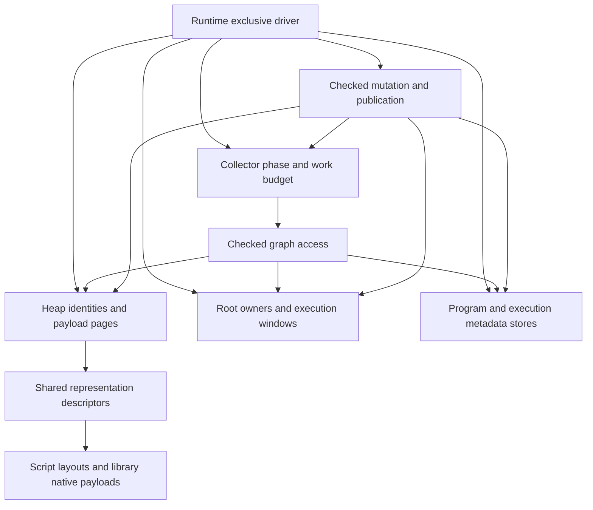

# Paged storage and incremental garbage collection

Status: joint PG00-PG06 migration activated by the user on 2026-10-26 at
`50ab194b30b0218e9befe3176d6b5711ecf17a28`; PG00/NC01 contract closure and baseline
are locally complete (`47be3cb7`). PG01/NC02 is locally complete after coordinated
review and focused/final local validation (commit `fc651b92`). PG02 nonmoving
inline storage is locally complete; focused tests, Miri, memory probes and final
local checks are recorded below (PG02 commit `4d8aa0c1`). PG03/NC03-NC04 is
locally complete and committed at `8d597b93` after final independent review,
selected focused contracts, paired gates and parent local checks. PG04 is locally
complete, pending commit, after parent acceptance of final Map/arrays paired gates,
scoped reuse of unaffected timing/memory evidence, repaired review blockers and final
local checks. Production marking and physical sweep remain synchronously drained.
PG05/NC05 is next; PG06/NC06 and full CI remain outstanding.
Initial implementation parameters remain selected policy, not measured optima or
acceptance of future performance gates. The execution breakdown
was originally recorded against `bb836eff`, following the design at `8c2a4568`.
The user selected paged storage, precise incremental tracing, unsafe integration
for Opaque payloads containing Value, and collecting Native callbacks. These replace
the provisional counted-Value/cycle-collector proposal and Native-wide GC exclusion.
The activation supersedes the earlier queued/no-authorization status; the
[roadmap](implementation-roadmap.md#library-owned-native-collections) remains the navigation owner.
[Current runtime semantics](spec/runtime.md#gc-heap) remain authoritative until the
corresponding implementation checkpoint changes them.

This document owns the proposed collector/storage architecture, PG00-PG06 execution
order, unresolved decisions and GC progress/error ledger. The
[native collections plan](native-collections-plan.md) continues to own NC01-NC06
and the detailed collection migration ledger.
Opaque registration, the general payload protocol and affected collection integration
belong to the same GC replacement migration. NC retains the collection work breakdown;
its removal of special container paths is part of joint acceptance, not a later
redesign. PG phases reference NC handoffs, not duplicate NC completion records.
Migration authorization does not waive phase dependencies or baseline acceptance.
NC01's provider, collection representation and evidence decisions are selected;
the general provider and collection proofs are locally accepted through PG03/NC04.
Production interleaving and joint incremental acceptance remain with PG05-PG06/
NC05-NC06. PG00-PG04 and NC01-NC04 are closed locally; full-workspace/feature/backend/
platform CI remains unrun.

## Direct-reference trial and API proposal (2026-10-28)

Status: concrete trial proposal requested after the remote scalar optimization
merge. No direct-reference implementation or new performance acceptance is claimed.
This section owns the proposed change to reference representation and the finite
trial below; the remainder describes the implemented handle-based migration until
replaced by a corresponding checkpoint. PG05/NC05 and PG06/NC06 remain open. Do not
continue speculative handle-path tuning in parallel with this trial or count the
trial as closure of the existing gates.

### Evidence, scope and reference implementations

The current `Value` is public, Copy, and unrooted; managed variants carry
`HeapObjectId { owner, slot, generation }`. A concrete scalar field operation in
`frame/cursor/objects.rs` obtains an admitted layout but still calls the heap with
an object ID and field slot. Heap access resolves identity and physical storage.
The earlier field-read regression was observed with automatic GC disabled; it
does not establish that incremental scheduling or graph locking caused the loss.
Direct references remove this lookup from admitted field accesses, but a speedup
and its magnitude remain hypotheses requiring a fresh combined-source baseline.

Reuse nonmoving pages, single-driver incremental tracing, bounded disposal, exact
roots and library-owned Native collections. Replace internal object transport and
its access boundary; do not add concurrent marking, Go scheduling, moving or
nursery collection, pointer compression, arbitrary reflection, or a second VM.
Module/reload generations and host-borrow identities are separate from heap-slot
generations and retain their existing contracts.

Primary mechanisms reviewed:

- Go 1.26.0 [field lowering](https://github.com/golang/go/blob/go1.26.0/src/cmd/compile/internal/ssagen/ssa.go)
  lowers `ODOTPTR` using a pointer plus a prepared field offset and a load. Its
  [collector](https://github.com/golang/go/blob/go1.26.0/src/runtime/mgc.go) is precise,
  noncompacting mark-sweep. Apply stable internal addresses and prepared layouts.
  Go compiler/runtime cooperation supplies liveness; Rust embedding callers do
  not automatically participate in that cooperation. Do not copy Go's concurrent
  barrier algorithm into Kagari's different single-driver publication protocol.
- V8's [embedding guide](https://v8.dev/docs/embed), whose example identifies
  v13.1, separates local handle scopes from persistent retention. Apply explicit
  external retention and bounded access lifetimes. V8's moving collector and C++
  handle discipline are not Kagari's Rust safety proof or a prescription for its
  internal representation.

Kagari needs a distinct boundary because Rust providers live outside script stack
maps, can call script synchronously, and retain lexical types independently of
executable generations. Existing `RootedValue`, `ScriptValue`, `StorageType` and
payload loans already implement much of that boundary; extend those owners.

### Representation and ownership

| Layer | Proposed representation | Lifetime and validation owner |
| --- | --- | --- |
| VM registers and traced heap edges | Tagged `VmValue` with opaque direct `GcRef` for objects | Runtime/backend admission, frame publication, tracing and write barriers |
| Long-lived host state | Existing `RootedValue`, `ScriptValue`, `Object`, `Opaque<T>` and typed collection/function handles | Root lease, runtime identity, declared type and access checks |
| Temporary host inspection | Invariant `ValueView<'view>` | Scoped loan retaining the source; no raw value or reference escape |
| Unsafe Native payload storage | Opaque `StoredValue` holding scalars or direct edges | Installed provider, checked storage access, scanner and edit protocol |
| Modules, functions and host views | Existing domain-specific checked identities | Existing reload/execution/borrow owners |

`GcRef` points at the start of a stable object allocation with a common header.
The first trial uses that header for shape/scan metadata and physical allocation
identity, with the prepared field offset including the payload displacement.
Alignment and large-object allocation remain explicit. GC consults the header;
admitted scalar field loads do not resolve a global slot table. Keep page occupancy
and allocation bitmaps with their page owner. Current 1 KiB slabs have only their
declared alignment: do not derive a page base by masking an arbitrary address.
Header overhead, size-class changes and retained metadata count in memory gates.
An arena/page address map is deferred unless this measured header design fails a
specific gate; it is not a second implementation to maintain during the trial.

Internal pointers are never owning `Arc`s, public Rust references, serialized
addresses, or independently valid capabilities. Allocation publishes a fully
initialized, scan-valid object before exposing it; failed initialization disposes
only initialized fields. All managed temporaries live in traced frames, roots or
provider work storage before allocation, polling or callbacks can collect. Queued
mark/sweep records cannot survive the retirement of their target storage. Address
reuse starts a new lifetime and cannot revive an old external root. Pointer
identity never replaces language equality, hashing rules or metadata retention.

Runtime and backend crates need one narrow shared transport surface. Rust
cross-crate visibility is not proof that an API is safe: opaque constructors and
trusted dereference operations must enforce or explicitly require live-frame,
heap-owner and prepared-layout evidence. No safe API may accept a freely copied
stale `VmValue` and dereference it. Keep unsafe operations in the owning kernels,
with debug validation where useful; do not create general public pointer access.
No new ABI version is required for unpublished internals; invalidate affected
in-memory products and disposable caches, and keep artifacts address-free.

### Object graph efficiency review (2026-10-28)

The linked `Node` scenario discussed with the user is a correctness workload,
not a proposed universal graph container or evidence of cache-efficient traversal.
Direct references remove identity/storage lookup from admitted accesses; they do
not make separately allocated nodes contiguous or remove dependent memory loads.
Do not introduce a duplicate adjacency graph for ordinary object fields; retain
only the collector work state and metadata dependencies that have distinct owners.

Current `module/layout_storage.rs` already packs scalar fields at their actual
width and stores each managed field as a 13-byte discriminator/owner/slot/generation
encoding. `gc/fields.rs` scans a prepared list of reference fields. Preserve compact
scalar storage and precise reference enumeration; do not replace every stored
field with a general tagged `VmValue`. VM transport and physical field encoding
have separate responsibilities. A pointer-only field is an option only when its
exact admitted representation permits it. Interface/tagged/enum storage must keep
all required information; do not assume `Option<Node>` is already one nullable
pointer or add an enum-layout migration to this trial implicitly.

Go 1.26.0's [heap bitmap implementation](https://github.com/golang/go/blob/go1.26.0/src/runtime/mbitmap.go)
uses span bitmaps for small scannable objects and type metadata for larger ones,
with separate handling for pointer-free objects. This supports separating scan
metadata from hot field loads; it does not prove that Kagari's proposed common
header is optimal. Keep the header as the first trial's chosen model and report
its complete cost, including alignment, size-class rounding, page slack, physical
metadata and shared descriptor retention. Do not promise pointer-width total
values or per-object savings from a smaller reference alone.

The vertical trial must distinguish scalar-only, pointer-rich and mixed layouts,
and shared/cyclic graphs from the single linked-chain example, using existing
workloads where possible. Compare field reads, allocations, scanning and total
memory against the same fixed images. This review refines the existing trial's
interpretation; it adds no independent optimization phase or measured result.

### Recommendation from Kagari's semantic requirements (2026-10-28)

The recommended trial remains nonmoving paged allocation, direct internal
references, prepared typed field access and single-driver incremental tracing,
with a lightweight per-object representation identifier and page-owned allocation
state. This is a recommendation for Kagari's existing contracts, not selection
of an entire Java, Go or Lua runtime model or a measured optimum. No implementation
or phase acceptance is implied by this design discussion.

The [project goals](project_goal.md) and [runtime specification](spec/runtime.md)
require shared object identity, closed typed layouts, nominal interfaces/generics,
exact Native payload mappings, scoped host loans and retained metadata across
compatible reload. Static typing permits prepared offsets and compact scalar
fields; it does not erase runtime layout provenance, turn shared structs into
by-value copies, or remove tracing from cycles. Shallow readonly aliases do not
make the referent immutable. Parked frames, closures and Futures remain roots or
traced state with their exact execution obligations. Host resources and concurrency
remain outside the script heap; Java-style per-object monitors are not required.

For the first trial, evaluate this concrete refinement of the common header:

```text
ObjectHeader {
    descriptor_id: u32,   // Existing descriptor-domain concept, shared layout/scan/drop facts.
    allocation_id: u32,   // Existing physical page/large-allocation directory concept.
}
```

This is an 8-byte logical header candidate, not a proven total allocation overhead.
It replaces the illustrative full descriptor pointer plus page/slot header from
the discussion. For a small page, compute the physical slot from the live object
address, page base and stride when GC needs it; large allocations have their own
geometry. There is no per-field page/descriptor lookup: admitted field operations
use the direct reference and prepared offset. GC and dynamic admission can resolve
these compact IDs through their existing owners. No new global address-to-arena
mapping, pointer compression, per-object GC linked-list pointer or nominal-type
page partition is required by this candidate.

Before implementation, close bounds/exhaustion, descriptor retention through final
disposal, page retirement/reuse and source-free/backend contracts. IDs cannot be
reused while a live allocation or detached disposal still depends on them. Root
owner/generation admission prevents foreign or expired host values from becoming
internal references; no safe unchecked raw transport remains. Remove superseded
identity/descriptor metadata rather than retain duplicates as a performance cache.
Payload alignment may add padding beyond these 8 bytes, especially for Native
payloads. Report complete object/page/table memory and metadata lookup costs; do
not equate compact IDs with a measured speedup or promise uniform 8-byte overhead.

Mature-runtime boundaries motivating this recommendation:

- Go 1.26.0's [allocation header policy](https://github.com/golang/go/blob/go1.26.0/src/internal/runtime/gc/malloc.go)
  varies header use with object size. Adopt selective, accounted metadata costs
  and direct typed access; do not copy Go struct value semantics, scheduler or
  concurrent collector, or assume Kagari already has its arena address mapping.
- HotSpot 25's [mark word](https://github.com/openjdk/jdk/blob/jdk-25-ga/src/hotspot/share/oops/markWord.hpp)
  combines class, hash, locking and GC state. Retain Kagari's exact layout metadata,
  but do not import unrelated monitor/age/forwarding machinery into every object.
- Lua 5.4.8's [object lists](https://github.com/lua/lua/blob/v5.4.8/lstate.h)
  use `next` and selected `gclist` fields. Kagari's page enumeration already owns
  physical sweep; copying those links would duplicate a responsibility.

Keep the four trial steps and existing acceptance gates. The header candidate
needs proof in the integrated vertical trial; fully headerless storage and a new
arena allocator remain deferred. This subsection records the recommendation and
its limits, not a parallel implementation queue.

### Proposed host API shape

The following sketches specify intended behavior, not implemented signatures.
Keep ordinary typed execution and owning adapters recognizable:

```text
let fields: VecValues<String> = runtime.execute_typed(
    &loaded, "split_text", ("hello,world".to_owned(),), &context,
)?;

let report = runtime.execute(&loaded, "main", &[], &context)?;
let result: RootedValue = report.return_value;
let retained = result.clone();       // Shares a root, does not copy the object.
// Subsequent execution/collection may run while retained remains alive.
let number = retained.inspect(runtime.runtime(), |view| view.as_i64())?;
drop(retained);                      // Releases this retention share.
```

`RootedValue::inspect` is proposed as a checked, short, non-reentrant access:

```text
inspect<R>(
    &self,
    runtime: &Runtime,
    read: impl for<'view> FnOnce(ValueView<'view>) -> NativeResult<R>,
) -> NativeResult<R>
```

The source root is kept live for the entire closure. Heap identity and root
validity are checked before any object dereference. The view is invariant and
cannot escape in `R`; it exposes scalar/tag inspection and existing declared
access capabilities, not arbitrary offsets or unrestricted `&T`. An RAII loan
also excludes collection, conflicting mutation and script reentry, including
attempts through captured runtime aliases. Unwind releases the loan. Owned
scalar results can escape. An object that must escape uses existing owning
conversion/retention paths. Do not run user conversions or callbacks inside the
inspection loan; longer decoding retains the root and uses separate bounded
loans around individual reads, with existing cancellation checks.

Replace raw extraction from `RootedValue::value` and `ScriptValue::value`; do not
keep them as safe methods returning a pointer-bearing Copy value. Preserve
`ScriptValue::decode`, declared-type information, owning collection adapters and
typed functions. Root replacement accepts checked rooted/scoped input and retains
publication semantics, never an unchecked internal pointer. Scoped host execution
returns a scope-bound value instead of an escapable raw transport. Conversion
traits and low-level argument/result paths migrate with this boundary; ordinary
`execute_typed` users should not need manual rooting. Untyped entry arguments are
not made newly functional as part of this GC change.

There is no new public `WeakValue` or general unrooted ID API in this trial. Add
one only for an identified consumer, with owner/generation checks before pointer
resolution. Root IDs retain generation checks even though object field accesses
stop using heap-slot generations.

### Proposed Native provider API shape

Ordinary callbacks keep `NativeContext`, typed arguments, `ScriptValue` and owned
return conversions. Unsafe storage providers replace embedded `Value` with opaque
`StoredValue`; scalars do not require a heap allocation. This is not a root per
collection element. Its fields and constructors are controlled by storage access,
and it has no safe standalone dereference. Payloads remain `Any + Send`; do not
pretend a Rust lifetime parameter can brand an entire `'static` provider graph.

Keep resumable scanning, budget charging, shape revision checks and the existing
unsafe provider responsibility. The visitor changes element type:

```text
unsafe trait NativePayload {
    type ScanState;
    fn scan(&self, state, budget, visit: FnMut(&StoredValue)) -> ScanStatus;
    fn charge(&self) -> HeapCharge;
    // Existing begin_scan, scan-kind and storage registration contracts remain.
}
```

A read obtains a loan-bound view from a stored edge under its admitted owner.
A read that needs a callback result first retains that edge as `ScriptValue`.
An edit imports a checked rooted/scoped value through `StorageAccess`, publishes
its edge, then commits the stored slot. Exact method names are implementation
choices; the required sequence is:

```text
retained_item = read_payload(owner, |payload, access| {
    access.retain(&payload.items[index], element_contract)
})?;                                  // Payload loan has ended.
answer = callback.call(cx, retained_item)?; // GC/reentry permitted here.
edit_payload(owner, plan, |payload, access| {
    imported = access.import(&answer, element_contract)?;
    access.replace(&mut payload.items[index], imported)
})?;
```

This is schematic: preserve operation guards, callback mutation detection, access
rights, once-only evaluation, error ordering, edit charge bounds and unwind
reconciliation in the actual APIs. `import`/`replace` cannot smuggle a pointer
between heaps or bypass the incremental publication barrier. Unsafe providers
must scan all installed and temporary edges, cannot expose extracted pointers,
and cannot mutate traced state behind a shared loan. Independent providers use
the same mechanism as stdlib Vec/Map; no builtin-only bypass or permanent roots
inside every element. Release all payload loans before collecting callbacks.

### Prepared field path

For `point.x`, use the same checked source and source-free admission facts:

```text
Current: frame value -> heap owner/slot/generation -> physical object
         -> layout/field resolution -> scalar read
Trial:   admitted frame object reference + prepared concrete field offset
         -> scalar read
```

Prepared access records the exact concrete layout, field representation, offset
and declared access rights. Runtime/backend admission establishes the base's
layout relationship before trusting that record; a tagged pointer alone is not
proof. Dynamic/generic/reflection paths retain required checks or create the same
admitted operation. Layout records stay alive for their exact data/code owners
across reload. Scalar writes preserve checked numeric behavior; managed writes
use the existing publication/barrier owner. No collector safepoint is introduced
between an unrooted temporary extraction and its destination publication.

### Finite trial sequence and acceptance

These are substeps of the existing GC plan, not a separate progress queue:

1. **Boundary closure and baseline.** Freeze the combined post-merge source,
   including PG05 work, with reproducible provenance before measuring. Inventory
   all raw `Value` consumers, source-free/native backends and conversion hooks.
   Finalize root/view/backend access contracts and replace unsafe public escape
   routes coherently. Establish selected field-read, construction, native-access,
   collection and memory baselines. Existing historical gates remain unchanged.
2. **Integrated vertical trial.** Implement stable headers, direct transport and
   rooted/scoped entry/exit for a representative struct graph and prepared field
   operations on an isolated trial branch. Include reference writes, allocation,
   root scanning, full collection and reuse; a raw-pointer microbenchmark alone
   cannot qualify it. Temporary mixed representation is confined to explicitly
   unaccepted migration checkpoints and must be removed in step 3. Check field
   throughput, header cost, GC correctness and boundary usability before expansion.
3. **Complete reference migration.** Switch all managed variants, frames, parked
   execution, roots, joint module edges and Native providers/stdlib together.
   Preserve PG05 incremental driving/barriers and NC's independent provider proof.
   Retire the heap-object slot-resolution transport, bridge conversions and old
   safe raw-value entrypoints. Keep physical slot metadata for allocation/sweep
   and generation IDs in domains that still require them. No dual semantic engine.
4. **Joint validation and decision.** Run selected correctness/performance/memory
   gates on the frozen final image, then complete PG05/PG06/NC acceptance in their
   assigned local/CI scope. Compare against both the combined-source baseline and
   the applicable existing historical gates; do not substitute a new baseline to
   erase regressions. If the integrated path fails, diagnose once against the
   stated invariants and measurements, record the result here, and stop expansion
   until a concrete revised model addresses it. Do not repeat timings until green.

Local correctness selection covers foreign heap rejection, root clone/drop and
runtime teardown, address reuse, view escape compile-fail cases, Rust aliasing
under Miri for selected kernels, collection/reentry exclusion during a loan,
collecting callbacks after release, managed field barriers, cancellation/unwind,
retained reload layouts and one source-free execution path. Reuse existing
contract tests; add only newly uncovered boundaries. Check all collectors' work
records and detached disposal for stale direct references. Diagnostic validation
must not enter ordinary timing artifacts.

Report toolchain/machine/profile/features/parallelism/cache state and source/image
identity. Separate compile time, execution throughput, normal-step pauses, full
GC, construction and allocator/metadata memory. Include the existing failing
field-read and mixed Native workloads; a field-only win is insufficient. Freeze
selected rows and run counts before measuring. Full-workspace tests and exhaustive
backend/feature/platform coverage remain CI-only; implementation checkpoints run
the repository's lightweight checks and workspace all-target Clippy. This proposal
is documentation-only and does not justify rerunning implementation checks.

## Goals and scope

Design a precise, single-driver, incremental mark-sweep collector with paged
payload storage and stable checked handles. Priorities are correctness, bounded
collector work where the object protocol permits it, understandable ownership and
measured memory/throughput costs. Incremental does not mean concurrent or hard
real-time, and paging alone does not establish lower memory use.

The design includes object allocation, roots, mutable edges, program/metadata
reachability, marking, sweeping, disposal and pressure-driven scheduling. It keeps:

- Full heap owner/slot/generation validation and scoped native borrows.
- Explicit host roots, traced execution windows and suspended computation state.
- Joint object/program reachability, including cycles across those domains.
- Current implementation selection for ordinary calls after compatible publication;
  exact owners retain already selected computations and necessary native evidence.
- Checked publication, mutation commits, completed effects and failure cleanup.
- Source-free executable validation and common interpreter/native runtime services.

Non-goals are concurrent or generational collection, automatic moving compaction,
raw host-visible heap references, a general-purpose replacement for the system
allocator, new weak-reference/finalizer language APIs, a hard memory quota, and
changes to cancellation policy. The discussion of removing or redesigning cx.poll
is explicitly deferred: preserve current cancellation and termination contracts,
without adding a cancellation redesign prerequisite to this migration. R13 type-only
code retention, shared-program redesign and general managed-native backend expansion
remain separate work.

## Current implementation and reason for change

At activation, the [heap](../crates/kagari-runtime/src/gc.rs) owned a checked object
directory, dense typed payload stores, roots, executable metadata stores, operation
leases, pressure state and collection-specific descriptor caches. The
former marker completed a temporary worklist in one operation. PG04 now installs
one [phase/epoch marker](../crates/kagari-runtime/src/gc/graph.rs) and owned scan
cursors; [collection](../crates/kagari-runtime/src/gc/collection.rs) drains it
synchronously before sweeping. The old collector helper remains for guarded trace
inspection, not as a second production marker. PG02
[directory storage](../crates/kagari-runtime/src/gc/directory.rs) supplies nonmoving
slabs/large allocations and actual inline native/struct payloads. PG04 brings forward
the 32-total detached-owner bound, but still builds the whole dead-ID inventory.
PG05 owns incremental sweep, dead-list/interface-batch-filter removal and legal
production interleaving. PG04's timing and singleton-static lifecycle blockers
remain open in its ledger below.

At activation, `sequence_storage`, `map_storage`, `set_storage` and `cursor_storage`
were cached NativeStorage descriptors, not element buffers. PG03 removes those
concrete caches together with runtime-owned collection policy, not as an isolated
field deletion. Stdlib owns ordinary nominal payloads, buffers, cursors, host
adapters and Serde conversions through the general provider protocol.

Preserve the useful foundations: compact scalar fields/buffers, identity checks,
release-driven root leases, occupied-object discovery, committed native charges,
scoped access and panic-contained disposal. Replace whole-cycle temporary graph
sets and whole-store relocation only through the new lifecycle owner. Do not
replace compact representations with one boxed `Value` per field or element.

## Design decisions

| Decision | Direction |
| --- | --- |
| Execution | GC steps alternate with script execution under the existing exclusive Runtime driver; no collector thread |
| Algorithm | Precise incremental mark-sweep, with a complete marking closure before sweeping |
| Identity | Keep stable owner/slot/generation handles; payload location is private and separate |
| Storage | Paged small-object storage; separately tracked large allocations; ordinary cycles do not move surviving payloads |
| Page grouping | Independent 1 KiB slabs supersede the initial 4 KiB choice after PG02 memory failures; unchanged stride classes and two edge-capability groups, no pool per nominal type |
| Marking | Runtime-local mark state and resumable work tasks, not new per-cycle hash sets duplicating every live object |
| Mutation | Runtime-owned insertion barriers for roots, payloads and executable metadata; admission pre-reserves work capacity so recovery publication of existing targets cannot allocate |
| Native execution | Native entry does not disable GC; release payload loans and protect temporary references before collecting helpers or script callbacks |
| Opaque admission | Unsafe provider integration permits Value and ordinary Rust containers; no NoGc whitelist or lifetime-brand migration is required |
| Payload policy | Libraries own container data structures; descriptions/scanners expose edges without teaching the collector container names |
| Reclamation | Incremental sweep, at most 32 outstanding retired items, and destruction outside storage borrows; heap interface wrappers retire before snapshot metadata |
| Limits | Work budgets are cooperative; opaque scans, destructors and allocators do not provide a wall-clock deadline |

Size-class pages may hold different types with compatible slot layout. Type-specific
trace/drop information must therefore remain recoverable for each occupied slot.
The selected implementation uses a narrow unsafe storage kernel with checked layout,
initialization, access and destruction, as specified below. This is not permission for
unchecked casts or per-type fallback pools. Its safety proof and focused Miri or
applicable sanitizer coverage belong to PG02; its costs remain baseline-dependent.

## Ownership



- **Heap storage** owns allocation, identity retirement, pages and locators. It
  does not own hash collision handling, sorting or iterator policy.
- **Collector** owns collection epochs/phases, work tasks, marking closure and
  sweep progress. Work queues are internal traversal state, not independent roots.
- **Root owners** retain the actual values and executable evidence. Collector
  cursors do not replace frame/root ownership.
- **Program and metadata stores** retain their present semantic responsibilities;
  checked graph adapters expose their roots, edges and reclamation operations.
- **Representation descriptors** own scan/drop dispatch and relevant storage
  facts. Pure reusable descriptors may be shared; applied runtime identities and
  mark state may not be stored in cross-Runtime immutable products.
- **Native providers** own payload layouts and algorithms. Runtime owns the
  checked access, edge publication, accounting and borrow boundary.

Use ordinary modules under the existing owners first. These responsibilities do
not justify new empty crates or moving mixed policy into `common`.

### Independent-library acceptance boundary

User requirement, 2026-10-26: the standard library must be implementable outside
Runtime using the same public, general Native capabilities available to an
application library. Physical crate separation already exists; it does not prove
this boundary while public APIs still implement concrete collections in Runtime.
Making sequence/map methods public, renaming their storage categories or moving
only payload definitions does not satisfy acceptance.

```text
Standard library or application provider
    owns payload layout, collection methods, algorithms and cursor policy
        -> public checked Native registration, access and publication services
        -> Runtime identity, roots, collector, storage and execution owners
```

The collector must not recognize Vec/HashMap/HashSet or sorting work objects.
Providers describe their edges, storage and scan progress through one protocol.
Opaque<LibraryPayload> is sufficient as the retained object category; a new
VecHandle or a runtime-owned ScriptVec implementation is not required. Libraries
may offer safe functions or extension methods without adding another root owner.
The [NC representation/API contract](native-collections-plan.md#ownership-and-representation)
owns concrete layouts, compact scalar storage and checked element evidence.

This boundary requires general services, not a universal edit closure that can
make arbitrary Rust algorithms GC-safe:

| Engine service | Provider responsibility and boundary |
| --- | --- |
| Checked allocation and scoped access | Register a payload once; preserve nominal application, owner, generation and installed Rust payload identity. No payload loan spans collection or script reentry. |
| Retention and reference publication | Retain extracted results before losing source protection; keep inputs protected until destination publication. Reuse runtime roots and barriers, never permanent external roots per internal edge. |
| Operation protection and revision commits | Protect callback-bearing operations through general access checks. Library policy decides conflicts and iterator invalidation; an operation token is neither a long payload borrow nor a second mutation counter. |
| Scan capability and mutation coordination | Describe edge-free, bounded or resumable scans; maintain initialized ranges and progress across insertions, removals, moves and reallocations. GC owns marking, not container traversal policy. |
| Dynamic accounting and ownership transfer | Prepare fallible changes before commit; account retained capacity, scratch transfers and deferred disposal without a collection-specific heap API. |
| Type and call evidence | Reuse checked actual types, bounds, selected calls and metadata edges for script and host construction alike; no container-name resolver or weakened type admission. |

For example, a library pop prepares result retention while the source still
protects the value, prepares required commit resources, removes the element and
updates scan/revision/accounting state, then ends the loan and returns a retained
result. A library push keeps its argument rooted through checked edge publication.
If either operation needs a sequence-specific heap entrypoint, the general
protocol is incomplete. Short exclusion alone does not supply publication safety.

The [NC capability audit](native-collections-plan.md#proven-capability-gaps-not-replacement-subsystems)
records implemented capabilities and remaining migration owners. PG01/NC02 now
provides dynamic edits and resumable provider scanning through public NativePayload,
Opaque, scoped contracts and retained-call services. The driver is still synchronous;
the external fixture is not proof of standard collection migration or integrated
incremental scanning. Coordinated PG01/NC02 local acceptance is complete.

## Concrete data structures

The following records describe ownership, not public Rust APIs. The physical
parameters below are selected for the initial implementation; exact Rust layouts
must be asserted and measured, not inferred from this sketch.

```text
Heap
    ObjectDirectory
    RegisteredStores / page classes
    RootRegistry

ObjectHandle
    owner
    slot
    generation

DirectoryEntry
    generation
    state: vacant | occupied(locator) | retired

PayloadLocator
    store/class
    page
    slot

SmallObjectPage
    slot size/alignment and slot count
    occupied and retiring bitmaps
    discovered/scanned bitmaps and checked collection epoch
    slot -> object-directory identity association
    descriptor information where not implied by the page
    payload slots

Collector
    phase and collection epoch
    admission-reserved, deduplicated owner-block jobs and singleton identities
    one active owned scan cursor
    root/metadata scan progress
    sweep progress
    bounded detached-disposal batches
    scheduling/work accounting
```

### Directory and generations

The directory maps stable identities to physical storage. Retiring an object
invalidates the locator and advances its generation before reuse. Exhaustion
retires that identity slot; it never wraps. Releasing payload pages must not erase
generation history and allow an old external handle to become valid again.

A locator's page slot may be reused only after all collector work that could name
the old allocation has finished or will reject its full identity. No queued raw
borrow or address survives page reclamation. The page-to-directory association
supports retirement without searching the directory.

PG02's compact directory remains 12 bytes on the measured target: generation plus
private kind, allocation/snapshot index and slot fields. This replaces the initial
two-tag-bit encoding sketch without changing public full handles. Small locations
carry an allocation-table index and slot; large locations name a tracked allocation;
interfaces directly locate snapshots and have a separate occupied-wrapper index,
not slab payloads. Vacant fields carry the next free identity, eliminating the
separate free-identity Vec. Checked admission never truncates indices; saturated
generations remain excluded from the free chain.

PG02 releases backing only after disposal and preserves identity generations;
its synchronous collector has no outstanding interleaved page cursor. For PG04/PG05,
released page-table indices must not be reused while old cycle work can name them.
Object scan work names full identities, not page addresses. Interface occupancy
must gain stable cursors instead of the current synchronous batch-filtered vector. Keep the compact snapshot-index binding only with
heap-wrapper-before-interface-metadata sweep ordering and phase-aware access; a
condemned wrapper cannot resolve a reused metadata slot. Metadata tokens still carry
and validate their own complete identity.

This indirection has a cost. Removing it would require a separate host/lifetime
model decision, not an incidental allocator optimization.

### Pages and large objects

Current physical parameters after the PG02 measured correction (not measured optima):

- Each small page has an independently allocated **1024-byte payload slab**, aligned
  to 16 bytes, with separately accounted side metadata. This explicitly supersedes
  the initial 4096-byte choice; it is not a 1 KiB subpage inside retained 4 KiB backing.
  PG00's historical model and frozen gates are unchanged. Strides, in bytes, are:

  ```text
  8, 16, 24, 32, 40, 48, 56, 64,
  80, 96, 112, 128, 160, 192, 224, 256,
  320, 384, 448, 512, 640, 768, 896, 1024
  ```

- Choose the first stride at least `max(layout.size(), 1)` that is divisible by
  `layout.align()`, provided alignment is at most 16. Thus a 24-byte request with
  16-byte alignment uses stride 32, not 24. A zero-sized payload still occupies an
  identity-associated slot and is destroyed exactly once.
- Each class has two groups: no graph edges, or potential graph edges. Executable
  metadata edges count too. Bounded/resumable/indivisible scanning is per descriptor,
  not another pool per type or scanner. The descriptor must conservatively cover
  edges that later mutation may introduce.
- PG02 page side metadata owns occupied/retiring bitmaps, non-full/active-page links,
  directory back-references and numeric representation descriptor IDs. Allocation
  does not search every page. The smallest class has 128 slots. PG04 instead places
  discovered/scanned bits in 128-slot blocks of the original identity stores, not
  physical slabs. Two color bitmaps use 32 bytes per owner block, excluding its epoch,
  registration/queued state and capacity; this is not total collector backing.
- Release empty slab backing immediately after the last retired slot finishes
  disposal. Initially retain no empty-page cache. Keep page-index reuse separate
  from backing release. Partial-page fragmentation remains a measured cost; release
  to the Rust allocator is not proof of immediate RSS reduction.
- A combined physical layout larger than 1024 bytes or aligned above 16 uses one
  separately tracked allocation with its exact checked Layout, descriptor, identity,
  disposal state; PG04 resolves mark state through its original identity-store block.
  Its compact control has
  no small-page slot array/bitmaps. There is no page-sized rounding requirement on this
  path. Owned container/String backing remains indirect payload-owned storage, not
  a GC object per element; a large Vec buffer does not make its small header large.

These classes explicitly trade dense packing and shared pools against sparse-page
retention. **Historical PG00 4 KiB payload-only model (not the current allocator):**
the [reproducible slab model](../benchmarks/lua-comparison/examples/runtime_storage/slab_model.rs)
retains 24 pages (98,304 bytes) for 1,536 live payload bytes after allocating 4,096
24-byte slots and retaining every 64th: only one of the original 25 pages empties.
The remaining backing includes 96,384 vacant-slot bytes and 384 page-tail bytes.
Stride 896 alone leaves a 512-byte tail per page (12.5%); worst absolute class
rounding in the modeled valid size/alignment domain is 127 bytes at size 513/alignment 1.
Pooling 32 nominal types with four eight-byte payloads each uses one modeled page
rather than 32 nominal-type pages, but does not eliminate sparse retention. These
are payload-only model results, excluding headers, descriptors, directory, bitmaps,
queues and allocator overhead, not measurements of an implemented paged collector.
Immediate empty release is selected, not a low-memory guarantee or speedup claim;
whole-runtime baseline/acceptance remains in the PG00 handoff. PG02's actual
metadata-inclusive correction and measurements are recorded in its ledger below;
the original model remains reproducible as historical evidence, not retuned to 1 KiB.

Normal collection never shifts surviving payloads. PG02 replaces both the dense
struct record and compacting global byte arena: a struct slot contains its initialized
field bytes, and the slot descriptor identifies its shared StructStorageLayout.
Keep the existing native-endian byte-copy codecs, exact scalar widths and 13-byte
managed fields (tag plus complete owner/slot/generation). Point { x: i32, y: i32 }
still contains eight field bytes; directory, side metadata and class slack are separate.

Native allocations contain an identity-local header (revision, committed charge,
nominal/application and selected-operation evidence) plus aligned T, composed with
checked Layout::extend and padding. Page the actual payload, not only NativeObject
while retaining a permanent erased Box for every small T. NativeStorage supplies
sealed TypeId/layout and monomorphized initialize/access/scan/take/drop dispatch.
Factories may produce owned T before final placement; no public pinning API is added.

The narrow unsafe kernel belongs under gc/directory and gc/storage. Safe owner-controlled
entrypoints enforce bounds, alignment, initialization-before-publication, matching
Rust identity, exclusive loans and exactly-once take/drop/deallocation, including
partial initialization and panic. No payload view crosses collection or reentry.
PG02 must cover zero-sized and over-aligned payloads, failed construction, native take,
page reuse and Runtime teardown with Miri or applicable sanitizers.

A runtime-local numeric descriptor table retains shared representation/struct-layout
facts through counted admissions for every live or retiring allocation, avoiding
per-slot Arc ownership. Retired disposal tokens retain dispatch/backing independently.
The existing StructStorageLayouts owner supplies canonical semantic interning;
there is no second structural semantic-key map in the physical descriptor table. Descriptor IDs are checked, non-aliasing tokens;
reuse requires that no allocation, active scan or disposal token can name the old ID.
Pure reusable dispatch may be shared, but applied runtime identities/marks may not.
Keep descriptor/drop code alive through disposal without making immutable type
provenance an executable graph root. PG02 removes the old native Box shallow charge:
payload bytes are part of charged slab/large backing; indirect charge stays disjoint.

### Mark information

Discovered means reachable in this cycle; scanned means all required edges have
been processed successfully. Use a checked u64 collection epoch. PG04's original-owner
slot blocks hold discovered/scanned bitmaps and an epoch; non-reused static cells
hold singleton epoch/color state. This supersedes the proposed physical-page/per-record
placement. Blocks initialize lazily on epoch mismatch; charge their four-word
bitmap reset as work, rather than resetting all blocks at cycle start. New/reused slots explicitly initialize their current-cycle state.
Epoch increment never wraps: exhaustion fails before starting a new cycle, without
sweeping or treating stale marks as current. No routine global reset is required.

During marking, discovery changes white to pending once; scanned becomes true only
after complete successful edge enumeration. During sweep, newborn slots are marked
as survivors for the current epoch and cannot inherit a previous occupant's death.
Their outgoing targets must pass sweep admission. An edge-free object can complete
on discovery only if its descriptor excludes executable edges as well as Values.

Native payload state, mutation revision and generation are different concepts.
Iterator invalidation revisions cannot stand in for GC barriers or mark epochs.

### Value and retained Native handles

Keep the distinction between an internal non-rooting value representation and a
retained Native handle. Copying/moving Value does not establish a GC root. The
provisional non-Copy counted Value, stable control-pointer layout, atomic per-object
ownership counts and cycle-disposal protocol are not selected. Its earlier layout
probe is not evidence for this tracing design and does not require an ABI change.
Preserve compact scalar storage and checked owner/slot/generation identities; exact
public naming/conversions remain an API review item, not a second collector.

Opaque<T>, Object and typed library handles retain objects through the existing
runtime-owned root service. Safe reads/removals return retained results before any
collecting boundary. An internal Vec<Value> in a heap payload contains traced edges,
not a permanent external root per element: otherwise cycles through the container
would remain live. Rust-owned local containers of retained handles are valid external
owners, but embedding those same root leases back into heap payloads is not a general
replacement for tracing internal edges.

Preserve Runtime: Send + !Sync, checked host lifetimes and safe root-lease release
after Runtime teardown. External handles must not keep the whole Runtime storage
alive. Transient host/frame tokens keep their scope checks; retaining a token does
not turn a scoped borrow into persistent access.

## Allocation and access

Allocation proceeds as one checked publication operation:

1. Validate the representation, type environment and incoming references.
2. Reserve directory, page/slot and required collector/accounting capacity.
3. Initialize the payload and its tracing description while it is unpublished.
4. Establish the forward locator and reverse identity association.
5. Apply the current phase's newborn/edge protection rule and commit accounting.
6. Publish the checked handle.

Failure before publication exposes no partial object. Successfully acquired backing
that remains owned must remain charged. Neither allocation nor a borrowed payload
edit invokes collection or script code. Allocation adds pressure; the driver pays
collector work at legal boundaries.

Access validates heap owner, generation, liveness, representation and applicable
type/access contracts before lending a scoped view. No view crosses collection,
page release, callbacks or reentry. Free-list allocation and phase bookkeeping
must remain valid after cancellation or quarantine for cleanup, without admitting
new execution.

## Native-facing GC object operations

The [selected end-to-end Native API](native-collections-plan.md#end-to-end-api-proposal-for-review)
connects registration, host borrowing, retained extraction and the audited
storage-provider boundary. It also identifies the unrestricted raw-Value escape
from current payload read closures. The selected interim direction requires an
explicit unsafe contract for opaque payload integration and unrestricted payload
access, including edge-free custom payloads without an existing proof. New NoGc
whitelists/derives, split opaque types and branded Value admission are deferred.
Retained handles and audited library methods remain safe; providers must preserve
tracing, publication, accounting and extracted-value retention, optionally through
short collection exclusion that ends before callbacks. Performance preservation
requires measurement; unchecked admission or omitted barriers are not
optimizations. PG01/NC02 locally establishes the general provider boundary and
external-provider proof. Later graph/publication and driver phases remain
prerequisites for interleaved production use.

Selected direction, 2026-10-26: Opaque payloads may contain Value and ordinary
Rust containers under an unsafe provider contract. Native entry does not suspend
collection. Short non-collecting payload edits remain permitted, but must end before
script callbacks or other collecting helpers. Providers preserve trace visibility,
barriers, accounting and root coverage for every extracted value. Ordinary safe
Native handles and library methods encapsulate these obligations.

Design clarification, 2026-10-26: a Native function operating on script GC objects
is a different API audience from a provider implementing Rust payload storage.
Ordinary Native code should hold checked, retained object handles and call field
or collection operations directly. It must not need nested `edit` closures,
long-lived payload guards, a caller-maintained `mutations` counter or explicit
collector barriers merely to access several objects.

This builds on existing APIs, not a new registration facade:

- [Object](../crates/kagari-runtime/src/native/objects/mod.rs) owns a rooted script
  object handle, not a Rust reference into payload memory.
- [Object::get/set and Field](../crates/kagari-runtime/src/native/objects/fields.rs)
  provide checked field operations with prepared type/member evidence.
- [ScriptVec](../crates/kagari-stdlib/src/collections/vector.rs) provides retained
  collection handles and direct `get`, `set` and `push` through general Native APIs.
  PG03 moves this owner to stdlib without a runtime facade; Rust owned conversion
  uses VecValues, while script Vec and flat checked access remain unchanged.

The following callback-body sketch uses that existing access shape. `a` and `b`
are compatible object handles; `hp` is an already bound mutable integer field.
Registration and field binding are omitted:

```text
let a_hp = a.get(cx, &hp)?;
let b_hp = b.get(cx, &hp)?;
a.set(cx, &hp, b_hp)?;
b.set(cx, &hp, a_hp)?;
```

Each operation ends its storage borrow before returning. Holding both handles
is not holding two mutable Rust references; aliases of the same object remain
valid and operations execute in order. This sequence is not a transaction: if
its second write fails, the first completed write remains visible.

Reference-bearing operations use the same model. With a compatible object-valued
`target_field` and a collection of matching objects, a callback can use:

```text
player.set(cx, &target_field, enemy.clone())?;
targets.push(cx, enemy)?;
```

Each operation validates owner, identity, type and declared access; protects
references through conversion; prepares fallible accounting; and publishes edges
through the incremental barrier before commit. Runtime owns these mechanisms,
while libraries own collection layouts and algorithms. A fallible destructor or a
full rescan after an arbitrary edit cannot substitute for publication safety.

Reads/removals requested as object handles return retained handles, not bare
payload references. Protection must cover extraction and conversion without a
root gap. Rust-held handles retain their targets; fields and container elements
store traced internal edges, not a persistent external root lease per edge. Otherwise
unreachable cycles could remain alive solely through internal root leases.

No storage borrow may span a collecting boundary, callback, reentry or suspension.
Conversions and collection callbacks that can invoke script code run outside such
borrows, with values protected and existing operation-conflict checks preserved.
Holding an ordinary handle does not itself forbid later allocation or script calls;
it also does not waive execution admission or permit arbitrary reentry. Low-level
allocation still only adds pressure as described above; collection runs at legal
driver boundaries.

Public Native categories remain `Ref<T>` (scoped shared borrowing), `RefMut<T>`
(scoped mutable borrowing) and `Opaque<T>` (a retained opaque object handle).
GC describes the current lifetime mechanism, not a separate public type category.
The [opaque registration adjustment](native-collections-plan.md#opaque-registration-and-public-categories)
owns associating a script type with its Rust payload once and deriving the storage
descriptor without a redundant ordinary `native_storage(...)` declaration. Its
API spelling and implementation are part of this GC replacement, coordinated with
NC01/NC02 rather than deferred until after it. Paging does not create a
`define_gc_type` API or another handle wrapper.

Opaque handles, scoped payload loans and audited storage-provider edit views have
distinct roles. Restrictions on arbitrary `&mut T` for traced payloads do not require
ordinary GC object users to borrow whole objects. Keep `cx` explicit for now;
omitting it is a separate execution-context decision, not a prerequisite for flat
access. More convenient field binding or typed accessors may reuse the existing
checks, but no generated field facade, string-based unchecked access or new field
binding API is selected here. Exact runtime/applied-type/layout evidence remains
checked across reload; paging does not authorize retargeting an old field binding
by slot alone.

### Native retention and temporary extraction inventory

Discussion evidence, 2026-10-26, implementation revision `a24dd361`. Separate
ordinary Native retention, custom payload tracing and temporary extraction.
Rust-held handles need roots; custom heap payloads enumerate internal edges through
`NativePayload::begin_scan`/`scan` (replacing `trace` in PG01). Temporary edits need
additional protection when those edges
leave the scanner-visible representation. The selected policy permits collection
during Native callbacks.

This historical activation inventory executed
[`catalog::declarations`](../crates/kagari-stdlib/src/catalog/mod.rs), then followed
entries into their implementations. Reproduce the count by enumerating public
`ModuleDecl::functions` (resolve IDs and exclude `private_functions`), methods of
`implementations` with `trait_type == None`, and `traits[*].methods`. Include required
trait methods; exclude concrete trait overrides, private templates, aliases,
constants and enum variants. Numeric receiver variants count separately. This is
an API-surface count, not independent algorithms, executed paths or call frequency.
It describes the activation code only and is not a denominator for the future
standard library or evidence that collection suspension will be rare or inexpensive.
PG03 replaces the detached sequence paths below with same-payload library algorithms;
the historical counts are not a fresh post-migration API census.

| Public declaration scope | Total | Bulk extraction paths | Extraction paths allowing script callbacks |
| --- | ---: | ---: | ---: |
| All modules: 5 free functions + 216 inherent methods + 86 trait methods | 307 | 11 (3.6%) | 9 (2.9%) |
| Excluding the 184 declarations owned by `core::num` | 123 | 11 (8.9%) | 9 (7.3%) |
| `alloc::vec` (6), `core::array` (2), `core::iter` (22), `std::collections` (43) | 73 | 11 (15.1%) | 9 (12.3%) |

An API enters the numerator if at least one implementation path has that behavior;
not every element type or receiver needs extraction protection. The 259 concrete
trait-method entries are excluded to avoid counting defaults and overrides twice.

| Operations | Observed activation behavior (superseded where noted above) |
| --- | --- |
| `sort`, `sort_by`, `sort_by_key`, `sorted`, `sorted_by`, `sorted_by_key` (6) | Detach the target buffer; Rust sort may use private scratch storage. Comparisons/key selectors can execute script. |
| `retain`, `dedup`, `distinct` (3) | Concrete sequence paths detach the buffer across predicates/equality. Completed removals survive failures. |
| `reverse`, `reversed` (2) | The shared edit path detaches storage; reversal itself invokes no script. Custom receiver traversal/writeback can call script outside that window. |
| Vec `pop/remove`, Map `remove` | Script entries prepare the Option result before destructive removal; no callback/safepoint occurs between preparation and commit. |
| Hash lookup/insertion/removal | Hash/Eq run outside storage borrows. Candidates remain in the rooted, mutation-guarded table until commit; no whole-table extraction. |
| Iteration, construction and content comparison | Ordinary roots retain intermediate items/results. Zip retains the left item across right.next; fold retains its accumulator; unordered content comparison stores rooted ScriptValue handles in a Rust Vec. |
| Task/Future composition | Existing traced state/root owners retain pending computations and outputs across suspension; a synchronous no-GC scope cannot replace those lifetimes. |

Current successor owners (Git history retains the old detached implementation):
[list algorithms](../crates/kagari-stdlib/src/foundation/lists/algorithms.rs),
[library Vec algorithms](../crates/kagari-stdlib/src/collections/vector/algorithms.rs),
[generic borrowed payloads](../crates/kagari-runtime/src/native/payload/borrowed.rs),
[Vec operations](../crates/kagari-stdlib/src/foundation/vector/operations.rs),
[hash operations](../crates/kagari-stdlib/src/foundation/hash/operations.rs),
[lazy cursors](../crates/kagari-stdlib/src/foundation/iteration/cursor.rs),
[terminal iteration](../crates/kagari-stdlib/src/foundation/iteration/operations.rs),
[content comparison](../crates/kagari-stdlib/src/foundation/comparison/operations.rs)
and [task composition](../crates/kagari-stdlib/src/foundation/tasks/composition.rs).

Separate the existing mechanism from future policy:

- Ordinary Native values use retained handles; heap payloads trace edges without
  an external root lease per element. Custom data also needs checked mutation,
  accounting and trace/drop obligations, regardless of the extraction policy.
- An edit without script calls or collecting helpers can exclude GC while its
  representation is temporarily untraceable. Current single-driver allocation
  already adds pressure without collecting; `CallContext::poll` checks cancellation,
  not GC. Before collection resumes, restore tracing invariants and satisfy
  incremental edge/cursor protection. No-GC alone does not replace barriers.
- Existing callback-bearing bulk edits use one temporary root group: protect original
  traced elements before detachment and restore storage before release. This costs
  O(n) reference storage, not object copies, and avoids tracing Rust sort scratch
  memory or creating another root subsystem. Growing edits must protect new values
  too; the current sorting/removal edit set does not grow. The sorting constraint
  below excludes this preparatory traversal from the replacement design.
- Whole-Native and callback-spanning GC exclusion are rejected as the default
  solution. A for_each callback may allocate on every iteration, accumulating garbage
  until an arbitrarily long outer call returns. Root the current item/accumulator,
  end the storage loan and allow collection during each callback instead. Current
  declaration percentages cannot bound future library coverage, duration or memory.

### Selected sorting implementation

NC01 selects a library-owned fixed-split stable mergesort with shorter-run scratch
and index-based gap restoration; the [NC sorting contract](native-collections-plan.md#concrete-vec-sorting-api-proposal)
owns the kernel and public operations. Main buffer, optional scratch and merge
progress stay in the same already-rooted VecStorage. There is no detach, separately
admitted filled work object, full-root snapshot, index permutation or retention
prepass. Empty scratch is reserved before use and populated only by necessary merge
moves. Newly populated external payload admission may still require O(n) validation;
sort does not admit a new payload to evade that validation.

Preserve stable worst-case O(n log n) comparisons/moves and comparison-time key
evaluation, not an O(n log n) bound on arbitrary callbacks or collector work. This
fixed-split kernel is not adaptive like Rust driftsort; no throughput parity follows.
Keep all main slots initialized, allowing conservative stale copies while numeric
merge state identifies authoritative contents. Scan only initialized scratch, using
main/scratch positions and finite captured extents. Forward-publish every copied or
relocated edge, including destinations behind a gray owner's scan cursor. No raw
scratch pointer, borrowed slice or payload reference survives a callback.

Enter ExclusiveSlots and register same-payload recovery before the first move;
reserve the single invalidate-on-exit revision and cleanup resources then. Short
moves finish publication/accounting and end loans before invoking retained callbacks.
Root both comparator arguments and the first key result across the second key call.
On error, cancellation or unwind, index-based recovery restores the original element
multiset without allocation, new graph identities or further callbacks; partial
reordering and completed callback effects remain observable. Recovery uses the
sealed existing-edge publication path, not fallible ordinary edit admission. Poll
long transfers at scanner-valid states without changing poll semantics. This is
library algorithm state under the general provider contract, not a collector sort
case or permanent external root per element.

Primary references: [Rust 1.99.1 slice sorting](https://doc.rust-lang.org/std/primitive.slice.html#method.sort_by)
uses stable driftsort with worst-case O(n log n), adaptive run handling and
length-dependent scratch allocation. [V8 array sorting](https://chromium.googlesource.com/v8/v8/+/refs/heads/main/third_party/v8/builtins/array-sort.tq),
reviewed 2026-10-26 at source blob `90e36b5cd08715c65f83bae28e96587534a406fe`,
uses PowerSort and a heap SortState containing work/temp arrays. It copies inputs
before sorting, so its complete pipeline does not satisfy the no-prepass constraint.
Only its managed temporary-storage mechanism is relevant here. V8's
Torque/JS object access and mutation behavior are not Kagari's Rust borrowing or
collection conflict contract. Neither source establishes a Kagari speedup.

Measure total time, comparison count, root/barrier work, allocations and peak
temporary memory for random, ordered, reversed and duplicate-heavy inputs. Separate
scalar native ordering, cheap script comparison and allocating script comparison;
reuse existing stable-order/trap/GC contracts for correctness. Custom O(n log n)
sorting alone does not imply parity with Rust's optimized implementation. Review
adaptive behavior on already ordered inputs as well as worst-case bounds. GC
adaptation must not add a retention/index prepass, a second full-input reference
snapshot or repeated whole-container rescans. Require bounded or explicitly
amortized publication/bookkeeping work per necessary move; count actual collector
traversal separately. Scratch keeps the selected element representation rather
than boxing an entire scalar input for convenience. Scalar
sorting with no script callbacks can retain its compact Rust sort path. Long
uninterrupted native kernels still need cancellation/latency review; their lack of
script allocation does not establish a bounded time to the next GC step.

The kernel is a selected design, not an implemented or measured replacement.
PG03/NC03 must prove scan/recovery behavior; PG06/NC06 must measure sorting and
collector costs against the coordinated baseline.

### Runtime comparisons: native storage versus native algorithms

Primary-source review, 2026-10-26. A host allocation/container can store managed
references, but its ordinary move algorithms do not automatically participate in
the runtime's liveness protocol. Established implementations pay for that protocol
through owned references, managed temporary storage or explicit roots:

| Runtime/source | Mechanism and limits of the comparison |
| --- | --- |
| [CPython 3.14.0 list sorting](https://github.com/python/cpython/blob/v3.14.0/Objects/listobject.c), [reference ownership](https://docs.python.org/3.14/c-api/intro.html#reference-counts) | Sort temporarily detaches `ob_item` and makes the list appear empty. Existing owned element references are retained without decrementing them during relocation. Reference counting preserves those elements independently of the list scanner; it does not require registering each move. This is not evidence that the complete sort has no preparatory passes, and its reference-count/cycle-collector model differs from Kagari's tracing-only internal edges. |
| [Lua 5.4.9 table sorting](https://www.lua.org/source/5.4/ltablib.c.html), [GC reachability](https://www.lua.org/manual/5.4/manual.html#2.5) | Library sorting uses table get/set operations and VM-stack values, including its pivot across callbacks. Those values are visible to GC. Its quicksort is not a substitute for Kagari's stable worst-case O(n log n) requirement; the relevant mechanism is temporary rooting. |
| [V8 sorting](https://chromium.googlesource.com/v8/v8/+/refs/heads/main/third_party/v8/builtins/array-sort.tq), source revision reviewed above | Managed work/temp arrays keep temporary references visible; it controls the sorting implementation and copies inputs. It does not demonstrate tracing arbitrary C++ algorithm scratch. |
| [QuickJS 2026-06-04 C API and GC](https://bellard.org/quickjs/quickjs.html#QuickJS-C-API) | Owned JSValues use explicit duplicate/free reference counting, with a separate cycle-removal pass and custom-class edge enumeration. Native code need not report the address of each owned local as a tracing root. This is a different collector/ownership model, not a free adapter for Kagari's current edges. |

Kagari can continue using Rust Vec for storage and ordinary retained handles in
host-local Vecs. Moving an already rooted handle does not unregister its root.
Heap-owned container edges must still be traced internal references rather than
permanent external roots, so tracing can reclaim unreachable cycles. Reusing native storage
and reusing every native algorithm without adaptation are separate requirements.
The selected library-owned sort keeps main/scratch/progress in the same ordinary
opaque payload, satisfying the no-container-special-cases collector boundary.
CPython-style mem::take/detach alone does not retain unrooted Value elements in a
tracing collector. Any detached state must acquire a scanner-visible owner without
a root gap, obey partial-scan barriers and avoid a preparatory retention traversal.

### Lua's public Native boundary

Review of official Lua 5.4 manual and 5.4.9 sources, 2026-10-26. This is the C API
model, not gc-arena's mutation/collection exclusion. The
[Lua stack API](https://www.lua.org/manual/5.4/manual.html#4.1) exchanges values in
VM-owned slots. A table read pushes the result onto this traced stack; removing
the table entry afterwards does not remove that stack reference. A native local
pointer alone is not a GC root. Native code must preserve stack references across
allocating calls or explicitly retain values elsewhere.

For external ownership across calls,
[luaL_ref](https://www.lua.org/manual/5.4/manual.html#luaL_ref) can store a value in
the registry and return an integer key; luaL_unref releases the table entry. The
integer is a lookup key, not an independently traced reference. For internal
ownership, full userdata has raw memory plus associated Lua user values. The
[userdata scanner](https://www.lua.org/source/5.4/lgc.c.html#traverseudata) visits
its metatable and user values, not the raw C bytes. The public API has no arbitrary
userdata scan callback comparable to NativePayload::scan; __gc is a finalizer,
not a tracing hook.

Native structs keep ordinary C state in raw memory and put owned Lua references
in user-value slots or a table stored in a user-value slot. This exposes the edges
to tracing without creating permanent registry roots for every internal
edge. [lua_setiuservalue](https://www.lua.org/source/5.4/lapi.c.html#lua_setiuservalue)
publishes the reference and applies the write barrier; lua_getiuservalue pushes a
retained stack value. Writing an object address into raw userdata does not provide
this protection. The C API relies on caller discipline; it does not statically
prove that native bytes contain no pointers or prevent dangling-pointer mistakes.

[Table sorting](https://www.lua.org/source/5.4/ltablib.c.html#sort_comp) uses its own
algorithm and stack-held comparison operands/pivot, allowing collecting callbacks.
It does not solve tracing arbitrary host-container scratch. This supports a model
of generic managed reference slots beside opaque host data, similar in ownership
to Kagari's existing Managed<T>, while Lua's built-in tables are runtime-owned.
Adopting that public boundary would limit arbitrary reference-bearing Rust layouts;
it is not proof of an efficient ordinary Rust Vec provider or of Kagari's required
stable worst-case sorting bound. No new slot API or representation is selected.

### Future standard-library extraction families

Selected tracing design, 2026-10-26. Review future operation families rather than
using current API percentages as proof that only Hash/Eq need treatment. Script
callouts include Ord, explicit predicates/comparators/key selectors and custom
iter/next. This inventory does not authorize new collection types or rewriting
all standard algorithms.

| Prospective family | Tracing boundary |
| --- | --- |
| Vec/Deque get, pop, remove, insert, growth, swap, reverse/rotate, append | Reuse Rust storage and non-callback kernels under checked short access. Establish result roots before the next safepoint; apply barriers and repair partial-scan progress on writes/reordering |
| Stable sort, retain, dedup and callback-driven compaction/partition | Own/adapt the algorithm where private scratch can contain unrooted elements at callouts. Trace source/scratch valid ranges or use reusable root slots; end loans before callbacks and restore state on every exit |
| HashMap/HashSet lookup, insertion, removal and rebuilding | Hash/Eq execute with rooted candidates and a valid guarded table. Separate lookup/callback/commit. Rebuilding with callouts must preserve all temporary references; do not retry user callbacks after observable side effects |
| Heap sifting and ordered-tree operations, if added | Audit comparison callouts inside holes/node transitions. Use rooted temporaries or traced work state and a callback-compatible algorithm; std Ord does not directly encode fallible context-bearing script execution |
| for_each/map/filter/fold/zip/collect and user-supplied iterator inputs | Root the current items/results/accumulator, release loans and allow collection during next/predicate/body calls. Do not protect the whole loop by disabling GC or snapshotting every input |
| Escaping drain/splice/extract/entry/iterator guards | Use traced owned cursor state and existing invalidation rules. A borrowed Rust guard or no-GC scope cannot span arbitrary script lifetime or suspension |
| clear/truncate/replace and bulk deletion | Maintain valid tracing/accounting state and release outgoing edges. Removing a non-rooting Value does not cause recursive object destruction; actual GC payload destruction follows detached disposal rules |

These families share runtime root/barrier/borrow mechanisms and library-owned
algorithms, never new collector branches per method. Reuse existing Hash/Eq
prepare/call/commit logic and error/cancellation rules. Rust panic-safe sorting or
BinaryHeap hole guards alone do not prove GC-visible liveness. No measured fraction
of future methods or throughput parity is established.

## Incremental tracing and mutation

### Graph and roots

Traverse objects, programs and executable metadata in one reachability cycle.
Physical storage stays with each owner; a universal object representation is not
required. Scan tasks identify their domain and checked identity and carry only
owned continuation state.

Roots include host/debug leases, managed execution windows, suspended frames/tasks,
published/staged programs and actual computation/native leases. Follow static cells,
constants, captures, interfaces and selected-operation environments through their
owning edges. Preserve the existing root table/lease identity owner and PG01's
reserved pending-ID release transport specified below; a delayed release is not
proof that a dead lease is live.

Root scans need stable cursor/revision rules when entries are released or slots are
reused between steps. New root publication must protect its target immediately;
removing a root may conservatively leave its old target alive for this cycle. Values
moved between roots/windows must never cross an unprotected gap. A final full scan
of all historical root slots is not a hidden bounded-work guarantee.

Selected continuation ownership:

- RootTable scans use slot/generation plus value/metadata ordinal and upgrade the
  weak lease for each processed slice. Release notifications remain ID-only and are
  drained in budgeted batches. Reuse invalidates an old cursor; new publication
  covers the replacement, even behind the scan position. Do not retain all leases
  or copy the whole root table merely to enumerate it.
- ExecutionValues scans use full FrameSlots identity and window-relative ordinals,
  resolving current bank ranges each step. Non-tail frame retirement currently
  compacts banks, so absolute bank offsets cannot be persistent cursors. Window
  metadata (program, environment, invocation, native application) is scanned too.
- Host dirty records are roots outside RootTable. Scan a captured prefix with a
  clear/reuse revision; publication covers appended records. Preserve old/new values,
  dynamic arguments and base-view retained values through host commit.
- Existing environment, operation-group, application and interface stores retain
  their checked IDs and gain runtime-local mark/queue state. Operation membership
  scans advance by ordinal; an OperationId resolves its group, whose scanner visits
  each member's edges once rather than recursively building borrowed worklists.
- Shared runtime-local executable descriptions, NativeApplication and scoped call
  records receive stable scan-owner IDs on admission. An owner-local registry maps
  full runtime/slot/generation IDs to the retained records and their mark state;
  edges refer to these owners, not addresses of temporary MetadataEdge views. Inline
  binding/selection data is enumerated by the enclosing owner's field/ordinal cursor.
  Register each shared owner once, before publication, rather than rediscovering it
  from Arc addresses while scanning. Registry lifetime is explicit: live semantic
  owners and pending work retain the record; the registry itself is not a graph root,
  and condemned entries cannot be promoted by cache lookup or an Arc clone.
- ModuleStore owns stable record/scan slots with ModuleKey lookup into those slots;
  this is the record owner, not a second live-set cache. Program nodes enumerate
  members, constants, linked execution/descriptors and static bindings through short
  borrows. No ProgramGraph RefMut or HashMap iterator survives a step. ModuleKey
  lookup still verifies runtime and exact executable identity, not just matching keys.
- Static cells are graph nodes identified by runtime plus non-reused CellId. Module
  bindings reach cells; Ready reaches its Value, and valid Uninitialized/Initializing
  reaches the initializer program. Failed attempts keep their current edge-removal
  semantics. Sweep cells directly instead of rebuilding a global referenced-cell
  HashSet from surviving module records. Reload rebinding publishes cell edges.
- Native take retains inert old full identities in a runtime-owned moved-identity
  ledger with its own mark state, stable occupied scan slots and identity lookup.
  It may coexist with a new generation at the same directory index. Collection
  recognizes inert aliases without admitting new reads/roots; it must not use the
  replacement object's mark bit. Take prepares ledger/work capacity before detaching.

All continuations contain checked owner IDs and owned bounded cursor data, never
borrowed MetadataEdge values, Rust iterators, payload pointers or raw-address identity.
Do not put marks or runtime scan IDs in cross-Runtime VerifiedProgram/type products.
Immutable type provenance remains distinct from actual executable edges; ordinary
calls still select current bodies, while admitted computations retain exact owners.

### Metadata edge continuation map

This closes the PG00 mapping decision for all 15 variants of
[MetadataEdge](../crates/kagari-runtime/src/execution_metadata.rs) at `50ab194b`.
PG04 must implement and prove it before interleaving; borrowed validation views
remain valid only within synchronous admission/inspection. Names of new scan IDs
below are private design roles, not already implemented APIs.

Select three typed runtime-local record IDs: NativeApplicationScanId,
InterfaceCallScanId and InterfaceDescriptionScanId, each runtime/slot/generation.
Their stores belong to execution_metadata, alongside the existing checked stores;
the native application, scoped call and interface-description construction owners
admit each record once and carry its ID on subsequent shared references. Cloning an
Arc does not register another node; do not reconstruct IDs from Arc addresses.
Module descriptor caches, execution links, snapshots and roots publish those IDs.
Immutable verified products never hold these runtime-local IDs.

| MetadataEdge variant | Stable scan owner and numeric continuation | Edges enumerated / implementation owner |
| --- | --- | --- |
| NativeApplication | NativeApplicationScanId; phase, selected-call ordinal, callable field | `native/application.rs`: owner program, environment, then each ready `function.selected` callable's resolved/pinned owner (or caller for Program) and optional environment, matching `LinkedCallable::trace`. |
| Program | ModuleStore runtime/record-slot/generation with exact executable identity; member, section, entry and field ordinals | `module/collection.rs`, `module/descriptors.rs`, `module/linked_execution.rs`: program members, constants, static-cell IDs, linked-call IDs and admitted descriptor entries. No HashMap iterator or ProgramGraph borrow persists. |
| Environment | EnvironmentId; phase, segment ordinal, construction phase/ordinal/field | `frame/types.rs` and `execution_metadata/environments.rs`: optional parent, OperationBindings, ConstructionScope. TypeBindings are provenance, not additional executable roots. |
| EnvironmentView | Candidate-only synchronous view; after admission use EnvironmentId and the Environment cursor | `alloc_environment` validates before exposure; no queue entry can refer to a temporary EnvironmentRecord. Extensions create a new admitted record. |
| InterfaceCall | InterfaceCallScanId; phase, segment ordinal, construction phase/ordinal/field | `execution_metadata/call_contracts.rs`: operations, argument constructions, optional operation. Interface/type argument facts alone add no executable edge. |
| Operation | Validate OperationId's group/member, normalize queued identity to OperationGroupId; member/field ordinal in group cursor | `execution_metadata/groups.rs` and `operation.rs`: group owns non-renumbering members. Scan each member's owner, optional application, generic receiver-table binding and receiver environment. No separate operation job/credit or recursive group/operation worklist. |
| Group | OperationGroupId; member and field ordinals | Same group scanner visits every member's edges once, preserving current whole-group retention when any operation is reached. |
| Interface | InterfaceSnapshotId; phase and parent-view ordinal | `execution_metadata/interfaces.rs`, `gc/interfaces.rs`: receiver Value, InterfaceDescriptionScanId, each initialized parent-view ID. Lazy publication shades after a cursor passes a cell. |
| InterfaceView | Candidate-only synchronous view; after admission use InterfaceSnapshotId and Interface cursor | `objects.rs` validates receiver/metadata before snapshot publication; no persistent reference to an unadmitted stack snapshot. |
| InterfaceDescription | InterfaceDescriptionScanId; phase, parent/method ordinal and binding field | `gc/interfaces.rs`: implementation, receiver-table binding, optional environment, lazy receiver group, each parent binding, each present method's lazy receiver group and optional result-adapter binding. Charge empty method/cache slots too. |
| Application | ApplicationId; variant phase and field | `execution_metadata/applications.rs`: Semantic scans environment and result-adapter binding; Admitted scans selected owner and environment. Ordinary relationship evidence is not silently turned into a pinned computation. |
| Binding | Enclosing stable owner plus explicit binding-field selector and element ordinal; two-field subcursor | `gc/interfaces.rs`: owner program and optional environment. Selectors are group member's generic receiver table; description receiver table/parent binding/method result adapter; semantic application's result adapter; or environment/call construction selection. No separately queued binding or address identity. |
| Closure | Full heap closure identity; metadata field then capture ordinal in heap scanner | `gc/storage.rs`, closure owner: implementation only when `call_route().is_none()`, optional environment, and separately the captures. A pre-allocation ClosureValueSnapshot is synchronous validation only; admitted calls use the existing heap/root/frame owners. |
| Selections | Full native heap identity; selected ordinal and callable field | `native/stored_selection.rs`: stored callable owner selection and optional environment exactly as `LinkedCallable::trace`; inline NativeObject metadata shares its heap job, not a new root or node per selection. |
| Operations | Enclosing EnvironmentId, InterfaceCallScanId or stable module descriptor location; segment ordinal | `frame/types/operations.rs`: Selected and Transported emit their OperationId (normalized to group); Receiver emits OperationGroupId. Associated type facts add no executable edges. No recursion into transported type keys. |

ConstructionScope is a finite inline subcursor: first `programs[i]`, then each
`selections[i].owner`, optional `selection.owner` and `selection.environment`.
A binding takes at most two fields and a callable at most two; cross-owner traversal
enqueues IDs instead of nesting cursors. The active state is a fixed tagged union
of owner/section/field and numeric positions/extents, not an unbounded recursive
path or a continuation allocation per graph object. Count field/slot inspection,
including absent optionals, against the work budget.

ModuleStore must replace descriptor iteration with stable entry slots owned by the
existing LinkedDescriptors/linked-execution records. Hash lookup indexes those slots;
a cursor stores module record ID, descriptor kind, entry slot/generation and field
ordinal, never HashMap iteration order. Immutable linked arrays use function/call
ordinals; dynamic application caches use the same stable-entry rule. `Published`
dependency availability checks advance by dependency ordinal before exposing that
entry's optional retention; do not hide `is_available`'s full vector walk in one unit.
Publication validates the full dependency set and shades newly published targets.
Eviction removes optional graph edges, but an active entry's immutable backing/slot
cannot be destroyed/reused until its cursor is finished or explicitly abandoned.
Already admitted frames/roots retain their own edges independently of cache eviction.
These inline descriptor entries consume their enclosing module's single job, not
extra queue credits; independent shared scan records consume their own credits.

Shared records, groups and environments do not mutate their indexed sequences after
admission. Lazy links use fixed ordinal cells and barriers. Module slots and root
windows use generations/revisions; mutation cannot retarget an old cursor to a new
record. Marked owner records remain resolvable until their job finishes, even if
semantic references disappear; this temporary physical retention is not a permanent
root. Sweep retires the record only after work is impossible and keeps its descriptor
through disposal. Phase-aware cache reuse rejects condemned targets after marking
closure. Unadmitted views must finish synchronous validation or acquire an owning
admitted identity before publication, never turn a borrowed view into a continuation.

The [NC bounded-application witness](native-collections-plan.md#bounded-applications-and-constructor-evidence)
is immutable, nonserialized ProgramVerification evidence keyed by carrier, occurrence,
NominalTy and binder scope. It receives neither runtime marks nor GC scan IDs.
Runtime-linked program/environment/selection owners above retain executable edges.
PG01/NC02 implements this verifier proof chain and bounded host binding with local
acceptance complete; a native-type witness still does not authorize a callable
constructor application.

### Write barrier

Use an incremental-update insertion barrier as the design baseline. During marking,
newly published strong edges cause their targets to be discovered/queued as needed.
Start from the conservative rule that every strong-reference publication participates;
source-color-based elision needs a proof that also covers partially scanned objects.

Example:

```text
A was scanned; B has not been discovered.
The script stores B in A.child and removes B's previous root.
The checked store discovers B before the new edge becomes observable.
A need not be rescanned merely to rediscover that one inserted edge.
```

Validation and preparation precede irreversible commit, but recovery must not depend
on a fresh queue allocation. Select an admission-reserved work-capacity contract:

1. Every admitted traceable identity retains an identity credit and original-owner
   mark, including heap objects, metadata, programs/statics and inert moved identities.
   PG04 separates queue work credits from identity credits: each registered 128-slot
   owner block and live singleton reserves one queue position before publication.
   Failure rejects admission and preserves charges for acquired retained backing.
2. PG04 supersedes the per-identity `Vec<GraphIdentity>` proposal with one private
   pending Vec of `Group(WorkGroup)` or `Singleton(GraphIdentity)` jobs. A block's
   queued bit deduplicates its job while gray identities remain represented by
   discovered-minus-scanned bits. The driver resolves one current full identity at a
   time from its original store and keeps one active cursor. Thus pending jobs are
   bounded by work credits, and gray identities including the active owner by identity
   credits; these are distinct bounds. Original-store generations remain authoritative,
   with no second ID registry. An empty job left by take keeps its registered block
   credit until resolved; moved identities use their own original-owner blocks.
   Singleton retirement must release its credit exactly once. The static reload
   lifecycle repair is still open in the PG04 ledger, so this is not a completed
   proof of all release/reuse paths.
3. Shading an already admitted valid target, including recovery-time restoration,
   cannot allocate, call provider code, or fail for work-queue capacity. Reserve checks
   occur at admission, not after a destructive move. Do not shrink reserved work
   capacity below its credit invariant. An invariant breach is an engine fault, not
   a recoverable enqueue failure after commit.
4. Use one active resumable cursor. Descriptor installation reserves both size and
   alignment of its Copy scan state in a single erased workspace before any instance
   can publish. Growth is transactional: allocate correctly aligned replacement
   workspace, preserve the existing active Copy state and only then commit; failure
   leaves the old state/descriptor intact. No loan or scanner may hold a workspace
   pointer across installation. Builtin/metadata states obey the same reservation
   rule. Begin/resume cannot allocate, copy outgoing edges, admit child identities or
   recurse into a child scan. Root/frame enumeration uses bounded owner cursors, not
   a snapshot. The active graph scan completes before another begins. Synchronous
   payload admission drains the same begin_scan/scan through a descriptor thunk with
   a scoped typed Copy state; it neither overwrites the suspended collector workspace
   nor installs a persistent cursor per object. Admission cannot collect/reenter, and
   scanner callbacks only validate/shade existing targets, not admit nested owners.
5. Restore prepared, already validated edges and initialized ranges before releasing
   temporary roots/work owners. Cleanup after cancellation may use this sealed path
   without admitting new execution. On quarantine, restore storage safety and finish
   detached cleanup, but do not resume sweeping an invalid graph. Recovery may not
   allocate new metadata owners, perform fresh conversions or invoke user callbacks.

Cleanup also releases roots: PG01/NC02 has replaced RootLease::drop's allocating
mpsc transport in gc/roots.rs with a shared mutex-protected pending-ID Vec. Reserve one
notification credit per root registration, not per clone; only final-clone drop
sends once. Reserve free-slot storage at root-slot admission. Drain in place without
`mem::take` losing capacity, releasing credits only after processing. The transport
lock never borrows heap storage or invokes script; final drop cannot grow it or panic
on a poisoned-lock shortcut. Runtime teardown disconnects the transport; late leases
own only IDs/transport state. Preserve full generations and cross-thread release.
Prepare RootedValue/ProgramLease registration before destructive removal; existing
program-token release and Arc deallocation add no allocation. Arbitrary external
Rust destructors are not covered by the provider recovery guarantee.

For example, a comparator may allocate new objects and then cancel. Those identities
already reserved their own credits; restoring a scratch element behind the active
Vec cursor either finds a gray/black target or consumes its existing white owner's
reserved slot. Recovery creates no descriptor, root or identity and cannot grow queue
or continuation storage. New root retention remains fallible before extraction;
existing-root replacement, shading and final release are nonallocating. PG01/NC02
must failure-inject reservation and cleanup paths; PG04 must prove the invariant
across actual epochs, retirement, metadata publication and generation reuse.

The pending-owner capacity is O(admitted graph owners), not O(edges) or a duplicate
whole-graph live set. A new provider requiring multiple simultaneous continuations
must fit this ownership bound or supply a separately reviewed bounded protocol; it
cannot silently weaken recovery. Restoration descriptors/targets and accounting
resources must already be prepared before extraction. Publication remains fallible
for invalid identities/types, new allocation or operation conflicts before commit;
allocation-free shading does not waive validation or authorize resurrection.

Bulk writes, replacement, reference rearrangement and error/panic exits obey the same
rule. The selected baseline shades inserted/moved targets rather than regraying whole
parents. Any future regray optimization must coalesce with the one-owner job and
prove progressing cursors; repeated whole-container rescans are not the default.

Required publication sites include script fields, builtin array elements, cells,
native payload edges, managed frame slots, roots, static state, lazy metadata links,
result/capture transfer and program publication. A provider's arbitrary interior
mutation must not bypass these sites. An unrestricted mutable payload reference is
not a sufficient public contract.

Internal container elements are traced edges, not individual persistent root leases.
Temporary extraction across a callback needs an existing runtime-owned protection
mechanism and correct restoration/commit, not a second root subsystem.

### Publication inventory and implementation owners

Activation audit at `50ab194b`, 2026-10-26. Paths below are relative to
`crates/kagari-runtime/src/`. PG01 establishes the general publication owner and
admission-credit contract; PG04 instruments all retained engine paths. Collection
routes transfer to the same provider protocol in PG03/NC03-NC04 before interleaving.
This is the finite category inventory, not evidence that barriers are implemented.

| Category | Existing publication owner | Required publication boundary |
| --- | --- | --- |
| New heap objects | `gc.rs::alloc_object`; struct/enum/tuple/closure/cell/interface/native constructors | Reserve identity, storage, descriptor/work credit and accounting; publish newborn state and outgoing scan obligations. Preserve candidate-initialization ownership. |
| Struct fields and capture cells | `gc/fields.rs::struct_set_slot`, `gc.rs::cell_set`; reflection and native object setters | Shade managed targets before write. Keep declared access/type checks; scalar-only field kernels need no reference barrier. |
| Builtin fixed Array | `gc/arrays.rs`, `gc/array_access.rs`, `gc/array_storage.rs`, `gc/buffers.rs` | Instrument element writes and bulk moves under the indexed scan contract; retain Array as an engine representation. |
| Managed and custom Native payloads | `gc/native/managed.rs::set_managed_field`, `replace_managed`; general provider access | Checked edges, replacement, charge and revision commits; unsafe provider obligations cover interior mutation, initialized ranges and unwind. |
| Vec/Map/Set and base cursors | Stdlib collection providers through `StorageAccess` | PG03 uses general publication/retention/operation services; PG04 adds their incremental effects without a concrete collection barrier or scanner branch. |
| Root values/metadata | `gc/roots.rs::root_execution_values`, `RootSet::set`, `RootSet::set_metadata`, `root_metadata` | Shade before insert/replace; preserve full root identity and exact Arc-lease checks. Removal may leave conservative current-cycle retention. |
| Frame entry/arguments | `frame/values.rs::ExecutionValues::allocate`; admission/argument/transfer owners | Publish managed arguments and program/environment/invocation edges before exposing a window. No gap during direct window-to-window transfer. |
| Frame writes/results | `FrameSlots::set/set_location`, ExecutionValues, `frame/values/operands.rs::OperandWindow::write_location`, cursor handlers, native completion/returns | Cover optimized direct operand-bank writes as well as checked public writes. Destination publication precedes source retirement or parking. |
| Frame metadata | `FrameSlots::publish_native_application`; invocation/application admission | Protect executable dependencies before installing selection/application edges. |
| Future/task/suspension | `gc/future.rs` capture claims, `gc/task.rs::complete_task`, owned frames and waiting/submission/task root owners | Preserve source-root-destination handoff and successful task-result publication. Sealed error cleanup adds no GC edge and remains available after quarantine. |
| Host scopes/dirty records | Host-scope retention; `host/registry.rs::commit_path_write` | Protect old/new values, dynamic arguments and base-view edges before irreversible host commit; append only after all preparation. Dirty-record clear removes edges. |
| Persistent statics | `module/state.rs::write_module_slot`, `module/state/initialization.rs::StaticInitialization::commit`, `module/state/cells.rs` allocation/reload binding | Publish Ready value, initializer-program or cell-binding edge before commit; preserve once-only initialization, poisoning and completed effects. |
| Lazy constants | `module/constants.rs::ConstantPool::materialize` | Shade before OnceLock::set, including after the program has already been scanned. |
| Metadata allocation | Environment/group/application/interface allocation in `execution_metadata/` | Admit full identities, graph evidence and work credits before publishing the new owner. Plain type provenance is not an executable root. |
| Lazy interface links | `execution_metadata/links.rs::cache_parent_interface`, `cache_receiver_operations` | Prepare targets for both lazy cells before either write; preserve duplicate/invalid rejection and current receiver identity. |
| Descriptor/execution links | `module/descriptors.rs::publish_descriptor`; linked-execution installation | Publish native applications, scoped interface calls, runtime operation witnesses, shared environments and method applications; immutable verifier witnesses are not GC nodes. Eviction removes optional retention, not an admitted frame's edge. |
| Programs and executable leases | `module.rs::stage_verified_program`, `module/staging.rs::StagedProgram::publish`, current installation and `retain_module/retain_program` | Protect staged/current/lease targets before exposure. Cross-thread release can remove retention only; abandoned candidates stay unavailable. |
| Weak/cache reuse | Struct-layout/interface-description weak registries; cached metadata IDs | Weak entries are not roots. Reuse validates runtime/type/generation and phase admission for executable edges; Arc upgrade alone cannot resurrect condemned metadata. |
| Taken-native aliases | `gc/native/take.rs::take_native`, moved-identity ledger | Prepare the old-identity record/credit before detachment; collector-only inert recognition must not admit new access or roots. |

Rooted host/debug values, host conversion intermediates, callback arguments, extracted
results and library work state reuse these owners rather than adding a second root
subsystem. Provider edge publication covers new/reordered scratch references, not a
permanent external root lease for every internal element. New execution paths must
name their category and commit owner before PG04 coverage can close.

### Scanning capability

Descriptors distinguish edge-free data, bounded whole-object scans, resumable scans
and explicitly indivisible provider scans. A bounded scanner declares its maximum
structural work; a resumable scanner receives budget and the single active owned
cursor and reports actual work plus completion/continuation. Neither retains a Rust
iterator/reference. Descriptor capability includes executable edges, not only Values.
Count actual slots/bytes visited as work, including empty hash buckets, rather than
only the number of non-null edges found.

Providers must specify how insertions, removals, reordering and reallocation affect
scan progress. Restarting from the beginning after every edit can prevent progress;
recreating an iterator and skipping an increasing prefix can make scanning quadratic.
Copying all entries into a snapshot merely exchanges pause cost for peak memory.
The descriptor must provide a correct, progressing protocol or explicitly declare
an indivisible scan. Arbitrary Rust containers do not automatically support bounded
incremental scans. No strict pause claim covers an opaque indivisible scanner.

For indexed storage select `(next, end_at_scan_start)`: appended/replaced references
are shaded at publication, removal/reordering shades references moved into the scanned
prefix before commit, and a reallocation preserving logical indices preserves progress.
Shrink can clamp the remaining range; later growth still uses barriers. Do not reset
progress merely because a native mutation revision changes. A slot visit is charged
whether it contains a reference or not.

NC01 selects [library-owned indexed hash entries](native-collections-plan.md#selected-indexed-hash-layout):
dense key/value/cached-hash slots (key/hash for Set), plus a Rust HashMap from cached
hash to scalar slot-index buckets. Per-entry bucket position supports index repair.
Scan with captured entry count and numeric entry/field positions. Swap-removal
republishes the last entry moved into the hole, including behind a gray cursor;
capacity growth preserves logical indices. Retain candidates under ReadOnlyCallbacks,
end loans for Hash/Eq and prepare all fallible work before a callback-free commit.
Preserve structural invalidation versus nonstructural value replacement. No retained
std iterator, `iter().skip(next)`, restart-on-mutation or collector hash case remains.
PG03/NC04 owes implementation and cost evidence, not another layout selection.

Sort scratch starts empty inside the existing VecStorage and is populated only by
necessary algorithm moves. The same payload scanner visits initialized main/scratch
ranges; forward publication covers each transfer. No new work-object admission or
whole-input retention pass occurs at sort entry. NativeStorage admission uses the
same provider scanner for newly populated external payloads and may be O(n); that
validation is not removed or bypassed to implement sorting.

## Collection phases and sweeping

```text
Idle -> MarkRoots -> Mark -> FinishMark -> Sweep -> Idle
                         ^        |
                         +--------+  newly discovered work
```

- **Idle:** accumulate pressure; select a new cycle at a legal driver boundary.
- **MarkRoots:** enumerate roots in resumable batches while barriers protect changes.
- **Mark:** process object and metadata scan tasks within the work budget.
- **FinishMark:** establish root/barrier/work closure before any reclamation. New
  work returns to Mark. Do not hide an unbounded full graph rescan in this phase.
- **Sweep:** advance checked store/page/slot and metadata cursors, detaching only
  allocations eligible for this cycle and not marked reachable.

Selected phase rules:

- Idle admission initializes ordinary occupancy and reserves its work credit.
- During MarkRoots/Mark/FinishMark, a newborn is discovered and pending, not scanned,
  unless its complete graph capability is edge-free. All outgoing edges must be
  processed before closure; merely coloring an unscanned newborn black is insufficient.
- During Sweep, a newborn receives current-epoch survivor state. Each outgoing target
  must already be a current survivor or a sweep newborn; old unmarked targets are
  rejected. New/reused slots cannot inherit a previous occupant's dead status.

FinishMark checks that initial root enumeration is complete, the active cursor and
pending queue are empty, no publication/loan is active, and no trace fault occurred.
This is a short exclusive check, not a full-root, metadata or heap rescan. Publication
before closure can create more pending work; closure and phase transition do not yield.

The end of marking is also an admission boundary for existing allocations. A raw
unrooted handle is not an ownership claim. New roots, weak cache hits, metadata
republishing and host accesses must not resurrect a condemned, not-yet-swept object.
Once closure succeeds, reject public access/publication of any existing unmarked
object, metadata owner, static cell or program, regardless of whether its sweep cursor
has reached it. Apply this to root registration, program leases, weak/cache promotion
and metadata republishing. Internal collector/disposal lookup is separate from public
admission. A failed mark never establishes this condemnation boundary: preserve safe
diagnostic inspection without treating partial marks as authoritative. Strongly
reachable objects and properly rooted handles remain usable throughout the cycle.

Sweep heap objects and all old interface-wrapper occupancy before interface snapshots
may retire or reuse slots. This preserves the current index-only wrapper locator's
proof. Wrappers newly allocated during sweep must name admitted surviving/newborn
snapshots; an unmarked old snapshot cannot be rewrapped. Metadata-only roots can keep
a snapshot alive after every wrapper disappears. Module/static/other metadata owners
use their own checked resumable sweep cursors; no whole-cycle dead inventory is needed.

### A page sweep example

```text
slot:        0 1 2 3 4 5 6 7
occupied:    1 1 0 1 1 0 0 1
reachable:   1 0 0 1 0 0 0 1

Sweep reclaims slots 1 and 4:
occupied:    1 0 0 1 0 0 0 1
```

For each dead slot, validate the identity/state, detach the payload, invalidate its
directory entry, advance the generation and make storage reusable only when the
old payload has been safely transferred out. Live slots do not move. An empty page
can release backing independently of directory generation history.

Keep at most 32 retired items outstanding across all domains, not 32 per store.
Prepare this fixed disposal capacity before retirement. A retired-slot token owns the
descriptor and exclusive slot/allocation lifetime, keeping its page backing alive.
The slot stays retiring and cannot be reused until disposal completes; no borrowed
pointer escapes as a continuation. Destructors run outside all storage-table borrows
under the existing execution-state collection guard and cannot reenter or mutate roots.
The guard covers each step/disposal invocation, not intervening script execution.

A tracing fault, invalid edge or provider panic before marking closure prevents all
sweeping of that cycle. Do not mark an owner scanned early or retry user trace code
as an implicit recovery strategy. Invalid state or destruction panic quarantines the
Runtime while safe detached cleanup continues. Never retry the same destructor or
claim rollback of earlier incremental retirement. Potentially leaked indirect backing
after a panic is not proven physically freed. Teardown must use the same exactly-once
storage disposal owner; current Runtime::drop task closure alone is not sufficient.

Logical retirement, payload destruction, capacity release and allocator/OS release
are separate events. If disposal is deferred, queued payload backing stays accounted
until it is actually released. Arbitrary Rust `Drop` is indivisible and may block;
provider obligations or explicit resource cleanup are required for stronger latency
claims. This proposal adds no user finalizer execution or resurrection mechanism.

## Scheduling and observability

Native entry does not suppress automatic or explicit collection. Drive steps from
existing safepoints outside invalid storage/host borrows. A captured Runtime alias
must not bypass a short active payload-loan exclusion. Script callbacks run only
after that exclusion ends, with all temporary references protected. Keep
ordinary synchronous and owned/async execution, reentry and the accepted native
backend on the same owner-controlled collection service. No interpreter-only root
protocol or machine-register scanning assumption is introduced.

### Selected work and pressure policy

A normal automatic invocation performs at most 1024 structural work units and keeps
at most 32 retired items outstanding. These are selected initial implementation
parameters, not measured pause/throughput gates. A unit is one root/managed slot,
metadata edge/member/constant/static binding, entry/hash slot (including empty slots),
queue/task setup, empty payload header, sweep slot, bitmap word touched, or disposal
dispatch. Charge setup and each inspected field/slot rather than counting an entire
metadata record, program, container or page as one unit. Debit each kind separately
before summing work; do not count only discovered references. Bitmap initialization
and release-queue maintenance consume budget too. Edge-free String bytes are not
scanned simply because they are retained.

Start a bounded whole scan only when its declared work fits the remaining budget;
if its bound exceeds a whole normal step, it must be resumable or explicitly
indivisible. An indivisible scan, destructor, allocator call or final Arc destruction
may overrun; record work and duration rather than claiming a deadline. Stop before
detaching item 33 and dispose pending items before further retirement. The item cap
bounds tokens, not arbitrary indirect bytes retained by one payload.

Keep GcHeapConfig's collection_threshold and retained_byte_threshold entry surface:
None disables automatic starts and assists, including abandonment-triggered work,
but never explicit collection. Preserve the existing threshold trigger and
post-collection `max(floor, 2 * live pressure)` rule. Once a cycle starts, advance it
at legal safepoints even if occupancy falls below its start threshold.

Separate current occupancy/backing, cumulative newly committed positive pressure,
and completed collector work. Capture logical/metadata and byte trigger thresholds
at cycle start; if additional committed positive pressure reaches either corresponding
threshold again before completion, drain the active cycle synchronously at the next
legal boundary. Releases do not erase this escalation debt. Count metadata-only
admission and successful retained-capacity growth, including reserves preceding a
later failed edit. Never collect inside allocation or a borrowed edit. A large
allocation before the next boundary can still outpace collection; this policy is not
a memory quota, hard latency bound or generic execution charging mechanism.

The common driver service is owned by Runtime::gc_safepoint and explicit Runtime
collection, reached by synchronous/owned/async VM boundaries, legal Native callbacks
and reentry, host-scope safepoints and jit_abi::jit_poll_execution. Preserve native
root admission and actual native-body validation; no unreported register roots are
assumed. Keep CallContext::poll cancellation-only: no poll redesign or collecting
behavior is added. Existing publication, payload-loan and execution-state guards
apply equally to aliases invoking explicit collection.

### Explicit completion and reporting

Preserve collect_garbage's completed-collection API. From Idle, run a fresh cycle
through disposal synchronously. If a cycle is active, finish it, then run a fresh
synchronous cycle before returning. A previously marked object may have lost its
last root before this call; finishing the old cycle alone would retain garbage the
current full-collection API reclaims. No script execution is interleaved inside the
explicit call, and no third cleanup cycle is required by this policy.

Return reclamation performed during this call across both cycles, including module
keys, and final live-object counts. Do not replay reclamation from earlier automatic
steps. The returned module-key vector is output-sized and fallibly prepared before
its corresponding retirement, not a hidden whole-dead-object inventory. Automatic
steps need not accumulate discarded module-key reports. Increment collections on
completed cycles, not steps; preserve error/quarantine reporting instead of returning
a successful report for a faulted graph.

GcCollection.pause measures time inside the explicit call. Preserve the existing
public statistics surface: last_pause records the collector service invocation's
pause, not elapsed wall time across script execution. Record completed-cycle work/time
and per-step/maximum/indivisible pauses separately in diagnostics; never silently
label interleaved mutator time as GC pause. Baseline reporting must distinguish these
measurements and the chosen escalation assists.

### Disjoint backing accounting

The current byte ledger is partial. Attribute slab backing (including slack), large
allocations, directory/page/descriptor bookkeeping, reserved collector queue/cursor
capacity, native/String indirect backing, metadata/root/frame backing and detached
storage without double counting. Detached backing stays in its original backing
category with a disposal-state attribution until actually released; it is not an
additional allocation. PG02 removes the old erased-Box shallow native charge for
inline payloads. Use committed charge updates and ownership transfer, not provider rescans
on release. Keep estimates, allocator requests, actual retained capacity and RSS
separate. Measure page occupancy, allocator calls and peak working memory as well
as work, full cycles and pauses.

## Related owners and removals

The replacement has two inseparable acceptance surfaces: the collector lifecycle
below and the [finite NC removal inventory](native-collections-plan.md#finite-removal-inventory).
That inventory includes storage/algorithms, type and value families, registration,
codecs, prepared Vec execution, cursors, host conversions and diagnostics. Moving
storage alone while keeping those privileged routes is not completion.

| Current mechanism and owner | Replacement and removal checkpoint |
| --- | --- |
| NativePayload/storage registration and unrestricted payload read escape in [native/storage.rs](../crates/kagari-runtime/src/native/storage.rs) and Native access adapters | PG01/NC02: unsafe provider/read/edit boundary, retained extraction, dynamic accounting, operation protection and admission-reserved scan/publication services. External raw payload admission stays validated; prepared transfer is not unchecked admission. |
| Dense typed stores and packed struct arena in [directory.rs](../crates/kagari-runtime/src/gc/directory.rs), [fields.rs](../crates/kagari-runtime/src/gc/fields.rs), [storage.rs](../crates/kagari-runtime/src/gc/storage.rs) | PG02: selected pages/large allocations, inline struct field bytes and native payloads; remove swap-remove locator repair, survivor extraction/relocation, global arena compaction and permanent small-native erased Boxes. Route take and teardown through the same storage owner. |
| Whole-traversal collector live/visited sets in [collector.rs](../crates/kagari-runtime/src/gc/collector.rs), [collection.rs](../crates/kagari-runtime/src/gc/collection.rs), [execution_metadata.rs](../crates/kagari-runtime/src/execution_metadata.rs) | PG04: one phase/epoch marker, stable metadata owners, bounded active cursor and admission-reserved block/singleton jobs. Remove MarkedGraph/MetadataLive from collection, not semantic validation. Physical dead-ID inventory removal is complete; PG05 removes remaining metadata/module inventories and sweep adapters. |
| Assignment-only roots, fields, frames and metadata | PG04: instrument every owner in the publication inventory, including direct OperandWindow writes, lazy cells and host dirty-record commit. Preserve lease lifetime, type/access and generation checks. |
| Root/frame/host snapshots and borrowed metadata worklists | PG04: stable root/window/record cursors and the exhaustive MetadataEdge owner/ordinal map above. Replace collector address deduplication and borrowed tasks; preserve synchronous semantic validation. No final whole-root rescan. |
| Root-release transport in [gc/roots.rs](../crates/kagari-runtime/src/gc/roots.rs) | PG01/NC02 implements reserved pending-ID transport and free-slot capacity, replacing allocating mpsc; local acceptance complete. Generations, final-clone and cross-thread release remain checked. This is separate from PG04 marker queue reservations. |
| Runtime descriptor HashMap traversal and Arc-address scan identity | PG04: stable module descriptor slots and typed shared metadata scan-owner IDs. Reserve credits/workspace before admission; remove borrowed cache continuations without putting runtime state into verified products. |
| ProgramGraph full-lifecycle borrow, DeadPrograms and global static referenced-set reconstruction in [module/collection.rs](../crates/kagari-runtime/src/module/collection.rs) | PG04 establishes program/static nodes and short-borrow access; PG05 removes whole dead inventories and detach loops, using stable record/static sweep cursors. Existing module publication, reload and candidate availability remain owners. |
| Inert native-take identities in [gc/native/take.rs](../crates/kagari-runtime/src/gc/native/take.rs) | PG02 preserves take/identity retirement; PG04 adds independent moved-ledger mark/work state; PG05 sweeps its occupied slots. Never remove inert-alias behavior or conflate old and reused generations. |
| Whole-object Native tracing and sequence-edit retention prepass | PG01/NC02 establishes one scanner for admission/full/incremental use. PG03/NC03 replaces detached sorting/root snapshots with same-payload scratch; NC04 installs indexed hash scans. Newly populated external payload validation remains required. Explicit indivisible providers are documented exceptions, not a second collector. |
| Sequence edit snapshots, concrete hash guards/cursors, collection descriptor caches and accounting downcasts | PG03/NC03-NC04 inventory closed at `8d597b93`: stdlib algorithms/storage use the public general protocol; concrete type/value/wire families, Vec primitives, linked Vector execution, host codecs/constructors and diagnostic downcasts are removed. Builtin Array and generic helpers remain. Final independent review passed; this is PG03 local acceptance, not NC06 completion. |
| Full-cycle scheduling and unbounded disposal/pruning in [gc/collection.rs](../crates/kagari-runtime/src/gc/collection.rs), Runtime and driver entrypoints | PG04 brings forward physical page/slot sweep, reusable bounded page/range disposal and the 32-total detached-owner cap under synchronous draining. PG05 still owns the common incremental service, 1024-unit normal work, explicit finish-active-plus-fresh completion and separate pressure/work statistics. Bound or make release-driven weak registry/lease maintenance; HashMap::retain at cycle end is not bounded work. |
| Temporary storage/sweep adapters | PG04 synchronously drains the replacement marker and physical sweep/disposal. PG05 removes remaining metadata/module inventories and interface batch filtering, then enables common-driver interleaving; PG06/NC06 confirms no compatibility routes or second collector remain. |

The collector/storage audit also inspected [roots.rs](../crates/kagari-runtime/src/gc/roots.rs),
[frame banks](../crates/kagari-runtime/src/frame/values.rs), module/static records,
metadata stores, allocation and detached disposal. Preserve public trace inspection,
candidate-value checking and gc/future.rs AsyncValues graph admission: their guarded
visited sets enforce semantic contracts, not a second production collector. Reuse the
same edge enumeration rules; removing collector live sets does not remove validation.

Preserve the already general HeapObject::Native tracing dispatch. PG03 Map/Set
storage uses ordinary nominal native payloads; concrete Value/type tags and
storage/operation privileges are removed. Builtin fixed-length
Array, script fields, closures/cells, host scopes and execution state remain engine
responsibilities. Their references must join the new GC protocol, not be removed
as library-container exceptions. NC01 retains MutableList::set as the checked
declared-interface indexing-write bridge, not a storage privilege or payload downcast.
PG03 preserves that bridge while removing concrete collection routes; this does not
activate a general language-role redesign.

- **NC:** libraries own Vec/HashMap/HashSet layouts, algorithms and base cursors;
  builtin fixed-length `[T]` remains a language representation. Opaque registration,
  unsafe provider access, tracing/barriers/retention and affected collection callers
  share one migration and joint acceptance. NC01/NC02 own collection API details;
  do not finish GC around special container paths and defer their removal. Preserve
  one define_opaque payload association and Ref/RefMut/Opaque categories. The authorized
  joint migration includes these handoffs; NC01-NC06's detailed ledger stays in NC.
- **Existing storage:** retain compact scalar/field representation and validated
  kernels. Replace affected dense-store/packed-arena compaction coherently; remove
  superseded full-cycle hash-set/dead-list paths rather than retain two collectors.
- **Metadata/reload:** reuse checked graph owners and current-call dispatch.
  Incremental GC does not activate R13 type/code separation or freeze method bodies.
- **Future native execution:** collecting helpers require registered, valid roots.
  Paging does not make unreported machine-register references safe.

## Primary references and applicability

Collector references reviewed on 2026-10-25; the Native object access comparison
was added on 2026-10-26. These establish mechanisms, not a measured speedup or an
off-the-shelf implementation of this complete Kagari proposal.

| Source/version | Mechanism to reuse | Different assumptions |
| --- | --- | --- |
| [Go 1.26 release](https://go.dev/doc/go1.26#runtime) and [Green Tea design](https://go.dev/blog/greenteagc) | Size-class/page organization, local discovered/scanned bitmaps and scan locality; Green Tea is default in 1.26 | Direct pointers, compiler-provided pointer layouts, concurrent workers and scheduler cooperation; no requirement to copy its page size, vector kernels or whole-page work scheduling |
| [gc-arena 0.7.0 context](https://docs.rs/crate/gc-arena/0.7.0/source/src/context.rs), [types](https://docs.rs/crate/gc-arena/0.7.0/source/src/types.rs) and [mutation](https://docs.rs/gc-arena/0.7.0/gc_arena/struct.Mutation.html) | Explicit mutation/barriers, collection phases, newborn exclusion during sweep and generic trace/drop descriptors | Intrusive allocation list and direct lifetime-branded pointers; whole-object tracing is not bounded large-object scanning; Kagari retains checked dynamic identities and its failure contract |
| [mlua 0.11.4 Table implementation](https://github.com/mlua-rs/mlua/blob/v0.11.4/src/table.rs) | Retained object handles with direct `get/set/push`; per-operation state access hides storage mechanics from callers | This is the relevant comparison for Native code operating on GC objects, not userdata `borrow_mut`. Lua table operations use Lua APIs and may invoke metamethods; Kagari retains declared fields, static type/access checks, explicit execution context and checked reload identities. This does not provide automatic tracing of arbitrary Rust payloads |
| [Lua 5.4.8 collector definitions](https://github.com/lua/lua/blob/v5.4.8/lgc.h) | Standard color invariants, forward/backward barriers and work-debt scheduling | Lua-specific object families, allocation-time GC and pointer model are not adopted |
| [OpenJDK 25 GA SATB queue](https://github.com/openjdk/jdk/blob/jdk-25-ga/src/hotspot/share/gc/shared/satbMarkQueue.hpp) | Explicit ownership and lifecycle of barrier work buffers | SATB and concurrent thread-local logging are alternatives, not the chosen single-driver insertion-barrier baseline |
| [Boehm collector algorithm overview](https://www.hboehm.info/gc/gcdescr.html) (unversioned) | Size/kind-segregated small-object blocks, mark bits, free-slot reuse and empty-block release | Conservative stack scanning, OS dirty-page tracking and finalization semantics do not fit Kagari's precise roots and checked native boundary |

### PG00 bounded source review at activation

Reviewed on 2026-10-26 for `50ab194b`; the selected parameters are Kagari decisions,
not copied performance evidence. This checkpoint consulted the following primary
sources; older entries above remain background, not claims of a newly repeated review.

| Source/version reviewed | Decision informed | Different assumptions and limits |
| --- | --- | --- |
| [Boehm algorithm overview](https://www.hboehm.info/gc/gcdescr.html), unversioned | Size/kind-segregated blocks, mark bits, large allocation path and empty-block release support the selected mixed-descriptor page model. | No conservative/interior-pointer scanning, OS dirty-page barriers, allocation-time collection or finalization model. The source does not validate Kagari's 4 KiB/classes or sparse-page cost. |
| [gc-arena 0.7.0 context.rs](https://docs.rs/crate/gc-arena/0.7.0/source/src/context.rs) | Forward barriers, sweep-newborn exclusion, trace-fault outstanding-work safety, and the distinction between finishing an active cycle and completing a fresh full cycle. | Direct lifetime-branded pointers, mutation exclusion and whole-object tracing differ. Kagari uses checked runtime identities, collecting callbacks and quarantine, not trace retry. Its allocation-backed queue is not evidence for allocation-free recovery; Kagari reserves credits at admission. |
| [Lua 5.4.8 lgc.c](https://github.com/lua/lua/blob/v5.4.8/lgc.c) | Forward publication, bounded sweep batches, slot-based work/debt and full-collection handling. | Do not copy whole-table scans, atomic stack revisiting, weak/finalizer phases, direct pointers or allocation-time GC. Kagari barriers frame writes and uses legal driver boundaries; 1024 units/32 retired items are initial policy, not Lua-derived timing claims. |

The admission-reserved work bound is specific to Kagari's fallible preparation and
allocation-free algorithm restoration: one job per stable graph owner makes an
existing target enqueueable even after callback allocation fails. None of these
sources supplies that complete provider, dynamic-identity and failure contract.
No performance claim follows from the comparison. Current-runtime family measurements
and a slab model are available; coordinated gates and implementation measurements
remain distinct, with acceptance owned by the PG00 baseline handoff.

This reconciliation also consulted the [NC01 recorded primary-source review](native-collections-plan.md#reviewed-sources-and-applicability),
not a new upstream source audit: Rust 1.99.1 stable `tiny.rs`/`merge.rs` supplies the
fixed-split/shorter-run/gap-restoration skeleton, while `stable/mod.rs` explains why
unchanged private scratch cannot support collecting callbacks. Kagari replaces raw
slice/pointer lifetimes with numeric same-payload scan state and explicit publication;
it does not inherit Rust's borrow-based liveness or driftsort adaptivity. V8 source
blob `90e36b5cd08715c65f83bae28e96587534a406fe` supports collector-visible temporary
state, but its full input copy is excluded. NC's indexed hash adaptation retains
Rust's scalar hash index, not borrowed std hash iterators across mutation. These
sources support ownership mechanisms, not Kagari memory savings or speed parity.

Paging is the selected direction, not evidence that it beats separate allocations
for every workload. A linked allocation-list implementation is simpler and should
remain a comparative cost reference, not a second production collector.

## Decisions required before implementation

This finite list distinguishes selected designs from their implementation and
acceptance obligations. The agent selected the initial allocator/work parameters
under the user's joint-migration authorization, not as user-prescribed constants
or measured optima. Measured timing and requested-memory peaks establish the baseline;
future incremental measurements are not passed by selecting parameters.

1. **Physical representation:** selected in the concrete-data-structures section:
   slab/classes/alignment, large path, descriptor lifetime, inline struct/native
   storage and immediate empty release. PG02 implements the corrected 1 KiB model
   with locally accepted GC/Miri evidence below. Checked marking epochs are now
   implemented and locally accepted in PG04; PG05 production interleaving and PG06
   joint acceptance remain open. No unmeasured performance win is assumed.
2. **Mutation and scan protocol:** selected here and in NC01: unsafe NativePayload,
   read/edit, retained extraction, same-payload sort, indexed hash, checked MutableList
   bridge and verifier-owned bounded-application evidence. The publication inventory,
   exhaustive MetadataEdge map, reserved pending/root-release capacity and aligned
   single continuation close the design choices. PG01/NC02 locally validates synchronous
   provider recovery and isolated scans; PG04 locally validates partial-scan publication,
   newborn/sweep admission and phase-aware access. PG05/NC05 still owes their integrated
   production-driver schedules.
3. **Lifecycle and scheduling surface:** selected 1024-unit normal work, 32 retired
   items, pressure escalation and explicit finish-active-plus-fresh full collection;
   preserve poll and automatic-disable semantics. PG05 owes driver/statistics and
   disposal implementation. Retain 1024 units as the initial policy; the alternative
   256-unit suggestion is not adopted without actual incremental work/latency evidence.
4. **Acceptance and sequencing:** freeze representative workloads and numerical
   memory/pause/throughput gates from the current baseline and accept focused test
   results before closing PG00. NC/storage ownership and the finite phase order are
   selected; their implementation and final integration remain unproven.
   Apply the independent-library boundary to all standard collections and host
   adapters, not just a separate demonstration container. Specify the general
   protocol in NC01 and exercise an external reference-bearing provider in NC02;
   integrate pages, barriers and graph owners with collection migration, then
   remove obsolete routes before joint acceptance. NC01-NC06 remain the collection
   ledger; activation authorizes the joint work, not bypassing its prerequisites
   or adding a parallel phase plan.

## Execution plan

### Phase ownership and dependency order

PG00-PG06 form the GC execution ledger in this document. NC01-NC06 keep their
existing scope and ledger in the [collection plan](native-collections-plan.md#sequencing-and-phases).
A joint checkpoint records each change/error once under its owning phase, with
cross-links for the dependent phase. Do not create another progress document,
parallel collector, collection API implementation or catch-all migration crate.

```text
PG00 + NC01: freeze contracts, baseline and removal ownership
    -> PG01 + NC02: general provider protocol and early external proof
    -> PG02: paged storage under the still-synchronous collection driver
    -> PG03 + NC03/NC04: migrate collections and remove privileged paths
    -> PG04: incremental graph/barriers, initially drained synchronously
    -> PG05 + NC05: incremental sweep and legal driver interleaving
    -> PG06 + NC06: integration, measurements and joint acceptance
```

This order deliberately makes general capabilities and independent collection
implementations prerequisites for production interleaving. Test-only tiny-step
harnesses may exercise new phase logic earlier, but no partially instrumented
runtime may execute scripts between marking steps. NC05 verifies the NC02 fixture
under real incremental schedules; it does not introduce a second fixture.

### PG00: contract closure and baseline

**Entry satisfied:** user authorization at `50ab194b` on 2026-10-26. The activation
audit verified that exact HEAD and the then-clean tree; ongoing NC and baseline
benchmark work formed this checkpoint. NC01 runs with this phase. Its API and
representation decisions, baseline/gates and focused-test selection are accepted.
Design closure does not claim production implementation or replace phase-specific
safety proofs.

**Work:**

- Refresh the [replacement inventory](#related-owners-and-removals) and NC inventory
  against the activation revision. Assign every old path a replacement owner and
  removal checkpoint; distinguish retained Array/execution machinery from library
  exceptions. NC01 selects retaining the checked MutableList::set declaration bridge;
  preserve it without concrete storage privileges or an unrelated role redesign.
- Resolve the four [pre-implementation decisions](#decisions-required-before-implementation).
  Record page classes/alignment, large-object policy, descriptor/epoch layout,
  scan-cursor mutation rules, newborn/sweep admission, failure ordering, work units,
  escalation and explicit collection semantics here. NC01 owns exact provider and
  constructor signatures; this document owns collector invariants.
- Use the [primary references](#primary-references-and-applicability) and sorting
  references for the affected decisions; document applicability and differing
  assumptions. Any newly selected mechanism needs its own bounded source review,
  not an inferred speedup from another runtime.
- Select a small reproducible baseline from the workload families below. Record
  machine/toolchain/profile/features/default parallelism/cache state, workload sizes,
  repetitions, raw-to-summary method and exact commands. Freeze numerical acceptance
  bounds and measurement uncertainty before optimizing; do not fabricate them in
  this plan. Unavailable measurements remain explicitly blocked, not passed.
- Select focused existing semantic owners and precise test filters; record the
  selected local scope and the matrix left to CI. Reuse NC baseline measurements
  for collection work rather than benchmark them a second time.

**Exit:** decisions and baseline gates recorded, API obligations reviewable end to
end, old-path removal owners assigned, and focused validation commands frozen.
Open design questions block their dependent phase, not a waiver of its exit gate.
Initial page/work parameters and NC01 contracts are selected. Representative current
runtime measurements exist; the baseline handoff owns adopted gates, limitations and
validation results. Allocator-event high-water requested bytes are measured with
explicit scope/realloc limits. Actual incremental-step and per-destructor evidence
belongs to the dependent implementation phases. PG00 is locally complete.

#### PG00 baseline handoff — measured baseline and frozen gates (2026-10-26)

**Status:** the representative pre-change timing, retained/peak requested-memory
and script-key Map evidence below is measured. Numerical gates are frozen before
production migration. The coordinated design review closes PG00/NC01, not the
proposed allocator's implementation safety or any future incremental-GC gate.
The normal step budget remains **1,024 work units** as selected above; the earlier
baseline-agent suggestion of 256 is not adopted. Tune only from subsequent measured
work/latency evidence with an explicit decision, not an inferred hard pause bound.

**Owners and scope.** Runtime baseline is
`50ab194b30b0218e9befe3176d6b5711ecf17a28`. Changes during measurement were the
[storage probe](../benchmarks/lua-comparison/examples/runtime_storage/README.md),
its tracked fixtures/summarizer, and opt-in
[scoped allocation counters](../crates/kagari-runtime/src/diagnostics/allocations.rs),
not the production collector. Existing
[Lua comparison tooling](../benchmarks/lua-comparison/README.md) owns Vec/primitive
Map and parked-root controls; NC reuses these measurements. All tracked workload
sources remain with those owners. The slab model is a byte-accounting/safety-boundary
prototype, not an allocator implementation or optimization result.

**Environment/method.** Apple M1 Max, 10 logical CPUs, 32 GiB RAM; macOS 26.6.2
(25G83), aarch64-apple-darwin; rustc 1.99.1 (58cf8f9c3, 2026-10-13), LLVM 23.1.1;
Cargo 1.99.1 (5f94df478). Workspace default release profile (opt-level 3), default
`target` and Cargo parallelism. Kagari `source,native`, mlua 0.12.2 `lua54,vendored`;
execution is interpreter-only, not native-backend proof. Memory builds add existing
`diagnostics`/`execution-diagnostics` and the scoped counting global allocator.
Processes/builds in this task ran sequentially without measurement/build overlap.
No CPU affinity, thermal/power control or OS cache flush; other system activity was
not isolated. Initial ordinary release images were absent, but dependency caches
could be reused. Later builds reused warm release dependencies.

Each timing family used two fresh processes, three warmup lifecycles and eleven
measured samples per process. The summary is the median of the two process medians,
not pooled samples. Ranges/extrema are diagnostics, not confidence intervals or p99
estimates. Result checks occur outside action/GC timers. Storage families use fresh
Runtime instances per lifecycle with automatic GC disabled; explicit GC drains the
current synchronous collector. Original Vec/Map controls retain default automatic
GC. Source compilation/artifact preparation are excluded. Reload's construction row
includes three reload publications and allocation, not compilation. Original storage
and the six extended families were not retimed for the peak-counter addition; only
the new script-key Map timing and changed diagnostic scope were run again.

Initial selected release build: 78.64 s wall; first diagnostics rebuild: 27.39 s.
Extended example-only builds were about 2.2 s with warm dependencies. The final
peak-counter diagnostic rebuild took 28.19 s wall. All are excluded from execution.
Extended family source compilation was 1,420.558/1,422.019 ms and artifact preparation
277.128/280.043 ms; reload products compiled in approximately 684-691 ms each.
Script-key product compilation was 815.829/807.543 ms, preparation 244.344/235.152 ms.

**Measured timing baseline.** All values below are microseconds per complete row.
The original `arrays` workload is Vec, not builtin Array.

| Workload / phase | Size | Median us | Two process-median range us |
| --- | --- | ---: | ---: |
| Vec append/index mutation/sum (`arrays`) | 2,000 i32 | 7,870.001 | 7,858.292-7,881.709 |
| Primitive HashMap insert/read-update/read-sum | 1,000 keys | 5,834.583 | 5,822.000-5,847.166 |
| Field read / write | 50,000 iterations | 2,842.771 / 3,988.438 | 2,823.958-2,861.584 / 3,964.000-4,012.875 |
| Field read-modify-write / float fields | 50,000 iterations | 7,001.104 / 6,833.000 | 6,943.083-7,059.125 / 6,753.917-6,912.083 |
| Point reference traversal / numeric buffer access | 512 elements | 537.562 / 993.667 | 528.667-546.458 / 985.708-1,001.625 |
| Vec growth / growth+iteration / growth+retain+reverse | 2,000 elements | 2,067.875 / 5,417.812 / 14,455.708 | 2,050.750-2,085.000 / 5,357.417-5,478.208 / 14,443.250-14,468.166 |
| 32 owned roots, tail completion: admit / retire / collect | 32 | 57.479 / 29.083 / 3.854 | 57.125-57.833 / 29.000-29.166 / 3.791-3.917 |
| 256 owned roots, random completion: admit / retire / collect | 256 | 661.854 / 447.771 / 4.000 | 658.167-665.541 / 443.333-452.208 / 4.000-4.000 |
| Script-key HashMap insert/read-update/read-sum | 256 keys | **77,429.459** | 77,175.334-77,683.583 |
| Script-key Map live / release GC | 259 / 0 final live objects | 148.354 / 79.604 | 139.750-156.958 / 79.417-79.791 |

Root controls also passed 1-tail and 256-forward, and cancellation for all four
population/order cases (eight cases total, not an exhaustive order cross-product);
random seed is `0x4b4147415249`. The script-key fixture uses 256 nominal keys and
16 hash buckets. Script Hash/Eq update shared counters: at least 1,024 Hash calls
and more than 256 Eq calls are required. The harness verifies sum 32,896, length,
every value after GC, and complete cleanup. This measures collision callbacks and
reference-bearing key storage, not merely primitive keys. Collection during/traps
from Hash/Eq remains the distinct semantic test below, not a timing claim.

| Storage lifecycle | Population | Construct us | Live/dense full GC us | Final release GC us |
| --- | ---: | ---: | ---: | ---: |
| Original Points | 512 | 774.250 | 105.167 | 26.229 |
| Original self-cyclic Nodes | 512 | 2,317.812 | 232.688 | 87.897 |
| Original interfaces / wide interfaces / generic interfaces | 512 each | 1,468.083 / 1,473.854 / 2,501.854 | 314.417 / 321.667 / 311.875 | 50.895 / 54.312 / 52.125 |
| Original scalar buffer | 512 elements, one heap object | 547.520 | 5.917 | 5.625 |
| Sparse nominal types, interface-backed | 32 types x 4 instances | 508.187 | 100.666 | 30.896 |
| Mixed native layouts | 128 x 6 payloads | 1,145.104 | 208.938 | 64.459 |
| Larger scalar buffer | 65,536 i32 (256 KiB) | 64,787.521 | 20.188 | 23.708 |
| Larger reference buffer | 8,192 Points | 11,562.416 | 1,598.104 | 293.312 |
| Sparse retained cycles | 4,096 Nodes, retain 64 | 18,201.250 | 1,831.771 | 22.270 after sparse phase |
| Retained hot reload | 4 generations x 256 Items | 213,419.292 including reload | 243.167 | 34.959 after last closure |

Mixed payload size/alignment pairs are 8/8, 24/8, 48/16, 1024/16, 1056/16 and 64/64;
trace/drop check real addresses and initialized boundary bytes. Sparse cycles retain
exactly 129 objects (64 Nodes, their edges Vecs, and the retaining Vec). Sparsifying
GC: 864.292 us; three equal churn collections: 868.229/876.791/888.271 us; subsequent
sparse-live GC: 34.979 us. Retained closures preserve original bodies while named
helpers select the latest body. Releasing three old generations costs **4,083.584 us**
(process medians 4,024.958-4,142.209; sample maximum 4,410.208), then their program
keys become unavailable. This includes joint metadata/object reclamation, not just
object marking. New-object pause statistics must not conceal that metadata cost.

**Measured backing and required peak baseline.** Diagnostics warm shared owners
once, then measure three complete Runtime lifecycles per family. All 21 final
teardowns return exactly zero net requested bytes; phase net deltas match across
repetitions. The previous six-family deltas are unchanged in the peak run. Original
16 size/workload diagnostic cases likewise passed zero-net teardown and three-cycle
reuse. Counts are calling-thread requested bytes, not allocator overhead or RSS.

The high-water counter updates on each successful allocator event, not periodic
sampling. A successful realloc atomically replaces old requested size in this model;
transient old/new overlap inside System is unobservable. A scope starts before Runtime
creation and ends after teardown, excluding already-prepared engine/products. A
checkpoint returns the preceding interval peak and resets the next interval to the
current net balance, without resetting the lifecycle peak. Setup includes Runtime
creation/load/baseline GC. Post-setup peak includes construction, explicit collections,
verification, root drops, sparse churn, reload publication and final teardown. It is
**not GC-only peak**. Verification between captures belongs to the following interval;
churn intervals include allocation and collection. No reporting allocation occurs
inside the scope. These lifecycles enclose their allocation/release; generic counter
users releasing pre-scope objects can obtain negative balances, not process liveness.

| Family | Live/dense retained delta B | Empty/final delta B | Setup high-water B | Lifecycle high-water B | Post-setup peak delta B |
| --- | ---: | ---: | ---: | ---: | ---: |
| Sparse types | 77,424 | 72,800 | 20,418,925 | 20,491,737 | **148,212** |
| Mixed native | 505,024 | 26,576 | 20,418,925 | 20,959,845 | **616,320** |
| Scalar 65,536 | 269,072 | 5,600 | 20,418,925 | 20,614,421 | **270,896** |
| References 8,192 | 597,604 | 333,756 | 20,418,925 | 22,178,289 | **1,834,764** |
| Cycles 4,096 | 3,222,668 | 334,172 | 20,418,925 | 24,590,361 | **4,246,836** |
| Retained reload | 37,934,828 | 200,152 | 15,815,813 | 70,964,370 | **55,223,957** |
| Script-key Map | 133,340 | 48,768 | 16,304,965 | 16,485,661 | **256,096** |

Every peak in this table was identical across all three final diagnostic repetitions;
that is observed repeatability, not a confidence bound. Post-setup peak delta is
maximum post-setup absolute interval peak minus the setup retained balance. Latest
setup balances are 20,343,525 B for the first five families, 15,740,413 B for reload,
and 16,229,565 B for script keys. Earlier absolute setup captures were 384 B higher;
all corresponding phase deltas are identical. Reload gross allocation counts varied
by ten requests/160 cumulative bytes between earlier builds, so do not require exact
cross-build request-count equality. Sparse cycles settle at 385,356 B after the first
churn and remain there; reload after releasing old generations retains 227,048 B above
setup. These retained capacities are distinct from live objects and final teardown.

Original 512-element live/empty deltas: Points 44,644/26,844 B, interfaces
84,936/76,168 B, cyclic Nodes 409,228/47,164 B, numbers 8,976/5,568 B. Whole-process
maximum RSS was 235,225,088/227,868,672 B for original storage and
330,252,288/329,039,872 B for extended timing; final peak diagnostics used
319,553,536 B. RSS includes compilation, all products/workloads and allocator effects;
it is reported separately, not substituted for the scoped peak gate.

**Slab model, not a speed/memory-win claim.** Using the selected 4 KiB payload slabs,
alignment <=16, the selected 24 strides and separate larger/overaligned allocations:
32 nominal types x4 eight-byte payloads need one shared page/4,096 B versus 32 nominal
pools/131,072 B for 1,024 B payload. Dense 8,192 eight-byte fields occupy 16 pages.
For 4,096 synthetic 24-byte slots with every 64th retained, only one of 25 pages
empties: **98,304 B remains for 1,536 B payload**, with 96,384 B vacant slots and
384 B tails. Mixed native payloads require 290,816 B modeled backing for 284,672 B
payload (36 pooled pages plus 256 separate allocations); the two large buffers use
393,216 B separate backing. Stride 896 leaves a 512-byte page tail. Worst absolute
rounding in the checked size/alignment domain is 127 B at size 513/alignment 1.
All empty model variants release their payload pages. Headers, descriptors, identity
directories, bitmaps, collector queues and allocator overhead are excluded: these are
payload-only accounting bounds, not the actual future Node layout or whole-runtime
savings. Newly introduced page/queue/descriptor categories have zero incremental
baseline cost; their future cost must fit the measured **total** backing/peak gates,
not obtain an independent unmeasured allowance. Existing metadata/storage costs remain
inside the baseline. Physical-layout safety and focused Miri/sanitizer proof remain
PG02 obligations; the byte model does not pass them.

**Frozen numerical gates (future candidate acceptance, not passed measurements).**
Use seven fixed alternating baseline/candidate process pairs, unchanged workload
sizes/features/toolchain and three warmups/eleven timing samples per process. Timing
estimator is the median of per-pair process-median ratios. For additive bounds below,
normalize each candidate to `bound(paired baseline)` and require the median of seven
normalized values <=1; retain all individual results/ranges and investigate noise.
Memory uses the maximum of three measured diagnostic lifecycles per process before
pair normalization. Correctness assertions must pass every run, regardless of timing.
No favorable-sample selection, post-hoc weakening, or claim that two baseline processes
prove a small speedup. The ordinary and diagnostic images remain separate.

| Gate | Frozen bound |
| --- | --- |
| Vec/Map execution, including script-key Map's complete `construct` row, Vec revision controls, owned-root admission/retirement | Candidate/baseline <= **1.05** |
| Other storage construction/access and retained reload publication | Candidate/baseline <= **1.10** |
| Completed full cycle with paired baseline time F | **max(1.20 F, F + 10 us)**, including all cycle work, attributed assists and destruction |
| Selected live/sparse/empty requested backing delta B | **B + max(0.10 B, 4,096 B)** |
| Absolute setup retained backing and setup high-water | **1.10 x paired baseline** |
| Required post-setup peak delta P and whole-lifecycle requested peak | **P + max(0.10 P, 4,096 B)**, applied independently to both metrics |
| Incremental normal-step latency | Median of per-process maximum normal-step durations <= **max(50 us, F/4)** for the corresponding frozen full-cycle scenario; publish every process maximum and the absolute observed maximum |
| Safety/release | Exact results, roots/owners/cleanup, zero-net Runtime teardown, stable repeated backing and immediate empty payload-page release; no tolerance |

For orientation, rounded-up post-setup peak ceilings from the measured table are
163,034 B (sparse types), 677,952 B (mixed native), 297,986 B (scalar), 2,018,241 B
(references), 4,671,520 B (cycles), 60,746,353 B (reload), and 281,706 B (script keys).
The paired bound remains the acceptance calculation; these baseline-derived numbers
are not candidate passes. Incremental targets from current F are 399.526 us for
reference live GC, 457.943 us for dense cycles, and 1,020.896 us for old-generation
reclamation; small cases use the 50 us floor and retain the full-cycle guard.
The 1,024-unit driver must charge root/edge/metadata and sweep inspections/preparation
according to the selected work contract; a whole Vec, page, program graph or retention
prepass cannot silently become one unit. Units are not uniform nanoseconds.

Identify indivisible provider trace, actual Rust Drop, allocator and backing-copy
operations by owner/type/size/count/duration; include their time in completed cycles
and their backing in peaks. Do not exempt all metadata retirement, sorting or callback
execution by label. Record escalation/assist work and frequency separately. Explicit
collection still completes the cycle. This is an empirical acceptance estimator,
**not a hard real-time guarantee**. Per-step, queue, page/descriptor and disposal
instrumentation belongs to implementation; future measurements and exhaustive CI
remain unrun, not waived or passed. A missed required gate blocks joint completion
and triggers architectural diagnosis.

**Exact baseline commands (repository root).** Commands below were actually run,
bounded at 120/180/240 seconds with no timeout. The historical ordinary family runs
preceded the script-key addition; `--script-keys` measured only that new scope.
The changed high-water scope reran diagnostics, not old timing families. `target/`
outputs are disposable raw evidence; all necessary results/limits are recorded here
and reproduction uses tracked source, not ignored helper scripts.

```sh
/usr/bin/time -p cargo build --release --locked -p kagari-lua-benchmark --bin kagari-lua-benchmark --example runtime_storage
uv run python scripts/benchmark_lua.py --interpreter-only --workload arrays --runs 2 --freeze-baseline target/pg00-baseline/arrays-before
uv run python scripts/benchmark_lua.py --interpreter-only --workload maps --runs 2 --freeze-baseline target/pg00-baseline/maps-before
/usr/bin/time -lp target/release/examples/runtime_storage > target/pg00-baseline/storage-0.log 2> target/pg00-baseline/storage-0.process.log
/usr/bin/time -lp target/release/examples/runtime_storage > target/pg00-baseline/storage-1.log 2> target/pg00-baseline/storage-1.process.log
cp -p target/release/examples/runtime_storage target/pg00-baseline/runtime-storage-before
/usr/bin/time -p cargo build --release --locked -p kagari-lua-benchmark --example runtime_storage --features diagnostics
/usr/bin/time -lp target/release/examples/runtime_storage > target/pg00-baseline/storage-memory.log 2> target/pg00-baseline/storage-memory.process.log
uv run python scripts/benchmark_lua.py --execution-controls --runs 2 --freeze-baseline target/pg00-baseline/roots-before
cargo build --release --locked -p kagari-lua-benchmark --example runtime_storage
target/release/examples/runtime_storage --slab-model > target/pg00-baseline/slab-model.log
/usr/bin/time -lp target/release/examples/runtime_storage --families > target/pg00-baseline/families-0.log 2> target/pg00-baseline/families-0.process.log
/usr/bin/time -lp target/release/examples/runtime_storage --families > target/pg00-baseline/families-1.log 2> target/pg00-baseline/families-1.process.log
cp -p target/release/examples/runtime_storage target/pg00-baseline/runtime-storage-families-before
cargo build --release --locked -p kagari-lua-benchmark --example runtime_storage
/usr/bin/time -lp target/release/examples/runtime_storage --script-keys > target/pg00-baseline/script-keys-0.log 2> target/pg00-baseline/script-keys-0.process.log
/usr/bin/time -lp target/release/examples/runtime_storage --script-keys > target/pg00-baseline/script-keys-1.log 2> target/pg00-baseline/script-keys-1.process.log
cp -p target/release/examples/runtime_storage target/pg00-baseline/runtime-storage-script-keys-before
/usr/bin/time -p cargo build --release --locked -p kagari-lua-benchmark --example runtime_storage --features diagnostics
/usr/bin/time -lp target/release/examples/runtime_storage --families > target/pg00-baseline/families-peak-memory.log 2> target/pg00-baseline/families-peak-memory.process.log
uv run python benchmarks/lua-comparison/examples/runtime_storage/summarize.py target/pg00-baseline/families-0.log target/pg00-baseline/families-1.log target/pg00-baseline/script-keys-0.log target/pg00-baseline/script-keys-1.log --memory target/pg00-baseline/families-peak-memory.log --json target/pg00-baseline/pg00-final-summary.json
```

The frozen original collection image SHA256 is
`e7d46a8421226d4f3272b68f15c91a5906d104df24090bd9fb49a625a00ab5f4`;
extended ordinary image
`2cfdd4f60c52413a9cc581807cbca70e0a6740fe1ad65937522d405c2c726c4d`;
script-key image
`b51c7372e0b7ff5dc6dc2aab50269bafc6084484841f7d8b89cf95a0499af5d7`.
The extended image predates diagnostic-only bookkeeping/import cleanup; preserve the
actually measured image rather than claiming byte identity with a later build.
Cargo.lock SHA256 is
`2aef782394020e92bbaf6ff48a254516ba15399d398bddd94eff35a4e49fbd8b`.

**Validation scope and outcomes.** The selected release builds, benchmark assertions,
21 peak-run teardown/plateau checks and tracked summary validation pass. The focused
counter contract actually ran and passed:

```sh
cargo test -p kagari-runtime --features execution-diagnostics --lib diagnostics::allocations::tests::scoped_high_water_tracks_realloc_release_and_intervals -- --exact
```

It covers allocation/realloc/release high water, interval reset, retained scope peak
and negative pre-scope-release balances. An initial invocation without the feature
selected zero tests and is not counted as a pass. The first script-key source used
record literals directly inside conditional/match operands and failed parsing;
binding keys to locals fixed it before any accepted timings. Earlier prototype
specialized-Drop compilation and an unused diagnostic field warning were resolved.
No failing command is carried. Final `uv run --locked scripts/check_structure.py`
passed 1,734 Rust files with zero violations; `cargo fmt --all -- --check`,
`cargo clippy --workspace --all-targets -- -D warnings` and `git diff --check` passed.
An initial Clippy failure in the slab-model assertion was corrected to use
is_multiple_of; the workspace check then passed. Changed responsibilities are confined
to probe modules and opt-in allocation diagnostics; no re-export, visibility exception,
production glob, deep parent path or new structural debt was introduced.

Three representative pre-migration semantic sentinels also passed (one test each):
rooted_clones_keep_values_alive_and_reused_slots_reject_stale_handles,
hash_callbacks_can_collect_and_trap_without_losing_keys_or_lookup_guards, and
comparator_failure_stops_callbacks_and_preserves_original_elements. Their commands
are included below. These establish identity/retention and collecting/failing callback
baselines; they do not validate the forthcoming provider or collector implementation.

The following selected migration contracts form a phase-specific menu, not a package
sweep. Only the three sentinels explicitly reported above ran at PG00; other entries
remain unrun. Reuse their
existing source/fixture owners; add only genuinely new incremental boundaries.

```sh
# Heap identity and pre-commit accounting (PG01/PG02/PG04).
cargo test -p kagari-runtime --lib rooted_clones_keep_values_alive_and_reused_slots_reject_stale_handles
cargo test -p kagari-runtime --lib foreign_executable_edges_abort_collection_before_any_storage_is_detached
cargo test -p kagari-runtime --lib native_charge_is_queried_once_and_never_during_release
cargo test -p kagari-runtime --lib rejected_provider_charge_never_publishes_storage_or_counters
# Native collection callbacks, commit/failure and host conversion (NC/PG03).
cargo test -p kagari-vm --lib hash_callbacks_can_collect_and_trap_without_losing_keys_or_lookup_guards
cargo test -p kagari-vm --lib comparator_failure_stops_callbacks_and_preserves_original_elements
cargo test -p kagari-vm --lib callback_alias_writes_and_nested_edits_are_rejected_without_changing_slots
cargo test -p kagari --lib host_results_preserve_collection_families_through_artifacts_and_binding_checks
# Cursor cycles, retained reload and parked execution (PG04/PG05).
cargo test -p kagari-vm --lib recursive_next_is_rejected_and_unreachable_capture_cycles_are_collected
cargo test -p kagari-vm --lib retained_zip_keeps_sources_and_closures_but_calls_current_methods
cargo test -p kagari --lib persistent_static_hash_comparators_use_current_bodies_and_helpers
cargo test -p kagari --lib lifecycle_reload_contract
# Independent artifact producer, then source-disabled consumers.
cargo run -p kagari --no-default-features --features source --example regenerate_feature_artifact
cargo test -p kagari --no-default-features --test artifact_features source_free_native_bindings_execute_and_release_scopes -- --exact
cargo test -p kagari --no-default-features --test artifact_features source_free_algorithms_and_application_payload_share_the_native_boundary -- --exact
cargo test -p kagari --no-default-features --test artifact_features structurally_valid_library_binding_mismatch_is_rejected_on_load -- --exact
```

The source-free fixture covers Vec/HashMap/HashSet construction, short-circuit/nested
pipelines, traced application payload/callback retention, cleanup and forged bindings.
It is not already proof that all collections use the proposed generic provider API.
`real_cranelift_compiles_portable_artifact_without_source` is a distinct native-feature
sentinel: scalar main must be Native, while collection `required_methods` explicitly
falls back. It cannot prove collecting collection code ran natively. Full workspace
and exhaustive source/native/AOT/wasm/platform matrices remain CI-only and unrun here.

**End of PG00 baseline evidence.**

#### PG00 reconciled decisions and remaining gates

**Closed design handoffs:** NC01 selects unsafe provider/read/edit, fallible
pre-extraction retention, infallible charge/finalization, sealed same-payload recovery,
Copy scanner state, NativeType creation and verifier-owned bounded-application
witnesses. Same-payload stable mergesort, library indexed hash and the checked
MutableList::set bridge are selected, not alternatives awaiting approval. The
[MetadataEdge map](#metadata-edge-continuation-map) selects every stable owner and
ordinal, including temporary-view admission and stable module descriptor entries.
The pending-capacity proof and aligned workspace reservation cover existing-edge
recovery; root-release transport replacement closes the additional cleanup obligation.

**PG00 acceptance:** the baseline subsection above records measurements, frozen gates,
limitations and focused validation selection. The coordinated review accepts these
results and retains the 1024-unit initial policy; changing it requires measured evidence.

No incremental timing, per-destructor attribution, actual queue/workspace high-water
or true transient-peak measurement is supplied by the payload-only slab model.
Record these limitations and their implementation measurement owners, not a pass.

**Dependent implementation proofs, not reopened PG00 API choices:**

- PG01/NC02: implemented verifier evidence, NativeData-only safe typed loans,
  precommit retention, charge/revision finalization, sealed recovery and reserved
  root-release transport passed coordinated local acceptance. Focused results are
  recorded in the ledger, not evidence of incremental interleaving. PG04 owns graph
  admission and active-continuation preservation during descriptor/workspace growth.
  Recovery must not admit new identities, allocate, reacquire cancellation admission
  or lose elements.
- PG02: prove inline layout/alignment, descriptor lifetime, checked identity/epoch
  exhaustion, interface-before-metadata retirement and narrow unsafe-kernel cleanup.
- PG03/NC03-NC04: prove same-payload sort/compaction and indexed-hash relocation under
  partial scans, reentry, error/cancellation/unwind; measure costs without parity claims.
- PG04: implement the selected edge map, phase-aware cache/access admission and every
  publication category. Prove reserved credits survive slot reuse/retirement, snapshot
  and descriptor eviction, and no continuation retains a borrow or raw address.
- PG05-PG06/NC05-NC06: prove actual interleaving, bounded structural work/disposal,
  completed-cycle progress and joint removals; collect remaining implementation
  measurements. Full feature/backend/platform acceptance remains CI-only.

### PG01: general Native protocol and external proof

**Dependency:** PG00 and NC01. NC02 owns implementation of the public provider API;
PG01 owns integrating its obligations with existing heap/root/execution owners.

**Primary surfaces:** native storage/opaque registration and scoped access, roots,
resource accounting, native revisions/leases, type evidence and retained calls.
Reuse existing modules; no Vec/Map-specific service enters the general protocol.

**Work:**

- Complete unsafe payload integration and read/edit boundaries, retained extraction,
  fallible pre-commit preparation, dynamic backing accounting and generic operation
  protection. Keep Ref/RefMut host borrowing distinct from opaque payload access.
- Define scanner capabilities and owned continuation data with exact mutation and
  work-count contracts. Publication services must already have their final owner;
  while the old collector is synchronous there is no active incremental marking,
  but validation, accounting and lifetime effects remain real, not no-op stubs.
- Make script and host constructors obtain equivalent actual-type/bounds/selected-call
  evidence. Close generic conversion gaps without collection-family dispatch.
- Build the early external reference-bearing provider through public APIs only.
  Exercise construction, growth, get/pop handoff, callbacks, invalidation, cycles
  and cleanup using the current full-collection service. Test scanner continuation
  and transfer invariants in isolation without claiming integrated incremental GC.

**Exit:** NC02 capability evidence exists; no private import or privileged codec is
needed by the fixture. Ordinary retained results survive an intervening collection.
Provider API completion does not yet claim interleaved marking or pause bounds.

### PG02: paged physical storage

**Dependency:** PG01. Keep the current collection lifecycle synchronous during the
storage replacement so storage faults are isolated from incremental graph faults.

**Primary surfaces:** gc/directory, gc/storage, gc/fields and their codecs, allocation,
capacity/accounting and descriptor dispatch; apply changes to every affected payload
family rather than paging Native records alone.

**Work:**

- Implement the checked size/alignment/page/large-object model and descriptor
  lifetime, with PG02's explicit 1 KiB correction to PG00's initial 4 KiB choice.
  Retain identity history independently of released payload pages.
- Replace dense locators and both packed struct records/field backing; preserve
  scalar widths, initialization-before-publication and exact destruction.
- Route allocation, access, retirement and disposal through the new store. Retain
  the same observable full-collection service while changing physical storage.
- Remove superseded dense-store relocation/arena compaction once callers migrate.
  An adapter inside this checkpoint may connect the existing synchronous sweeper to
  page storage, but it must not create a second heap or survive as a compatibility API.

**Exit:** allocation/access and full collection use paged storage; identity reuse,
alignment, partial initialization failure, empty-page release and drop/quarantine
coverage pass. Live payloads do not move during collection. Record page slack and
backing accounting against the baseline; do not infer RSS savings from slot counts.

### PG03: remove privileged collection paths

**Dependency:** PG02 and the completed NC02 public boundary. NC03/NC04 own concrete
Vec/HashMap/HashSet layouts, algorithms, cursors and consumer migration.

**Work:**

- Migrate standard collections through the same general public protocol exercised
  in PG01. Preserve compact scalar buffers, existing type evidence and current-call
  semantics; no runtime-owned collection handle or per-element external roots.
- Replace callback-bearing sort/retain/dedup work storage without the old retention
  snapshot. Preserve stable worst-case O(n log n) sorting, comparison-time keys,
  linear retain/dedup and restoration without further user calls or allocation solely
  for recovery. Keep algorithm kernels and their performance evidence in NC.
- Migrate type/value/constructor/layout/codec families, linked Vec primitives, base
  cursors, host conversion/construction, diagnostics and artifact consumers together
  with their callers. Refresh affected disposable fixtures at coherent boundaries.
- Remove each retired route rather than leave forwarding implementations. No new
  core enum branch or stdlib-name recognition may be introduced to complete the
  migration. Retain builtin Array and unrelated language/execution owners.

**Exit:** NC03/NC04 semantic evidence and the removal inventory agree; all three
standard collections run on generic Native objects. Collecting callback tests pass
with the current full collector, including temporary extraction and error cleanup.
The exact incremental-schedule reruns remain PG05/NC05 work, not a reason to keep
privileged storage paths until final acceptance.

### PG04: incremental graph state and complete publication coverage

**Dependency:** PG03. Integrate one replacement marker with existing graph owners;
production collection still drains its work synchronously until PG05 opens the
interleaving boundary. PG04 is locally complete pending commit, with fresh/reused
acceptance evidence in the [PG04 ledger](#pg04-marker-implementation-and-open-acceptance).
Physical page/slot sweep, reusable page/range disposal and the 32-total detached-owner
bound were explicitly brought forward from PG05; remaining metadata/module sweep and
production scheduling are not complete.

**Primary surfaces:** gc/collector, gc/collection, gc/roots, payload/field/cell writes,
frame and argument/result windows, native helpers, statics, module graph and
execution_metadata stores. Preserve joint object/program reachability.

**Work:**

- Implement phase/epoch state, resumable roots and graph tasks, metadata progress,
  newborn protection and marking closure. Collector tasks hold checked identities
  and owned cursors, never borrowed iterators or payload addresses across steps.
- Enumerate and instrument every strong-reference/root publication owner. Enforce
  admission-reserved pending-owner credits and shared active-cursor scratch: existing
  valid targets must remain enqueueable without allocation during restoration.
  Handle reference rearrangement and partial scans without repeated whole rescans.
- Define phase-aware access and root admission, including weak internal caches and
  condemned-but-not-yet-swept identities. Current calls and retained computations
  preserve their existing distinct metadata ownership.
- Replace old mark/visited/live-set construction with the new state machine. The
  synchronous wrapper now drains physical page/slot sweep and bounded page/range
  disposal as well, replacing the whole-heap dead-ID inventory. Remaining metadata/
  module inventories and interface batch filtering stay with PG05.
- Use tiny-step tests with mutations between steps to prove publication, scan
  progress, root replacement, failed admission reservation and trace-fault closure.
  Inject allocation failure after extraction/callback progress and prove restoration
  still shades existing targets without allocation. Cover take/reuse work-credit
  accounting. A full trace fallback after every mutation does not prove these rules.

**Exit:** one production marker exists, all publication owners have a reviewed path,
focused graph/roots/reload tests pass, and no trace fault permits partial-graph sweep.
Do not enable automatic incremental interleaving based only on object-field tests.

### PG05: incremental sweep, disposal and execution driving

**Dependency:** PG04 publication coverage and marking closure. NC05 completes the
external/cursor proof under the same interleaved service as the standard library.

**Work:**

- Reuse PG04's physical page/slot cursor, bounded page/range disposal and 32-total
  detached-owner bound. Finish metadata/module sweep cursors and interface pruning,
  remove their remaining inventories/adapters, and integrate safe retirement/reuse,
  newborn exclusion and release-driven accounting with the interleaved driver.
- Wire one phase driver into legal existing safepoints for synchronous, owned/async
  and reentrant execution, and supported native execution helpers. No payload loan
  may be bypassed by a captured Runtime alias; Native entry does not suppress GC.
- Apply PG00 pressure/work escalation and statistics. Explicit collection drains
  to the documented completed-cycle/reporting boundary; disabling automatic work
  does not silently disable explicit collection. Existing cancellation/termination
  semantics stay unchanged, and poll is not redefined as a collecting helper.
- Enable interleaving only after the admission/publication audit closes. Exercise
  collection in allocating comparisons, predicates, Hash/Eq, custom next and long
  consumers; cover suspension, cleanup, slot reuse and failure during sweep/disposal.

**Exit:** all phases operate incrementally through the common driver; NC05's public
provider passes the integrated schedule. Document any indivisible scans/destructors
and measured escalation costs. Supported native execution must run actual native
bodies for its selected coverage; interpreter fallback is not native proof, and
this phase does not expand the native backend's language coverage.

### PG06: joint integration and acceptance

**Dependency:** PG05 and NC05. NC06 closes collection integration; this phase closes
GC lifecycle, performance and shared acceptance without duplicating its ledger.

**Work and exit:**

- Close every GC replacement and NC removal row; inspect imports, registration,
  typed/host access, codecs and optimized paths for remaining collection privileges.
  The real standard library and external provider must use the same public protocol.
- Resolve every carried error and remove every recorded bridge. No obsolete collector,
  detached-snapshot sort, old format reader or second semantic implementation remains.
- Run selected local contracts and final lightweight/Clippy checks, reusing unaffected
  prior passes. Repeat the frozen measurements; compare actual work, throughput,
  peak memory and pauses with uncertainty, not asymptotic bounds alone. A missed
  gate triggers architectural diagnosis, not weaker assertions or an unreported target
  change. Required unresolved gates block completion.
- Complete the designated CI workspace/feature/backend/platform matrix. Report
  locally validated scope separately while CI is pending; do not mark joint final
  acceptance complete on local evidence alone.
- Move lasting contracts to architecture/spec owners and outstanding unrelated work
  to its existing owner. After acceptance, retire completed plan material per the
  documentation policy; preserve relevant uncompleted NC work if any, never erase
  its open status to claim completion.

### Intermediate build and checkpoint policy

Default to buildable, coherent checkpoints. Change a declaration, validation path
and its consumers together when splitting would create a fake intermediate API.
The bounded transitions above allow staging a new mechanism behind the existing
synchronous completion contract; they do not authorize two selectable production
collectors or disabling validation until a later phase.

At each implementation checkpoint, record phase scope separately from build/test
status. A carried failure records the command, representative diagnostic, cause,
owner and next repair checkpoint in this ledger or the NC ledger, not both. Do not
repeat unchanged known failures until their owning repair. No failure is carried
at the current documentation checkpoint. Temporary bridges require an explicit
removal phase and may not escape PG06/NC06.

Use default workspace Cargo profiles, target directory and parallelism. Run focused
contracts plus a small direct-dependent regression set, not workspace test sweeps.
Implementation acceptance also requires:

```text
uv run --locked scripts/check_structure.py
cargo fmt --all -- --check
cargo clippy --workspace --all-targets -- -D warnings
git diff --check
```

Full-workspace tests and the complete feature/backend/platform matrix are CI-only.
PG00 records exact test/measurement commands after inspecting the activation baseline;
planning does not claim those commands or measurements have already run. If a
selected multi-target test command is appropriate, use --no-fail-fast and complete
skipped cases after build repairs. Documentation-only checkpoints use link/content/
diff checks, not builds. Commit only when authorized; implementation checkpoints
use `Plan: paged-incremental-gc-design PG0N`, plus the NC trailer when jointly owned.

## Validation design

The design reconciliation itself runs documentation checks, not implementation
tests or performance probes. The baseline agent-owned PG00 handoff records separately
gathered measurements; the coordinating parent accepts focused test results. Reuse
existing GC ownership, native storage, frame cleanup, async, source-free and reload
contract owners; add only distinct incremental boundaries:

- Tiny-step schedules with mutations between steps: black/partially scanned parents,
  root transfers, new allocation, slot reuse, bulk edits and metadata publication.
- Cycles through objects, statics, closures and retired program/metadata records;
  ordinary calls after reload still select current implementations.
- Large mutable native payloads and sparse containers: correct cursor progress,
  no leaked borrow, no hidden snapshot, and reported indivisible operations.
- Failure before publication, admission work-capacity failure, trace/drop panic,
  cancellation, reentry and cleanup of detached storage. Prove allocation-free
  recovery publication after injected allocation failure: deduplicated queue credits,
  one active cursor, moved old identities and slot reuse must not exhaust enqueue
  capacity. No partial-graph sweep or fresh allocation solely for restoration.
- Native handle operations across multiple objects, including aliases: reference
  reads/removals survive a legal collection before their next use, reference writes
  protect targets between mark steps, and a later failure preserves earlier commits.
  Reuse existing field/type/owner/reload and callback-conflict coverage; no nested
  payload edit scopes or caller-managed barriers should be needed.
- Collection during allocating sort/retain/dedup/Hash/Eq/Ord callbacks and long
  for_each/custom-next loops, with no callback-wide exclusion or root gap; stable
  sort/multiset preservation, alias rejection and cleanup on error/unwind. Include
  roots added during marking, scratch transfers and mutations between partial scans.
- A reference-bearing application container implemented across a crate boundary
  using only public general Native capabilities, with no new core type tag,
  collector branch, private import, installation privilege or persistent root per
  element. Exercise retained extraction, growth/accounting, callbacks, cursor
  invalidation, partial scans, cyclic cleanup, host construction and source-free
  loading through existing contract owners. The same route must implement Vec,
  HashMap, HashSet and their host adapters; an external fixture alongside retained
  privileged standard-library paths does not pass. Reuse NC's external fixture,
  rather than create another extensibility test product.
- Source-free invalid identity/type/metadata cases and actual supported native
  execution at collecting boundaries; fallback does not prove native coverage.

Performance selection must include dense small objects, many sparse types, mixed
sizes/alignment, large pointer-free buffers, large reference containers, cyclic
short-lived graphs, long-lived sparse pages, root churn and retained reload state.
Compare the current implementation against the proposal using equal workloads and
outputs. Report toolchain, machine, profile/features, parallelism and cache state;
separate allocation/access throughput, GC work, longest steps, full cycles, metadata,
page slack, native capacity, deferred disposal and RSS. Do not infer savings solely
from bitmap size or fewer source lines.

Routine implementation validation stays focused. Structure checks, formatting,
workspace all-target Clippy and diff checks follow [repository rules](../AGENTS.md).
Full-workspace tests and the complete feature/backend/platform matrix remain CI-only.
Documentation-only work needs content/link/diff checks, not Rust builds.

## Progress and error ledger

### Direct-reference proposal handoff (2026-10-28)

The user requested a concrete Go-inspired trial and resulting API shape. The
[proposal](#direct-reference-trial-and-api-proposal-2026-10-28) records current-path
evidence, pinned primary references, header-based direct internal transport,
retained/scoped host APIs, the unsafe provider boundary and four finite trial
steps. No runtime code changed, no benchmarks ran, and no PG/NC phase was closed.
Implementation starts with boundary/baseline closure, not another speculative
PG05 micro-optimization round. Existing uncommitted PG05 work is preserved.

### Remote scalar optimization integration (2026-10-28)

Merged `origin/main` at `47a2d829` into the local GC branch, preserving the five
committed PG checkpoints and restoring the existing uncommitted PG05 worktree.
The architecture conflict retains library-owned collections and incorporates the
remote scalar-segment PC publication and polling contract. No GC policy, acceptance
limit or object-reference model was changed by this integration.

Validation ran on the combined worktree, including uncommitted PG05, not only the
merge commit. Selected existing contracts passed: runtime frame cursor 5, collection
driver 11, compiler placement 2 and VM numeric semantics 11. Selection covers native
completion/managed publication, incremental lifecycle and budgets, scalar placement,
field access, overflow commits, loop effects and numeric domains:

```sh
cargo test -p kagari-runtime --lib frame::cursor::tests
cargo test -p kagari-runtime --lib gc::collection::tests
cargo test -p kagari-compiler --lib tests::bytecode::placement
cargo test -p kagari-vm --lib tests::numeric
```

Structure (1829 Rust files, zero violations/exceptions), formatting, workspace
all-target Clippy with warnings denied and diff checks passed. Full-workspace and
exhaustive feature/backend/platform tests remain CI-only and were not run. No new
performance measurements were made; earlier PG05 image results do not establish
acceptance of this combined source. PG05/NC05 and PG06/NC06 remain incomplete.

- [x] Record the user-selected paged storage direction and incremental GC scope.
- [x] Record ownership, concrete storage/sweep examples and primary references.
- [x] Clarify ordinary Native GC object operations versus storage-provider access,
  with flat handle examples and the mlua Table comparison (2026-10-26).
- [x] Select tracing/incremental GC again on 2026-10-26; supersede counted Value and
  cycle-collection design. Permit Value inside unsafe Opaque providers, retain safe
  ordinary Native handles, and reject Native-wide GC exclusion.
- [x] Couple GC, opaque registration/general storage and affected NC migration;
  preserve one payload association and remove special container paths at acceptance.
- [x] Select library-controlled temporary storage for callback-bearing algorithms,
  with roots/traced work state, stable worst-case O(n log n) sorting and no retention
  prepass. Record future operation families and ordinary per-item callback rooting.
- [x] Preserve incremental scanning/barrier/sweep design and explicitly distinguish
  collecting Native callbacks from a hard pause guarantee.
- [x] Record the independent-library hard acceptance boundary, general capability
  gaps and joint GC/NC removal scope, 2026-10-26. The capability inventory does not
  prove implementation of the subsequently selected public provider protocol.
- [x] Add the PG00-PG06 execution breakdown and NC handoffs on 2026-10-26;
  preserve cancellation policy and distinguish synchronous staging from incremental
  interleaving; implementation acceptance remains phase-specific.
- [x] Record user activation of the joint PG00-PG06 migration at `50ab194b` on
  2026-10-26; audit the clean activation tree, recent history and actual GC/storage,
  roots, frames, module/static/metadata and allocation/destruction owners.
- [x] Select initial 4 KiB/classes/large-object/empty-release parameters, inline
  struct/native storage, checked epochs and descriptor/interface sweep lifetimes.
  PG02 explicitly supersedes slab size with independent 1 KiB backing below;
  historical PG00 measurements/model and frozen gates remain unchanged.
- [x] Record admission-reserved allocation-free recovery barriers, stable graph-owner
  IDs, single-active-cursor progress, publication inventory and removal checkpoints.
- [x] Select 1024-unit normal work, 32-item retired cap, explicit finish-active-plus-fresh
  completion and unchanged poll behavior; record bounded primary-source review.
- [x] Reconcile selected NC01 APIs, same-payload mergesort, indexed hash, MutableList
  bridge and verifier witness; close all MetadataEdge owner/ordinal design mappings.
  Record aligned single-workspace and pending/root-release reservation proofs, with
  implementation validation retained under PG01/NC02 and PG04.
- [x] Accept the measured baseline, frozen gates and focused tests; retain the
  selected 1024-unit initial policy without claiming a measured pause bound.
- [x] PG00: Contract closure and baseline (with NC01).
- [x] PG01: General Native protocol and external proof (with NC02), locally complete.
- [x] PG02: Paged physical storage (locally complete).
- [x] PG03: Remove privileged collection paths (locally complete with NC03/NC04;
  final independent review, selected gates and parent local checks passed).
- [x] PG04: Incremental graph state and complete publication coverage (locally complete,
  pending commit; synchronously drained marker and physical sweep/bounded disposal.
  Fresh Map 1.031376 / arrays 0.920740 pass; scoped timing and 55-memory/21-zero-teardown
  evidence reuse are explicit below. Final focused/quality checks pass; known blockers
  fixed. This is not production interleaving or joint CI acceptance).
- [ ] PG05: Incremental sweep, disposal and execution driving (with NC05).
- [ ] PG06: Joint integration and acceptance (with NC06).

PG00 status: locally complete with NC01 at `47be3cb7`. That checkpoint closed design,
recorded the baseline and numerical gates, added reproducible probes and opt-in
high-water counters, and passed the focused/local checks reported above without
changing production storage/collection. Initial allocator/work parameters are
selected under authorization, not measured optima. No build/test failure was carried
from PG00.

### PG03 collection migration evidence and handoff

**Status, 2026-10-27:** locally complete and committed at `8d597b93` against PG02
`4d8aa0c1`. Final independent review approved that checkpoint; selected focused checks,
all selected numerical gates and parent local checks passed. PG03/NC03/NC04 are
checked complete; the locally complete PG04 checkpoint has separate evidence below. This documentation pass did not rerun builds, tests or timings. The
[NC ledger](native-collections-plan.md#nc03nc04-implementation-handoff-2026-10-27-locally-complete)
owns collection scope and the closed finite removal inventory. PG00's historical
measurements and frozen gates above are unchanged.

#### Architectural corrections and failed iterations

- All three collections and base cursors are ordinary nominal stdlib payloads.
  VecValues owns Rust Vec conversion; Serde schema/conversion also moves to stdlib.
  Runtime collection tags/layouts/codecs/constructors/primitives/caches and facades
  are removed; builtin Array and generic safety owners remain.
- Hash storage uses a uniform prehashed scalar index and dense entries with
  previous/next collision links, not a Vec per bucket. HashMap::Entry avoids a
  failed lookup followed by another insertion search. Selected Hash/Eq semantics,
  candidate order, capacity preflight and relocation publication remain shared.
  Scalar hashing starts from its existing input and allocates traversal backing
  only for compound children. Earlier migration handoffs described lazy Hasher allocation
  and boxed optional algorithm state; those descriptions must not be mistaken for
  final Vec layout: current VecStorage has inline `Option<Work>` and same-payload
  main/scratch buffers, not another admitted work object.
- Generic BorrowedPayload borrows an existing root; fused edit preparation and
  publish_argument remove repeated preparation without weakening value/runtime/
  scoped-type checks. Retained prepared calls consume already-rooted arguments;
  collecting sort retains its active pair, not an O(n) root prepass. Array-to-Vec
  construction uses the rooted input and ordinary result scanner admission.
- The scalar leaf requires exact selected ValueCmp evidence and an actual
  pointer-free representation, at most 512 elements of at most eight bytes. Rust
  1.99.1's stable sort fits its 4096-byte stack workspace; larger scalar inputs use
  bounded merges with same-payload recovery. Cancellation/unordered comparison
  unwinds through permutation restoration, never fake ordering. This dispatch is
  unwind-only; abort targets use the existing fallible general sort. Arbitrary
  callbacks keep collecting general sort, with no Native-wide GC exclusion.
- DefinitionContext stores immutable `id()` beside its mutex in the same shared
  allocation instead of locking/freezing a table solely to compare identity.
  Foreign contexts still snapshot and resolve IDs. Enum construction reuses owner
  proof only from an authenticated CallContext; standalone runtime entry retains
  full executable validation. Dynamic execution, type/member/layout and actual
  value checks remain. These are owner corrections, not validity caches.
- Dead enumeration accumulates checked committed-charge totals once and stores
  indices only (24 to 8 bytes per entry on this target). Separate, exactly reserved
  payload/page retirement queues represent real owners, rather than widening every
  entry for unused page capacity. A full homogeneous dead page can transfer backing
  and one descriptor owner; mixed/partial/already-retiring pages use per-object
  retirement. Destruction consumes initialization before dispatch and quarantines
  on each panic **before the next destructor**; metadata/backing release is outside
  storage borrows. Descriptor-owned `needs_drop` evidence skips only proven no-op
  destruction, never treating GC edge-freedom as that proof. Native payloads retain
  their actual destructor. This remains synchronous dead-list collection, not PG05
  bounded sweeping or its 32-item retirement cap.
- Review reproduced an owning Vec retaining all 40 obsolete module keys through
  Opaque -> NativeType -> RustType's executable lease, while raw roots/ScriptValue
  passed. Opaque now shares only a data record (exact type, lexical owner, storage,
  managed schema); explicit `prepare_native_type(cx)` revalidates executable access
  in the live caller context. Vec retains its exact reclamation assertion while
  alive. Map/Set selected Hash/Eq edges still trace Program even for intrinsic keys;
  their tests establish reclamation after the final root drops, **not** access after
  old-program reclamation. Broader selected-call ownership is outside this finite
  fix. Final review accepted this scope distinction; it remains a coverage limit,
    not evidence for Map/Set access after old-program reclamation.

The initial corrected table still measured Map 1.441310, scalar sort 11.703616,
cheap/allocating sort 2.360297/3.420517 and failed script-key GC gates. Later Map
1.196611/scalar 1.892960 remained failures. A widened retirement-token experiment
failed sparse-type post-setup peak at 168,792 B, then 166,736 B, above 163,033.2 B,
and was reverted; its timing wins were not accepted. The corrected separate queues
and destructor ownership supersede that experiment. Closure rounds still failed
Map 1.06656998 and release-GC normalized 1.00154128, then Map 1.06163844, before
immutable-context/scoped-enum preparation corrections. These were source corrections,
not unchanged-source lucky repeats or relaxed thresholds. Final affected timings
below were repeated after the data-record fix, superseding earlier closure numbers.

The page failure test makes the fourth destructor panic: all remaining 60 observe
quarantine, all 64 run exactly once, repeat disposal runs none, and page reuse and
descriptor/backing lifetimes remain checked. Two gc_ownership tests also reproduced
failures because their forged Array values now had the valid surviving Array tag;
only the invalid expressions changed to Struct tags, retaining all rejection,
accounting and stale/foreign-generation assertions. Missing generic arguments,
invalid test-source bounds/private entrypoints and one needless borrow were repaired
without disabling validation. An initial wasm check omitted the supported `web`
feature; the corrected compile command below passed.

#### Primary mechanisms and applicability

Reviewed mechanisms are not speed evidence:

- [.NET runtime v9.0.0 Dictionary](https://raw.githubusercontent.com/dotnet/runtime/v9.0.0/src/libraries/System.Private.CoreLib/src/System/Collections/Generic/Dictionary.cs):
  scalar bucket positions and entry-owned collision links. Kagari adds back-links
  for dense scanner relocation and preserves selected callback visitation; it does
  not copy the CLR free-list or managed-runtime assumptions.
- Rust **1.99.1** [stable sort](https://doc.rust-lang.org/src/core/slice/sort/stable/mod.rs.html),
  [Entry](https://doc.rust-lang.org/std/collections/hash_map/enum.Entry.html),
  [needs_drop](https://doc.rust-lang.org/std/mem/fn.needs_drop.html),
  [Vec IntoIter](https://doc.rust-lang.org/src/alloc/vec/into_iter.rs.html),
  [resume_unwind](https://doc.rust-lang.org/std/panic/fn.resume_unwind.html) and
  [Arc](https://doc.rust-lang.org/std/sync/struct.Arc.html), reviewed 2026-10-27:
  bounded noncollecting scalar scratch, one lookup/update, destructor evidence,
  consume-before-drop ownership, abort limitations and immutable shared identity.
  Kagari additionally owns checked selected evidence, tracing, scoped identities,
  cancellation, per-destructor quarantine and cleanup. Rust internal scratch cannot
  host collecting script callbacks. Existing Rust/V8 managed-scratch research stays
  applicable to the general kernel, not evidence of equal adaptive behavior.
- [OpenJDK jdk-25+36 GC boundary clocks](https://raw.githubusercontent.com/openjdk/jdk/jdk-25%2B36/src/hotspot/share/gc/shared/gcTraceTime.inline.hpp)
  guided temporary owner-boundary attribution. Nested timings were inclusive and
  strongly perturbed small operations; they were neither summed nor used as gate
  evidence. Temporary clocks were removed. Retained data versus executable owners
  also reuses the prior mlua 0.11.4 handle review, not its runtime lifetime model.

#### Reproduction, baseline provenance and estimator

Environment: Apple M1 Max, 10 logical CPUs, 32 GiB, macOS 26.6.2,
aarch64-apple-darwin; rustc 1.99.1 (`58cf8f9c3`, 2026-10-13), LLVM 23.1.1;
Cargo 1.99.1 (`5f94df478`). Machine/RAM use prior authenticated metadata; current
sysctl and ps were sandbox-denied. Workspace release defaults, default target and
Cargo parallelism; source/native, mlua lua54/vendored. Runtime and stdlib execution
diagnostics are enabled only in the separate diagnostic build. Timings ran
sequentially with no agent build/test overlap; other system processes were not
inventoried. Each fresh process has three warmups and eleven samples. Compilation,
artifact preparation and linking are separate from execution; this is a warmed
execution comparison, not cold-start or cross-platform evidence.

Map/Vec and script-key baselines reuse saved PG00 binaries from `50ab194b`.
**Sort is a reconstructed baseline**, not an original PG00 --sort measurement:
`git archive 50ab194b30b0218e9befe3176d6b5711ecf17a28` supplied isolated old source;
the same tracked runtime_storage `sort.rs`/`sort.kgr` probe and --sort dispatcher were
added, with no old production semantic fix. Its ordinary binary was saved before
separate observational root/prepass instrumentation. The baseline release build used
`cargo build --release -p kagari-lua-benchmark --example runtime_storage --manifest-path target/pg03-gates/baseline/Cargo.toml --target-dir /Users/mikai/CLionProjects/kagari/target`.
Shared-target path-package fingerprint reuse initially mixed source generations;
invalidated release fingerprints forced correct builds. Those failed builds and
missing-dispatch output are excluded. Closure and final retention runs reused the
correct saved binaries; they did not rebuild the sort baseline. Baseline internal
sort moves and scratch-only allocator peaks are unavailable, not zero.

The reproducible candidate harness remains tracked under
[benchmarks/lua-comparison](../benchmarks/lua-comparison/examples/runtime_storage/main.rs).
The final measurement scope used these build/entry commands (save ordinary binaries
before a diagnostic rebuild overwrites outputs):

```text
cargo build --release -p kagari-lua-benchmark --bin kagari-lua-benchmark --example runtime_storage
target/release/kagari-lua-benchmark --interpreter-only --workload=maps
target/release/kagari-lua-benchmark --interpreter-only --workload=arrays
target/release/examples/runtime_storage --sort
target/release/examples/runtime_storage --script-keys
cargo build --release -p kagari-lua-benchmark --features diagnostics --example runtime_storage
target/release/examples/runtime_storage --families
target/release/examples/runtime_storage --sort --check
```

For each ordinary workload run seven baseline/candidate pairs, baseline first on
pairs 1/3/5/7 and candidate first on 2/4/6. For each phase, take each process's median
of eleven samples, then **median of the seven paired C/B ratios**, not the ratio of
aggregate medians. The reported execution/sort/construction rows use 1.05; full GC
uses `median(C / max(1.20*B, B+10000ns)) <= 1`. Apply the unchanged PG00 memory gates
to the maximum of three diagnostic lifecycles. This method and the commands above,
not an ignored orchestration script, define reproduction. Final source/binary hash
checks reported zero mismatches. No individual correction's speedup is isolated.

#### Latest measured results (post-retention correction)

Nanoseconds below are medians of process medians for scale; ratios use the paired
estimator. All eleven selected rows pass their stated gates.

| Workload / phase | Baseline ns | Candidate ns | Paired ratio | Normalized GC bound |
| --- | ---: | ---: | ---: | ---: |
| maps execute | 5,491,542 | 5,682,750 | 1.030554 | — |
| arrays/Vec execute | 7,580,000 | 6,862,167 | 0.897900 | — |
| scalar sort construct | 502,792 | 487,084 | 0.968826 | — |
| scalar sort | 9,250 | 9,708 | 1.036603 | — |
| cheap-script construct | 715,458 | 701,292 | 0.978220 | — |
| cheap-script sort | 17,359,917 | 15,229,500 | 0.876533 | — |
| allocating-script construct | 721,292 | 707,958 | 0.986851 | — |
| allocating-script sort | 36,945,708 | 33,712,708 | 0.912421 | — |
| script-key construct | 74,357,250 | 65,494,834 | 0.880698 | — |
| script-key live GC | 118,917 | 122,833 | 1.032931 | 0.860775443 |
| script-key release GC | 44,584 | 50,459 | 1.128553 | 0.919882403 |

All **55 memory gates** and **21 zero-net teardown observations** pass. Sparse-cycle
live requested delta is **325,384 B <= 351,802 B**. High-water observations are scoped
requested-live allocator bytes, not RSS, usable allocation size or collector pause.
Post-setup peaks reset at the post-setup/GC checkpoint and include construction,
collections, mutation/reload and release until teardown; absolute setup/lifecycle
peaks remain separately checked. Temporary dead lists and both retirement queues
are included, so reducing an endpoint cannot hide their peak cost.

| Family | Baseline post-setup peak B | Candidate peak B | Frozen ceiling B |
| --- | ---: | ---: | ---: |
| sparse nominal types | 148,212 | 156,504 | 163,033.2 |
| mixed native layouts | 616,320 | 651,984 | 677,952 |
| scalar buffer | 270,896 | 271,268 | 297,985.6 |
| reference buffer | 1,834,764 | 1,717,104 | 2,018,240.4 |
| sparse cycles | 4,246,836 | 3,703,640 | 4,671,519.6 |
| retained reload | 55,223,957 | 53,656,504 | 60,746,352.7 |
| script-key map | 256,096 | 191,800 | 281,705.6 |

Sort uses 512 duplicate-heavy values/32 keys, with scalar, cheap script and allocating
script comparators. Diagnostic recovery deliberately fails/unwinds at callback 17,
collects during callbacks and checks the complete multiset, accounting and release;
the caught panic hook is expected, and the process passes. Zero same-payload scalar
copies excludes Rust's internal moves and its 4096-byte stack workspace. Ordered,
reversed/random workload matrices, baseline internal moves and isolated recovery
latency remain unmeasured. These synchronous full-cycle timings do not establish
incremental pauses: the selected 1024-unit budget and future
`max(50us, F/4)` step gate, with explicit indivisible exemptions/work reporting,
remain PG04/PG05 measurement obligations, not a hard deadline or passed gate.

#### Reported focused validation and remaining acceptance

Latest affected commands/results (no sum across overlapping/repeated filters):

| Command | Result |
| --- | --- |
| `cargo test -p kagari-vm --lib rooted_data_keeps_type_metadata_without_retaining_obsolete_module_state` | 1 parameterized test / 15 variants pass, with the Map/Set retention limit above |
| `cargo test -p kagari-vm --lib native_boundary_payload` | 25 pass |
| `cargo test -p kagari-vm --lib native_boundary_hash_handles` | 11 pass |
| `cargo test -p kagari --test native_storage_provider ordered_provider` | 7 pass |
| `cargo test -p kagari-vm --lib native_boundary_payload::managed` | 5 pass; subset of the 25 |
| `cargo test -p kagari-vm --lib recursive_element_contracts_reject_foreign_nested_layouts_after_reload` | 1 pass |
| `cargo test -p kagari-runtime --lib gc::tests::gc_ownership -- --nocapture` | reproduced 2 failures / 4 passes before invalid-tag test repair |
| `cargo test -p kagari-runtime --lib gc::tests::gc_ownership` | 6 pass after repair |

Earlier closure selections remain evidence for unaffected owners; provider/hash
filters above overlap these runs and must not be double-counted:

| Command | Result |
| --- | --- |
| `cargo test -p kagari-runtime --lib native::composition::tests` | 1 pass |
| `cargo test -p kagari-common --lib identity::map::tests` | 2 pass |
| `cargo test -p kagari-runtime --lib frame::types::arguments` | 4 pass |
| `cargo test -p kagari-runtime --lib native::context::tests` | 1 pass |
| `cargo test -p kagari-runtime --lib gc::directory` | 9 pass |
| `cargo test -p kagari-runtime --lib gc::native` | 13 pass |
| `cargo test -p kagari-stdlib --lib collections::` | 5 pass |
| `cargo test -p kagari-vm --lib native_boundary_resources` | 3 pass |
| `cargo test -p kagari-vm --lib collecting_sort` | 1 pass |
| `cargo test -p kagari-vm --lib list_failures` | 4 pass |

The earlier migration also ran
`cargo test -p kagari --no-default-features --features source --test native_storage_provider standard_vector_error_and_unwind_recovery_allocate_nothing`:
one pass, directly checking zero allocator calls during standard Vec sealed recovery.
This is separate from the seven ordered_provider tests and not a new final rerun.

Source-free integration used `cargo run -p kagari --example regenerate_feature_artifact`
(disposable `target/fixtures/feature_artifact.kbc` only), followed by:

```text
cargo test -p kagari --no-default-features --test artifact_features source_free_algorithms_and_application_payload_share_the_native_boundary -- --exact
cargo test -p kagari --no-default-features --test artifact_features source_free_native_enums_retain_nested_payloads -- --exact
```

Each passed one test; the first also passed after the retention correction.
`cargo check -p kagari-stdlib --target wasm32-unknown-unknown --features kagari-runtime/web`
passed compilation, **not wasm execution**. Reported final source checks passed:
`cargo fmt --all -- --check`,
`UV_CACHE_DIR=target/uv-cache uv run --locked scripts/check_structure.py` (1766 files,
zero violations/exceptions), `cargo clippy --workspace --all-targets -- -D warnings`
and `git diff --check`. Miri was not rerun: unavailable on the active stable aarch64
component set. Full workspace tests and the complete backend/feature/platform matrix
remain CI-only and unrun.

**Final independent review and local acceptance (parent/reviewer-reported):** the
reviewer approved the data/executable retention split, indexed hash back-links and
prepared edits, scalar typed-panic unwind/abort routing, immutable DefinitionContext
identity/scoped enum evidence, and full-page disposal. Independent selected runs
passed: stdlib collections **5 tests**, ownership plus page-quarantine **7 tests**,
and retention **15 variants**. These repeat existing contract evidence and are not
added to earlier totals. The parent confirms final structure **1766 files, zero
violations**, formatting, workspace all-target Clippy and diff checks passed.
PG03/NC03/NC04 are therefore locally complete at `8d597b93`. PG04 is subsequently
locally complete pending commit, with separate evidence below. PG05/NC05 is next;
PG06/NC06, incremental pause/interleaving acceptance and the full CI matrix remain
outstanding.

### PG04 marker implementation and open acceptance

**Status: locally complete, pending commit**, accepted by the parent on 2026-10-27
against committed PG03 `8d597b93fc69f688faf674f847cfdac4b0596ff9` plus the reviewed
PG04 overlay. Final fresh Map/arrays gates pass; unaffected timing and authenticated
memory evidence retain the provenance below. Known review blockers are fixed. Parent
reports final focused/quality checks passing. This heading remains stable for incoming
links; **joint acceptance**, not PG04 local closure, remains open. PG05/NC05 is next;
PG06/NC06 and full CI remain outstanding. Production still drains marking and physical
sweep synchronously: no production interleaving or incremental pause acceptance is claimed.
This is the single owning PG04 ledger, not a parallel collection correction queue.

#### Implemented model and bounded adaptations

Current contracts live in [runtime architecture](architecture.md#runtime-model) and
[GC semantics](spec/runtime.md#gc-heap). Material decisions and handoff:

- [GraphState/GraphMarker](../crates/kagari-runtime/src/gc/graph.rs) owns authoritative
  phase/epoch state, admission credits and one active owned cursor. Original stores
  keep [128-slot block marks](../crates/kagari-runtime/src/gc/graph/marks.rs), with
  discovered/scanned bitmaps and deduplicated block jobs; static cells have singleton
  jobs. These blocks are not payload slabs. Full generations resolve through original
  owners, not a second ID registry. Identity and block/singleton work credits are
  distinct and reserved before admission; queued empty blocks after take remain counted.
  Root/metadata/object cursors retain owned progress, never borrowed pointers across slices.
  Active Copy scanner state survives aligned workspace growth transactionally. Finite
  external scanner chunks are **256 units**, distinct from the selected normal driver
  budget **1024**, which is not a measured deadline.
- Phase-first service skips inactive graph preparation, not identity validation.
  Original-owner access checks owner, bounds, full generation and occupied kind under
  the same borrow. Generic managed values avoid irrelevant native subtype reads;
  specialized Array values still check the native subtype. New allocation marks use
  the just-published directory index, not reverse physical lookup. Ordinary publication
  validates identity/representation before lazy mark construction. Explicit Faulted
  permits diagnostic reads but rejects publication/admission; terminal Poisoned rejects
  graph access and work acquisition too. One acquire phase load replaces ordinary
  advisory-poison observation, without another field/cache. Every graph mutex acquisition,
  including Debug, is immediately wrapped; unwinding guard Drop publishes Poisoned
  before unlock, even when acquired during unwind. Standard mutex poison remains a
  backstop. Provider scan failures outside the guard explicitly fault/quarantine.
- [Module records](../crates/kagari-runtime/src/module/records/storage.rs) keep compact
  generation slots and `Option<Box<ModuleRecord>>` live backing. This is module backing,
  **not permanent native payload boxes or boxed Vec algorithm state**; VecStorage's
  `Option<Work>` remains inline. `ResolvedRecord` borrows the original compact owner,
  without an eager record/graph tuple. Program-owned current/staged root eligibility
  avoids repeated member discovery (focused case: **2 roots / 80 charged slots**),
  but does not replace all reached-member graph jobs.
- Frame admission retains earlier validation for original error order. `AdmittedExecutable`
  scopes the exact module borrow/candidate pin and existing linked-cache RefCell.
  `ArgumentPublication` is a private exact-argument transaction: successful arguments
  validate/shade once; failures report at their original heap/late graph boundary.
  No callback, phase advance or argument mutation can intervene; abort may conservatively
  shade. It is **not** the removed bulk-frame proof. Managed operand writes always retain
  central identity validation and shading; the sealed `OperandWindow` admits execution
  once per closed region, while standalone writes keep preflight/bounds before permission.
  `admit_active_session` and immediate top-frame validation borrow the same SessionStore
  owner, without cached permission or a borrow across callbacks.
- `ExecutionRetention` names an exact live runtime/program generation.
  `ConversionContext::in_execution` borrows matching authority instead of walking the
  same program again; unmatched owners use owned retention and foreign authority is
  rejected. No registry Ref crosses converters/user code. Even covered conversion calls
  `publish_program` once to reject explicit Faulted admission, without a member walk.
  Root-slice/single-target publication retains concrete owner borrows; the generic
  PublicationSource scaffold and bulk-frame proof were removed.
- **Physical page/slot sweep and reusable bounded page/range disposal moved from PG05
  into PG04 with explicit parent approval.** [Collection](../crates/kagari-runtime/src/gc/collection.rs)
  drains a persistent physical cursor with fixed preparation workspace, not a whole-heap
  dead-ID inventory. Inspected holes and survivors consume work. At most **32 actual
  detached-but-undisposed owners total** exist across domains; a full-page token counts
  every payload. One batch finishes before the next detaches. `SweepGraph` and checked
  physical ranges cover phase, full identities/locations, aggregate credits, free-list
  updates and page finish under original borrows. Cross-store borrows preflight before
  first detach. Preparation is **batch-atomic, not whole-cycle rollback**: later failure
  leaves that batch stored; earlier batches stay retired/accounted, and the runtime
  faults/quarantines. Destruction consumes initialization once, outside storage borrows;
  a panic quarantines before the next destructor while remaining detached cleanup continues.
  Geometry evidence: **1,027 owners -> 66 ranges + 19 individual tokens = 85 tokens**,
  zero preparation allocations. The separate script lifecycle's 71 ranges/72 batches
  is a different workload, not a conflicting geometry count.

**Primary-source applicability:** Go's [Green Tea explanation](https://go.dev/blog/greenteagc)
(Michael Knyszek/Austin Clements, Go 1.25 experiment) supports grouped seen/scanned
work and deduplicated owner-block jobs, not Go's direct pointers, 8 KiB pages,
concurrency or vector kernels. OpenJDK **25 GA**
[`G1BarrierSet.inline.hpp`](https://raw.githubusercontent.com/openjdk/jdk/jdk-25-ga/src/hotspot/share/gc/g1/g1BarrierSet.inline.hpp)
supports phase-first inactive/active service separation, not SATB/deletion barriers,
concurrent thread queues or oop representation. Lua **5.4.8**
[`lgc.c::sweeplist`](https://raw.githubusercontent.com/lua/lua/v5.4.8/lgc.c) supports bounded
cursor progress, not Lua's object layout/finalizers or batch size. Rust **1.99.1**
[`Vec::IntoIter`](https://doc.rust-lang.org/src/alloc/vec/into_iter.rs.html) supports
consume-before-drop and retained backing; Rust **1.90.0**
[`Mutex`](https://raw.githubusercontent.com/rust-lang/rust/1.90.0/library/std/src/sync/poison/mutex.rs)
and [poison flag](https://raw.githubusercontent.com/rust-lang/rust/1.90.0/library/std/src/sync/poison.rs)
explain Debug acquisition and entry/exit panic snapshots. Kagari's terminal phase also
covers acquisition during unwind. These mechanisms preserve checked identities,
precise scanners, joint executable edges and single-driver ownership; none predicts speed.

#### Latest separate memory evidence

Final acceptance **reuses**, rather than reruns, the directory + Poisoned candidate's
**55/55 passing memory gates**, three observations per metric with the maximum tested,
and **21 zero-net requested-byte teardowns**. All original baseline/limit pairs and raw
hashes were authenticated before/after final timing. The final delta is exactly two
attributes in [publication owners](../crates/kagari-runtime/src/gc/graph/owners.rs):
`#[inline]` on `publish_value`, `#[cold]` on existing private `invalid()`. Removing these
lines reproduces the prior owner hash; every other entry in the **2,334-entry** source/
configuration manifest is unchanged. Bodies, call sites, layouts, allocation/capacity,
scanner, retirement and workloads are unchanged. This is **reviewed equivalent allocation
behavior**, not source identity. Executable text/native stack may change and are outside
these allocator-byte gates; the tradeoff below remains explicit.

| Family / phase | PG00 baseline B | PG04 candidate B | Frozen ceiling B |
| --- | ---: | ---: | ---: |
| Sparse nominal types / live GC | 77,424 | **82,612** | 85,166.4 |
| Sparse nominal types / post-setup high-water delta | 148,212 | **116,052** | 163,033.2 |
| Sparse cycles / final sparse-live GC delta | 385,356 | **333,432** | **351,802** |
| Retained reload / release old GC | 227,048 | **72,292** | 249,752.8 |
| Retained reload / release all GC | 200,152 | **48,308** | 220,167.2 |

All three sparse-live observations are 333,432 B. These rows are requested allocator
**deltas relative to each run's post-setup balance**, not RSS/usable size or absolute
balances. Sparse cycles: **20,171,459 absolute − 19,838,027 setup = 333,432 B**. Setup
retained/peak and lifecycle peak are separately gated absolute measurements; post-setup
high-water subtracts that run's setup retained balance. This interval includes subsequent
construction, verification, GC, mutation/reload, root release and teardown, including
collector temporaries. Reload release rows are residuals, not retained-live totals;
retained live delta is **36,897,193 B**.

**Historical cap discrepancy, resolved:** the older PG04 gate file incorrectly used the
generic **423,891.6 B** ceiling for final sparse-live cycles. Authenticated PG03 review-
retention freezes **351,802 B** for that row with the same original 385,356 B baseline.
The old and corrected candidates both pass the stricter cap; no gate was relaxed.
Churn and sparse-nominal rows have different ceilings. All 55 frozen pairs were checked
without rerunning the probe to repair this bookkeeping error. PG00 gates stay unchanged.

Memory reproduction uses the tracked runtime_storage harness, not an ignored script:

```sh
cargo build --release -p kagari-lua-benchmark --features diagnostics --example runtime_storage
target/release/examples/runtime_storage --families
```

These commands describe the **reused** measurement's owner and intervals, not a fresh
final run. Preserved diagnostic SHA256:
`5a6a60d981257e52bdf4ab6c4dd91c24894477c23ca03150db6c9a073e19e654`.

#### Selected timing acceptance: exact evidence and reproduction

Final publication-inline timing freshly measures **exactly two gates**. Seven alternating
baseline/candidate process pairs per workload, three warmups and eleven samples per
fresh process; acceptance is the **median of seven paired process-median C/B ratios**,
not the ratio of the aggregate medians shown below. The frozen limit remains **1.05**.

| Fresh workload | Baseline median ns | Candidate median ns | Paired C/B | Result |
| --- | ---: | ---: | ---: | --- |
| Map execute | 5,593,750 | 5,792,584 | **1.031376340** | PASS |
| Vec/arrays execute | 7,624,416 | 7,065,875 | **0.920739605** | PASS |

All Map pairs, in schedule order: **1.025911179, 1.036590453, 1.031376340,
1.057450928, 1.063010478, 1.030038968, 1.010823151**. Two exceed 1.05 and remain
included. This passes the frozen median gate, **not every pair or environment**. Arrays
ratios: 0.922272867, 0.920582329, 0.928487662, 0.920739605, 0.928341075, 0.910253165,
0.920411233. No retry, omitted sample, favorable-window selection or outlier removal.
All **28 timing processes** succeeded; all 154 Map samples have checksum **47995**, and
all 154 arrays samples checksum **286670**. Compilation/artifact/linking costs remain
separate from execution. No GC, script-key, construction or sort timing ran in this final scope.

**Reused sort/construction evidence:** the six passing rows from the shared-execution
checkpoint retain their original candidate/provenance, rather than becoming fresh passes:

| Reused workload | Baseline median ns | Candidate median ns | Paired C/B |
| --- | ---: | ---: | ---: |
| Scalar construction | 527,292 | 521,792 | 0.984534 |
| Scalar sort | 9,250 | 8,500 | 0.927239 |
| Cheap-script construction | 751,208 | 737,750 | 0.978178 |
| Cheap-script sort | 17,418,042 | 15,598,583 | 0.896541 |
| Allocating construction | 756,584 | 738,125 | 0.974226 |
| Allocating sort | 36,970,750 | 34,621,333 | 0.934422 |

Older admission/roots/sweep evidence is also explicitly reused: script-key construction
**0.936889**, live GC C/B **0.682472** / normalized **0.568726**, release GC **1.012847** /
normalized **0.830214**. GC acceptance remains
`median(C / max(1.2*B, B+10000ns)) <= 1`. Sort uses the **reconstructed/adapted PG00
baseline** documented in the PG03 handoff, not an original PG00 `--sort` run. No baseline
was rebuilt for the final measurement. This is two fresh gates plus scoped evidence
reuse, not eight/eleven fresh passes or complete PG06 acceptance.

**Environment/provenance:** Apple M1 Max / 32 GiB / ten logical CPUs, macOS 26.6.2 arm64
(machine identity inherited from authenticated evidence); rustc **1.99.1**
(`58cf8f9c3`, 2026-10-13), LLVM **23.1.1**, Cargo **1.99.1** (`5f94df478`, 2026-08-27).
Default workspace release profile/target/parallelism, ordinary source/native interpreter,
no diagnostics, warm dependencies, fresh processes. No affinity, cache flush or thermal
control; OS background activity is uncontrolled. Nineteen stable/idle observations over
93.408 s preceded the run; no detected conflicting heavy process or source change.
One release build took **23.020 s**, then the 28-process timing schedule **45.951 s**.
Initial offline authentication stopped before any build/timing because manifest scopes
were 2,261 versus 2,334 entries; all 2,261 matched and the remaining 73 were unchanged.
Correcting this scope assertion did not rerun a benchmark.

- Frozen PG00 revision: `50ab194b30b0218e9befe3176d6b5711ecf17a28`.
- Baseline binary SHA256: `e7d46a8421226d4f3272b68f15c91a5906d104df24090bd9fb49a625a00ab5f4`.
- Final ordinary candidate SHA256: `624548aa18ec4ef1656da64b2998944aed6039f4f275d8a352ce2294bf402765`.
  It is byte-identical to the reviewed publication-codegen candidate, **not** the earlier
  phase/directory image. Final quality/source manifests match all 2,334 entries before/
  after measurement. HEAD alone does not identify the uncommitted PG04 candidate.

Executed build/workload commands from repository root (each workload pair runs seven
times, alternating order, baseline first on pairs 1/3/5/7):

```sh
cargo build --release -p kagari-lua-benchmark --bin kagari-lua-benchmark
target/pg00-baseline/arrays-before --interpreter-only --workload=maps
target/pg04-marker/timing-publication-inline/candidate-maps --interpreter-only --workload=maps
target/pg00-baseline/arrays-before --interpreter-only --workload=arrays
target/pg04-marker/timing-publication-inline/candidate-maps --interpreter-only --workload=arrays
```

The tracked benchmark's `--interpreter-only --workload=maps|arrays` entrypoints and the
estimator above define reproduction without ignored orchestration scripts. Retained
paths identify measured binaries; a new build must preserve/authenticate the intended
baseline and candidate separately. No diagnostics build/probe accompanied this final run.

#### Closed diagnosis and parent-owned closure

**Failed iterations and architectural lessons (history, not current failures):**

- Initial and phase/frame-corrected candidates failed **10/11** selected gates. Eager
  module record/mark tuple construction and arbitrary 32-ID disposal chunks were real
  boundary defects: sampled inclusive module resolution rose PG03 -> early PG04 from
  2.01% -> 13.25% (Map), 4.34% -> 21.41% (arrays); 1,027 retired owners used **697 tokens**
  versus PG03's 73, with **2,054 charge reads**. Compact borrow-scoped resolution and
  physical batching replaced those paths; no Arc synchronization rewrite or collection
  algorithm change was authorized. Resolved-sweep passed 4/11, admission/roots/sweep 7/11
  and closed the selected GC regressions. Remaining metadata/module work stays PG05.
- The bulk-frame/generic PublicationSource proof regressed to **1/8** fresh passes
  despite semantic identity reuse; it was removed. Retain module `AdmittedExecutable`,
  concrete root-slice/single-target borrowing and the later exact-argument transaction,
  not four guards/two visits per source. Those counts were not CPU attribution.
- Shared session ownership reduced admissions **411,271 -> 299,235** and top-frame
  validation **168,054 -> 56,018**; execution checks **187,269**, phase observations
  **46,439** and publications **16,047** were unchanged. Directory correction removed
  **12,046 -> 0** irrelevant native-subtype reads while validations **16,052**, publications
  and phase counts stayed unchanged. No ordinary managed-write exemption was introduced.
- The Option allocation hypothesis was not Map-dominant; frame environment/invocation/
  native-application preparation was absent across **4,003 frames**, and narrowing
  **4,001 calls / 10,000 parameters** matched unchanged PG03 code with no scalar
  read/validation branch. The inline metadata probe's **0.125 us** was not the cause.
  No speculative metadata cache or native conversion rewrite followed.
- A `for_each` probe removed an external iterator boundary but measured only **11.625 us
  / about 0.2%**, insufficient evidence for promotion; **no foreach patch was promoted**.
  Byte-identical short windows ranged across the gate (diagnostic ratio 1.04287 versus
  earlier 1.066), demonstrating variance, not acceptance. Instrumented inclusive timers
  overlap/perturb execution and sometimes invert ordinary ordering; they cannot be added
  or treated as exact residual CPU cost. Cross-run ratios do not isolate patch causality.
- Last formal failures were shared-execution Map **1.088901** and first directory +
  Poisoned Map **1.059518** (all seven pairs **1.052396–1.060892**). The phase correctness
  repair itself showed no diagnostic speedup. Final promotion was **only two attributes**
  on publication/rejection owners. Assembly removed an observed Idle wrapper call and
  eager **12-byte identity stack packing**; the success discriminant remains. Baseline
  success did not copy/allocate a full RuntimeError. The operand-write caller grew
  **380 -> 716 bytes**, local stack **176 -> 336 bytes**; do not infer whole-program
  code/stack savings or attribute every publication's cost to this caller.
  Six fixed diagnostic triplets covering all orders (18 processes, 198 samples) measured
  median candidate/current **0.983000138**, **−97.625 us**, retaining one adverse
  **+138.958 us**. Diagnostic candidate/PG00 **1.033178834** was not acceptance or a
  predicted saving. The separate final seven-pair result above closes the frozen gate.

**Reproduced blockers, repaired and reviewed:** static reload leaked singleton work
credits at reload index **2** (**5**, expected **4**); repeated-static and black-static
publication/reload tests now pass. The 600-slot external provider lost finite continuation
under `usize::MAX` drain (`pending >= 2` failed); 256-unit chunks restored all **seven**
fixtures with unchanged assertions. Covered conversion incorrectly accepted explicit
nonpoison Faulted state and invoked mapping; one authoritative `publish_program` fixed
it, with three conversion cases plus SDK coverage. This was not a public quarantine
bypass: production faults quarantine. Standalone write permission ran before bounds and
could quarantine invalid writes during collection; both paths reproduced and the fix
passed **11 focused cases**. Closed OperandWindow reuse remains approved. Hidden Debug
raw mutex acquisition was wrapped; phase/poison coverage passed **40 focused cases**.
Independent b680 review closed these blockers and approved the actual final two-attribute
patch, not just an isolated probe. Frame early-publication and shared-execution changes
also received source approval. Source review is not a test run.

**Validation provenance:** parent reports final **22 focused tests passed**, structure
**1,794 files / zero violations / zero exceptions**, workspace all-target Clippy with
warnings denied, fmt and diff passed. Final source manifests match the measured 2,334
entries. Earlier focused selections include 29 frame, 31 roots/retention and 19 directory
checks; physical preparation and later batch cases also passed Miri on
**`nightly-2026-07-27`** (three physical and later two batch cases). These overlapping
selections and earlier reviewer reruns are **not summed**, nor relabeled as final fresh
coverage. The isolated two-attribute snapshot passed 55 tests (5 publication + 26 graph +
24 frame-value), with one existing manual timing case ignored; those are tests, not the
55 memory gates. No test/Clippy/Miri was rerun by this documentation pass.

Representative executed focused commands retained from the implementation evidence:

```sh
cargo test -p kagari-runtime --lib --features execution-diagnostics repeated_static_reload_releases_superseded_singleton_work_credits
cargo test -p kagari-runtime --lib black_static_initialization_replacement_and_sweep_reload_preserve_published_edges
cargo test -p kagari --test native_storage_provider indexed_scanner_continuation_and_existing_iteration_adapters
cargo test -p kagari-runtime --lib gc::publication::tests
cargo test -p kagari-runtime --lib gc::graph::
cargo test -p kagari-runtime --lib frame::values::tests
cargo fmt --all -- --check
uv run --locked scripts/check_structure.py
cargo clippy --workspace --all-targets -- -D warnings
git diff --check
```

The three broad filters describe the isolated publication-codegen snapshot selection,
not invented filters/counts for the parent's final 22 tests. Remaining handoff is finite:
**PG05/NC05** owns metadata/module sweep adapters, interface batch filtering, pressure-
driven execution scheduling and production interleaving, reusing PG04 physical sweep/
bounded disposal. **PG06/NC06** owns broader integration/performance and full CI acceptance.
Normal work remains selected **1024**, not a hard pause guarantee. The future incremental
step gate and indivisible exemptions remain as frozen in PG00; no future pause is passed
by synchronous timing. PG04 local closure does not close those obligations.

### PG01 implementation handoff (2026-10-27; locally complete)

**Historical PG01 checkpoint (`fc651b92`):** the following records that phase's
implementation and validation, not the current PG03 physical/collection model.
PG02 subsequently replaced its boxed short-loan path; PG03 completed standard
collection migration. PG01 integrated the protocol under existing native/heap/root owners:

- Unsafe NativePayload replaces whole-trace/fallible-charge with one scanner and
  infallible constant-time installed charge. Admission and completed general edits
  sample charge, including error/unwind finalization; release uses committed records.
  `define_opaque` makes one representation/mapping association. Typed creation is
  `NativeType::create(cx, payload, selected_slots)`; `create_opaque` is removed.
- Unsafe general read/edit loans expose StorageAccess retention/publication and
  EditPlan preflight. Operation guards enforce alias access and sealed same-payload
  recovery. Safe NativeData read_data/edit_data and typed/paired loans exclude
  arbitrary raw payload exposure; NativeTake alone supplies no shared-loan proof.
  `call_stored_values` now preserves RootedValue rather than dropping its result root.
- The temporary boxed short loan released the directory borrow and blocked escaping
  public string/tuple/enum/closure views until restoration. Internal scoped validation
  still performed real aggregate/type/owner checks. PG02 replaced the physical Box
  path while preserving these checks and error/unwind cleanup.
- Root registration reserves final-release notification and free-slot capacity.
  Final-clone Drop enqueues only the full ID without allocation; in-place draining
  retires identity/credit before dropping contents outside the lock. Poison recovery,
  disconnect and cross-thread late release stay with the existing root owner.
- HIR/lowering preserve opaque bounds; contract and source-free bytecode verification
  issue immutable carrier/occurrence/nominal/binder witnesses after declaration and
  call validation. Bounded host binding consumes closed compatible occurrences;
  native constructors consume their exact import/result witness, including adapter
  receiver and prepared scope checks. Existing-object descriptor reconstruction
  instead validates the actual object's identity/type/representation. No runtime
  trait resolver or callable-constructor authority is inferred from a type witness.

**Historical PG01 synchronous adaptation:** the runtime-local aligned scanner
workspace was reserved on admission and reused by the sole scanner. That driver
drained it completely with internal 256-unit chunks, not the selected
**1024-unit normal incremental driver budget**. Idle growth could replace storage
because no continuation was live. PG04 now implements preserved active Copy state,
graph credits and barriers; its measured backing and open timing/lifecycle acceptance
belong to the PG04 ledger. The old synchronous scanner tests alone do not prove
these later guarantees or production pause bounds. PG05 still owns legal interleaving.
This historical PG01 evidence did not establish post-change performance acceptance;
the subsequent PG03 paired/backing results are recorded in its handoff above.

**Reported focused validation:** implementation-agent results supplied for this
handoff (not rerun by the documentation pass) are: roots 20; provider protocol 5;
scanner 2; VM boxed-loan views 2; operation guard 1; sequence 2; bounded native
applications 3; source-free native-application verifier 6; HIR opaque bounds one
test containing eight cases plus 27 recovery tests; compiler 2. The
[NC02 ledger](native-collections-plan.md#nc02-implementation-handoff-2026-10-27-locally-complete)
owns the external public OrderedMap fixture and its six reported passing tests.
These selections cover changed root, provider, loan and evidence boundaries, not
an exhaustive feature/backend/platform matrix.

**Final local acceptance (parent/reviewer-reported, not rerun by this documentation
pass):** manual source-free fixture regeneration passed with no tracked artifact
diff. The following three actual `artifact_features` tests passed with
`--no-default-features` (one each):

- `source_free_native_bindings_execute_and_release_scopes`
- `source_free_algorithms_and_application_payload_share_the_native_boundary`
- `structurally_valid_library_binding_mismatch_is_rejected_on_load`

The parent also reports one pass each for the directly affected VM regressions
`hash_callbacks_can_collect_and_trap_without_losing_keys_or_lookup_guards`,
`comparator_failure_stops_callbacks_and_preserves_original_elements`, and
`retained_zip_keeps_sources_and_closures_but_calls_current_methods`. These complement
the verifier and public-provider results above with source-free execution, callback
failure and retained-reload evidence. The reviewer reports one passing schema
NativeData diagnostic test and successful benchmark diagnostics compilation after
the storage diagnostic API fix. Final
`cargo clippy --workspace --all-targets -- -D warnings` passed after HIR/compiler
repairs; structure checked 1751 files with
zero findings, and formatting/diff checks passed.

**Repaired review failures:** an escaping-view reproduction triggered SIGABRT during
boxed-loan restoration; public directory-backed views now reject the loan and
restoration/scoped validation are covered. The operation-guard bypass was repaired
and covered. HIR native-bound checking and compiler propagation/validation fixes
closed the bounds failures. Storage diagnostics could panic on loan/borrow conflicts;
`GcHeap::storage_usage() -> Result<StorageUsage, RuntimeError>` now rejects those
conflicts rather than enumerating detached payloads or panicking. The schema
NativeData diagnostic test covers this path and benchmark callers compile against
the fallible API. Earlier reviewer blockers are repaired/covered; no known selected
local failure remains.

**Historical handoff and subsequent closure:** PG01/NC02 completed at `fc651b92`.
Its temporary boxed-loan adaptation was replaced and locally accepted in PG02
(`4d8aa0c1`); legacy Vec/Map/Set paths and host adapters were then removed and
locally accepted in PG03/NC03-NC04. The early external fixture alone did not prove
those later migrations. Current implementation/paired/backing acceptance belongs
to the PG03 handoff above, not these historical PG01 results. PG04 owns persistent
scanner state, graph reservations and complete publication coverage; PG05 owns
actual interleaving. Incremental pause gates and full-workspace/feature/backend/
platform CI remain unrun.

### PG02 physical-model correction and checkpoint evidence

**Status:** locally complete after PG01 `fc651b92`. Actual native T and struct field bytes now occupy
nonmoving slab/large backing. The collector remains synchronous. No post-change
timing, full CI or final seven-alternating-pair performance acceptance was run.

**Failure and architectural diagnosis.** The initial 4 KiB implementation exceeded
PG00's frozen retained-backing comparison on sparse types (108,480 B versus
77,424 B baseline), mixed native layouts (615,088 versus 505,024 B), and sparse cycles
after churn (821,648 versus 385,356 B). This was not addressed by relaxing gates.
Breakdown review identified large allocations carrying full small-page metadata,
per-slot Arc descriptor ownership, unnecessary interface slab wrappers, duplicate
struct semantic descriptor interning, a separate free-identity Vec and sparse
survivors pinning oversized slabs. Those ownership/layout costs were corrected
before selecting independent 1 KiB slabs with the same stride table, alignment 16
and separate >1024/overaligned path. Object generations and exactly-once disposal
remain mandatory; smaller slabs do not permit survivor relocation.

For example, the 32-type/four-instance family still has 128 distinct objects and
128 interface wrappers, but their wrappers now point directly to snapshots rather
than consume slab slots. Canonical struct descriptions are interned once; slots
carry numeric representation IDs whose admission lasts through retirement. A large
native payload uses one exact-layout allocation and compact large control, not a
one-element small page. On this target the large record, backing control and one
allocation-directory entry total **96 B**, excluding spare directory capacity,
shared descriptors and allocator overhead. This is not a claim of 96 B total
per-object runtime cost.

**Reviewed mechanism and tradeoff.** The independent layout audit reused the
[Boehm allocator description](https://www.hboehm.info/gc/gcdescr.html) (unversioned)
for size/kind segregation and a distinct large-object path, and
[gc-arena 0.7.0 types](https://docs.rs/crate/gc-arena/0.7.0/source/src/types.rs) for
separating representation/dispatch facts from object ownership. Kagari retains
precise full-generation identities, checked loans and panic-contained disposal,
not conservative scanning or direct branded pointers. Numeric descriptor tokens
with live/retiring admissions are the local ownership adaptation, not an upstream
speed guarantee. Smaller independent slabs reduce sparse pinning but increase
page/control count: dense-cycle backing rose from 3,024,656 B in the initial 4 KiB
candidate to 3,104,776 B after the complete correction. These changes were made
together; the measurements do not isolate slab size or prove a throughput win.

**Measurement method and reproduction.** The tracked
[storage harness](../benchmarks/lua-comparison/examples/runtime_storage/README.md)
retains the PG00 workloads and allocator interval attribution. The inspected logs
were `target/pg02/families-4k-breakdown.log` and
`target/pg02/families-1k-final.log`; they are disposable provenance, not required
documentation inputs. Reproduce the current candidate with:

```sh
cargo build --release --locked -p kagari-lua-benchmark --example runtime_storage --features diagnostics
target/release/examples/runtime_storage --families
```

The PG00 host is Apple M1 Max/32 GiB; this documentation inspection confirmed the
same macOS 26.6.2 (25G83), rustc 1.99.1 (58cf8f9c3), LLVM 23.1.1, Cargo 1.99.1 and
aarch64 target. Use workspace release/default target/parallelism and existing
source/native plus diagnostics features; execution is interpreter-only. The harness
warms shared owners once, then measures three fresh Runtime lifecycles per family,
with automatic GC disabled and explicit synchronous collections. Compilation and
preparation are outside the Runtime allocation scope. Logs do not independently
stamp build-cache/thermal state or establish paired runs; no timing conclusion is
available. All **21 teardown checks return zero** and all **34 phase rows have
identical deltas across three repetitions**. First-use caches are separate.

All values below are calling-thread requested retained-byte deltas relative to that
Runtime's setup, not payload-only bytes or RSS. Ceilings apply the unchanged PG00
`baseline + max(10%, 4096 B)` formula (rounded up to whole bytes); these are unpaired
checkpoint comparisons, not completion of the required final paired gate.

| Family / phase | PG00 baseline B | Initial 4 KiB B | Corrected 1 KiB B | PG00 ceiling B |
| --- | ---: | ---: | ---: | ---: |
| Sparse types / live | 77,424 | 108,480 | 79,212 | 85,167 |
| Mixed native / live | 505,024 | 615,088 | 539,384 | 555,527 |
| Mixed native / empty | 26,576 | 32,248 | 24,892 | 30,672 |
| Scalar 65,536 / live | 269,072 | 272,444 | 268,996 | 295,980 |
| References 8,192 / live | 597,604 | 540,056 | 479,264 | 657,365 |
| Cycles 4,096 / dense | 3,222,668 | 3,024,656 | 3,104,776 | 3,544,935 |
| Cycles / post-churn plateau | 385,356 | 821,648 | 331,360 | 423,892 |
| Retained reload / retained | 37,934,828 | 38,046,516 | 38,033,424 | 41,728,311 |
| Script-key Map / live | 133,340 | 137,377 | 99,465 | 146,674 |

Corrected cycles first sparsify to 329,824 B, then retain 331,360 B after each of
three churn rounds and the final sparse-live collection. Empty mixed-native backing
is not zero because directory/descriptor capacities and other runtime state remain;
Runtime teardown is separately zero. Final post-setup peak deltas, in the same row
order by family (sparse, mixed, scalar, references, cycles, reload, script-key), are
156,096 / 650,680 / 270,804 / 1,716,424 / 4,128,944 / 55,318,361 / 273,613 B.
Setup high-water is 20,464,213 B for the first five, 15,856,949 B for reload and
16,346,101 B for script keys. Peaks include construction, verification, root drops,
collection, churn/reload and teardown—not GC-only peak—and exclude other threads,
allocator overhead and internal realloc overlap. PG00's baseline, historical 4 KiB
model, setup 1.10 rule, backing/peak bounds, timing gates and seven-pair requirement
are **unchanged**; these diagnostics do not pass future pause/timing gates.

**Validation and remaining ownership.** Parent reports 72 focused GC tests, Miri
7 storage plus 5 protocol tests, structure and formatting passing. This documentation
pass inspected source/logs, not reran those tests. Final parent validation passed:
`cargo clippy --workspace --all-targets -- -D warnings`, formatting/diff checks,
the six public provider tests, two safe NativeData loan-view tests, collecting Hash/Eq
and retained-zip reload sentinels (one each), and the source-disabled
source_free_algorithms_and_application_payload_share_the_native_boundary artifact
test. Independent review found no remaining storage safety blocker. No failing
command was carried from PG02. Its legacy collection-path handoff was subsequently
closed by PG03; the PG03 section above records current local acceptance.
PG04 owns epoch marking and active scanner/work reservations; PG05 removes the
synchronous dead list and interface batch filtering and supplies incremental
sweep/disposal. Descriptor pruning and other synchronous maintenance must also obey
those later bounded-work contracts; no implicit incremental acceptance is claimed.

Subsequent checkpoints record actual implementation, structural debt, failures and
bridge removal under their owning phase here; NC-specific results stay in its ledger
with a handoff link, not a copied checklist. Full feature/backend/platform acceptance
remains CI scope. PG03's selected numerical gates passed as recorded above; future
incremental implementations must meet the frozen gates on their own evidence.
No hard pause bound or joint PG06/NC06 acceptance is claimed. After joint acceptance, move
lasting contracts to architecture/specification owners and retire completed plan
material without erasing unresolved NC work.
