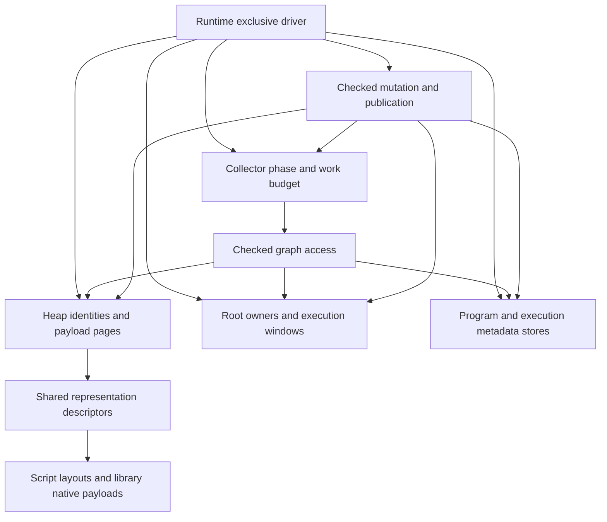

# Paged storage and incremental garbage collection

Status: design only, recorded on 2026-10-25 against `8c2a4568`. The user selected
paged storage as the design direction. On 2026-10-26 the user selected precise
tracing with incremental collection, unsafe integration for Opaque payloads that
contain Value, and collecting Native callbacks. This supersedes the provisional
counted-Value/cycle-collector proposal and blanket Native-wide GC exclusion.
Implementation, allocator parameters and
performance acceptance are not authorized or complete. The
[roadmap](implementation-roadmap.md#other-queued-designs) owns activation.
[Current runtime semantics](spec/runtime.md#gc-heap) remain authoritative until an
explicit implementation task changes them.

This document owns the proposed collector/storage architecture and its unresolved
decisions. The [native collections plan](native-collections-plan.md) continues to
own moving concrete collection representations and algorithms into libraries.
Opaque registration, the general payload protocol and affected collection integration
belong to the same GC replacement migration. NC retains the collection work breakdown;
its removal of special container paths is part of joint acceptance, not a later
redesign. Neither document creates a second implementation or progress queue.
This is design authorization only; runtime implementation remains unstarted.

## Goals and scope

Design a precise, single-driver, incremental mark-sweep collector with paged
payload storage and stable checked handles. Priorities are correctness, bounded
collector work where the object protocol permits it, understandable ownership and
measured memory/throughput costs. Incremental does not mean concurrent or hard
real-time, and paging alone does not establish lower memory use.

The design includes object allocation, roots, mutable edges, program/metadata
reachability, marking, sweeping, disposal and pressure-driven scheduling. It keeps:

- Full heap owner/slot/generation validation and scoped native borrows.
- Explicit host roots, traced execution windows and suspended computation state.
- Joint object/program reachability, including cycles across those domains.
- Current implementation selection for ordinary calls after compatible publication;
  exact owners retain already selected computations and necessary native evidence.
- Checked publication, mutation commits, completed effects and failure cleanup.
- Source-free executable validation and common interpreter/native runtime services.

Non-goals are concurrent or generational collection, automatic moving compaction,
raw host-visible heap references, a general-purpose replacement for the system
allocator, new weak-reference/finalizer language APIs, a hard memory quota, and
changes to cancellation policy. R13 type-only code retention, shared-program
redesign and general managed-native backend expansion remain separate work.

## Current implementation and reason for change

The current [heap](../crates/kagari-runtime/src/gc.rs) owns a checked object
directory, dense typed payload stores, roots, executable metadata stores, operation
leases, pressure state and collection-specific descriptor caches. The
[marker](../crates/kagari-runtime/src/gc/collector.rs) completes its worklist in one
operation. [Collection](../crates/kagari-runtime/src/gc/collection.rs) builds the
validated live graph and dead-object inventory, detaches storage, then disposes it.
[Directory storage](../crates/kagari-runtime/src/gc/directory.rs) compacts affected
stores and packed struct bytes. This is sound full-collection organization, not an
incremental protocol: simply yielding inside its traversal would allow mutations
to hide reachable objects.

`sequence_storage`, `map_storage`, `set_storage` and `cursor_storage` are cached
`NativeStorage` descriptors, not element buffers. Removing those fields alone
would not reduce per-element storage or remove runtime-owned container policy.
Their concrete policy belongs to NC; the GC replacement must expose a sufficient
general payload protocol rather than grow more collection cases.

Preserve the useful foundations: compact scalar fields/buffers, identity checks,
release-driven root leases, occupied-object discovery, committed native charges,
scoped access and panic-contained disposal. Replace whole-cycle temporary graph
sets and whole-store relocation only through the new lifecycle owner. Do not
replace compact representations with one boxed `Value` per field or element.

## Design decisions

| Decision | Direction |
| --- | --- |
| Execution | GC steps alternate with script execution under the existing exclusive Runtime driver; no collector thread |
| Algorithm | Precise incremental mark-sweep, with a complete marking closure before sweeping |
| Identity | Keep stable owner/slot/generation handles; payload location is private and separate |
| Storage | Paged small-object storage; separately tracked large allocations; ordinary cycles do not move surviving payloads |
| Page grouping | Prefer size/alignment classes and scan capability over one pool per nominal type; exact classes and Rust representation require pre-implementation evidence |
| Marking | Runtime-local mark state and resumable work tasks, not new per-cycle hash sets duplicating every live object |
| Mutation | Runtime-owned edge publication and write barriers, including roots and executable metadata |
| Native execution | Native entry does not disable GC; release payload loans and protect temporary references before collecting helpers or script callbacks |
| Opaque admission | Unsafe provider integration permits Value and ordinary Rust containers; no NoGc whitelist or lifetime-brand migration is required |
| Payload policy | Libraries own container data structures; descriptions/scanners expose edges without teaching the collector container names |
| Reclamation | Incremental sweep and bounded detached batches; destruction runs outside storage borrows |
| Limits | Work budgets are cooperative; opaque scans, destructors and allocators do not provide a wall-clock deadline |

Size-class pages may hold different types with compatible slot layout. Type-specific
trace/drop information must therefore remain recoverable for each occupied slot.
This is not a decision to put different Rust values into untyped bytes without a
checked alignment, initialization and destruction design. A typed-page implementation
may be retained where justified, but its sparse-type page cost must be measured.
No unsafe allocator implementation is authorized by this design alone.

## Ownership



- **Heap storage** owns allocation, identity retirement, pages and locators. It
  does not own hash collision handling, sorting or iterator policy.
- **Collector** owns collection epochs/phases, work tasks, marking closure and
  sweep progress. Work queues are internal traversal state, not independent roots.
- **Root owners** retain the actual values and executable evidence. Collector
  cursors do not replace frame/root ownership.
- **Program and metadata stores** retain their present semantic responsibilities;
  checked graph adapters expose their roots, edges and reclamation operations.
- **Representation descriptors** own scan/drop dispatch and relevant storage
  facts. Pure reusable descriptors may be shared; applied runtime identities and
  mark state may not be stored in cross-Runtime immutable products.
- **Native providers** own payload layouts and algorithms. Runtime owns the
  checked access, edge publication, accounting and borrow boundary.

Use ordinary modules under the existing owners first. These responsibilities do
not justify new empty crates or moving mixed policy into `common`.

## Concrete data structures

The following are conceptual records, not Rust APIs or final byte layouts.

```text
Heap
    ObjectDirectory
    RegisteredStores / page classes
    RootRegistry

ObjectHandle
    owner
    slot
    generation

DirectoryEntry
    generation
    state: vacant | occupied(locator) | retired

PayloadLocator
    store/class
    page
    slot

SmallObjectPage
    slot size/alignment and slot count
    occupied bitmap
    discovered/scanned state for the current collection
    slot -> object-directory identity association
    descriptor information where not implied by the page
    payload slots

Collector
    phase and collection epoch
    pending scan tasks
    root/metadata scan progress
    sweep progress
    bounded detached-disposal batches
    scheduling/work accounting
```

### Directory and generations

The directory maps stable identities to physical storage. Retiring an object
invalidates the locator and advances its generation before reuse. Exhaustion
retires that identity slot; it never wraps. Releasing payload pages must not erase
generation history and allow an old external handle to become valid again.

A locator's page slot may be reused only after all collector work that could name
the old allocation has finished or will reject its full identity. No queued raw
borrow or address survives page reclamation. The page-to-directory association
supports retirement without searching the directory.

This indirection has a cost. Removing it would require a separate host/lifetime
model decision, not an incidental allocator optimization.

### Pages and large objects

Small allocations occupy reusable fixed-size slots. Non-full-page indexes avoid
searching every page per allocation. Empty pages can be released or retained under
an explicit bounded reuse policy. Page release to the Rust allocator is not proof
of an immediate RSS reduction.

Large or unusually aligned payload allocations use a separate tracked allocation
path and participate in the same graph and sweep protocol. Container backing
buffers remain owned by their payload; a large Vec buffer does not require every
array element to become a separate GC object.

Normal collection does not shift live slots to fill holes. This avoids an
unbounded whole-store compaction step, but leaves partial-page fragmentation.
The currently packed script-struct arena needs an explicit replacement for both
its records and field bytes; paging only the records while retaining whole-arena
compaction would not satisfy the design. Preserve exact scalar field widths.

### Mark information

Discovered means reachable in this cycle; scanned means all required edges have
been processed. Small bitmaps or equivalent packed state replace duplicate visited
and live identity sets. The encoding, epoch rollover and lazy page initialization
must prevent stale marks from being interpreted as current marks without requiring
an unbounded all-page reset at every cycle start.

Native payload state, mutation revision and generation are different concepts.
Iterator invalidation revisions cannot stand in for GC barriers or mark epochs.

### Value and retained Native handles

Keep the distinction between an internal non-rooting value representation and a
retained Native handle. Copying/moving Value does not establish a GC root. The
provisional non-Copy counted Value, stable control-pointer layout, atomic per-object
ownership counts and cycle-disposal protocol are not selected. Its earlier layout
probe is not evidence for this tracing design and does not require an ABI change.
Preserve compact scalar storage and checked owner/slot/generation identities; exact
public naming/conversions remain an API review item, not a second collector.

Opaque<T>, Object and typed library handles retain objects through the existing
runtime-owned root service. Safe reads/removals return retained results before any
collecting boundary. An internal Vec<Value> in a heap payload contains traced edges,
not a permanent external root per element: otherwise cycles through the container
would remain live. Rust-owned local containers of retained handles are valid external
owners, but embedding those same root leases back into heap payloads is not a general
replacement for tracing internal edges.

Preserve Runtime: Send + !Sync, checked host lifetimes and safe root-lease release
after Runtime teardown. External handles must not keep the whole Runtime storage
alive. Transient host/frame tokens keep their scope checks; retaining a token does
not turn a scoped borrow into persistent access.

## Allocation and access

Allocation proceeds as one checked publication operation:

1. Validate the representation, type environment and incoming references.
2. Reserve directory, page/slot and required collector/accounting capacity.
3. Initialize the payload and its tracing description while it is unpublished.
4. Establish the forward locator and reverse identity association.
5. Apply the current phase's newborn/edge protection rule and commit accounting.
6. Publish the checked handle.

Failure before publication exposes no partial object. Successfully acquired backing
that remains owned must remain charged. Neither allocation nor a borrowed payload
edit invokes collection or script code. Allocation adds pressure; the driver pays
collector work at legal boundaries.

Access validates heap owner, generation, liveness, representation and applicable
type/access contracts before lending a scoped view. No view crosses collection,
page release, callbacks or reentry. Free-list allocation and phase bookkeeping
must remain valid after cancellation or quarantine for cleanup, without admitting
new execution.

## Native-facing GC object operations

The [end-to-end Native API draft](native-collections-plan.md#end-to-end-api-proposal-for-review)
connects registration, host borrowing, retained extraction and the proposed audited
storage-provider boundary. It also identifies the unrestricted raw-Value escape
from current payload read closures. The selected interim direction requires an
explicit unsafe contract for opaque payload integration and unrestricted payload
access, including edge-free custom payloads without an existing proof. New NoGc
whitelists/derives, split opaque types and branded Value admission are deferred.
Retained handles and audited library methods remain safe; providers must preserve
tracing, publication, accounting and extracted-value retention, optionally through
short collection exclusion that ends before callbacks. Performance preservation
requires measurement; unchecked admission or omitted barriers are not
optimizations. Provider signatures remain under review; this does not activate
implementation or change current runtime semantics.

Selected direction, 2026-10-26: Opaque payloads may contain Value and ordinary
Rust containers under an unsafe provider contract. Native entry does not suspend
collection. Short non-collecting payload edits remain permitted, but must end before
script callbacks or other collecting helpers. Providers preserve trace visibility,
barriers, accounting and root coverage for every extracted value. Ordinary safe
Native handles and library methods encapsulate these obligations.

Design clarification, 2026-10-26: a Native function operating on script GC objects
is a different API audience from a provider implementing Rust payload storage.
Ordinary Native code should hold checked, retained object handles and call field
or collection operations directly. It must not need nested `edit` closures,
long-lived payload guards, a caller-maintained `mutations` counter or explicit
collector barriers merely to access several objects.

This builds on existing APIs, not a new registration facade:

- [Object](../crates/kagari-runtime/src/native/objects/mod.rs) owns a rooted script
  object handle, not a Rust reference into payload memory.
- [Object::get/set and Field](../crates/kagari-runtime/src/native/objects/fields.rs)
  provide checked field operations with prepared type/member evidence.
- [ScriptVec](../crates/kagari-runtime/src/native/collections/vector.rs) provides
  retained collection handles and direct `get`, `set` and `push` operations.

The following callback-body sketch uses that existing access shape. `a` and `b`
are compatible object handles; `hp` is an already bound mutable integer field.
Registration and field binding are omitted:

```text
let a_hp = a.get(cx, &hp)?;
let b_hp = b.get(cx, &hp)?;
a.set(cx, &hp, b_hp)?;
b.set(cx, &hp, a_hp)?;
```

Each operation ends its storage borrow before returning. Holding both handles
is not holding two mutable Rust references; aliases of the same object remain
valid and operations execute in order. This sequence is not a transaction: if
its second write fails, the first completed write remains visible.

Reference-bearing operations use the same model. With a compatible object-valued
`target_field` and a collection of matching objects, a callback can use:

```text
player.set(cx, &target_field, enemy.clone())?;
targets.push(cx, enemy)?;
```

Each operation validates owner, identity, type and declared access; protects
references through conversion; prepares fallible accounting; and publishes edges
through the incremental barrier before commit. Runtime owns these mechanisms,
while libraries own collection layouts and algorithms. A fallible destructor or a
full rescan after an arbitrary edit cannot substitute for publication safety.

Reads/removals requested as object handles return retained handles, not bare
payload references. Protection must cover extraction and conversion without a
root gap. Rust-held handles retain their targets; fields and container elements
store traced internal edges, not a persistent external root lease per edge. Otherwise
unreachable cycles could remain alive solely through internal root leases.

No storage borrow may span a collecting boundary, callback, reentry or suspension.
Conversions and collection callbacks that can invoke script code run outside such
borrows, with values protected and existing operation-conflict checks preserved.
Holding an ordinary handle does not itself forbid later allocation or script calls;
it also does not waive execution admission or permit arbitrary reentry. Low-level
allocation still only adds pressure as described above; collection runs at legal
driver boundaries.

Public Native categories remain `Ref<T>` (scoped shared borrowing), `RefMut<T>`
(scoped mutable borrowing) and `Opaque<T>` (a retained opaque object handle).
GC describes the current lifetime mechanism, not a separate public type category.
The [opaque registration adjustment](native-collections-plan.md#opaque-registration-and-public-categories)
owns associating a script type with its Rust payload once and deriving the storage
descriptor without a redundant ordinary `native_storage(...)` declaration. Its
API spelling and implementation are part of this GC replacement, coordinated with
NC01/NC02 rather than deferred until after it. Paging does not create a
`define_gc_type` API or another handle wrapper.

Opaque handles, scoped payload loans and audited storage-provider edit views have
distinct roles. Restrictions on arbitrary `&mut T` for traced payloads do not require
ordinary GC object users to borrow whole objects. Keep `cx` explicit for now;
omitting it is a separate execution-context decision, not a prerequisite for flat
access. More convenient field binding or typed accessors may reuse the existing
checks, but no generated field facade, string-based unchecked access or new field
binding API is selected here. Exact runtime/applied-type/layout evidence remains
checked across reload; paging does not authorize retargeting an old field binding
by slot alone.

### Native retention and temporary extraction inventory

Discussion evidence, 2026-10-26, implementation revision `a24dd361`. Separate
ordinary Native retention, custom payload tracing and temporary extraction.
Rust-held handles need roots; custom heap payloads enumerate internal edges through
`NativePayload::trace`. Temporary edits need additional protection when those edges
leave the scanner-visible representation. The selected policy permits collection
during Native callbacks.

The inventory executed the current
[`catalog::declarations`](../crates/kagari-stdlib/src/catalog/mod.rs), then followed
entries into their implementations. Reproduce the count by enumerating public
`ModuleDecl::functions` (resolve IDs and exclude `private_functions`), methods of
`implementations` with `trait_type == None`, and `traits[*].methods`. Include required
trait methods; exclude concrete trait overrides, private templates, aliases,
constants and enum variants. Numeric receiver variants count separately. This is
an API-surface count, not independent algorithms, executed paths or call frequency.
It describes existing code only and is not a denominator for the future standard
library or evidence that collection suspension will be rare or inexpensive.

| Public declaration scope | Total | Bulk extraction paths | Extraction paths allowing script callbacks |
| --- | ---: | ---: | ---: |
| All modules: 5 free functions + 216 inherent methods + 86 trait methods | 307 | 11 (3.6%) | 9 (2.9%) |
| Excluding the 184 declarations owned by `core::num` | 123 | 11 (8.9%) | 9 (7.3%) |
| `alloc::vec` (6), `core::array` (2), `core::iter` (22), `std::collections` (43) | 73 | 11 (15.1%) | 9 (12.3%) |

An API enters the numerator if at least one implementation path has that behavior;
not every element type or receiver needs extraction protection. The 259 concrete
trait-method entries are excluded to avoid counting defaults and overrides twice.

| Operations | Observed behavior |
| --- | --- |
| `sort`, `sort_by`, `sort_by_key`, `sorted`, `sorted_by`, `sorted_by_key` (6) | Detach the target buffer; Rust sort may use private scratch storage. Comparisons/key selectors can execute script. |
| `retain`, `dedup`, `distinct` (3) | Concrete sequence paths detach the buffer across predicates/equality. Completed removals survive failures. |
| `reverse`, `reversed` (2) | The shared edit path detaches storage; reversal itself invokes no script. Custom receiver traversal/writeback can call script outside that window. |
| Vec `pop/remove`, Map `remove` | Script entries prepare the Option result before destructive removal; no callback/safepoint occurs between preparation and commit. |
| Hash lookup/insertion/removal | Hash/Eq run outside storage borrows. Candidates remain in the rooted, mutation-guarded table until commit; no whole-table extraction. |
| Iteration, construction and content comparison | Ordinary roots retain intermediate items/results. Zip retains the left item across right.next; fold retains its accumulator; unordered content comparison stores rooted ScriptValue handles in a Rust Vec. |
| Task/Future composition | Existing traced state/root owners retain pending computations and outputs across suspension; a synchronous no-GC scope cannot replace those lifetimes. |

Evidence: [list algorithms](../crates/kagari-stdlib/src/foundation/lists/algorithms.rs),
[typed Vec edits](../crates/kagari-runtime/src/native/collections/vector/edits.rs),
[buffer leases](../crates/kagari-runtime/src/gc/sequence_edit.rs),
[Vec operations](../crates/kagari-stdlib/src/foundation/vector/operations.rs),
[hash operations](../crates/kagari-stdlib/src/foundation/hash/operations.rs),
[lazy cursors](../crates/kagari-stdlib/src/foundation/iteration/cursor.rs),
[terminal iteration](../crates/kagari-stdlib/src/foundation/iteration/operations.rs),
[content comparison](../crates/kagari-stdlib/src/foundation/comparison/operations.rs)
and [task composition](../crates/kagari-stdlib/src/foundation/tasks/composition.rs).

Separate the existing mechanism from future policy:

- Ordinary Native values use retained handles; heap payloads trace edges without
  an external root lease per element. Custom data also needs checked mutation,
  accounting and trace/drop obligations, regardless of the extraction policy.
- An edit without script calls or collecting helpers can exclude GC while its
  representation is temporarily untraceable. Current single-driver allocation
  already adds pressure without collecting; `CallContext::poll` checks cancellation,
  not GC. Before collection resumes, restore tracing invariants and satisfy
  incremental edge/cursor protection. No-GC alone does not replace barriers.
- Existing callback-bearing bulk edits use one temporary root group: protect original
  traced elements before detachment and restore storage before release. This costs
  O(n) reference storage, not object copies, and avoids tracing Rust sort scratch
  memory or creating another root subsystem. Growing edits must protect new values
  too; the current sorting/removal edit set does not grow. The sorting constraint
  below excludes this preparatory traversal from the replacement design.
- Whole-Native and callback-spanning GC exclusion are rejected as the default
  solution. A for_each callback may allocate on every iteration, accumulating garbage
  until an arbitrarily long outer call returns. Root the current item/accumulator,
  end the storage loan and allow collection during each callback instead. Current
  declaration percentages cannot bound future library coverage, duration or memory.

### Sorting implementation candidates

Selected direction, 2026-10-26: implement or adapt the small set of algorithms
whose Rust-private temporaries would be invisible during collecting callbacks.
The exact stable sorting kernel remains open. User constraints:
preserve optimal worst-case comparison-sort complexity, O(n log n), and do not add
a preparatory traversal for retention or index construction. The latter is an
independent constraint even though an O(n) pass would not change that asymptotic
bound. Preserve stability and comparison-time key evaluation. Count comparisons,
moves and auxiliary storage separately; arbitrary callback execution and collector
work do not acquire an O(n log n) total-time bound from the sorting algorithm.

The previous full-root snapshot and newly constructed index permutation are excluded
as replacement strategies. Existing Rust sort plus snapshot remains a measurement
baseline only. For reference-bearing callback sorts, review these two
implementations of the selected tracing boundary:

| Candidate | Protection and costs |
| --- | --- |
| Library-owned stable sort with reusable root slots | Register temporary slots once and update them when extraction occurs. Avoid per-move root allocation/registration, but retain publication barriers. A few slots cover scalar temporaries; a merge buffer requires protection for all its live elements. |
| Library-owned stable merge/adaptive sort with traced work state | Root an initially empty ordinary opaque work object. Its scanner reports initialized scratch ranges and temporary slots as the algorithm fills them. Keep the source traceable too. Use only the algorithm's necessary moves, without a separate retention snapshot. This is a general payload protocol, not a collector sort case. |

For traced work state, a transfer must publish the destination edge before losing
the source edge, or complete both inside a short non-collecting mutation interval.
Before a comparator can collect, end payload loans and expose only initialized
source/scratch slots. Incremental barriers and scan-cursor repair still apply.
Registering a work owner does not mean eagerly tracing every input element;
ordinary collector scanning is charged when performed. The new generic protocol
must establish this property, including admission and buffer ownership transfers;
the current payload preparation path cannot simply be assumed traversal-free.

This combines short no-GC moves with collecting callbacks; it does not require
disabling GC for the whole sort. It still requires controlling the sorting
implementation. Rust-private scratch cannot be made traceable by registering only
the receiver or the two comparison arguments. Rust moves do not invoke a user
move hook. Stable handles/nonmoving storage preserve identity/location, not liveness.
Persistent slot-table references must be ordinary internal traced edges, not global
roots per element, so unreachable container cycles remain collectable.

Both mechanisms preserve cancellation, valid state on inconsistent comparators,
original elements on failure, completed callback effects and root cleanup. Stop
invoking user code after the first error while completing required bookkeeping.
Keep conflicting receiver aliases excluded and release Rust storage borrows before
script reentry. Algorithms and representation choices stay in the library; no
candidate adds collector container cases.

Primary references: [Rust 1.99.1 slice sorting](https://doc.rust-lang.org/std/primitive.slice.html#method.sort_by)
uses stable driftsort with worst-case O(n log n), adaptive run handling and
length-dependent scratch allocation. [V8 array sorting](https://chromium.googlesource.com/v8/v8/+/refs/heads/main/third_party/v8/builtins/array-sort.tq),
reviewed 2026-10-26 at source blob `90e36b5cd08715c65f83bae28e96587534a406fe`,
uses PowerSort and a heap SortState containing work/temp arrays. It copies inputs
before sorting, so its complete pipeline does not satisfy the no-prepass constraint.
Only its managed temporary-storage mechanism is relevant here. V8's
Torque/JS object access and mutation behavior are not Kagari's Rust borrowing or
collection conflict contract. Neither source establishes a Kagari speedup.

Measure total time, comparison count, root/barrier work, allocations and peak
temporary memory for random, ordered, reversed and duplicate-heavy inputs. Separate
scalar native ordering, cheap script comparison and allocating script comparison;
reuse existing stable-order/trap/GC contracts for correctness. Custom O(n log n)
sorting alone does not imply parity with Rust's optimized implementation. Scalar
sorting with no script callbacks can retain its compact Rust sort path. Long
uninterrupted native kernels still need cancellation/latency review; their lack of
script allocation does not establish a bounded time to the next GC step.

Only the declaration inventory was executed; no sorting prototypes, behavioral
tests or memory/pause measurements were run for these candidates. The validation
design below must cover the selected policy.

### Runtime comparisons: native storage versus native algorithms

Primary-source review, 2026-10-26. A host allocation/container can store managed
references, but its ordinary move algorithms do not automatically participate in
the runtime's liveness protocol. Established implementations pay for that protocol
through owned references, managed temporary storage or explicit roots:

| Runtime/source | Mechanism and limits of the comparison |
| --- | --- |
| [CPython 3.14.0 list sorting](https://github.com/python/cpython/blob/v3.14.0/Objects/listobject.c), [reference ownership](https://docs.python.org/3.14/c-api/intro.html#reference-counts) | Sort temporarily detaches `ob_item` and makes the list appear empty. Existing owned element references are retained without decrementing them during relocation. Reference counting preserves those elements independently of the list scanner; it does not require registering each move. This is not evidence that the complete sort has no preparatory passes, and its reference-count/cycle-collector model differs from Kagari's tracing-only internal edges. |
| [Lua 5.4.9 table sorting](https://www.lua.org/source/5.4/ltablib.c.html), [GC reachability](https://www.lua.org/manual/5.4/manual.html#2.5) | Library sorting uses table get/set operations and VM-stack values, including its pivot across callbacks. Those values are visible to GC. Its quicksort is not a substitute for Kagari's stable worst-case O(n log n) requirement; the relevant mechanism is temporary rooting. |
| [V8 sorting](https://chromium.googlesource.com/v8/v8/+/refs/heads/main/third_party/v8/builtins/array-sort.tq), source revision reviewed above | Managed work/temp arrays keep temporary references visible; it controls the sorting implementation and copies inputs. It does not demonstrate tracing arbitrary C++ algorithm scratch. |
| [QuickJS 2026-06-04 C API and GC](https://bellard.org/quickjs/quickjs.html#QuickJS-C-API) | Owned JSValues use explicit duplicate/free reference counting, with a separate cycle-removal pass and custom-class edge enumeration. Native code need not report the address of each owned local as a tracing root. This is a different collector/ownership model, not a free adapter for Kagari's current edges. |

Kagari can continue using Rust Vec for storage and ordinary retained handles in
host-local Vecs. Moving an already rooted handle does not unregister its root.
Heap-owned container edges must still be traced internal references rather than
permanent external roots, so tracing can reclaim unreachable cycles. Reusing native storage
and reusing every native algorithm without adaptation are separate requirements.
A library-owned sorting implementation with ordinary opaque work state satisfies
the no-container-special-cases collector boundary and is the selected direction.
CPython-style mem::take/detach alone does not retain unrooted Value elements in a
tracing collector. Any detached state must acquire a scanner-visible owner without
a root gap, obey partial-scan barriers and avoid a preparatory retention traversal.

### Lua's public Native boundary

Review of official Lua 5.4 manual and 5.4.9 sources, 2026-10-26. This is the C API
model, not gc-arena's mutation/collection exclusion. The
[Lua stack API](https://www.lua.org/manual/5.4/manual.html#4.1) exchanges values in
VM-owned slots. A table read pushes the result onto this traced stack; removing
the table entry afterwards does not remove that stack reference. A native local
pointer alone is not a GC root. Native code must preserve stack references across
allocating calls or explicitly retain values elsewhere.

For external ownership across calls,
[luaL_ref](https://www.lua.org/manual/5.4/manual.html#luaL_ref) can store a value in
the registry and return an integer key; luaL_unref releases the table entry. The
integer is a lookup key, not an independently traced reference. For internal
ownership, full userdata has raw memory plus associated Lua user values. The
[userdata scanner](https://www.lua.org/source/5.4/lgc.c.html#traverseudata) visits
its metatable and user values, not the raw C bytes. The public API has no arbitrary
userdata trace callback comparable to NativePayload::trace; __gc is a finalizer,
not a tracing hook.

Native structs keep ordinary C state in raw memory and put owned Lua references
in user-value slots or a table stored in a user-value slot. This exposes the edges
to tracing without creating permanent registry roots for every internal
edge. [lua_setiuservalue](https://www.lua.org/source/5.4/lapi.c.html#lua_setiuservalue)
publishes the reference and applies the write barrier; lua_getiuservalue pushes a
retained stack value. Writing an object address into raw userdata does not provide
this protection. The C API relies on caller discipline; it does not statically
prove that native bytes contain no pointers or prevent dangling-pointer mistakes.

[Table sorting](https://www.lua.org/source/5.4/ltablib.c.html#sort_comp) uses its own
algorithm and stack-held comparison operands/pivot, allowing collecting callbacks.
It does not solve tracing arbitrary host-container scratch. This supports a model
of generic managed reference slots beside opaque host data, similar in ownership
to Kagari's existing Managed<T>, while Lua's built-in tables are runtime-owned.
Adopting that public boundary would limit arbitrary reference-bearing Rust layouts;
it is not proof of an efficient ordinary Rust Vec provider or of Kagari's required
stable worst-case sorting bound. No new slot API or representation is selected.

### Future standard-library extraction families

Selected tracing design, 2026-10-26. Review future operation families rather than
using current API percentages as proof that only Hash/Eq need treatment. Script
callouts include Ord, explicit predicates/comparators/key selectors and custom
iter/next. This inventory does not authorize new collection types or rewriting
all standard algorithms.

| Prospective family | Tracing boundary |
| --- | --- |
| Vec/Deque get, pop, remove, insert, growth, swap, reverse/rotate, append | Reuse Rust storage and non-callback kernels under checked short access. Establish result roots before the next safepoint; apply barriers and repair partial-scan progress on writes/reordering |
| Stable sort, retain, dedup and callback-driven compaction/partition | Own/adapt the algorithm where private scratch can contain unrooted elements at callouts. Trace source/scratch valid ranges or use reusable root slots; end loans before callbacks and restore state on every exit |
| HashMap/HashSet lookup, insertion, removal and rebuilding | Hash/Eq execute with rooted candidates and a valid guarded table. Separate lookup/callback/commit. Rebuilding with callouts must preserve all temporary references; do not retry user callbacks after observable side effects |
| Heap sifting and ordered-tree operations, if added | Audit comparison callouts inside holes/node transitions. Use rooted temporaries or traced work state and a callback-compatible algorithm; std Ord does not directly encode fallible context-bearing script execution |
| for_each/map/filter/fold/zip/collect and user-supplied iterator inputs | Root the current items/results/accumulator, release loans and allow collection during next/predicate/body calls. Do not protect the whole loop by disabling GC or snapshotting every input |
| Escaping drain/splice/extract/entry/iterator guards | Use traced owned cursor state and existing invalidation rules. A borrowed Rust guard or no-GC scope cannot span arbitrary script lifetime or suspension |
| clear/truncate/replace and bulk deletion | Maintain valid tracing/accounting state and release outgoing edges. Removing a non-rooting Value does not cause recursive object destruction; actual GC payload destruction follows detached disposal rules |

These families share runtime root/barrier/borrow mechanisms and library-owned
algorithms, never new collector branches per method. Reuse existing Hash/Eq
prepare/call/commit logic and error/cancellation rules. Rust panic-safe sorting or
BinaryHeap hole guards alone do not prove GC-visible liveness. No measured fraction
of future methods or throughput parity is established.

## Incremental tracing and mutation

### Graph and roots

Traverse objects, programs and executable metadata in one reachability cycle.
Physical storage stays with each owner; a universal object representation is not
required. Scan tasks identify their domain and checked identity and carry only
owned continuation state.

Roots include host/debug leases, managed execution windows, suspended frames/tasks,
published/staged programs and actual computation/native leases. Follow static cells,
constants, captures, interfaces and selected-operation environments through their
owning edges. Reuse the existing root-release queue; a delayed release is not proof
that a dead lease is live.

Root scans need stable cursor/revision rules when entries are released or slots are
reused between steps. New root publication must protect its target immediately;
removing a root may conservatively leave its old target alive for this cycle. Values
moved between roots/windows must never cross an unprotected gap. A final full scan
of all historical root slots is not a hidden bounded-work guarantee.

### Write barrier

Use an incremental-update insertion barrier as the design baseline. During marking,
newly published strong edges cause their targets to be discovered/queued as needed.
Start from the conservative rule that every strong-reference publication participates;
source-color-based elision needs a proof that also covers partially scanned objects.

Example:

```text
A was scanned; B has not been discovered.
The script stores B in A.child and removes B's previous root.
The checked store discovers B before the new edge becomes observable.
A need not be rescanned merely to rediscover that one inserted edge.
```

Barrier work and capacity preparation happen before an irreversible commit. A queue
allocation failure cannot leave a committed unrecorded edge. Bulk writes, replacement,
reference rearrangement during partial scans and error/panic exits must obey the same
rule. Regraying a parent can be a bounded provider mechanism, but repeatedly rescanning
an entire large container on each write is not the default solution.

Required publication sites include script fields, builtin array elements, cells,
native payload edges, managed frame slots, roots, static state, lazy metadata links,
result/capture transfer and program publication. A provider's arbitrary interior
mutation must not bypass these sites. An unrestricted mutable payload reference is
not a sufficient public contract.

Internal container elements are traced edges, not individual persistent root leases.
Temporary extraction across a callback needs an existing runtime-owned protection
mechanism and correct restoration/commit, not a second root subsystem.

### Scanning capability

Descriptors distinguish edge-free data, bounded whole-object scans and resumable
large-object scans. A resumable scan receives a work budget and an owned cursor and
reports completion or continuation; it never retains a Rust iterator/reference.
Count actual slots/bytes visited as work, including empty hash buckets, rather than
only the number of non-null edges found.

Providers must specify how insertions, removals, reordering and reallocation affect
scan progress. Restarting from the beginning after every edit can prevent progress;
recreating an iterator and skipping an increasing prefix can make scanning quadratic.
Copying all entries into a snapshot merely exchanges pause cost for peak memory.
The descriptor must provide a correct, progressing protocol or explicitly declare
an indivisible scan. Arbitrary Rust containers do not automatically support bounded
incremental scans. No strict pause claim covers an opaque indivisible scanner.

## Collection phases and sweeping

```text
Idle -> MarkRoots -> Mark -> FinishMark -> Sweep -> Idle
                         ^        |
                         +--------+  newly discovered work
```

- **Idle:** accumulate pressure; select a new cycle at a legal driver boundary.
- **MarkRoots:** enumerate roots in resumable batches while barriers protect changes.
- **Mark:** process object and metadata scan tasks within the work budget.
- **FinishMark:** establish root/barrier/work closure before any reclamation. New
  work returns to Mark. Do not hide an unbounded full graph rescan in this phase.
- **Sweep:** advance checked store/page/slot and metadata cursors, detaching only
  allocations eligible for this cycle and not marked reachable.

The phase protocol must distinguish allocations present for this cycle from newborn
allocations. During marking, a published new object and its outgoing edges must be
protected; simply coloring an unscanned object black is insufficient. During sweep,
new or reused slots must not inherit the dead status of the previous occupant.
Phase-local survivor/epoch bookkeeping must exclude newborns from reclamation.
Exact bit encoding remains an implementation decision, but these rules do not.

The end of marking is also an admission boundary for existing allocations. A raw
unrooted handle is not an ownership claim. New roots, weak cache hits, metadata
republishing and host accesses must not resurrect a condemned, not-yet-swept object.
Define the phase-aware checked admission rules before implementation; delaying the
physical free must not temporarily make a dead object valid again. Ordinary strongly
reachable objects and properly rooted handles remain usable throughout the cycle.

### A page sweep example

```text
slot:        0 1 2 3 4 5 6 7
occupied:    1 1 0 1 1 0 0 1
reachable:   1 0 0 1 0 0 0 1

Sweep reclaims slots 1 and 4:
occupied:    1 0 0 1 0 0 0 1
```

For each dead slot, validate the identity/state, detach the payload, invalidate its
directory entry, advance the generation and make storage reusable only when the
old payload has been safely transferred out. Live slots do not move. An empty page
can release backing independently of directory generation history.

Keep detached batches bounded. Destructors run without storage borrows and cannot
reenter execution or mutate roots. A tracing fault before marking closure cannot
lead to sweeping a partial graph. Invalid state or destruction panic quarantines
the Runtime under the existing failure contract, while safe detached cleanup
continues. Do not claim rollback of an entire incrementally completed cycle.

Logical retirement, payload destruction, capacity release and allocator/OS release
are separate events. If disposal is deferred, queued payload backing stays accounted
until it is actually released. Arbitrary Rust `Drop` is indivisible and may block;
provider obligations or explicit resource cleanup are required for stronger latency
claims. This proposal adds no user finalizer execution or resurrection mechanism.

## Scheduling and observability

Native entry does not suppress automatic or explicit collection. Drive steps from
existing safepoints outside invalid storage/host borrows. A captured Runtime alias
must not bypass a short active payload-loan exclusion. Script callbacks run only
after that exclusion ends, with all temporary references protected. Keep
ordinary synchronous and owned/async execution, reentry and the accepted native
backend on the same owner-controlled collection service. No interpreter-only root
protocol or machine-register scanning assumption is introduced.

Separate current retained pressure, newly committed allocation pressure and completed
collector work. Use allocation pressure/debt and live-set observations to schedule
work, with a bounded normal step. High pressure requires an explicit escalation
policy; a fixed tiny budget cannot both guarantee progress and bound memory under
arbitrary allocation. It may be necessary to do more synchronous work at a legal
boundary or fail allocation under applicable resource limits. Do not promise hard
latency or introduce generic execution charging.

The current byte ledger is partial. Account page backing, directories, collector
queues and native indirect backing in disjoint categories before using them to make
memory claims; keep estimates, requested capacity and physical RSS separate. Reuse
committed charge updates rather than rescanning providers on release.

Keep disabling automatic collection distinct from explicit collection. The existing
`collect_garbage` completion/reporting contract must not silently become "perform
one small step". Exact configuration, explicit full-cycle draining and statistics
changes are part of the pre-implementation decision, not new callable APIs here.
Measure per-step pause, full-cycle work/time, assist work, indivisible scan/drop time,
page occupancy, allocator calls and peak working memory separately.

## Related owners and removals

- **NC:** libraries own Vec/HashMap/HashSet layouts, algorithms and base cursors;
  builtin fixed-length `[T]` remains a language representation. Opaque registration,
  unsafe provider access, tracing/barriers/retention and affected collection callers
  share one migration and joint acceptance. NC01/NC02 own collection API details;
  do not finish GC around special container paths and defer their removal. Preserve
  one define_opaque payload association and Ref/RefMut/Opaque categories. This does
  not activate NC01-NC06 or move its ledger here.
- **Existing storage:** retain compact scalar/field representation and validated
  kernels. Replace affected dense-store/packed-arena compaction coherently; remove
  superseded full-cycle hash-set/dead-list paths rather than retain two collectors.
- **Metadata/reload:** reuse checked graph owners and current-call dispatch.
  Incremental GC does not activate R13 type/code separation or freeze method bodies.
- **Future native execution:** collecting helpers require registered, valid roots.
  Paging does not make unreported machine-register references safe.

## Primary references and applicability

Collector references reviewed on 2026-10-25; the Native object access comparison
was added on 2026-10-26. These establish mechanisms, not a measured speedup or an
off-the-shelf implementation of this complete Kagari proposal.

| Source/version | Mechanism to reuse | Different assumptions |
| --- | --- | --- |
| [Go 1.26 release](https://go.dev/doc/go1.26#runtime) and [Green Tea design](https://go.dev/blog/greenteagc) | Size-class/page organization, local discovered/scanned bitmaps and scan locality; Green Tea is default in 1.26 | Direct pointers, compiler-provided pointer layouts, concurrent workers and scheduler cooperation; no requirement to copy its page size, vector kernels or whole-page work scheduling |
| [gc-arena 0.7.0 context](https://docs.rs/crate/gc-arena/0.7.0/source/src/context.rs), [types](https://docs.rs/crate/gc-arena/0.7.0/source/src/types.rs) and [mutation](https://docs.rs/gc-arena/0.7.0/gc_arena/struct.Mutation.html) | Explicit mutation/barriers, collection phases, newborn exclusion during sweep and generic trace/drop descriptors | Intrusive allocation list and direct lifetime-branded pointers; whole-object tracing is not bounded large-object scanning; Kagari retains checked dynamic identities and its failure contract |
| [mlua 0.11.4 Table implementation](https://github.com/mlua-rs/mlua/blob/v0.11.4/src/table.rs) | Retained object handles with direct `get/set/push`; per-operation state access hides storage mechanics from callers | This is the relevant comparison for Native code operating on GC objects, not userdata `borrow_mut`. Lua table operations use Lua APIs and may invoke metamethods; Kagari retains declared fields, static type/access checks, explicit execution context and checked reload identities. This does not provide automatic tracing of arbitrary Rust payloads |
| [Lua 5.4.8 collector definitions](https://github.com/lua/lua/blob/v5.4.8/lgc.h) | Standard color invariants, forward/backward barriers and work-debt scheduling | Lua-specific object families, allocation-time GC and pointer model are not adopted |
| [OpenJDK 25 GA SATB queue](https://github.com/openjdk/jdk/blob/jdk-25-ga/src/hotspot/share/gc/shared/satbMarkQueue.hpp) | Explicit ownership and lifecycle of barrier work buffers | SATB and concurrent thread-local logging are alternatives, not the chosen single-driver insertion-barrier baseline |
| [Boehm collector algorithm overview](https://www.hboehm.info/gc/gcdescr.html) (unversioned) | Size/kind-segregated small-object blocks, mark bits, free-slot reuse and empty-block release | Conservative stack scanning, OS dirty-page tracking and finalization semantics do not fit Kagari's precise roots and checked native boundary |

Paging is the selected direction, not evidence that it beats separate allocations
for every workload. A linked allocation-list implementation is simpler and should
remain a comparative cost reference, not a second production collector.

## Decisions required before implementation

This is a finite list; unresolved items block implementation acceptance, not the
recording of the paging direction.

1. **Physical representation:** size/alignment classes, page and large-object
   thresholds, descriptor placement, mark/epoch encoding, packed-struct replacement,
   free-page policy and any narrowly justified unsafe storage kernel.
2. **Mutation and scan protocol:** specify unsafe NativePayload/read/edit, retained
   extraction and collecting algorithm work state; enumerate every strong edge/root
   publication;
   specify queue exhaustion, partial scan mutation/progress, newborns, marking
   closure, sweep-time admission, weak internal caches and publication across steps.
3. **Lifecycle and scheduling surface:** step work units, escalation, explicit
   full-collection behavior, automatic-disable behavior, disposal obligations and
   disjoint pressure/statistics categories.
4. **Acceptance and sequencing:** freeze representative workloads and numerical
   memory/pause/throughput gates from a current baseline; agree NC/storage ownership
   boundaries and a finite buildable migration before authorizing implementation.

## Validation design

No implementation tests or performance probes were run for this document. When
activated, reuse existing GC ownership, native storage, frame cleanup, async,
source-free and reload contract owners. Add only distinct incremental boundaries:

- Tiny-step schedules with mutations between steps: black/partially scanned parents,
  root transfers, new allocation, slot reuse, bulk edits and metadata publication.
- Cycles through objects, statics, closures and retired program/metadata records;
  ordinary calls after reload still select current implementations.
- Large mutable native payloads and sparse containers: correct cursor progress,
  no leaked borrow, no hidden snapshot, and reported indivisible operations.
- Failure before publication, work-queue capacity failure, trace/drop panic,
  cancellation, reentry and cleanup of detached storage.
- Native handle operations across multiple objects, including aliases: reference
  reads/removals survive a legal collection before their next use, reference writes
  protect targets between mark steps, and a later failure preserves earlier commits.
  Reuse existing field/type/owner/reload and callback-conflict coverage; no nested
  payload edit scopes or caller-managed barriers should be needed.
- Collection during allocating sort/retain/dedup/Hash/Eq/Ord callbacks and long
  for_each/custom-next loops, with no callback-wide exclusion or root gap; stable
  sort/multiset preservation, alias rejection and cleanup on error/unwind. Include
  roots added during marking, scratch transfers and mutations between partial scans.
- A reference-bearing application container using only public native capabilities,
  with no new core type tag, collector branch or persistent root per element.
- Source-free invalid identity/type/metadata cases and actual supported native
  execution at collecting boundaries; fallback does not prove native coverage.

Performance selection must include dense small objects, many sparse types, mixed
sizes/alignment, large pointer-free buffers, large reference containers, cyclic
short-lived graphs, long-lived sparse pages, root churn and retained reload state.
Compare the current implementation against the proposal using equal workloads and
outputs. Report toolchain, machine, profile/features, parallelism and cache state;
separate allocation/access throughput, GC work, longest steps, full cycles, metadata,
page slack, native capacity, deferred disposal and RSS. Do not infer savings solely
from bitmap size or fewer source lines.

Routine implementation validation stays focused. Structure checks, formatting,
workspace all-target Clippy and diff checks follow [repository rules](../AGENTS.md).
Full-workspace tests and the complete feature/backend/platform matrix remain CI-only.
Documentation-only work needs content/link/diff checks, not Rust builds.

## Design status

- [x] Record the user-selected paged storage direction and incremental GC scope.
- [x] Record ownership, concrete storage/sweep examples and primary references.
- [x] Clarify ordinary Native GC object operations versus storage-provider access,
  with flat handle examples and the mlua Table comparison (2026-10-26).
- [x] Select tracing/incremental GC again on 2026-10-26; supersede counted Value and
  cycle-collection design. Permit Value inside unsafe Opaque providers, retain safe
  ordinary Native handles, and reject Native-wide GC exclusion.
- [x] Couple GC, opaque registration/general storage and affected NC migration;
  preserve one payload association and remove special container paths at acceptance.
- [x] Select library-controlled temporary storage for callback-bearing algorithms,
  with roots/traced work state, stable worst-case O(n log n) sorting and no retention
  prepass. Record future operation families and ordinary per-item callback rooting.
- [x] Preserve incremental scanning/barrier/sweep design and explicitly distinguish
  collecting Native callbacks from a hard pause guarantee.
- [ ] Resolve the four pre-implementation decisions above and obtain implementation scope approval.
- [ ] Implement and validate the replacement; not started.

No numerical performance target, memory saving, pause bound or implementation
acceptance is claimed. On completion of a future implementation, move lasting
contracts to architecture/specification owners and retire this design document.
