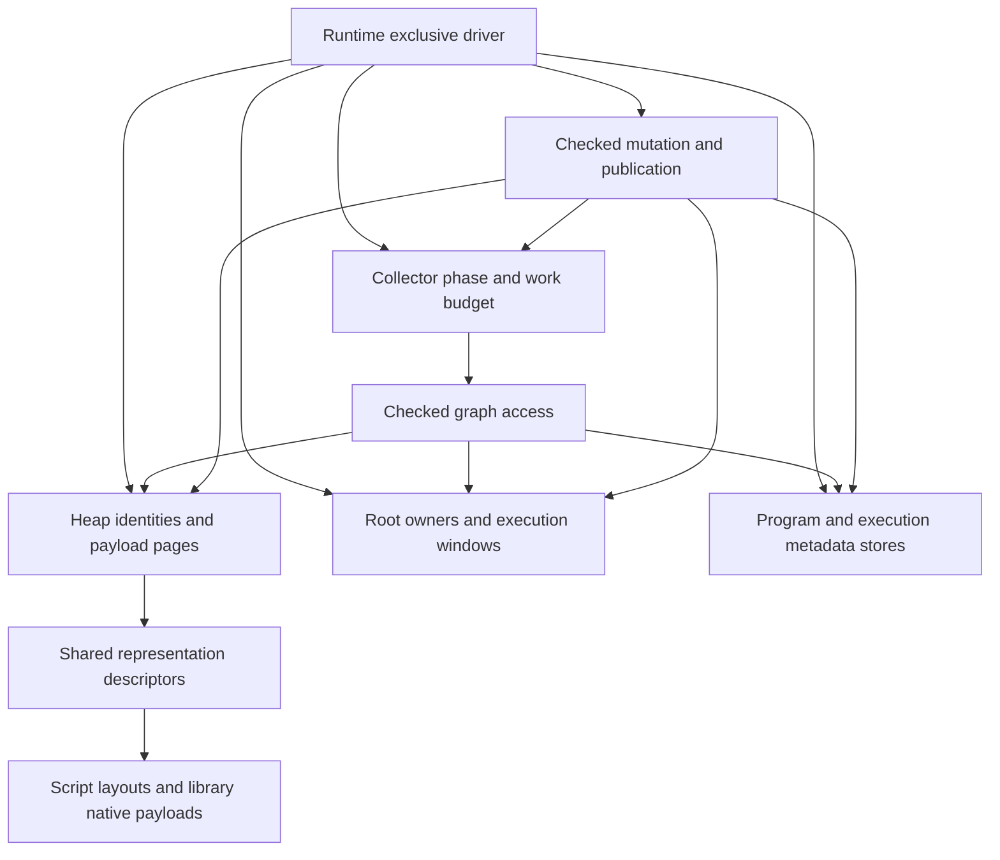

# Paged storage and incremental garbage collection

Status: design only, recorded on 2026-10-25 against `8c2a4568`. The user selected
paged storage as the design direction. Implementation, allocator parameters and
performance acceptance are not authorized or complete. The
[roadmap](implementation-roadmap.md#other-queued-designs) owns activation.
[Current runtime semantics](spec/runtime.md#gc-heap) remain authoritative until an
explicit implementation task changes them.

This document owns the proposed collector/storage architecture and its unresolved
decisions. The [native collections plan](native-collections-plan.md) continues to
own moving concrete collection representations and algorithms into libraries.
Neither document creates a second collection implementation or progress queue.

## Goals and scope

Design a precise, single-driver, incremental mark-sweep collector with paged
payload storage and stable checked handles. Priorities are correctness, bounded
collector work where the object protocol permits it, understandable ownership and
measured memory/throughput costs. Incremental does not mean concurrent or hard
real-time, and paging alone does not establish lower memory use.

The design includes object allocation, roots, mutable edges, program/metadata
reachability, marking, sweeping, disposal and pressure-driven scheduling. It keeps:

- Full heap owner/slot/generation validation and scoped native borrows.
- Explicit host roots, traced execution windows and suspended computation state.
- Joint object/program reachability, including cycles across those domains.
- Current implementation selection for ordinary calls after compatible publication;
  exact owners retain already selected computations and necessary native evidence.
- Checked publication, mutation commits, completed effects and failure cleanup.
- Source-free executable validation and common interpreter/native runtime services.

Non-goals are concurrent or generational collection, automatic moving compaction,
raw host-visible heap references, a general-purpose replacement for the system
allocator, new weak-reference/finalizer language APIs, a hard memory quota, and
changes to cancellation policy. R13 type-only code retention, shared-program
redesign and general managed-native backend expansion remain separate work.

## Current implementation and reason for change

The current [heap](../crates/kagari-runtime/src/gc.rs) owns a checked object
directory, dense typed payload stores, roots, executable metadata stores, operation
leases, pressure state and collection-specific descriptor caches. The
[marker](../crates/kagari-runtime/src/gc/collector.rs) completes its worklist in one
operation. [Collection](../crates/kagari-runtime/src/gc/collection.rs) builds the
validated live graph and dead-object inventory, detaches storage, then disposes it.
[Directory storage](../crates/kagari-runtime/src/gc/directory.rs) compacts affected
stores and packed struct bytes. This is sound full-collection organization, not an
incremental protocol: simply yielding inside its traversal would allow mutations
to hide reachable objects.

`sequence_storage`, `map_storage`, `set_storage` and `cursor_storage` are cached
`NativeStorage` descriptors, not element buffers. Removing those fields alone
would not reduce per-element storage or remove runtime-owned container policy.
Their concrete policy belongs to NC; the GC replacement must expose a sufficient
general payload protocol rather than grow more collection cases.

Preserve the useful foundations: compact scalar fields/buffers, identity checks,
release-driven root leases, occupied-object discovery, committed native charges,
scoped access and panic-contained disposal. Replace whole-cycle temporary graph
sets and whole-store relocation only through the new lifecycle owner. Do not
replace compact representations with one boxed `Value` per field or element.

## Design decisions

| Decision | Direction |
| --- | --- |
| Execution | GC steps alternate with script execution under the existing exclusive Runtime driver; no collector thread |
| Algorithm | Precise incremental mark-sweep, with a complete marking closure before sweeping |
| Identity | Keep stable owner/slot/generation handles; payload location is private and separate |
| Storage | Paged small-object storage; separately tracked large allocations; ordinary cycles do not move surviving payloads |
| Page grouping | Prefer size/alignment classes and scan capability over one pool per nominal type; exact classes and Rust representation require pre-implementation evidence |
| Marking | Runtime-local mark state and resumable work tasks, not new per-cycle hash sets duplicating every live object |
| Mutation | Runtime-owned edge publication and write barriers, including roots and executable metadata |
| Payload policy | Libraries own container data structures; descriptions/scanners expose edges without teaching the collector container names |
| Reclamation | Incremental sweep and bounded detached batches; destruction runs outside storage borrows |
| Limits | Work budgets are cooperative; opaque scans, destructors and allocators do not provide a wall-clock deadline |

Size-class pages may hold different types with compatible slot layout. Type-specific
trace/drop information must therefore remain recoverable for each occupied slot.
This is not a decision to put different Rust values into untyped bytes without a
checked alignment, initialization and destruction design. A typed-page implementation
may be retained where justified, but its sparse-type page cost must be measured.
No unsafe allocator implementation is authorized by this design alone.

## Ownership



- **Heap storage** owns allocation, identity retirement, pages and locators. It
  does not own hash collision handling, sorting or iterator policy.
- **Collector** owns collection epochs/phases, work tasks, marking closure and
  sweep progress. Work queues are internal traversal state, not independent roots.
- **Root owners** retain the actual values and executable evidence. Collector
  cursors do not replace frame/root ownership.
- **Program and metadata stores** retain their present semantic responsibilities;
  checked graph adapters expose their roots, edges and reclamation operations.
- **Representation descriptors** own scan/drop dispatch and relevant storage
  facts. Pure reusable descriptors may be shared; applied runtime identities and
  mark state may not be stored in cross-Runtime immutable products.
- **Native providers** own payload layouts and algorithms. Runtime owns the
  checked access, edge publication, accounting and borrow boundary.

Use ordinary modules under the existing owners first. These responsibilities do
not justify new empty crates or moving mixed policy into `common`.

## Concrete data structures

The following are conceptual records, not Rust APIs or final byte layouts.

```text
Heap
    ObjectDirectory
    RegisteredStores / page classes
    RootRegistry

ObjectHandle
    owner
    slot
    generation

DirectoryEntry
    generation
    state: vacant | occupied(locator) | retired

PayloadLocator
    store/class
    page
    slot

SmallObjectPage
    slot size/alignment and slot count
    occupied bitmap
    discovered/scanned state for the current collection
    slot -> object-directory identity association
    descriptor information where not implied by the page
    payload slots

Collector
    phase and collection epoch
    pending scan tasks
    root/metadata scan progress
    sweep progress
    bounded detached-disposal batches
    scheduling/work accounting
```

### Directory and generations

The directory maps stable identities to physical storage. Retiring an object
invalidates the locator and advances its generation before reuse. Exhaustion
retires that identity slot; it never wraps. Releasing payload pages must not erase
generation history and allow an old external handle to become valid again.

A locator's page slot may be reused only after all collector work that could name
the old allocation has finished or will reject its full identity. No queued raw
borrow or address survives page reclamation. The page-to-directory association
supports retirement without searching the directory.

This indirection has a cost. Removing it would require a separate host/lifetime
model decision, not an incidental allocator optimization.

### Pages and large objects

Small allocations occupy reusable fixed-size slots. Non-full-page indexes avoid
searching every page per allocation. Empty pages can be released or retained under
an explicit bounded reuse policy. Page release to the Rust allocator is not proof
of an immediate RSS reduction.

Large or unusually aligned payload allocations use a separate tracked allocation
path and participate in the same graph and sweep protocol. Container backing
buffers remain owned by their payload; a large Vec buffer does not require every
array element to become a separate GC object.

Normal collection does not shift live slots to fill holes. This avoids an
unbounded whole-store compaction step, but leaves partial-page fragmentation.
The currently packed script-struct arena needs an explicit replacement for both
its records and field bytes; paging only the records while retaining whole-arena
compaction would not satisfy the design. Preserve exact scalar field widths.

### Mark information

Discovered means reachable in this cycle; scanned means all required edges have
been processed. Small bitmaps or equivalent packed state replace duplicate visited
and live identity sets. The encoding, epoch rollover and lazy page initialization
must prevent stale marks from being interpreted as current marks without requiring
an unbounded all-page reset at every cycle start.

Native payload state, mutation revision and generation are different concepts.
Iterator invalidation revisions cannot stand in for GC barriers or mark epochs.

## Allocation and access

Allocation proceeds as one checked publication operation:

1. Validate the representation, type environment and incoming references.
2. Reserve directory, page/slot and required collector/accounting capacity.
3. Initialize the payload and its tracing description while it is unpublished.
4. Establish the forward locator and reverse identity association.
5. Apply the current phase's newborn/edge protection rule and commit accounting.
6. Publish the checked handle.

Failure before publication exposes no partial object. Successfully acquired backing
that remains owned must remain charged. Neither allocation nor a borrowed payload
edit invokes collection or script code. Allocation adds pressure; the driver pays
collector work at legal boundaries.

Access validates heap owner, generation, liveness, representation and applicable
type/access contracts before lending a scoped view. No view crosses collection,
page release, callbacks or reentry. Free-list allocation and phase bookkeeping
must remain valid after cancellation or quarantine for cleanup, without admitting
new execution.

## Incremental tracing and mutation

### Graph and roots

Traverse objects, programs and executable metadata in one reachability cycle.
Physical storage stays with each owner; a universal object representation is not
required. Scan tasks identify their domain and checked identity and carry only
owned continuation state.

Roots include host/debug leases, managed execution windows, suspended frames/tasks,
published/staged programs and actual computation/native leases. Follow static cells,
constants, captures, interfaces and selected-operation environments through their
owning edges. Reuse the existing root-release queue; a delayed release is not proof
that a dead lease is live.

Root scans need stable cursor/revision rules when entries are released or slots are
reused between steps. New root publication must protect its target immediately;
removing a root may conservatively leave its old target alive for this cycle. Values
moved between roots/windows must never cross an unprotected gap. A final full scan
of all historical root slots is not a hidden bounded-work guarantee.

### Write barrier

Use an incremental-update insertion barrier as the design baseline. During marking,
newly published strong edges cause their targets to be discovered/queued as needed.
Start from the conservative rule that every strong-reference publication participates;
source-color-based elision needs a proof that also covers partially scanned objects.

Example:

```text
A was scanned; B has not been discovered.
The script stores B in A.child and removes B's previous root.
The checked store discovers B before the new edge becomes observable.
A need not be rescanned merely to rediscover that one inserted edge.
```

Barrier work and capacity preparation happen before an irreversible commit. A queue
allocation failure cannot leave a committed unrecorded edge. Bulk writes, replacement,
reference rearrangement during partial scans and error/panic exits must obey the same
rule. Regraying a parent can be a bounded provider mechanism, but repeatedly rescanning
an entire large container on each write is not the default solution.

Required publication sites include script fields, builtin array elements, cells,
native payload edges, managed frame slots, roots, static state, lazy metadata links,
result/capture transfer and program publication. A provider's arbitrary interior
mutation must not bypass these sites. An unrestricted mutable payload reference is
not a sufficient public contract.

Internal container elements are traced edges, not individual persistent root leases.
Temporary extraction across a callback needs an existing runtime-owned protection
mechanism and correct restoration/commit, not a second root subsystem.

### Scanning capability

Descriptors distinguish edge-free data, bounded whole-object scans and resumable
large-object scans. A resumable scan receives a work budget and an owned cursor and
reports completion or continuation; it never retains a Rust iterator/reference.
Count actual slots/bytes visited as work, including empty hash buckets, rather than
only the number of non-null edges found.

Providers must specify how insertions, removals, reordering and reallocation affect
scan progress. Restarting from the beginning after every edit can prevent progress;
recreating an iterator and skipping an increasing prefix can make scanning quadratic.
Copying all entries into a snapshot merely exchanges pause cost for peak memory.
The descriptor must provide a correct, progressing protocol or explicitly declare
an indivisible scan. Arbitrary Rust containers do not automatically support bounded
incremental scans. No strict pause claim covers an opaque indivisible scanner.

## Collection phases and sweeping

```text
Idle -> MarkRoots -> Mark -> FinishMark -> Sweep -> Idle
                         ^        |
                         +--------+  newly discovered work
```

- **Idle:** accumulate pressure; select a new cycle at a legal driver boundary.
- **MarkRoots:** enumerate roots in resumable batches while barriers protect changes.
- **Mark:** process object and metadata scan tasks within the work budget.
- **FinishMark:** establish root/barrier/work closure before any reclamation. New
  work returns to Mark. Do not hide an unbounded full graph rescan in this phase.
- **Sweep:** advance checked store/page/slot and metadata cursors, detaching only
  allocations eligible for this cycle and not marked reachable.

The phase protocol must distinguish allocations present for this cycle from newborn
allocations. During marking, a published new object and its outgoing edges must be
protected; simply coloring an unscanned object black is insufficient. During sweep,
new or reused slots must not inherit the dead status of the previous occupant.
Phase-local survivor/epoch bookkeeping must exclude newborns from reclamation.
Exact bit encoding remains an implementation decision, but these rules do not.

The end of marking is also an admission boundary for existing allocations. A raw
unrooted handle is not an ownership claim. New roots, weak cache hits, metadata
republishing and host accesses must not resurrect a condemned, not-yet-swept object.
Define the phase-aware checked admission rules before implementation; delaying the
physical free must not temporarily make a dead object valid again. Ordinary strongly
reachable objects and properly rooted handles remain usable throughout the cycle.

### A page sweep example

```text
slot:        0 1 2 3 4 5 6 7
occupied:    1 1 0 1 1 0 0 1
reachable:   1 0 0 1 0 0 0 1

Sweep reclaims slots 1 and 4:
occupied:    1 0 0 1 0 0 0 1
```

For each dead slot, validate the identity/state, detach the payload, invalidate its
directory entry, advance the generation and make storage reusable only when the
old payload has been safely transferred out. Live slots do not move. An empty page
can release backing independently of directory generation history.

Keep detached batches bounded. Destructors run without storage borrows and cannot
reenter execution or mutate roots. A tracing fault before marking closure cannot
lead to sweeping a partial graph. Invalid state or destruction panic quarantines
the Runtime under the existing failure contract, while safe detached cleanup
continues. Do not claim rollback of an entire incrementally completed cycle.

Logical retirement, payload destruction, capacity release and allocator/OS release
are separate events. If disposal is deferred, queued payload backing stays accounted
until it is actually released. Arbitrary Rust `Drop` is indivisible and may block;
provider obligations or explicit resource cleanup are required for stronger latency
claims. This proposal adds no user finalizer execution or resurrection mechanism.

## Scheduling and observability

Drive steps from existing safepoints outside invalid storage/host borrows. Keep
ordinary synchronous and owned/async execution, reentry and the accepted native
backend on the same owner-controlled collection service. No interpreter-only root
protocol or machine-register scanning assumption is introduced.

Separate current retained pressure, newly committed allocation pressure and completed
collector work. Use allocation pressure/debt and live-set observations to schedule
work, with a bounded normal step. High pressure requires an explicit escalation
policy; a fixed tiny budget cannot both guarantee progress and bound memory under
arbitrary allocation. It may be necessary to do more synchronous work at a legal
boundary or fail allocation under applicable resource limits. Do not promise hard
latency or introduce generic execution charging.

The current byte ledger is partial. Account page backing, directories, collector
queues and native indirect backing in disjoint categories before using them to make
memory claims; keep estimates, requested capacity and physical RSS separate. Reuse
committed charge updates rather than rescanning providers on release.

Keep disabling automatic collection distinct from explicit collection. The existing
`collect_garbage` completion/reporting contract must not silently become "perform
one small step". Exact configuration, explicit full-cycle draining and statistics
changes are part of the pre-implementation decision, not new callable APIs here.
Measure per-step pause, full-cycle work/time, assist work, indivisible scan/drop time,
page occupancy, allocator calls and peak working memory separately.

## Related owners and removals

- **NC:** libraries own Vec/HashMap/HashSet layouts, algorithms and base cursors;
  builtin fixed-length `[T]` remains a language representation. Settle shared
  dynamic mutation/scanning requirements with NC01 before either migration exposes
  a public storage API. This does not authorize NC01-NC06 or move its ledger here.
- **Existing storage:** retain compact scalar/field representation and validated
  kernels. Replace affected dense-store/packed-arena compaction coherently; remove
  superseded full-cycle hash-set/dead-list paths rather than retain two collectors.
- **Metadata/reload:** reuse checked graph owners and current-call dispatch.
  Incremental GC does not activate R13 type/code separation or freeze method bodies.
- **Future native execution:** collecting helpers require registered, valid roots.
  Paging does not make unreported machine-register references safe.

## Primary references and applicability

Reviewed for this design on 2026-10-25. These establish mechanisms, not a measured
speedup or an off-the-shelf implementation of this complete Kagari proposal.

| Source/version | Mechanism to reuse | Different assumptions |
| --- | --- | --- |
| [Go 1.26 release](https://go.dev/doc/go1.26#runtime) and [Green Tea design](https://go.dev/blog/greenteagc) | Size-class/page organization, local discovered/scanned bitmaps and scan locality; Green Tea is default in 1.26 | Direct pointers, compiler-provided pointer layouts, concurrent workers and scheduler cooperation; no requirement to copy its page size, vector kernels or whole-page work scheduling |
| [gc-arena 0.7.0 context](https://docs.rs/crate/gc-arena/0.7.0/source/src/context.rs), [types](https://docs.rs/crate/gc-arena/0.7.0/source/src/types.rs) and [mutation](https://docs.rs/gc-arena/0.7.0/gc_arena/struct.Mutation.html) | Explicit mutation/barriers, collection phases, newborn exclusion during sweep and generic trace/drop descriptors | Intrusive allocation list and direct lifetime-branded pointers; whole-object tracing is not bounded large-object scanning; Kagari retains checked dynamic identities and its failure contract |
| [Lua 5.4.8 collector definitions](https://github.com/lua/lua/blob/v5.4.8/lgc.h) | Standard color invariants, forward/backward barriers and work-debt scheduling | Lua-specific object families, allocation-time GC and pointer model are not adopted |
| [OpenJDK 25 GA SATB queue](https://github.com/openjdk/jdk/blob/jdk-25-ga/src/hotspot/share/gc/shared/satbMarkQueue.hpp) | Explicit ownership and lifecycle of barrier work buffers | SATB and concurrent thread-local logging are alternatives, not the chosen single-driver insertion-barrier baseline |
| [Boehm collector algorithm overview](https://www.hboehm.info/gc/gcdescr.html) (unversioned) | Size/kind-segregated small-object blocks, mark bits, free-slot reuse and empty-block release | Conservative stack scanning, OS dirty-page tracking and finalization semantics do not fit Kagari's precise roots and checked native boundary |

Paging is the selected direction, not evidence that it beats separate allocations
for every workload. A linked allocation-list implementation is simpler and should
remain a comparative cost reference, not a second production collector.

## Decisions required before implementation

This is a finite list; unresolved items block implementation acceptance, not the
recording of the paging direction.

1. **Physical representation:** size/alignment classes, page and large-object
   thresholds, descriptor placement, mark/epoch encoding, packed-struct replacement,
   free-page policy and any narrowly justified unsafe storage kernel.
2. **Mutation and scan protocol:** enumerate every strong edge/root publication;
   specify queue exhaustion, partial scan mutation/progress, newborns, marking
   closure, sweep-time admission, weak internal caches and publication across steps.
3. **Lifecycle and scheduling surface:** step work units, escalation, explicit
   full-collection behavior, automatic-disable behavior, disposal obligations and
   disjoint pressure/statistics categories.
4. **Acceptance and sequencing:** freeze representative workloads and numerical
   memory/pause/throughput gates from a current baseline; agree NC/storage ownership
   boundaries and a finite buildable migration before authorizing implementation.

## Validation design

No implementation tests or performance probes were run for this document. When
activated, reuse existing GC ownership, native storage, frame cleanup, async,
source-free and reload contract owners. Add only distinct incremental boundaries:

- Tiny-step schedules with mutations between steps: black/partially scanned parents,
  root transfers, new allocation, slot reuse, bulk edits and metadata publication.
- Cycles through objects, statics, closures and retired program/metadata records;
  ordinary calls after reload still select current implementations.
- Large mutable native payloads and sparse containers: correct cursor progress,
  no leaked borrow, no hidden snapshot, and reported indivisible operations.
- Failure before publication, work-queue capacity failure, trace/drop panic,
  cancellation, reentry and cleanup of detached storage.
- A reference-bearing application container using only public native capabilities,
  with no new core type tag, collector branch or persistent root per element.
- Source-free invalid identity/type/metadata cases and actual supported native
  execution at collecting boundaries; fallback does not prove native coverage.

Performance selection must include dense small objects, many sparse types, mixed
sizes/alignment, large pointer-free buffers, large reference containers, cyclic
short-lived graphs, long-lived sparse pages, root churn and retained reload state.
Compare the current implementation against the proposal using equal workloads and
outputs. Report toolchain, machine, profile/features, parallelism and cache state;
separate allocation/access throughput, GC work, longest steps, full cycles, metadata,
page slack, native capacity, deferred disposal and RSS. Do not infer savings solely
from bitmap size or fewer source lines.

Routine implementation validation stays focused. Structure checks, formatting,
workspace all-target Clippy and diff checks follow [repository rules](../AGENTS.md).
Full-workspace tests and the complete feature/backend/platform matrix remain CI-only.
Documentation-only work needs content/link/diff checks, not Rust builds.

## Design status

- [x] Record the user-selected paged storage direction and incremental GC scope.
- [x] Record ownership, concrete storage/sweep examples and primary references.
- [ ] Resolve the four pre-implementation decisions above and obtain implementation scope approval.
- [ ] Implement and validate the replacement; not started.

No numerical performance target, memory saving, pause bound or implementation
acceptance is claimed. On completion of a future implementation, move lasting
contracts to architecture/specification owners and retire this design document.
