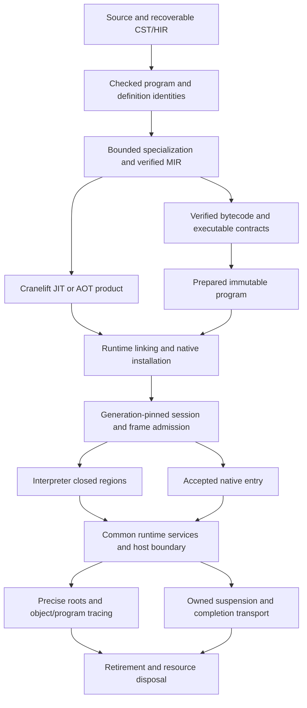

# Repository review

Keep ongoing repository review findings in this document rather than creating
dated review files. Entries record observed behavior and possible follow-ups;
they do not activate implementation work.

This is the single review queue for unresolved findings and scoped follow-ups.
SA identifiers retain the repository review numbering; R identifiers retain the
architecture review numbering. Neither series is renumbered when resolved entries
are removed. Current contracts live in the specifications and architecture; CI
status and activation belong to the [roadmap](implementation-roadmap.md).

- [Runtime architecture review](#runtime-architecture-review): current system map,
  evidence, priorities and bounded recommendations at `88acbdb5`.
- [Repository findings](#sa1-inline-modules-are-parsed-again): unresolved SA entries.
- [Architecture findings](#architecture-findings): retained R findings checked
  against the current implementation; validation limits are recorded below.
- [Interpreter instruction model](#interpreter-instruction-and-operand-model-follow-up):
  general operand/control-flow simplification before specialized loop instructions.
- [Native expansion gates](#native-expansion-gates): requirements for future native
  coverage, not defects caused by the intentionally limited backend.
- Historical timings, allocation data and reproduction details are retained under
  [performance measurements](performance-baseline.md#architecture-review-measurements-2026-10-03).

The consolidation audit inspected code and existing tests at `b71e0cdd`; it did
not rerun behavior tests or performance probes. The remaining SA entries still
have their described representation or missing feature. Test preparation progress
and pending measurements belong to the [existing task](test-preparation-plan.md),
not a separate review finding. Reconfirm affected behavior when activating a task.

## Runtime architecture review

### Baseline and assessment

Reviewed on 2026-10-18 at `88acbdb54e369bde2ca72602cc0f453604dc528d`
(`review/architecture`), including DF01-DF03. The worktree was initially clean.

Publication note: this document was rebased onto `350fa1d6` before opening its PR.
That newer main completes Default/struct updates and the object-overhead task,
including native mutation revisions and direct interface snapshot locations.
Its removal of SA26 and the completed plans is preserved. Findings, source paths
and probe results below describe `88acbdb5`, not a fresh review of those intervening
changes; affected findings require rechecking before implementation. Lasting
storage contracts and measurements now live in [architecture](architecture.md)
and [performance measurements](performance-baseline.md).

This is review and bounded verification, not implementation authorization. Only
this review document is changed; temporary probes are disposable. Findings below
separate **reproduced defects**, **source-confirmed costs/ownership**, and
**unmeasured risks**. P1-P3 indicate remediation priority, not permission to weaken
correctness. Cost classifications are A: architecture, B: local implementation,
C: required semantics, and D: unmeasured performance hypothesis.

**Overall:** the checked compilation/runtime boundary, generation-pinned ownership
and explicit roots fit a statically typed embedded language. The main immediate
problems are incomplete failure-state transitions and memory-pressure accounting,
not evidence that the language needs a different GC family or a new universal IR.
Several costs still scale with historical state or repeat a proof unnecessarily.
Future native expansion needs stronger runtime ABI/root/call contracts, but the
current scalar backend deliberately refuses the unsupported cases.

Highest-value priorities, in order:

1. **R9/R10:** make resource termination and async retirement complete state
   transitions, including host conversion failures and payload destructor panics.
2. **R11:** separate retained allocation pressure from logical heap occupancy;
   make native accounting a runtime-owned committed fact.
3. **R12:** remove full-history scans from root registration and sparse sweeping,
   without weakening stale-handle or cross-thread root-release rules.
4. **R13:** stop using the original executable payload as its version identity;
   then measure identity-domain and type-only retention separately.
5. **R14:** perform one suspension proof per transition, sharing traversal across
   its roots. Do not add a long-lived async-safety cache for mutable graphs.

Preserve the following foundations:

- Recoverable source/HIR is distinct from checked executable contracts. Runtime
  loading does not need syntax, HIR or a live compiler database.
- Verified MIR and bounded MIR/bytecode correspondence; code generation,
  installation and entry are distinct trust/ownership steps. Native code trust
  remains explicit: fingerprints do not prove machine-code semantics.
- Precise owner/slot/generation handles, explicit roots, scoped host borrowing,
  immutable verified code and exact generation-pinned dependencies.
- Transactional frame admission, runtime-owned value windows, closed return
  transfer, and checked mutation commits. Retiring a callee cannot leave a
  collecting gap before its result is rooted in the caller.
- The current closed-region interpreter: reuse authority only while no allocation,
  callback or reentry can invalidate it, poll at logical boundaries, and leave
  storage borrows before cold transitions. Do not replace this with either
  repeated public-API admission per scalar operation or unchecked raw pointers.
- Pre-entry native fallback and common observable semantics. Unsupported native
  features are not permission for mid-execution fallback after effects occur.

### System map and ownership



This is a responsibility map, not a requirement that every deployment serializes
an artifact or uses both backends. Artifact preparation additionally checks any
supplied native-input MIR against the bytecode before installing a product.

| Phase | Work actually owned there | Lifetime and remaining obligations |
| --- | --- | --- |
| Source/checking | Parsing, recoverable HIR, name/type/trait checks, source identities and dependency analysis | Analysis sessions retain their caches; no corresponding CST/HIR owner was found through a loaded runtime descriptor. R7 still repeats lowering rounds; SA1 reparses inline modules. |
| Lowering/verification | Instantiate bounded generic demands, lower checked facts, verify MIR and bytecode, retain executable declarations/layout contracts | Source-free type/witness information is not automatically redundant. Optional preparation MIR may remain with its preparation owner, not automatically the runtime. |
| Preparation | `VerifiedProgram::from_bytecode` builds reusable execution layouts, scalar/managed locations and call placements | Immutable verified bytecode and prepared execution records coexist. These are an intentional execution representation, not source reanalysis. R13 identifies an additional avoidable bytecode graph. |
| Runtime link/install | Remap definition identities, validate installed native declarations, bind layouts/call targets and exact code ownership | Runtime-specific authority and installed host identity cannot be established only by compile-time verification. Cold dependent layouts may be prepared later. |
| Call admission | Check current runtime/generation, type/environment, depth and arguments; reserve/populate frame windows transactionally | Only successful admission publishes a frame. Host callbacks and reentry retain the same pinned session and termination state. |
| Execution | Checked scalar operations, dynamic object identity/access/bounds, field/index kernels, calls and safepoints | Prepared scalar locations avoid repeated type resolution. Identity/bounds checks are semantic costs, not automatically removable work. |
| Suspension/retirement | Retain live frame windows and code leases; detach transient borrows; consume/cancel completion and release windows | Async safety concerns the actual graph, including mutable aliases. R10 and R14 concern this transition, not a missing async model. |

Identity and release boundaries:

- **Definitions and types:** portable identities are imported into scoped
  `DefinitionContext` tables; numeric IDs require their supplying table. Checked
  type arguments can retain their supplying loaded module. Engine/installation
  writers and immutable snapshots have different retention lifetimes (R13).
- **Objects:** `HeapObjectId` identifies heap owner, directory slot and generation.
  `Value` carries typed scalar data or handles, not unrestricted Rust references.
  Directory identity is stable while typed payload records and packed struct bytes
  may relocate. It is inaccurate to describe this as either raw-pointer moving GC
  or wholly immobile storage.
- **Functions/modules/code:** local slots are interpreted within a loaded program;
  `LoadedModule` owns an `Arc<ProgramDescriptor>`. Executable admission also requires
  live runtime/version authority. Keeping old type facts does not resurrect retired
  executable admission. Native products keep owned code and exact program leases.
- **Roots:** frame windows, explicit root leases, module state, closure/callable
  edges, pending async state and task results have distinct owners. A raw low-level
  callback `Value` is not itself an explicit host root; typed/reentry APIs provide
  stronger ownership. Cloning a root lease is not a new root-table registration.
- **Host/native resources:** Rust host state remains outside the script heap and
  behind installed interfaces/scoped borrows. Native payloads expose trace and
  accounting hooks. Completion endpoints transport owned Rust data, not VM borrows.
- **Reload:** active calls and retained callables keep their old dependency graph.
  Collection traverses object and program edges together before reclaiming retired
  records. Releasing registry records, original bytecode Arcs and interning writers
  are three different events; one counter cannot demonstrate all three.

### Representative execution traces

1. **Scalar loop and call.** A checked `i32` loop becomes verified MIR/bytecode;
   preparation assigns scalar locations and reusable callee layout. The VM driver
   admits a cursor, runs closed scalar operations and logical cancellation polls,
   and exits on a prepared call. Runtime admission reserves the callee's window;
   return transfers the value without a collecting gap. Overflow remains a trap,
   not wraparound. Evidence: [driver](../crates/kagari-vm/src/executor/driver.rs),
   [kernel](../crates/kagari-runtime/src/frame/cursor/kernel.rs),
   [callee layouts](../crates/kagari-runtime/src/module/execution/frames.rs),
   [admission](../crates/kagari-runtime/src/frame/admission.rs) and
   [returns](../crates/kagari-runtime/src/frame/returns.rs). The current interpreter
   is not a naive public-register-API loop; historical descriptions of that cost
   must not be reused as current evidence.
2. **Objects and collections.** Construction validates/reserves, initializes,
   publishes and charges; allocation itself does not collect. Concrete field
   operations use prepared sites/layouts and checked heap kernels. Scoped/generic
   preparation leaves the cursor first. Array reads/writes share checked storage
   kernels with native adapters; tuple replacement instead copies the value's
   elements into a new tuple and publishes its root before the next safepoint.
   These are different semantics, not automatically duplicate implementations.
   See [fields](../crates/kagari-runtime/src/frame/cursor/objects.rs),
   [indices](../crates/kagari-runtime/src/frame/cursor/indices.rs) and
   [cold transitions](../crates/kagari-runtime/src/frame/cursor/transitions.rs).
   Strings/sequence buffers also retain capacity that logical units miss (R11).
3. **Generics and interface calls.** Source checking supplies selected declarations
   and witnesses; program lowering discovers further specialization demands (R7).
   Runtime type environments and bound interface methods retain their supplying
   program/receiver, then enter the common frame admission path. Erased receivers
   still need concrete identity/type/access checks. Do not replace this with backend
   name resolution or consider all retained generic contracts dead artifact data.
   Owners: [program lowering](../crates/kagari-compiler/src/source/program.rs),
   [type arguments](../crates/kagari-runtime/src/frame/types/arguments.rs) and
   [executor interface entry](../crates/kagari-vm/src/executor/mod.rs).
4. **Script → host → script.** A linked native binding validates/narrows arguments,
   protects conversion inputs/results and invokes a callback without a live cursor
   storage borrow. Reentry adds a suffix to the same session stack, sharing depth,
   cancellation and pinned environment. Normal nested trap cleanup removes only
   that suffix. Resource exhaustion must instead remain sticky for the whole root;
   conversion currently violates that distinction (R9). Borrow validation and
   completed host effects must survive any optimization of this boundary.
5. **Captured closure and async wait.** A callable retains captures and versioned
   dependencies. A cold Future retains inputs without running its provider; claim
   protects captures before submission. A pending operation owns its reservation,
   while the suspended session retains live frame roots. Completion carries owned
   host data until conversion on the driver. Park validation rejects scoped values
   reachable through aliases, not just immediate arguments. Finished task results
   have another explicit owner. R14 repeats the parking proof; R10 can interrupt
   cancellation before the window-retirement loop.
6. **GC, cancellation and old calls.** Safepoints collect only after publication and
   outside invalid storage/host borrows. The collector snapshots roots, traces the
   object/program graph, validates it before detachment, sweeps/relocates storage,
   then disposes native resources without table borrows. Ordinary trap/cancellation
   cleanup releases frame roots and leases, not business mutations. An old closure
   after reload still calls the old dependencies; only after those roots/leases
   disappear may corresponding executable records be reclaimed. See
   [collection](../crates/kagari-runtime/src/gc/collection.rs),
   [future claim](../crates/kagari-runtime/src/gc/future.rs) and
   [owned retirement](../crates/kagari-runtime/src/session/owned.rs).

### Memory model and collector suitability

On the current 64-bit probe build, `size_of::<Value>()` is **16 bytes**. The retained
RS layout records describe a 12-byte heap identity and 24-byte directory slot;
these latter figures are structural/historical evidence, not new allocator
measurements. A small struct with 8 payload bytes has an approximate occupied
representation of 8 payload + 24 typed-record/back-reference + 24 directory =
**56 bytes**, before store capacity, free lists, shared layout metadata and allocator
rounding. This is not a per-object malloc size or an RSS estimate. Boxed native
payloads, strings and arrays have their own buffers; not every object is a boxed
16-byte-Value vector. Scalar frame banks also differ from managed Value banks.

The collector is precise, per-isolate, stop-the-driver tracing with handle-stable
identity and relocatable internal storage. Full tracing correctly handles managed
cycles; native resources are disposed after detachment, with panic containment on
that GC path. No ordinary premature-reclamation defect was established. This is
not proof of all safepoint/reentry interleavings. Native trace callbacks still have
an embedding contract; opaque external references cannot become GC roots by
accident. No complete inventory of provider-owned external memory was measured.

Current memory risks span different owners:

| Memory category | Observation and limitation |
| --- | --- |
| Payload/header/alignment | RS already reduced directory and object representation; do not revive the obsolete 168-byte directory finding. Small objects still pay directory/back-reference costs. |
| Native buffers/collection capacity | R11 proves scheduling undercounts retained String capacity. Sequence logical length is likewise not allocated bytes. |
| Frame/closure/async state | Typed banks and captures are real retained state; parked stacks keep live windows and code. No fresh maximum-frame or suspension-liveness benchmark was run. R10 concerns skipped retirement, not proof that every parked frame leaks. |
| Temporary peak | Conversion protection, grow-before-commit and prepare-before-remove deliberately retain old and new values together. Removing this peak without an alternative commit protocol would weaken failure semantics. |
| Runtime metadata/code | R13 distinguishes remapped/original code, type provenance, append-only identity tables and exact executable leases. No loaded-runtime CST/HIR/MIR retention was found through its descriptor. |
| Historical capacity | R12 scans root/directory history. Free indices and generation tombstones can outlive most objects; that memory is not live payload. |

Do not introduce generations, incremental tracing, concurrent collection or raw
moving references on this evidence. A nursery could reduce scans if measured
survival patterns justify it, but requires old-to-young publication coverage across
all fields, collections, native traceable payloads, captures and host reentry.
Incremental/concurrent marking adds barriers, mutation invariants and native-hook
constraints to a deliberately single-driver runtime. Existing stable handles make
internal compaction possible without exposing moving addresses; they do not make
untracked native machine registers safe. First measure allocation bytes, survival,
root/directory scan work and pause distribution separately. Keep logical units,
requested bytes, allocator usable bytes and process working set distinct.

### R9 — Resource failure classification does not establish root termination

**P1; reproduced contract defect; A/B.** The failure contract says resource
exhaustion is sticky for the active root, including synchronous host reentry.
[ResourceState::limit](../crates/kagari-runtime/src/resource.rs) records termination,
but [ConversionContext::charge_string/check_elements/enter](../crates/kagari-runtime/src/native/conversion/context.rs)
construct `RuntimeError::resource_limit` directly. That constructor only creates
an error. [Binding::invoke_narrowed](../crates/kagari-runtime/src/native/binding.rs)
polls after callback execution but does not admit the returned resource error into
session state; [report_operation](../crates/kagari-vm/src/executor/driver.rs) likewise
reports a trap without establishing termination.

**Reproduction:** compile a program whose `main` calls a logging host binding,
then emits `after` and returns 42. The first host call reenters `nested`, whose
typed native `fail() -> String` returns a string beyond the conversion limit.
The host records that error, reenters a healthy function returning 7 and returns
success. Both of these bounded cases reproduced the same result:

- `ConversionContext::with_limits(max_string_bytes = 0, other defaults)` encoding
  the one-byte string `x` inside the native callback.
- Ordinary typed output conversion of a string of default max-string-bytes + 1
  (16 MiB + 1); no manually constructed RuntimeError or overridden default limit.

Observed: nested `ResourceLimitExceeded`, trace `nested → main`, session termination
`None`, next poll successful, second reentry returned 7, `after` ran once, and main
returned 42. Final depth/root counts were zero and a fresh root returned 7. A control
that returned a host error instead did stop main before `after`; its explicit
`HostError` wrapping is not a separate runtime classification finding.

**Root cause and impact:** structured error classification and execution-state
admission have separate, incompletely connected owners. This is already a semantic
failure; it is not a GC algorithm defect or a performance benchmark. Native/LLVM
helpers must not inherit the same split.

**Recommendation:** use the existing session owner to admit execution resource
failures consistently at their creation/propagation boundary, retaining the first
termination and origin. Audit conversion and frame-capacity/generation producers
in the same finite change. Do not globally make a detached error constructor mutate
state, make ordinary nested traps sticky, or turn task admission business rejection
into root termination. Standalone conversion with no active root must remain usable.
This is a correction to Kagari's stronger root-termination contract, not Java or
Tokio exception behavior copied verbatim; retain scoped boundary ownership rather
than a VM-only flag (reference mechanisms below).

**Migration/validation:** small-to-medium cross-boundary repair. Extend the existing
host-reentry contract with actual conversion failures, preserved error origin,
forbidden same-root effects, unconditional cleanup and successful fresh-root reuse.
Use the same execution-failure service for native helpers as they expand. Do not
defer this behind LLVM or performance work.

### R10 — Completion cleanup contains hook panics but not payload destruction

**P1; reproduced transport defect, source-confirmed retirement risk; A/B.**
[Operation::cancel](../crates/kagari-runtime/src/native/completion.rs) marks status
Retired, then calls `drop(previous)` **before** taking the reservation and before
its panic guard around the cancellation hook. `previous` includes the queued owned
payload and waker. Successful `poll` also drops the hook's captures outside that
guard. The [completion contract](spec/host-interop.md#completion-transport-foundation)
says cleanup panic faults the registry, prevents new admission and reports EngineFault.

**Minimal reproduction:** reserve one `Operation<Payload>`, install a counting
cancel hook, complete with a payload whose `Drop` panics, and call `cancel()` inside
an outer `catch_unwind`, retaining the operation for inspection. Observed:

```text
panic_escaped=true active=1 registry_ok=true hooks=0
after_operation_drop: active=0 registry_ok=true hooks=1
```

The later Drop retries cancellation and releases capacity; this probe therefore
**does not demonstrate a permanent reservation leak**. It does prove the documented
fault/cleanup boundary was not honored. The existing hook-panic test passes because
it exercises the protected hook invocation, not queued-payload destruction.

**Wider path:** [Runtime::retire_execution](../crates/kagari-runtime/src/session/owned.rs)
removes the session, cancels its pending wait, then explicitly calls
`frame.release_values`. [ExecutionFrame](../crates/kagari-runtime/src/frame.rs) owns
window IDs, not a Drop implementation that releases them. A panic before that loop
can therefore skip root-window retirement. This downstream retention is a
source-confirmed risk, **not an end-to-end retained-heap measurement**.

**Recommendation:** commit terminal ownership once; separately contain payload,
waker and hook destruction, release the reservation and frame windows unconditionally,
then report/quarantine the failure. Catching the entire drain and ignoring the panic
would leave skipped cleanup unresolved. Cover successful-claim hook-capture Drop
as well as explicit cancel. Preserve no-callback-under-lock and at-most-once hook
invocation. Tokio's task harness is a useful destruction-containment reference, but
Kagari additionally owes precise root release and EngineFault/quarantine, not merely
a JoinError or swallowed destructor panic.

**Migration/validation:** medium, bounded to completion/wait/retirement ownership.
Extend existing completion and owned-wait contracts with a panicking queued payload,
a panicking hook capture on successful claim, and a live managed value in a retired
wait. Assert capacity, slot generations, quarantine, frame roots/depth and continued
cleanup of remaining retired executions. A process-aborting panic configuration
cannot promise unwind recovery; no such recovery is claimed here.

### R11 — Logical units are not retained allocation pressure

**P1; reproduced scheduling blind spot; A.**
[String storage](../crates/kagari-runtime/src/gc/storage.rs) charges length;
[sequence payloads](../crates/kagari-runtime/src/native/sequence.rs) charge element
count rather than capacity and physical element width. [Capacity reservation](../crates/kagari-runtime/src/gc/capacity.rs)
uses temporary charges that disappear afterward. Automatic collection in
[GcHeap](../crates/kagari-runtime/src/gc.rs) is driven by logical occupancy/metadata,
not a committed backing-allocation ledger.

**Measured minimal scenario:** move an empty `String::with_capacity(8 * 1024 * 1024)`
into `alloc_string`, retain a root and collect once, drop the root, call
`gc_safepoint`, then collect manually. Compare an empty zero-capacity string in a
separate otherwise identical runtime lifecycle. Net allocator-requested live bytes
relative to runtime setup were:

| Stage | Capacity 0 | Capacity 8 MiB | Heap units / objects / collections |
| --- | ---: | ---: | --- |
| Before moving String into GC | 0 | 8,388,608 | 0 / 0 / 0 |
| After `alloc_string` | 224 | 8,388,832 | 1 / 1 / 0 |
| Manual collection with root | 512 | 8,389,120 | 1 / 1 / 1 |
| Drop root, automatic safepoint | 512 | 8,389,120 | 1 / 1 / 1 |
| Manual collection without root | 416 | 416 | 0 / 0 / 2 |

The buffer pointer was unchanged after transfer and after the automatic safepoint;
capacity was exactly 8,388,608. The default threshold stayed `Some(1024)`. Manual
collection reclaimed one object/unit and invalidated its old Value. Both lifecycles
returned to zero net requested bytes after runtime teardown. This proves retained
buffer pressure is invisible to this trigger, **not a leak or an 8 MiB RSS rise**:
empty reserved pages were not deliberately touched. A byte-aware policy need not
collect immediately merely because a root was dropped; the defect is that the
retained capacity never enters its pressure input. The remaining 416 bytes before
runtime teardown were bookkeeping/capacity, not the freed String buffer.

**Related accounting risk:** [NativePayload::units/NativeObject::units](../crates/kagari-runtime/src/native/storage.rs)
are provider callbacks. [Allocation](../crates/kagari-runtime/src/gc/native.rs),
[sweep](../crates/kagari-runtime/src/gc/collection.rs) and
[take](../crates/kagari-runtime/src/gc/native/take.rs) reevaluate them rather than
releasing an authoritative previously committed charge. A custom interior-mutable
payload can report a different value later; subtraction in ResourceState assumes
it matches admitted occupancy. No built-in drifting payload or underflow was
reproduced. This is an accounting-ownership risk, not evidence that arbitrary
native hooks may violate their contracts without consequences.

**Recommendation:** keep logical occupancy if useful, but add storage-owned checked
retained-byte/allocation-debt accounting. Commit actual growth/shrink deltas together
with storage changes; release recorded charges on detach, not arbitrary fresh size
queries. Define external provider pressure separately where it cannot be inferred.
Schedule collection at existing safe boundaries, not inside reserve, unpublished
allocation or scoped borrowing. Lua's successful-allocation byte deltas and GC debt
are the relevant mechanism; its emergency collection inside allocation cannot be
copied into Kagari. This is scheduling, not reintroducing heap quotas or execution
charging forbidden by the current policy.

**Migration/validation:** medium, spanning storage growth and collection policy.
First cover String and existing sequence storage, failure/rollback and manual versus
automatic collection; then make the native charge contract explicit. Measure retained
bytes, allocation rate, collection count/pause and peak separately on the existing
[storage measurements](performance-baseline.md) and [collection](native-collections-plan.md)
workloads. Do not use a benchmark with automatic GC disabled to accept this policy.

### R12 — Root insertion and sparse sweep scale with historical tables

**P1 for scaling, source-confirmed algorithms; A/B, elapsed cost unmeasured.**
[RootTable::insert](../crates/kagari-runtime/src/gc/roots.rs) invokes `prune`, which
scans every historical root slot. Registering N distinct simultaneously retained
roots from empty storage therefore examines approximately N(N−1)/2 slots before
snapshot/collection work. Reusing one old slot after a large peak still scans that
peak-sized table. Root-lease clones do not execute this insertion path.

Separately, [collect_inner](../crates/kagari-runtime/src/gc/collection.rs) enumerates
all directory slots to find dead occupied entries. [Directory](../crates/kagari-runtime/src/gc/directory.rs)
generation tombstones are retained to reject stale handles. A burst of objects
followed by a nearly empty steady state still pays that historical scan. At the
recorded 64-bit layout, one million slots plus one million free indices is about
24 MB + 8 MB before spare capacity; this is an estimate, not a measured RSS figure.

**Root cause:** stable identity history also acts as the iteration/discovery index.
The history is necessary for safety; visiting every historical row on each insertion
or sweep is not. These costs affect host rooting, allocation-heavy workloads and
future native root publication; they are not proof that every script is slow.

**Recommendation:** let last-root release notify the owning root table, so the owner
can drain released IDs and reuse slots without a global scan on every insert. Retain
cross-thread lease-drop safety, owner identity, generation exhaustion and snapshot
upgrade rules. For sweep, evaluate enumerating occupied typed stores through their
existing directory back-references; do not reset generations or add a second live
index without evidence. OpenJDK OopStorage demonstrates occupied-bit iteration and
release-driven bookkeeping. Its release clears bits immediately and defers selected
block-list updates; it is not literally a Kagari root-ID queue and its concurrent
raw-pointer machinery should not be imported wholesale.

**Migration/validation:** medium, two bounded storage-owner changes rather than a
collector rewrite. Reuse stale-handle, root-clone and sparse-relocation contracts.
Measure insertion work and sparse/full collection separately at fixed live count
and increasing historical peaks; include cross-thread final lease release. Keep
root snapshot safety and full mark validation. Only choose retained-capacity shrink
policy after measuring churn and reuse; raw slot truncation can create ABA bugs.

### R13 — Code identity and identity domains retain more than executable liveness

**P2 overall, P1 memory candidate; source-confirmed retention, magnitude unmeasured; A.**
Three related ownership boundaries need distinct decisions, not one global cache
flush:

1. **Exact version identity retains original executable payload.**
   [VerifiedProgram](../crates/kagari-runtime/src/module.rs) stores both `modules`
   and `version` as module-graph Arcs. Initially they share the same graph. On
   cross-context normalization with definition references,
   [normalized](../crates/kagari-runtime/src/module/normalization.rs) builds remapped
   modules while preserving the original graph and original definition snapshot.
   `same_version` needs root equality and Arc identity, not the original instructions.
   Thus `LoadedModule → ProgramDescriptor → VerifiedProgram` can retain both graphs
   after the preparation owner is dropped. Same-context and no-reference paths do
   not create this duplication; several runtimes can share the original graph.
   This does not imply all program memory doubles.
2. **Engine/installation identity writer outlives individual users.**
   [DefinitionContext](../crates/kagari-common/src/identity/map.rs) shares an
   append-only `Arc<Mutex<DefinitionTableBuilder>>`.
   [Engine sessions](../crates/kagari/src/engine/mod.rs) clone their analysis owner;
   [NativeInstallation](../crates/kagari-runtime/src/native/installation.rs) clones
   registry state into runtimes. Loading imports identities into that shared writer.
   Keep an installation alive, create/drop runtimes with distinct new nominal names,
   and their identities remain with that installation. Repeating existing identities
   need not grow the table; independent installations need not share it. No unbounded
   production process-global definition map was found. Immutable snapshots and
   `Arc::make_mut` also create potential copy/peak cost while the writer grows.
3. **Type-only provenance can retain an entire program.** `StructLayoutRef` in
   [module.rs](../crates/kagari-runtime/src/module.rs) retains a LoadedModule;
   [TypeArgument](../crates/kagari-runtime/src/frame/types/arguments.rs) scope and
   [associated bindings](../crates/kagari-runtime/src/frame/types/bindings.rs) likewise
   retain supplying ownership. Retiring executable records in
   [module collection](../crates/kagari-runtime/src/module/collection.rs) does not
   release bytecode held by an external descriptor Arc. Old-layout admission tests
   establish revoked execution, not necessarily freed immutable instructions.

**Recommendation and bounded sequence:** first replace payload-backed exact-version
identity with an immutable shared token and only the provenance required by its
consumers. Delete the superseded original graph/snapshot retention, not exact-version
checks or normalization. Then measure distinct-name churn and define the intended
identity-domain lifetime. Consider immutable provider baseline plus runtime/session
writers with correct remapping; never fork mutable builders under the same table ID.
Only if old type-only holders materially retain code should type/layout provenance
be separated from executable payload. Keep actual callables/native products pinned
to the old executable dependencies. Hash equality must not become exact identity.

Rust's context-owned interning and JLS loader-scoped unloading illustrate why the
identity owner determines retention. Neither dictates Kagari's domain size: Rust's
borrowed compiler arena cannot own values across Kagari reloads, and Java loader
reachability is not Kagari executable admission. The version token is a small custom
fit to Kagari's immutable Arc identity, not a new global registry.

**Impact/validation:** source-free memory, multi-runtime embedding and reload/JIT code
lifetime; no executable resurrection or dangling-reference defect demonstrated.
Token replacement is small-to-medium; identity/type-owner separation is higher risk
and conditional. Compare equal bytes from distinct preparations, clones, cross-context
loads, actual native installation and pinned old callbacks. Use Weak-owner probes
and requested-byte accounting separately from executable registry counters. Reuse
[test preparation](test-preparation-plan.md) and OM ownership work; do not add a
parallel migration or silently broaden the current Default plan.

### R14 — Parking repeats a whole reachable-graph safety proof

**P2; source-confirmed redundant work, no timing claim; A/B.** At slice exhaustion,
[driver::run_inner](../crates/kagari-vm/src/executor/driver.rs) calls `can_park`.
[Executor::run_slice](../crates/kagari-vm/src/executor/mod.rs) then calls `park`,
which calls [can_park](../crates/kagari-runtime/src/frame/owned.rs) again without an
intervening script/host action. Each call loops frames; each frame invokes
[validate_async_values](../crates/kagari-runtime/src/gc/future.rs) with a new tracing
visited set. If D frames alias one G-object graph, a successful slice can repeat
roughly 2×D×G graph work, excluding the ordinary execution between slices.

**Root cause:** query and commit split a transition-owned proof, and per-frame graph
validation loses shared traversal knowledge. Safety itself is necessary: mutable
aliases and erased receivers can hide a scoped resource inside an otherwise ordinary
container. Merely checking static types or caching an object's previous safety result
would be wrong.

**Recommendation:** combine the successful proof and park commit under the runtime
transition owner; share a visited set across all retained roots for that transition.
If a query must remain, use only a tightly scoped proof whose validity ends before
any mutation/reentry; do not add a persistent async-safe cache. Existing tracing
machinery already supplies graph validation, so this does not justify a new GC
framework. Tokio's state-transition-before-notification discipline is analogous,
but it has no Kagari mutable-graph/host-borrow proof to reuse directly.

**Migration/validation:** small-to-medium. Consolidate the duplicate query/commit
call path, preserve trace-hook guards and validate non-suspendable values reached
through aliases, resumed mutation and host scopes. Count visits for shared versus
disjoint graphs at fixed depth; measure park/drive time independently of execution
and post-retirement collection. This does **not** explain the unresolved IP12
collection timing by itself. Existing IP08-IP12 remains the performance owner.

### Existing compiler and native findings, reconciled

**R7 remains:** `lower_program_to_mir` reconstructs/lower-verifies the authoring
modules in fixed-point demand rounds. For M modules and R rounds this is M×R module
visits, not a universal quadratic-runtime claim. Measure a bounded generic
chain/fan-out, then use a program-owned instance worklist/retained planners with
shared budgets and deterministic finalization. Remove the whole-closure rebuild
loop instead of caching its redundant products. Rust's mono collector is a useful
reference for roots, visited instances and vtable edges, not authority to drop
Kagari diagnostics or source-free witnesses. R8 remains conservative invalidation,
not evidence of incorrect reuse.

**Artifact reachability:** [add_implicit](../crates/kagari-hir/src/imports/resolve.rs)
adds registered native APIs to nonnative dependency sets;
[checked closure](../crates/kagari-hir/src/program.rs) and lowering can carry their
contracts into an artifact, and [native linking](../crates/kagari-runtime/src/native/registry.rs)
validates carried declarations. Availability versus actual executable dependency is
therefore a concrete boundary to investigate. No fresh end-to-end missing-unused-
provider probe or artifact-size measurement was run. Separate full source/coherence
checking from emission only after defining roots for exports, function values,
witness/default implementations, reflection, layouts and reload. Do not suppress
unused-source errors or relax loading validation to make artifacts smaller.

**Native/LLVM classification:**

| Class | Current assessment / required work |
| --- | --- |
| Already affects execution | R9-R14 affect runtime boundaries independent of LLVM. No miscompile of the currently accepted Cranelift scalar subset was established. Its exact-trap test timed out in this review, so this is not a fresh all-green native validation. |
| Before general managed native/LLVM execution | Runtime-owned call admission, argument/result/root ownership, bounded machine-stack behavior or a driver continuation protocol; registered native root frames before collecting helpers; program-scoped call proofs and pinned target dependencies. An LLVM implementation of only the existing scalar subset does not first need all managed-value machinery. |
| Before aggressive optimization | Conservative transitive call/memory/GC facts or explicit barriers, exact overflow/trap lowering, shared-alias semantics, origin/PC mapping and dependency/code leases. False individual effect bits are not absence proofs. |
| Preserve an extension point | Physical PC/location maps if justified instead of registered root frames; code-unit dependency ownership for future direct calls/inlining; logical debug origins and observer fallback. |
| Not justified now | OSR/deoptimization, tiering controller, universal new SSA IR, speculative cross-generation inlining or concurrent/generational collector solely to enable LLVM. |

[Native logical maps](../crates/kagari-contract/src/native.rs) name Register/Local
slots; [jit_poll_execution](../crates/kagari-runtime/src/jit_abi.rs) records a logical
point and performs ordinary registered-root collection. Neither publishes a live
machine-register reference. [Cranelift check_subset](../crates/kagari-codegen-cranelift/src/emit.rs)
rejects heap-bearing slots and emits empty maps for its accepted scalar functions,
so this is an expansion gate rather than a demonstrated current missed root.
Start with the existing plan's registered-root-frame approach, protecting freshly
allocated/returned references across helpers and reentry; physical stack scanning
can wait. A zero-argument scalar entry is also not a general call-stack ownership
protocol: adding arguments alone does not solve native recursion or suspended
caller roots.

For LLVM, `add nsw` produces poison on overflow, not Kagari's checked trap; use
checked intrinsics plus explicit error control flow or equivalent proven lowering.
Readonly views permit mutation through other aliases and do not justify `noalias`
or whole-call no-write claims. Exact program leases must also cover direct-call
and inline dependencies; replacing names with latest-generation lookup changes
semantics. Keep JIT/AOT on common contracts and preserve the current distinction
between logical debug origins, physical machine locations and code allocation
lifetime. See the retained [native gates](#native-expansion-gates), not a new plan.

### Primary implementation references

Consulted on **2026-10-18**, pinned to the tags/spec versions below (not claimed to
be resolved commit SHAs). These are mechanisms and applicability boundaries, not
performance evidence for Kagari:

- **Tokio 1.48.0:** [task harness](https://github.com/tokio-rs/tokio/blob/tokio-1.48.0/tokio/src/runtime/task/harness.rs),
  `cancel_task`, task completion and `drop_future_or_output`: contain user future/
  output destruction and establish task state before notification. Relevant to R10
  and transition ownership in R14. Its threaded scheduler/JoinError policy does not
  replace Kagari's isolate, roots, host leases or EngineFault contract.
- **OpenJDK 25 GA:** [OopStorage](https://github.com/openjdk/jdk/blob/jdk-25-ga/src/hotspot/share/gc/shared/oopStorage.hpp),
  [iteration](https://github.com/openjdk/jdk/blob/jdk-25-ga/src/hotspot/share/gc/shared/oopStorage.inline.hpp),
  [allocation/release](https://github.com/openjdk/jdk/blob/jdk-25-ga/src/hotspot/share/gc/shared/oopStorage.cpp).
  Occupied bitmaps, allocation lists and deferred block-list maintenance avoid
  rediscovering all free slots per allocation. Relevant to R12, not a ready-made
  cross-thread Arc-lease queue or stable-generation handle scheme.
- **Lua 5.4.8:** [lmem.c](https://github.com/lua/lua/blob/v5.4.8/lmem.c) and
  [lgc.h](https://github.com/lua/lua/blob/v5.4.8/lgc.h). Successful malloc/realloc/free
  adjust byte debt, and conditional GC consumes scheduling debt. Relevant to R11;
  debt is not live bytes or RSS. Its emergency allocation-time GC and barriers assume
  Lua's own publication/root model, not Kagari's scoped Rust borrows.
- **Rust 1.90.0:** [mono collector](https://github.com/rust-lang/rust/blob/1.90.0/compiler/rustc_monomorphize/src/collector.rs)
  uses roots, visited instances and MIR uses including vtable requirements;
  used versus mentioned items preserve diagnostic obligations. Relevant to R7 and
  artifact roots; Rust drop glue/linkage rules are not Kagari's roots policy.
  [Type context](https://github.com/rust-lang/rust/blob/1.90.0/compiler/rustc_middle/src/ty/context.rs)
  ties interners to a compiler-context arena. Relevant to R13 lifetime ownership,
  not permission to borrow across Kagari compilation/reload boundaries.
- **Java SE 25:** [JLS 12.7](https://docs.oracle.com/javase/specs/jls/se25/html/jls-12.html#jls-12.7)
  permits unloading only when the defining loader can be reclaimed. Relevant to
  explicit identity-domain lifetime in R13, not a guarantee of immediate unloading
  or a requirement to use Java loader granularity.
- **LLVM 22.1.0:** [LangRef](https://github.com/llvm/llvm-project/blob/llvmorg-22.1.0/llvm/docs/LangRef.rst)
  defines poison, overflow intrinsics and alias/memory attributes;
  [Statepoints](https://github.com/llvm/llvm-project/blob/llvmorg-22.1.0/llvm/docs/Statepoints.rst)
  distinguishes liveness from relocation and physical stack-map locations. Even
  nonmoving GC needs visible live references; registered shadow roots remain an
  alternative. [OpenJDK 25 OopMap](https://github.com/openjdk/jdk/blob/jdk-25-ga/src/hotspot/share/compiler/oopMap.hpp)
  associates machine PCs and VMReg/frame locations, unlike Kagari's logical slots.
  These mechanisms inform native gates, not a demand for immediate physical scanning.

### Finite remediation order and removals

These are recommendations for the existing roadmap/review owners, not newly
activated phases or an implementation ledger.

| Order | Scope / owner | Delete or consolidate when replacing | Acceptance boundary |
| --- | --- | --- | --- |
| Must fix | R9 session failure admission; R10 completion/owned retirement | Direct non-sticky execution-limit paths; hook-only cleanup containment and interruptible retirement sequencing | Existing reentry/completion contracts plus the distinct uncovered failures; no forbidden later effects, lost roots or weakened origin/cleanup |
| Near-term high value | R11 storage accounting; R12 root/directory iteration, coordinated with OM/NC | Callback-recomputed release charges; full-table prune on every root insert; directory-history sweep where occupied stores suffice | Checked transactional deltas, stale generations, cross-thread lease drop, sparse relocation; capacity/scan measurements |
| Near-term bounded simplification | R13 exact-version token; R14 one-shot parking, coordinated with IP08-IP12 | Payload-backed version identity and unnecessary original snapshot; duplicate successful park proof and per-frame repeated visits | Cross-context exact identity, pinned dependencies, mutable-graph suspension rejection and cleanup |
| Measure before expanding | R13 identity-domain/type-only split, R7 worklist, artifact pruning | If justified: shared mutable identity writer across independent lifetimes, whole-module demand rounds; not a cache layered over them | Distinct/reused-name churn, actual bytecode release, compiler scaling, explicit executable roots and unchanged source diagnostics |
| Existing future gates | Native expansion plan, then appropriate LLVM coverage | Replace scalar-only ABI/consumers coherently as general calls land; no compatibility forwarding ABI or backend-owned duplicate semantics | Assert actual native entry, source-free execution, roots across helpers/reentry, numeric/trap order and old-version calls |
| Defer | GC family replacement, OSR/deopt, extra universal IR, speculative interface/layout grouping | No new speculative mechanisms | Activate only on measured survival/pause data or concrete backend/optimization requirements |

Do not revive the rejected IP11 map/Vec candidates, attribute IP12 timing to R14
without measurement, or bypass owner/generation/bounds checks under the label of
optimization. Prepared field/call facts and closed regions are sound foundations;
keep their lifetime/admission contracts while removing identified repeated work.
Structural `common`/contract responsibility cleanup and SA authoring issues remain
owned by their existing entries; moving code between crates alone is not a runtime
fix. No blanket public-API compatibility layer is recommended for this unpublished
project.

### Documentation differences and verification limits

Implementation, not old prose, determines this baseline:

- [Project goals](project_goal.md) still describe async as queued; host-driven async,
  cold Future/Task ownership and explicit suspension are already implemented and
  specified. General async trait methods and native async suspension remain limited;
  those limits do not make all async unimplemented.
- At the reviewed baseline, ordinary Default and contextual calls were implemented
  through DF03 while struct updates/integration remained pending. Main subsequently
  completed that work and removed SA26 and its execution plan; publication preserves
  those removals rather than reopening the completed task.
- Older native-gate text is now rechecked, not evidence that logical stack maps
  already support managed machine registers. RS measurements are historical; the
  older object directory layout and resolved duplication must not be resurrected.

**Actual checks and probes:**

Environment: Windows 11 Pro `10.0.26300`, x86_64-pc-windows-msvc, Intel Core
i9-12900K (16 cores / 24 logical processors), 68,447,940,608 bytes reported physical
memory; rustc `1.99.0 (b940084d7 2026-09-28)`, Cargo 1.99.0. Cargo used the workspace
`dev`/`test` profiles (dev opt-level 1), default `target`, default parallelism and
existing mixed/warm build cache. Builds contended for the target lock. Their wall
time is **not** a compilation or execution benchmark. Probes used the freshly built
matching rlibs with `rustc --edition=2024 -C opt-level=1 -C debuginfo=2 -L
dependency=target/debug/deps`; temporary files were under `target/architecture-review/`.

- `cargo test --locked -p kagari-runtime --lib -- gc::tests::sparse_collection_preserves_aliases_and_mutation_across_payload_relocation --exact`:
  **1 passed**, 307 filtered out. Selected to protect handle/alias semantics during
  current internal relocation, not to sweep all GC contracts.
- `cargo test -p kagari-vm --lib host_reentry_cannot_swallow_root_termination_and_releases_borrows`:
  **1 passed**, 321 filtered out. This covers existing cancellation/depth termination;
  it does not cover the conversion-origin failure demonstrated by R9.
- `cargo test --locked -p kagari-runtime --lib async_native_completion_contract_cleanup_fault_and_generation_exhaustion`:
  **1 passed**, 307 filtered out. This establishes the protected cancellation-hook
  baseline; R10's payload destructor is a distinct missing boundary.
- `cargo test --locked -p kagari-codegen-cranelift --lib tests::checked_i32_traps_keep_the_exact_mir_point -- --exact`:
  compilation completed and **1 test started**, but the command hit its **180-second
  timeout** with no final result. **Not passed, not a confirmed assertion failure.**
  It directly installs/calls native code rather than accepting fallback. No longer
  rerun was attempted; exact native trap validation remains unresolved for this review.
- R9 public-API probe: source → checked HIR → MIR → bytecode → runtime, standard
  native installation and host reentry; both small configured and ordinary default
  output conversion limits reproduced the defect. Compiler `source`/default enabled,
  VM and stdlib default feature sets, runtime default, no JIT. A bounded library build
  for these dependencies completed; no workspace test sweep was run.
- R10 public-API probe: reserve/complete/cancel one operation with a panicking payload,
  inspect before/after consumer Drop. All assertions of the **observed defect** passed.
  Runtime default features; no end-to-end owned-execution leak probe.
- R11 public-API probe: two separate capacity-0/capacity-8-MiB runtime lifecycles;
  diagnostic allocator counts successful allocation requests minus matching frees.
  All capacity, pointer, counters, stale-value and teardown assertions passed.
  Runtime default features; one process, no async load or throughput timing. These
  are requested-byte observations, not allocator usable size, page residency or RSS.
- Primary-source links above were accessed at their pinned versions. Documentation
  receives local link and whitespace checks; no production edits, commits or pushes.

For reproduction without the disposable files, R9's required fixture is the
four-step call chain and two payload sizes specified in its finding; use the existing
native-boundary registration/compilation helpers. R10 needs only public
`CompletionRegistry::new(NonZeroUsize::new(1).unwrap())`, `reserve`, `on_cancel`,
`completion().complete`, and
`catch_unwind` around `cancel` while retaining the consumer. R11 needs public
`Runtime::default`, `gc().alloc_string`, `root_value`, manual collection and
`gc_safepoint` in the table's order. Instrument allocation requests independently
of logical heap counters. The report records the actual results and restrictions;
it does not depend on retaining ignored logs or probe binaries.

**Not performed:** full-workspace tests, the feature/backend/platform matrix,
workspace Clippy for this documentation-only change, throughput/pause distributions,
physical RSS measurements, production-load survival profiling, new root-scaling
benchmarks, native heap-root execution, exhaustive race/panic injection, version
retention Weak probes or LLVM implementation validation. Source inspection can
establish retention edges and repeated traversals, but not their share of total
latency or a promised speedup. Existing tests remain evidence only for their actual
contracts, not every adjacent path. CI and future focused remediation validation
remain separate from this review's local results.

## SA1 Inline modules are parsed again

[prepare_declarations](../crates/kagari-hir/src/analysis/declaration_queries.rs)
copies the enclosing source, masks bytes outside each inline module body and
parses that virtual file again. The parent AST already contains the module body;
[lower_module_decl](../crates/kagari-hir/src/lower/item.rs) only records its header.
This repeats lexing/parsing and allocates a full source buffer per child.

Consider lowering existing `ModuleBlock::items()` with an independent child
context. Preserve module ownership, visibility, stable child identities, original
UTF-8/CRLF offsets and diagnostic attribution. Reuse the existing inline-module
navigation tests. Keep declaration, signature and body checking separate.

## SA9 Module paths are copied into internal graph keys and references

[ModuleIdentity](../crates/kagari-common/src/identity.rs) is a portable package/path
value containing owned strings. It is also embedded in `SourceUnit`, binding owners,
namespace keys and dependency sets. Cloning these identities copies strings; hashing
and ordering examine path content. NR04 removed whole-catalog rounds, but retained
portable keys in namespace watchers and derivation sets. This establishes remaining
representation overhead, not a measured bottleneck.

Separate portable module identity from a compact, context-owned module handle.
Intern each identity once; use handles for catalog keys, owners and dependencies,
and borrow the portable identity for diagnostics, registration and artifact boundaries.
The existing [definition table](../crates/kagari-common/src/identity/table.rs) already
interns module roots and shares their paths; investigate extending/reusing that
owner before introducing a second interner. Do not reuse HIR `ModuleId`: it addresses
a local module declaration, not a module in the analysis universe.

The design must define handle ownership and retained-snapshot validity, remap across
independent contexts, retain source revision/arena checks, and preserve deterministic
artifact ordering independently of allocation order. Parent/package/visibility checks
need table queries in place of editing copied path vectors. `Arc<ModuleIdentity>`
alone reduces clone costs but still compares/hashes content with ordinary traits.

Rust reference:

- The resolver's [`Module<'ra>`](https://doc.rust-lang.org/stable/nightly-rustc/rustc_resolve/struct.Module.html)
  wraps `Interned<'ra, ModuleData<'ra>>`: a `Copy` handle with identity-based
  equality, while module data is stored separately. It does not copy a full
  string path into every module reference.
- Definitions, including modules, use [`DefId`](https://doc.rust-lang.org/stable/nightly-rustc/rustc_hir/def_id/struct.DefId.html),
  a `Copy` pair of `CrateNum` and `DefIndex`, for compiler queries.
- Session-local numeric IDs can change after source edits. The
  [incremental cache](https://rustc-dev-guide.rust-lang.org/queries/incremental-compilation-in-detail.html)
  stores `DefPathHash` and remaps it to the current session's `DefId` when loading.

Apply the same separation in Kagari: portable `ModuleIdentity` at boundaries,
shared identity data in the context, compact handles inside the graph. This does
not require introducing Rust's crate model or adopting its arena lifetimes.

Keep this follow-up separate from completed identity and namespace work. Measure
graph build allocations and time before/after on the same module workload,
separating compilation time; reuse identity/snapshot and import tests for focused validation. Code migration is
not activated by this review.

## SA11 HIR declarations and ADT members carry container-derived identities

[Struct](../crates/kagari-hir/src/hir/item/adt.rs) stores its own `StructId`,
although that ID also identifies its position in `Module.structs`. Consumers such
as [signature checking](../crates/kagari-hir/src/typeck/check.rs) iterate over
`&Struct` and use `structure.id` to query semantic declarations and constraints.
[Item lowering](../crates/kagari-hir/src/lower/item.rs) also uses the stored ID to
publish `Item::Struct` before appending the declaration row. These are concrete
convenience uses, not evidence that the identity must live inside the payload.

All five ADT records store a self ID, but their reconstruction contexts differ:

| Record | Stored identity | Container-derived context |
| --- | --- | --- |
| `OpaqueType` | `OpaqueTypeId` | Index in `Module.opaque_types`. |
| `Struct` | `StructId` | Index in `Module.structs`. |
| `Enum` | `EnumId` | Index in `Module.enums`. |
| `Field` | `FieldId` | Arena, enclosing `StructId` and field slot. |
| `Variant` | `VariantId` | Arena, enclosing `EnumId` and variant slot. |

The first three duplicate their declaration-vector index. Fields and variants
are nested records: a slot alone cannot identify a member across owners. Their
IDs could also be reconstructed by a container, but only with the full arena,
owner and slot context. Review these two categories separately, including their
source-map and semantic-table consumers; this observation does not establish
that any of the five fields should be removed.

[Function](../crates/kagari-hir/src/hir/item/function.rs) has the same
container-derived self identity as the top-level ADT declarations above:
`module.functions[index].id.index() == index`. The
[source map](../crates/kagari-hir/src/source_map.rs) allocates `FunctionId` from
its function-span vector, and current item/method lowering appends function
records in the corresponding order. This applies to free functions and the
trait/impl methods stored in the same collection.

The field has active consumers: lowering publishes `Item::Function` and links
trait/impl method records; signature checking uses `function.id` to index typed
functions and source locations. It is a redundant identity with convenience
uses; removing it requires updating those consumers.
Review retaining the field versus supplying `(FunctionId, &Function)` from the
container and passing the identity explicitly to consumers. `FunctionId` itself
must remain available for method links, name resolution, source maps and
`BodyOwner::Function`; only its duplication inside `Function` is under review.
Any change must preserve allocation/storage order and snapshot identity mapping.
Future local function support (SA14) must also preserve that relationship if
parent and child declarations are allocated and appended at different times.

Expression storage uses a different interface:
[Body::expressions](../crates/kagari-hir/src/hir/body.rs) yields `(ExprId,
&ExprData)`, reconstructing each ID from the container's arena, the row's owner
and its index. `ExprData` contains no self ID. Both declarations and expressions
have identities; the difference is where that identity is supplied to consumers.

For structs, the duplicated invariant is
`module.structs[index].id.index() == index`, with matching source-map slots.
Reordering rows or changing the stored ID independently can break those links.
No current invariant violation or measured performance bottleneck was established
by this review. `StructId` is lowering-local and carries only an index; retaining
the field does not make it stable across modules, revisions or snapshots.

Follow-up owner: HIR declaration storage and its consumers. Compare retaining
self IDs with container-owned iteration returning `(ID, &record)` for the five
ADT records and `Function` above; review other declarations only where the same
issue applies.
The identity interface and any field removals remain undecided.
Preserve item order, source-map alignment, member ownership, semantic declaration
mapping and snapshot/reuse remapping. Do not conflate inline binding/member IDs
with redundant self IDs, or widen visibility/add forwarding APIs to hide the
ownership question. Reuse existing declaration, navigation and snapshot contracts
if implementation is activated; measure any claimed memory or speed benefit.
This entry records a design review only and does not activate a migration.

## SA14 Function bodies cannot declare named local functions

Named functions cannot currently be declared inside another function's body.
For example, the following requested source form is rejected:

```kagari
fn outer() -> i32 {
    fn inner(x: i32) -> i32 { x + 1 }
    inner(41)
}
```

[Block parsing](../crates/kagari-syntax/src/parser/grammar/stmt.rs) accepts
bindings, control flow and expressions, but has no function-declaration branch.
[HIR statements](../crates/kagari-hir/src/hir/stmt.rs) and
[statement lowering](../crates/kagari-hir/src/lower/stmt.rs) likewise have no
local function declaration form. Both the current
[syntax specification](spec/syntax.md#blocks-and-statements) and
[EBNF](kagari.ebnf) exclude function declarations from block statements, so this
is a missing language capability rather than an implementation violation of the
current grammar.

A closure binding such as `val inner = |x: i32| x + 1;` is supported, including
lexical captures, but does not provide the requested named declaration form.
The user requests that named local function support be added in later work.

Follow-up owner: language syntax, HIR declaration ownership and lexical name
resolution. Define block visibility, forward references, recursion, shadowing
and access to enclosing locals/generic parameters before implementation; capture
behavior must be specified explicitly rather than inferred from closures.
Extend the grammar, AST, HIR/lowering and declaration/resolution model together,
then carry checked local callable identities through typing, executable lowering
and tooling. Local declarations must not leak into module exports. Review whether
`FunctionKind` and function ownership need changes instead of automatically treating
local declarations as module-level `User` functions.

When activated, validate the example through execution and add focused coverage
for the chosen scope, recursion and capture rules, including diagnostics and
navigation. Preserve existing module functions, methods and closure contracts.
This entry records the requested future feature only; semantic choices and
implementation remain deferred, with no change to the currently accepted grammar.

## SA15 HIR import paths should retain segments instead of joined text

The requested follow-up direction is to replace
[`Import.path: String`](../crates/kagari-hir/src/hir/item/module.rs) with owned
`segments: Vec<String>`. The [SA15 execution plan](structured-import-path-plan.md)
owns the finite SA15-01 through SA15-03 sequence, decisions and acceptance.
The user activated phased implementation with one commit per phase on 2026-10-19;
SA15-01 established the baseline, and representation replacement is next. For example:

```kagari
use pkg::math::sum as add;
```

```text
Current: Import { path: "pkg::math::sum", kind: Named { alias: Some("add") }, ... }
Proposed: Import { segments: ["pkg", "math", "sum"],
                   kind: Named { alias: Some("add") }, ... }
```

[Item lowering](../crates/kagari-hir/src/lower/item.rs) currently joins syntax
segments and stores each accumulated prefix with its physical source site in
[SourceMap](../crates/kagari-hir/src/source_map.rs). Import analysis copies the
joined path into `ImportDirective`.
[Resolution orchestration](../crates/kagari-hir/src/imports/resolve.rs) passes it to
the [namespace catalog](../crates/kagari-hir/src/imports/catalog.rs), whose
`package_path` normalizes `self`, `super` and `crate`; catalog traversal and
syntactic dependency-prefix matching also consume components. Prefix navigation
resolves `pkg`, `pkg::math` and `pkg::math::sum` separately. Diagnostics and host
lookup interfaces also consume complete path text. `ModuleIdentity.path` already
uses `Vec<String>`; it is a resolved module identity, distinct from written import
syntax.

Follow-up owner: HIR import syntax/lowering and import analysis. Carry segments
through the affected `ImportDirective`, normalization, catalog traversal and
prefix-dependency consumers, with text rendering at diagnostics or existing
text-based host interfaces. Update `local_name()` to use the terminal segment
when no alias is written. Adapt source-map prefix sites and navigation together,
retaining their source-map ownership and exact physical spans. Avoid introducing
a second complete-path field merely to preserve the former internal API.
Preserve flattened grouped imports, aliases, glob paths excluding the final `*`,
relative-path behavior, namespace-specific resolution, visibility checks,
canonical targets, dependencies and retained-snapshot validity. An omitted alias
and a glob must keep their existing local-name behavior.

Rust's HIR provides a reference for structured paths:
[`Path`](https://doc.rust-lang.org/nightly/nightly-rustc/rustc_hir/hir/struct.Path.html)
stores a slice of path segments, a span and resolution information; each
[`PathSegment`](https://doc.rust-lang.org/nightly/nightly-rustc/rustc_hir/hir/struct.PathSegment.html)
retains its identifier and other segment facts. Kagari should keep resolution
facts under its existing analysis owners rather than copying Rust's entire model.
Owned `Vec<String>` needs no lifetime parameter. Rust's `'hir` describes borrowed
HIR storage; its interned `Symbol` is an index without a lifetime parameter.
Symbol interning is a separate decision and is not part of this follow-up.
The portable module-identity handle review in SA9 remains separate.

When activated, reuse existing import, relative-path, grouped/alias/glob,
visibility, dependency and navigation contracts for focused validation. Review
all affected callers together and update source-to-field documentation. The
motivation is to retain structure used by current consumers and reduce conversion
steps; no correctness failure or measured performance bottleneck was established.
Measure allocations/time before claiming a memory or speed improvement. This
entry records the future representation change only. The linked plan owns progress;
the phased implementation and commits are authorized, not SA9 or SA1 expansion.


## SA21 Unify Rust registration through NativeModule with scoped host access

Registration, runtime-owned Opaque and scoped Ref/RefMut are implemented.
Common NativeModule declarations, one bind entrypoint and atomic installation
replace the former host aggregate, standalone format and parallel registration.
Existing live-host consumers retain their checked root/path behavior. The completed
HR/RF/RI plans are retired; Git history retains their phase ledgers.

The [host interop specification](spec/host-interop.md) owns the storage/passing
matrix, scoped loans, generated inline field paths and explicit method/trait
registration. The [embedding guide](spec/embedding-api.md#typed-native-registration)
owns DTO/Serde conversion and runnable consumers. Rust traits and Kagari traits
remain independent. Borrowed returns, general view trait forwarding, async
retention and wider native reference execution remain outside this implementation;
[the roadmap](implementation-roadmap.md#host-registration-and-interop-delivery)
records those limits and pending exhaustive CI.

### Call-boundary cost follow-up

Static review confirms the following remaining preparation costs. These are
code-derived costs, not benchmark results or speedup claims:

- [RootTable::insert](../crates/kagari-runtime/src/gc/roots.rs) calls `prune` over
  every slot before each insertion, including when reusable slots already exist.
  [Vec conversion](../crates/kagari-runtime/src/native/conversion/composites.rs)
  calls `encode_value` per element; the
  [conversion context](../crates/kagari-runtime/src/native/conversion/context.rs)
  retains temporary roots for heap-backed results until the enclosing scope ends.
  For n such elements and initial slot high-water mark R, scanning can cost
  O(nR + n^2) when live temporary roots force table growth. Existing free capacity
  can avoid the quadratic growth term, but not the repeated high-water scan.
- [Typed native invocation](../crates/kagari-runtime/src/native/typed.rs) builds a
  `Vec<Value>`; [argument decoding](../crates/kagari-runtime/src/native/conversion/arguments.rs)
  copies it into rooted storage and creates a root lease even for scalar packs.
  Mapping checks recur at pack and element conversion boundaries. Value/handle
  copying here is not necessarily a deep object copy. Individual scalar conversion
  avoids an object root, which does not eliminate the pack-level allocation.

- [Native call-site linking](../crates/kagari-runtime/src/module/linked_execution/native_calls.rs)
  validates arity and prepares physical argument locations, while the common
  [linked invocation entry](../crates/kagari-runtime/src/native/binding.rs) repeats
  the arity check per call. Audit which callers possess the prepared call-site
  evidence before proposing any specialized admission path; this is not authority
  to remove checks from dynamic or host-originated invocation.
- [Native result adaptation](../crates/kagari-runtime/src/native/result.rs) selects
  its implementation table at linking, but its closed branch without applied type
  arguments still resolves those arguments during conversion. Composite result
  encoding also repeats Rust mapping checks before the outer return validation.
  Distinguish stable preparation facts from checks on newly produced values;
  bytecode containing one native call does not expose this work or measure its cost.

The GC root owner should evaluate scope/batch storage or bounded amortized reclaim;
the typed invocation owner should evaluate borrowed argument windows and reuse of
checked mapping facts. Preserve snapshot/retention across user conversion and
reentry, collection during conversion, owner/generation/value checks, cancellation
and cleanup on every exit. Separate stable declaration proofs from invocation-time
facts before relocating validation. Root reclamation must still handle last-lease
drop and runtime transfer safely. Do not remove roots merely because the simple
scalar case does not need GC protection.

Keep owned conversion, scoped borrowing and explicit raw/primitive implementations
behind one validated binding entrypoint without forcing one data-movement path.
The [VM allocation tests](../crates/kagari-vm/tests/allocation_contracts/native_allocations.rs) establish
warm zero-allocation scalar/SequenceHandle paths; they do not establish that the
general typed adapter is allocation-free. The completed
[module-owned registration](native-registration.md) refactor preserves these
primitive/raw/typed/owned distinctions through direct associations and one-shot
preparation. Its bounded bytecode/link/runtime comparison and focused allocation
checks do not implement these pre-existing optimizations or establish general
allocation-free invocation. Keep this follow-up at the actual call/conversion/root
owners, not in a second standard-library registration layer.

This is a queued, bounded follow-up, separate from completed registration/interop
delivery. Before optimization, measure equivalent raw/typed/owned cases and the
implemented Ref/RefMut adapters. Vary argument/payload size, root-table high-water
mark, path depth and active loans where applicable. Separate compile,
installation, conversion and warm-call costs; report allocations, retained memory
and timing with revision, machine, toolchain, profile/features, parallelism and
cache state. Include representative bulk calls and small frequent calls without
assuming one is faster. Reuse focused correctness tests for GC/reentry/trap cleanup;
no retained performance conclusion can be inferred from registration unification.

## SA22 Generic bounds do not supply interface construction witnesses

The current coercion path requires a selected construction witness; the retained
[typing test](../crates/kagari-hir/src/tests/typeck/traits.rs) expects rejection of
bound-only erasure to `std::fmt::Debug`. The original minimal reproduction was
rejected with KG_TYPE_RETURN_TYPE_MISMATCH:

```text
trait Child {}
fn erase<T: Child>(value: T) -> Child { value }
```

[Interface coercion](../crates/kagari-hir/src/typeck/body/methods.rs) requires a
selected concrete implementation identity/arguments or an existing interface
upcast. A bound permits method calls but does not produce that construction record.
The same boundary predates the collection-interface migration (baseline 53949725).
Generic receiver shapes with a selected implementation, such as Vec<T> -> List<T>,
already work, including shared generic methods and retained closures.

Follow-up owner: HIR coercion facts, contract construction witnesses and compiler
lowering, with runtime consuming checked facts. A future implementation must carry
the bound's actual implementation and associated outputs through static/shared calls,
verify it without source, and preserve receiver category, GC roots and supplying
generations. Validate scalar and object receivers, parent adaptation, cancellation,
forged/missing witnesses and reload. Do not infer an object upper bound from an
arbitrary trait or bypass conversion checks. This is a recorded existing limitation,
not an activated feature, Any/downcast design or part of host registration unification.

## SA23 Builtin type specifications duplicate scalar properties

[BuiltinTypeSpec](../crates/kagari-types/src/surface.rs) stores `family`,
`const_safe` and `heap_backed` beside `ty` in a fixed builtin table. The requested
follow-up is to remove these stored properties and query the scalar semantic
owner instead. This is a deferred cleanup, not activated implementation.

`family` duplicates facts already available through
[BuiltinType::number_type and integer_layout](../crates/kagari-types/src/scalar.rs).
Its current consumers in [HIR scalar checks](../crates/kagari-hir/src/builtin/surface.rs)
only classify numeric types and signed-integer/float negation. Reuse scalar-owned
facts for primitive checks and remove `BuiltinTypeFamily` when it has no remaining
consumers. Generic operation requirements already use
[ordinary trait bounds](spec/traits.md#operation-specific-bounds); do not move
their source-level semantics into scalar classification methods.

For the current builtin types, only `String` is heap-backed. Constant eligibility
is a separate language policy: `Never` and `String` are not const-safe, while the
other builtin types are. In particular, `Never` is neither heap-backed nor
const-safe, so constant eligibility cannot be derived as `!is_heap_backed()`.
Move both queries to explicit `BuiltinType` methods; define constant eligibility
with an exhaustive match so new builtin variants require a deliberate decision.
Update the HIR constant checks and representation classification to use those
methods, preserving existing behavior and the remaining name lookup/display table.

Follow-up owner: `kagari-types` scalar semantics and their HIR consumers. Keep
numeric admission, constant eligibility and representation facts distinct; do not
expand this cleanup into runtime reflection, declaration registration or a type
model migration. The table is fixed data, not per-object metadata. No memory or
speed improvement has been measured, and removing fields does not establish a
byte saving without checking padding and the resulting layout.

When activated, reuse the existing [standard type checks](../crates/kagari-hir/src/tests/typeck/standard.rs)
and constant-check contracts, with focused numeric/negation and builtin
name/display coverage. Verify all consumers migrate without changing accepted
programs or diagnostics; add coverage only for distinct missing rules.

## Architecture findings

R7-R8 originated in the 2026-10-03 review of
`9581f5ad2a754911d1edb92eb35e957a18d7b5df`. Source inspection at `88acbdb5`
confirms these mechanisms remain; their scaling has not been remeasured.
Resolved findings and superseded implementation details are not retained as tasks.
R9-R14 below extend this series; their individual evidence levels and the actual
validation scope are recorded in the current runtime review.

| ID | Current finding | Focused follow-up and acceptance |
| --- | --- | --- |
| R7 / P2 | `lower_program_to_mir` still loops over all authoring modules for each new specialization-request round. | Measure a bounded generic chain/fan-out before choosing an instance work queue or input-keyed reuse. Preserve foreign defaults/witnesses, compilation limits and final verification. Current scaling cost is unmeasured. |
| R8 / P2 | Body reuse compares imported functions using derived equality, including source/navigation identity; aggregate equality also compares inherent methods with their source sites. Signature-preserving edits can therefore prevent semantic reuse. | Separate semantic contracts from navigation identities. Validate signature-preserving versus contract-changing dependency edits without dropping source revision/arena validation. This is conservative invalidation, not evidence of a stale result. |

Evidence owners:

- R7: [program lowering](../crates/kagari-compiler/src/source/program.rs).
- R8: [body reuse](../crates/kagari-hir/src/analysis/body_queries.rs),
  [imported functions](../crates/kagari-hir/src/imports/functions.rs),
  [source identities](../crates/kagari-hir/src/imports/mod.rs) and
  [aggregate equality](../crates/kagari-hir/src/aggregates/mod.rs).

These findings remain review items, not automatically activated tasks or new
prerequisites for unrelated work.

## Interpreter instruction and operand model follow-up

**Execution plan drafted; implementation is not activated and no speedup is claimed.**
Prefer a compact general value/operand/control-flow model before introducing
specialized counting-loop instructions. The
[proposed IP13-IP16 extension](interpreter-performance-plan.md#proposed-instruction-model-execution-extension)
in the existing interpreter performance plan owns the finite execution sequence,
slot/commit/observation decisions, verification and performance gates. The user's
2026-10-19 request authorized plan preparation only, not production edits or phase
commits. The plan remains the sole progress ledger; activation requires explicit
scope and a recorded disposition of outstanding IP12 acceptance.

A current `i64` probe initializes `s = 0`, `i = 0`, runs
`while i < n { s = s + i; i = i + 1; }` and returns s.
Actual `kg emit` / `kg disasm` output contains 17 instructions. Each successful
iteration traverses ten bytecode positions: load i/n, compare, branch, load s,
add, store s, add, store i and jump. Constants zero/one are already outside the
loop. The function declares three locals and twelve temporary registers, not twelve
simultaneously live values. [Physical allocation](../crates/kagari-runtime/src/module/execution/allocation.rs)
reuses temporaries but separates named locals; preparation converts local transport
into moves. The [scalar execution loop](../crates/kagari-runtime/src/frame/cursor/scalars.rs)
already uses prepared scalar slots and kernels, not repeated source type inference.
See the [existing attribution](performance-baseline.md#instruction-stream-and-scalar-execution)
for the distinction between excess logical work and per-operation machinery.

The comparable PUC Lua 5.4.9 while function has eleven stored instructions, directly
updates local registers and couples comparison with a jump; successful numeric
arithmetic skips metamethod fallback instructions. Numeric-for specialization is
separate. Consult [Lua opcodes](https://www.lua.org/source/5.4/lopcodes.h.html) and
[execution](https://www.lua.org/source/5.4/lvm.c.html) (pages track the 5.4 series).
Adopt direct destinations/control flow, not wrapping arithmetic or incompatible
root/ownership rules; stored opcode counts are not dispatched-handler counts.

Proposed general shape, **illustrative pseudobytecode, not existing opcodes**:

```text
; r0 = n, r1 = s, r2 = i
00  load_i64          r1, 0
01  load_i64          r2, 0
Lcheck:
02  branch_ge_i64     r2, r0, Lexit
03  add_i64_checked   r1, r1, r2
04  add_i64_checked   r2, r2, #1
05  jump              Lcheck
Lexit:
06  return            r1
```

The intended ownership/model changes are:

- Let locals occupy execution slots directly; keep temporaries only where aliasing,
  old-value liveness, once-only evaluation or calls require them. Compiler value
  placement and runtime physical preparation must agree on ownership.
- Write arithmetic directly to its destination only after checked success; retain
  one numeric semantic owner and no partial assignment on failure.
- Branch directly on comparisons used only for control flow; keep materialized bools
  when they are observable values. Support suitable immediate/constant operands.
- Preserve logical origins, debugger-visible ranges, effect/trap order, roots and
  pinned calls through explicit mappings, not unconditional local transport.
  Removing initialization/ownership checks requires adequate verification evidence.
- Review portable encoding and prepared execution together, without prematurely
  multiplying type/operand opcode combinations or creating duplicate semantics.

This example targets seven general instructions and four positions per successful
iteration, rather than adding a one-off sum instruction. Assignments, branches and
other arithmetic should benefit too. It is a structural target, not a dispatch-time
ratio, register-allocation result or promise that fewer serialized bytes run faster.
No closed-form replacement, JIT route or weaker overflow semantics is implied.
Cancellation feature/polling policy is a separate execution-contract decision, not
an implicit change authorized by this representation proposal.

Only after the general model is coherent and measured should a specialized numeric
loop combine increment, comparison and backedge. Require explicit step/bound rules,
initial zero-iteration behavior, counter mutation/liveness and trap/debug mappings;
do not hide unresolved local transport beneath growing superinstruction cases.

When activated, inspect MIR, bytecode, prepared records and release machine code.
Reuse the fixed benchmarks and scalar/control-flow, source-free, debug, overflow/trap,
GC/callback and reload contracts, including negative/zero bounds and effectful failures.
Measure warmed execution separately from preparation, code size and slot traffic.
Current cancellation/slice guarantees remain unless explicitly revised; do not use
benchmark-only unchecked execution.

## Artifact reachability follow-up

Whether executable artifacts should prune unreachable contracts remains an open
question separate from completed registration-sharing work. Review artifact
construction and verified dependency closure ownership before proposing pruning;
measure artifact size and preparation costs on a current baseline. Preserve
source-free validation, declared native contracts and generation-pinned dependencies.
Historical startup costs do not establish the benefit of this change.

## Native expansion gates

The mechanism inventory below was rechecked against `88acbdb5`. The acceptance
requirements remain future expansion constraints, not current accepted-subset
miscompilations or a new phase sequence. The [Cranelift expansion plan](cranelift-expansion-plan.md)
retains ownership; the current review adds the evidence and limitations below.

The narrow scalar backend is intentional. The following gates apply when adding
calls, GC-bearing values, compiled callbacks or optimizations that depend on callee/memory facts. Wider scalar arithmetic and
scalar locals/control flow can progress independently with appropriate trap and
polling semantics. These are not bugs caused merely by lacking a larger backend.

| Gate | Boundary observed at the reviewed baseline | Required decision and evidence |
| --- | --- | --- |
| General calls and values | [native_call.rs](../crates/kagari-abi/src/native_call.rs) transports runtime/result/status for zero arguments and Unit/Bool/i32 results | Define argument/result representation, helper calls, error propagation and cleanup once for both native backends |
| Native GC roots | [native.rs](../crates/kagari-contract/src/native.rs), logical stack-map declarations, records logical Register/Local locations; no runtime physical map reader was found | Choose a shadow-root protocol or real physical frame/PC/location maps; prove objects survive collecting helpers, returned allocation, reentry and traps |
| Verified cross-module calls | [codegen/lib.rs](../crates/kagari-codegen/src/lib.rs) accepts a module seal; full binding proofs live in `VerifiedMirProgram` | Pass program-scoped verified target bindings or a typed runtime trampoline; backends must not redo name/type resolution |
| Effect interpretation | Script calls carry `calls`/`may_trap`, not transitive allocation/write facts | Treat calls as conservative memory/GC barriers or compute conservative graph summaries before emitting LLVM `readonly`/`readnone`-style assumptions |
| Tier-neutral callbacks | Synchronous `ScriptInvoker` selected the interpreter | Preserve pinned generation, captures, argument/result checks, shared call depth/cancellation, observers and trap origins when selecting compiled callbacks |
| Code lifetime and hot reload | Installed handles retain exact versions and their dependency closure | Extend dependency assumptions to direct calls, inlining and module/SCC compilation units; reclaim code only when its owners and retained dependencies permit it |

At the reviewed baseline, the poll helper recorded a logical offset and invoked
ordinary registered-root GC; it did not publish native stack roots. Cranelift rejected heap-bearing
slots and emitted empty root maps for its accepted subset. Do not mistake the logical
metadata schema for completed GC integration.

Effect caution is similarly forward-looking. In
[instruction.rs](../crates/kagari-mir/src/instruction.rs), reviewed script calls
used `EffectSet::call`; [effects.rs](../crates/kagari-contract/src/effects.rs)
set only `calls` and `may_trap`. A callee can still allocate and mutate.
The reviewed constant propagation treated calls as barriers and dead-code
elimination required an empty effect set, so no miscompile was demonstrated. Individual
false effect bits must not become absence proofs in a future optimizer.

Recommended order: establish calls/roots and tier-neutral runtime services with
Cranelift, grow the semantic conformance matrix, then implement LLVM against the
same checked contract. Keep LLVM lowering and optimization local to that backend.
MIR need not become LLVM IR, and an additional SSA IR is justified only by concrete
optimization requirements. Simple baseline native compilation and optimizing
compilation may use different strategies without duplicating language semantics.

For each newly accepted native feature, use the same semantic cases through source,
serialized artifact, interpreter and **asserted actual native execution**. Tests
that successfully fall back do not establish native coverage. The important rows
are checked overflow/trap order; left-to-right once-only effects; nested calls and
call-depth failure; objects live across collection/reentry; cleanup after traps and
cancellation; old callbacks/interfaces surviving reload; and observer-triggered
pre-entry fallback. Add differential generated-program testing only within the
supported subset, with reproducible seeds and finite bounds.

Keep recoverable HIR distinct from checked executable types. Readonly collection
interfaces do not prove frozen storage, noalias or an exclusive native borrow;
use the current [collection contracts](spec/collection-access.md) rather than
historical type spellings. Preserve once-only evaluation, trap order, completed
effects and pinned generations. The [contract/common responsibility review](architecture.md#contract-and-common-responsibility-cleanup)
remains separate; renaming a mixed crate alone does not fix ownership.
