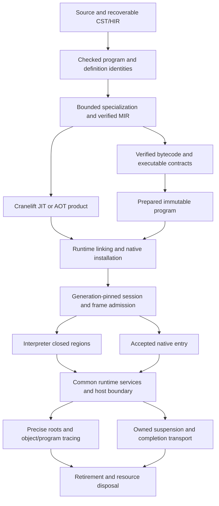

# Repository review

Keep ongoing repository review findings in this document rather than creating
dated review files. Entries record observed behavior and possible follow-ups;
they do not activate implementation work.

This is the single review queue for unresolved findings and scoped follow-ups.
SA identifiers retain the repository review numbering; R identifiers retain the
architecture review numbering. Neither series is renumbered when resolved entries
are removed. Current contracts live in the specifications and architecture; CI
status and activation belong to the [roadmap](implementation-roadmap.md).

Update direction changed after the historical reviews below: the
[confirmed update design](update-model-design.md#calls-retained-objects-and-new-trait-implementations)
uses host-top-level serialized publication, retained computation bodies and current
implementation selection on subsequent ordinary calls. Ordinary Program/Module
handles query the latest published contents within the same installation; existing
function handles call the latest implementation without reacquisition or rebinding.
These confirmed public semantics are not implemented by the current pinned runtime;
internal computation retention and explicit version-specific source/debug inspection
are distinct. Historical pinned-dependency observations remain evidence of the
current implementation, not a requirement to preserve that dispatch policy in UP.
Reconcile affected optimization/native findings
with the migration before implementation; type, root and executable lifetime safety
remain required.

- [Engineering a Compiler review](#engineering-a-compiler-chapter-review): chapter-led
  assessment at `5b57c9a8`, reconciled with current storage/optimization boundaries.
- [Runtime architecture review](#runtime-architecture-review): system map and
  historical evidence at `88acbdb5`, reconciled with implemented lifecycle contracts.
- Repository findings: [SA11](#sa11-hir-declarations-and-adt-members-carry-container-derived-identities),
  [SA21](#sa21-unify-rust-registration-through-nativemodule-with-scoped-host-access)
  and [SA23](#sa23-builtin-type-specifications-duplicate-scalar-properties).
- [Architecture findings](#architecture-findings): retained R findings checked
  against the current implementation; validation limits are recorded below.
- [Interpreter instruction model](#interpreter-instruction-and-operand-model-follow-up):
  general operand/control-flow simplification before specialized loop instructions.
- [R13 type/code ownership](#r13--type-and-layout-provenance-retains-retired-code):
  the remaining lifecycle finding. Scalar storage, transition-owned parking and
  payload-independent version identity are implemented; bounded retention decisions
  and evidence are recorded below.
- [Runtime-loaded repair programs](#runtime-loaded-programs-referencing-existing-installations):
  compile new maintenance code against versioned public contracts and explicitly
  link existing installations without duplicating game objects or statics.
- [Native expansion gates](#native-expansion-gates): requirements for future native
  coverage, not defects caused by the intentionally limited backend.
- Historical timings, allocation data and reproduction details are retained under
  [performance measurements](performance-baseline.md#architecture-review-measurements-2026-10-03).

The consolidation audit inspected code and existing tests at `b71e0cdd`; it did
not rerun behavior tests or performance probes. The remaining SA entries still
have their described representation or missing feature. Test preparation progress
and pending measurements belong to the [existing task](test-preparation-plan.md),
not a separate review finding. Reconfirm affected behavior when activating a task.

## Engineering a Compiler chapter review

### Source, scope and conclusion

Reviewed on 2026-10-20 against `5b57c9a8`, after the R9/R10 repair. Reference:
Keith D. Cooper and Linda Torczon, *Engineering a Compiler*, **second edition**,
Morgan Kaufmann / Elsevier, 2012, ISBN **978-0-12-088478-0**, using the supplied
825-page PDF. References below use the book's **printed pages**; in this copy,
PDF page = printed page + 25 for the main text and appendices. The chapter map
records selected substantive reading, not an exhaustive reading of every page or
an audit of every algorithm. No book text or private filesystem dependency is
required by this repository.

**Conclusion: Kagari can continue performance work on its existing architecture.**
The source/HIR, verified MIR, bytecode preparation and runtime boundaries are
useful foundations, not evidence for starting again. Neither a universal new IR,
an SSA rewrite, a replacement parser, a new GC family nor a Kagari-owned machine
scheduler/register allocator is justified by this review. More ambitious work is
conditional on explicit analysis and semantic contracts, not merely on adding
more optimization passes.

The chapter assessment combines the book with source and test inspection at the
reviewed baseline. R15 is resolved in the current tree: scalar constant reuse is
block-local, with no cross-block hoisting. The focused
[debugger test](../crates/kagari-vm/src/tests/execution/debugger.rs),
`optimized_breakpoints_preserve_branch_paths_and_binding_state`, passed for taken
and untaken branches, binding state and overflow origins, both directly and after
retained-debug artifact round-trip. It compares optimized and unoptimized lowering;
the lasting contract is specified in [safe debug points](spec/debugger.md#safe-debug-points).
The former R19 storage finding is resolved: physical scalar classification now
owns scalar-only coloring, while managed locations remain distinct. The
[RL01 measurements](performance-baseline.md#rl01-scalar-storage-class-allocation-2026-10-23)
report backing capacity and preparation work, not execution speed. The original
chapter examples were source-derived, not executed reproductions; the recorded BO
results below remain historical measurements of their identified images. This
handoff reconciles reported focused tests without rerunning them. No current
whole-workspace/backend acceptance or whole-runtime audit is claimed. Review does
not activate implementation or change the outstanding BO04/IP12 performance gates.

### Chapter map and architectural implications

| Chapter / selected printed pages | Current Kagari assessment and bounded recommendation |
| --- | --- |
| **1. Overview of Compilation**, §§1.1-1.3, pp. 5-8, 14-15; §1.4, p. 21 | Keep distinct semantic, transformation and target owners. Evaluate compilation/preparation plus repeated execution, retained memory and lifecycle costs; fewer bytecode instructions alone are not an economic result. |
| **2. Scanners**, §§2.5.3-2.5.4, pp. 69-73 | Token spans and retained source suit tooling. Inline modules now share their physical parse; that ownership change required no new scanner generator. Identifier/escape classification also has local temporary allocations, discussed below; no scanner rewrite is required. |
| **3. Parsers**, §3.2.4, pp. 92-95; §§3.3.1-3.3.2, pp. 108-110 | Recursive descent, precedence handling and a lossless tree are appropriate. Inline-module subtrees now lower under their own contexts, preserving recovery and physical source offsets. The book does not make LR tables a prerequisite for a fast frontend. |
| **4. Context-Sensitive Analysis**, pp. 161-167, 186-187, 194-201 | Preserve separate declaration/signature/body queries and stored checked answers. R8 should distinguish semantic dependencies from navigation freshness; never weaken revision/arena validation globally. Generic interface construction consumes checked bound evidence; performance work must preserve its proof boundary. |
| **5. Intermediate Representations**, §§5.1-5.4, selected pp. 221-251; §5.5, selected pp. 253-263 | Typed block MIR plus side metadata is a viable hybrid IR. `TempId` is not an SSA definition. Context-owned module handles separate local identity from portable paths; SA11 is an interface/storage tradeoff, not a required migration. Any SSA proposal must justify its consumers and own merge edges, destruction and origins. |
| **6. The Procedure Abstraction**, §§6.1-6.2, pp. 269-273; §6.4, pp. 297-298, 300-301; §6.5, pp. 308-311; §§6.6.2-6.7, pp. 317-322 | Keep call admission, parameter/result transfer, roots and retirement under runtime ownership. Optimize stable prepared facts and data movement, not away the call contract (SA21). R13's remaining type/code retention is distinct from the implemented transition-owned parking proof; neither it nor the accounting/discovery contracts justifies changing GC families. Managed native calls need the existing ABI/root gates. |
| **7. Code Shape**, §§7.1-7.3.1, pp. 331-345; §7.4, pp. 350-356 | BO02/BO03 already implement direct destinations, control-only predicates and bounded constant operands. Keep checked commit and source observations. Arithmetic reassociation and expression reordering from examples do not override Kagari trap/evaluation order. |
| **8. Introduction to Optimization**, §§8.1-8.2, selected pp. 405-416; §8.4.1, pp. 420-428; §8.7.1, pp. 458-462 | Legality precedes profitability. Block-local scalar constants preserve executable observations; broader motion still needs an explicit observation/provenance contract. Inlining must additionally preserve pinned dependencies, logical call-depth/cancellation and error origins; ordinary call effects remain conservative. |
| **9. Data-Flow Analysis**, §§9.1-9.2, selected pp. 475-490; §§9.3.1,9.3.5, pp. 495-497, 510-512; §9.4.1, pp. 519-522; §9.5.2, pp. 530-532 | MIR and bytecode have bounded directional initialization/liveness worklists and immutable analysis ownership. Preserve independent bytecode validation. Add dominance/reaching definitions for concrete consumers; name uniqueness cannot substitute for them. |
| **10. Scalar Optimizations**, pp. 539-542, 544-560, 565-566, 575-578, 580-582, 591-592 | Stable aligned compaction now applies dead-operation decisions without repeated suffix shifts. Local forwarding/folding can cooperate under a bounded owner; blindly repeating every pass and verifier is not a first choice. LICM/PRE/strength reduction need explicit trap, alias, zero-trip and cancellation legality. |
| **11. Instruction Selection**, §§11.1-11.4.1, pp. 597-612; §11.5.1, pp. 622-629 | Bytecode selection belongs to the compiler's checked placement stage; machine selection belongs to Cranelift. Existing placement checks uses, snapshots and debug availability. Do not hide unresolved general costs behind growing superinstructions or infer speed from serialized opcode count. |
| **12. Instruction Scheduling**, §§12.1-12.3.5, selected pp. 639-658 | Machine latency/resource scheduling is backend-owned. The VM's Rust implementation is compiled by Rust's backend. Preserve call, memory, trap and safepoint dependencies; a custom scheduler cannot remove a required helper call. Native polling attribution belongs to the existing expansion gates. |
| **13. Register Allocation**, §§13.1-13.2.3, pp. 679-684; §13.3.3, pp. 689-692; §§13.4-13.4.3, pp. 693-701 | VM backing slots are not CPU registers. Scalar-only coloring now uses physical storage classes while preserving shared logical liveness and distinct managed roots. Cranelift owns native machine allocation; hardware spill heuristics need not be copied into VM storage preparation. |
| **Appendix B. Data Structures**, §§B.1-B.3, pp. 737-750; §§B.4.4-B.4.5, pp. 756-758 | Select indexes and set representations for actual operations/density. Debug availability now uses a function-local interval index without stripping debug information. Dense bitsets can remain sensible; replacing every set with a sparse set is not supported. |

The book supplies mechanisms and tradeoffs, not Kagari's embedding contract. Its
batch-compilation assumptions do not permit skipping source-free verification;
register examples do not permit dropping roots; reference/readonly examples do
not imply exclusive access to shared objects. Kagari adds generation-pinned reload,
scoped host borrows, checked arithmetic, observable failures and cooperative
execution. Those differences constrain every proposed transformation.

### Foundations to retain and existing findings to reuse

- **Analysis has an owner.** [MIR verification](../crates/kagari-mir/src/verify.rs)
  seals immutable code and analyses; [optimization](../crates/kagari-mir/src/passes.rs)
  discards the seal before editing and verifies the result. Revalidation after a
  real edit is not the same problem as avoidable scans inside that validation.
  [Bytecode flow](../crates/kagari-bytecode/src/verifier/flow.rs) independently checks
  changed slot/PC contracts, including artifacts without MIR/source. Preserve it.
- **Naming and value flow are distinct.**
  [Conditional lowering](../crates/kagari-compiler/src/source/lower/expr.rs) writes
  an expression's result temporary from alternative predecessor blocks. This is
  valid non-SSA code. A global value-numbering pass must use reaching definitions
  and dominance, or explicitly construct SSA, rather than assume one definition
  from the name `TempId`. A new permanent IR is not required for that decision.
- **Frontend reuse needs sharper dependencies, not weaker identity.** R8
  remains the owner of finer dependency invalidation. In particular, an imported function-body edit
  can change source revision/arena without changing its callable contract; semantic
  reuse must refresh navigation while preserving old snapshot validity. SA11's
  redundant self IDs are not established as a performance bottleneck. Modules with
  named local functions conservatively reject changed-revision signature/body
  reuse so edits inside enclosing bodies cannot preserve stale local signatures.
  Exact-revision caching remains available; finer local-declaration invalidation
  belongs to R8 and must retain source/navigation ownership.
- **Calls and GC already have necessary boundaries.**
  [Frame admission](../crates/kagari-runtime/src/frame/admission.rs) validates inputs,
  prepares storage with rollback and publishes the frame only on success. Caller
  result storage must outlive callee retirement. Native conversion/reentry can
  collect or mutate; immutable linked facts are reusable, but dynamic value/borrow
  checks are not redundant solely because the signature was checked. SA21 must reuse
  the runtime root owner rather than build a second call/root subsystem.
- **Runtime pressure is a different axis from compiler code shape.** R11/R12 are
  implemented: runtime-owned committed `HeapCharge` records retain capacity pressure;
  final root-lease release uses MPSC, and dead-object discovery visits occupied
  stores plus a narrow interface-wrapper index. See the current
  [runtime model](architecture.md#runtime-model) and
  [deterministic work counts](performance-baseline.md#root-release-and-occupied-discovery-work-counts-2026-10-20).
  The implemented [parking transition](architecture.md#owned-interpreter-activation)
  and R13's remaining type/code ownership issue are separate from machine-code work.

Two bounded local opportunities do not require additional architecture projects:

1. [Identifier scanning](../crates/kagari-syntax/src/lexer.rs) builds a temporary
   `String` for keyword classification; string classification calls the allocating
   [literal decoder](../crates/kagari-source/src/literal.rs) and discards the result.
   Use borrowed spelling and a shared validation/output decoder core if allocation
   measurement warrants it. Preserve one escape grammar, interpolation recovery,
   Unicode/CRLF offsets and the lossless tree. Do not add a cross-stage literal cache
   or duplicate the implemented physical parse sharing.
2. `passes::optimize` folds constants before forwarding local snapshots. Forwarding
   can expose constant operands after folding has finished. This is a conservative
   missed opportunity, not incorrect execution. A bounded local simplification
   owner may combine these facts; prove benefit on the same inputs before adding
   fixed-point whole-pipeline reruns. Existing call/effect barriers remain valid.


### Performance feasibility and bounded next decisions

The [retained BO04 measurements](performance-baseline.md#bytecode-slot-and-operand-evaluation-windows-2026-10-19)
show real historical headroom: arithmetic 0.691811x and branches 0.719951x of the
identified BO01 baseline. They also retain **four failed lifecycle timing gates**.
Those results neither measure the current block-local-constant implementation nor
establish Lua parity or complete acceptance. Historical hoisted images are not
current validation; no performance claim follows from the R15 repair or R12 work
counts. Do not attribute those failures to analysis/representation changes or
parking without measurement.

A finite decision order, not a new implementation plan:

1. **Preserve legality before expanding motion:** keep the block-local constant
   boundary and require an observation/provenance contract for broader motion.
   Checked arithmetic, effects and trap order remain optimization constraints.
2. **Retain measured storage and analysis boundaries:** scalar-only coloring and
   [bounded analysis/compaction](architecture.md#bounded-flow-debug-availability-and-mir-deletion)
   preserve independent verification. Their measurements do not resolve the
   outstanding lifecycle gates or justify broader reuse eligibility.
3. **Scope the remaining runtime ownership issue:** R13's measured type/layout
   retention warrants a separate type/code separation design, not implementation
   in this handoff. Preserve the completed version-token, parking and accounting/
   root contracts; do not reopen identity-domain policy or unrelated frontend work.
4. **Grow optimization only with its evidence:** local value simplification first;
   dominance/reaching definitions plus conservative alias/effect facts before
   global redundancy elimination or code motion. An unknown call is a barrier,
   not evidence of no allocation/write. Checked `x * 2` is not generally replaceable
   by a truncating shift, and reassociation may change which intermediate traps.
   An empty or zero-trip loop does not authorize changing cancellation/termination.
5. **Native expansion follows its existing plan:** runtime/ABI owns calls, roots,
   failure and safepoints; Cranelift owns machine selection/allocation. Attribute
   helper-call, spill and code-size costs before discussing a different polling
   protocol. LLVM, OSR/deoptimization, speculative cross-generation inlining and
   another universal IR remain unjustified by this review alone.

For each chosen task, separate source/analysis, MIR passes, bytecode verification,
runtime preparation, warm execution and retirement/collection. Use the same
workload/output, toolchain, profile/features and cache conditions; track allocations,
retained bytes and actual visits/moves as well as time. Include semantic equivalence,
source-free negative validation, GC/reentry, debugger origins and pinned reload
where affected. The sum of setup and repeated execution matters for short-lived
embeddings; no benchmark-only unchecked route or automatic tiering is proposed.

## Runtime architecture review

### Baseline and assessment

Reviewed on 2026-10-18 at `88acbdb54e369bde2ca72602cc0f453604dc528d`
(`review/architecture`), including DF01-DF03. The worktree was initially clean.

Publication note: this document was rebased onto `350fa1d6` before opening its PR.
That newer main completes Default/struct updates and the object-overhead task,
including native mutation revisions and direct interface snapshot locations.
Its removal of SA26 and the completed plans is preserved. The historical review
and native-test timeout describe `88acbdb5`, not current acceptance. Resolved
R11/R12, R19 and R14 task entries are removed. R13's version marker is resolved;
its measured identity-domain decision retains the installation-scoped writer, and
only type/layout holders retaining retired code remain queued. Lasting contracts
and bounded evidence live in [architecture](architecture.md) and
[performance measurements](performance-baseline.md).

This is review, not implementation authorization. Remaining findings distinguish
**source-confirmed costs/ownership** from **unmeasured risks**. P1-P3 indicate remediation priority, not permission to weaken
correctness. Cost classifications are A: architecture, B: local implementation,
C: required semantics, and D: unmeasured performance hypothesis.

**Overall:** the checked compilation/runtime boundary, generation-pinned ownership
and explicit roots fit a statically typed embedded language. The remaining runtime
finding is type/layout provenance retaining retired executable payloads, not a
reason to replace the GC family or introduce a universal IR.
The repaired pressure and discovery paths do not eliminate root snapshot,
metadata, marking or retained-capacity costs.
Future native expansion needs stronger runtime ABI/root/call contracts, but the
current scalar backend deliberately refuses the unsupported cases.

**Remaining lifecycle priority:** separately scope R13's type/layout versus code
ownership split using the bounded retention evidence below. The token alone owns
no code, and each parking transition already shares one guarded graph traversal.
Mutable graphs still require a fresh proof at each transition.

Preserve the following foundations:

- Recoverable source/HIR is distinct from checked executable contracts. Runtime
  loading does not need syntax, HIR or a live compiler database.
- Verified MIR and bounded MIR/bytecode correspondence; code generation,
  installation and entry are distinct trust/ownership steps. Native code trust
  remains explicit: fingerprints do not prove machine-code semantics.
- Precise owner/slot/generation handles, explicit roots, scoped host borrowing,
  immutable verified code and exact generation-pinned dependencies.
- Transactional frame admission, runtime-owned value windows, closed return
  transfer, and checked mutation commits. Retiring a callee cannot leave a
  collecting gap before its result is rooted in the caller.
- The current closed-region interpreter: reuse authority only while no allocation,
  callback or reentry can invalidate it, poll at logical boundaries, and leave
  storage borrows before cold transitions. Do not replace this with either
  repeated public-API admission per scalar operation or unchecked raw pointers.
- Pre-entry native fallback and common observable semantics. Unsupported native
  features are not permission for mid-execution fallback after effects occur.

### System map and ownership



This is a responsibility map, not a requirement that every deployment serializes
an artifact or uses both backends. Artifact preparation additionally checks any
supplied native-input MIR against the bytecode before installing a product.

| Phase | Work actually owned there | Lifetime and remaining obligations |
| --- | --- | --- |
| Source/checking | Parsing, recoverable HIR, name/type/trait checks, source identities and dependency analysis | Analysis sessions retain their caches; no corresponding CST/HIR owner was found through a loaded runtime descriptor. R7 still repeats lowering rounds; inline modules share physical parse storage. |
| Lowering/verification | Instantiate bounded generic demands, lower checked facts, verify MIR and bytecode, retain executable declarations/layout contracts | Source-free type/witness information is not automatically redundant. Optional preparation MIR may remain with its preparation owner, not automatically the runtime. |
| Preparation | `VerifiedProgram::from_bytecode` builds reusable execution layouts, scalar/managed locations and call placements | Immutable verified bytecode and prepared execution records coexist. These are an intentional execution representation, not source reanalysis. Exact version identity is now payload-independent; R13 concerns type-only holders of current descriptors. |
| Runtime link/install | Remap definition identities, validate installed native declarations, bind layouts/call targets and exact code ownership | Runtime-specific authority and installed host identity cannot be established only by compile-time verification. Cold dependent layouts may be prepared later. |
| Call admission | Check current runtime/generation, type/environment, depth and arguments; reserve/populate frame windows transactionally | Only successful admission publishes a frame. Host callbacks and reentry retain the same pinned session and termination state. |
| Execution | Checked scalar operations, dynamic object identity/access/bounds, field/index kernels, calls and safepoints | Prepared scalar locations avoid repeated type resolution. Identity/bounds checks are semantic costs, not automatically removable work. |
| Suspension/retirement | Retain live frame windows and code leases; detach transient borrows; consume/cancel completion and release windows | Async safety concerns the actual graph, including mutable aliases. One guarded traversal serves each transition; post-poll and later transitions require fresh proofs. |

Identity and release boundaries:

- **Definitions and types:** portable identities are imported into scoped
  `DefinitionContext` tables; numeric IDs require their supplying table. Checked
  type arguments can retain their supplying loaded module (R13). Installation
  writers and immutable snapshots have deliberate, separately measured lifetimes.
- **Objects:** `HeapObjectId` identifies heap owner, directory slot and generation.
  `Value` carries typed scalar data or handles, not unrestricted Rust references.
  Directory identity is stable while typed payload records and packed struct bytes
  may relocate. It is inaccurate to describe this as either raw-pointer moving GC
  or wholly immobile storage.
- **Functions/modules/code:** local slots are interpreted within a loaded program;
  `LoadedModule` owns an `Arc<ProgramDescriptor>`. Executable admission also requires
  live runtime/version authority. Keeping old type facts does not resurrect retired
  executable admission. Native products keep owned code and exact program leases.
- **Roots:** frame windows, explicit root leases, module state, closure/callable
  edges, pending async state and task results have distinct owners. A raw low-level
  callback `Value` is not itself an explicit host root; typed/reentry APIs provide
  stronger ownership. Cloning a root lease is not a new root-table registration.
- **Host/native resources:** Rust host state remains outside the script heap and
  behind installed interfaces/scoped borrows. Native payloads expose tracing and a
  fallible charge description; runtime native records own committed charges for
  mutation and release. Completion endpoints transport owned Rust data, not VM borrows.
- **Reload:** active calls and retained callables keep their old dependency graph.
  Collection traverses object and program edges together before reclaiming retired
  records. Registry retirement, bytecode payload destruction and identity backing
  release are different events; one counter cannot demonstrate all three.

### Representative execution traces

1. **Scalar loop and call.** A checked `i32` loop becomes verified MIR/bytecode;
   preparation assigns scalar locations and reusable callee layout. The VM driver
   admits a cursor, runs closed scalar operations and logical cancellation polls,
   and exits on a prepared call. Runtime admission reserves the callee's window;
   return transfers the value without a collecting gap. Overflow remains a trap,
   not wraparound. Evidence: [driver](../crates/kagari-vm/src/executor/driver.rs),
   [kernel](../crates/kagari-runtime/src/frame/cursor/kernel.rs),
   [callee layouts](../crates/kagari-runtime/src/module/execution/frames.rs),
   [admission](../crates/kagari-runtime/src/frame/admission.rs) and
   [returns](../crates/kagari-runtime/src/frame/returns.rs). The current interpreter
   is not a naive public-register-API loop; historical descriptions of that cost
   must not be reused as current evidence.
2. **Objects and collections.** Construction validates/reserves, initializes,
   publishes and charges; allocation itself does not collect. Concrete field
   operations use prepared sites/layouts and checked heap kernels. Scoped/generic
   preparation leaves the cursor first. Array reads/writes share checked storage
   kernels with native adapters; tuple replacement instead copies the value's
   elements into a new tuple and publishes its root before the next safepoint.
   These are different semantics, not automatically duplicate implementations.
   See [fields](../crates/kagari-runtime/src/frame/cursor/objects.rs),
   [indices](../crates/kagari-runtime/src/frame/cursor/indices.rs) and
   [cold transitions](../crates/kagari-runtime/src/frame/cursor/transitions.rs).
   String/sequence retained capacity is charged separately from logical occupancy.
3. **Generics and interface calls.** Source checking supplies selected declarations
   and witnesses; program lowering discovers further specialization demands (R7).
   Runtime type environments and bound interface methods retain their supplying
   program/receiver, then enter the common frame admission path. Erased receivers
   still need concrete identity/type/access checks. Do not replace this with backend
   name resolution or consider all retained generic contracts dead artifact data.
   Owners: [program lowering](../crates/kagari-compiler/src/source/program.rs),
   [type arguments](../crates/kagari-runtime/src/frame/types/arguments.rs) and
   [executor interface entry](../crates/kagari-vm/src/executor/mod.rs).
4. **Script → host → script.** A linked native binding validates/narrows arguments,
   protects conversion inputs/results and invokes a callback without a live cursor
   storage borrow. Reentry adds a suffix to the same session stack, sharing depth,
   cancellation and pinned environment. Normal nested trap cleanup removes only
   that suffix. Resource exhaustion instead remains sticky for the whole root;
   [execution failure semantics](spec/failure-semantics.md) own termination and origin
   precedence. Borrow validation and completed host effects must survive any
   optimization of this boundary.
5. **Captured closure and async wait.** A callable retains captures and versioned
   dependencies. A cold Future retains inputs without running its provider; claim
   protects captures before submission. A pending operation owns its reservation,
   while the suspended session retains live frame roots. Completion carries owned
   host data until conversion on the driver. Park validation rejects scoped values
   reachable through aliases, not just immediate arguments. Finished task results
   have another explicit owner. Parking shares one guarded proof across frame roots;
   polling or later alias mutation requires a fresh transition proof. The
   [completion contract](spec/host-interop.md#completion-transport-foundation)
   owns transport cleanup and fault containment.
6. **GC, cancellation and old calls.** Safepoints collect only after publication and
   outside invalid storage/host borrows. The collector snapshots roots, traces the
   object/program graph, validates it before detachment, sweeps/relocates storage,
   then disposes native resources without table borrows. Ordinary trap/cancellation
   cleanup releases frame roots and leases, not business mutations. An old closure
   after reload still calls the old dependencies; only after those roots/leases
   disappear may corresponding executable records be reclaimed. See
   [collection](../crates/kagari-runtime/src/gc/collection.rs),
   [future claim](../crates/kagari-runtime/src/gc/future.rs) and
   [owned retirement](../crates/kagari-runtime/src/session/owned.rs).

### Memory model and collector suitability

On the historical 64-bit review probe build, `size_of::<Value>()` was **16 bytes**. The retained
RS layout records describe a 12-byte heap identity and 24-byte directory slot;
these latter figures are structural/historical evidence, not new allocator
measurements. A small struct with 8 payload bytes has an approximate occupied
representation of 8 payload + 24 typed-record/back-reference + 24 directory =
**56 bytes**, before store capacity, free lists, shared layout metadata and allocator
rounding. This is not a per-object malloc size or an RSS estimate. Boxed native
payloads, strings and arrays have their own buffers; not every object is a boxed
16-byte-Value vector. Scalar frame banks also differ from managed Value banks.

The collector is precise, per-isolate, stop-the-driver tracing with handle-stable
identity and relocatable internal storage. Full tracing correctly handles managed
cycles; native resources are disposed after detachment, with panic containment on
that GC path. No ordinary premature-reclamation defect was established. This is
not proof of all safepoint/reentry interleavings. Native trace callbacks still have
an embedding contract; opaque external references cannot become GC roots by
accident. No complete inventory of provider-owned external memory was measured.

Current memory risks span different owners:

| Memory category | Observation and limitation |
| --- | --- |
| Payload/header/alignment | RS already reduced directory and object representation; do not revive the obsolete 168-byte directory finding. Small objects still pay directory/back-reference costs. |
| Native buffers/collection capacity | Committed `HeapCharge` separates logical occupancy from attributed retained capacity. Its partial byte ledger is not allocator usable size, external host memory or RSS. |
| Frame/closure/async state | Typed banks and captures are real retained state; parked stacks keep live windows and code. No fresh maximum-frame or suspension-liveness benchmark was run. |
| Temporary peak | Conversion protection, grow-before-commit and prepare-before-remove deliberately retain old and new values together. Removing this peak without an alternative commit protocol would weaken failure semantics. |
| Runtime metadata/code | Exact version tokens no longer retain original code/snapshots. Installation-scoped identity retention is measured and retained; R13 remains type-only provenance retaining retired code. No loaded-runtime CST/HIR/MIR retention was found through its descriptor. |
| Historical capacity | Root registration drains releases and object discovery visits occupied stores. Free indices and generation tombstones can still outlive most objects; root snapshots and metadata scans retain separate costs. |

Do not introduce generations, incremental tracing, concurrent collection or raw
moving references on this evidence. A nursery could reduce scans if measured
survival patterns justify it, but requires old-to-young publication coverage across
all fields, collections, native traceable payloads, captures and host reentry.
Incremental/concurrent marking adds barriers, mutation invariants and native-hook
constraints to a deliberately single-driver runtime. Existing stable handles make
internal compaction possible without exposing moving addresses; they do not make
untracked native machine registers safe. First measure allocation bytes, survival,
root/directory scan work and pause distribution separately. Keep logical units,
requested bytes, allocator usable bytes and process working set distinct.

### R13 — Type and layout provenance retains retired code

**P2 overall, P1 memory candidate; bounded retention measured; A.** Only type/layout
holders retaining retired executable payloads remain queued. This finding is not
closed as a whole, and the separate type/code split is not implemented or activated.

**Resolved version marker.** A private `Arc<VersionToken>` replaces payload-backed
identity; `same_version` retains root equality plus token allocation identity.
Clones/normalization preserve it; independently prepared equal programs remain
distinct. No original-only graph or `version_definitions` snapshot remains. Current
scope remapping, immutable accepted prefixes and actual executable leases are
unchanged. [RL03 evidence](performance-baseline.md#rl03-exact-version-identity-and-bounded-retention-2026-10-23)
records source -> A -> B payload release, token-only non-admission, pinned native
calls and real AOT image execution with the process-local linker override. The
[architecture](architecture.md#definition-identity-ownership) owns the lasting model.

**Measured domain decision: RETAIN the installation-scoped writer for the measured
lifetime.** The [1/16/128-cycle matrix](performance-baseline.md#identity-domain-observations-and-decision)
finds repeated-name retention flat after runtime/snapshot release; distinct names
grow with the deliberately retained installation. Session clones share that writer,
not a new domain. Independent installations supply independent lifetimes, and all
measured allocations balance after final owner release. The
[common-owner probe](performance-baseline.md#common-owner-snapshot-backing-and-capacity-follow-up)
confirms source/intermediate backing release, immutable prefixes and repeated-name
backing sharing; retaining every distinct prefix keeps additional COW containers.
This is not an endorsement of infinite cheap name/snapshot retention, a measured
append-time peak/RSS result or a source-session compiler-cache study. No new writer
model or process-global leak is established; domain redesign is not queued by R13.

**Remaining ownership mismatch.** `StructLayoutRef` in
[module.rs](../crates/kagari-runtime/src/module.rs) retains a `LoadedModule`;
[TypeArgument](../crates/kagari-runtime/src/frame/types/arguments.rs) and
[associated bindings](../crates/kagari-runtime/src/frame/types/bindings.rs) retain
supplying provenance. For example, a host keeps only each old Record layout while
reloading: registry collection revokes executable admission, but the descriptor
still owns the old program's instructions and preparation records. The
[type-only probe](performance-baseline.md#type-only-provenance-observations-and-decision)
observes zero retired registry entries but 1/16/128 old payloads alive with layout
or nominal-type holders, versus none without holders. Actual native holders
intentionally keep executable leases and remain callable. Payloads expire after
final holder release. Requested-byte deltas include required type facts and other
metadata, not just code; the fixture does not establish production prevalence or
larger-program savings.

**Next decision and constraints:** separately scope type/layout provenance versus
executable-payload ownership. Preserve scoped IDs, immutable layout/associated-type
facts, accepted-prefix checks and old-object allocation compatibility. Keeping type
facts must not revive executable admission; actual callables/native products must
retain their exact dependency leases. Keep root-plus-token exact identity distinct
from hash/ABI equality. This is not a cache flush, collector migration or identity-
domain split; never fork mutable identity builders under the same table ID.

Validation for that future split must distinguish registry retirement, payload Weak
expiry and required type readability, with actual old-call/native execution controls.
Reuse the measured owner-local contracts rather than adding a parallel migration.
The pinned Rust/JLS [reference mechanisms](#primary-implementation-references)
explain context/loader lifetime ownership, not borrowed arenas across Kagari reloads,
immediate unloading or a prescribed domain size.

### Existing compiler and native findings, reconciled

**R7 remains:** `lower_program_to_mir` reconstructs/lower-verifies the authoring
modules in fixed-point demand rounds. For M modules and R rounds this is M×R module
visits, not a universal quadratic-runtime claim. Measure a bounded generic
chain/fan-out, then use a program-owned instance worklist/retained planners with
shared budgets and deterministic finalization. Remove the whole-closure rebuild
loop instead of caching its redundant products. Rust's mono collector is a useful
reference for roots, visited instances and vtable edges, not authority to drop
Kagari diagnostics or source-free witnesses. R8 remains conservative invalidation,
not evidence of incorrect reuse.

**Artifact reachability:** [add_implicit](../crates/kagari-hir/src/imports/resolve.rs)
adds registered native APIs to nonnative dependency sets;
[checked closure](../crates/kagari-hir/src/program.rs) and lowering can carry their
contracts into an artifact, and [native linking](../crates/kagari-runtime/src/native/registry.rs)
validates carried declarations. Availability versus actual executable dependency is
therefore a concrete boundary to investigate. No fresh end-to-end missing-unused-
provider probe or artifact-size measurement was run. Separate full source/coherence
checking from emission only after defining roots for exports, function values,
witness/default implementations, reflection, layouts and reload. Do not suppress
unused-source errors or relax loading validation to make artifacts smaller.

**Native/LLVM classification:**

| Class | Current assessment / required work |
| --- | --- |
| Already affects execution | R13's remaining type/code retention affects runtime ownership independent of LLVM; transition-owned parking is implemented. No miscompile of the currently accepted Cranelift scalar subset was established. Its exact-trap test timed out in the historical review, so this is not a fresh all-green native validation. |
| Before general managed native/LLVM execution | Runtime-owned call admission, argument/result/root ownership, bounded machine-stack behavior or a driver continuation protocol; registered native root frames before collecting helpers; program-scoped call proofs and pinned target dependencies. An LLVM implementation of only the existing scalar subset does not first need all managed-value machinery. |
| Before aggressive optimization | Conservative transitive call/memory/GC facts or explicit barriers, exact overflow/trap lowering, shared-alias semantics, origin/PC mapping and dependency/code leases. False individual effect bits are not absence proofs. |
| Preserve an extension point | Physical PC/location maps if justified instead of registered root frames; code-unit dependency ownership for future direct calls/inlining; logical debug origins and observer fallback. |
| Not justified now | OSR/deoptimization, tiering controller, universal new SSA IR, speculative cross-generation inlining or concurrent/generational collector solely to enable LLVM. |

[Native logical maps](../crates/kagari-contract/src/native.rs) name Register/Local
slots; [jit_poll_execution](../crates/kagari-runtime/src/jit_abi.rs) records a logical
point and performs ordinary registered-root collection. Neither publishes a live
machine-register reference. [Cranelift check_subset](../crates/kagari-codegen-cranelift/src/emit.rs)
rejects heap-bearing slots and emits empty maps for its accepted scalar functions,
so this is an expansion gate rather than a demonstrated current missed root.
Start with the existing plan's registered-root-frame approach, protecting freshly
allocated/returned references across helpers and reentry; physical stack scanning
can wait. A zero-argument scalar entry is also not a general call-stack ownership
protocol: adding arguments alone does not solve native recursion or suspended
caller roots.

For LLVM, `add nsw` produces poison on overflow, not Kagari's checked trap; use
checked intrinsics plus explicit error control flow or equivalent proven lowering.
Readonly views permit mutation through other aliases and do not justify `noalias`
or whole-call no-write claims. Exact program leases must also cover direct-call
and inline dependencies; replacing names with latest-generation lookup changes
semantics. Keep JIT/AOT on common contracts and preserve the current distinction
between logical debug origins, physical machine locations and code allocation
lifetime. See the retained [native gates](#native-expansion-gates), not a new plan.

### Primary implementation references

Consulted on **2026-10-18**, pinned to the tags/spec versions below (not claimed to
be resolved commit SHAs). These are mechanisms and applicability boundaries, not
performance evidence for Kagari:

- **Tokio 1.48.0:** [task harness](https://github.com/tokio-rs/tokio/blob/tokio-1.48.0/tokio/src/runtime/task/harness.rs),
  `cancel_task`, task completion and `drop_future_or_output`: contain user future/
  output destruction and establish task state before notification. Relevant to the
  [completion contract](spec/host-interop.md#completion-transport-foundation)
  and implemented [parking ownership](architecture.md#owned-interpreter-activation).
  Its threaded scheduler/JoinError policy does not
  replace Kagari's isolate, roots, host leases or EngineFault contract.
- **OpenJDK 25 GA:** [OopStorage](https://github.com/openjdk/jdk/blob/jdk-25-ga/src/hotspot/share/gc/shared/oopStorage.hpp),
  [iteration](https://github.com/openjdk/jdk/blob/jdk-25-ga/src/hotspot/share/gc/shared/oopStorage.inline.hpp),
  [allocation/release](https://github.com/openjdk/jdk/blob/jdk-25-ga/src/hotspot/share/gc/shared/oopStorage.cpp).
  Occupied bitmaps, allocation lists and deferred block-list maintenance avoid
  rediscovering all free slots per allocation. Background for the implemented release/discovery contract, not a ready-made
  cross-thread Arc-lease queue or stable-generation handle scheme.
- **Lua 5.4.8:** [lmem.c](https://github.com/lua/lua/blob/v5.4.8/lmem.c) and
  [lgc.h](https://github.com/lua/lua/blob/v5.4.8/lgc.h). Successful malloc/realloc/free
  adjust byte debt, and conditional GC consumes scheduling debt. Background for the implemented accounting boundary;
  debt is not live bytes or RSS. Its emergency allocation-time GC and barriers assume
  Lua's own publication/root model, not Kagari's scoped Rust borrows.
- **Rust 1.90.0:** [mono collector](https://github.com/rust-lang/rust/blob/1.90.0/compiler/rustc_monomorphize/src/collector.rs)
  uses roots, visited instances and MIR uses including vtable requirements;
  used versus mentioned items preserve diagnostic obligations. Relevant to R7 and
  artifact roots; Rust drop glue/linkage rules are not Kagari's roots policy.
  [Type context](https://github.com/rust-lang/rust/blob/1.90.0/compiler/rustc_middle/src/ty/context.rs)
  ties interners to a compiler-context arena. Relevant to R13 lifetime ownership,
  not permission to borrow across Kagari compilation/reload boundaries.
- **Java SE 25:** [JLS 12.7](https://docs.oracle.com/javase/specs/jls/se25/html/jls-12.html#jls-12.7)
  permits unloading only when the defining loader can be reclaimed. Relevant to
  explicit identity-domain lifetime in R13, not a guarantee of immediate unloading
  or a requirement to use Java loader granularity.
- **LLVM 22.1.0:** [LangRef](https://github.com/llvm/llvm-project/blob/llvmorg-22.1.0/llvm/docs/LangRef.rst)
  defines poison, overflow intrinsics and alias/memory attributes;
  [Statepoints](https://github.com/llvm/llvm-project/blob/llvmorg-22.1.0/llvm/docs/Statepoints.rst)
  distinguishes liveness from relocation and physical stack-map locations. Even
  nonmoving GC needs visible live references; registered shadow roots remain an
  alternative. [OpenJDK 25 OopMap](https://github.com/openjdk/jdk/blob/jdk-25-ga/src/hotspot/share/compiler/oopMap.hpp)
  associates machine PCs and VMReg/frame locations, unlike Kagari's logical slots.
  These mechanisms inform native gates, not a demand for immediate physical scanning.

### Finite remediation order and removals

These are recommendations for the existing roadmap/review owners, not newly
activated phases or an implementation ledger.

| Order | Scope / owner | Delete or consolidate when replacing | Acceptance boundary |
| --- | --- | --- | --- |
| Separately scope from measured evidence | R13 type/layout versus executable payload | Descriptor ownership that keeps code solely for type/layout provenance; retain required type facts and actual executable leases | Type readability and old-object compatibility without old payload retention or executable resurrection |
| Measure before expanding | R7 worklist, artifact pruning | If justified: whole-module demand rounds; not a cache layered over them | Compiler scaling, explicit executable roots and unchanged source diagnostics |
| Existing future gates | Native expansion plan, then appropriate LLVM coverage | Replace scalar-only ABI/consumers coherently as general calls land; no compatibility forwarding ABI or backend-owned duplicate semantics | Assert actual native entry, source-free execution, roots across helpers/reentry, numeric/trap order and old-version calls |
| Defer | GC family replacement, OSR/deopt, extra universal IR, speculative interface/layout grouping | No new speculative mechanisms | Activate only on measured survival/pause data or concrete backend/optimization requirements |

Do not revive the rejected IP11 map/Vec candidates, attribute IP12 timing to parking
without measurement, or bypass owner/generation/bounds checks under the label of
optimization. Prepared field/call facts and closed regions are sound foundations;
keep their lifetime/admission contracts while removing identified repeated work.
Structural `common`/contract responsibility cleanup and SA authoring issues remain
owned by their existing entries; moving code between crates alone is not a runtime
fix. No blanket public-API compatibility layer is recommended for this unpublished
project.

### Documentation differences and verification limits

Implementation, not old prose, determines this baseline:

- At the historical review baseline, project goals still described async as queued.
  Current [goals](project_goal.md#scope-boundaries) now reflect implemented host-driven
  async, cold Future/Task ownership and explicit suspension. General async trait
  methods and native async suspension remain limited; those limits do not make all
  async unimplemented.
- At the reviewed baseline, ordinary Default and contextual calls were implemented
  through DF03 while struct updates/integration remained pending. Main subsequently
  completed that work and removed SA26 and its execution plan; publication preserves
  those removals rather than reopening the completed task.
- Older native-gate text is now rechecked, not evidence that logical stack maps
  already support managed machine registers. RS measurements are historical; the
  older object directory layout and resolved duplication must not be resurrected.

**Unresolved historical native validation:** at `88acbdb5`,
`cargo test --locked -p kagari-codegen-cranelift --lib tests::checked_i32_traps_keep_the_exact_mir_point -- --exact`
completed compilation and started the test, but hit a **180-second timeout** without
a final result. This is **not passed and not a confirmed assertion failure**. The
test directly installs/calls native code rather than accepting fallback. The
historical environment was Windows 11 Pro `10.0.26300`, x86_64-pc-windows-msvc,
Intel Core i9-12900K, rustc `1.99.0 (b940084d7 2026-09-28)` and Cargo 1.99.0,
workspace dev/test profiles, default target/parallelism and mixed/warm build cache.
Builds contended for the target lock; elapsed time is not a benchmark. No longer
rerun was attempted, and this documentation update does not resolve that result.

This documentation handoff inspects current source and reconciles reported focused
evidence; it runs no behavior tests, builds or performance probes. R11 probe tables
and reproduction instructions are retired with the resolved finding. R12 retains
only durable [algorithm work counts](performance-baseline.md#root-release-and-occupied-discovery-work-counts-2026-10-20).
The [RL01](performance-baseline.md#rl01-scalar-storage-class-allocation-2026-10-23),
[RL02](performance-baseline.md#rl02-transition-owned-parking-2026-10-23) and
[RL03](performance-baseline.md#rl03-exact-version-identity-and-bounded-retention-2026-10-23)
sections own measured methods, limits and passing scoped tests, including actual
AOT execution after a process-local linker override. R13 domain/backing and type-only
retention are now measured within those finite fixtures, not inferred from registry
counts alone. No global speed claim follows.

Full-workspace tests and the complete feature/backend/platform matrix remain CI
scope. General throughput/pause distributions, physical RSS, production-load survival,
native heap-root execution, exhaustive race/panic injection and LLVM validation are
not established by this handoff. Historical BO04/IP12 failed gates remain unresolved.

## SA11 HIR declarations and ADT members carry container-derived identities

[Struct](../crates/kagari-hir/src/hir/item/adt.rs) stores its own `StructId`,
although that ID also identifies its position in `Module.structs`. Consumers such
as [signature checking](../crates/kagari-hir/src/typeck/check.rs) iterate over
`&Struct` and use `structure.id` to query semantic declarations and constraints.
[Item lowering](../crates/kagari-hir/src/lower/item.rs) also uses the stored ID to
publish `Item::Struct` before appending the declaration row. These are concrete
convenience uses, not evidence that the identity must live inside the payload.

All five ADT records store a self ID, but their reconstruction contexts differ:

| Record | Stored identity | Container-derived context |
| --- | --- | --- |
| `OpaqueType` | `OpaqueTypeId` | Index in `Module.opaque_types`. |
| `Struct` | `StructId` | Index in `Module.structs`. |
| `Enum` | `EnumId` | Index in `Module.enums`. |
| `Field` | `FieldId` | Arena, enclosing `StructId` and field slot. |
| `Variant` | `VariantId` | Arena, enclosing `EnumId` and variant slot. |

The first three duplicate their declaration-vector index. Fields and variants
are nested records: a slot alone cannot identify a member across owners. Their
IDs could also be reconstructed by a container, but only with the full arena,
owner and slot context. Review these two categories separately, including their
source-map and semantic-table consumers; this observation does not establish
that any of the five fields should be removed.

[Function](../crates/kagari-hir/src/hir/item/function.rs) has the same
container-derived self identity as the top-level ADT declarations above:
`module.functions[index].id.index() == index`. The
[source map](../crates/kagari-hir/src/source_map.rs) allocates `FunctionId` from
its function-span vector. Current lowering reserves private slots before
descending into children and fills each exact slot before publication. This
applies to module functions, named locals and trait/impl methods in the same
collection; only module functions also enter Module.items.

The field has active consumers: lowering publishes `Item::Function` and links
trait/impl method records; signature checking uses `function.id` to index typed
functions and source locations. It is a redundant identity with convenience
uses; removing it requires updating those consumers.
Review retaining the field versus supplying `(FunctionId, &Function)` from the
container and passing the identity explicitly to consumers. `FunctionId` itself
must remain available for method links, name resolution, source maps and
`BodyOwner::Function`; only its duplication inside `Function` is under review.
Any change must preserve allocation/storage order and snapshot identity mapping.
Named local functions preserve that relationship when parent and child records
finish at different times. Review this implemented reservation/finalization boundary
without reintroducing a second function store or exposing incomplete records.

Expression storage uses a different interface:
[Body::expressions](../crates/kagari-hir/src/hir/body.rs) yields `(ExprId,
&ExprData)`, reconstructing each ID from the container's arena, the row's owner
and its index. `ExprData` contains no self ID. Both declarations and expressions
have identities; the difference is where that identity is supplied to consumers.

For structs, the duplicated invariant is
`module.structs[index].id.index() == index`, with matching source-map slots.
Reordering rows or changing the stored ID independently can break those links.
No current invariant violation or measured performance bottleneck was established
by this review. `StructId` is lowering-local and carries only an index; retaining
the field does not make it stable across modules, revisions or snapshots.

Follow-up owner: HIR declaration storage and its consumers. Compare retaining
self IDs with container-owned iteration returning `(ID, &record)` for the five
ADT records and `Function` above; review other declarations only where the same
issue applies.
The identity interface and any field removals remain undecided.
Preserve item order, source-map alignment, member ownership, semantic declaration
mapping and snapshot/reuse remapping. Do not conflate inline binding/member IDs
with redundant self IDs, or widen visibility/add forwarding APIs to hide the
ownership question. Reuse existing declaration, navigation and snapshot contracts
if implementation is activated; measure any claimed memory or speed benefit.
This entry records a design review only and does not activate a migration.

## SA21 Unify Rust registration through NativeModule with scoped host access

Registration, runtime-owned Opaque and scoped Ref/RefMut are implemented.
Common NativeModule declarations, one bind entrypoint and atomic installation
replace the former host aggregate, standalone format and parallel registration.
Existing live-host consumers retain their checked root/path behavior. The completed
HR/RF/RI plans are retired; Git history retains their phase ledgers.

The [host interop specification](spec/host-interop.md) owns the storage/passing
matrix, scoped loans, generated inline field paths and explicit method/trait
registration. The [embedding guide](spec/embedding-api.md#typed-native-registration)
owns DTO/Serde conversion and runnable consumers. Rust traits and Kagari traits
remain independent. Borrowed returns, general view trait forwarding, async
retention and wider native reference execution remain outside this implementation;
[the roadmap](implementation-roadmap.md#host-registration-and-interop-delivery)
records those limits and pending exhaustive CI.

### Call-boundary cost follow-up

Static review confirms the following remaining preparation costs. These are
code-derived costs, not benchmark results or speedup claims:

- [Typed native invocation](../crates/kagari-runtime/src/native/typed.rs) builds a
  `Vec<Value>`; [argument decoding](../crates/kagari-runtime/src/native/conversion/arguments.rs)
  copies it into rooted storage and creates a root lease even for scalar packs.
  Mapping checks recur at pack and element conversion boundaries. Value/handle
  copying here is not necessarily a deep object copy. Individual scalar conversion
  avoids an object root, which does not eliminate the pack-level allocation.

- [Native call-site linking](../crates/kagari-runtime/src/module/linked_execution/native_calls.rs)
  validates arity and prepares physical argument locations, while the common
  [linked invocation entry](../crates/kagari-runtime/src/native/binding.rs) repeats
  the arity check per call. Audit which callers possess the prepared call-site
  evidence before proposing any specialized admission path; this is not authority
  to remove checks from dynamic or host-originated invocation.
- [Native result adaptation](../crates/kagari-runtime/src/native/result.rs) selects
  its implementation table at linking, but its closed branch without applied type
  arguments still resolves those arguments during conversion. Composite result
  encoding also repeats Rust mapping checks before the outer return validation.
  Distinguish stable preparation facts from checks on newly produced values;
  bytecode containing one native call does not expose this work or measure its cost.

The typed invocation owner should evaluate borrowed argument windows and reuse of
checked mapping facts through the existing runtime root owner. Release-driven root
reclamation is implemented, not an outstanding full-table-prune optimization.
Preserve snapshot/retention across user conversion and reentry, collection during
conversion, owner/generation/value checks, cancellation
and cleanup on every exit. Separate stable declaration proofs from invocation-time
facts before relocating validation. Root reclamation must still handle last-lease
drop and runtime transfer safely. Do not remove roots merely because the simple
scalar case does not need GC protection.

Keep owned conversion, scoped borrowing and explicit raw/primitive implementations
behind one validated binding entrypoint without forcing one data-movement path.
The [VM allocation tests](../crates/kagari-vm/tests/allocation_contracts/native_allocations.rs) establish
warm zero-allocation scalar/SequenceHandle paths; they do not establish that the
general typed adapter is allocation-free. The completed
[module-owned registration](native-registration.md) refactor preserves these
primitive/raw/typed/owned distinctions through direct associations and one-shot
preparation. Its bounded bytecode/link/runtime comparison and focused allocation
checks do not implement these pre-existing optimizations or establish general
allocation-free invocation. Keep this follow-up at the actual call/conversion/root
owners, not in a second standard-library registration layer.

This is a queued, bounded follow-up, separate from completed registration/interop
delivery. Before optimization, measure equivalent raw/typed/owned cases and the
implemented Ref/RefMut adapters. Vary argument/payload size, root-table high-water
mark, path depth and active loans where applicable. Separate compile,
installation, conversion and warm-call costs; report allocations, retained memory
and timing with revision, machine, toolchain, profile/features, parallelism and
cache state. Include representative bulk calls and small frequent calls without
assuming one is faster. Reuse focused correctness tests for GC/reentry/trap cleanup;
no retained performance conclusion can be inferred from registration unification.

## SA23 Builtin type specifications duplicate scalar properties

[BuiltinTypeSpec](../crates/kagari-types/src/surface.rs) stores `family`,
`const_safe` and `heap_backed` beside `ty` in a fixed builtin table. The requested
follow-up is to remove these stored properties and query the scalar semantic
owner instead. This is a deferred cleanup, not activated implementation.

`family` duplicates facts already available through
[BuiltinType::number_type and integer_layout](../crates/kagari-types/src/scalar.rs).
Its current consumers in [HIR scalar checks](../crates/kagari-hir/src/builtin/surface.rs)
only classify numeric types and signed-integer/float negation. Reuse scalar-owned
facts for primitive checks and remove `BuiltinTypeFamily` when it has no remaining
consumers. Generic operation requirements already use
[ordinary trait bounds](spec/traits.md#operation-specific-bounds); do not move
their source-level semantics into scalar classification methods.

For the current builtin types, only `String` is heap-backed. Constant eligibility
is a separate language policy: `Never` and `String` are not const-safe, while the
other builtin types are. In particular, `Never` is neither heap-backed nor
const-safe, so constant eligibility cannot be derived as `!is_heap_backed()`.
Move both queries to explicit `BuiltinType` methods; define constant eligibility
with an exhaustive match so new builtin variants require a deliberate decision.
Update the HIR constant checks and representation classification to use those
methods, preserving existing behavior and the remaining name lookup/display table.

Follow-up owner: `kagari-types` scalar semantics and their HIR consumers. Keep
numeric admission, constant eligibility and representation facts distinct; do not
expand this cleanup into runtime reflection, declaration registration or a type
model migration. The table is fixed data, not per-object metadata. No memory or
speed improvement has been measured, and removing fields does not establish a
byte saving without checking padding and the resulting layout.

When activated, reuse the existing [standard type checks](../crates/kagari-hir/src/tests/typeck/standard.rs)
and constant-check contracts, with focused numeric/negation and builtin
name/display coverage. Verify all consumers migrate without changing accepted
programs or diagnostics; add coverage only for distinct missing rules.

## Architecture findings

R7-R8 originated in the 2026-10-03 review of
`9581f5ad2a754911d1edb92eb35e957a18d7b5df`. Source inspection at `88acbdb5`
confirms these mechanisms remain; their scaling has not been remeasured.
Resolved findings and superseded implementation details are not retained as tasks.
R13/R14 remain in the runtime review; R19 remains in the
[chapter review](#engineering-a-compiler-chapter-review). R11/R12/R15-R18 are resolved
and are not current queue entries.
Each entry records its own evidence level and validation limits.

| ID | Current finding | Focused follow-up and acceptance |
| --- | --- | --- |
| R7 / P2 | `lower_program_to_mir` still loops over all authoring modules for each new specialization-request round. | Measure a bounded generic chain/fan-out before choosing an instance work queue or input-keyed reuse. Preserve foreign defaults/witnesses, compilation limits and final verification. Current scaling cost is unmeasured. |
| R8 / P2 | Body reuse compares imported functions using derived equality, including source/navigation identity; aggregate equality also compares inherent methods with their source sites. Signature-preserving edits can therefore prevent semantic reuse. | Separate semantic contracts from navigation identities. Validate signature-preserving versus contract-changing dependency edits without dropping source revision/arena validation. This is conservative invalidation, not evidence of a stale result. |

Evidence owners:

- R7: [program lowering](../crates/kagari-compiler/src/source/program.rs).
- R8: [body reuse](../crates/kagari-hir/src/analysis/body_queries.rs),
  [imported functions](../crates/kagari-hir/src/imports/functions.rs),
  [source identities](../crates/kagari-hir/src/imports/mod.rs) and
  [aggregate equality](../crates/kagari-hir/src/aggregates/mod.rs).

These findings remain review items, not automatically activated tasks or new
prerequisites for unrelated work.

## Interpreter instruction and operand model follow-up

**BO02/BO03 implemented; BO04 evaluated but blocked by four lifecycle timing gates.**
Prefer a compact general value/operand/control-flow model before introducing
specialized counting-loop instructions. The
[bytecode optimization plan](bytecode-optimization-plan.md) owns BO01-BO04,
slot/commit/observation decisions, verification, performance gates and the sole
ledger for this migration. On 2026-10-19 the user requested a separate plan that
can proceed before the earlier interpreter work finishes. Its current-revision
baseline and acceptance do not depend on IP12 completion; the older plan retains
its outstanding lifecycle gate. The user's subsequent instruction authorized
implementation and one commit per BO phase. BO02 removed eligible scalar transport;
BO03 added predicate branches and prepared scalar-constant operands. Targeted
arithmetic/branches passed; unrestricted integrated gates did not. After one bounded
fixed-core diagnosis/publication-owner repair, original and forms suites pass, but
four lifecycle timing gates remain. The
[measurement report](performance-baseline.md#bytecode-slot-and-operand-evaluation-windows-2026-10-19)
and plan retain failures, accepted boundaries and the required scope decision before
further tuning. This section's
original counts below describe the pre-migration baseline, not the current product.

The historical pre-migration `i64` probe initializes `s = 0`, `i = 0`, runs
`while i < n { s = s + i; i = i + 1; }` and returns s.
Actual `kg emit` / `kg disasm` output contains 17 instructions. Each successful
iteration traverses ten bytecode positions: load i/n, compare, branch, load s,
add, store s, add, store i and jump. Constants zero/one are already outside the
loop in that historical hoisted image, not the current block-local implementation.
The function declares three locals and twelve temporary registers, not twelve
simultaneously live values. [Physical allocation](../crates/kagari-runtime/src/module/execution/allocation.rs)
reuses temporaries but separates named locals; preparation converts local transport
into moves. The [scalar execution loop](../crates/kagari-runtime/src/frame/cursor/scalars.rs)
already uses prepared scalar slots and kernels, not repeated source type inference.
See the [existing attribution](performance-baseline.md#instruction-stream-and-scalar-execution)
for the distinction between excess logical work and per-operation machinery.

The comparable PUC Lua 5.4.9 while function has eleven stored instructions, directly
updates local registers and couples comparison with a jump; successful numeric
arithmetic skips metamethod fallback instructions. Numeric-for specialization is
separate. Consult [Lua opcodes](https://www.lua.org/source/5.4/lopcodes.h.html) and
[execution](https://www.lua.org/source/5.4/lvm.c.html) (pages track the 5.4 series).
Adopt direct destinations/control flow, not wrapping arithmetic or incompatible
root/ownership rules; stored opcode counts are not dispatched-handler counts.

Proposed general shape, **illustrative pseudobytecode, not existing opcodes**:

```text
; r0 = n, r1 = s, r2 = i
00  load_i64          r1, 0
01  load_i64          r2, 0
Lcheck:
02  branch_ge_i64     r2, r0, Lexit
03  add_i64_checked   r1, r1, r2
04  add_i64_checked   r2, r2, #1
05  jump              Lcheck
Lexit:
06  return            r1
```

The intended ownership/model changes are:

- Let locals occupy execution slots directly; keep temporaries only where aliasing,
  old-value liveness, once-only evaluation or calls require them. Compiler value
  placement and runtime physical preparation must agree on ownership.
- Write arithmetic directly to its destination only after checked success; retain
  one numeric semantic owner and no partial assignment on failure.
- Branch directly on comparisons used only for control flow; keep materialized bools
  when they are observable values. Support suitable immediate/constant operands.
- Preserve logical origins, debugger-visible ranges, effect/trap order, roots and
  pinned calls through explicit mappings, not unconditional local transport.
  Removing initialization/ownership checks requires adequate verification evidence.
- Review portable encoding and prepared execution together, without prematurely
  multiplying type/operand opcode combinations or creating duplicate semantics.

This example targets seven general instructions and four positions per successful
iteration, rather than adding a one-off sum instruction. Assignments, branches and
other arithmetic should benefit too. It is a structural target, not a dispatch-time
ratio, register-allocation result or promise that fewer serialized bytes run faster.
No closed-form replacement, JIT route or weaker overflow semantics is implied.
Cancellation feature/polling policy is a separate execution-contract decision, not
an implicit change authorized by this representation proposal.

Only after the general model is coherent and measured should a specialized numeric
loop combine increment, comparison and backedge. Require explicit step/bound rules,
initial zero-iteration behavior, counter mutation/liveness and trap/debug mappings;
do not hide unresolved local transport beneath growing superinstruction cases.

When activated, inspect MIR, bytecode, prepared records and release machine code.
Reuse the fixed benchmarks and scalar/control-flow, source-free, debug, overflow/trap,
GC/callback and reload contracts, including negative/zero bounds and effectful failures.
Measure warmed execution separately from preparation, code size and slot traffic.
Current cancellation/slice guarantees remain unless explicitly revised; do not use
benchmark-only unchecked execution.

## Hash lookup equality receiver clarification

Inspection during persistent-static integration found a pre-existing contract
mismatch: [value semantics](spec/value-semantics.md)
describes the query as the equality receiver for map/set lookup, while
[hash operations](../crates/kagari-stdlib/src/foundation/hash/operations.rs) passes
`[stored, query]` to selected equality. The persistent-state fix deliberately
changes protocol ownership (construction-pinned lookup versus caller-selected
content comparison), not operand order.

For an asymmetric or observably effectful equality implementation, receiver order
can change results or completed effects. Reconcile the intended rule with the
collection contract and add a focused asymmetric/effect-order case before changing
implementation or specification. This finding is source-derived, not a new executed
reproduction; it does not activate a semantic change as part of static support.

## Runtime-loaded programs referencing existing installations

This unimplemented requirement is separate from the implemented
[installed Program/live Module API](spec/embedding-api.md#installed-programs-and-public-paths)
and [current-call publication](spec/module-activation.md#live-installations-and-call-selection).
Public navigation alone does not link independently loaded installations.

Related user requirement: execute newly supplied game-maintenance code against
current player objects and game services, without reloading the game or creating a
second copy of its state. For example, a repair function accepts the retained
Player object, updates its level through public methods and returns. The change
must affect the original object; calls into game services must use the existing
installation's static cells.

Temporary use is a host lifetime choice, not another executable kind. The repair
code should be an ordinary Program with the same verification, typed calls, GC,
cancellation and async scheduler as long-lived programs. Do not introduce a
TemporaryProgram, separate evaluator, privileged visibility mode or duplicate
load/call surface. One-shot repair and persistent administration tools differ in
how long the host retains and invokes their handles.

Current [loading](../crates/kagari-runtime/src/loading.rs) installs a complete
verified Program; independently loading another closure containing the game does
not establish shared game-instance state. The proposed missing capability is an
explicit reference from new code to an existing installation:

- Compilation consumes a versioned public contract for the referenced program,
  rather than inferring types from heap contents. Determine the metadata needed
  when original source is unavailable, including trait evidence and generic bodies
  or installed specialization limits; signatures alone do not establish arbitrary
  new generic specialization support.
- Loading validates the versioned compilation contract against the selected runtime
  installation and fixed declaration/type relationships. An ordinary callable
  reference targets that installation's stable identity/current implementation;
  required computation/type/native evidence has its own retention contract. Loading
  must not silently select another same-named program, copy its objects or initialize
  another set of its statics. The new program still owns its own declarations and
  state. Compilation references and installation bindings must agree before
  publication or execution; exact cross-installation linker details remain open.
- Reuse ordinary function/object bindings and call/call_async after loading. Access
  remains public and checked. Execution is serialized by the existing runtime
  driver; suspension does not freeze shared game state. Completed mutations survive
  later traps and program retirement. Transactional repair requires an explicit
  business transaction or validation/commit operation, not implicit rollback.

As a comparative mechanism, [.NET AssemblyLoadContext shared dependencies](https://learn.microsoft.com/en-us/dotnet/core/dependency-loading/understanding-assemblyloadcontext#shared-dependencies)
(.NET 5+/Core conceptual documentation, reviewed 2026-10-23) shares a loaded
assembly instance rather than treating equal type names as equal instances.
Kagari can reuse that ownership principle, not its one-version-per-name resolution
or equal-or-higher version policy: Kagari must retain checked installation/type
identities, selected-computation lifetimes, GC roots and host-boundary guarantees,
without confusing those with pinning ordinary method bodies. Exact API and linker
representation remain undecided; this capability is not implemented by the
current source compilation and load_program entrypoints alone.

### Reload boundary for independently loaded repair programs

A repair program references the game; it does not become part of the game's own
module/export inventory. Current [reload validation](../crates/kagari-runtime/src/reload.rs)
compares the selected active Program with its candidate, not all code loaded in
the Runtime. Preserve that boundary when adding installation references:

```text
Target before: repair computation -> game declaration in installation A (v1 body)
Update: compare game v1 with game v2, not (game v1 + repair) with game v2
Target after: retained repair computation -> same game declaration (v2 body)
Retained repair body/resume state is unchanged; its next ordinary call uses v2
```

A later game update must not need the repair source or its function definitions.
Injecting repair declarations into the game's own Program would instead make their
absence relevant to its compatibility checks; that is not the proposed model.
An ordinary Program is not automatically in the same update unit as every program
that it references. Retaining selected old computations does not waive game v2's
existing signature, layout, export or static compatibility requirements. This is
the target behavior with explicit installation linking, not evidence that ordinary
current-call dispatch already supplies the missing cross-installation linker.

When repair has finished and no code-bearing references remain, its code may be
reclaimed according to ordinary ownership. Player mutations remain. A selected
repair computation, closure, precreated Future or task retains the body/resume/
capture state it needs, plus required type/native evidence; do not require the next
game artifact to reproduce repair code or unload reachable code. A captured callback
stored in game state may therefore keep its repair body alive. Ordinary calls from
that body into the game select the current implementation through stable identity,
without preparing/binding again merely to observe game v2. This does not migrate
the callback's capture layout or substitute a new body into a precreated Future.
Exact cross-installation lifetime/linker representation remains deferred.

On activation, cover shared object identity and static state, rejected dependency
identity/version mismatches, source-free metadata limits, game reload without any
repair declarations, suspended/retained repair across reload calling current game
methods, escaped callbacks retaining capture-compatible bodies, fixed trait/type
relationships with current method bodies, and cleanup after final owners end.
Keep whole-program replacement/state migration and persistent REPL environments
separate. This is a recorded requirement
and proposed contract only, with no implementation authorization or executed
behavioral acceptance for cross-installation linking.

## Artifact reachability follow-up

Whether executable artifacts should prune unreachable contracts remains an open
question separate from completed registration-sharing work. Review artifact
construction and verified dependency closure ownership before proposing pruning;
measure artifact size and preparation costs on a current baseline. Preserve
source-free validation, declared native contracts and generation-pinned dependencies.
Historical startup costs do not establish the benefit of this change.

## Native expansion gates

The mechanism inventory below was rechecked against `88acbdb5`. The acceptance
requirements remain future expansion constraints, not current accepted-subset
miscompilations or a new phase sequence. The [Cranelift expansion plan](cranelift-expansion-plan.md)
retains ownership; the current review adds the evidence and limitations below.

The narrow scalar backend is intentional. The following gates apply when adding
calls, GC-bearing values, compiled callbacks or optimizations that depend on callee/memory facts. Wider scalar arithmetic and
scalar locals/control flow can progress independently with appropriate trap and
polling semantics. These are not bugs caused merely by lacking a larger backend.

| Gate | Boundary observed at the reviewed baseline | Required decision and evidence |
| --- | --- | --- |
| General calls and values | [native_call.rs](../crates/kagari-abi/src/native_call.rs) transports runtime/result/status for zero arguments and Unit/Bool/i32 results | Define argument/result representation, helper calls, error propagation and cleanup once for both native backends |
| Native GC roots | [native.rs](../crates/kagari-contract/src/native.rs), logical stack-map declarations, records logical Register/Local locations; no runtime physical map reader was found | Choose a shadow-root protocol or real physical frame/PC/location maps; prove objects survive collecting helpers, returned allocation, reentry and traps |
| Verified cross-module calls | [codegen/lib.rs](../crates/kagari-codegen/src/lib.rs) accepts a module seal; full binding proofs live in `VerifiedMirProgram` | Pass program-scoped verified target bindings or a typed runtime trampoline; backends must not redo name/type resolution |
| Effect interpretation | Script calls carry `calls`/`may_trap`, not transitive allocation/write facts | Treat calls as conservative memory/GC barriers or compute conservative graph summaries before emitting LLVM `readonly`/`readnone`-style assumptions |
| Tier-neutral callbacks | Synchronous `ScriptInvoker` selected the interpreter | Preserve pinned generation, captures, argument/result checks, shared call depth/cancellation, observers and trap origins when selecting compiled callbacks |
| Code lifetime and hot reload | Installed handles retain exact versions and their dependency closure | Extend dependency assumptions to direct calls, inlining and module/SCC compilation units; reclaim code only when its owners and retained dependencies permit it |

**Chapter-review attribution at `5b57c9a8`:**
[Cranelift emission](../crates/kagari-codegen-cranelift/src/emit.rs) inserts a resource
check before each MIR instruction and return; [the scalar helper lowering](../crates/kagari-codegen-cranelift/src/scalar.rs)
emits a helper call, status test and continuation/error branch. The
[runtime helper](../crates/kagari-runtime/src/jit_abi.rs) publishes the origin and
services ordinary GC/cancellation. This is intentional current behavior, not a
miscompile. Intermediate values live across these helper calls are subject to the
machine calling convention; whether they spill or rematerialize requires generated
code inspection. A textbook instruction scheduler cannot remove that effectful
boundary.

Within the existing J02 acceptance owner, include actual-native input-dependent
arithmetic/CFG cases and attribute helper-call count, final frame/spill traffic,
code bytes and preparation versus execution cost. This is an assessment of the
existing gate, not activation of J02 or permission to remove/coalesce polls. Any
later change needs a runtime-owned fast/slow safepoint contract preserving GC,
sticky cancellation, logical origin and no post-effect fallback. Do not mark the
helper pure, expose private runtime layout or add a Kagari machine allocator to
compensate for it. Cranelift `0.136.2` in `Cargo.lock` owns machine register
allocation; VM scalar-bank colors identify reusable VM storage, not CPU registers.

At the reviewed baseline, the poll helper recorded a logical offset and invoked
ordinary registered-root GC; it did not publish native stack roots. Cranelift rejected heap-bearing
slots and emitted empty root maps for its accepted subset. Do not mistake the logical
metadata schema for completed GC integration.

Effect caution is similarly forward-looking. In
[instruction.rs](../crates/kagari-mir/src/instruction.rs), reviewed script calls
used `EffectSet::call`; [effects.rs](../crates/kagari-contract/src/effects.rs)
set only `calls` and `may_trap`. A callee can still allocate and mutate.
The reviewed constant propagation treated calls as barriers and dead-code
elimination required an empty effect set, so no miscompile was demonstrated. Individual
false effect bits must not become absence proofs in a future optimizer.

Recommended order: establish calls/roots and tier-neutral runtime services with
Cranelift, grow the semantic conformance matrix, then implement LLVM against the
same checked contract. Keep LLVM lowering and optimization local to that backend.
MIR need not become LLVM IR, and an additional SSA IR is justified only by concrete
optimization requirements. Simple baseline native compilation and optimizing
compilation may use different strategies without duplicating language semantics.

For each newly accepted native feature, use the same semantic cases through source,
serialized artifact, interpreter and **asserted actual native execution**. Tests
that successfully fall back do not establish native coverage. The important rows
are checked overflow/trap order; left-to-right once-only effects; nested calls and
call-depth failure; objects live across collection/reentry; cleanup after traps and
cancellation; old callbacks/interfaces surviving reload; and observer-triggered
pre-entry fallback. Add differential generated-program testing only within the
supported subset, with reproducible seeds and finite bounds.

Keep recoverable HIR distinct from checked executable types. Readonly collection
interfaces do not prove frozen storage, noalias or an exclusive native borrow;
use the current [collection contracts](spec/collection-access.md) rather than
historical type spellings. Preserve once-only evaluation, trap order, completed
effects and pinned generations. The [contract/common responsibility review](architecture.md#contract-and-common-responsibility-cleanup)
remains separate; renaming a mixed crate alone does not fix ownership.
