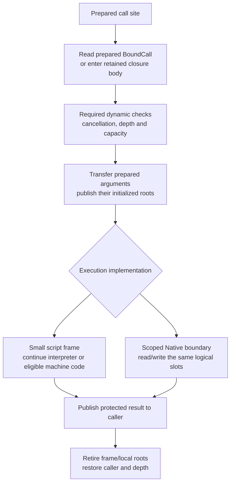

# Runtime Call and Native Execution Follow-up

Status: queued design, not activated by the completed immutable Program/reload
migration. Current product ownership, final call tables and publication are in the
[Runtime model](architecture/runtime.md) and [reload walkthrough](architecture/runtime/reload.md).
The [roadmap](implementation-roadmap.md#runtime-execution-model-review) owns any
future activation. The sketches below propose slot/frame/Native-adapter and
optimizing-native extensions; they are not current APIs or performance results.

## Candidate call execution model

This is subsequent call-model work. The implemented prepared call tables are
part of the reload design; logical slot storage, frame compaction and public Native
adapter changes remain separate review/implementation work. Reuse those tables
rather than creating another current/legacy dispatch mechanism.

Proposed on 2026-11-09 after the [empty-call measurements](performance-baseline.md#empty-call-attribution-windows-2026-11-08).
An ordinary empty script call costs about 531 ns; raw/flat Native about 640-660 ns;
owned Native about 1,977 ns. The owned path rebuilds type mappings twice and creates
two empty root leases. These results motivate moving stable preparation out of the
invocation and using one execution-slot protocol. They do not establish a speedup
for the proposed implementation or imply that all checks can move to installation.

### Prepare facts, then execute a bound call

| Boundary | Work and validity |
| --- | --- |
| Compile/verify Program | Check script types and call contracts; prepare argument/result locations, frame requirements, initialization/liveness facts and GC maps. Source-free verification independently proves the executable contracts. |
| Bind/install in Runtime | Match declarations/applications, resolve local host/type identities, check Rust mapping against the declared signature and prepare codecs, link dense call-site/entry tables and compatible call ABI. Facts are scoped to this installation and checked body/application. |
| Enter/resume from host | Check Runtime/installation/handle authority and phase; establish an exclusive activation and its code/root protection; validate actual external arguments. |
| Internal call | Use the frame's committed BoundCall; enter a current ordinary target or exact retained closure body, check cancellation/depth/capacity and transfer prepared operands. |
| Value access/conversion | Check actual object owner/generation, host availability, loans and value/result validity where required. Custom decoders/encoders still execute per value. |
| Return | Publish the result while protected, retire only this frame/local scope, restore caller state and release depth. Preserve trap/effect order. |

An internal call is not another host admission. Installation authority and code
liveness proved for an exclusive activation are reused until a callback, collection,
suspension or other relevant transition requires specific dynamic revalidation.
Publication/close cannot intervene in a synchronous activation. Moving Runtime
between threads is outside that interval. Avoid repeating installation HashMap and
whole-contract validation merely because another logical function was called.

Prepared code does not authorize arbitrary host-supplied values. A host boundary,
revoked opaque payload, mutable alias, expired view or changed loan still needs
the corresponding dynamic checks. Readonly values do not establish deep immutability.
If existing user-defined mapping hooks mix type description with per-value effects,
separate those contracts coherently; do not silently hoist arbitrary converter code.

### Core records and hot reload selection

[Prepared call tables](architecture/runtime/reload.md#exact-old-bodies-current-ordinary-calls)
own shared body/call recipes, installation-local final bindings and refreshed
activation views.
The later execution-slot model adds only:

```text
Execution
    frames[]                      exact body, PC, base, saved top, return destination
    slots                         logical arguments/locals/results
    local_roots                   scoped temporary roots with checkpoint rollback
```

Ordinary calls from a retained old body use its prebound current targets. The
body's private temporary layout may stay old while callee layouts change behind
the frozen call contract. Generic environments retain their lexical values and
proof origins while prepared recipes transport the necessary binder/witness keys.
No new type inference occurs in the call loop. Actual interface receivers and
captured closure values retain their distinct checked selection behavior.

### Slots, frames and return

Slots form an execution-owned logical stack. They can initially use the existing
scalar/managed banks; this proposal does not require Vec<Value>, a new universal
carrier or the deferred enum-layout cutover. Prepared locations/layouts explain
how an argument or result is read. Indices and generation checks survive storage
growth; no Rust slice or payload pointer stays borrowed across reentry/collection.
Compiled code can use its verified register/native calling convention and root
maps; logical slots do not require every machine-code call to copy through
interpreter Value records. Boundary adaptation remains explicit.



The compiler can place arguments directly in a prepared outgoing area or use a
bounded move plan. Preserve left-to-right once-only evaluation: in f(g(), h()),
g's result must already be rooted while h can allocate or reenter. Reuse capacity
in the ordinary stack suffix; do not run generic independent-window compaction
on a normal tail return. Parked/independently retired executions still need their
separate checked storage/cleanup policy.

Initialize real arguments and necessary GC state. Definite initialization and
root maps allow dead/uninitialized temporaries to avoid blanket Value clearing,
provided the collector/debugger cannot read stale bank contents. Unit requires
no payload/result slot in the proposed call ABI. A logical empty frame still
participates in depth, traces, cancellation and reload body selection; it cannot
be erased merely because it contains no data.

For a managed result, publish the caller's root before releasing callee/local
protection, through the existing non-collecting return handoff invariant. A failed
conversion or return does not undo completed callback effects.

### One Native boundary with prepared adapters

The proposed boundary is a scoped view over the same execution storage:

```text
NativeCall
    exclusive execution service access
    installed binding / closed signature / prepared codecs
    argument locations and caller result destination
    local-root checkpoint and scoped-loan cleanup
```

Typed Rust callbacks remain ergonomic; registration generates the thunk that reads
arguments and writes the declared result. Raw access and typed adapters use this
boundary, with the same identity, loan, cancellation and cleanup rules. The concrete
public context name and bind syntax are not settled by this record sketch.

Bind the Rust type mapping and expected script type once for a fixed application.
Invocation uses that codec; it does not construct a new TypeArgument just to prove
again that Rust () matches Unit. Custom value conversion, runtime owner/generation
checks and actual result validation remain where needed. A dynamic script handle
cannot pass solely because its Rust wrapper type was checked during registration.
Deep owned DTO conversion may still allocate according to its real data.

Arguments are already protected in their frame/outgoing slots. Decode directly
from those locations instead of cloning a Vec<Value> pack into two RootSets. New
temporary managed values use a stack-like local root area, reclaimed to a saved
mark on every exit. Empty/scalar calls take no root leases, reference-counted scope
objects or release-channel messages. Actual local-root growth is a fallible slow
path. A handle explicitly retained beyond the call needs a durable owning root;
requesting an owning argument representation also pays that ownership cost.

Synchronous Native execution normally invokes the callback and performs the common
return transition directly. Keep its logical Native frame for tracing/depth and
release storage borrows before arbitrary Rust/reentry. Do not require three generic
driver iterations for every callback. Explicit saved return/continuation state is
still necessary when the existing debugger/slicing contract admits parking after
the callback but before return. Preserve those observable boundaries and results;
never suspend a Running Rust callback or remove a poll/trace point without proving
its required behavior. Async work continues through owned Future/wait machinery.

### Reference mechanisms and acceptance

[Lua 5.4.9 ldo.c](https://github.com/lua/lua/blob/v5.4.9/ldo.c#L495-L528)
reuses CallInfo records and passes C-function arguments/results through its stack;
[OP_CALL](https://github.com/lua/lua/blob/v5.4.9/lvm.c) continues script execution
within the interpreter's existing C frame. Adopt reusable storage and narrow frame
transitions, not Lua's dynamic typing, missing-argument semantics or error unwinding.
Kagari retains checked types, current-inner-call selection and Rust-safe boundaries.

[JNI 25 local/global references](https://docs.oracle.com/en/java/javase/25/docs/specs/jni/design.html#global-and-local-references)
separate call-duration protection from longer native retention. Adopt that lifetime
distinction, not per-reference global leases for synchronous arguments or JNI's
thread-affine interface contract. Kagari's call scope stays on its active thread;
Runtime can move only between synchronous activations. Neither source proves an
expected Kagari speedup or permits dropping its handle/loan checks.

First acceptance witnesses are zero allocator requests for warmed empty/scalar
internal calls and Native adapters, no repeated static type/schema construction,
no duplicate empty root leases, table-based warm selection, and correct result/root
handoff. Also exercise storage growth, malformed source-free calls, custom codec
failure/effects, host reentry with GC, scoped loans, cancellation/depth, debugger/
slice exits, and old-body/current-inner-call reload with actual native selection.
Run the existing empty/control/Lua workloads on the implemented model before
claiming an improvement; the measured Lua numbers are context, not a promised target.

This design crosses Runtime/VM/SDK and, for call layouts/liveness/Unit storage,
compiler/bytecode/native ABI boundaries. It is not a Runtime-only patch. Exact
record layout, generated adapter API, slow-path ownership and observer/slice
transition details require review before a finite implementation phase is activated.

## AOT, JIT and deoptimization

Select the semantic body first, then a valid execution implementation of that
body. A native product describes its exact root body, backend/target/ABI and the
assumptions used by optimizations. Its immutable dependency evidence is shared;
whether it is usable in a particular installation belongs to Runtime-local bindings.
Publishing in Runtime A must not disable a product still valid in Runtime B.

For example, `attack@1` can be unchanged while its machine code becomes unusable:

```text
attack@1 calls damage()
    native variant N inlines damage@1
    optimization dependency: current damage body must be damage@1

publish damage@2
    keep attack@1 bytecode
    disable N for this installation
    interpret attack@1, whose damage() call now selects damage@2
    optionally compile a new native variant later
```

Track body-dependent inlining, constant propagation, devirtualization and other
assumptions, including transitive effects. A plain indirect current-dispatch call
does not by itself make its caller dependent on the callee's body version. Missing
dependency evidence requires conservative invalidation or refusing the optimization.
Imports alone are neither a sufficient nor a precise invalidation graph.

### Entry invalidation versus frame deoptimization

Initial native support retains the no-active-native-stack publication boundary.
No native stack may survive parking at this stage. Invalidation prevents entry into
an ineligible product, then selects valid machine code or verified bytecode before
execution. It does not require rewriting an active machine stack at publication.

A retained old computation may still use machine code for its own old root body
when its assumptions remain valid. If ordinary-callee assumptions became stale,
fallback uses that old root body's bytecode, not the new root body. New ordinary
calls never use a superseded root merely because its pages are still alive.

Later native continuations that survive publication, or speculative assumptions
that fail after native entry, require actual frame deoptimization. Unsupported
mechanisms must decline native execution before entry until that contract exists.
Reconstruction needs exact old body/bytecode PC, inline-frame chains, live locals
and temporaries, GC roots, supported object materialization and effect/trap state.
It resumes the original computation at the correct position and never restarts a
partially executed function or repeats a completed host call/mutation. Already
admitted inlined computations keep their selected body; later ordinary calls use
current implementations.

### Code eligibility and reclamation

Disabling an entry does not free executable memory. Frames, continuations, created
computations, installed entries and direct code links retain code owners and their
required metadata. Runtime GC dependencies remain explicitly rooted/traced; bare
IDs and Rust reference counts are not script roots. Reclamation requires no
remaining user of the address or dependency. Code/native owners must remain valid
after compiler destruction and Runtime thread migration.

AOT uses the same selection and dependency rules. Without a compiler, an invalid
AOT variant falls back to another eligible product or verified bytecode before
entry. Reclamation may be at library granularity: keep the containing DLL alive
while any retained entry/link needs it. Artifact decoding/validation errors remain
errors and never authorize fallback to unvalidated code.

### Primary-source comparison

[JVMTI 25 RedefineClasses](https://docs.oracle.com/en/java/javase/25/docs/specs/jvmti.html#RedefineClasses)
preserves active old method versions and static values. [OpenJDK 25+36](https://github.com/openjdk/jdk/blob/jdk-25%2B36/src/hotspot/share/prims/jvmtiRedefineClasses.cpp#L3748)
tracks dependent compiled code and deoptimizes it at a safepoint. Adopt the
separation of semantic body versions, optimization dependencies and executable
lifetime. Kagari differs by publishing between exclusive synchronous activations;
it does not need HotSpot's concurrent Java-thread publication coordination.

The existing [native product contract](spec/codegen-backend.md#compilation-interface-and-trust)
also separates compilation from page ownership; final products can outlive their
compiler. This design does not claim current Kagari implements optimizing tiers,
general native calls, native suspension or full frame deoptimization.
