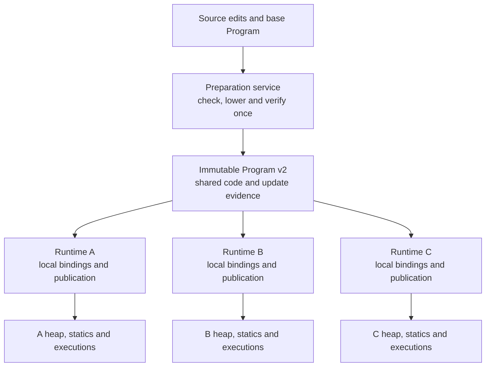
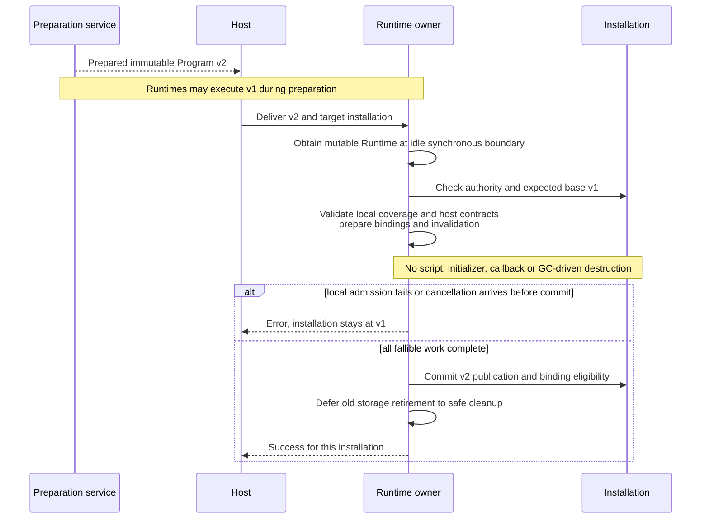
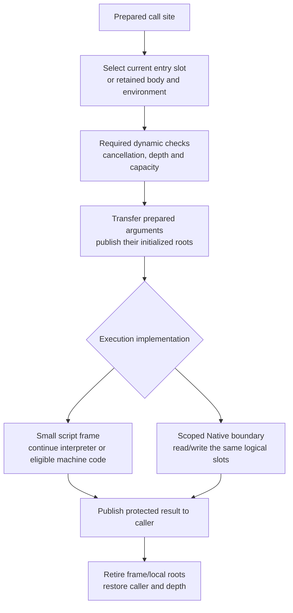

# Runtime Refactor Architecture

Status: target architecture under review, started on 2026-11-08. This document
records the intended ownership and execution model, beginning with hot reload.
It does not describe implemented replacement APIs or authorize implementation.
The [roadmap](implementation-roadmap.md#runtime-execution-model-review) owns scope,
sequencing and acceptance. Hot reload and a candidate synchronous call model are
covered. Concrete public Native registration APIs, physical value storage and
stdlib separation remain further review topics.

For the implementation being replaced, read the [Runtime execution map](architecture/runtime.md)
and [current reload walkthrough](architecture/runtime/reload.md). Existing behavior
remains specified by [module activation](spec/module-activation.md) and
[execution](spec/execution.md). The target preserves their observable semantics
while replacing preparation, ownership and publication mechanics.

## Hot reload: the core model

A preparation service builds one immutable Program version. The host distributes
that version to independent Runtime owners. Each Runtime checks and installs it
at its own exclusive scheduling boundary, preserving its own state.



Preparation does not borrow a Runtime. Source parsing, type checking, MIR/bytecode
generation and reusable verification do not repeat for each recipient. Loading
portable input in a different process still requires validation there; installed
state and authority are never accepted merely because another process prepared it.

Runtime remains Send and not Sync. It can move between host workers outside active
synchronous scopes; only its current owner drives execution or publishes a version.
Runtime-local current-version lookup goes through Runtime. Shared host handles
identify installations or hold explicit immutable snapshots; they do not query a
shared mutable current pointer without Runtime access.

## Names, identities and data ownership

The proposed name `Program` means the immutable compiled product requested by the
user. Today, SDK `PreparedProgram` mixes that product with preparation/cache state,
while runtime `Program` means a live installation handle. The target calls the
latter `InstalledProgram`. These are design names; final public names are not yet
implemented. Migration replaces the old model directly rather than adding aliases.

| Identity | Meaning | Lifetime rule |
| --- | --- | --- |
| Program revision | One exact immutable product and its checked evidence | Independent of any Runtime installation |
| Declaration/application | Checked function/type identity and generic arguments | Matched across compatible revisions; not a source-order or numeric-slot match |
| Body version | One exact executable body with its matching environments | Retained by actual computations/code dependencies |
| Installation | One Program instance in one supplying Runtime | Owner/generation checked; another Runtime has different authority |
| Native product | One machine-code implementation of an exact body under stated assumptions | Executable owner retains pages, links and metadata |

Conceptual records follow. This is a responsibility sketch, not Rust declarations
or a promise about physical collection types:

```text
PreparationService
    source inputs, compiler configuration, compiler state
    preparation caches and optional native compiler

Program                                      immutable, Send + Sync
    revision and expected update base
    shared module code and verified execution/link recipes
    declarations, exports, types and layouts
    checked update evidence and historical application requirements
    diagnostic metadata
    optional immutable native products

Runtime                                      exclusively driven, Send + !Sync
    installed programs, heap, executions, host bindings and scheduler

InstalledProgramState                        owned by its Runtime
    current: Publication
    persistent static cells and original initializer recipes
    historical requirements and Runtime-local native cache/bindings

Publication                                  one installation's current view
    program: Arc<Program>
    checked local declaration/application dispatch bindings
    local type, host and static-cell bindings

Frame / Closure / Future / QueuedInvocation
    retained exact body and matching type/capture environment
    explicit Runtime-owned roots/retention for code and GC dependencies
```

All Program components must satisfy the sharing contract; an outer Arc does not
make Rc/RefCell compiler state transferable. Same-process installations share
immutable code/products without sharing heap values, callbacks, static cells or
execution records. Receiving an Arc does not authorize access to another Runtime.
Close/unload revokes local authority even if code owners remain alive.

Arc is the shared-product storage model in this review. Exclusive Program storage
is deferred until its benefit and interaction with retained old bodies are measured.
It must not become a second set of reload semantics.

## Cache ownership

| Contents | Owner | Mutation and validity |
| --- | --- | --- |
| Source/IR preparation results and build deduplication | Preparation service | Updated during preparation, outside Runtime publication |
| Compiler instances, temporary arenas and scratch buffers | Compiler worker; optionally thread local | Disposable working state, not installed-code ownership |
| Hotness, selected native entries, JIT results and optimization validity | Runtime / installation | Follows this Runtime across worker migration; tied to exact bodies and assumptions |
| Final bytecode and machine-code products | Immutable owners shared where applicable | Products do not acquire mutable per-Runtime validity state |

An immutable Program has no RefCell-backed lazy compilation cache. Runtime JIT may
submit work to a compiler worker and retain the resulting product in its own cache.
Completed compilation returns a product, not an instruction to overwrite current
code: Runtime checks its body/configuration/assumptions before installing it.
An obsolete result cannot retarget a new ordinary call to an old body.

A thread-local compiler may be reused by several Runtimes. Its lifetime does not
keep their installed code alive, and moving a Runtime to another thread does not
lose its code ownership or reset installation validity. Shared native products
retain their executable pages independently of compiler destruction. Optional
compilation deduplication is outside the execution hot path and requires a concrete
owner; this design does not require a global synchronized code cache.

## Source update and host API

The host captures source edits and chooses their immutable base revision. The
preparation service applies the batch to a detached source candidate, checks the
complete candidate and prepares a new Program. It neither changes a running
installation nor silently advances every recipient's source baseline.

The following is proposed API usage, not currently callable Rust:

```text
// Preparation owner: compiler state stays here.
base: Arc<Program> = compiler.prepare(initial_inputs)?;
next: Arc<Program> = compiler.prepare_update(&base, edits)?;

// Host sends next.clone() to each Runtime owner through its own transport.
// Each owner already holds its own InstalledProgram handle.
runtime.replace_program(&installed, next)?;    // Requires &mut Runtime.
```

`prepare_update` takes no Runtime reference or Runtime-scoped source locator.
Function edits identify declarations in the selected Program's checked source
context. Whole-file edits preserve captured module/package mappings. Concrete
edit-builder and compiler-service APIs remain to be settled; there is no new
source resolver inside Runtime.

`replace_program` accepts a prepared product, validates local admission, and
returns success or an error for that installation. It performs no source analysis,
MIR lowering or hidden native compilation. It may allocate checked local bindings
and new static-cell records. Existing callable bindings keep their declaration
identity; successful publication does not require reacquiring them.

Preparation includes the lineage's historical application requirements. For
example, a v1 Future may still call `helper<OldType>` after v2 removes that call
from new source. The candidate must supply the current implementation for that
application, not just compile applications reachable from new source. Portable
requirements must be prepared once from version history; local admission still
checks coverage of the installation's actual history. Missing coverage rejects,
without a per-Runtime compile fallback or substitution of old helper code.

Each recipient checks its expected base. A Runtime still on v0 cannot silently
apply a transition prepared only for v1. The host supplies a checked transition
covering that base or updates it through admitted revisions. A host rollout pointer
does not advance a Runtime that failed installation. Fleet-wide synchronization
and business-state coordination belong to the host.

For a separate preparation process, distribute portable bytecode/AOT artifacts and
update evidence. Arc pointers and machine addresses are process-local. The receiving
process validates/maps the product before sharing it with its Runtime owners.
No compiler or source frontend is required in a bytecode/AOT-only recipient.

## Local staging and publication



The steps and invariants are:

1. Check Runtime phase, installation owner/generation and exact expected base.
   No synchronous execution/driver, callback, observer, reentry or their cleanup
   may be active. Parked computations and producer-side completion notifications
   are allowed; notifications do not execute script.
2. Check reusable evidence against the local baseline/history and admitted host
   capabilities. Build local dispatch/type bindings, static-cell additions and
   machine-code eligibility changes. Existing cell values/states stay untouched.
   Ordinary staging runs no initializers or candidate functions. Drop/GC cleanup
   that could call host code is deferred beyond this preparation/commit interval.
3. Complete allocations and fallible checks before visibility changes. A future
   separately staged token must recheck base/authority at commit; a single mutable
   call cannot assume that a detached candidate's earlier base check suffices.
4. Commit the complete publication and corresponding local binding changes in one
   non-failing, non-reentrant segment. No execution can observe partly switched
   module tables or stale native eligibility. Logical atomicity here needs no
   AtomicPtr or Mutex protecting current, because the Runtime owner is exclusive.
5. Release the exclusive operation; retire superseded records only through safe
   cleanup. A completed commit remains committed even if a cancellation arrives
   afterward. Success is not conditional on destroying every old code owner.

An &mut API expresses exclusive ownership but does not by itself prove that all
internal/reentrant scopes are idle. Keep the admission invariants; replacing a
Mutex or removing a guard mechanically is not the refactor.

## Updating one small module

One installation publication covers a complete checked executable graph. Its
physical contents can reuse unchanged module products:

```text
Publication v1                   Publication v2
    combat@1                        combat@2       new code
    player@1                        player@1       same immutable product
    inventory@1                     inventory@1    same immutable product
```

The new Program view is a consistent set of modules, declarations and dependencies.
Replacing it does not reset Runtime state or require copying all code/native pages.
Compilation units, publication units and invalidation units are distinct. Changed
dependencies may still require rebuilding otherwise unchanged consumers.

The current bytecode uses program-local slots and definition evidence, so arbitrary
module splicing is invalid. First preserve complete verified candidates at the new
ownership boundary. Independent module products require checked references,
relocation/link recipes and compatible identity mapping across compiler, bytecode,
SDK and Runtime. Incremental compilation and minimal rebuilds are not promised by
this architecture document.

## Calls and old computations after publication

Ordinary calls resolve a stable declaration/application through this installation's
current bindings. Created closures/Futures, admitted frames and queued invocations
retain their selected exact body/provider and matching environment. The same rule
applies to interpreter, JIT and AOT; execution backend is not a source-level choice.

```text
Before publication:
    a Future has selected resume_body@v1 and parked

After publishing v2:
    a new named call selects its current body@v2
    the old Future resumes resume_body@v1 at its retained PC
    an ordinary helper() call inside it selects helper@v2
```

Version selection uses prepared bindings, not source lookup, whole-program
compatibility checking or repeated type inference on every call. The synchronous
execution interval has stable publication state. After parking, the next activation
must observe the new current bindings for ordinary calls, even when its own body
is old. This does not freeze an old transitive call graph.

Preserve all existing declaration/type/layout/ABI compatibility checks, including
private declarations and static initializers. Persistent cell values and original
initialization recipes survive. New cells are staged privately. Publication does
not migrate objects, rerun initializers, roll back effects or rehash collections.
Rolling back business code is another checked publication; assigning an older Arc
does not bypass declarations/statics introduced in the meantime.

## Candidate call execution model

Proposed on 2026-11-09 after the [empty-call measurements](performance-baseline.md#empty-call-attribution-windows-2026-11-08).
An ordinary empty script call costs about 531 ns; raw/flat Native about 640-660 ns;
owned Native about 1,977 ns. The owned path rebuilds type mappings twice and creates
two empty root leases. These results motivate moving stable preparation out of the
invocation and using one execution-slot protocol. They do not establish a speedup
for the proposed implementation or imply that all checks can move to installation.

### Prepare facts, then execute a bound call

| Boundary | Work and validity |
| --- | --- |
| Compile/verify Program | Check script types and call contracts; prepare argument/result locations, frame requirements, initialization/liveness facts and GC maps. Source-free verification independently proves the executable contracts. |
| Bind/install in Runtime | Match declarations/applications, resolve local host/type identities, check Rust mapping against the declared signature and prepare codecs, link dense call-site/entry tables and compatible call ABI. Facts are scoped to this installation and checked body/application. |
| Enter/resume from host | Check Runtime/installation/handle authority and phase; establish an exclusive activation and its code/root protection; validate actual external arguments. |
| Internal call | Select the current or retained target through linked tables, check required cancellation/depth/capacity, transfer prepared operands and enter a small logical frame or synchronous Native boundary. |
| Value access/conversion | Check actual object owner/generation, host availability, loans and value/result validity where required. Custom decoders/encoders still execute per value. |
| Return | Publish the result while protected, retire only this frame/local scope, restore caller state and release depth. Preserve trap/effect order. |

An internal call is not another host admission. Installation authority and code
liveness proved for an exclusive activation are reused until a callback, collection,
suspension or other relevant transition requires specific dynamic revalidation.
Publication/close cannot intervene in a synchronous activation. Moving Runtime
between threads is outside that interval. Avoid repeating installation HashMap and
whole-contract validation merely because another logical function was called.

Prepared code does not authorize arbitrary host-supplied values. A host boundary,
revoked opaque payload, mutable alias, expired view or changed loan still needs
the corresponding dynamic checks. Readonly values do not establish deep immutability.
If existing user-defined mapping hooks mix type description with per-value effects,
separate those contracts coherently; do not silently hoist arbitrary converter code.

### Core records and hot reload selection

The following are logical records, not finalized Rust types:

```text
Program
    CallSiteDescription[]         portable declarations/applications and operands
    BodyCode[]                    exact code, frame/GC facts and call ABI

Runtime installation
    LinkedCallSite[]              dense links to local entry slots and transfers
    current_entries[]             stable entry slot -> current body/implementation
    PreparedNativeBinding[]       callback/state and installed codec plans

Execution
    frames[]                      logical frames: exact body, PC, base, saved top,
                                  return destination, optional applied environment
    slots                         logical argument/local/result storage
    local_roots                   scoped temporary roots with checkpoint rollback
```

Shared Program code contains no Runtime pointers or local table indices. Its
call-site ordinal indexes a Runtime-linked array, which names an installation-local
entry slot. Ordinary call selection is an indexed lookup, not a declaration search
or new publication mapping. Retained body code also keeps its matching local links.
Interface calls select through checked receiver/witness information; closure calls
select their retained body/environment. They join the same operand/frame protocol
after selection, without erasing their distinct selection semantics.

Publication prepares affected entry/binding changes, including retained-caller
binder/application correspondence, before commit. A compatible call ABI fixes the
parameter/result contract across body replacement; a body's private temporary
layout may change. No generic inference or correspondence construction is repeated
on an ordinary warm call. Closed generic Native applications can prepare a binding
once per checked application in a Runtime-owned cache with explicit version validity.

Updating helper@v1 to helper@v2 changes its current entry. An old Future keeps its
resume body@v1 and its environment, while its ordinary helper call reads the
current helper slot. Never patch a retained closure's own body to the new body or
cache a transitive old dependency choice across parking. AOT/JIT selection uses the
same semantic entry and the native eligibility rules below.

### Slots, frames and return

Slots form an execution-owned logical stack. They can initially use the existing
scalar/managed banks; this proposal does not require Vec<Value>, a new universal
carrier or the deferred enum-layout cutover. Prepared locations/layouts explain
how an argument or result is read. Indices and generation checks survive storage
growth; no Rust slice or payload pointer stays borrowed across reentry/collection.
Compiled code can use its verified register/native calling convention and root
maps; logical slots do not require every machine-code call to copy through
interpreter Value records. Boundary adaptation remains explicit.



The compiler can place arguments directly in a prepared outgoing area or use a
bounded move plan. Preserve left-to-right once-only evaluation: in f(g(), h()),
g's result must already be rooted while h can allocate or reenter. Reuse capacity
in the ordinary stack suffix; do not run generic independent-window compaction
on a normal tail return. Parked/independently retired executions still need their
separate checked storage/cleanup policy.

Initialize real arguments and necessary GC state. Definite initialization and
root maps allow dead/uninitialized temporaries to avoid blanket Value clearing,
provided the collector/debugger cannot read stale bank contents. Unit requires
no payload/result slot in the proposed call ABI. A logical empty frame still
participates in depth, traces, cancellation and reload body selection; it cannot
be erased merely because it contains no data.

For a managed result, publish the caller's root before releasing callee/local
protection, through the existing non-collecting return handoff invariant. A failed
conversion or return does not undo completed callback effects.

### One Native boundary with prepared adapters

The proposed boundary is a scoped view over the same execution storage:

```text
NativeCall
    exclusive execution service access
    installed binding / closed signature / prepared codecs
    argument locations and caller result destination
    local-root checkpoint and scoped-loan cleanup
```

Typed Rust callbacks remain ergonomic; registration generates the thunk that reads
arguments and writes the declared result. Raw access and typed adapters use this
boundary, with the same identity, loan, cancellation and cleanup rules. The concrete
public context name and bind syntax are not settled by this record sketch.

Bind the Rust type mapping and expected script type once for a fixed application.
Invocation uses that codec; it does not construct a new TypeArgument just to prove
again that Rust () matches Unit. Custom value conversion, runtime owner/generation
checks and actual result validation remain where needed. A dynamic script handle
cannot pass solely because its Rust wrapper type was checked during registration.
Deep owned DTO conversion may still allocate according to its real data.

Arguments are already protected in their frame/outgoing slots. Decode directly
from those locations instead of cloning a Vec<Value> pack into two RootSets. New
temporary managed values use a stack-like local root area, reclaimed to a saved
mark on every exit. Empty/scalar calls take no root leases, reference-counted scope
objects or release-channel messages. Actual local-root growth is a fallible slow
path. A handle explicitly retained beyond the call needs a durable owning root;
requesting an owning argument representation also pays that ownership cost.

Synchronous Native execution normally invokes the callback and performs the common
return transition directly. Keep its logical Native frame for tracing/depth and
release storage borrows before arbitrary Rust/reentry. Do not require three generic
driver iterations for every callback. Explicit saved return/continuation state is
still necessary when the existing debugger/slicing contract admits parking after
the callback but before return. Preserve those observable boundaries and results;
never suspend a Running Rust callback or remove a poll/trace point without proving
its required behavior. Async work continues through owned Future/wait machinery.

### Reference mechanisms and acceptance

[Lua 5.4.9 ldo.c](https://github.com/lua/lua/blob/v5.4.9/ldo.c#L495-L528)
reuses CallInfo records and passes C-function arguments/results through its stack;
[OP_CALL](https://github.com/lua/lua/blob/v5.4.9/lvm.c) continues script execution
within the interpreter's existing C frame. Adopt reusable storage and narrow frame
transitions, not Lua's dynamic typing, missing-argument semantics or error unwinding.
Kagari retains checked types, current-implementation selection and Rust-safe boundaries.

[JNI 25 local/global references](https://docs.oracle.com/en/java/javase/25/docs/specs/jni/design.html#global-and-local-references)
separate call-duration protection from longer native retention. Adopt that lifetime
distinction, not per-reference global leases for synchronous arguments or JNI's
thread-affine interface contract. Kagari's call scope stays on its active thread;
Runtime can move only between synchronous activations. Neither source proves an
expected Kagari speedup or permits dropping its handle/loan checks.

First acceptance witnesses are zero allocator requests for warmed empty/scalar
internal calls and Native adapters, no repeated static type/schema construction,
no duplicate empty root leases, table-based warm selection, and correct result/root
handoff. Also exercise storage growth, malformed source-free calls, custom codec
failure/effects, host reentry with GC, scoped loans, cancellation/depth, debugger/
slice exits, and old-body/current-inner-call reload with actual native selection.
Run the existing empty/control/Lua workloads on the implemented model before
claiming an improvement; the measured Lua numbers are context, not a promised target.

This design crosses Runtime/VM/SDK and, for call layouts/liveness/Unit storage,
compiler/bytecode/native ABI boundaries. It is not a Runtime-only patch. Exact
record layout, generated adapter API, slow-path ownership and observer/slice
transition details require review before a finite implementation phase is activated.

## AOT, JIT and deoptimization

Select the semantic body first, then a valid execution implementation of that
body. A native product describes its exact root body, backend/target/ABI and the
assumptions used by optimizations. Its immutable dependency evidence is shared;
whether it is usable in a particular installation belongs to Runtime-local bindings.
Publishing in Runtime A must not disable a product still valid in Runtime B.

For example, `attack@1` can be unchanged while its machine code becomes unusable:

```text
attack@1 calls damage()
    native variant N inlines damage@1
    optimization dependency: current damage body must be damage@1

publish damage@2
    keep attack@1 bytecode
    disable N for this installation
    interpret attack@1, whose damage() call now selects damage@2
    optionally compile a new native variant later
```

Track body-dependent inlining, constant propagation, devirtualization and other
assumptions, including transitive effects. A plain indirect current-dispatch call
does not by itself make its caller dependent on the callee's body version. Missing
dependency evidence requires conservative invalidation or refusing the optimization.
Imports alone are neither a sufficient nor a precise invalidation graph.

### Entry invalidation versus frame deoptimization

Initial native support retains the no-active-native-stack publication boundary.
No native stack may survive parking at this stage. Invalidation prevents entry into
an ineligible product, then selects valid machine code or verified bytecode before
execution. It does not require rewriting an active machine stack at publication.

A retained old computation may still use machine code for its own old root body
when its assumptions remain valid. If ordinary-callee assumptions became stale,
fallback uses that old root body's bytecode, not the new root body. New ordinary
calls never use a superseded root merely because its pages are still alive.

Later native continuations that survive publication, or speculative assumptions
that fail after native entry, require actual frame deoptimization. Unsupported
mechanisms must decline native execution before entry until that contract exists.
Reconstruction needs exact old body/bytecode PC, inline-frame chains, live locals
and temporaries, GC roots, supported object materialization and effect/trap state.
It resumes the original computation at the correct position and never restarts a
partially executed function or repeats a completed host call/mutation. Already
admitted inlined computations keep their selected body; later ordinary calls use
current implementations.

### Code eligibility and reclamation

Disabling an entry does not free executable memory. Frames, continuations, created
computations, installed entries and direct code links retain code owners and their
required metadata. Runtime GC dependencies remain explicitly rooted/traced; bare
IDs and Rust reference counts are not script roots. Reclamation requires no
remaining user of the address or dependency. Code/native owners must remain valid
after compiler destruction and Runtime thread migration.

AOT uses the same selection and dependency rules. Without a compiler, an invalid
AOT variant falls back to another eligible product or verified bytecode before
entry. Reclamation may be at library granularity: keep the containing DLL alive
while any retained entry/link needs it. Artifact decoding/validation errors remain
errors and never authorize fallback to unvalidated code.

### Primary-source comparison

[JVMTI 25 RedefineClasses](https://docs.oracle.com/en/java/javase/25/docs/specs/jvmti.html#RedefineClasses)
preserves active old method versions and static values. [OpenJDK 25+36](https://github.com/openjdk/jdk/blob/jdk-25%2B36/src/hotspot/share/prims/jvmtiRedefineClasses.cpp#L3748)
tracks dependent compiled code and deoptimizes it at a safepoint. Adopt the
separation of semantic body versions, optimization dependencies and executable
lifetime. Kagari differs by publishing between exclusive synchronous activations;
it does not need HotSpot's concurrent Java-thread publication coordination.

The existing [native product contract](spec/codegen-backend.md#compilation-interface-and-trust)
also separates compilation from page ownership; final products can outlive their
compiler. This design does not claim current Kagari implements optimizing tiers,
general native calls, native suspension or full frame deoptimization.

## Changes from the current architecture

| Current implementation | Target |
| --- | --- |
| SDK Runtime::update owns source replay and compilation inside a publication guard | Preparation service builds once while recipients continue running, then distributes the product |
| PreparedProgram combines Rc-owned product state and a RefCell native cache | Immutable transferable Program, separate preparation state and Runtime-local JIT cache/bindings |
| Program/Module handles query a Mutex-backed current pointer without Runtime | Installation identity handles, Runtime-owned live lookup and explicit immutable snapshots |
| Reload accepts &self with dynamic exclusivity checks | Mutable Runtime publication API with retained synchronous-scope admission invariants |
| Historical demands are supplied to source compilation from the selected Runtime | Portable version-lineage preparation plus local coverage admission |
| Native preparation/execution have product-specific handles and separate entrypoints | Select the semantic body through common call semantics, then its eligible implementation |

The target does not claim cheaper setup merely because ownership changes. Local
binding/identity work must be measured and factored into reusable recipes versus
installation-specific authority without weakening validation. The existing
[multi-Runtime sharing plan](multi-runtime-sharing-plan.md) retains that measurement
and implementation scope; this document does not create another sharing project.
The [current-cell lock measurement](performance-baseline.md#installation-current-cell-mutex-measurement-windows-2026-11-08)
finds a limited call-path contribution under fixed publications. It supports neither
a lock-only explanation for the call gap nor production snapshot caching.
The [empty-call attribution](performance-baseline.md#empty-call-attribution-windows-2026-11-08)
also identifies heavy per-call admission and repeated owned-conversion type/root
construction. It motivates the [candidate call model](#candidate-call-execution-model);
the public replacement API and implementation remain unactivated.

## Implementation boundaries and review acceptance

This document authorizes no production cutover. The roadmap retains the finite
implementation sequence and existing native/sharing plan owners. Before starting:

- Settle the exact immutable product and installation APIs, checked revision/base
  evidence, identity adoption and portable historical-demand representation.
- Replace SDK Runtime-owned source compilation orchestration and the mixed
  Rc/RefCell PreparedProgram owner coherently; review Runtime/VM/SDK consumers.
- Establish Runtime-local native validity and cache ownership; preserve actual
  native execution and product lifetime coverage rather than testing only fallback.
- Keep independent module linking, optimizing tiers/native continuations, enum
  layouts and unrelated frontend/collector refactors deferred unless activated.

Acceptance must demonstrate one prepared candidate distributed to independent
Runtime owners on different threads, independent static state and host bindings,
one-recipient rejection, stale-base rejection, old-Future/new-helper selection,
historical generic coverage and cleanup after old owners retire. For supported
native paths, also cover shared-product validity in different installations,
unchanged-caller/changed-inline-dependency invalidation, AOT fallback and eventual
page/library retirement. Future stack deoptimization needs effect-preserving
continuation tests before it can be enabled.

These are required architectural witnesses, not a new exhaustive test matrix or
performance claim. Measure preparation once separately from per-Runtime admission,
binding/publication, hot-call cost and retained memory; an Arc count alone is not
evidence of cheap installation or faster execution.
