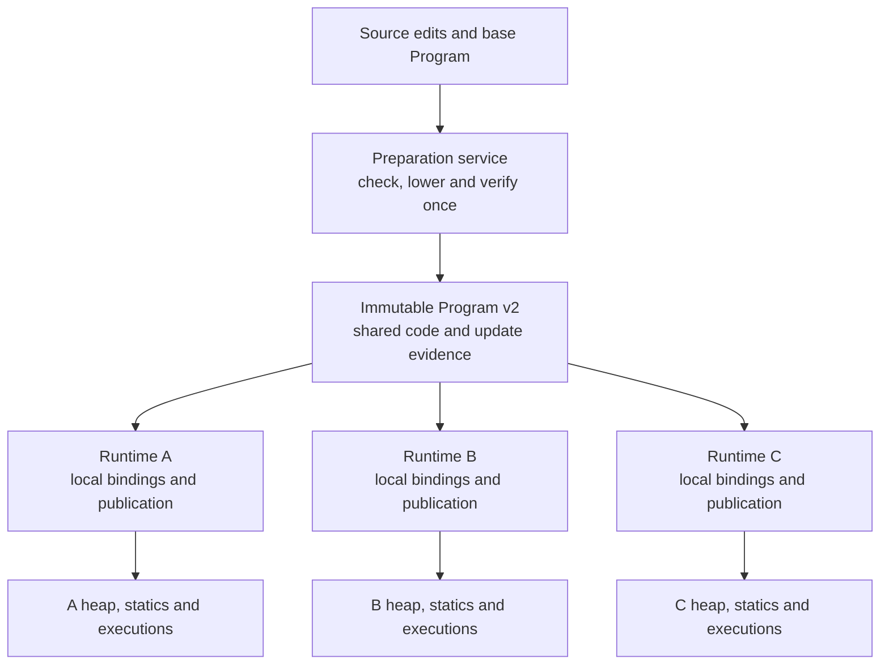
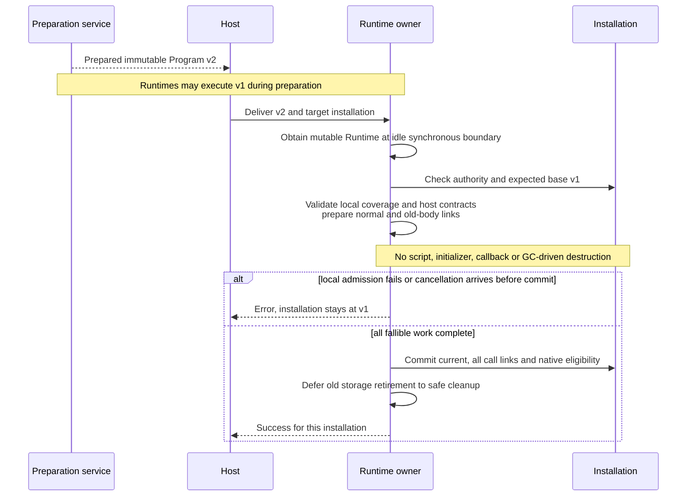
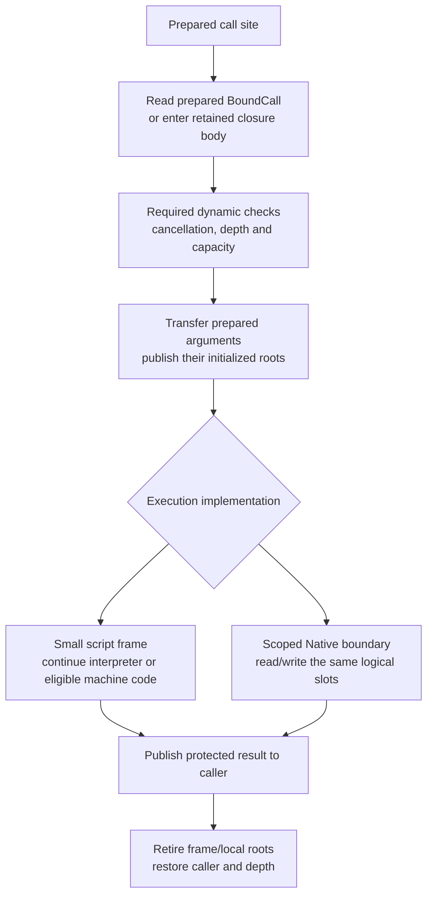

# Runtime Refactor Architecture

Status: target architecture review started on 2026-11-08. On 2026-11-09 the user
selected shared whole-version retention and prepared call-table redirection:
current-version code uses normal links, while retained old bodies use links
prepared against current implementations. The MS00 ownership/API choices below
are selected for implementation; the later slot/Native-adapter model remains
under review. On 2026-11-09 the user
authorized execution of MS00-MS05 and a commit per completed phase. The [roadmap](implementation-roadmap.md#runtime-execution-model-review)
owns scope, sequencing and acceptance. The existing
[MS00-MS05 implementation plan](multi-runtime-sharing-plan.md#phases) is ready;
MS00 is locally accepted; production cutover begins in MS01.

For implemented ownership and execution, read the [Runtime execution map](architecture/runtime.md)
and [reload walkthrough](architecture/runtime/reload.md). [Module activation](spec/module-activation.md)
and [execution](spec/execution.md) own existing semantics. The selected target
preserves old-body/current-inner-call behavior and replaces its preparation,
ownership and dispatch mechanics. Whole-old-call-graph freezing and automatic
drain/dependency-impact analysis are superseded alternatives, not additional modes.

## Hot reload: the core model

A preparation service builds one immutable Program version. The host distributes
that version to independent Runtime owners. Each Runtime checks and installs it
at its own exclusive scheduling boundary, preserving its own state. Fresh named
calls select current implementations. Created closures/Futures and admitted work
retain their exact bodies and environments; their ordinary inner calls use the
current implementations through prepared links. Publication can proceed while
old work is parked, without waiting for every Future to finish.



Preparation does not borrow a Runtime. Source parsing, type checking, MIR/bytecode
generation and reusable verification do not repeat for each recipient. Loading
portable input in a different process still requires validation there; installed
state and authority are never accepted merely because another process prepared it.

Runtime remains Send and not Sync. It can move between host workers outside active
synchronous scopes; only its current owner drives execution or publishes a version.
Runtime-local current-version lookup goes through Runtime. Shared host handles
identify installations or hold explicit immutable snapshots; they do not query a
shared mutable current pointer without Runtime access.

### Initial reload scope and decisions

The initial scope is Runtime-owned current-version access without the call-path
current-cell Mutex, plus detached preparation and independent Runtime publication.
The decisions below close the reload review points raised on 2026-11-09. They do
not make the later call-model proposal a prerequisite. Implementation now follows
the separately authorized MS00-MS05 plan.

| Review point | Initial decision |
| --- | --- |
| Current-version access | Runtime owns current; live lookup requires Runtime access. Installation/namespace handles carry identity, while explicit snapshots retain immutable metadata. Keep synchronous-scope admission checks. |
| Shared product and retention | Share immutable Program revisions through Arc and retain complete revisions until their last owner releases them. Per-body reclamation is deferred. |
| Source update context | A source-editable Program retains its exact immutable compilation capsule. Preparation consumes that capsule outside Runtime; mutable compiler/cache state stays preparation-owned. |
| Version history | Prepare from one exact base, preserving frozen contracts and bounded cumulative historical application demands, including old callers and host entries. Initially advance installations through that version chain; branch merging and skipped-base transitions are deferred. |
| Call selection | Retained computations keep exact bodies. Current code uses normal links; old bodies use prepared links directly to current ordinary callees. Named function values and live host bindings follow their declarations, while actual closures retain their own body. |
| Publication | Prepare candidate normal links, retained-body redirects, native eligibility and compatibility metadata before a non-failing joint commit. Preserve old bodies, environments and static cell state; failure leaves current and all links unchanged. |
| Deferred mechanisms | Independent module linking, call-slot/Native-adapter redesign, optimizing native tiers, frame deoptimization and finer reclamation are outside this initial scope. Preserve supported native execution. |

The current-version direct-call path has no reload-specific version comparison,
retired-version lookup, current-cell lock or legacy-adaptation branch. Its ordinary
call costs remain a separate concern. Old call-site redirection is materialized
before execution; generic environment transfer and dynamic value/borrow checks
still execute where required. Interface and closure calls retain their normal
dynamic selection rules. These are architecture/acceptance requirements, not a
measured performance result.

## Names, identities and data ownership

The proposed name `Program` means the immutable compiled product requested by the
user. Today, SDK `PreparedProgram` mixes that product with preparation/cache state,
while runtime `Program` means a live installation handle. The target calls the
latter `InstalledProgram`. MS00 selects these public names; their migration starts
in MS01. Replace the old model directly rather than adding compatibility aliases.

| Identity | Meaning | Lifetime rule |
| --- | --- | --- |
| Program revision | One exact immutable product and its checked evidence | Independent of any Runtime installation |
| Declaration/application | Checked function/type identity and generic arguments | Matched across compatible revisions; not a source-order or numeric-slot match |
| Body version | One exact executable body with its matching environments | Retained by actual computations/code dependencies |
| Installation | One Program instance in one supplying Runtime | Owner/generation checked; another Runtime has different authority |
| Native product | One machine-code implementation of an exact body under stated assumptions | Executable owner retains pages, links and metadata |

Conceptual records follow. This is a responsibility sketch, not Rust declarations
or a promise about physical collection types:

```text
PreparationService
    source inputs, compiler configuration, compiler state
    preparation caches and optional native compiler

Program                                      immutable, Send + Sync
    revision and expected update base
    shared module code and verified execution/link recipes
    declarations, exports, types and layouts
    checked update evidence and historical application requirements
    diagnostic metadata
    optional immutable source-update compilation capsule
    optional immutable native products

Runtime                                      exclusively driven, Send + !Sync
    installed programs, heap, executions, host bindings and scheduler

InstalledProgramState                        owned by its Runtime
    current: RevisionKey
    revisions: RevisionStore
    persistent static cells and original initializer recipes
    historical requirements and Runtime-local native cache/bindings

RevisionRecord                               one local installed code revision
    program: Arc<Program>
    own_bindings: LocalBindings
    call_links: CallTable

Frame / Closure / Future / QueuedInvocation
    shared owner of the complete selected Program revision
    retained exact body and matching type/capture environment
    explicit Runtime-owned roots/retention for code and GC dependencies
```

All Program components must satisfy the sharing contract; an outer Arc does not
make Rc/RefCell compiler state transferable. Same-process installations share
immutable code/products without sharing heap values, callbacks, static cells or
execution records. Receiving an Arc does not authorize access to another Runtime.
Close/unload revokes local authority even if code owners remain alive.

Arc is the shared-product storage model in this review. Exclusive Program storage
is deferred until its benefit and interaction with retained old bodies are measured.
It must not become a second set of reload semantics.

### Whole-version retention

Decision on 2026-11-09: initially retain complete immutable Program revisions.
A Future, closure, admitted frame or queued invocation retains its selected body
through the owning Program, together with the necessary Runtime-local bindings
and roots. Per-body code reclamation is deferred. Retaining an old Program keeps
its storage alive; ordinary inner calls use the current targets in prepared links.
Whole-version retention does not pin the old transitive call selection.

When a Future completes, is cancelled or is dropped, its normal cleanup releases
retention no longer needed by that computation. The complete old Program becomes
reclaimable only after its last owner releases it. Other computations, another
Runtime's current publication, original static initializer recipes, retained
type/layout dependencies or explicit host owners can keep it alive. Script GC
and safe cleanup still govern Runtime-local dependencies; a Future completing
in one Runtime does not free storage used elsewhere. This decision does not
implement the deferred [type-only retention separation](review.md#r13--type-and-layout-provenance-retains-retired-code).

Same-process Runtimes receiving the same Arc share one immutable Program product
per revision; each retains its own state and required local bindings. Shared code
memory therefore follows the distinct retained products, rather than the number
of installations times a full code copy. Different revisions can still occupy
complete separate products; cross-revision module reuse is not a prerequisite.
Long-lived old computations can retain many revisions, so sharing alone does not
establish a small memory bound. Measure shared products and Runtime-local retained
state separately under the existing sharing plan before refining reclamation.

Expected-base and historical-demand metadata must not require a strong chain of
all predecessor Programs. Keep those records without executable leases. Revision
storage is not itself a permanent GC/retention root; reclaim unneeded records
through explicit retention and traced dependencies, not Arc counts alone.

## Cache ownership

| Contents | Owner | Mutation and validity |
| --- | --- | --- |
| Source/IR preparation results and build deduplication | Preparation service | Updated during preparation, outside Runtime publication |
| Compiler instances, temporary arenas and scratch buffers | Compiler worker; optionally thread local | Disposable working state, not installed-code ownership |
| Hotness, selected native entries, JIT results and optimization validity | Runtime / installation | Follows this Runtime across worker migration; tied to exact bodies and assumptions |
| Final bytecode and machine-code products | Immutable owners shared where applicable | Products do not acquire mutable per-Runtime validity state |

An immutable Program has no RefCell-backed lazy compilation cache. Runtime JIT may
submit work to a compiler worker and retain the resulting product in its own cache.
Completed compilation returns a product, not an instruction to overwrite current
code: Runtime checks its body/configuration/assumptions before installing it.
An obsolete result cannot retarget a new ordinary call to an old body.

A thread-local compiler may be reused by several Runtimes. Its lifetime does not
keep their installed code alive, and moving a Runtime to another thread does not
lose its code ownership or reset installation validity. Shared native products
retain their executable pages independently of compiler destruction. Optional
compilation deduplication is outside the execution hot path and requires a concrete
owner; this design does not require a global synchronized code cache.

## Source update and host API

The host captures source edits and chooses their immutable base revision. The
preparation service applies the batch to a detached source candidate, checks the
complete candidate and prepares a new Program. It neither changes a running
installation nor silently advances every recipient's source baseline.

The following is proposed API usage, not currently callable Rust:

```text
// Preparation owner: compiler state stays here.
base: Program = engine.prepare(initial_inputs, options)?;
next: Program = base.prepare_update(edits)?;

// Host sends next.clone() to each Runtime owner through its own transport.
// Each owner already holds its own InstalledProgram handle.
runtime.replace_program(&installed, &next, options)?; // Requires &mut Runtime.
```

`prepare_update` takes no Runtime reference or Runtime-scoped source locator.
Function edits identify declarations in the selected Program's checked source
context. Whole-file edits preserve captured module/package mappings. The MS00 API
table fixes the product/preparation/Runtime boundary;
ordinary builder/options details remain implementation choices. There is no new
source resolver inside Runtime. A source-editable Program retains
its exact immutable compilation capsule, including captured source/package inputs
and semantic lowering settings. This reuses the existing Send + Sync capsule
boundary; mutable compiler queries and caches stay preparation-owned. Missing
compilation context rejects a source edit, including for artifact-only input;
diagnostic source text is not a substitute. Whole-version retention also retains
any attached capsule, whose memory must be included in product measurements.

`replace_program` accepts a prepared product, validates local admission, and
returns success or an error for that installation. It performs no source analysis,
MIR lowering or hidden native compilation. It may allocate checked local bindings
and new static-cell records. Existing callable bindings keep their declaration
identity; successful publication does not require reacquiring them.

Preparation includes bounded cumulative historical application demands. A v1
Future may still call `helper<OldType>` after v2 removes that application from new
source; v2 must provide its current implementation. Preserve the existing shared
contract solver, executable/provenance validation and admission limits. Carry the
portable requirements through version lineage, without querying or compiling
separately for each Runtime. Local admission independently checks actual history,
host bindings and executable coverage; a candidate label cannot waive those checks.

Preparation may share source-revision-to-candidate declaration matching and
transfer recipes. Runtime instantiates its owner/type/host/static bindings and
materializes final call links. Do not reconstruct correspondence or run type
inference at each ordinary call. This also preserves current coverage for retained
host Function/method/interface bindings. Equal source text alone does not prove
an equal update base, historical demand envelope or installation authority.

Each recipient checks its expected base. A Runtime still on v0 cannot silently
apply a transition prepared only for v1. Initially the host updates it through
admitted revisions; skipped-base transitions and branch merging are deferred.
A host rollout pointer does not advance a Runtime that failed installation.
Fleet-wide synchronization and business-state coordination belong to the host.

For a separate preparation process, distribute portable bytecode/AOT artifacts and
update evidence. Arc pointers and machine addresses are process-local. The receiving
process validates/maps the product before sharing it with its Runtime owners.
No compiler or source frontend is required in a bytecode/AOT-only recipient.

## Local staging and publication



The steps and invariants are:

1. Check Runtime phase, installation owner/generation and exact expected base.
   No synchronous execution/driver, callback, observer, reentry or their cleanup
   may be active. Parked computations and producer-side completion notifications
   are allowed; notifications do not execute script.
2. Check reusable evidence against the local baseline/history and admitted host
   capabilities. Prepare the candidate's normal call/type bindings and redirects
   for all retained source revisions, static-cell additions and native eligibility.
   Existing call tables, code eligibility and cell values/states stay untouched
   until commit. Missing current historical coverage rejects publication.
   Ordinary staging runs no initializers or candidate functions. Drop/GC cleanup
   that could call host code is deferred beyond this preparation/commit interval.
3. Complete allocations and fallible checks before visibility changes. A future
   separately staged token must recheck base/authority at commit; a single mutable
   call cannot assume that a detached candidate's earlier base check suffices.
4. Commit current, the candidate's normal links, all retained-body redirect tables,
   history and native eligibility in one non-failing, non-reentrant segment. No
   execution can observe partly switched module tables or stale native eligibility. Logical atomicity here needs no
   AtomicPtr or Mutex protecting current, because the Runtime owner is exclusive.
5. Release the exclusive operation; retire superseded records only through safe
   cleanup. A completed commit remains committed even if a cancellation arrives
   afterward. Success is not conditional on destroying every old code owner.

An &mut API expresses exclusive ownership but does not by itself prove that all
internal/reentrant scopes are idle. Keep the admission invariants; replacing a
Mutex or removing a guard mechanically is not the refactor.

## Updating one small module

One installation publication covers a complete checked executable graph. Its
physical contents can reuse unchanged module products:

```text
Publication v1                   Publication v2
    combat@1                        combat@2       new code
    player@1                        player@1       same immutable product
    inventory@1                     inventory@1    same immutable product
```

The new Program view is a consistent set of modules, declarations and dependencies.
Replacing it does not reset Runtime state or require copying all code/native pages.
Compilation units, publication units and invalidation units are distinct. Changed
dependencies may still require rebuilding otherwise unchanged consumers.

The current bytecode uses program-local slots and definition evidence, so arbitrary
module splicing is invalid. First preserve complete verified candidates at the new
ownership boundary. Independent module products require checked references,
relocation/link recipes and compatible identity mapping across compiler, bytecode,
SDK and Runtime. Incremental compilation and minimal rebuilds are not promised by
this architecture document.

## Calls and old computations after publication

Fresh named calls and named function values select current implementations of their
checked declarations/applications. Created closures/Futures, admitted frames and
queued invocations retain exact bodies/providers and matching environments. Actual
closure invocation does not replace its own body; ordinary calls made inside it
use current targets. The same semantics apply to interpreter, JIT and AOT.

```text
Before publication:
    create Future F and closure C under Program v1

After publishing v2:
    a fresh named call enters its v2 body using normal links
    F first starts or resumes its retained v1 body, calling helper@v2
    C executes its retained v1 body, calling helper@v2
```

Only the executing body and its local/capture environment remain old. The target
does not migrate a Future's PC or replace a closure's capture layout. A v2 caller
invoking a v1 closure enters that exact closure body, whose ordinary calls use
prepared current links, and returns to v2 normally. Public aliases still bind a
specific declaration; later alias retargeting does not change a saved binding.

Shared objects and statics remain live mutable state. Dynamic interface dispatch
uses current checked implementations for the receiver and contract, including
new admissible types; old callers are not restricted to an old implementation
inventory. Preserve type, witness, host-availability, borrowing and owner/generation
checks, plus current historical application coverage. Generic witnesses and implicit
protocol operations must follow the same selection rule as explicit calls.

Existing static cells retain values/states and original initializer recipe bodies.
An original recipe's ordinary helper calls select current implementations through
prepared links, even if first accessed after publication. Loading/publication runs
no initializers and does not migrate state, undo effects, retry failed cells or
rehash collections. Rolling back business code is another checked publication.

## Prepared call tables and old-code redirection

This is the selected 2026-11-09 data-structure direction for reload dispatch. Names
are responsibility sketches, not implemented Rust declarations or public APIs.
It builds on existing `PreparedCall` ordinals, `LinkedFunction` and
[ExecutionFrame.links](../crates/kagari-runtime/src/frame.rs), without requiring the
later slot-stack or Native-adapter redesign.

### Shared code and installation-local records

```text
Program                                      immutable, Send + Sync
    revision
    bodies[]
        instructions
        frame_layout
        call_recipes[]                       checked identities and operand facts

InstalledProgram                             one Runtime installation
    current: RevisionKey
    revisions: RevisionStore
    static_cells, host_bindings, historical_demands

RevisionRecord
    program: Arc<Program>
    own_bindings: LocalBindings               this revision's constants/types/cells
    call_links: CallTable

CallTable
    linked_for: PublicationId                 build/activation validity, not per-call
    bodies[]
        calls[]: BoundCall                    same ordinal as shared call_recipes
```

RevisionKey, EntryKey and binding keys are checked installation-local generational
locators, not raw addresses or public execution authority. Shared instructions hold
no Runtime pointers. Separate reusable declaration/operand/transfer recipes from
local authority and mutable state; do not duplicate instructions, layouts or source
metadata merely to create these tables. Attribute the actual local table cost
under the existing sharing plan.

The current revision's table contains normal bindings. A retained old revision's
table contains final targets rebound against current. Keep original code and
own_bindings for its PC, constants, captures and original static-cell access; only
its call linkage is renewed. The stored table format is the same in both cases,
so execution does not need a per-call `is_old` branch or a second legacy table lookup.

### Final call bindings

```text
BoundCall
    Direct(EntryKey)
    Shared(SharedBindingKey)
    Interface(InterfaceBindingKey)
    Closure(ClosureContractKey)
    Adapted(AdaptedCallKey)
```

Direct names an already resolved script/native entry, including the callee's normal
binding locator. Shared supplies checked generic-call/environment recipes.
Interface supplies a checked current dispatch contract; the actual receiver still
selects through normal dynamic dispatch. Closure validates and enters the actual
value's retained body. Adapted is used only where an old caller needs an explicit
cross-publication argument/environment/result transfer recipe. A simple old scalar
call can be Direct to the new target without an adapter.

Preparation resolves declaration/application correspondence and known type/binder
transport once. It never hoists arbitrary user conversion effects or actual value,
loan and generation checks. A parameterized generic recipe still consumes actual
type arguments/witnesses at execution; this does not promise constant total cost
for every generic or interface invocation. No per-call source/trait inference or
construction of a PublicationMapping is part of the selected ordinary path.

A call reads its existing ordinal from the frame's selected calls slice and enters
the bound target. Current-version direct calls use the normal Direct path with no
reload-specific version comparison, retired-revision search, lock or Adapted
branch. Explicitly invoking an old closure may enter old-code adaptation; that is
work required by that retained computation, not a surcharge on unrelated new calls.

### Frame state and activation views

```text
FrameState                                   persistent across parking
    source_revision, body, pc
    environment, slots, return_destination
    code_retention                           explicit code/GC dependencies

ActiveBodyView                               synchronous execution only
    code: reference to this frame's exact BodyCode
    calls: reference to its committed BoundCall[]
```

Root admission, old-closure entry or execution resumption obtains the applicable
committed call table and creates the read-only code/link view. Entering a normal
Direct callee uses its already prepared normal binding locator; it does not search
for a redirect table or independently test whether a publication occurred.

Publication is forbidden throughout the active synchronous/driver/callback/reentry
interval, so these views remain stable. Release views before parking and retain
FrameState rather than a stale call-table snapshot in a Future. On resumption,
refresh views for the complete parked frame stack, including parents that become
active again after a child returns. Keep every frame's original PC, slots and
source environment. Never execute an old parent with bindings saved before the
last publication.

Protect code/link storage at activation/frame lifecycle boundaries rather than
cloning an Arc per instruction. Read-only code views do not permit borrowing
mutable execution banks or host payloads across callbacks, GC or reentry; existing
scoped-loan/root rules and dynamic cancellation/depth checks remain mandatory.
The exact Rust borrowing representation remains an implementation decision.

### Repeated publication and reclamation

```text
publish v2:
    v2 call table = normal bindings
    v1 call table = final current targets in v2

publish v3:
    v3 call table = normal bindings
    v2 call table = final current targets in v3
    v1 call table = final current targets in v3
```

Do not construct a v1-to-v2-to-v3 forwarding chain. Prepare new tables for every
retained source revision before visibility changes, reusing checked shared recipes
where possible; instantiate only local bindings in each recipient Runtime.
Commit current, normal/redirect tables, demand history and native eligibility
together at the exclusive idle boundary. Failure or precommit cancellation leaves
all old tables and current unchanged. Defer old-table/owner destruction that could
invoke host cleanup until outside the commit segment.

A retired record and its table are storage, not unconditional retention roots.
Explicit frames, Futures, closures, initializer recipes, executable owners and
traced dependencies determine reachability. Reclaim the old Program ownership,
local bindings and redirect table when no required user remains. Entries use
checked locators/transfer metadata rather than introducing strong predecessor
Program chains or self-owning record cycles. Keep target owners and GC dependencies
protected through entry/return; bare IDs alone are never roots. Metadata-only
handles do not gain execution authority by naming an old revision. Static recipes
and the existing R13 type-provenance coupling can still delay retirement; this
model does not claim to implement finer per-body reclamation.

### Remaining implementation review

The core call-selection/data ownership direction and MS00 identity/API choices
are settled. Implement the selected boundaries below; physical Rust layout and
consumer migration remain the responsibility of their designated phase.

Express portable historical demands/current coverage and parameterized transfer
recipes at the shared compiler/contract owner, preserving the existing independent
bounded solver/verification. Keep normal direct-call performance separate from
legacy redirection overhead. Validate this dispatch design with the current frames
before activating unrelated slot storage, Native API or collector migrations.
No automatic Future drain or precise dependency-impact admission is required.

### MS00 representation and API decision (2026-11-09)

Select **immutable product-scoped definitions with checked installation bindings**.
Retain `DefinitionId { table, index }` and each product's accepted-prefix
`DefinitionTable`; do not translate its bytecode, export graph, source package or
contract image into the Runtime native catalog's writer on every load. An owning
reference to the frozen table is metadata, not installation authority. A detached
preparation session may keep its append-only writer; executable products keep only
immutable snapshots. Independent writers must never reuse a table identity.

This choice follows the actual consumers:

| Field / consumer | Owner and migration |
| --- | --- |
| `VerifiedProgram.modules`, exports, evidence, coverage, execution recipes and definition references | Shared product; retain their original scope and backing. Remove whole-image `normalized` reconstruction from installation. Artifact decoding/verification and detached preparation may adopt identities once before freezing a product. |
| Optional `Arc<CompilationInputs>` and `Arc<VerifiedMirProgram>` | Exact immutable product; already shared today. Keep HIR/source query caches outside the product. |
| `DefinitionContext` in native registry/host registration | Existing registration writer remains registration-owned. It does not become a process-global script interner or a cloned writer with a reused ID. |
| Script declaration/layout indexes | Read IDs with their supplying product table. Installation-local binding keys carry checked installation/generation; frozen IDs alone cannot select a local object or executable. |
| Native import, external type, host path and native trait bindings | At admission, validate contracts/access/ABI and bind product IDs to actual local registered targets. Keep bounded binding records and local authority. Path resolution is a cold admission operation; equal names are insufficient evidence. |
| `TypeBindings` / generic binder scopes | Replace the Runtime-wide writer dependency with the supplying immutable table. Binder ownership checks remain; a transported parent must name the prepared destination binder scope. No per-instruction identity map. |
| `TypeArgument`, `TypeView`, `TypeIdentity` and layout admission | Retain exact lexical product tables plus installation/generation provenance. Validate against those tables, not `runtime.definition_context()`. Compare script identity only inside the checked installation lineage. Canonicalize native identities through admitted native bindings when arguments cross product scopes; prepare/cache the resulting typed descriptor at the existing metadata owner. Raw scoped `Ty` equality is not cross-scope authority. |
| Revision correspondence / generic transfer | Prepared publication binding records map semantic declarations/binders to the current product. Source definitions stay immutable. Share pure correspondence; local final targets and argument/witness transfer remain installation-owned. |
| Constants/statics, host values/loans, heap, scheduler, environments, interface/operation descriptors | Runtime-local. Pure recipes may be shared, but GC values, installation capabilities and actual mutable cells may not. |
| `ExecutionFrame`, closures/Futures, queued/admitted invocations | Exact body/environment/provider retention plus the installed call-table view. Metadata lookup does not turn every revision record into a code root. |
| Native artifacts/pages, compilation decisions and installed native entry | Immutable artifact/page owner is shared. Compiler/cache is preparation-owned; entry authority and native eligibility are Runtime-local. Cache/page ownership never supplies a current-implementation lookup. |

For example, two engines can have different native definition tables while loading
the same checked `Player`/`Rule` product. Each validates and binds its own native
imports; both read the same `Player` layout recipe. A value from installation A
still fails B's owner check. An independently prepared candidate is converted, if
needed, once at detached preparation against its exact base's checked lineage;
neither recipient rebuilds its bytecode/export/source image. This differs from the
current normalization path, which rebuilds those records for each recipient.

The physical implementation must not introduce a second dynamic type resolver.
Reuse contract/type admission, prepared metadata descriptors and the existing
bounded correspondence solver. MS01 owns multi-scope admission/type correctness;
MS02 owns final call and transfer records. If a consumer still assumes one global
Runtime script table, migrate that consumer rather than adding a hot remapping
fallback. This is a selected implementation obligation, not an implemented claim.

Freeze the public migration map:

| Current API / owner | Replacement |
| --- | --- |
| SDK `program::PreparedProgram` | SDK `program::Program`, an `Arc`-backed immutable `Send + Sync` product. No compatibility alias. |
| Core `module::Program` | Core `module::InstalledProgram`, the local installation identity; `Module` remains a namespace identity. Use explicit imports to resolve the name change. |
| `KagariEngine::prepare` / artifact preparation | Return `Program`; source analysis/session state remains engine-owned. Source-free constructors still independently verify the executable and optional attachment. |
| `Runtime::update(installed, edits)` | `Program::prepare_update(edits)` returns the next `Program` without borrowing Runtime; `Runtime::replace_program(&mut self, installed, &candidate, options)` performs checked local staging/publication. Remove the source-replay entrypoint. |
| `Runtime::prepared_program` / publication-token-to-input capsule map | Runtime stores the installed shared Program association; `Runtime::program(&installed)` returns the exact current shared product. It does not reconstruct a preparation wrapper/cache. Core-only publications have no fabricated SDK source capsule. |
| Runtime-bound `SourceDeclaration` used as an edit locator | Product-owned `SourceEditTarget` from the exact base's authored metadata, carrying checked product identity and declaration ID. Public-path edits remain supported; local/reflection handles do not authorize detached edits. |
| `Runtime::prepare_native` mixing compile/install | Preparation-owned `NativeCompiler::prepare(&Program, entry, backend, cancel)` returns an immutable `NativeCode` product; `Runtime::install_native(&mut self, installed, &code)` checks and binds it locally. The compiler owns the bounded exact product/configuration/ABI cache; execution never reads it. |
| Handle-only current metadata lookup | Runtime-taking live lookup, or an explicitly acquired immutable snapshot. MS03 removes handle-only current access and the `Installation.current` mutex. |

Exact base identity is the existing opaque preparation/version identity, paired
with the independently verified executable evidence, not a byte hash, source
position, runtime installation ID or strong predecessor chain. A candidate carries
its expected base token and a bounded cumulative history/demand envelope. Retain
historical generic applications and semantic impl/binder correspondence even when
their callers disappear from current source; reuse the compiler/contract solver.
The local replacement checks its current exact base and local authority before
committing. A stale, cancelled or incompatible recipient cannot modify the shared
candidate or another installation. Source locators must reject a wrong base and
resolve authored kind/document/range through the base's verified source package.

MS01 replaces the product/preparation APIs; MS02 materializes call/transfer tables;
MS03 completes mutable Runtime access/current-query migration. Each checkpoint
updates all affected callers and remains buildable. No forwarding API, unvalidated
identity shortcut or temporary call-path resolver is part of the migration.


## Candidate call execution model

This is subsequent call-model work. The selected prepared call tables above are
part of the reload design; logical slot storage, frame compaction and public Native
adapter changes remain separate review/implementation work. Reuse those tables
rather than creating another current/legacy dispatch mechanism.

Proposed on 2026-11-09 after the [empty-call measurements](performance-baseline.md#empty-call-attribution-windows-2026-11-08).
An ordinary empty script call costs about 531 ns; raw/flat Native about 640-660 ns;
owned Native about 1,977 ns. The owned path rebuilds type mappings twice and creates
two empty root leases. These results motivate moving stable preparation out of the
invocation and using one execution-slot protocol. They do not establish a speedup
for the proposed implementation or imply that all checks can move to installation.

### Prepare facts, then execute a bound call

| Boundary | Work and validity |
| --- | --- |
| Compile/verify Program | Check script types and call contracts; prepare argument/result locations, frame requirements, initialization/liveness facts and GC maps. Source-free verification independently proves the executable contracts. |
| Bind/install in Runtime | Match declarations/applications, resolve local host/type identities, check Rust mapping against the declared signature and prepare codecs, link dense call-site/entry tables and compatible call ABI. Facts are scoped to this installation and checked body/application. |
| Enter/resume from host | Check Runtime/installation/handle authority and phase; establish an exclusive activation and its code/root protection; validate actual external arguments. |
| Internal call | Use the frame's committed BoundCall; enter a current ordinary target or exact retained closure body, check cancellation/depth/capacity and transfer prepared operands. |
| Value access/conversion | Check actual object owner/generation, host availability, loans and value/result validity where required. Custom decoders/encoders still execute per value. |
| Return | Publish the result while protected, retire only this frame/local scope, restore caller state and release depth. Preserve trap/effect order. |

An internal call is not another host admission. Installation authority and code
liveness proved for an exclusive activation are reused until a callback, collection,
suspension or other relevant transition requires specific dynamic revalidation.
Publication/close cannot intervene in a synchronous activation. Moving Runtime
between threads is outside that interval. Avoid repeating installation HashMap and
whole-contract validation merely because another logical function was called.

Prepared code does not authorize arbitrary host-supplied values. A host boundary,
revoked opaque payload, mutable alias, expired view or changed loan still needs
the corresponding dynamic checks. Readonly values do not establish deep immutability.
If existing user-defined mapping hooks mix type description with per-value effects,
separate those contracts coherently; do not silently hoist arbitrary converter code.

### Core records and hot reload selection

[Prepared call tables](#prepared-call-tables-and-old-code-redirection) own the shared
body/call recipes, installation-local final BoundCall records and activation view.
The later execution-slot model adds only:

```text
Execution
    frames[]                      exact body, PC, base, saved top, return destination
    slots                         logical arguments/locals/results
    local_roots                   scoped temporary roots with checkpoint rollback
```

Ordinary calls from a retained old body use its prebound current targets. The
body's private temporary layout may stay old while callee layouts change behind
the frozen call contract. Generic environments retain their lexical values and
proof origins while prepared recipes transport the necessary binder/witness keys.
No new type inference occurs in the call loop. Actual interface receivers and
captured closure values retain their distinct checked selection behavior.

### Slots, frames and return

Slots form an execution-owned logical stack. They can initially use the existing
scalar/managed banks; this proposal does not require Vec<Value>, a new universal
carrier or the deferred enum-layout cutover. Prepared locations/layouts explain
how an argument or result is read. Indices and generation checks survive storage
growth; no Rust slice or payload pointer stays borrowed across reentry/collection.
Compiled code can use its verified register/native calling convention and root
maps; logical slots do not require every machine-code call to copy through
interpreter Value records. Boundary adaptation remains explicit.



The compiler can place arguments directly in a prepared outgoing area or use a
bounded move plan. Preserve left-to-right once-only evaluation: in f(g(), h()),
g's result must already be rooted while h can allocate or reenter. Reuse capacity
in the ordinary stack suffix; do not run generic independent-window compaction
on a normal tail return. Parked/independently retired executions still need their
separate checked storage/cleanup policy.

Initialize real arguments and necessary GC state. Definite initialization and
root maps allow dead/uninitialized temporaries to avoid blanket Value clearing,
provided the collector/debugger cannot read stale bank contents. Unit requires
no payload/result slot in the proposed call ABI. A logical empty frame still
participates in depth, traces, cancellation and reload body selection; it cannot
be erased merely because it contains no data.

For a managed result, publish the caller's root before releasing callee/local
protection, through the existing non-collecting return handoff invariant. A failed
conversion or return does not undo completed callback effects.

### One Native boundary with prepared adapters

The proposed boundary is a scoped view over the same execution storage:

```text
NativeCall
    exclusive execution service access
    installed binding / closed signature / prepared codecs
    argument locations and caller result destination
    local-root checkpoint and scoped-loan cleanup
```

Typed Rust callbacks remain ergonomic; registration generates the thunk that reads
arguments and writes the declared result. Raw access and typed adapters use this
boundary, with the same identity, loan, cancellation and cleanup rules. The concrete
public context name and bind syntax are not settled by this record sketch.

Bind the Rust type mapping and expected script type once for a fixed application.
Invocation uses that codec; it does not construct a new TypeArgument just to prove
again that Rust () matches Unit. Custom value conversion, runtime owner/generation
checks and actual result validation remain where needed. A dynamic script handle
cannot pass solely because its Rust wrapper type was checked during registration.
Deep owned DTO conversion may still allocate according to its real data.

Arguments are already protected in their frame/outgoing slots. Decode directly
from those locations instead of cloning a Vec<Value> pack into two RootSets. New
temporary managed values use a stack-like local root area, reclaimed to a saved
mark on every exit. Empty/scalar calls take no root leases, reference-counted scope
objects or release-channel messages. Actual local-root growth is a fallible slow
path. A handle explicitly retained beyond the call needs a durable owning root;
requesting an owning argument representation also pays that ownership cost.

Synchronous Native execution normally invokes the callback and performs the common
return transition directly. Keep its logical Native frame for tracing/depth and
release storage borrows before arbitrary Rust/reentry. Do not require three generic
driver iterations for every callback. Explicit saved return/continuation state is
still necessary when the existing debugger/slicing contract admits parking after
the callback but before return. Preserve those observable boundaries and results;
never suspend a Running Rust callback or remove a poll/trace point without proving
its required behavior. Async work continues through owned Future/wait machinery.

### Reference mechanisms and acceptance

[Lua 5.4.9 ldo.c](https://github.com/lua/lua/blob/v5.4.9/ldo.c#L495-L528)
reuses CallInfo records and passes C-function arguments/results through its stack;
[OP_CALL](https://github.com/lua/lua/blob/v5.4.9/lvm.c) continues script execution
within the interpreter's existing C frame. Adopt reusable storage and narrow frame
transitions, not Lua's dynamic typing, missing-argument semantics or error unwinding.
Kagari retains checked types, current-inner-call selection and Rust-safe boundaries.

[JNI 25 local/global references](https://docs.oracle.com/en/java/javase/25/docs/specs/jni/design.html#global-and-local-references)
separate call-duration protection from longer native retention. Adopt that lifetime
distinction, not per-reference global leases for synchronous arguments or JNI's
thread-affine interface contract. Kagari's call scope stays on its active thread;
Runtime can move only between synchronous activations. Neither source proves an
expected Kagari speedup or permits dropping its handle/loan checks.

First acceptance witnesses are zero allocator requests for warmed empty/scalar
internal calls and Native adapters, no repeated static type/schema construction,
no duplicate empty root leases, table-based warm selection, and correct result/root
handoff. Also exercise storage growth, malformed source-free calls, custom codec
failure/effects, host reentry with GC, scoped loans, cancellation/depth, debugger/
slice exits, and old-body/current-inner-call reload with actual native selection.
Run the existing empty/control/Lua workloads on the implemented model before
claiming an improvement; the measured Lua numbers are context, not a promised target.

This design crosses Runtime/VM/SDK and, for call layouts/liveness/Unit storage,
compiler/bytecode/native ABI boundaries. It is not a Runtime-only patch. Exact
record layout, generated adapter API, slow-path ownership and observer/slice
transition details require review before a finite implementation phase is activated.

## AOT, JIT and deoptimization

Select the semantic body first, then a valid execution implementation of that
body. A native product describes its exact root body, backend/target/ABI and the
assumptions used by optimizations. Its immutable dependency evidence is shared;
whether it is usable in a particular installation belongs to Runtime-local bindings.
Publishing in Runtime A must not disable a product still valid in Runtime B.

For example, `attack@1` can be unchanged while its machine code becomes unusable:

```text
attack@1 calls damage()
    native variant N inlines damage@1
    optimization dependency: current damage body must be damage@1

publish damage@2
    keep attack@1 bytecode
    disable N for this installation
    interpret attack@1, whose damage() call now selects damage@2
    optionally compile a new native variant later
```

Track body-dependent inlining, constant propagation, devirtualization and other
assumptions, including transitive effects. A plain indirect current-dispatch call
does not by itself make its caller dependent on the callee's body version. Missing
dependency evidence requires conservative invalidation or refusing the optimization.
Imports alone are neither a sufficient nor a precise invalidation graph.

### Entry invalidation versus frame deoptimization

Initial native support retains the no-active-native-stack publication boundary.
No native stack may survive parking at this stage. Invalidation prevents entry into
an ineligible product, then selects valid machine code or verified bytecode before
execution. It does not require rewriting an active machine stack at publication.

A retained old computation may still use machine code for its own old root body
when its assumptions remain valid. If ordinary-callee assumptions became stale,
fallback uses that old root body's bytecode, not the new root body. New ordinary
calls never use a superseded root merely because its pages are still alive.

Later native continuations that survive publication, or speculative assumptions
that fail after native entry, require actual frame deoptimization. Unsupported
mechanisms must decline native execution before entry until that contract exists.
Reconstruction needs exact old body/bytecode PC, inline-frame chains, live locals
and temporaries, GC roots, supported object materialization and effect/trap state.
It resumes the original computation at the correct position and never restarts a
partially executed function or repeats a completed host call/mutation. Already
admitted inlined computations keep their selected body; later ordinary calls use
current implementations.

### Code eligibility and reclamation

Disabling an entry does not free executable memory. Frames, continuations, created
computations, installed entries and direct code links retain code owners and their
required metadata. Runtime GC dependencies remain explicitly rooted/traced; bare
IDs and Rust reference counts are not script roots. Reclamation requires no
remaining user of the address or dependency. Code/native owners must remain valid
after compiler destruction and Runtime thread migration.

AOT uses the same selection and dependency rules. Without a compiler, an invalid
AOT variant falls back to another eligible product or verified bytecode before
entry. Reclamation may be at library granularity: keep the containing DLL alive
while any retained entry/link needs it. Artifact decoding/validation errors remain
errors and never authorize fallback to unvalidated code.

### Primary-source comparison

[JVMTI 25 RedefineClasses](https://docs.oracle.com/en/java/javase/25/docs/specs/jvmti.html#RedefineClasses)
preserves active old method versions and static values. [OpenJDK 25+36](https://github.com/openjdk/jdk/blob/jdk-25%2B36/src/hotspot/share/prims/jvmtiRedefineClasses.cpp#L3748)
tracks dependent compiled code and deoptimizes it at a safepoint. Adopt the
separation of semantic body versions, optimization dependencies and executable
lifetime. Kagari differs by publishing between exclusive synchronous activations;
it does not need HotSpot's concurrent Java-thread publication coordination.

The existing [native product contract](spec/codegen-backend.md#compilation-interface-and-trust)
also separates compilation from page ownership; final products can outlive their
compiler. This design does not claim current Kagari implements optimizing tiers,
general native calls, native suspension or full frame deoptimization.

## Changes from the current architecture

| Current implementation | Target |
| --- | --- |
| SDK Runtime::update owns source replay and compilation inside a publication guard | Preparation service builds once while recipients continue running, then distributes the product |
| PreparedProgram combines Rc-owned product state and a RefCell native cache | Immutable transferable Program, separate preparation state and Runtime-local JIT cache/bindings |
| Program/Module handles query a Mutex-backed current pointer without Runtime | Installation identity handles, Runtime-owned live lookup and explicit immutable snapshots |
| Reload accepts &self with dynamic exclusivity checks | Mutable Runtime publication API with retained synchronous-scope admission invariants |
| Each ordinary route selection can construct cross-publication correspondence | Prepare final call tables and transfer recipes before commit; current code uses normal links and retained old bodies use direct-to-current links |
| Native preparation/execution have product-specific handles and separate entrypoints | Select the semantic body through common call semantics, then its eligible implementation |

The target does not claim cheaper setup merely because ownership changes. Local
binding/identity work must be measured and factored into reusable recipes versus
installation-specific authority without weakening validation. The existing
[MS00-MS05 plan](multi-runtime-sharing-plan.md#phases) owns the complete selected
ownership/preparation/dispatch migration and its measurements; this document does
not create a parallel implementation or sharing project.
The [current-cell lock measurement](performance-baseline.md#installation-current-cell-mutex-measurement-windows-2026-11-08)
finds a limited call-path contribution under fixed publications. It supports neither
a lock-only explanation for the call gap nor production snapshot caching.
The [empty-call attribution](performance-baseline.md#empty-call-attribution-windows-2026-11-08)
also identifies heavy per-call admission and repeated owned-conversion type/root
construction. It motivates the [candidate call model](#candidate-call-execution-model);
the public replacement API and implementation remain unactivated.

## Implementation boundaries and review acceptance

This document authorizes no production cutover. The roadmap retains the finite
implementation sequence and existing sharing/native plan owners. Implement the
selected ownership and [prepared tables](#prepared-call-tables-and-old-code-redirection)
coherently across Runtime/VM/SDK, preserving current-inner-call semantics:

- Express shared product/installation APIs, checked revision/base identity and
  bounded historical application requirements through existing contract owners.
- Replace per-call route correspondence with prepared final call tables and
  parameterized transfer plans; migrate direct/shared/interface/implicit protocol,
  callback, closure/Future, static initializer and native selection consumers.
- Move source preparation outside Runtime and separate immutable transferable
  products from Rc/RefCell compiler/cache state. Preserve source-free verification.
- Commit candidate normal links, all old-body tables, history and native eligibility
  together; preserve metadata-only publication, atomic failure and safe cleanup.
- Keep per-body reclamation/R13, independent module linking, public Native/slot
  redesign, optimizing tiers and unrelated frontend/collector work deferred.

Acceptance must demonstrate one prepared candidate shared by independent Runtime
owners on different threads, independent state/host bindings, one-recipient and
stale-base rejection, and old-body/current-helper behavior for cold/resumed Futures
and retained closures. Reuse existing semantics coverage and strengthen distinct
new failure/lifecycle boundaries rather than duplicating it.

Specifically sample repeated v1-to-v3 rebinding without forwarding chains, complete
parked-stack refresh after a child returns, generic/witness/result transfer, native
reentry with GC, initializer helpers and source-free input. Verify publication
failure leaves both current and all tables unchanged, final old-owner retirement
releases its table, and current-only calls retain the normal binding path after
updates and after all old records disappear. Include supported actual-native
selection and changed-inline-dependency invalidation/fallback where applicable.

Hot-path structural acceptance is no current-cell Mutex, per-call publication
comparison, retired-revision lookup or legacy adapter on normal current direct
calls; old calls use already prepared final bindings. Measure normal calls and
retained-body adaptation separately. No execution speedup or zero total call-cost
claim follows merely from satisfying these structure requirements.


These are required architectural witnesses, not a new exhaustive test matrix or
performance claim. Measure preparation once separately from per-Runtime admission,
binding/publication, hot-call cost and retained memory; an Arc count alone is not
evidence of cheap installation or faster execution.
