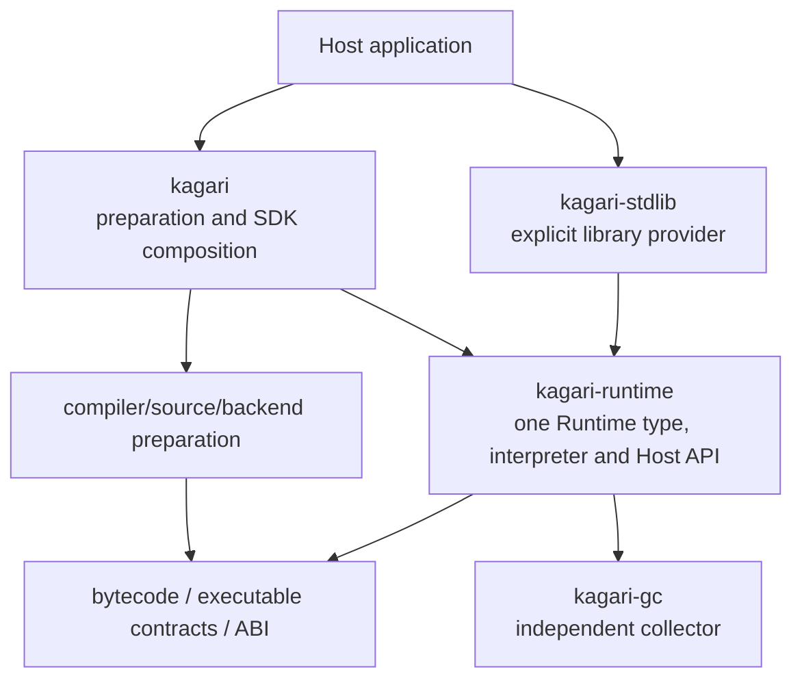
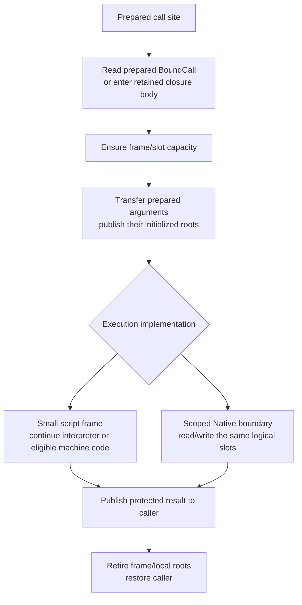

# Runtime Architecture and Host Boundary Refactor

Status: next-scope design recorded at the user's request on 2026-11-09;
implementation has not started. Current product ownership, final call tables and
publication are in the
[Runtime model](architecture/runtime.md) and [reload walkthrough](architecture/runtime/reload.md).
The [roadmap](implementation-roadmap.md#runtime-execution-model-review) owns any
future activation. This document owns the proposed Runtime responsibilities,
execution and Host boundary, standard-library detachment and existing-GC integration.
The sketches below are proposals, not current APIs or performance results.

## Next scope: detach the standard library and reuse the existing GC

The user-selected sequence is to detach the existing standard-library implementation,
organize Runtime and its general Host interface, then connect the existing collector
through that model. Full standard-library design and implementation follow later.
This changes the earlier assumption that Runtime/library boundary work must wait
for the paged incremental GC migration. It records scope and sequencing only;
no Rust migration or final public API is activated by this documentation change.

This document is the design owner. [Current architecture](architecture/runtime.md)
continues to describe implemented behavior. The [native collections plan](native-collections-plan.md)
owns later concrete storage/algorithm/cursor/host-adapter migration, and the
[paged incremental GC design](paged-incremental-gc-design.md) owns a separate future
collector replacement. Do not duplicate those plans' implementation ledgers here.

### Responsibilities and dependency direction

```text
Standard-library crate        Application Native modules
             \                 /
              public Host / Native protocol
                         |
                       Runtime
              execution, types, local state
                         |
              existing collector integration
```

Runtime owns execution sessions, frames/slots, call preparation and entry/return,
installation/binding authority, statics, retained computations, cancellation and
cleanup. General Host capabilities cover checked declarations and generic types,
Native calls and callbacks, native payload allocation/access, managed edges,
temporary/escaping roots and scoped loans. Standard-library and application
providers must receive the same capabilities; a public Vec-specific heap method
does not establish that boundary.

### Proposed crate consolidation and single Runtime

Recommended after the user's 2026-11-09 ownership review; implementation is not
activated by this proposal. The current chain is SDK `runtime::Runtime { vm, ... }`
-> `kagari_vm::Vm { runtime }` -> `kagari_runtime::Runtime`. Vm has no separate
execution-state fields, while interpretation is split between its executor and
Runtime's `frame/cursor`. Preserve the useful modules, remove these object/crate
boundaries and converge on one Runtime type.

| Owner | Target responsibility and disposition |
| --- | --- |
| `kagari-runtime` | Retain. Own the single public Runtime, installed program state, executions, language objects, Host/Native APIs and execution implementations. Absorb the VM executor/debug integration as ordinary modules. |
| `kagari-vm` | Remove after moving consumers and unique tests. Delete the `Vm` wrapper; do not leave a forwarding crate or alternate execution entrypoint. |
| `kagari` | Retain source preparation, artifact/backend tooling and SDK composition. Remove its distinct Runtime struct and execution-context/error translations that only wrap the same operation. Expose the canonical Runtime through an exact intentional facade export, with the required re-export-whitelist entry when implemented. |
| `kagari-compiler`, HIR/MIR/source crates | Retain their compilation responsibilities. Prepare executable products outside Runtime; Runtime must load/run without these production dependencies. No compiler rewrite is required by this consolidation. |
| `kagari-bytecode`, `kagari-contract`, `kagari-abi` | Retain executable representation, checked contracts and backend ABI ownership. Crate consolidation does not reopen their formats or language rules. |
| `kagari-gc` | Retain the implemented independent collector. It owns storage, tracing/collection machinery and GC-scoped access; Runtime owns language-specific layouts, edges, root sources and execution integration. |
| `kagari-stdlib` | Retain as an independent provider of concrete library types/functions through Runtime's public Host API. Runtime neither depends on it nor installs it automatically. Detach privileged implementation paths before later library design. |

Target production dependency direction (arrows mean depends on):



An artifact-only host may depend directly on `kagari-runtime`; an SDK host uses
the same type through the facade. Installing a standard provider is explicit.
Neither path creates another Runtime owner or requires a provider to depend on
the source-enabled SDK. There is no Runtime-to-SDK dependency.

Inside Runtime, keep responsibilities in ordinary modules:

| Module responsibility | Owned data / work |
| --- | --- |
| Public Runtime entrypoints | Construction, provider installation, program load/replace, call/resume and collection orchestration. No second CoreRuntime/Runtime pair. |
| Programs and installations | Shared immutable executable products; local current bindings, statics and exact retained bodies. Publication remains exclusive and outside synchronous execution. |
| Execution | Frames, slots, local roots and parked execution state. These are Runtime execution state, not collector-owned scheduling/state records. |
| Interpreter | Prepared instruction dispatch, PC progression and ordinary call/return transitions. Move the existing runtime cursor and VM driver/dispatch under this one owner; remove overlapping fallback handlers after their semantics are covered. |
| Host/Native | Registration, prepared codecs, scoped callbacks/reentry and host-owned resources. Script and Native calls use the same execution storage. |
| Heap integration | Language representations, root/edge enumeration and collector entrypoints, using `kagari-gc`. The collector does not interpret bytecode or own Session/Frame records. |
| Optional debugging/async/native execution | Attach to the same state and call selection. Keep feature-specific driving outside the initial plain synchronous loop; do not introduce an execution-backend trait framework merely to replace Vm. |

Runtime owns these fields directly or through cohesive records. An interpreter
activation borrows the relevant execution/services; it is not another persistent
object that owns Runtime. Split field borrows for closed regions, release storage
borrows before a Native callback, and reborrow on return. Do not implement the
merge by wrapping the old CoreRuntime in a newly renamed internal state object.

The existing SDK Program also needs a real boundary correction: its ProgramState
currently owns optional compilation inputs/MIR and is recovered from installed
code through a type-erased owner/downcast. The canonical executable Program belongs
with runtime-side immutable program preparation and contains checked code/layout/
debug/reload evidence, without source-analysis ownership. Source inputs and MIR
preparation stay with the compiler/preparation owner. SDK preparation produces the
canonical product; artifact-only loading produces that same type. Preserve exact
revision/base/history and code retention, but remove the Runtime-to-SDK owner
recovery mechanism. Do not add another public Program wrapper or source cache just
to preserve the obsolete API. Runtime installation state remains separate from the
shared executable product.

For `runtime.call(add, (1, 2))`, the canonical Runtime admits the external call
once, obtains its active execution and invokes its private interpreter. The
interpreter transfers operands and continues through script calls; Native calls
invoke the prepared thunk and return to the same loop. A callback calling script
uses that same internal entry, with the required reentry scope. Results return to
the public call directly. There is no SDK Runtime -> Vm -> CoreRuntime trampoline.
JIT/AOT code later uses the same Runtime data and call contracts, not another Vm.

Migration scope is finite: detach library-specific execution helpers; co-locate
the interpreter modules and merge entry/error/context ownership; remove the two
wrappers and VM package; migrate the executable-product boundary and affected
SDK/CLI/web/benchmark/provider consumers; then integrate the existing GC crate.
Preserve unique source-free, GC/reentry, debug/async and actual-native tests at
their new owners. Exact file moves and intermediate build boundaries belong to
implementation activation. Do not combine this with unrelated compiler changes.
Acceptance includes absence of the VM dependency and Runtime wrappers, one call
entry and compilation-free artifact execution. Measure performance independently;
removing a crate or wrapper does not by itself establish a runtime speedup.

Reference: Lua 5.4.9 separates [API entrypoints](https://github.com/lua/lua/blob/v5.4.9/lapi.c),
[execution state](https://github.com/lua/lua/blob/v5.4.9/lstate.h) and
[interpreter code](https://github.com/lua/lua/blob/v5.4.9/lvm.c) within one runtime
implementation. Adopt explicit state ownership with module-level execution code;
Lua's dynamic typing, C pointers, coroutine/thread relationships and unwinding are
different. This supports cohesive ownership, not a proof that Rust crates are slow.

Detach concrete collection storage, algorithms, cursors, library policies and
library-specific Rust adapters from the new Runtime core. Before removal, identify
compiler-known language roles and required declaration metadata separately from
their concrete implementations. Detachment does not silently remove operator,
Option/Result propagation, builtin value representation or execution semantics.
Revisit actual boundaries rather than assuming every existing core operation can
be moved unchanged into an optional module.

Reuse the implemented [kagari-gc](../crates/kagari-gc/README.md) collector rather
than redesigning its algorithm during Runtime integration. Current production
Runtime still uses its older in-crate GcHeap and does not yet depend on kagari-gc;
the target replaces that integration with language-specific adapters to the
independent collector. Preserve useful language layout/handle contracts where
applicable, with an explicit finite replacement of obsolete storage paths.
Specify who owns execution roots, temporary Native protection, native payload edges,
code/type provenance and retirement, and how the collector observes those owners.
Preserve checked owner/slot/generation handles, collection across Native callbacks,
loan exclusion and cleanup on errors/reentry/cancellation. This may reorganize the
current collector integration; it does not authorize a new GC algorithm, additional
paged-storage migration or the deferred enum/value representation redesign.

### Sequence and reviewable exit conditions

1. **Detach existing library implementation dependencies.** Inventory privileged
   Runtime/GC/VM/SDK paths and their consumers; establish the Runtime-only build
   and checked executable-input boundary before designing replacement libraries.
2. **Organize the Runtime and Host model.** Describe ownership with core records,
   diagrams and complete host-entry, script-call, Native-call, return, park/resume,
   trap and publication paths. Reuse implemented immutable Programs, prepared
   calls and exclusive Runtime publication. Settle one coherent registration and
   call model before naming multiple public adapters.
3. **Integrate the existing GC and prove the generic boundary.** Exercise allocation,
   root handoff, payload edges, mutation and cleanup through the reorganized model.
   A small external Native provider containing a managed reference and a script
   callback is a Runtime contract witness; it does not require designing the full
   Vec/HashMap/HashSet library. Test it under collection, reentry and failure.
4. **Design and reconnect full libraries later.** Rebase the existing collection
   plan on the proven protocol. Standard implementations must use that same
   public path; restoring privileged paths is not an independent-library result.

Before implementation activation, freeze the finite removal inventory, affected
crate/build boundaries and consumer reconnection checkpoints. Any intermediate
unbuildable SDK/library targets or deferred integration tests must have explicit
causes and owning follow-up steps; do not disable checks or add fake-success
stubs. Runtime-focused evidence is not a full-workspace or restored-stdlib claim.
Retain the independent behavioral, source-free, GC/loan, cancellation and reload
oracles at their semantic owners.

Full collection/API redesign, paged/incremental GC, enum/niche/value-struct layouts,
the deferred shared declaration-ID migration, R13 reclamation and broader
AOT/JIT/deoptimization remain separate. Later call-model sections are design
inputs; this scope record does not automatically activate every proposed optimization.

Reference boundaries: [Lua 5.4.9 library initialization](https://github.com/lua/lua/blob/v5.4.9/linit.c)
and [table library](https://github.com/lua/lua/blob/v5.4.9/ltablib.c) demonstrate
ordinary registered library functions, while table storage remains core-owned.
[AngelScript's array add-on](https://www.angelcode.com/angelscript/sdk/docs/manual/doc_addon_array.html)
and [application GC behaviors](https://www.angelcode.com/angelscript/sdk/docs/manual/doc_gc_object.html)
(online SDK manual reviewed 2026-11-09) demonstrate a registered generic container
and provider-visible edge enumeration. Its reference-count/cycle-collection model
differs from Kagari's precise tracing; these sources support the boundary, not
reuse of its memory protocol or a Kagari performance claim.

## Candidate call execution model

This is subsequent call-model work. The implemented prepared call tables are
part of the reload design; logical slot storage, frame compaction and public Native
adapter changes remain separate review/implementation work. Reuse those tables
rather than creating another current/legacy dispatch mechanism.

Proposed on 2026-11-09 after the [empty-call measurements](performance-baseline.md#empty-call-attribution-windows-2026-11-08).
An ordinary empty script call costs about 531 ns; raw/flat Native about 640-660 ns;
owned Native about 1,977 ns. The owned path rebuilds type mappings twice and creates
two empty root leases. These results motivate moving stable preparation out of the
invocation and using one execution-slot protocol. They do not establish a speedup
for the proposed implementation or imply that all checks can move to installation.

### Performance-first scope and removal review

The user-selected priority on 2026-11-09 is to establish a small, fast execution
core before adding defensive policies. The first performance checkpoint covers
ordinary synchronous script and Native calls with cancellation, observers, slicing
and statistics disabled. It is a bounded baseline, not acceptance of all existing
execution features. Do not design a new permission matrix, configurable check
registry or parallel checked/unchecked execution model to support this work.
Existing API/specification behavior remains current until its owning migration;
record any deferred integration instead of reporting a semantic regression as a pass.

The source review identifies the following removals from the proposed ordinary
call path. Rows describe ownership changes, not measured individual speedups.

| Existing cost and evidence | Target ownership / removal |
| --- | --- |
| `frame/admission.rs` rechecks arity, generic environment shape and Program metadata for prepared calls. | Compile/verify and bind the internal transfer contract once. Internal entry consumes that contract; host-supplied arguments and dynamic receiver selection have their boundary checks. Do not route every call through public admission. |
| `native/typed.rs::invoke` checks Rust mappings; result encoding checks again. | Prepare a codec per fixed Native application at binding/application preparation. Invocation performs actual conversion, with no reconstruction of a fixed Rust/script type mapping. Custom converter effects remain per value. |
| The owned adapter copies arguments into a Vec, clones it for roots, and argument decoding creates another root scope. | Read protected execution slots directly. Temporary values use one local-root checkpoint; durable handles alone acquire durable roots. Warm empty/scalar calls allocate nothing. |
| `executor/driver.rs`, `gc_safepoint`, call admission, Native entry/exit and return can each poll execution; `observe_execution` queries the active session even without an attached observer. | Keep cancellation/observer dispatch out of the initial plain-call baseline. Later choose polling sites from the actual responsiveness contract, consolidating adjacent callback-free checks. State explicitly when a benchmark disables these features. |
| Ordinary Native calls pass through Pending, Running, Complete and a later NativeReturn driver action. | Invoke and return directly while retaining the logical frame. Materialize a completed continuation only where slicing/observation actually requires it; no asynchronous state machine for every synchronous callback. |
| `frame/values.rs` reserves five backing owners and maintains generational windows/allocation order for ordinary stack calls. | Execution owns reusable frame/slot suffixes. Push/pop with saved positions; grow in a slow path. Keep independent retirement machinery at parked/escaping storage owners, not every nested call. |
| Slot allocation clears all scalar payloads/flags and fills managed records with Unit. | First remove unnecessary scalar payload clearing. Keep managed clearing until existing initialization facts can exclude stale entries from GC/debug access. Reuse checked facts; do not make a new liveness-analysis project a prerequisite. |
| Session, frames and banks use repeated RefCell admission; frames and value windows retain overlapping body/environment owners. | Give the active driver exclusive mutable execution access, with scoped reborrowing at Native boundaries. Retain exact body/type dependencies at their real owner and trace slots through that owner; avoid duplicate per-window pins and bookkeeping. Do not blanket replace Arc with Rc or retain storage references across growth/callbacks. |
| `objects/invocation.rs::admit` allocates a MethodComputation even for an immediate interface call. | Carry the selected body/environment in the admitted frame. Allocate retained computation state only when it escapes or must persist independently. Preserve old-body/current-inner-call selection. |
| Whole Runtime/installation/phase checks recur along internal target and frame entry. | Establish exclusive activation and bound body validity at entry/resume. Internal transitions reuse it; a callback or suspension revalidates only facts it can invalidate. Do not add epoch checks, locks or a validity cache to every instruction. |

For example, repeated `tick(player)` calls from verified script code already have
a known parameter type, prepared target and rooted `player` slot. Rebuilding that
signature, validating its Program again, copying the argument into independently
rooted packs and allocating an invocation identity adds no new fact. The proposed
ordinary flow is:

```text
script: prepared target -> ensure stack space -> transfer operands -> push frame
        -> interpreter continues -> publish result -> restore caller positions
Native: prepared thunk/codec -> protected argument slots -> Rust callback
        -> encode/publish result -> release temporary roots -> continue caller
```

Keep storage bounds, valid GC roots/result handoff, actual host-handle/loan access
and checked language operations at their existing semantic owners. These make the
execution produce valid results; they do not justify another generic admission
layer. Defer extra quotas, always-on diagnostic counters and fault-hardening policy.
An invalid internal prepared relationship is a compiler/linker defect to detect
with verification/assertions, not a reason to reconstruct its proof on every call.

Start with Native mapping/root duplication and internal admission/driver work,
then simplify storage and ownership. The historical instrumented empty-call study
attributes about 386 ns to script preparation and only about 7.5 ns within it to
depth handling; the owned adapter attributes 16 allocations to two mapping checks
and two more to empty roots. These overlapping diagnostic scopes precede Runtime
lock removal and are prioritization evidence, not present-day additive costs.
Refresh the empty/control/Lua measurements at the implementation baseline. The
[lock-removal comparison](performance-baseline.md#runtime-owned-publication-and-lock-removal-windows-2026-11-09)
does not replace an updated empty-call attribution or establish Lua parity.

### Prepare facts, then execute a bound call

| Boundary | Work and validity |
| --- | --- |
| Compile/verify Program | Check script types and call contracts; prepare argument/result locations, frame requirements, initialization/liveness facts and GC maps. Source-free verification independently proves the executable contracts. |
| Bind/install in Runtime | Match declarations/applications, resolve local host/type identities, check Rust mapping against the declared signature and prepare codecs, link dense call-site/entry tables and compatible call ABI. Facts are scoped to this installation and checked body/application. |
| Enter/resume from host | Check Runtime/installation/handle authority and phase; establish an exclusive activation and its code/root protection; validate actual external arguments. |
| Internal call | Use the frame's committed BoundCall; enter a current ordinary target or exact retained closure body, ensure frame/slot capacity and transfer prepared operands. Cancellation/observation follow the explicitly enabled execution contract; script calls have no separate logical-depth quota. |
| Value access/conversion | Check actual object owner/generation, host availability, loans and value/result validity where required. Custom decoders/encoders still execute per value. |
| Return | Publish the result while protected, retire only this frame/local scope and restore caller state. Release a native-stack guard only when this boundary acquired one. Preserve trap/effect order. |

An internal call is not another host admission. Installation authority and code
liveness proved for an exclusive activation are reused until a callback, collection,
suspension or other relevant transition requires specific dynamic revalidation.
Publication/close cannot intervene in a synchronous activation. Moving Runtime
between threads is outside that interval. Avoid repeating installation HashMap and
whole-contract validation merely because another logical function was called.

Prepared code does not authorize arbitrary host-supplied values. A host boundary,
revoked opaque payload, mutable alias, expired view or changed loan still needs
the corresponding dynamic checks. Readonly values do not establish deep immutability.
If existing user-defined mapping hooks mix type description with per-value effects,
separate those contracts coherently; do not silently hoist arbitrary converter code.

### Core records and hot reload selection

[Prepared call tables](architecture/runtime/reload.md#exact-old-bodies-current-ordinary-calls)
own shared body/call recipes, installation-local final bindings and refreshed
activation views.
The later execution-slot model adds only:

```text
Execution
    frames[]                      exact body, PC, base, saved top, return destination
    slots                         logical arguments/locals/results
    local_roots                   scoped temporary roots with checkpoint rollback
```

Ordinary calls from a retained old body use its prebound current targets. The
body's private temporary layout may stay old while callee layouts change behind
the frozen call contract. Generic environments retain their lexical values and
proof origins while prepared recipes transport the necessary binder/witness keys.
No new type inference occurs in the call loop. Actual interface receivers and
captured closure values retain their distinct checked selection behavior.

### Slots, frames and return

Slots form an execution-owned logical stack. They can initially use the existing
scalar/managed banks; this proposal does not require Vec<Value>, a new universal
carrier or the deferred enum-layout cutover. Prepared locations/layouts explain
how an argument or result is read. Indices and generation checks survive storage
growth; no Rust slice or payload pointer stays borrowed across reentry/collection.
Compiled code can use its verified register/native calling convention and root
maps; logical slots do not require every machine-code call to copy through
interpreter Value records. Boundary adaptation remains explicit.



The compiler can place arguments directly in a prepared outgoing area or use a
bounded move plan. Preserve left-to-right once-only evaluation: in f(g(), h()),
g's result must already be rooted while h can allocate or reenter. Reuse capacity
in the ordinary stack suffix; do not run generic independent-window compaction
on a normal tail return. Parked/independently retired executions still need their
separate checked storage/cleanup policy.

Initialize real arguments and necessary GC state. Definite initialization and
root maps allow dead/uninitialized temporaries to avoid blanket Value clearing,
provided the collector/debugger cannot read stale bank contents. Unit requires
no payload/result slot in the proposed call ABI. A logical empty frame still
occupies frame storage and participates in reload body selection and enabled
tracing/cancellation; it cannot be erased merely because it contains no data.

For a managed result, publish the caller's root before releasing callee/local
protection, through the existing non-collecting return handoff invariant. A failed
conversion or return does not undo completed callback effects.

### Compact frame and stack storage

Design refinement recorded on 2026-11-10, within this Runtime/Host refactor.
This is part of the execution-storage model, not a separate optimization queue.
Current x86_64-pc-windows-msvc default-feature Runtime built with Rust 1.99.1
(58cf8f9c3) has `size_of::<ExecutionFrame>() == 392` and
`size_of::<Value>() == 16`. Each physical scalar cell also uses eight payload
bytes plus one initialization byte. These are compiler layout observations,
excluding Window records, spare capacity and transitive allocations; they are
not call-latency measurements. Reproduce the public sizes with a small consumer
using `std::mem::size_of` against the current runtime library. Do not substitute
an older cached rlib or compare unlike targets/features.

The scalar/managed split and scalar lifetime coloring are sound foundations.
The main mismatch is ordinary calls carrying the full multi-purpose frame plus
a separate generational Window with overlapping program/environment/layout
references. Managed slots do not currently participate in scalar coloring. A
compact redesign must address total frame/control storage and entry/return work,
not just compress `initialized` while keeping the same ownership machinery.

Primary mechanisms consulted on 2026-11-10:

| Reference/version | Mechanism to adopt | Different assumptions |
| --- | --- | --- |
| [Lua 5.4.9 CallInfo](https://github.com/lua/lua/blob/v5.4.9/lstate.h) and [call/return](https://github.com/lua/lua/blob/v5.4.9/ldo.c) | Small call records over a reusable value stack; mutually exclusive script/C and continuation states share storage. | Kagari keeps checked typed layouts, precise managed roots, Rust cleanup and selected old bodies. Do not copy Lua's raw-pointer/longjmp rules or assume independent Kagari states are mutually exclusive. |
| [Wasmi v0.51.1 CallFrame](https://github.com/wasmi-labs/wasmi/blob/v0.51.1/crates/wasmi/src/engine/executor/stack/calls.rs) and [ValueStack](https://github.com/wasmi-labs/wasmi/blob/v0.51.1/crates/wasmi/src/engine/executor/stack/values.rs) | Separate compact control records from contiguous value storage; frame offsets and prepared result destinations support push/pop and capacity reuse. | This pinned implementation is a mechanism reference, not the latest Wasmi model. Its cell representation, recursion quota and unsafe stack-pointer rules do not establish Kagari's GC, handle or reentry contracts. |
| [Rust 1.99.1 coroutine saved locals](https://github.com/rust-lang/rust/blob/1.99.1/compiler/rustc_mir_transform/src/coroutine/layout.rs) and [layout](https://github.com/rust-lang/rust/blob/1.99.1/compiler/rustc_abi/src/layout/coroutine.rs) | Compiler-owned liveness/storage-conflict facts determine saved state and which nonconflicting fields can overlap. | Rust lowers stackless state machines and has different borrowing/drop rules. Kagari must preserve interpreted caller stacks, exact old environments and independently verified source-free facts. |

The proposed first implementation keeps exact code ownership inline in the small
frame and reuses the existing scalar/managed distinction. It does not require a
new per-call body wrapper or an execution-wide cache retaining every previously
called version. Rust-style data sketches follow; names are responsibilities, not
new public APIs or final Rust declarations. Widths and byte targets remain subject
to checked executable/stack limits and layout measurement.

```text
Execution {
    frames: Vec<Frame>,
    values: ValueStack,
    local_roots: LocalRoots,
    extras: FrameExtraPool,
    state: RunState,                // readiness, wait/result and retirement owner
}

ValueStack {
    scalars: Vec<u64>,
    initialized: Vec<bool>,         // first baseline; proof-based reduction is separate
    managed: Vec<Value>,
}

Frame {
    body: BodyRef,                 // exact admitted body, never implicit current
    environment: Option<TypeEnvironment>,
    links: Option<Arc<FunctionLinks>>,
    pc: CodeOffset,
    phase: FramePhase,              // availability at observable boundaries
    base: StackMark,               // both callee bases and pre-call rollback positions
    return_to: ReturnTarget,
    extra: Option<ExtraIndex>,
}

BodyRef {
    revision: Arc<InstalledRevision>,
    member: ModuleIndex,
    target: CallableTarget,
}

StackMark {
    scalar_top: usize,
    managed_top: usize,
    local_root_top: usize,
}

FramePhase = Pending | Executing | Complete
ReturnTarget = Caller(OperandSlot) | ScopeResult | Discard

FrameExtra {
    native: Option<NativeState>,
    initializer: Option<InitializerState>,
    invocation: Option<InvocationEvidence>,
    mutations: Vec<PendingMutation>,
    observation: Option<ObservationState>,
}
```

`InstalledRevision` is the supplying installation's existing exact descriptor role,
which owns a shared executable Program and checked local binding/layout facts.
`BodyRef` stores its owner and placement directly; construction is an owner clone
and checked indices, not another allocation for each invocation. Reuse that owner
to obtain function facts and frame requirements instead of copying slot counts,
layout Arcs and target metadata into both Frame and Window. A bare stable function
ID is insufficient because it would lose the selected old body's lifetime.

`environment` initially uses the checked existing environment representation.
Nongeneric frames have none. A smaller environment handle is a later representation
choice only if its owner, scope, generation and traced dependencies remain explicit;
this proposal does not silently add an environment table or truncate its identity.
`links` is the replaceable active execution view for that exact source body; it
does not select a different body for the frame. Keep it for efficient prepared
execution. Parking clears it for every frame; resume refreshes all frames against
committed call tables without changing their body, environment, PC or values.
Transitive type/layout metadata may still retain supplying versions under R13;
count that retention rather than claiming the compact frame solves that split.

FramePhase preserves pending/executing/completed availability at observable
boundaries, including Native reentry and frame inspection. The closed interpreter
region may keep its current cursor/action in local state and publish it before an
external boundary. A pause that must distinguish observed PC from a pending resume
action retains that action in its execution/observation state. Do not simply erase
existing PC/phase distinctions to reduce size; basic frame access must not require
allocating observer state when observation is disabled.

One StackMark suffices because the first implementation appends callee storage
after the caller's live suffix. Function layout gives each bank's required count.
Outgoing-area overlap and move elimination can follow verified call preparation;
do not store redundant base/end/count/checkpoint copies by default. Bank offsets
start as checked usize. Use narrower offsets only after the stack/executable ceiling
proves representability; do not narrow Runtime/heap owner-generation identities.

ReturnTarget carries only the checked destination kind and compact operand locator.
The frozen callable/call-site facts and admitted environments provide representation
and any result adaptation; the frame need not carry a full Location. ScopeResult
hands the result to the driver/owned execution. Discard still performs required
result validation and effects. Unit has no result payload cell.

FrameExtraPool belongs to the execution and reuses vacated entries. A frame acquires
an entry only when it actually needs extra state. Native, initializer, invocation,
mutation and observation state may coexist, so this record does not assert they
form one mutually exclusive enum. Its local index is valid only within its owning
execution and live frame; it is not an externally retained frame/heap handle.
Trace any managed or metadata dependencies in live entries. Remove/reset the entry
on frame completion/unwind, retaining capacity but no old values/code dependencies.
No new per-frame Box, persistent invocation identity for an immediate method call,
or universal state-machine framework is implied. Retained callable computations
keep their own existing escape lifetime rather than borrowing this pool.

The collector enumerates live frames, protected managed cells, local roots, live
extensions and execution wait/result state through the Runtime execution owner.
Arc ownership alone does not publish GC roots. Once this traversal owns frame value
and metadata protection, remove ordinary-call Window registration and its duplicate
program/environment/layout owners. A projection of argument slots is a scoped view
of the execution; release it before growth, collecting callbacks or reentry. Actual
external loan/owner/generation validation remains at the corresponding boundary.

An owned Future/Task parks this Execution storage without copying the whole stack.
Its completion/cancellation drains its own frames and roots; another execution's
out-of-order completion cannot shift this execution's bank offsets. Synchronous
host reentry uses a saved frame depth and StackMark over the same execution, then
retires only its suffix. Native thread-stack protection remains separate.

For a warmed script call the data operations are: read final binding; ensure
frame/bank capacity; capture StackMark; initialize/transfer admitted parameters;
publish the frame's dependency/root view; push Frame; continue dispatch. Return
validates/adapts while the callee remains protected, publishes to the caller or
scope, completes extra-state cleanup, restores the root/bank checkpoints and pops
the frame. Capacity growth, actual environment construction, extension acquisition
and suspension stay explicit branches rather than unconditional call allocations.

Ownership and hot-path decisions:

- Execution owns the frame and bank buffers. An ordinary nested call reserves a
  suffix and return restores its saved positions. It creates no independent
  generational Window, allocation-order entry or per-call root lease. Empty/scalar
  calls with warmed capacity require no allocator request. Growth and independent
  execution retirement stay at their actual storage boundaries.
- Each live frame has one authoritative exact-body/environment dependency path.
  GC consumes a root view of active and parked executions, including their live
  managed slots and metadata. Remove duplicate per-window owners when that root
  path replaces them; do not keep IDs without supplying lifetime/authority.
  Reuse existing linked/admitted body and application facts where suitable.
  Packing a frame must not introduce a freshly allocated descriptor or another
  per-call identity-resolution cache.
- Keep ordinary PC/base/return operations in the frame. Additional Native,
  initializer, mutation and enabled debugger state use execution-owned reusable
  side storage or a proven discriminated representation. Independent states may
  coexist. A large enum whose largest variant still bloats every frame, or a
  Box allocation on every call, does not satisfy the design. Hot instructions
  must not traverse a generic extension dispatcher to read their basic fields.
- Shared immutable function layouts supply types, physical locations and call
  requirements. Keep eight-byte scalar cells as the first execution baseline;
  mixed-width packing/bitsets need separate evidence after total frame ownership
  is fixed. Unit has no payload cell. Retain scalar coloring and extend storage
  reuse to managed values only when availability, representation and root lifetime
  agree. Do not reinterpret a stale managed cell as another live object.
- Remove scalar clearing only where verifier-proven write-before-read and the
  actual inspection/side-entry contract permit it. Managed clearing/root visibility
  must remain correct at every collecting callback or safepoint. Reducing or
  removing the initialization bank requires those facts at the source-free
  executable boundary; Rust coroutine analysis is a reference, not imported proof.
- A parked computation retains its Execution storage and selected body/environment.
  Another computation completes in its own storage without draining or relocating
  unrelated stacks. First support ownership transfer/parking of those buffers;
  do not make every await copy and compact the entire stack. Compiler-driven
  suspension-field compaction is a later use of existing liveness facts, not a
  prerequisite for the small ordinary frame. Reentry uses scoped suffix ownership
  and the separate Native stack protection described below.

For `caller -> add(a, b) -> caller`, the current path admits a full ExecutionFrame
and Window, publishes overlapping dependency metadata, and initializes the new
banks. The target prepares the argument/result locations, ensures capacity,
publishes arguments in the callee suffix, pushes the small record, executes, then
publishes the result before restoring the caller checkpoint. In `f(g(), h())`,
g's completed managed result remains rooted while h runs. Traps unwind only the
owned suffix and preserve completed mutations. A suspended old body still makes
ordinary calls through current prepared bindings; packing does not change reload
selection or invalidate the whole-stack view refresh contract.

Acceptance counts total fixed frame/control bytes, used bank bytes, spare capacity,
extension/root storage and retained dependencies. Reporting only `size_of<Frame>`
after moving its fields into per-frame boxes is not a reduction. Compare empty,
scalar, managed/generic and Native calls, depth/growth/reentry, parked-stack memory
and non-LIFO completion. Reuse the existing source-free, GC/return-handoff, loan,
trap/cancellation and reload cases. Report setup separately from warmed execution;
require no warmed empty/scalar call allocations and measure any added indirection.
Freeze numerical frame-memory/call-time gates at implementation activation, before
changes. No unmeasured 32/64-byte frame target or predicted speedup is accepted here.

### Stack exhaustion and Native reentry

Decision accepted on 2026-11-09: ordinary script recursion is bounded by VM stack
space, without a separate logical call-depth quota such as the current default of
256. This is the target model; current Runtime limits and the
[execution specification](spec/execution.md) remain implemented contracts until
the migration updates the APIs, specification and affected tests together.

The interpreter continues in its dispatch loop with explicit frames and slots.
Each checked body supplies its frame/slot requirements. Execution owns the used
positions, backing capacities and stack-space ceiling. The ordinary call path
checks available frame and slot capacity, publishes arguments and pushes a frame;
return restores saved positions. Do not increment/decrement an independent script
depth counter or update peak-depth statistics on this path. Optional diagnostics
must have an explicit collection mode rather than an unconditional call cost.

Insufficient backing capacity enters a fallible growth path. Grow geometrically
within the VM stack-space ceiling; exceeding that ceiling reports the proposed
script `StackOverflow` outcome. Allocation failure within the ceiling remains
out-of-memory. Count frame storage as well as scalar/managed slot storage, so an
empty recursive function still consumes space. A capacity hit may bypass ceiling
arithmetic only when that admitted capacity already respects the ceiling. Use
checked size arithmetic, including outgoing arguments and required alignment.
Choose the ceiling, its configuration and the exact public error/API during the
finite implementation phase; this decision does not introduce another limit
registry. Independently parked executions retain their own stack ownership;
Native reentry does not share a fresh allowance for the same physical thread stack.

Synchronous Native-to-script reentry can nest Rust calls even though ordinary
script recursion does not. Guard boundaries that can grow the native stack and
release their guards on every exit, including traps and cancellation. A bounded
reentry counter is an acceptable fallback when its native-frame assumptions and
supported platforms are established; it counts nested native transitions, not
every logical script frame. Neither a VM stack-space ceiling nor `catch_unwind`
provides recovery from an exhausted Rust thread stack. Arbitrary recursion inside
a host callback remains host-owned. AOT/JIT calls using the native stack must
provide their backend's corresponding stack check before execution is enabled.

[Lua 5.4.9 stack handling](https://github.com/lua/lua/blob/v5.4.9/ldo.c)
(`luaD_growstack` and `ccall`) and its
[C-call accounting](https://github.com/lua/lua/blob/v5.4.9/lstate.c)
(`luaE_checkcstack`/`luaE_incCstack`) distinguish the growable Lua value stack
from nested C calls. Adopt that separation, with Kagari's explicit frame storage,
precise roots and Rust cleanup; do not copy Lua's slot ceilings, C-frame estimates
or longjmp unwinding. This is an ownership decision, not a measured speedup.

Acceptance reuses recursion/reentry coverage to distinguish VM space exhaustion,
allocation failure and Native reentry exhaustion. Check zero-slot recursion,
different frame sizes, growth with live managed arguments and recovery/cleanup
after rejected entry. Cancellation and observer integration follow the staged
performance-first scope above. Compare warmed script/Native calls and
recursive workloads before claiming an improvement.

### One Native boundary with prepared adapters

The proposed boundary is a scoped view over the same execution storage:

```text
NativeCall
    exclusive execution service access
    installed binding / closed signature / prepared codecs
    argument locations and caller result destination
    local-root checkpoint and scoped-loan cleanup
```

Typed Rust callbacks remain ergonomic; registration generates the thunk that reads
arguments and writes the declared result. Raw access and typed adapters use this
boundary, with the same identity, loan, cancellation and cleanup rules. The concrete
public context name and bind syntax are not settled by this record sketch.

Bind the Rust type mapping and expected script type once for a fixed application.
Invocation uses that codec; it does not construct a new TypeArgument just to prove
again that Rust () matches Unit. Custom value conversion, runtime owner/generation
checks and actual result validation remain where needed. A dynamic script handle
cannot pass solely because its Rust wrapper type was checked during registration.
Deep owned DTO conversion may still allocate according to its real data.

Arguments are already protected in their frame/outgoing slots. Decode directly
from those locations instead of cloning a Vec<Value> pack into two RootSets. New
temporary managed values use a stack-like local root area, reclaimed to a saved
mark on every exit. Empty/scalar calls take no root leases, reference-counted scope
objects or release-channel messages. Actual local-root growth is a fallible slow
path. A handle explicitly retained beyond the call needs a durable owning root;
requesting an owning argument representation also pays that ownership cost.

Synchronous Native execution normally invokes the callback and performs the common
return transition directly. Keep its logical Native frame for stack storage and
enabled tracing; release storage borrows before arbitrary Rust/reentry. Do not
require three generic driver iterations for every callback. Explicit saved
return/continuation state is
still necessary when the existing debugger/slicing contract admits parking after
the callback but before return. Preserve those observable boundaries and results;
never suspend a Running Rust callback. Poll/trace behavior belongs to enabled
instrumentation and its integration checkpoint, not the initial plain-call baseline.
Async work continues through owned Future/wait machinery.

### Reference mechanisms and acceptance

[Lua 5.4.9 ldo.c](https://github.com/lua/lua/blob/v5.4.9/ldo.c#L495-L528)
reuses CallInfo records and passes C-function arguments/results through its stack;
[OP_CALL](https://github.com/lua/lua/blob/v5.4.9/lvm.c) continues script execution
within the interpreter's existing C frame. Adopt reusable storage and narrow frame
transitions, not Lua's dynamic typing, missing-argument semantics or error unwinding.
Kagari retains checked types, current-inner-call selection and Rust-safe boundaries.

[JNI 25 local/global references](https://docs.oracle.com/en/java/javase/25/docs/specs/jni/design.html#global-and-local-references)
separate call-duration protection from longer native retention. Adopt that lifetime
distinction, not per-reference global leases for synchronous arguments or JNI's
thread-affine interface contract. Kagari's call scope stays on its active thread;
Runtime can move only between synchronous activations. Neither source proves an
expected Kagari speedup or permits dropping its handle/loan checks.

First acceptance witnesses are zero allocator requests for warmed empty/scalar
internal calls and Native adapters, no repeated static type/schema construction,
no duplicate empty root leases, table-based warm selection, and correct result/root
handoff. Also exercise storage growth, malformed source-free calls, custom codec
failure/effects, host reentry with GC, scoped loans, cancellation/stack exhaustion, debugger/
slice exits, and old-body/current-inner-call reload with actual native selection.
Run the existing empty/control/Lua workloads on the implemented model before
claiming an improvement; the measured Lua numbers are context, not a promised target.

This design crosses Runtime/VM/SDK and, for call layouts/liveness/Unit storage,
compiler/bytecode/native ABI boundaries. It is not a Runtime-only patch. Exact
record layout, generated adapter API, slow-path ownership and observer/slice
transition details require review before a finite implementation phase is activated.

## AOT, JIT and deoptimization

Select the semantic body first, then a valid execution implementation of that
body. A native product describes its exact root body, backend/target/ABI and the
assumptions used by optimizations. Its immutable dependency evidence is shared;
whether it is usable in a particular installation belongs to Runtime-local bindings.
Publishing in Runtime A must not disable a product still valid in Runtime B.

For example, `attack@1` can be unchanged while its machine code becomes unusable:

```text
attack@1 calls damage()
    native variant N inlines damage@1
    optimization dependency: current damage body must be damage@1

publish damage@2
    keep attack@1 bytecode
    disable N for this installation
    interpret attack@1, whose damage() call now selects damage@2
    optionally compile a new native variant later
```

Track body-dependent inlining, constant propagation, devirtualization and other
assumptions, including transitive effects. A plain indirect current-dispatch call
does not by itself make its caller dependent on the callee's body version. Missing
dependency evidence requires conservative invalidation or refusing the optimization.
Imports alone are neither a sufficient nor a precise invalidation graph.

### Entry invalidation versus frame deoptimization

Initial native support retains the no-active-native-stack publication boundary.
No native stack may survive parking at this stage. Invalidation prevents entry into
an ineligible product, then selects valid machine code or verified bytecode before
execution. It does not require rewriting an active machine stack at publication.

A retained old computation may still use machine code for its own old root body
when its assumptions remain valid. If ordinary-callee assumptions became stale,
fallback uses that old root body's bytecode, not the new root body. New ordinary
calls never use a superseded root merely because its pages are still alive.

Later native continuations that survive publication, or speculative assumptions
that fail after native entry, require actual frame deoptimization. Unsupported
mechanisms must decline native execution before entry until that contract exists.
Reconstruction needs exact old body/bytecode PC, inline-frame chains, live locals
and temporaries, GC roots, supported object materialization and effect/trap state.
It resumes the original computation at the correct position and never restarts a
partially executed function or repeats a completed host call/mutation. Already
admitted inlined computations keep their selected body; later ordinary calls use
current implementations.

### Code eligibility and reclamation

Disabling an entry does not free executable memory. Frames, continuations, created
computations, installed entries and direct code links retain code owners and their
required metadata. Runtime GC dependencies remain explicitly rooted/traced; bare
IDs and Rust reference counts are not script roots. Reclamation requires no
remaining user of the address or dependency. Code/native owners must remain valid
after compiler destruction and Runtime thread migration.

AOT uses the same selection and dependency rules. Without a compiler, an invalid
AOT variant falls back to another eligible product or verified bytecode before
entry. Reclamation may be at library granularity: keep the containing DLL alive
while any retained entry/link needs it. Artifact decoding/validation errors remain
errors and never authorize fallback to unvalidated code.

### Primary-source comparison

[JVMTI 25 RedefineClasses](https://docs.oracle.com/en/java/javase/25/docs/specs/jvmti.html#RedefineClasses)
preserves active old method versions and static values. [OpenJDK 25+36](https://github.com/openjdk/jdk/blob/jdk-25%2B36/src/hotspot/share/prims/jvmtiRedefineClasses.cpp#L3748)
tracks dependent compiled code and deoptimizes it at a safepoint. Adopt the
separation of semantic body versions, optimization dependencies and executable
lifetime. Kagari differs by publishing between exclusive synchronous activations;
it does not need HotSpot's concurrent Java-thread publication coordination.

The existing [native product contract](spec/codegen-backend.md#compilation-interface-and-trust)
also separates compilation from page ownership; final products can outlive their
compiler. This design does not claim current Kagari implements optimizing tiers,
general native calls, native suspension or full frame deoptimization.
