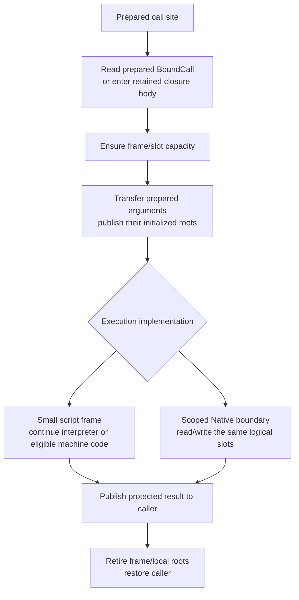

# Runtime Architecture and Host Boundary Refactor

Status: standard-library detachment D00-D05 and crate consolidation CM00-CM04
are complete on 2026-11-11. Their phase ledgers live in Git history. Current
ownership, API contracts and measurements belong to the
[Runtime model](architecture/runtime.md#single-runtime-and-preparation-boundary),
[embedding specification](spec/embedding-api.md) and
[performance record](performance-baseline.md#runtime-consolidation-core-call-comparison-windows-2026-11-11).
Exclusive Runtime/Host services and prepared Native/Host mappings are implemented
through RR02. Production execution storage and collector cutover remain pending. The
[execution plan](runtime-refactor-plan.md) owns the selected RR00-RR06 sequence;
this document owns its design inputs. The
[roadmap](implementation-roadmap.md#runtime-execution-model-review) locates that
work; implemented foundations are not prerequisites to replay.

## Standard-library test boundary

The user-requested TC00 correction removes Runtime's standard-library dependency
from production, build, test and example scopes. Standard-provider scenarios and
consumer targets belong to kagari-stdlib. Runtime keeps generic private execution,
GC/borrowing/reload/cleanup witnesses and its provider-independent core_calls
measurement, with application-owned Native declarations explicit per test.
No standard-provider implementation sources are injected into Runtime, and the
conditional production child paths are removed. Current ownership is described
in the [Runtime map](architecture/runtime.md#test-ownership) and
[testing guide](testing.md#default-placement-and-integration-exceptions).

Twelve private standard-provider oracles were retired at the user's direction,
without widening Runtime APIs or recreating standard implementations. The
[collection plan](native-collections-plan.md) and
[type/provenance review](review.md#r13--type-and-layout-provenance-retains-retired-code)
record the reduced combinations and public-provider follow-up. Existing NC library
gaps remain separate from this completed dependency cleanup. Compact frames,
Host root/storage redesign and collector integration remain pending after RR02.

## Session measurement boundary

Session creation and ExecutionCounters snapshots do not sample the platform
clock or retain a start timestamp. Counters expose current/peak call depth and
heap units. GC pause measurement and host-selected deterministic time inputs are
separate mechanisms. The [execution specification](spec/runtime.md#execution-control-and-lifecycle-accounting)
owns this contract. Hosts measure their own call intervals when needed; there is
no session elapsed-time field or timer configuration.

## Next scope: detach the standard library and reuse the existing GC

The user-selected sequence is to detach the existing standard-library implementation,
organize Runtime and its general Host interface, then connect the existing collector
through that model. Full standard-library design and implementation follow later.
This changes the earlier assumption that Runtime/library boundary work must wait
for the paged incremental GC migration. D00-D05 implemented the detach-first boundary below. Single-Runtime consolidation
is complete. The compact execution/Host redesign
and existing-GC integration follow the [execution plan](runtime-refactor-plan.md);
RR00-RR02 have completed locally; RR03 owns the next coherent graph cutover.

This document is the design owner. [Current architecture](architecture/runtime.md)
continues to describe implemented behavior. The [native collections plan](native-collections-plan.md)
owns later concrete storage/algorithm/cursor/host-adapter migration, and the
[paged incremental GC design](paged-incremental-gc-design.md) owns a separate future
collector replacement. Do not duplicate those plans' implementation ledgers here.

### Responsibilities and dependency direction

```text
Standard-library crate        Application Native modules
             \                 /
              public Host / Native protocol
                         |
                       Runtime
              execution, types, local state
                         |
              existing collector integration
```

Runtime owns execution sessions, frames/slots, call preparation and entry/return,
installation/binding authority, statics, retained computations, cancellation and
cleanup. General Host capabilities cover checked declarations and generic types,
Native calls and callbacks, native payload allocation/access, managed edges,
temporary/escaping roots and scoped loans. Standard-library and application
providers must receive the same capabilities; a public Vec-specific heap method
does not establish that boundary.

### Integrated execution, Native and GC model

Architecture review, 2026-11-11: reuse the existing bound-call, compact execution
and Native adapter proposals below together with the
[GC integration map](gc-implementation-design.md#runtime-integration-map).
These are one ownership/data-flow design, not a requirement to plug a new heap
under the old call model and rewrite the same boundaries later. The records here
are design sketches; the [execution plan](runtime-refactor-plan.md#order-and-build-boundaries)
owns their implementation order and proof/cutover checkpoints.

```text
Compiler/source preparation -> checked immutable Program
                                        |
Host Native registrations -> installation/application preparation
                                        |
                              prepared bindings and codecs
                                        |
                             exclusive Runtime activation
                                        |
                     script call / Native call / return
                                        |
                     authoritative execution slots and roots
                                        |
                      RootDriver<ExecutionRoots> + kagari-gc
```

Program supplies verified script facts and checked Native requirements. Runtime
installation supplies local implementation/type identities and fixed codecs;
concrete generic applications own their prepared mappings. Host entry validates
external authority/arguments once. Internal calls consume these facts instead of
re-entering public admission. Prepared evidence has its existing installation,
body/application lifetime; do not add a second target cache or version test per
instruction. Publication is excluded for the entire synchronous activation,
including Native callbacks and reentry. Actual resume refreshes current-call links
without changing the selected old frame body.

The execution subsystem owns the semantics of frames, slots, local-root marks,
wait/results and retirement. The GC driver physically owns its complete root
source: ExecutionRoots contains the authoritative managed slot/dependency storage
for all active and parked executions. There is one copy of those slots, not one
Runtime stack plus a mirrored GC RootSet per frame. Scheduling/control records
outside that source carry no untraced managed references. The exact partition
between frame/control and managed source records must be frozen during GCR02;
these two design sketches must not be implemented as competing storage owners.

Runtime owns language types, lookup/reload policy, checked object operations and
Host borrowing. The collector owns physical storage, tracing/publication and
reclamation. Reachability-bearing module/static/environment state participates in
the managed graph; indexes and Rust Arc backing must not accidentally root every
old version. Execution roots, native payload edges and durable host roots all
enter this same graph. Value tags and persistent reference transport still need the representation proofs
listed in GCR00/GCR02. Native payload extraction is selected for removal during
the Runtime/Host migration; it is not a capability to add to the new collector.

#### One prepared Native invocation

For a verified script call `hp(player)` whose Rust callback reads a checked Player
and returns i64, the target model is:

1. Installation/application preparation checks the Rust/script mapping and owns
   the prepared thunk/codecs. It does not repeatedly rebuild the Player or i64
   mapping at invocation. Arbitrary custom converters still run for actual values.
2. The interpreter selects the prepared Native binding, establishes its logical
   call identity/result destination and a local-root/loan cleanup mark. Arguments
   remain protected in execution slots. A synchronous direct Native call need not
   push a complete script ExecutionFrame or copy a parameter window. Preserve the
   existing prepared direct callback path while simplifying its adapters.
3. The adapter decodes those slots, checks actual object/loan access at its owner,
   and invokes Rust. Scalar-only adapters transfer bits without heap roots. An
   owned DTO/string conversion may allocate for its real data contract.
4. Rust can call script or request collection through the scoped service boundary.
   All heap/source loans end first. Existing arguments remain in the root source;
   new temporary values crossing that boundary use local roots. Reacquire access
   afterward, without rerunning immutable Program/signature proofs. A synchronous
   callback cannot publish another Program.
5. Encode and publish the result while protected, release loans/local roots to
   their marks and complete the ordinary return directly. A scalar result needs
   no persistent root. Retaining an object beyond the call explicitly acquires a
   durable host root. Preserve any enabled observer/slice boundary requiring a
   saved completion; do not park a Running Rust callback.

A Rust payload reference cannot stay borrowed through arbitrary reentry merely
because the receiver is rooted. Roots prove liveness; loans govern access. Both
are scoped without requiring per-argument persistent ownership. Error/cancellation
paths retire the same suffix, preserve completed effects and run cleanup once.

#### Work placement and performance acceptance

| Work | Owner/frequency |
| --- | --- |
| Script arity/types, locations, frame requirements and executable validity | Compiler/independent verifier, once per product |
| Rust mapping, fixed codecs and checked Native requirements | Installation or concrete application preparation |
| External Runtime/installation/handle authority and external conversion | Actual Host entry/resume or supplied dynamic value boundary |
| Current target, frame/slot reservation and parameter/result transfer | Internal call, consuming prepared links; backing growth is a slow path |
| Actual object identity/type, payload loan, bounds and checked numeric operation | Their real access/operation boundary; never replaced by a static Rust wrapper proof |
| Local temporary protection | Execution-owned root suffix; durable registration only for escaping ownership |
| Collection work | Collector safe boundary after source/payload loans end; not a compulsory full scan or step for every call |

At design freeze, Native invocation and argument conversion both rebuilt fixed
mappings and rooted copied packs. RR02 moves fixed Rust mappings to bindings and
closed applications, preserving their typed evidence through Host preparation.
Legacy typed argument packs/root leases and broad frame admission remain RR03
work. The ownership defect is preparation/lifetime work assigned to invocation,
not an inherent consequence of static typing or Rust callbacks. Keep value-dependent
checks while relocating immutable proof work; Native routes have distinct costs.

The [November 8 attribution](performance-baseline.md#empty-call-attribution-windows-2026-11-08)
is historical and predates later changes. The
[November 11 consolidation comparison](performance-baseline.md#runtime-consolidation-core-call-comparison-windows-2026-11-11)
measures complete bound Host calls, including their entry/conversion costs; its
Native-forwarding allocation totals are not isolated script-to-Native allocations.
Neither is a measurement of this proposal or of the later session-clock removal.
Freeze fresh matched baseline binaries before implementation. Measure Host-to-script,
script-to-script, raw/typed script-to-Native, reentry and real object conversion
separately, with preparation outside warm call timing. Empty/scalar internal calls
and borrowed Native adapters must have zero steady-state allocations, no rebuilt
static mappings and no duplicate root leases. Deep owned conversion is a separate
workload. Count total frame/source/control storage rather than reporting only a
smaller Frame struct; run actual GC/reload/borrow/cleanup witnesses alongside gates.

The next finite migration should settle these records, prepare Native mappings,
and establish the execution-slot/root-source protocol together; GCR02 proves the
actual Runtime adapters, and GCR03 coherently replaces old memory/root owners.
Intermediate standalone proofs can coexist, but never put two collectors over the
same object graph or treat a permanent old-heap adapter as completion. Do not make
all frame packing, tail recursion, library reconstruction or incremental scheduling
tuning prerequisites. Existing cancellation/debug/async contracts remain integration
requirements, even when a deliberately plain performance baseline disables them.
Public API ergonomics can follow the stable data/lifetime boundary without changing
that boundary again.

References remain the [Lua 5.4.9 call machinery](https://www.lua.org/source/5.4/ldo.c.html)
for stack-based argument/result transfer and
[JNI 25 local/global references](https://docs.oracle.com/en/java/javase/25/docs/specs/jni/design.html#global-and-local-references)
for call-duration versus escaping retention. Adopt those ownership mechanisms,
not Lua's dynamic type/longjmp behavior or JNI's thread-affine/moving-GC ABI. These
references justify the boundary; they do not establish Kagari throughput.

### Borrowing and shared ownership policy

User preference: express ownership/access with ordinary Rust moves and borrows
where that makes Runtime easier to reason about and cheaper to execute. This is
not a blanket ban on Rc/RefCell or a reason to make otherwise clear code awkward.
Review actual runtime ownership and operation frequency, not occurrences of names.

Mutable Runtime operations should receive exclusive mutable access: ordinary call,
execute, drive/resume, binding preparation that changes state, and explicit
collection. Observational queries keep shared access. Split the required fields
or lend a small service view instead of giving every helper an undifferentiated
Runtime reference. RR02 replaces shared call/execute/collection entrypoints and
superseded cache/scheduler/Task/Group cells. Legacy frames/sessions/object stores
move together with their root/loan ownership in RR03; the bounded observer cell
still supports a mutable observer with read-only Runtime access. Borrowing Call
futures and service activations own exclusive Runtime references.

An interpreter region borrows execution and required memory/services exclusively.
It holds direct frame/slot views only for that closed interval. Before arbitrary
Native code, script reentry, collection or suspension, finish the scoped operation
and release transient frame/payload loans. NativeCall lends checked services for
short operations; reentry reborrows the same execution and then restores its suffix.
Do not retain &mut Runtime and overlapping &mut field references through a callback,
or take a RefCell guard over the entire Native callback to avoid designing the
boundary. RootDriver::scope already supplies separate heap/source capabilities;
collection and reentry occur after that scope ends. The exact callback service
split belongs to the same Host/root-source migration, not a later workaround.

| Storage/use | Preferred design and bounded exceptions |
| --- | --- |
| Frames, banks, current activation and Runtime-local registries/caches | One owner and ordinary mutable fields; reuse an admitted mutable view in hot regions rather than borrowing dynamically for every access. |
| Immutable shared Program/code/metadata | Arc where independent retention or cross-thread sharing is real. Borrow prepared facts during execution; clone only when acquiring an actual lifetime obligation. Do not replace Arc with Rc merely because Runtime is not Sync. |
| Reference-counted Runtime-local mutable nodes | Prefer owner-held stores and checked IDs where that fits the actual lifecycle. Avoid Rc<RefCell<T>> used only to connect services back to Runtime. IDs do not themselves root GC objects or replace semantic alias validation. |
| Small flags and scoped observations | Cell/OnceCell can remain where they express a real shared-access requirement clearly. They are not RefCell's dynamic borrowing protocol; do not mechanically rewrite all cell types. |
| Irreducible scoped dynamic borrowing or cold cache/observer implementation | A narrowly owned RefCell may remain when alternatives introduce convoluted state extraction, extensive generic lifetimes or unnecessary unsafe code. Document who can borrow, the guard interval and reentry behavior. Keep repeated guards out of ordinary call/operand access. |
| Scoped !Send/!Sync markers | Preserve PhantomData<Rc<()>> where it encodes thread affinity. This stores no Rc allocation and performs no reference counting; test/authoring uses are reviewed separately from Runtime-owned state. |

Runtime remains Send and not Sync. Actual Rc-owned state cannot silently become
part of transferable Runtime state; local authoring/scoped values have their own
lifetimes and transfer checks. RefCell is not an allocator by itself; its relevant
cost is dynamic borrow tracking and its failure/guard paths. Rc/Arc ownership costs
include allocation and clone/drop accounting; dereferencing alone does not clone
the owner. Removing either name is not evidence of a measured speedup.

Rust's exclusive access cannot prove every Kagari/Host alias rule. Keep actual
object generation/identity, external view and host-loan checks
at their semantic boundaries. Conversely, keep one proof per closed access interval
rather than reconstructing it at each internal helper. Do not emulate a removed
RefCell with scattered raw pointers, blanket UnsafeCell, repeated Option::take
ownership tricks or long-lived unsafe aliases. Existing necessary GC/provider
unsafe code stays isolated behind reviewed scoped contracts.

Reference: Rust 1.99.1 documents [Cell/RefCell borrowing](https://doc.rust-lang.org/std/cell/index.html),
[Rc ownership and Send restrictions](https://doc.rust-lang.org/std/rc/index.html),
and [PhantomData's zero-sized markers](https://doc.rust-lang.org/std/marker/struct.PhantomData.html).
Use their actual ownership/borrowing contracts; this policy does not predict a
nanosecond saving or authorize removing language-level dynamic access checks.

### Deferred removal of Native payload extraction

The user selected removal of Opaque<T>::take, NativeTake and the takeable storage
capability, then deferred implementation to the coordinated Runtime refactor.
Do not remove Rust APIs, examples, tests or current specification contracts in
this design-only step. At migration, retire extraction-only tests and remove the
moved-identity registry, GC special cases and dead helpers together with their
consumers. Preserve independent stale-generation, alias/loan, accounting and
payload-destruction coverage. No compatibility stub, replacement take API or GC
tombstone feature is required. Removing a global/table binding is a separate
operation and does not imply invalidation of all object aliases.

### Decisions to close before coordinated implementation

This register narrows the existing Runtime/Host and GCR00/GCR02 obligations; it
creates no parallel migration queue. The single Runtime, immutable shared Program,
explicit providers, exclusive publication, prepared current-call tables and scoped
mutable ownership are already selected directions. Do not replay those decisions.
The user delegated closure of the remaining choices. The first-implementation
choices below and the detailed control flow after the carrier proposal are selected
as the migration baseline. Rust borrowing/layout, correctness and performance
proofs remain required acceptance; they have not been run on a new implementation.
Directory naming and public authoring syntax are not blocking decisions.

| Decision and owner | First implementation choice | Required implementation evidence |
| --- | --- | --- |
| Persistent value/reference transport; GCR00/GCR02 | Keep scalar/managed banks and existing language value semantics. Distinguish a scoped access value, an edge stored in traced execution/object state, and a durable Host root. Do not require every stored value to be Copy, register a Root per copy, or place a branded Gc into unbranded persistent Value. If opaque transport support is missing, extend the generic collector protocol at its owner. | Concrete carriers and operations for argument copy, field write, local temporary, Host retention and return. Prove foreign/stale input rejection and publication before an old source is cleared. Freeze actual sizes; enum niche/bit packing stays deferred. |
| Native entry and codec ownership; Runtime/Host | One erased binding entry, preferably a Rust-monomorphized adapter decoding the complete typed pack and publishing its result to prepared slots. Do not add a virtual codec call for each scalar just to remove another dispatch. Separate authoring type descriptions, prepared binding evidence and custom per-value conversion. | Complete empty, scalar, borrowed-object and custom-converter signatures. Fixed mapping preparation occurs before effects and only once per closed application. Use private Result<(), Box<RuntimeError>> status and a prepared result place; measure actual layout/cost without adding another error framework. Preserve typed errors and effect/return ordering. |
| Mutable service/reentry boundary; Runtime/Host | Mutable execution/collection entrypoints with a short NativeCall service view. Release RootDriver source/payload loans before arbitrary callbacks/collection; reborrow afterward. Prepared entry lifetime must survive the callback without borrowing a mutable table. Prefer the immutable registry; permit a necessary existing Arc descriptor pin across callback when that is clearer than unsafe lifetime tricks, then measure it. | A Rust implementation sketch that actually type-checks for Native -> script -> GC -> Native return, plus observer/error/unwind cleanup. Do not substitute pervasive RefCell, moving fields out of Runtime on every call, or scattered raw pointers. |
| Authoritative roots and storage; execution/GCR02 | RootDriver owns one complete source for active and parked frames, managed slots, local roots, uncommon dependencies and wait/results. Scheduling/control retains IDs or genuine roots, not another untraced copy. Keep eight-byte scalar banks and existing initialization discipline initially. | Exact root inventory and root/source mutation operations, including stack growth/reuse, parallel argument moves, return publication and independent parked retirement. No mirrored frame RootSets or per-call auxiliary allocations. |
| Code/static/environment graph; GCR02/GCR03 | Keep immutable edge-free code/backing in Arc where needed. Put reachability-bearing static/environment/capture state in ordinary managed representations; lookup indexes do not root every old version. Remove the old Native payload extraction API during the Runtime/Host migration rather than reproducing taken-object states in the new collector. | One unrooted object/closure/static cycle is reclaimed, a real retained old computation remains valid, and ordinary inner calls select current code. Preserve exactly-once destruction of retained payloads. Do not expand this into the separate R13 type/code-retention redesign. |
| Observable execution boundaries; execution/debug/task | Ordinary direct Native calls use caller slots and a lightweight logical-call record as necessary, not an obligatory script frame. Preserve executing/completed origins, cleanup and actual cancellation/observer/slice boundaries. Synchronous Native code never parks while running. | Explicit before-call, callback, result-publication, return, trap and resume transitions with one cleanup owner. Map existing guarantees before removing repeated checks. Retain actual unwind cleanup and Native-stack protection; remove the unused PanicPolicy field instead of adding a catch to every call. Coordinate logical-depth-to-stack-space API changes at their own checkpoint. |
| Measurement gates and finite cutover; Runtime/GCR04 | Freeze matched release binaries before modifying the call path. Measure internal Native calls separately from complete Host calls and separate raw/scalar/borrowed/owned conversion costs. Reuse current workloads/providers and change only the necessary preparation. | Zero warm allocations/root leases/static-mapping rebuilds for empty/scalar borrowed adapters; argument/result correctness, actual callbacks and bounded repeated timing. Record total execution/control/root memory, preparation cost and object/GC behavior. Set numerical latency limits from the baseline/required workload, not an invented target. List temporarily broken consumers and the checkpoint that repairs each; no permanent old-heap facade or two collectors over one graph. |

First implementation proofs are bounded: scoped/Stored/Host-root transfer;
Native reentry plus collection and a protected managed result; and a mixed
object/code-state cycle with retained-old/current-inner-call behavior. Use the
existing GCR02 and Runtime fixture owners. Their purpose is to settle the actual
records and borrow/retirement boundaries, not build a second toy Runtime or claim
full cutover acceptance. GCR03 then removes old owners coherently. Do not repeatedly
add gates unrelated to these concrete representation and invocation risks.

The declaration/verification boundary remains source-free. Compile-time facts are
verified independently, recipient bindings are admitted once, and actual object/
loan/value checks remain at their dynamic boundary. Ordinary scalar calls should
not pay repeated whole-contract verification, publication lookup, reflection or
persistent root registration. Unsupported native machine-code execution selects
its existing fallback before entry; full JIT/AOT deoptimization is not required to
prove the first interpreted Host/GC model.

Deferred choices include mixed-width packing, enum niches/value structs, automatic
mutual/async tail calls, complete standard-library reconstruction, declaration-ID
domain redesign, incremental scheduling tuning and general native deoptimization.
Keep their existing owners. The first migration retains actual language/cleanup/
reload contracts while changing who performs repeated preparation and owns storage.

Reference mechanisms: [Wasmi 0.51.1 TypedFunc](https://docs.rs/wasmi/0.51.1/wasmi/struct.TypedFunc.html)
checks the typed contract at construction and calls through mutable store context;
[Caller](https://docs.rs/wasmi/0.51.1/wasmi/struct.Caller.html) lends Host context and
mutable user data. Adopt prepared type evidence and scoped mutable services, not
Wasm's lack of Kagari's managed object graph or its resumable-host-error semantics.
JNI's previously cited local/global reference distinction supports retention
lifetimes; it does not supply the missing Runtime carrier representation or justify
per-argument global roots. The implemented kagari-gc RootDriver/Scope/Edge contracts
remain the direct integration requirements. No throughput claim follows from these
references.

### Runtime reference carriers and transfers

Selected first design for the representation decision above. kagari-gc already owns
Gc<'gc, T>, Edge<T>, Root<T> and RootDriver<RootSource>; the Runtime wrappers below
are proposed, not existing public APIs. Use those kernels first rather than add a
raw pointer/number transport API to keep the old Value: Copy contract. All sketches
omit some existing scalar/value tags and use text, not compilable Rust declarations.

#### Three lifetimes, three representations

```text
// Private transient representation, usable only inside RootDriver::scope.
// Existing Gc is Copy; copying this object handle registers no root.
enum ScopedValue<'gc> {
    Unit,
    Bool(bool),
    I64(i64),
    ...other existing scalar variants...,
    Object { kind: ObjectKind, target: Gc<'gc, AnyObject> },
}

// Private persistent representation in traced Runtime slots/objects.
// Existing Edge is neither Copy nor Clone and cannot be dereferenced alone.
enum StoredValue {
    Unit,
    Bool(bool),
    I64(i64),
    ...other existing scalar variants...,
    Object { kind: ObjectKind, target: Edge<AnyObject> },
}

// Public Host handle with hidden representation and checked constructors.
struct RootedValue { repr: RootedValueRepr }
enum RootedValueRepr {
    Unit,
    Bool(bool),
    I64(i64),
    ...other existing scalar variants...,
    Object { kind: ObjectKind, target: Root<AnyObject> },
}
```

ObjectKind describes the existing physical value category, such as String, Array,
Struct, Enum, Closure or Native. It is not sufficient nominal type authority.
Checked constructors bind the tag to its actual protected object representation;
never expose independent tag/ref setters or accept an arbitrary erased reference
as a Player. Preserve prepared type/layout evidence and real Host input admission.
GC itself sees references, not Kagari value tags or declaration identities.

The flattened variants preserve once-only value semantics. These are ownership
sketches, not a size/layout commitment: measure flattened Rust enums at the selected
checkpoint. Do not introduce nested dynamic payload boxing just to implement these
names, require all values to be Copy, or claim that three wrapper types allocate
three objects. No Rc/RefCell or refcount is needed to copy a scoped Gc. Root clones
share their actual Host lease; they do not deep-copy the managed object.

StoredValue is a generic-cell representation, not a requirement to store a tagged
enum in every field. Known scalar slots remain eight-byte scalar cells. Fixed
known reference fields can use their checked GC reference accessor/layout without
a redundant dynamic tag. Keep current enum/Option/Result semantics: a GC reference
slot is not authorization for the deferred language enum niche optimization.

These sketches cover ordinary storable values. Ref/RefMut and other ephemeral
Host views retain their stricter scope/access rules. Rooting their identity cannot
extend the underlying Rust loan or make them legal persistent script fields.

#### Authoritative execution and object storage

```text
RootDriver<ExecutionRoots>
    heap                          objects, fields and collector metadata
    ExecutionRoots
        executions[]
            frames[]              exact body/control and dependency roots
            scalars[]             raw scalar cells + verified initialization
            managed[]             StoredValue generic/reference cells
            local_roots[]         StoredValue temporaries, checkpoint retirement
            wait/result state     stored managed references and dependencies
```

Active and parked executions remain in this source. Object representations store
reference fields through dynamic field accessors or reviewed GcObject providers.
Their outgoing references, including code/static/environment relationships, are
ordinary collector edges. Host Root entries are the independent escaping roots;
execution slots are not registered again in the Host root table.

#### Loading, copying, publishing and retaining

Runtime slot-adapter operations below are proposed; the corresponding collector
primitives already exist in root_source.rs and access/scope.rs.

| Operation | Implementation and protection |
| --- | --- |
| Read a managed execution slot | Enter a closed RootDriver scope, admit the paired source/slot, use Scope::source_get on the still-retained Edge and produce ScopedValue. No host Root is created. |
| Copy slot a to b | Load a as a scoped value; publish the incoming target with Scope::source_edge; commit the new StoredValue into b in the same paired source. Do not clone Edge, memcpy arbitrary stored carriers or update the tag separately. |
| Write a reference field | Use the prepared Dynamic ReferenceField::set or reviewed provider field/mutation operation. It publishes before replacement and preserves scanner repair; source_edge is only for the paired execution source, not arbitrary object fields. |
| Create an object | Allocate within Scope; install it in a caller/result/local slot before the scope ends. Partial construction follows the existing initializer/provider protocol. No intermediate persistent root is needed solely for allocation. |
| Keep a value in Rust across calls | Use Scope::retain for a protected object and wrap the Root with its checked tag. Scalars can be retained inline without a GC lease. |
| Reopen a Host handle | Scope::get validates the actual Root against this heap and creates a scoped handle without cloning/registering another root. |
| Clear/retire execution storage | Remove the old stored references under the source protocol and fix scanner coordinates/frontiers where needed. This removes a tracing path; it does not recursively destroy the object. |

Publication is not optional: a marker may already have scanned b. A newly installed
white target must become protected before the old value is replaced, even though
this Runtime has one exclusive driver. On publication failure the old slot/field
remains intact, and collector fault policy applies. A coupled tag/reference write
is one prepared no-callback/no-collection commit. A source cursor stores stable
coordinates, not borrowed Vec pointers. Scope-created handles remain physically
live through that scope even if their original source edge is cleared.

For argument moves, keep all required source handles protected until overlapping
moves finish; f(b, a) must not overwrite a prematurely. For a managed return,
publish into the caller/root result before retiring callee/local protection.
These transfers create stored edges, not independent ownership registrations.
Write barriers have real phase-dependent work; this proposal does not call all
reference assignments free or remove their publication checks.

#### Native callback and collection boundary

A Native callback can request collection/reentry, so its entire Rust body cannot
run inside one collection-excluding GC Scope. NativeCall keeps prepared argument
locations and a local-root mark. Call-lifetime object views refer to those rooted
locations; they do not store a Gc<'gc, T> across scopes. Their private IDs/brands
cannot outlive the call or be used after slot retirement.

Read/edit/allocate services open short GC scopes and end object/source loans before
returning control to arbitrary Rust or invoking script. Results that must survive
another callback are first installed in the execution's local-root source. A new
local handle refers to that slot, without a Host Root registration; explicit retain
is required to escape the Native call. No raw pointer or borrowed payload reference
crosses a collecting callback.

For hp(player) -> i64, the caller's existing player slot is the protection. The
adapter accesses that slot during a short scope, reads hp and returns bits; it
creates no independent player root. For make_player() -> Player, the new object
is published into the prepared result/local slot before releasing scope protection,
then transferred to the caller before local retirement. Native reentry may grow
banks, so held handles use checked locations rather than slices into those banks.

#### Existing support and proof boundary

[Collector handles](../crates/kagari-gc/src/object.rs) implement the three pointer/
carrier roles; [host roots](../crates/kagari-gc/src/root.rs) implement retention;
[Scope](../crates/kagari-gc/src/access/scope.rs) supplies get/retain;
[RootDriver](../crates/kagari-gc/src/root_source.rs) supplies paired source import/
publication; [the frame adapter](../crates/kagari-gc/examples/root_access/frames.rs)
already copies a slot by scoped get followed by published set, without cloning
Edge or creating a Root. This is standalone protocol evidence, not Runtime acceptance.

GCR02 must implement the actual tagged Runtime adapters and complete scanning,
including managed fields, Native argument/local/result views, exact dependency
retention, stack growth/reuse and error cleanup. Test tags/nominal identity, foreign
root admission, a copy followed by source clear/collection, parent result handoff,
Native collection/reentry, and final Host-root release. The three lifetime roles
are selected for the first implementation; wrapper names and exact enum sizes
remain implementation details subject to that proof. The Host entry/control-flow
choices below use this same representation. No extraction/tombstone
support or per-frame mirror root bank is part of it.

### Selected Native, execution and GC control flow

The user requested closure of the other pending choices. This section selects a
finite first implementation, not passing Rust prototypes or measured performance.
Keep the existing GCR02/GCR03 owners; a failed borrow/layout/performance proof must
be diagnosed at its real boundary, not bypassed with disabled checks or a second
execution model. The records are responsibility sketches in text.

#### Native entry and result placement

```text
trait ErasedNativeEntry: Send + Sync {
    invoke(&self, call: &mut NativeCall) -> NativeStatus
}
NativeStatus = Result<(), Box<RuntimeError>>       // private Runtime ABI

PreparedNativeBinding {
    entry: erased monomorphized Rust adapter,
    contract: checked argument/result mapping and application evidence,
}

NativeCallSite {
    binding: committed binding locator,
    arguments: prepared operand locations,
    result: prepared caller/scope destination,
}

NativeCall {
    services: short mutable Runtime services,
    origin: exact caller body/call PC and Native identity,
    application: traced prepared application locator,
    arguments: locations into existing protected execution storage,
    destination: prepared result place,
    pending: PendingReturn,
    mark: NativeMark,
}

PendingReturn = Unset | Unit | Scalar(representation, bits) | ManagedLocal(slot)
NativeMark { local_top, loan_top, logical_call_top }
```

The binding's concrete Rust adapter owns F/A/R and decodes the complete pack;
there is one erased entry dispatch, no Any downcast of the callback environment
and no per-scalar virtual codec call. Fixed mapping is prepared before invocation.
Custom value converters remain explicit and can perform their actual effects.
Existing owned DTO conversion remains available but is not the default cost of a
scalar/borrowed argument. Raw and typed authoring adapt to this same boundary.

Lifetime-dependent object results use the scoped entry's explicit result setter,
which stages a call-local reference. Do not force that case through an owned
R: 'static callback shape or register a Host Root solely to make Rust's generic
return type expressible. Typed scalar/owned callbacks remain convenient adapter
forms; all forms publish into the same pending result place. Exact builder names
can change without creating a second runtime protocol.

NativeStatus returns no language value through a large success union. The generated
adapter stages its result in the prepared call context. Successful Unit calls need
no payload or root; scalar scratch lives inline in the short call context; managed
scratch is a location in the authoritative execution local-root area. Neither
scalar scratch nor a logical Native record implies a complete script frame or a
new heap allocation. Exact sizes and the Rust return ABI must be measured.

Only actual execution errors allocate the Box at this private boundary; preserve
the existing RuntimeError reason/context/trace, and unwrap at the outer public
RuntimeError boundary when needed. Public typed callback ergonomics can continue
returning Result<R, RuntimeError>. Script Result::Err is normal data encoded into
the prepared result place, not NativeStatus::Err. Do not allocate/render diagnostic
strings on successful calls or add a second error side channel.

Result staging preserves current trap order: a callback/custom encoder can finish
its effects and still fail, or the post-Native cancellation check can win before
caller result publication. Therefore do not overwrite the caller destination
prematurely. After the recorded post-call precedence is resolved, commit the
pending value exactly once. A managed result is published into the destination
before its local protection is retired. A simpler direct store may be selected
only when the closed transfer preserves those boundaries, never by ignoring them.

#### Mutable services, reentry and lifetime anchors

```text
NativeServices {
    entries: immutable prepared Native registry view,
    code: already-admitted immutable code/type facts,
    memory: exclusive RootDriver service,
    control: exclusive activation/execution control,
    host: exclusive Rust resource/loan services,
    scheduler: exclusive task/completion services,
}
```

Split fields or reborrow a short view; NativeCall does not contain &Runtime plus
RefCells behind it. It holds no mutable slice into banks or payload borrow while
user code runs. A read/edit/allocate operation opens its own short RootDriver scope.
A call-lifetime object view names an already-rooted location; a Rust payload loan
must end before requesting collection or calling script. Reentry borrows these
same services, pushes its own script suffix, and returns without rebuilding the
parent activation or parameters.

Prepared entries/code are immutable through synchronous execution. Generic
application facts are prepared once per actual closed application using existing
checked keys including scope/witness provenance. Misses use the explicit cold
preparation path; the application index is not a root retaining every old context.
Actual frames/Native records trace the application they use. Do not create a fresh
per-call identity just to use it as a cache key, or solve types in a warm invocation.

First prefer borrowing a frozen entry registry with disjoint mutable services.
When stable operand/descriptor ownership across arbitrary reentry needs an existing
Arc pin, retain that pin explicitly without allocation. This is an allowed clarity/
lifetime tradeoff, not permission for clones in every helper, a new per-call scope
object or a cache retaining all previously called bodies. Do not force zero atomic
operations with raw pointers or expand the source graph's lifetime assumptions.

#### Execution records and sole root ownership

```text
ExecutionRoots {
    executions: checked execution store,        // live and parked
}
ExecutionStorage {
    frames: reusable ScriptFrame stack,
    scalars: Vec<u64>,
    initialized: verified initialization bank,
    managed: Vec<StoredValue>,
    locals: Vec<StoredValue>,
    native_calls: reusable logical-call/dependency records,
    extras: uncommon script/observer/initializer state pool,
    pending: stored wait/result/completion state,
}
ScriptFrame {
    body: exact code/member/function plus traced state dependency,
    environment: lexical checked environment when needed,
    links: replaceable prepared current-call view,
    pc/phase: exact execution/observation position,
    base: StackMark,
    return_to: ReturnTarget,
    extra: optional pool index,
}
```

Keep existing owner/generation validation for execution handles that cross Host
activations. Ordinary nested frames use stack suffixes and marks, not independent
Window registrations/generations. Native logical records protect trace origins and
managed dependencies; they need not allocate a ScriptFrame or parameter pack.
All active/parked frames, local values, pending completion and uncommon state are
scanned from this single source; control/scheduler indexes do not mirror the values.

Keep eight-byte scalar banks, current valid initialization rules and managed slot
clearing initially. Unit has no payload cell. Do not shrink ID widths or remove
initialization facts to meet a Frame-only byte target. Measure total stack/source/
control capacity. Tight packing and managed-slot coloring require later evidence.
Existing call-depth/Native-stack behavior remains until the designated coordinated
stack-space API/spec/test checkpoint; it is not silently changed by GC integration.

#### Managed installation graph

```text
InstallationRecord {
    identity and non-owning checked lookup indexes,
    publication_root: Root<InstallationState>,
}
InstallationState {
    current_revision: Edge<RevisionState>,
    statics: Edge<StaticState>,
}
RevisionState {
    code: immutable edge-free Program backing,
    local binding/type facts and traced dependencies,
}
```

Published installations contribute genuine roots. Compatible publication replaces
current_revision and prepared current-call links while preserving statics. Active
frames, closures and Futures retain their selected revision/state through traced
dependencies; immutable code backing may remain Arc-owned where required for closed
instruction access. Internal state-to-state references are edges, not permanent
host roots or Arc-only object/static cycles. Lookup indexes are non-owning checked
locators; remove/invalidate their retired entries at the graph retirement owner.
Program bytecode/debug/layout data contain no hidden mutable script values.
Materialized managed constants belong to the revision/state graph, while literal
bytes and numeric descriptors can stay in Program. An activation view's lookup
indexes do not replace these roots or authorize an unretained pointer.

After the publication root and real retained computations disappear, an
object -> closure -> environment/revision -> static -> object cycle must die.
An identity-only InstalledProgram handle does not itself keep the publication
alive after explicit close. Ordinary Host function bindings remain current routes;
closures and admitted/queued computations retain exact bodies. Preserve existing
old-body/current-inner-call tables and whole-stack resume refreshes. Do not reopen
R13's broader type-only code-retention work or keep every revision as a workaround.

#### One cleanup and observation sequence

For a direct Native call:

1. Reuse the admitted activation/binding; enter the lightweight logical record and
   capture local/loan marks. Preserve the required pre-call cancellation boundary,
   reusing an equivalent driver poll when no invalidating work intervened.
2. Decode once and invoke the prepared Rust adapter. Nested access scopes end
   before arbitrary callbacks/reentry; long Native code uses explicit cooperative
   polling. New temporary objects enter locals before collection can observe them.
3. Keep the callback/encoding outcome, perform the required post-call poll and
   resolve the existing cancellation/error precedence without skipping it on Err.
4. On success, publish the pending result; on failure, preserve completed effects
   and leave the caller result uncommitted. Capture origin/trace while the logical
   call/dependencies are still available, then retire this call's loans/locals.
5. Continue the same interpreter. Where the existing contract allows a completed
   Native operation to park before its next transition, transfer its protected
   result/origin to execution-owned completion state and never invoke Rust twice.

Native scope cleanup owns only its local/loan/logical-call suffix. A reentry guard
owns the script suffix it created; execution retirement owns the whole execution.
Do not add multiple cleanup owners that can pop the same frames or release the
last managed-result protection twice. Rust unwind follows those same ownership
rules and never undoes completed user mutations.

Current PanicPolicy/panic_policy is declared and exported but has no execution
consumer. Remove that unused configuration during this migration; do not implement
an extra catch on every callback to make a dead option appear meaningful. Ordinary
Rust callback panic propagation and scoped unwind cleanup remain the initial
behavior. Keep existing GC/provider/completion fault containment at its actual
owner. No Rust unwind may cross a non-unwind machine-code/FFI boundary; that backend
retains its required boundary conversion, not a catch in each interpreter helper.

#### Collection scheduling and acceptance

Use kagari-gc's existing collect/safepoint/publication mechanisms. Explicit collect
drains through the collector API; Runtime chooses valid service points after
access loans end and retains allocation-pressure collection. Do not add a second
allocation-debt counter or force a collector step on every scalar/Native call.
The library's existing incremental mechanism remains; new pacing algorithms and
budgets/latency tuning are separate from first cutover. Pending GC work must still
make progress when allocations stop, under the existing driver service policy.

Freeze release baseline binaries before implementation. Warm empty/scalar and
borrowed-object Native adapters use zero persistent root registrations, zero
argument-pack allocations and no rebuilt static mapping. Require no stable
regression in the already optimized direct scalar path; typed scalar registration
must converge on that same entry protocol. Real DTO ownership, Host call entry,
capacity growth and actual GC work remain separate measurements. No absolute
nanosecond promise or measured pass is asserted by these record choices.

GCR02 proves carrier transfer, mutable reentry with collection/protected return,
and object/code-state cycle retirement. GCR03 moves consumers and deletes old
memory/root owners and the selected take API/PanicPolicy; required source-free,
Host alias/borrow, error/effect, cancellation, async/debug and native backend
contracts remain acceptance. Retain local structure/fmt/workspace Clippy/diff
checks and CI-only full workspace matrices. This closes design choices, not their
implementation or performance evidence.

### Target crate and file ownership

Proposed final organization, reviewed 2026-11-11. This refines the integrated model
above; it is not a mechanical file-move task or a new implementation phase. The
current architecture map continues to describe implemented paths. Leaves below
name responsibility boundaries, not a requirement to create empty placeholder
files; keep cohesive implementations together and split at actual size/ownership
boundaries. Every out-of-line Rust module uses foo.rs plus foo/, never mod.rs.

```text
crates/kagari-runtime/src/
  lib.rs                         # intentional public entrypoints and module wiring
  runtime.rs                     # the one Runtime, configuration and orchestration

  program.rs                     # immutable, shareable executable Program
  program/
    prepare.rs                   # source-free preparation of verified contracts
    code.rs                      # prepared bodies, instructions and call-site facts
    code/instruction.rs          # generated instruction regions where applicable
    layout.rs                    # immutable function/slot/root-map requirements
    source.rs                    # retained source/debug data; no frontend analysis

  installation.rs                # per-Runtime installed state and identity authority
  installation/
    store.rs                     # current installations and checked lookup indexes
    bind.rs                      # final local calls, application links and bindings
    publication.rs               # stage/commit/retire and resume-link refresh
    statics.rs                   # managed static state and initialization lifecycle
    retention.rs                 # actual installation/body lifetime requirements
    inspection.rs                # declared metadata/source queries and reflection gates

  execution.rs                   # logical executions and their state/slot protocol
  execution/
    entry.rs                     # Host entry/resume and scoped reentry admission
    activation.rs                # exclusive activation, options and termination
    store.rs                     # active/parked execution identities and retirement
    frame.rs                     # Frame, BodyRef, ReturnTarget and uncommon state
    stack.rs                     # reusable scalar/managed banks and StackMark
    roots.rs                     # authoritative execution roots and GC RootSource
    transfer.rs                  # argument/result publication and cleanup handoff
    wait.rs                      # pending/result state crossing owned suspension

  interpreter.rs                 # borrowed executor, not another Runtime owner
  interpreter/
    driver.rs                    # drive/park/resume orchestration
    dispatch.rs                  # instruction selection and region continuation
    calls.rs                     # consume bound calls and enter script frames
    returns.rs                   # return, suffix retirement and failure unwind
    native.rs                    # enter the common Native boundary and continue
    objects.rs                   # prepared object/field instruction handlers
    scalar.rs                    # scalar region setup
    scalar/execute.rs            # generated scalar execution regions

  host.rs                        # one public Host/Native protocol
  host/
    registration.rs              # declarations, provider composition and sealing
    registration/                # catalog, builders, modules and schema authoring
    binding.rs                   # installed thunk/codecs and concrete applications
    call.rs                      # NativeCall view, invoke and script callbacks
    codec.rs                     # slot-based conversion and custom converters
    codec/                       # arguments, results and composite conversions
    handles.rs                   # bound functions/objects/interfaces and retention
    payload.rs                   # checked Native payload storage and scoped access
    borrow.rs                    # external Rust loans, scopes and access validation
    paths.rs                     # typed host paths, projection and mutation records
    serde.rs                     # optional generic Serde bridge

  memory.rs                      # Runtime integration of kagari-gc
  memory/
    driver.rs                    # paired collector/root-source access and safe points
    roots.rs                     # durable Host roots and scoped temporary integration
    providers.rs                 # reviewed Runtime representation/GC adapters
    accounting.rs                # Runtime policy and report/error integration
    clock.rs                     # GC measurement clock only

  value.rs                       # transport and language representations
  value/
    scalar.rs                    # scalar encoding/decoding
    arrays.rs                    # builtin fixed arrays and packed elements
    strings.rs                   # immutable builtin String operations
    aggregates.rs                # struct/enum/tuple representations and fields
    closure.rs                   # captures, cells and retained callable values
    semantics.rs                 # checked equality/hash/format language kernels
    reflection.rs                # object/member reflection operations

  types.rs                       # checked Runtime type/layout evidence
  types/
    registry.rs                  # local checked type identities
    layout.rs                    # object representation facts and field accessors
    environment.rs               # generic environments and their managed dependencies
    interface.rs                 # interface/application metadata and checked views

  task.rs                        # existing Future/Task/TaskScope mechanisms
  task/                          # future, scheduler, scope, completion and cleanup
  backend.rs                     # finalized script machine-code execution integration
  backend/                       # native eligibility, installed pages and ABI
  debug.rs                       # execution observer, debug session and protocol
  debug/                         # observer, session and protocol
  error.rs                       # RuntimeError and typed causes
  error/                         # reason, context, trap/fault and asynchronous traces
  diagnostics.rs                 # optional measurement hooks, not execution policy
  diagnostics/                   # allocation/storage observations
```

The host directory owns both callback registration and checked external Rust state
access. Remove the current competing top-level native/host/objects entry families;
their useful implementations become cohesive children, not forwarding modules or
compatibility aliases. Native describes Rust callbacks; backend describes compiled
script code. These must not share a misleading native execution abstraction.

Program and installation are intentionally separate. Program contains shareable
immutable checked facts; installation contains local current bindings, statics,
identity and publication policy. Initial preparation reuses bytecode verification
rather than adding a second verifier. Program has no HIR/MIR/source-compiler owner;
retained source packages only support declared diagnostics/queries.

Execution owns storage semantics; interpreter owns transitions over that storage.
A call handler uses stack/transfer operations without routing through public Host
admission. The Native handler hands the same slots to host/call; it does not build
a second parameter stack or invoke another round of type preparation. Host callback
reentry goes through execution/entry for the real reentry boundary and returns to
the same executor. Calls, return cleanup and error propagation each have one owner.

Memory owns no replacement collector algorithm or duplicate object directory.
Its driver pairs kagari-gc with execution/roots' authoritative source, including
active/parked stacks and dependencies. Those slots have one physical owner under
RootDriver, as specified above; an execution control index does not duplicate
managed slots outside the source. Value/types/installation adapters provide their
actual managed edges. Do not copy today's ResourceState into a new Memory struct.

#### Existing sources and their destinations

| Current family | Final responsibility |
| --- | --- |
| lib.rs, loading.rs, publication.rs, authority.rs | Small runtime orchestration; product preparation versus installation publication/admission split by actual responsibility |
| program.rs and module/execution/ | program prepared immutable bodies/layouts; local call links go to installation/bind |
| module/, reload/, source/, cache.rs | installation store/publication/retention/inspection; immutable source attachment goes to program/source; remaining backend/application caches stay at their concrete owners |
| execution/, executor/, frame/cursor/ | public entry and owned control in execution; private driving/dispatch/handlers in interpreter; Native adapter work in host/call |
| frame/, session/, execution_state.rs, resource.rs | execution records, stack, roots, activation and transfer; split allocation policy to memory and scoped Rust access to host |
| host/, host_scope/, native/, objects/ | host registration/binding/codec/handle/payload/borrow/path owners; builtin language operations go to value or interpreter instead |
| gc/collector.rs, gc/directory.rs, gc/collection.rs | removed at GCR03 cutover; generic collection/storage live in kagari-gc, Runtime scheduling/report adaptation in memory |
| gc/fields.rs, gc/arrays.rs, gc/values.rs, gc/interfaces.rs | value representations and types access facts with reviewed GC providers; remove old heap-specific storage/scanning algorithms |
| execution_metadata/ | split environment/interface facts to types, application/call evidence to host/installation and roots to execution; reachability-bearing state uses the managed graph |
| builtin/, numeric.rs, range.rs, closure.rs, value_check.rs, value_semantics/ | value/type semantics or prepared interpreter kernels; reused scalar rules stay in kagari-types rather than being copied |
| scheduler/, task/, frame/future.rs, native/future/, completion | task lifecycle, execution waits and Host producer binding respectively; no new general scheduler framework |
| debug.rs, debug_protocol.rs, observer.rs, error_trace/ | debug observation versus error trace ownership; no compulsory debug state in every ordinary frame |

Existing private test modules follow their semantic owners. Keep integration
contracts under the existing explicit Cargo test targets, including core_calls;
keep application-only fixtures in Runtime and standard-provider scenarios in
stdlib. Preserve generated catalog/check tooling and move its configured paths
with generated consumers; never hand-edit generated regions as a migration shortcut.

#### Migration and performance boundaries

First freeze records, lifetime contracts and the common Native entry. Then migrate
execution/root storage and actual GC/object providers coherently, moving code when
its responsibility changes. Resolve current duplicated type preparation and root
packs at host/binding and host/codec boundaries; do not mechanically move the old
costs into prettier paths. Full frame packing, tail recursion, public authoring
syntax refinement and library reconstruction remain later scoped work.

After migration, an ordinary call must be readable through execution/entry,
interpreter/calls, host/call when Native, and interpreter/returns. Looking at
installation/publication must reveal exactly when current bindings change; looking
at execution/roots and memory/driver must reveal every root/collection boundary.
This is a navigation requirement, not a count of public layers executed per call.
Directories and Rust modules do not inherently add runtime dispatch or allocation.

lib.rs exposes intentional public owners only; the target tree is not a mandate
for pub mod everywhere. Remove obsolete APIs directly and update real consumers;
do not widen visibility or add re-exports merely to preserve old paths. Public
facade exports need exact whitelist/consumer evidence when implemented. Passing
structure checks or reducing file counts does not establish faster execution;
retain the integrated model's call/allocation and GC/borrow/reload acceptance.

### Crate consolidation and single Runtime

CM00-CM04 are complete. Canonical executable Program/Runtime, interpretation,
async/debug/native driving and execution errors now live in kagari-runtime; the
VM package and SDK Runtime wrapper are removed. Source/MIR/backend preparation
stays in the SDK/compiler owners. The
[current Runtime map](architecture/runtime.md#single-runtime-and-preparation-boundary)
owns the module/dependency/data-flow contract and exact SDK facade evidence.

The completed migration does not activate compact frames, stack-limit changes,
tail recursion, a new Host capability model, collection reconstruction or collector
integration. Runtime still uses its in-crate GcHeap; the independent
[kagari-gc](../crates/kagari-gc/README.md) integration is the later scope. Runtime
must supply precise roots, language layouts, payload edges, code/type provenance
and cleanup while that collector owns storage/tracing. Preserve owner/generation
checks, collection across Native callbacks, loan exclusion and cancellation/reentry
cleanup. This is not authorization to redesign the collector algorithm.

### Standard-library detachment inventory and execution plan

D00-D05 are complete. The implementation checkpoints and resolved migration
diagnostics live in Git history; this section records the resulting baseline and
remaining integration boundary. Current contracts belong to
[architecture](architecture.md#language-contracts-and-native-implementations),
[embedding](spec/embedding-api.md#typed-native-registration),
[GC](spec/runtime.md#gc-heap) and [artifact](spec/artifacts.md) specifications.

Runtime and SDK construction install no providers. Hosts compose exactly their
checked modules; CLI/web explicitly select the reduced stdlib. SDK's normal
no-default-feature dependency tree contains no stdlib. Runtime has no stdlib
dependency in production, build or test scopes. Provider scenarios belong to stdlib. Empty/scalar and application-only Native execution need no
standard bundle. Operator/trait syntax, language-role enums and async declarations
still require their actual checked providers, never fabricated layouts or names.

The retained core owns fixed arrays with packed scalars/traced Values, immutable
String/ranges/numerics, language enum roles, Future/Task/TaskScope execution,
generic native payload roots/accounting/loans and checked calls. Assert remains
the narrow-integer compiler bridge; StringByteLength is the only NativePrimitive.
Created closures/Futures and admitted bodies retain their selection; ordinary
inner calls still select current implementations. The detachment introduces no
cross-version lookup on new code and does not change the reload model.

Removed contracts include Sequence/Map/Set/Iterator layouts, Map/Set/Iter semantic
and value tags, cursor bytecode, concrete table/key/collision policy, nominal Vec
primitives/codecs/factories/handles, detached collection edits and automatic Rust
Vec/Serde sequence adapters. Fixed arrays have an exact independent payload and
cannot grow. Ordinary payloads retain explicit StoredSelection/StoredCallable
slots, metadata tracing, type environments and checked current-call dispatch.
Source/declaration correspondence, reference access, declared bounds, handle
generations and source-free admission remain independently validated.

Runtime and library consumers use builtin arrays, tuples and application payloads
for generic guarantees. Transparent Rust Box supports recursive DTO/Serde schemas
without a script type or extra graph node. A source-free async example uses a
script Iterator across await, rather than a privileged source-container cursor.
Affected disposable artifacts were invalidated and re-emitted without changing
unpublished ABI/format identifiers. No compatibility aliases or replacement
collection backend remain.

The completed detachment validation lives in Git history; its lasting baseline is
recorded in the [D00/D05 release call comparison](performance-baseline.md#runtime-detachment-core-call-comparison-windows-2026-11-11).

Full-product acceptance is deliberately separate. Concrete Vec/HashMap/HashSet,
builtin array/range iteration, String chars/bytes/split, removed List algorithms,
library collection conversions and collection-heavy manual measurements are not
currently usable. Their source fixtures and behavioral oracles remain for
[NC reconstruction](native-collections-plan.md); none are ignored or replaced with
fake success. NC must use the later public dynamic-payload/edit protocol and prove
independent-provider parity before those routes can pass. Collection-specific API
and retired-instruction tests have been removed; generic safety checks remain at
their owning layer. The optional enum measurement Rust target compiles but still
needs reconstructed providers to execute its collection workload.

Full-workspace tests and exhaustive features/backend/platform matrices remain
CI-only and were not run or claimed passing. The known library-dependent failures
remain an explicit NC gap, not a core detachment build failure. Single-Runtime
consolidation is complete. Host redesign and existing-GC integration remain the next
design scope; tail recursion, enum/value representation and PG collector replacement remain
inactive. This completion does not activate any of those migrations.

Mechanism reference: [Lua 5.4.9 library composition](https://www.lua.org/source/5.4/linit.c.html)
selects/open libraries separately from execution, and its
[table library](https://www.lua.org/source/5.4/ltablib.c.html) uses public table APIs.
Kagari adopts explicit composition and a public provider boundary. Lua tables are
a VM builtin with different typing and GC assumptions; that is not authority to
retain Kagari's nominal Vec/hash storage in Runtime or to skip typed mutation rules.

### Sequence and reviewable exit conditions

Detachment and crate consolidation are complete. The
[RR00-RR06 execution plan](runtime-refactor-plan.md#order-and-build-boundaries)
now owns the finite remaining sequence, removal inventory, affected consumers,
build/repair boundaries and exit conditions. Do not replay completed detachment
or maintain a second phase ledger in this design document.

The migration proves the public boundary with a small application-owned Native
provider containing a managed edge and a script callback. Full Vec/HashMap/HashSet
reconstruction follows at the [collection plan](native-collections-plan.md), using
that same public protocol. Other deferred work is listed at the execution plan;
collector contracts and inherited measurements remain at their existing owners.

Reference boundaries: [Lua 5.4.9 library initialization](https://github.com/lua/lua/blob/v5.4.9/linit.c)
and [table library](https://github.com/lua/lua/blob/v5.4.9/ltablib.c) demonstrate
ordinary registered library functions, while table storage remains core-owned.
[AngelScript's array add-on](https://www.angelcode.com/angelscript/sdk/docs/manual/doc_addon_array.html)
and [application GC behaviors](https://www.angelcode.com/angelscript/sdk/docs/manual/doc_gc_object.html)
(online SDK manual reviewed 2026-11-09) demonstrate a registered generic container
and provider-visible edge enumeration. Its reference-count/cycle-collection model
differs from Kagari's precise tracing; these sources support the boundary, not
reuse of its memory protocol or a Kagari performance claim.

## Candidate call execution model

This is subsequent call-model work. The implemented prepared call tables are
part of the reload design; logical slot storage, frame compaction and public Native
adapter changes remain separate review/implementation work. Reuse those tables
rather than creating another current/legacy dispatch mechanism.

Proposed on 2026-11-09 after the [empty-call measurements](performance-baseline.md#empty-call-attribution-windows-2026-11-08).
An ordinary empty script call costs about 531 ns; raw/flat Native about 640-660 ns;
owned Native about 1,977 ns. The owned path rebuilds type mappings twice and creates
two empty root leases. These results motivate moving stable preparation out of the
invocation and using one execution-slot protocol. They do not establish a speedup
for the proposed implementation or imply that all checks can move to installation.

### Performance-first scope and removal review

The user-selected priority on 2026-11-09 is to establish a small, fast execution
core before adding defensive policies. The first performance checkpoint covers
ordinary synchronous script and Native calls with cancellation, observers, slicing
and statistics disabled. It is a bounded baseline, not acceptance of all existing
execution features. Do not design a new permission matrix, configurable check
registry or parallel checked/unchecked execution model to support this work.
Existing API/specification behavior remains current until its owning migration;
record any deferred integration instead of reporting a semantic regression as a pass.

The source review identifies the following removals from the proposed ordinary
call path. Rows describe ownership changes, not measured individual speedups.

| Existing cost and evidence | Target ownership / removal |
| --- | --- |
| `frame/admission.rs` rechecks arity, generic environment shape and Program metadata for prepared calls. | Compile/verify and bind the internal transfer contract once. Internal entry consumes that contract; host-supplied arguments and dynamic receiver selection have their boundary checks. Do not route every call through public admission. |
| `native/typed.rs::invoke` checks Rust mappings; result encoding checks again. | Prepare a codec per fixed Native application at binding/application preparation. Invocation performs actual conversion, with no reconstruction of a fixed Rust/script type mapping. Custom converter effects remain per value. |
| The owned adapter copies arguments into a Vec, clones it for roots, and argument decoding creates another root scope. | Read protected execution slots directly. Temporary values use one local-root checkpoint; durable handles alone acquire durable roots. Warm empty/scalar calls allocate nothing. |
| `executor/driver.rs`, `gc_safepoint`, call admission, Native entry/exit and return can each poll execution; `observe_execution` queries the active session even without an attached observer. | Keep cancellation/observer dispatch out of the initial plain-call baseline. Later choose polling sites from the actual responsiveness contract, consolidating adjacent callback-free checks. State explicitly when a benchmark disables these features. |
| Ordinary Native calls pass through Pending, Running, Complete and a later NativeReturn driver action. | Invoke and return directly while retaining the logical frame. Materialize a completed continuation only where slicing/observation actually requires it; no asynchronous state machine for every synchronous callback. |
| `frame/values.rs` reserves five backing owners and maintains generational windows/allocation order for ordinary stack calls. | Execution owns reusable frame/slot suffixes. Push/pop with saved positions; grow in a slow path. Keep independent retirement machinery at parked/escaping storage owners, not every nested call. |
| Slot allocation clears all scalar payloads/flags and fills managed records with Unit. | First remove unnecessary scalar payload clearing. Keep managed clearing until existing initialization facts can exclude stale entries from GC/debug access. Reuse checked facts; do not make a new liveness-analysis project a prerequisite. |
| Session, frames and banks use repeated RefCell admission; frames and value windows retain overlapping body/environment owners. | Give the active driver exclusive mutable execution access, with scoped reborrowing at Native boundaries. Retain exact body/type dependencies at their real owner and trace slots through that owner; avoid duplicate per-window pins and bookkeeping. Do not blanket replace Arc with Rc or retain storage references across growth/callbacks. |
| `objects/invocation.rs::admit` allocates a MethodComputation even for an immediate interface call. | Carry the selected body/environment in the admitted frame. Allocate retained computation state only when it escapes or must persist independently. Preserve old-body/current-inner-call selection. |
| Whole Runtime/installation/phase checks recur along internal target and frame entry. | Establish exclusive activation and bound body validity at entry/resume. Internal transitions reuse it; a callback or suspension revalidates only facts it can invalidate. Do not add epoch checks, locks or a validity cache to every instruction. |

For example, repeated `tick(player)` calls from verified script code already have
a known parameter type, prepared target and rooted `player` slot. Rebuilding that
signature, validating its Program again, copying the argument into independently
rooted packs and allocating an invocation identity adds no new fact. The proposed
ordinary flow is:

```text
script: prepared target -> ensure stack space -> transfer operands -> push frame
        -> interpreter continues -> publish result -> restore caller positions
Native: prepared thunk/codec -> protected argument slots -> Rust callback
        -> encode/publish result -> release temporary roots -> continue caller
```

Keep storage bounds, valid GC roots/result handoff, actual host-handle/loan access
and checked language operations at their existing semantic owners. These make the
execution produce valid results; they do not justify another generic admission
layer. Defer extra quotas, always-on diagnostic counters and fault-hardening policy.
An invalid internal prepared relationship is a compiler/linker defect to detect
with verification/assertions, not a reason to reconstruct its proof on every call.

Start with Native mapping/root duplication and internal admission/driver work,
then simplify storage and ownership. The historical instrumented empty-call study
attributes about 386 ns to script preparation and only about 7.5 ns within it to
depth handling; the owned adapter attributes 16 allocations to two mapping checks
and two more to empty roots. These overlapping diagnostic scopes precede Runtime
lock removal and are prioritization evidence, not present-day additive costs.
Refresh the empty/control/Lua measurements at the implementation baseline. The
[lock-removal comparison](performance-baseline.md#runtime-owned-publication-and-lock-removal-windows-2026-11-09)
does not replace an updated empty-call attribution or establish Lua parity.

### Explicit generation of readable scalar execution

The 2026-11-10 generation task is implemented as one bounded change before VM
consolidation. The three scalar catalog macro consumers are replaced together by
ordinary Rust enum/preparation/dispatch regions, maintained by an explicit catalog
and generator. The small cold-error propagation macro remains; the interpreter
loop itself is ordinary Rust. No instruction set, polling, call model or GC change
is part of this source-organization migration.

The [scalar execution guide](architecture/runtime/scalar-execution.md) owns current
file responsibilities, regeneration/check commands, single-dispatch invariants and
exact bounded LOC exceptions. The [roadmap](implementation-roadmap.md#runtime-execution-model-review)
owns integration status. Existing numeric semantics remain at
their payload owners; generation consistency is not a semantic execution oracle.
The [paired comparison](performance-baseline.md#explicit-scalar-source-generation-windows-2026-11-10)
passes the existing regression gates; no speedup is claimed. This bounded migration
is locally accepted and adds no new pending implementation phase to this design.

### Deferred bytecode specialization experiment

Recorded at the user's request on 2026-11-10; queued for later measurement, with
no bytecode/compiler migration activated. Compare the current typed canonical
bytecode -> prepared ExecutionInstruction path against compiler-emitted specialized
bytecode, for example I32AddRR/I32AddRK. Current preparation consumes checked type
facts; it does not infer types from values or re-specialize each executed operation.
Its immutable results can be shared across Runtime installations.

The hypothesis is that equal final instruction layout/dispatch yields similar
steady-state execution cost. Moving specialization may reduce preparation work;
it does not inherently eliminate physical-slot mapping, provider/call linking or
the separate prepared array. Test elimination of duplicate instruction storage as
a distinct extension rather than attributing its gains to specialization placement.
More opcode variants do not by themselves prove larger encoded artifacts.

Before prototyping, freeze the compared input, numeric/effect semantics, final hot
representation and dispatch mechanism. Measure source compilation/artifact size,
verification/shared preparation, per-Runtime installation, first invocation and
warmed execution separately. Account for canonical code, prepared arrays and
metadata in memory results; distinguish once-per-product cost from per-installation
and per-call cost, including shared-Program amortization. Use representative scalar
arithmetic/constant shapes, branches and call controls with independent checksums
and the existing numeric/trap/source-free oracles, not a new exhaustive test matrix.

Preserve width/overflow/IEEE behavior, evaluation/commit order, executable
verification and reload code ownership. Record machine/toolchain/profile, cache
state and paired-run variability; compare preparation and execution separately.
The explicit source-generation benchmark above changed neither bytecode model nor
specialization stage and cannot establish this experiment's result. This work is
not a prerequisite for the queued compact execution/Host/GC refactor; do not
combine those changes into the measured prototype.

### Typed errors and diagnostic ownership

Design review requested on 2026-11-10; EN01 numeric transport is locally accepted.
EN02 Runtime reason/context ownership is locally accepted.
Single-Runtime error transport is complete; finer cold validation details remain queued.
Use typed reasons as error identity and format human-readable text at diagnostic
boundaries. This changes representation/ownership, not the number of execution
checks, numeric policy or cancellation behavior. No new error crate, error registry,
permission framework or generic catch-all execution layer is needed.

EN01/EN02 numeric/reason/context changes are implemented; their checkpoints and
validation logs live in Git history. The [current error contract](architecture/runtime.md#error-reasons-and-diagnostic-context)
owns reason/category/context transport, and the following table records remaining
cold diagnostic refinement without reopening completed execution normalization.

#### Reviewed defects and owners

| Boundary | Current ownership and remaining issue | Disposition |
| --- | --- | --- |
| Numeric semantics | [ScalarError](../crates/kagari-types/src/scalar/error.rs) retains ArithmeticError and operand-domain/width/shift/Unicode reasons through [integer_operation](../crates/kagari-types/src/integer.rs), [payload.rs](../crates/kagari-types/src/payload.rs) and shared/comparison helpers. | Implemented in EN01. Semantic helpers do not parse or format messages. |
| Interpreter | ScalarFailure and compact operation errors carry typed reasons to their cold RuntimeError exit. | Implemented numeric and execution transport; retain compact hot operation results. |
| Runtime diagnostics | [RuntimeError](../crates/kagari-runtime/src/error.rs) derives kind/code from ErrorReason and keeps optional owned context. | Implemented in EN02. Finer cold validation details remain at their existing owners. |
| Native/builtin conversion | Builtin and field/variant/element adapters annotate the original RuntimeError; reflective wrapping keeps its typed source. HostError retains custom message/trace data. | Implemented in EN02. Full provider/helper separation remains queued with Runtime/stdlib ownership. |
| Runtime/SDK | [RuntimeError](../crates/kagari-runtime/src/error.rs) is the canonical execution error; SDK preparation may retain it as a typed cause. | Consolidation complete. Keep compilation/artifact diagnostics distinct. |

This inventory describes the migrated numeric boundary and remaining defects. It
is representative, not a claim
that every string-producing call site has been audited. Before implementing each
owner, inventory its constructors/conversions and direct consumers so the replacement
has a finite end. Do not leave a permanent generic `(kind, message)` escape hatch
for internal failures to avoid that migration.

#### Numeric leaf and error-boundary example

The implemented [ScalarError](../crates/kagari-types/src/scalar/error.rs) is Copy
and derives thiserror::Error with one static message mapping. Arithmetic wraps the
existing ArithmeticError; the other variants identify invalid operand domains,
integer widths, shift counts and Unicode scalars. Runtime context shapes below
remain proposals.

The quoted decode_integer_domain example now returns `Result<i128, ScalarError>` and
produces `Err(ScalarError::InvalidOperandDomain)`. integer_operation propagates
`ArithmeticError` through a typed conversion rather than `.map_err(...::message)`.
The interpreter carries that leaf until the closed failure exit, where it creates
the Runtime diagnostic and attaches the selected code/PC context. Constant folding
and Native adapters consume the same semantic leaf; they choose their own outer
diagnostic context without depending on Runtime from kagari-types.

The enum contains compact reasons, not all operand values, source strings or a
backtrace. Add diagnostic fields only where useful and owned; large optional data
belongs to cold context. Derive Display/Error with thiserror where appropriate;
do not call to_string/format merely to transport a failure between internal layers.
Static messages are still necessary at one display owner. They were not heap
allocations in the old helpers, so replacing them is not evidence of saved per-call
allocations. Measure leaf/Result layout and generated machine code before claiming
a performance improvement, especially for `Result<i128, E>` padding.

#### One Runtime error, separate context

The implemented public shape is a RuntimeError carrying a typed reason plus
optional execution context. A reason may wrap its semantic owner's error (numeric, handle,
borrow, loading/publication or interpreter invariant), but there is no separate
freely assignable message/category pair. Existing KG_* codes remain the outward
category contract; reason-specific inspection uses typed variants. Do not invent
a second universal numeric-code registry for every local variant.

Rich Runtime errors are constructed after leaving the closed operation segment.
Keep large owned host/context payloads off the common enum layout, boxing only
where measured sizes/lifetimes justify it; do not box each arithmetic failure or
allocate a context object on successful operations. Formatting is requested by
Display/log/SDK diagnostic serialization. A borrowed `message() -> &str` cannot
generally describe lazily formatted structured fields; EN02 replaces that API
with Display and typed access without a hidden formatted-message cache.

Keep trace capture at its established first-error/PC boundary, not at eventual
formatting time. Attach it once and transport it unchanged through callbacks,
async boundaries and SDK calls; preserve bounded/incomplete trace behavior and
task origin. Conversion context should retain field/index/argument facts, not a
chain of preformatted prefixes. Detached diagnostics must retain the required
code/type identity or owned labels rather than borrowing retired Program data.

Application-generated Host error text remains valid owned diagnostic data. Reuse
the current host error/source contract; do not introduce dynamic trait objects for
all internal errors. Script business `Result::Err` remains an ordinary returned
value and is not promoted into execution failure. Engine invariant, script trap,
external validation and host failure remain distinct. In particular, changing a
string to InvalidOperandDomain does not itself authorize reclassifying the current
ScriptTrap as EngineFault or changing quarantine/termination priority.

#### Bounded implementation sequence

1. **Typed numeric path.** Replace integer/payload/shared/comparison string errors
   together, reusing ArithmeticError, then update constant evaluation, interpreter,
   Native adapters and backend bridges that consume them. Preserve existing error
   classification, text, trap/commit order and source-free verification. No numeric
   algorithm or validation removal belongs in this first change.
2. **Runtime reason/context owners.** Migrate finite families of internal
   constructors to typed reasons and structured conversion context. Update
   quarantine/sticky termination, async retained-error memory accounting and public
   typed access together; retained-byte attribution must follow actual owned storage. Replace obsolete constructors directly, not through indefinite
   string adapters. The execution-wrapper consolidation is complete; keep remaining refinement finite
   and preserve distinct compilation/loading diagnostics where required.
3. **Acceptance.** Reuse numeric boundary, failure-before-effect, trace, Host,
   source-free and cleanup oracles. Assert reason/category and relevant contextual
   fields; keep representative text-format checks at the diagnostic owner. Compare
   successful scalar loops/calls, failure construction and formatting separately,
   and inspect error/Result sizes. Existing source-generation timings do not
   measure this error migration. Full-workspace tests remain CI-only.

Reference mechanisms: Rust 1.99.1's
[IntErrorKind](https://doc.rust-lang.org/std/num/enum.IntErrorKind.html) demonstrates
copyable semantic error classification separate from rendered text. Wasmtime
38.0.3's [Trap](https://docs.rs/wasmtime/38.0.3/wasmtime/enum.Trap.html) distinguishes
typed VM traps, host errors and attached execution backtraces. Adopt typed leaves
and cold context ownership, not Wasmtime's general anyhow container or WebAssembly
trap/numeric policy. Kagari keeps its checked numeric, shared-object, reload and
explicit Host boundary semantics.

### Prepare facts, then execute a bound call

| Boundary | Work and validity |
| --- | --- |
| Compile/verify Program | Check script types and call contracts; prepare argument/result locations, frame requirements, initialization/liveness facts and GC maps. Source-free verification independently proves the executable contracts. |
| Bind/install in Runtime | Match declarations/applications, resolve local host/type identities, check Rust mapping against the declared signature and prepare codecs, link dense call-site/entry tables and compatible call ABI. Facts are scoped to this installation and checked body/application. |
| Enter/resume from host | Check Runtime/installation/handle authority and phase; establish an exclusive activation and its code/root protection; validate actual external arguments. |
| Internal call | Use the frame's committed BoundCall; enter a current ordinary target or exact retained closure body, ensure frame/slot capacity and transfer prepared operands. Cancellation/observation follow the explicitly enabled execution contract; script calls have no separate logical-depth quota. |
| Value access/conversion | Check actual object owner/generation, host availability, loans and value/result validity where required. Custom decoders/encoders still execute per value. |
| Return | Publish the result while protected, retire only this frame/local scope and restore caller state. Release a native-stack guard only when this boundary acquired one. Preserve trap/effect order. |

An internal call is not another host admission. Installation authority and code
liveness proved for an exclusive activation are reused until a callback, collection,
suspension or other relevant transition requires specific dynamic revalidation.
Publication/close cannot intervene in a synchronous activation. Moving Runtime
between threads is outside that interval. Avoid repeating installation HashMap and
whole-contract validation merely because another logical function was called.

Prepared code does not authorize arbitrary host-supplied values. A host boundary,
revoked opaque payload, mutable alias, expired view or changed loan still needs
the corresponding dynamic checks. Readonly values do not establish deep immutability.
If existing user-defined mapping hooks mix type description with per-value effects,
separate those contracts coherently; do not silently hoist arbitrary converter code.

### Core records and hot reload selection

[Prepared call tables](architecture/runtime/reload.md#exact-old-bodies-current-ordinary-calls)
own shared body/call recipes, installation-local final bindings and refreshed
activation views.
The root Runtime owns distinct services rather than a generic ResourceState
containing execution, publication and heap policy. The target ownership sketch is:

```text
Runtime {
    installations: InstallationStore,
    host: HostState,                       // registrations, Rust resources and loans
    types: RuntimeTypes,                   // identities and immutable checked facts
    memory: RootDriver<ExecutionRoots>,    // heap plus authoritative managed source
    control: ExecutionControl,             // activation and selected execution IDs
    tasks: TaskScheduler,
    observer: optional observation state,
}

ExecutionRoots {
    executions: ExecutionStorage,          // active AND parked frames/slots/locals
    dependency_roots: ExecutionDependencies,
}
```

These names are responsibilities, not new public types. Control and scheduler
records may retain checked IDs or genuine durable roots, but cannot keep untraced
managed carriers outside the authoritative source. An execution's frames/slots
are not copied into a second RootSet bank. The interpreter is a temporary borrower
of these owners; it is not another persistent execution engine or Runtime wrapper.

Keep four program/installation concepts distinct:

- Program is the immutable shareable product: verified code/layout/call recipes,
  diagnostic source and compatibility evidence, with no per-Runtime mutable state.
- An installed revision is one exact product with its recipient's admitted local
  facts. A body reference retains this exact code and required managed dependencies.
- The installation owns current implementation selection and committed ordinary
  call links, including views for still-retained old callers. Active execution
  uses admitted links; actual resume refreshes them after publication.
- Static state belongs to the installation lifecycle and survives compatible body
  replacement. Managed old bodies reach required state through the real graph;
  neither an ID nor an Arc-only cycle is a substitute for traced relationships.

A normal bound Host function identifies an installation/declaration and prepared
call contract; it does not freeze an implementation by accidentally owning its
old body. Closures, admitted invocations and Futures retain the selected body and
lexical environment. A data/type descriptor's lifetime is separate from that
ordinary current-call choice. Do not combine these handles to save type names.

For Program v1 shared by Runtimes A and B, each installation has its own bindings,
statics and managed objects. Prepare v2 independently, then publish it to A under
exclusive mutable access. A's compatible statics persist; its ordinary calls use
v2. B remains on v1 until its own publication. A's retained v1 computation keeps
v1 code, but refreshed ordinary inner calls use A's current targets. No global
current Program, Runtime-wide code lock or per-instruction publication check is
needed. Reuse existing correspondence and call tables; do not introduce another
version-selection abstraction.

The later execution-slot model adds only:

```text
Execution
    frames[]                      exact body, PC, base, saved top, return destination
    slots                         logical arguments/locals/results
    local_roots                   scoped temporary roots with checkpoint rollback
```

Ordinary calls from a retained old body use its prebound current targets. The
body's private temporary layout may stay old while callee layouts change behind
the frozen call contract. Generic environments retain their lexical values and
proof origins while prepared recipes transport the necessary binder/witness keys.
No new type inference occurs in the call loop. Actual interface receivers and
captured closure values retain their distinct checked selection behavior.

### Slots, frames and return

Slots form an execution-owned logical stack. They can initially use the existing
scalar/managed banks; this proposal does not require Vec<Value>, a new universal
carrier or the deferred enum-layout cutover. Prepared locations/layouts explain
how an argument or result is read. Indices and generation checks survive storage
growth; no Rust slice or payload pointer stays borrowed across reentry/collection.
Compiled code can use its verified register/native calling convention and root
maps; logical slots do not require every machine-code call to copy through
interpreter Value records. Boundary adaptation remains explicit.



The compiler can place arguments directly in a prepared outgoing area or use a
bounded move plan. Preserve left-to-right once-only evaluation: in f(g(), h()),
g's result must already be rooted while h can allocate or reenter. Reuse capacity
in the ordinary stack suffix; do not run generic independent-window compaction
on a normal tail return. Parked/independently retired executions still need their
separate checked storage/cleanup policy.

Initialize real arguments and necessary GC state. Definite initialization and
root maps allow dead/uninitialized temporaries to avoid blanket Value clearing,
provided the collector/debugger cannot read stale bank contents. Unit requires
no payload/result slot in the proposed call ABI. A logical empty frame still
occupies frame storage and participates in reload body selection and enabled
tracing/cancellation; it cannot be erased merely because it contains no data.

For a managed result, publish the caller's root before releasing callee/local
protection, through the existing non-collecting return handoff invariant. A failed
conversion or return does not undo completed callback effects.

### Compact frame and stack storage

Design refinement recorded on 2026-11-10, within this Runtime/Host refactor.
This is part of the execution-storage model, not a separate optimization queue.
Current x86_64-pc-windows-msvc default-feature Runtime built with Rust 1.99.1
(58cf8f9c3) has `size_of::<ExecutionFrame>() == 392` and
`size_of::<Value>() == 16`. Each physical scalar cell also uses eight payload
bytes plus one initialization byte. These are compiler layout observations,
excluding Window records, spare capacity and transitive allocations; they are
not call-latency measurements. Reproduce the public sizes with a small consumer
using `std::mem::size_of` against the current runtime library. Do not substitute
an older cached rlib or compare unlike targets/features.

The scalar/managed split and scalar lifetime coloring are sound foundations.
The main mismatch is ordinary calls carrying the full multi-purpose frame plus
a separate generational Window with overlapping program/environment/layout
references. Managed slots do not currently participate in scalar coloring. A
compact redesign must address total frame/control storage and entry/return work,
not just compress `initialized` while keeping the same ownership machinery.

Primary mechanisms consulted on 2026-11-10:

| Reference/version | Mechanism to adopt | Different assumptions |
| --- | --- | --- |
| [Lua 5.4.9 CallInfo](https://github.com/lua/lua/blob/v5.4.9/lstate.h) and [call/return](https://github.com/lua/lua/blob/v5.4.9/ldo.c) | Small call records over a reusable value stack; mutually exclusive script/C and continuation states share storage. | Kagari keeps checked typed layouts, precise managed roots, Rust cleanup and selected old bodies. Do not copy Lua's raw-pointer/longjmp rules or assume independent Kagari states are mutually exclusive. |
| [Wasmi v0.51.1 CallFrame](https://github.com/wasmi-labs/wasmi/blob/v0.51.1/crates/wasmi/src/engine/executor/stack/calls.rs) and [ValueStack](https://github.com/wasmi-labs/wasmi/blob/v0.51.1/crates/wasmi/src/engine/executor/stack/values.rs) | Separate compact control records from contiguous value storage; frame offsets and prepared result destinations support push/pop and capacity reuse. | This pinned implementation is a mechanism reference, not the latest Wasmi model. Its cell representation, recursion quota and unsafe stack-pointer rules do not establish Kagari's GC, handle or reentry contracts. |
| [Rust 1.99.1 coroutine saved locals](https://github.com/rust-lang/rust/blob/1.99.1/compiler/rustc_mir_transform/src/coroutine/layout.rs) and [layout](https://github.com/rust-lang/rust/blob/1.99.1/compiler/rustc_abi/src/layout/coroutine.rs) | Compiler-owned liveness/storage-conflict facts determine saved state and which nonconflicting fields can overlap. | Rust lowers stackless state machines and has different borrowing/drop rules. Kagari must preserve interpreted caller stacks, exact old environments and independently verified source-free facts. |

The proposed first implementation keeps exact code ownership inline in the small
frame and reuses the existing scalar/managed distinction. It does not require a
new per-call body wrapper or an execution-wide cache retaining every previously
called version. Rust-style data sketches follow; names are responsibilities, not
new public APIs or final Rust declarations. Widths and byte targets remain subject
to checked executable/stack limits and layout measurement.

```text
Execution {
    frames: Vec<Frame>,
    values: ValueStack,
    local_roots: LocalRoots,
    extras: FrameExtraPool,
    state: RunState,                // readiness, wait/result and retirement owner
}

ValueStack {
    scalars: Vec<u64>,
    initialized: Vec<bool>,         // first baseline; proof-based reduction is separate
    managed: Vec<Value>,
}

Frame {
    body: BodyRef,                 // exact admitted body, never implicit current
    environment: Option<TypeEnvironment>,
    links: Option<Arc<FunctionLinks>>,
    pc: CodeOffset,
    phase: FramePhase,              // availability at observable boundaries
    base: StackMark,               // both callee bases and pre-call rollback positions
    return_to: ReturnTarget,
    extra: Option<ExtraIndex>,
}

BodyRef {
    revision: Arc<InstalledRevision>,
    member: ModuleIndex,
    target: CallableTarget,
}

StackMark {
    scalar_top: usize,
    managed_top: usize,
    local_root_top: usize,
}

FramePhase = Pending | Executing | Complete
ReturnTarget = Caller(OperandSlot) | ScopeResult | Discard

FrameExtra {
    native: Option<NativeState>,
    initializer: Option<InitializerState>,
    invocation: Option<InvocationEvidence>,
    mutations: Vec<PendingMutation>,
    observation: Option<ObservationState>,
}
```

`InstalledRevision` is the supplying installation's existing exact descriptor role,
which owns a shared executable Program and checked local binding/layout facts.
`BodyRef` stores its owner and placement directly; construction is an owner clone
and checked indices, not another allocation for each invocation. Reuse that owner
to obtain function facts and frame requirements instead of copying slot counts,
layout Arcs and target metadata into both Frame and Window. A bare stable function
ID is insufficient because it would lose the selected old body's lifetime.

`environment` initially uses the checked existing environment representation.
Nongeneric frames have none. A smaller environment handle is a later representation
choice only if its owner, scope, generation and traced dependencies remain explicit;
this proposal does not silently add an environment table or truncate its identity.
`links` is the replaceable active execution view for that exact source body; it
does not select a different body for the frame. Keep it for efficient prepared
execution. Parking clears it for every frame; resume refreshes all frames against
committed call tables without changing their body, environment, PC or values.
Transitive type/layout metadata may still retain supplying versions under R13;
count that retention rather than claiming the compact frame solves that split.

FramePhase preserves pending/executing/completed availability at observable
boundaries, including Native reentry and frame inspection. The closed interpreter
region may keep its current cursor/action in local state and publish it before an
external boundary. A pause that must distinguish observed PC from a pending resume
action retains that action in its execution/observation state. Do not simply erase
existing PC/phase distinctions to reduce size; basic frame access must not require
allocating observer state when observation is disabled.

One StackMark suffices because the first implementation appends callee storage
after the caller's live suffix. Function layout gives each bank's required count.
Outgoing-area overlap and move elimination can follow verified call preparation;
do not store redundant base/end/count/checkpoint copies by default. Bank offsets
start as checked usize. Use narrower offsets only after the stack/executable ceiling
proves representability; do not narrow Runtime/heap owner-generation identities.

ReturnTarget carries only the checked destination kind and compact operand locator.
The frozen callable/call-site facts and admitted environments provide representation
and any result adaptation; the frame need not carry a full Location. ScopeResult
hands the result to the driver/owned execution. Discard still performs required
result validation and effects. Unit has no result payload cell.

FrameExtraPool belongs to the execution and reuses vacated entries. A frame acquires
an entry only when it actually needs extra state. Native, initializer, invocation,
mutation and observation state may coexist, so this record does not assert they
form one mutually exclusive enum. Its local index is valid only within its owning
execution and live frame; it is not an externally retained frame/heap handle.
Trace any managed or metadata dependencies in live entries. Remove/reset the entry
on frame completion/unwind, retaining capacity but no old values/code dependencies.
No new per-frame Box, persistent invocation identity for an immediate method call,
or universal state-machine framework is implied. Retained callable computations
keep their own existing escape lifetime rather than borrowing this pool.

The collector enumerates live frames, protected managed cells, local roots, live
extensions and execution wait/result state through the Runtime execution owner.
Arc ownership alone does not publish GC roots. Once this traversal owns frame value
and metadata protection, remove ordinary-call Window registration and its duplicate
program/environment/layout owners. A projection of argument slots is a scoped view
of the execution; release it before growth, collecting callbacks or reentry. Actual
external loan/owner/generation validation remains at the corresponding boundary.

An owned Future/Task parks this Execution storage without copying the whole stack.
Its completion/cancellation drains its own frames and roots; another execution's
out-of-order completion cannot shift this execution's bank offsets. Synchronous
host reentry uses a saved frame depth and StackMark over the same execution, then
retires only its suffix. Native thread-stack protection remains separate.

For a warmed script call the data operations are: read final binding; ensure
frame/bank capacity; capture StackMark; initialize/transfer admitted parameters;
publish the frame's dependency/root view; push Frame; continue dispatch. Return
validates/adapts while the callee remains protected, publishes to the caller or
scope, completes extra-state cleanup, restores the root/bank checkpoints and pops
the frame. Capacity growth, actual environment construction, extension acquisition
and suspension stay explicit branches rather than unconditional call allocations.

Ownership and hot-path decisions:

- Execution owns the frame and bank buffers. An ordinary nested call reserves a
  suffix and return restores its saved positions. It creates no independent
  generational Window, allocation-order entry or per-call root lease. Empty/scalar
  calls with warmed capacity require no allocator request. Growth and independent
  execution retirement stay at their actual storage boundaries.
- Each live frame has one authoritative exact-body/environment dependency path.
  GC consumes a root view of active and parked executions, including their live
  managed slots and metadata. Remove duplicate per-window owners when that root
  path replaces them; do not keep IDs without supplying lifetime/authority.
  Reuse existing linked/admitted body and application facts where suitable.
  Packing a frame must not introduce a freshly allocated descriptor or another
  per-call identity-resolution cache.
- Keep ordinary PC/base/return operations in the frame. Additional Native,
  initializer, mutation and enabled debugger state use execution-owned reusable
  side storage or a proven discriminated representation. Independent states may
  coexist. A large enum whose largest variant still bloats every frame, or a
  Box allocation on every call, does not satisfy the design. Hot instructions
  must not traverse a generic extension dispatcher to read their basic fields.
- Shared immutable function layouts supply types, physical locations and call
  requirements. Keep eight-byte scalar cells as the first execution baseline;
  mixed-width packing/bitsets need separate evidence after total frame ownership
  is fixed. Unit has no payload cell. Retain scalar coloring and extend storage
  reuse to managed values only when availability, representation and root lifetime
  agree. Do not reinterpret a stale managed cell as another live object.
- Remove scalar clearing only where verifier-proven write-before-read and the
  actual inspection/side-entry contract permit it. Managed clearing/root visibility
  must remain correct at every collecting callback or safepoint. Reducing or
  removing the initialization bank requires those facts at the source-free
  executable boundary; Rust coroutine analysis is a reference, not imported proof.
- A parked computation retains its Execution storage and selected body/environment.
  Another computation completes in its own storage without draining or relocating
  unrelated stacks. First support ownership transfer/parking of those buffers;
  do not make every await copy and compact the entire stack. Compiler-driven
  suspension-field compaction is a later use of existing liveness facts, not a
  prerequisite for the small ordinary frame. Reentry uses scoped suffix ownership
  and the separate Native stack protection described below.

For `caller -> add(a, b) -> caller`, the current path admits a full ExecutionFrame
and Window, publishes overlapping dependency metadata, and initializes the new
banks. The target prepares the argument/result locations, ensures capacity,
publishes arguments in the callee suffix, pushes the small record, executes, then
publishes the result before restoring the caller checkpoint. In `f(g(), h())`,
g's completed managed result remains rooted while h runs. Traps unwind only the
owned suffix and preserve completed mutations. A suspended old body still makes
ordinary calls through current prepared bindings; packing does not change reload
selection or invalidate the whole-stack view refresh contract.

Acceptance counts total fixed frame/control bytes, used bank bytes, spare capacity,
extension/root storage and retained dependencies. Reporting only `size_of<Frame>`
after moving its fields into per-frame boxes is not a reduction. Compare empty,
scalar, managed/generic and Native calls, depth/growth/reentry, parked-stack memory
and non-LIFO completion. Reuse the existing source-free, GC/return-handoff, loan,
trap/cancellation and reload cases. Report setup separately from warmed execution;
require no warmed empty/scalar call allocations and measure any added indirection.
Freeze numerical frame-memory/call-time gates at implementation activation, before
changes. No unmeasured 32/64-byte frame target or predicted speedup is accepted here.

### Tail recursion through frame replacement

Proposal requested on 2026-11-11, within the compact-frame Runtime refactor.
No optimization, new syntax, executable fact or diagnostic behavior is implemented
by this design record. Treat this initially as an optional optimization of eligible
calls, not a promise of proper tail calls for every source form/backend/debug mode.

#### Operation and first scope

A tail call has no remaining caller computation after the selected callee returns.
For example, the final `sum(n - 1, acc + n)` below can replace the current frame;
`n + sum(n - 1, acc)` cannot. Do not rewrite the latter into accumulator form:
checked overflow, arithmetic order and completed effects would need another proof.

```text
fn sum(n: i64, acc: i64) -> i64 {
    if n == 0 { acc } else { sum(n - 1, acc + n) }
}

ordinary: parent -> sum(3, 0) -> sum(2, 3) -> sum(1, 5) -> sum(0, 6)
reused:   parent -> [sum(3, 0) => sum(2, 3) => sum(1, 5) => sum(0, 6)]
```

The bracket is one active control record and reusable slot suffix, returning 6
directly to parent. Execution time remains linear in recursive steps; the intended
benefit is bounded stack storage and removal of repeated push/return forwarding.
This does not make arbitrary recursion constant-space or eliminate argument work.

Build the transfer mechanism for an admitted target rather than a source-name
special case. First automatic recognition is deliberately limited to direct
self-recursion in concrete synchronous script functions, scalar-only caller storage,
matching parameter/result ABI and no pending return adaptation or frame-extra
cleanup obligation. Exclude async factories/resume bodies, shared generic evidence,
closures/interfaces, Native targets/reentry, static-initializer frames and pending
mutation/borrow/observer state. These execute their ordinary call/return path.
Managed arguments/results, mutual/non-self tail calls and native tail transfers
are later extensions of this same mechanism, not prerequisites for the first pass.
Do not introduce a source annotation or a general call-policy framework.

#### Checked facts and the ordinary fallback

Current [MIR](../crates/kagari-mir/src/instruction.rs) stores calls as Instructions
and Return as a Terminator; canonical
[bytecode](../crates/kagari-bytecode/src/instruction.rs) likewise has ordinary Call
and Return. Recommend recognizing a strict `call r = f(args); return r` shape in
checked MIR and retaining the ordinary pair, with an explicit call-site candidate
fact carried into executable metadata. First recognition need not chase CFG merges,
casts, propagation or arbitrary copies. There must be no intervening operation,
alternate entry into a removed step, result conversion/wrapping or cleanup action.
A `Result` returned unchanged can become eligible later; `?` or `Ok(f())` is not
assumed to be a direct return merely because it appears last in the source.

Source-free verification must independently check candidate site/target identity,
argument/result contracts and the untouched fallback sequence, rejecting forged
facts. Runtime preparation consumes those checked facts once and prepares the
argument move plan plus result/retirement eligibility; it does not re-analyze source
or search for tail patterns on every call. An internal execution instruction may
represent the prepared replacement. Preserve canonical PCs/origins and the ordinary
Call/Return path so debugging or an unsuitable selected target needs no synthetic
return-continuation stack or second copy of every function body. Activation must
explicitly amend the current no-skipped-final-bytecode-boundary rule for this verified
terminal pair: observers use the ordinary path; optimized execution retains the
logical tail-call cancellation/slice boundary and does not execute the retired
caller's Return. This is not permission for unrelated Runtime instruction fusion.
Such metadata is an executable contract change: update its codec, verifier and direct consumers
coherently, invalidate affected caches and follow unpublished version policy.

#### Transfer and ownership

A replacement keeps the current frame's original ReturnTarget and base StackMark;
it changes the selected BodyRef, environment/links, PC and callee slot requirements.
It never pushes a dummy return frame. The transition is:

1. Evaluate all arguments left to right into protected outgoing locations while
   the old frame remains intact. For `f(b, a)` use a parallel move plan/cycle scratch;
   overwriting parameter a before fetching its old value is incorrect. Argument
   calls, checked arithmetic and earlier effects retain their existing semantics.
2. Use the ordinary current target prepared through BoundCall for this exclusive
   activation, admit its ABI and reserve any extra slot capacity before destructive
   changes. Publication cannot occur during synchronous execution, including Native
   callbacks/reentry. Do not resolve the declaration or check publication versions
   on every recursive step. Resume after parking refreshes existing execution links
   and tail-transfer eligibility before using them again. Preserve enabled call
   cancellation/slicing boundaries; repeated tail calls cannot become an unpollable
   infinite loop.
3. In the existing closed stack/GC handoff, publish the selected callee's argument
   roots and metadata before retiring old roots/owners, apply overlap-safe moves,
   and replace the top frame. Retire only that frame's suffix; preserve parent
   frames, host activation/Native guards and the original return destination.
4. Start the selected body at its entry PC. Its eventual return uses the inherited
   destination once. Preparation/admission failures retain the old call-site
   frame/PC for diagnosis; no callee instruction has executed. Cleanup/owner release
   follows the existing retirement protocol, with no user callback across a live
   stack-bank borrow. If an obligation must run after callee completion, replacement
   is ineligible rather than silently moving it earlier.

The scalar-only first pass avoids changing managed-local reachability. Later
managed support must prove which roots may die at this boundary, preserve escaped
captures/alias references and specify any observable payload cleanup timing. GC
liveness shortening is not justified merely by recognizing a tail-position call.
For fixed layouts and warmed capacity, replacement must not allocate a Vec<Value>,
argument root set or frame-extra box per iteration. A newly selected larger body
may require growth, but that storage is capacity reused on later steps.

#### Reload, diagnostics and compiled execution

Ordinary recursive calls select current implementations under the
[reload contract](spec/module-activation.md#live-installations-and-call-selection),
but publication is excluded for the entire exclusive synchronous activation.
This includes Native callbacks, observers and synchronous reentry; they do not
open a publication window. OS preemption also does not release Runtime ownership.
For ordinary synchronous self-recursion whose prepared current target is its
executing body, reuse the argument slots and jump to that body's entry. Establish
exact body/environment/ABI agreement through existing entry/preparation links;
no per-iteration declaration lookup, publication-version check or new validity
cache is needed. Hot reload does not prevent this loop-shaped fast path.

Reconsider that target only when the execution actually parks and returns control
to the host, then resumes after publication. This can happen at async waits or
owned-driver slice exits; the executed function need not itself contain await.
A retained old invocation/body can also enter a newer activation. In these cases,
the existing entry/resume link refresh selects the current ordinary-call target.
A resumed v1 frame must tail-transfer to v2 when v2 is current, retaining v2 before
releasing v1. Subsequent steps in that same activation can use v2's entry directly.
A jump to the retained v1 entry is invalid only when its selected current target
differs. Preserve cancellation polls and actual slice exits in either path;
refresh after a real resume, not merely at every poll or synchronous callback.

Physical frame elimination makes former callers unavailable to stack inspection.
Propose optimized traces show surviving frames with a bounded per-active-chain
elision marker, not a fabricated complete stack or an unbounded history list.
The marker belongs in the compact frame's status/layout budget and disappears when
that active chain returns. Argument/admission traps still show the intact caller;
traps after replacement show the selected callee's real source origin. This is a
proposed observable trace change, requiring execution/debug specifications and tests
at activation. Current trace semantics are unchanged by this document.

Full-stack debugging/observation initially uses the retained ordinary Call/Return
path. Attaching later cannot recover already eliminated callers; report that limit
and disable further replacement. A full-history session must select that mode
before entry. This mode may use more stack; do not promise identical stack-exhaustion
behavior across optimized and full-history modes.

Do not rely on Rust/LLVM opportunistically optimizing recursive host calls. Initially
route eligible tail-optimized functions to the interpreter before native entry if
the backend cannot implement the same transfer. Unsupported decisions occur before
execution, never by restarting partially executed code. Later JIT/AOT lowering must
preserve ordinary current-target selection and inherited returns. If it specializes
to a body/ABI, publication invalidates that eligibility under the existing native
binding model. Deoptimization before replacement reconstructs the intact caller;
after replacement it reconstructs the selected callee/roots/return target and the
elision marker, not already retired callers. Old code can remain retained for actual
active computations without authorizing future ordinary calls to choose old bodies.

#### Sequencing and acceptance

Implement after the compact frame/slot entry-return baseline is working; activate
with the planned stack-space exhaustion model. The present logical-depth quota
must not be accidentally bypassed by frame reuse before its API/spec/test migration.
First add verified candidate facts and the ordinary fallback, then scalar self-tail
replacement, then optional managed/general-tail and native implementations. Keep
the first pass independently reviewable; no GC/stdlib rewrite is needed for it.

Reuse owner fixtures for argument snapshots, checked traps, cleanup/cancellation
and reload. Add distinct witnesses for argument permutation, very deep eligible
recursion with bounded frame/slot use, a non-tail recursion control, nested parent
return targets, old-body-to-current-body selection after park/publication, and
forged source-free candidate metadata. Verify debug fallback/elision reporting and
refusal with pending cleanup; later managed/native support needs its own root and
actual compiled/deoptimization oracles. Compare explicit loops, ordinary recursion
and replacement at identical inputs; separate preparation, warmed execution,
allocation/peak stack storage and target-version/layout growth. Freeze regression
gates for non-tail empty/Native calls before implementation. No speedup is predicted.

Mechanism reference: [Lua 5.4.9 luaD_pretailcall](https://www.lua.org/source/5.4/ldo.c.html#luaD_pretailcall)
reuses CallInfo, moves arguments and resets the selected code entry;
[OP_TAILCALL](https://www.lua.org/source/5.4/lvm.c.html) separates that transfer from
normal return. The [Lua 5.4 manual](https://www.lua.org/manual/5.4/manual.html#3.4.10)
also documents the lost caller debug information and cleanup exclusions. Kagari
adopts frame/argument reuse, not Lua's dynamic arity, raw-pointer/upvalue rules or
language-wide proper-tail-call guarantee; its typed ABI, GC roots and live reload
selection require the explicit handoff and narrower first scope above.

### Stack exhaustion and Native reentry

Decision accepted on 2026-11-09: ordinary script recursion is bounded by VM stack
space, without a separate logical call-depth quota such as the current default of
256. This is the target model; current Runtime limits and the
[execution specification](spec/execution.md) remain implemented contracts until
the migration updates the APIs, specification and affected tests together.

The interpreter continues in its dispatch loop with explicit frames and slots.
Each checked body supplies its frame/slot requirements. Execution owns the used
positions, backing capacities and stack-space ceiling. The ordinary call path
checks available frame and slot capacity, publishes arguments and pushes a frame;
return restores saved positions. Do not increment/decrement an independent script
depth counter or update peak-depth statistics on this path. Optional diagnostics
must have an explicit collection mode rather than an unconditional call cost.

Insufficient backing capacity enters a fallible growth path. Grow geometrically
within the VM stack-space ceiling; exceeding that ceiling reports the proposed
script `StackOverflow` outcome. Allocation failure within the ceiling remains
out-of-memory. Count frame storage as well as scalar/managed slot storage, so an
empty recursive function still consumes space. A capacity hit may bypass ceiling
arithmetic only when that admitted capacity already respects the ceiling. Use
checked size arithmetic, including outgoing arguments and required alignment.
Choose the ceiling, its configuration and the exact public error/API during the
finite implementation phase; this decision does not introduce another limit
registry. Independently parked executions retain their own stack ownership;
Native reentry does not share a fresh allowance for the same physical thread stack.

Synchronous Native-to-script reentry can nest Rust calls even though ordinary
script recursion does not. Guard boundaries that can grow the native stack and
release their guards on every exit, including traps and cancellation. A bounded
reentry counter is an acceptable fallback when its native-frame assumptions and
supported platforms are established; it counts nested native transitions, not
every logical script frame. Neither a VM stack-space ceiling nor `catch_unwind`
provides recovery from an exhausted Rust thread stack. Arbitrary recursion inside
a host callback remains host-owned. AOT/JIT calls using the native stack must
provide their backend's corresponding stack check before execution is enabled.

[Lua 5.4.9 stack handling](https://github.com/lua/lua/blob/v5.4.9/ldo.c)
(`luaD_growstack` and `ccall`) and its
[C-call accounting](https://github.com/lua/lua/blob/v5.4.9/lstate.c)
(`luaE_checkcstack`/`luaE_incCstack`) distinguish the growable Lua value stack
from nested C calls. Adopt that separation, with Kagari's explicit frame storage,
precise roots and Rust cleanup; do not copy Lua's slot ceilings, C-frame estimates
or longjmp unwinding. This is an ownership decision, not a measured speedup.

Acceptance reuses recursion/reentry coverage to distinguish VM space exhaustion,
allocation failure and Native reentry exhaustion. Check zero-slot recursion,
different frame sizes, growth with live managed arguments and recovery/cleanup
after rejected entry. Cancellation and observer integration follow the staged
performance-first scope above. Compare warmed script/Native calls and
recursive workloads before claiming an improvement.

### One Native boundary with prepared adapters

The proposed boundary is a scoped view over the same execution storage:

```text
NativeCall
    exclusive execution service access
    installed binding / closed signature / prepared codecs
    argument locations and caller result destination
    local-root checkpoint and scoped-loan cleanup
```

Typed Rust callbacks remain ergonomic; registration generates the thunk that reads
arguments and writes the declared result. Raw access and typed adapters use this
boundary, with the same identity, loan, cancellation and cleanup rules. The concrete
public context name and bind syntax are not settled by this record sketch.

Separate reusable Native binding facts from individual call-site locations.
The binding/application owns the erased thunk, prepared codecs and closed signature
evidence. A call site owns its argument locations and result destination, referring
to that binding through the committed table. Ten callers of the same closed Native
application do not need ten mapping preparations or codec copies. NativeCall is a
transient invocation view with local-root/loan marks, not a new persistent owner of
Program, arguments or heap state. Retained computation state is created only for
real escaping work, not every immediate callback.

Bind the Rust type mapping and expected script type once for a fixed application.
Invocation uses that codec; it does not construct a new TypeArgument just to prove
again that Rust () matches Unit. Custom value conversion, runtime owner/generation
checks and actual result validation remain where needed. A dynamic script handle
cannot pass solely because its Rust wrapper type was checked during registration.
Deep owned DTO conversion may still allocate according to its real data.

Arguments are already protected in their frame/outgoing slots. Decode directly
from those locations instead of cloning a Vec<Value> pack into two RootSets. New
temporary managed values use a stack-like local root area, reclaimed to a saved
mark on every exit. Empty/scalar calls take no root leases, reference-counted scope
objects or release-channel messages. Actual local-root growth is a fallible slow
path. A handle explicitly retained beyond the call needs a durable owning root;
requesting an owning argument representation also pays that ownership cost.

Synchronous Native execution normally invokes the callback and publishes the
result directly to its prepared caller destination. Preserve logical Native call
identity for tracing, reentry and cleanup through a scoped record when required;
do not force every direct callback into a complete script ExecutionFrame or a
separate parameter/result window. Release storage borrows before arbitrary
Rust/reentry. Do not require three generic driver iterations for every callback. Explicit saved
return/continuation state is
still necessary when the existing debugger/slicing contract admits parking after
the callback but before return. Preserve those observable boundaries and results;
never suspend a Running Rust callback. Poll/trace behavior belongs to enabled
instrumentation and its integration checkpoint, not the initial plain-call baseline.
Async work continues through owned Future/wait machinery.

### Reference mechanisms and acceptance

[Lua 5.4.9 ldo.c](https://github.com/lua/lua/blob/v5.4.9/ldo.c#L495-L528)
reuses CallInfo records and passes C-function arguments/results through its stack;
[OP_CALL](https://github.com/lua/lua/blob/v5.4.9/lvm.c) continues script execution
within the interpreter's existing C frame. Adopt reusable storage and narrow frame
transitions, not Lua's dynamic typing, missing-argument semantics or error unwinding.
Kagari retains checked types, current-inner-call selection and Rust-safe boundaries.

[JNI 25 local/global references](https://docs.oracle.com/en/java/javase/25/docs/specs/jni/design.html#global-and-local-references)
separate call-duration protection from longer native retention. Adopt that lifetime
distinction, not per-reference global leases for synchronous arguments or JNI's
thread-affine interface contract. Kagari's call scope stays on its active thread;
Runtime can move only between synchronous activations. Neither source proves an
expected Kagari speedup or permits dropping its handle/loan checks.

First acceptance witnesses are zero allocator requests for warmed empty/scalar
internal calls and Native adapters, no repeated static type/schema construction,
no duplicate empty root leases, table-based warm selection, and correct result/root
handoff. Also exercise storage growth, malformed source-free calls, custom codec
failure/effects, host reentry with GC, scoped loans, cancellation/stack exhaustion, debugger/
slice exits, and old-body/current-inner-call reload with actual native selection.
Run the existing empty/control/Lua workloads on the implemented model before
claiming an improvement; the measured Lua numbers are context, not a promised target.

This design crosses Runtime/SDK and, for call layouts/liveness/Unit storage,
compiler/bytecode/native ABI boundaries. It is not a Runtime-only patch. Exact
record layout, generated adapter API, slow-path ownership and observer/slice
transition details are proved and migrated at RR01-RR03 of the
[execution plan](runtime-refactor-plan.md).

## AOT, JIT and deoptimization

Select the semantic body first, then a valid execution implementation of that
body. A native product describes its exact root body, backend/target/ABI and the
assumptions used by optimizations. Its immutable dependency evidence is shared;
whether it is usable in a particular installation belongs to Runtime-local bindings.
Publishing in Runtime A must not disable a product still valid in Runtime B.

For example, `attack@1` can be unchanged while its machine code becomes unusable:

```text
attack@1 calls damage()
    native variant N inlines damage@1
    optimization dependency: current damage body must be damage@1

publish damage@2
    keep attack@1 bytecode
    disable N for this installation
    interpret attack@1, whose damage() call now selects damage@2
    optionally compile a new native variant later
```

Track body-dependent inlining, constant propagation, devirtualization and other
assumptions, including transitive effects. A plain indirect current-dispatch call
does not by itself make its caller dependent on the callee's body version. Missing
dependency evidence requires conservative invalidation or refusing the optimization.
Imports alone are neither a sufficient nor a precise invalidation graph.

### Entry invalidation versus frame deoptimization

Initial native support retains the no-active-native-stack publication boundary.
No native stack may survive parking at this stage. Invalidation prevents entry into
an ineligible product, then selects valid machine code or verified bytecode before
execution. It does not require rewriting an active machine stack at publication.

A retained old computation may still use machine code for its own old root body
when its assumptions remain valid. If ordinary-callee assumptions became stale,
fallback uses that old root body's bytecode, not the new root body. New ordinary
calls never use a superseded root merely because its pages are still alive.

Later native continuations that survive publication, or speculative assumptions
that fail after native entry, require actual frame deoptimization. Unsupported
mechanisms must decline native execution before entry until that contract exists.
Reconstruction needs exact old body/bytecode PC, inline-frame chains, live locals
and temporaries, GC roots, supported object materialization and effect/trap state.
It resumes the original computation at the correct position and never restarts a
partially executed function or repeats a completed host call/mutation. Already
admitted inlined computations keep their selected body; later ordinary calls use
current implementations.

### Code eligibility and reclamation

Disabling an entry does not free executable memory. Frames, continuations, created
computations, installed entries and direct code links retain code owners and their
required metadata. Runtime GC dependencies remain explicitly rooted/traced; bare
IDs and Rust reference counts are not script roots. Reclamation requires no
remaining user of the address or dependency. Code/native owners must remain valid
after compiler destruction and Runtime thread migration.

AOT uses the same selection and dependency rules. Without a compiler, an invalid
AOT variant falls back to another eligible product or verified bytecode before
entry. Reclamation may be at library granularity: keep the containing DLL alive
while any retained entry/link needs it. Artifact decoding/validation errors remain
errors and never authorize fallback to unvalidated code.

### Primary-source comparison

[JVMTI 25 RedefineClasses](https://docs.oracle.com/en/java/javase/25/docs/specs/jvmti.html#RedefineClasses)
preserves active old method versions and static values. [OpenJDK 25+36](https://github.com/openjdk/jdk/blob/jdk-25%2B36/src/hotspot/share/prims/jvmtiRedefineClasses.cpp#L3748)
tracks dependent compiled code and deoptimizes it at a safepoint. Adopt the
separation of semantic body versions, optimization dependencies and executable
lifetime. Kagari differs by publishing between exclusive synchronous activations;
it does not need HotSpot's concurrent Java-thread publication coordination.

The existing [native product contract](spec/codegen-backend.md#compilation-interface-and-trust)
also separates compilation from page ownership; final products can outlive their
compiler. This design does not claim current Kagari implements optimizing tiers,
general native calls, native suspension or full frame deoptimization.
