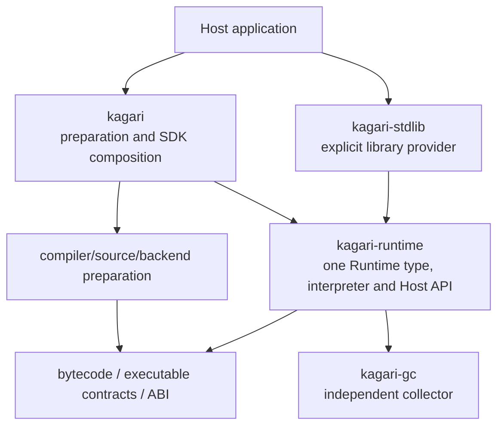
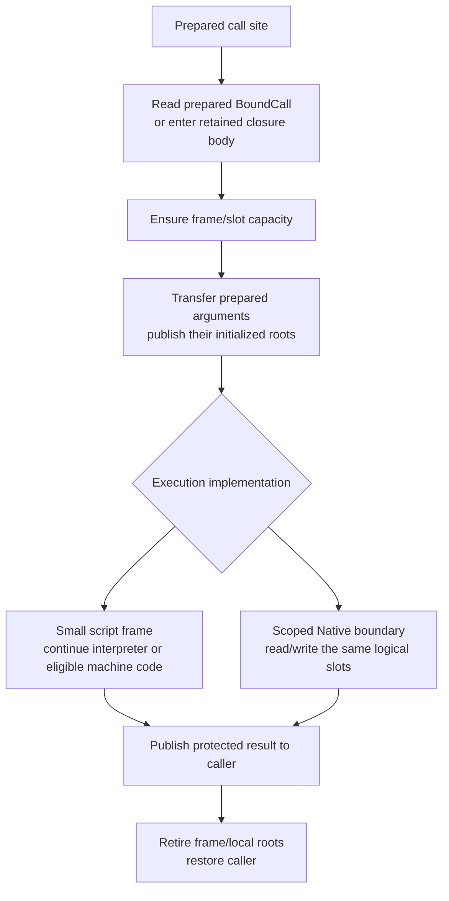

# Runtime Architecture and Host Boundary Refactor

Status: next-scope design recorded at the user's request on 2026-11-09;
standard-library detachment D00-D05 is complete on 2026-11-11. The user requested
the crate consolidation implementation plan CM00-CM04 on 2026-11-11; the user activated CM00-CM04 on 2026-11-11. CM00-CM01 are complete; CM02-CM04 remain pending. Other proposed Runtime changes remain unstarted. Current product ownership, final call tables and
publication are in the
[Runtime model](architecture/runtime.md) and [reload walkthrough](architecture/runtime/reload.md).
The [roadmap](implementation-roadmap.md#runtime-execution-model-review) owns any
future activation. This document owns the proposed Runtime responsibilities,
execution and Host boundary, standard-library detachment and existing-GC integration.
The sketches below are proposals, not current APIs or performance results.

## Next scope: detach the standard library and reuse the existing GC

The user-selected sequence is to detach the existing standard-library implementation,
organize Runtime and its general Host interface, then connect the existing collector
through that model. Full standard-library design and implementation follow later.
This changes the earlier assumption that Runtime/library boundary work must wait
for the paged incremental GC migration. D00-D05 implemented the detach-first boundary below. Runtime/Host consolidation
and existing-GC integration remain proposed, without an activated implementation plan.

This document is the design owner. [Current architecture](architecture/runtime.md)
continues to describe implemented behavior. The [native collections plan](native-collections-plan.md)
owns later concrete storage/algorithm/cursor/host-adapter migration, and the
[paged incremental GC design](paged-incremental-gc-design.md) owns a separate future
collector replacement. Do not duplicate those plans' implementation ledgers here.

### Responsibilities and dependency direction

```text
Standard-library crate        Application Native modules
             \                 /
              public Host / Native protocol
                         |
                       Runtime
              execution, types, local state
                         |
              existing collector integration
```

Runtime owns execution sessions, frames/slots, call preparation and entry/return,
installation/binding authority, statics, retained computations, cancellation and
cleanup. General Host capabilities cover checked declarations and generic types,
Native calls and callbacks, native payload allocation/access, managed edges,
temporary/escaping roots and scoped loans. Standard-library and application
providers must receive the same capabilities; a public Vec-specific heap method
does not establish that boundary.

### Proposed crate consolidation and single Runtime

Recommended after the user's 2026-11-09 ownership review; the CM00-CM04
implementation plan below was requested and activated on 2026-11-11. The current chain is SDK `runtime::Runtime { vm, ... }`
-> `kagari_vm::Vm { runtime }` -> `kagari_runtime::Runtime`. Vm has no separate
execution-state fields, while interpretation is split between its executor and
Runtime's `frame/cursor`. Preserve the useful modules, remove these object/crate
boundaries and converge on one Runtime type.

| Owner | Target responsibility and disposition |
| --- | --- |
| `kagari-runtime` | Retain. Own the single public Runtime, installed program state, executions, language objects, Host/Native APIs and execution implementations. Absorb the VM executor/debug integration as ordinary modules. |
| `kagari-vm` | Remove after moving consumers and unique tests. Delete the `Vm` wrapper; do not leave a forwarding crate or alternate execution entrypoint. |
| `kagari` | Retain source preparation, artifact/backend tooling and SDK composition. Remove its distinct Runtime struct and execution-context/error translations that only wrap the same operation. Expose the canonical Runtime through an exact intentional facade export, with the required re-export-whitelist entry when implemented. |
| `kagari-compiler`, HIR/MIR/source crates | Retain their compilation responsibilities. Prepare executable products outside Runtime; Runtime must load/run without these production dependencies. No compiler rewrite is required by this consolidation. |
| `kagari-bytecode`, `kagari-contract`, `kagari-abi` | Retain executable representation, checked contracts and backend ABI ownership. Crate consolidation does not reopen their formats or language rules. |
| `kagari-gc` | Retain the implemented independent collector. It owns storage, tracing/collection machinery and GC-scoped access; Runtime owns language-specific layouts, edges, root sources and execution integration. |
| `kagari-stdlib` | Retain as an independent provider of concrete library types/functions through Runtime's public Host API. Runtime neither depends on it nor installs it automatically. Detach privileged implementation paths before later library design. |

Target production dependency direction (arrows mean depends on). The collector
edge is the later GC integration target; CM00-CM04 keeps the current in-crate
GcHeap and does not add the `kagari-gc` production dependency:



An artifact-only host may depend directly on `kagari-runtime`; an SDK host uses
the same type through the facade. Installing a standard provider is explicit.
Neither path creates another Runtime owner or requires a provider to depend on
the source-enabled SDK. There is no Runtime-to-SDK dependency.

Inside Runtime, keep responsibilities in ordinary modules:

| Module responsibility | Owned data / work |
| --- | --- |
| Public Runtime entrypoints | Construction, provider installation, program load/replace, call/resume and collection orchestration. No second CoreRuntime/Runtime pair. |
| Programs and installations | Shared immutable executable products; local current bindings, statics and exact retained bodies. Publication remains exclusive and outside synchronous execution. |
| Execution | Frames, slots, local roots and parked execution state. These are Runtime execution state, not collector-owned scheduling/state records. |
| Interpreter | Prepared instruction dispatch, PC progression and ordinary call/return transitions. Move the existing runtime cursor and VM driver/dispatch under this one owner; remove overlapping fallback handlers after their semantics are covered. |
| Host/Native | Registration, prepared codecs, scoped callbacks/reentry and host-owned resources. Script and Native calls use the same execution storage. |
| Heap integration | Language representations, root/edge enumeration and collector entrypoints, using `kagari-gc`. The collector does not interpret bytecode or own Session/Frame records. |
| Optional debugging/async/native execution | Attach to the same state and call selection. Keep feature-specific driving outside the initial plain synchronous loop; do not introduce an execution-backend trait framework merely to replace Vm. |

Runtime owns these fields directly or through cohesive records. An interpreter
activation borrows the relevant execution/services; it is not another persistent
object that owns Runtime. Split field borrows for closed regions, release storage
borrows before a Native callback, and reborrow on return. Do not implement the
merge by wrapping the old CoreRuntime in a newly renamed internal state object.

The existing SDK Program also needs a real boundary correction: its ProgramState
currently owns optional compilation inputs/MIR and is recovered from installed
code through a type-erased owner/downcast. The canonical executable Program belongs
with runtime-side immutable program preparation and contains checked code/layout/
debug/reload evidence, without source-analysis ownership. Source inputs and MIR
preparation stay with the compiler/preparation owner. SDK preparation produces the
canonical product; artifact-only loading produces that same type. Preserve exact
revision/base/history and code retention, but remove the Runtime-to-SDK owner
recovery mechanism. Do not add another public Program wrapper or source cache just
to preserve the obsolete API. Runtime installation state remains separate from the
shared executable product.

For `runtime.call(add, (1, 2))`, the canonical Runtime admits the external call
once, obtains its active execution and invokes its private interpreter. The
interpreter transfers operands and continues through script calls; Native calls
invoke the prepared thunk and return to the same loop. A callback calling script
uses that same internal entry, with the required reentry scope. Results return to
the public call directly. There is no SDK Runtime -> Vm -> CoreRuntime trampoline.
JIT/AOT code later uses the same Runtime data and call contracts, not another Vm.

Migration scope is finite: detach library-specific execution helpers; co-locate
the interpreter modules and merge entry/error/context ownership; remove the two
wrappers and VM package; migrate the executable-product boundary and affected
SDK/CLI/web/benchmark/provider consumers. Integrating the existing GC crate follows
as a separate task after consolidation. Preserve unique source-free, GC/reentry,
debug/async and actual-native tests at
their new owners. Exact file moves and intermediate build boundaries belong to
implementation activation. Do not combine this with unrelated compiler changes.
Acceptance includes absence of the VM dependency and Runtime wrappers, one call
entry and compilation-free artifact execution. Measure performance independently;
removing a crate or wrapper does not by itself establish a runtime speedup.

Reference: Lua 5.4.9 separates [API entrypoints](https://github.com/lua/lua/blob/v5.4.9/lapi.c),
[execution state](https://github.com/lua/lua/blob/v5.4.9/lstate.h) and
[interpreter code](https://github.com/lua/lua/blob/v5.4.9/lvm.c) within one runtime
implementation. Adopt explicit state ownership with module-level execution code;
Lua's dynamic typing, C pointers, coroutine/thread relationships and unwinding are
different. This supports cohesive ownership, not a proof that Rust crates are slow.

Detach concrete collection storage, algorithms, cursors, library policies and
library-specific Rust adapters from the new Runtime core. Before removal, identify
compiler-known language roles and required declaration metadata separately from
their concrete implementations. Detachment does not silently remove operator,
Option/Result propagation, builtin value representation or execution semantics.
Revisit actual boundaries rather than assuming every existing core operation can
be moved unchanged into an optional module.

Reuse the implemented [kagari-gc](../crates/kagari-gc/README.md) collector rather
than redesigning its algorithm during Runtime integration. Current production
Runtime still uses its older in-crate GcHeap and does not yet depend on kagari-gc;
the target replaces that integration with language-specific adapters to the
independent collector. Preserve useful language layout/handle contracts where
applicable, with an explicit finite replacement of obsolete storage paths.
Specify who owns execution roots, temporary Native protection, native payload edges,
code/type provenance and retirement, and how the collector observes those owners.
Preserve checked owner/slot/generation handles, collection across Native callbacks,
loan exclusion and cleanup on errors/reentry/cancellation. This may reorganize the
current collector integration; it does not authorize a new GC algorithm, additional
paged-storage migration or the deferred enum/value representation redesign.

#### Crate consolidation implementation plan (CM00-CM04)

Status: implementation plan requested and activated on 2026-11-11 against
`a656554a`. CM00 is complete; CM01-CM04 remain pending. D00-D05 detachment is complete. This section owns the finite next
migration, checkpoint boundaries and acceptance; it does not activate the other
Runtime proposals. Do not create another consolidation queue.

Task: remove the VM crate and both Runtime wrappers, exposing one Runtime and one
canonical immutable executable Program through the existing SDK facade.
Context: Runtime owns execution/installations; SDK/compiler tooling owns source,
MIR, backend preparation and artifact export. The current dependency is
`kagari -> kagari-vm -> kagari-runtime`; `Vm` owns only a Runtime, while SDK Runtime
owns Vm plus its default execution context.
Expected behavior: an artifact-only host and an SDK host use the same Runtime,
Program and checked execution path, with preserved effects, diagnostics, roots,
reload selection and asynchronous cleanup.
Scope: ownership, module/crate placement, public entry/error/context convergence
and directly affected consumers. Keep the existing interpreter kernels, frame/value
storage, collector, typed Native adapters and execution limits. Do not implement
compact frames, tail calls, new stack limits, generic Host API redesign, collection
reconstruction, JIT expansion/deoptimization, R13 reclamation or `kagari-gc`
integration here. Those remain separate follow-up scope.
Validation: focused owner tests plus the required repository checks below.
Known intermediate errors: none at planning time; this is not a fresh passing-test
claim. The D05 collection-dependent failures remain owned by NC and must not be
hidden or reclassified as consolidation regressions.

##### Ownership decisions and migration order

- Runtime owns the executable product, exact revision/base/history, local
  installations, entry/resume/reentry, scheduling and execution diagnostics. Preserve
  the existing verified descriptor backing and immutable sharing. Distinguish a
  verification proof from the public Program; do not create competing public
  products or an extra wrapper merely to retain an old constructor.
- SDK/preparation owns `CompilationInputs`, verified MIR, source checking/update
  compilation and NativeCompiler's existing bounded cache. Preparation explicitly
  associates its inputs with an exact canonical Program revision. Source updates
  and native compilation consume that association, not a downcast from installed
  Runtime code. Reuse existing preparation owners; do not add a global source/MIR
  registry or duplicate bytecode/source caches. Checked source/debug attachments
  may remain executable diagnostic data, without frontend state or compilation
  authority. Missing preparation input must produce the existing appropriate
  diagnostic/fallback, never silently reuse a previous version's input.
- Runtime can retain finalized native pages and checked linkage/ABI evidence.
  Backend compilation and portable MIR validation remain outside its production
  dependencies. An artifact-only Runtime needs neither SDK nor a source/backend
  compiler. Retain cancellation and exact native-input/bytecode correspondence
  checks when relocating artifact preparation.
- Execution policy/default context, typed calls, cold Future/Task driving, reports,
  debug control and execution error ownership converge in Runtime. Move the useful
  data/handlers, then remove VmError and SDK translations that only wrap execution
  failures. Preserve typed reasons, KG codes, source traces and termination
  precedence. Compilation/package/artifact/backend-preparation errors remain with
  their actual preparation owner; do not force every error into RuntimeError.
- The SDK may intentionally expose the canonical Runtime/Program through its
  existing facade. Every new re-export needs an exact whitelist declaration and
  consumer evidence. Remove runtime/backend/into-runtime forwarding accessors used
  only to traverse wrappers; keep real diagnostics or preparation APIs at their
  owner. No forwarding crate, alternate Runtime type, new backend trait framework
  or permanent old-path alias is permitted.

For `runtime.call(add, (1, 2))`, CM02 must admit the host arguments/session once,
enter Runtime's private interpreter activation, transfer ordinary script arguments
within existing frame storage, and return the rooted result directly. A Native
callback releases storage borrows before calling out; synchronous script reentry
uses the same active Runtime/session and restores the caller on return. Ordinary
inner calls still select current implementations. No second persistent executor
owns Runtime, and removing a public boundary must not remove its required checks.

| Phase | Cohesive change | Build boundary and acceptance |
| --- | --- | --- |
| CM00: freeze the consolidation baseline | Inventory actual entrypoint/name/signature collisions across core Runtime, Vm and SDK Runtime; map error/context/report ownership. Map Program source/MIR/native preparation and update consumers, direct VM dependencies and all test targets. Reuse D05 core/reload/artifact witnesses and existing whole-call/allocation measurements. | No implementation replacement. Record the exact source-only, no-source, async/debug and actual-native sample selectors and their results before editing. Capture release binaries/revisions for comparison. Preserve known NC gaps separately. |
| CM01: give executable Program its runtime owner | Move the canonical executable product/replacement history to Runtime-side preparation. Separate SDK source/MIR inputs and NativeCompiler preparation, migrate engine compilation, artifact import/export and body-update consumers together. Remove `Program::from_installed_code` and the SDK ProgramState downcast/retention edge; do not delete generic ownership needed by other executable holders without auditing them. | Core and SDK targets build. Load/replace/inspect the same canonical product through both direct Runtime and SDK composition. Shared Programs remain Send + Sync; installations/statics remain Runtime-local. Source-update exact-base/history, artifact/native mismatch rejection, failed publication cleanup and backend-cache/page lifetime witnesses pass. No Runtime-to-SDK/frontend/MIR/codegen dependency is introduced. |
| CM02: merge execution and remove wrappers | Move VM executor/driver/dispatch, debug protocol, owned execution, reentry, scheduler/tasks, typed entry and prepared-native invocation into cohesive Runtime modules. Merge SDK Runtime execution/context/report/error responsibilities directly into the existing Runtime. Resolve conflicting APIs and migrate all direct callers in one coordinated cut. Delete Vm, SDK Runtime wrapper and the VM package/workspace/Cargo references. | All affected production and test targets compile; plain script/Native/callback/reentry and representative parked/native routes execute. There is one Runtime owner and one shared execution implementation, with no new CoreRuntime/state wrapper. Runtime stays Send + !Sync. Preserve specialized scalar kernels and GC/loan/initialization/owner checks. CM02 cannot finish with placeholder async/debug/native paths or a forwarding VM crate. |
| CM03: close execution-mode and consumer integration | Review transferred paths for duplicate session/admission/conversion/retirement work and remove superseded forwarding. Complete unique test/fixture ownership, feature/tooling and error-diagnostic migration. Exercise the actual async/debug/native paths against the unified state and repair concrete integration defects. | Selected source-free, retained-body/current-inner-call, scoped-loan/reentry, cancellation/unwind/quarantine, task wake/drop/output publication and debug stack/stepping contracts pass. Actual Cranelift/native execution, honest unsupported fallback and no restart after native side effects remain distinct assertions. Required-feature consumers and scripts use the new owner, without broad visibility or test-only production dependencies. |
| CM04: acceptance and handoff | Audit the final dependency/API/ownership graph, run isolated baseline comparisons and required checks, update current architecture/spec/guides and existing follow-up owners, then retire this completed phase ledger to Git history. | No VM package/dependency, Vm/SDK Runtime wrapper or installed-code-to-SDK downcast remains. Artifact-only execution uses canonical Runtime/Program without production compiler/stdlib dependencies. No known CM integration failure remains. Report local evidence, pending CI and unchanged NC gaps separately; later GC/frame/Host/library work is not marked complete. |

CM01 precedes CM02 so program/preparation ownership does not get hidden inside a
new Runtime wrapper. CM02 is an intentional coordinated crate/API cut: move its
consumers in the same checkpoint rather than retaining hypothetical compatibility.
CM02/CM03 may share one implementation commit if required to keep execution-mode
integration meaningful. Do not retain a knowingly failing CM02 checkpoint merely
because its nominal file moves are complete. CM00-CM04 are otherwise buildable
checkpoints; record newly discovered failures, reproduction, cause and the owning
repair before committing, and resolve them before declaring their phase complete.
Preserve ordinary language behavior and the already recorded NC integration gaps.

##### Concrete migration surface

| Current owner | Required disposition |
| --- | --- |
| [VM](../crates/kagari-vm/src/lib.rs), [entrypoints](../crates/kagari-vm/src/vm.rs), [executor](../crates/kagari-vm/src/executor.rs), [reentry](../crates/kagari-vm/src/reentry.rs) | Move implementations under Runtime's execution/interpreter/debug owners; eliminate the VM object/crate rather than relocating it wholesale as another owner. Keep activations borrowing Runtime. |
| [SDK Runtime](../crates/kagari/src/runtime.rs), [context](../crates/kagari/src/context.rs), runtime call/typed/scheduler/scoped/source modules | Move execution policy/state/orchestration to Runtime and remove translations/forwarding. Source analysis/update compilation stays SDK-side. Preserve Engine configuration and explicit provider installation. |
| [SDK Program](../crates/kagari/src/program.rs), [updates](../crates/kagari/src/program/update.rs), [NativeCompiler](../crates/kagari/src/program/native.rs), [core verified backing](../crates/kagari-runtime/src/module.rs), `module/owner.rs` (retired by CM01) | Preserve exact revision/history and native/source evidence while separating executable ownership from preparation inputs. Keep installed handles identity-only. Audit ordinary metadata/code holders, cycles and final release, without claiming the deferred R13 type/code lifetime split. |
| SDK, CLI, web, Lua-comparison benchmark and their examples | Migrate current direct VM dependencies and low-level accessors to canonical owners. Preserve the existing required-feature paths; do not recreate withdrawn collection providers just to run an old workload. |
| VM lib/integration tests, allocation contracts, library measurements and fixtures | Move unique runtime contracts/fixtures into Runtime test owners and SDK end-to-end/backend preparation contracts into SDK owners. Transfer explicit Cargo targets because helper files are not standalone tests. Keep source-free and actual-native oracles distinct; consolidate only equivalent coverage. |
| Workspace manifests/lockfile, [feature checks](../scripts/check_features.py), [AOT checks](../scripts/check_aot.py), CI targets, [re-export whitelist](../scripts/structure-exceptions.toml) and current guides | Remove retired package/import/command references, update dependency constraints and exact facade exports. Do not weaken source-free constraints to accommodate a new cycle. Only update ABI/format IDs under the repository's publication policy. |

CM00 fixes the semantic-owner destination and command for each selected case before
moving it. Current anchors include VM `native_wait`, `owned_drive`, `reentry_debug`,
`prepared_execution` and `native_boundary` tests; SDK `program/update` and
`program/tests/native_preparation`, `runtime_transfer`, `artifact_features` and
async output-publication cases; Runtime native-schema, root/loan and typed-error
tests. Reuse their actual assertions and fixtures. A new test requires a distinct
uncovered failure/lifecycle, not merely a renamed crate/API.

##### CM00 baseline and resolved ownership map

CM00 is complete against implementation `a656554a` (activation docs `49271109`).
No runtime implementation changed in this checkpoint. The 2026-11-11 source audit
finds these concrete collisions, beyond file placement:

| Boundary | Current conflict | Chosen destination |
| --- | --- | --- |
| Construction/loading | Core constructs from RuntimeConfig and loads bytecode; Vm wraps it; SDK adds default ExecutionContext and Program/load options. | Canonical Runtime owns defaults and checked Program installation. Remove wrapper traversal; raw verification/staging stays a distinct internal mechanism, not an overloaded legacy load facade. |
| Call/execute/session | All layers own call/execute variants; Vm and core have begin_execution, while SDK converts options and owns result-root/retirement orchestration. | Runtime owns host entry, typed conversion and session orchestration once. Borrowed interpreter activations consume that authority; internal script calls do not restart public admission. |
| Tasks/debug/scopes | create_task_scope, scheduler polling, event retrieval, close and host-scope forwarding cross wrappers. Vm owns debug observer attachment and owned drivers. | Runtime owns the existing scheduler/task/observer/loan state and the moved drivers, without changing frame/storage or adding another execution owner. |
| Diagnostics | VmError wraps RuntimeError/HostError/backend failures and trace; SDK maps execution failures again. Source inspection is already implemented in Runtime and merely forwarded. | Runtime owns typed execution reasons/context and inspection. Keep separate preparation errors and preserve termination/trace ordering. Delete redundant forwarding rather than broadening visibility. |
| Program | SDK ProgramState strongly retains source/MIR; VerifiedProgram retains it via the only implementation of ProgramCodeOwner; installed-code lookup downcasts it. | Runtime Program owns verified backing, history and expected-base identity. Replace the SDK ownership back-reference with a typed runtime product association. Audit confirms no other ProgramCodeOwner implementation/with_owner consumer; remove that obsolete trait without losing ordinary executable holders. |
| Preparation | Compilation currently pairs checked source/MIR/bytecode, then SDK Program absorbs the inputs. Source updates and NativeCompiler read those private fields. | Retain a public SDK-side Compilation as the explicit preparation owner with canonical Program access and source/MIR inputs. It is not another executable type: Runtime accepts Program, never Compilation. No automatic forwarding/Deref, installed-code recovery or source/MIR registry. Source/native consumers retain their Compilation explicitly; program-only compilation may discard preparation state. |

Program extraction must not make compilation state a GC/code-retention edge. Source
editing and NativeCompiler will use the explicit Compilation; their candidate/base
checks use the canonical Program's identity/history. Preserve private/member edit
locators, checked source/debug metadata and missing-input rejection. Artifact-only
Program loading remains independent; native-enabled SDK artifact preparation also
validates portable MIR correspondence before exposing it for compilation. This is
the concrete CM01 migration, not a new generic preparation framework.

Direct VM production consumers are SDK, CLI, web and the Lua-comparison benchmark,
plus workspace manifest/dependency entries. `scripts/check_features.py` encodes
execution/preparation dependency constraints and `scripts/check_aot.py` selects
packages. Move the constraints to canonical owners, not remove them. Unique VM
execution tests/fixtures and allocation/measurement targets belong to Runtime;
compiler-product/backend/source-update integration stays SDK-side. Full-library
fixtures remain retained with their existing NC availability gap.

Fresh CM00 local evidence: 14 cases pass using the selectors below (one command
per filter, rather than multiple positional Cargo filters):

- `cargo test -p kagari --lib <filter>`: `program::tests::source_preparation`
  (2 cases), `retained_old_closure_demands_recompile_generic_applications_removed_from_new_source_calls`,
  `caches_products_across_runtimes_and_retains_them_after_backend_drop`, and
  `mismatched_artifact_native_input_is_rejected_before_loading`.
- `cargo test -p kagari-vm --lib <filter>`: `native_wait` (4 cases),
  `nested_breakpoints_and_traps_include_the_suspended_host_caller`, and
  `native_errors_never_restart_in_the_interpreter_and_keep_the_trace`.
- `cargo test -p kagari-vm --test allocation_contracts warmed_scalar_and_array_read_boundaries_add_no_allocations`.
- `cargo test -p kagari --test artifact_features real_cranelift_compiles_portable_artifact_without_source`.
- `cargo test -p kagari --no-default-features --test artifact_features portable_artifact_executes_without_source_compilation`.

The existing core-call release binary was retained before editing and run alone.
Using the D05 method/environment (Windows x64 MSVC, i7-10700F/16 logical processors,
Rust 1.99.1 `58cf8f9c3`/LLVM 23.1.1, workspace release/default features and Cargo
parallelism, warmed Runtime/binding caches, one test thread), the CM00 medians are
5096.17 / 5800.39 / 12003.29 ns per empty/script/Native whole host call. Three warm-up
and eleven measured batches each contain 10,000 calls; compilation/loading/binding
are outside timing. Allocation requests remain 38/38/103 and bytes 1808/1808/4688,
with zero reallocations. Prepared scalar/array Native boundaries still allocate
zero. The source workload/counter must stay identical after its target moves.

No new implementation/build failure is carried. D05 required checks remain valid
for unchanged Rust; this documentation checkpoint passes content/link/diff review.
Full-workspace tests, feature/backend/platform matrices and AOT process execution
are unrun local scope. Collection-dependent source programs still await NC; the
selected core/artifact/native witnesses do not imply their restoration.


##### CM01 implementation and validation

CM01 is complete. Canonical Program/replacement history now lives in
`kagari-runtime::program`; VerifiedProgram's optional association is typed to that
runtime product. The SDK facade re-exports that exact Program/ProgramPreparationError
with a declaration-scoped whitelist entry. ProgramCodeOwner, Any/downcast recovery
and installed-code ownership of compilation inputs/MIR are removed.

SDK Compilation explicitly retains its canonical Program plus source/MIR inputs.
`engine.prepare`/`compile` return Compilation; `compile_to_program` discards those
inputs and returns Program. Source updates advance the caller's explicit Compilation
only after successful publication; NativeCompiler consumes Compilation. CLI,
benchmarks and source/native consumers use the proper owner. Private edit locators
retain revision identity tokens, not code or inputs. The existing snapshot/base/
history and source/native mismatch assertions remain, with input-release assertions
updated to the new explicit lifetime rather than old installed SDK retention.

Production Runtime and SDK/all-target checks pass; SDK no-default library, CLI jit
and the diagnostic enum example build. Workspace all-target Clippy passes. Structure
passes for 1847 Rust files with three existing scalar size exceptions and one exact
SDK facade re-export. Source update (12), Native preparation (10), real Cranelift
(6), artifact input (2) and default Native artifact (5) cases pass. The direct core
Program installation witness passes after explicitly installing the same declared
providers as its SDK route; missing providers continue to reject before publication.
Source cancellation also passes. The no-default opaque-artifact case and actual
Cranelift with only the SDK native feature enabled both pass. Documentation links,
Rust formatting and diff checks pass. The isolated source-free Core installation
setup initially lacked its declared providers; explicitly installing them repaired
the witness without weakening declaration admission. No build/test errors are
carried at this checkpoint. No execution
wrapper/interpreter/frame/GC change belongs to CM01; CM02-CM04 remain pending.

##### Verification, performance and commits

At every implementation checkpoint run the required structure/import/ownership
review and `uv run --locked scripts/check_structure.py`, `cargo fmt --all -- --check`,
`cargo clippy --workspace --all-targets -- -D warnings` and `git diff --check`.
Keep meaningful module boundaries and the existing narrow scalar-dispatch size
exceptions; merging crates does not justify production globs, forwarding modules
or blanket visibility/LOC exceptions. Keep tracked docs/source links valid as
files move. Documentation-only planning needs content/link/diff checks, not builds.

Local behavioral selection is bounded by each phase's changed owners. Sample
normal Runtime-only dependency trees, SDK `--no-default-features` artifact loading,
one source/body-update route, serde DTO conversion, debug/reentry, async cleanup
and an actual-native route where affected. Check necessary diagnostic/AOT/target
features in their supported scope; full-workspace tests and exhaustive feature,
backend and platform matrices remain CI-only. Move affected CI commands rather
than running that full matrix locally. Retain known NC failures and unrun scope
in the plan; compilable targets alone are not execution acceptance.

Reuse the existing `library_measurements` core-call and `allocation_contracts`
workloads after relocating their target names. Preserve inputs, warm-up, timed
region and allocation counter. Record exact Rust/machine/profile/features,
revision/cache state and parallelism; compile first and run prebuilt baseline and
candidate sequentially with no competing build. Prepared scalar/array Native
invocation must preserve its zero-allocation contract, and whole-call allocation
counts must not grow for this unchanged-workload ownership migration; diagnose
an increase rather than weakening the workload or its counter. A repeatable
median regression above 5% on the same workload triggers ownership/path diagnosis
and repair before acceptance; confirm a suspected regression with three paired
baseline/candidate runs rather than repeated broad suites. No speedup is required
or inferred merely from deleting a crate. Compact-frame optimization remains later.

When implementation and phase commits are authorized, use Conventional Commits
with `Plan: docs/runtime-refactor-design.md` and `Plan-Phase: CMNN` (both trailers
for a combined CM02/CM03 checkpoint). Mark public API removals as breaking, record
actual validation/limits, and preserve unrelated work. Do not amend prior commits.
On completion move lasting contracts to architecture/spec owners and remaining
GC/frame/Host/NC work to its existing roadmap/plan, then remove this execution
ledger. Planning does not authorize implementation or a commit by itself.

The Lua 5.4.9 module/state/interpreter references above remain the mechanism
reference: adopt one state owner with borrowed interpreter activations, while
retaining Kagari's static contracts, Rust borrowing and precise GC/reload roots.
This plan changes placement/ownership; it is not evidence for a new collector,
stack format or unsafe execution shortcut.


### Standard-library detachment inventory and execution plan

D00-D05 are complete. The implementation checkpoints and resolved migration
diagnostics live in Git history; this section records the resulting baseline and
remaining integration boundary. Current contracts belong to
[architecture](architecture.md#language-contracts-and-native-implementations),
[embedding](spec/embedding-api.md#typed-native-registration),
[GC](spec/runtime.md#gc-heap) and [artifact](spec/artifacts.md) specifications.

Runtime and SDK construction install no providers. Hosts compose exactly their
checked modules; CLI/web explicitly select the reduced stdlib. SDK's normal
no-default-feature dependency tree contains no stdlib, and Runtime/VM have only
dev dependencies on it. Empty/scalar and application-only Native execution need no
standard bundle. Operator/trait syntax, language-role enums and async declarations
still require their actual checked providers, never fabricated layouts or names.

The retained core owns fixed arrays with packed scalars/traced Values, immutable
String/ranges/numerics, language enum roles, Future/Task/TaskScope execution,
generic native payload roots/accounting/loans and checked calls. Assert remains
the narrow-integer compiler bridge; StringByteLength is the only NativePrimitive.
Created closures/Futures and admitted bodies retain their selection; ordinary
inner calls still select current implementations. The detachment introduces no
cross-version lookup on new code and does not change the reload model.

Removed contracts include Sequence/Map/Set/Iterator layouts, Map/Set/Iter semantic
and value tags, cursor bytecode, concrete table/key/collision policy, nominal Vec
primitives/codecs/factories/handles, detached collection edits and automatic Rust
Vec/Serde sequence adapters. Fixed arrays have an exact independent payload and
cannot grow. Ordinary payloads retain explicit StoredSelection/StoredCallable
slots, metadata tracing, type environments and checked current-call dispatch.
Source/declaration correspondence, reference access, declared bounds, handle
generations and source-free admission remain independently validated.

Runtime and library consumers use builtin arrays, tuples and application payloads
for generic guarantees. Transparent Rust Box supports recursive DTO/Serde schemas
without a script type or extra graph node. A source-free async example uses a
script Iterator across await, rather than a privileged source-container cursor.
Affected disposable artifacts were invalidated and re-emitted without changing
unpublished ABI/format identifiers. No compatibility aliases or replacement
collection backend remain.

Local acceptance passes: workspace all-target Clippy, structure (1847 Rust files,
zero violations, three existing bounded scalar-dispatch exceptions), Rust/changed
fixture formatting and diff checks. SDK serde all-target and optional diagnostic
example builds pass. Focused behavioral evidence covers fixed-array bounds and
packing, checked numeric traps/completed effects, payload charge/take/revision,
roots and child snapshots across GC/reentry/unwind, reference wire scopes, explicit
trait prerequisites/foreign owners, retained-body/current-inner-call reload,
generic Native result conversion and async output cleanup. Twelve artifact cases
pass with SDK default features disabled; native/default artifact routes also pass,
including actual Cranelift and structurally valid forged binding rejection.
The unchanged warmed scalar/array Native-boundary oracle observes no allocations.
The [D00/D05 release call comparison](performance-baseline.md#runtime-detachment-core-call-comparison-windows-2026-11-11)
records unchanged allocation counts and no observed median-time regression; it is
not a lookup-only, whole-interpreter speedup or compact-frame claim.

Full-product acceptance is deliberately separate. Concrete Vec/HashMap/HashSet,
builtin array/range iteration, String chars/bytes/split, removed List algorithms,
library collection conversions and collection-heavy manual measurements are not
currently usable. Their source fixtures and behavioral oracles remain for
[NC reconstruction](native-collections-plan.md); none are ignored or replaced with
fake success. NC must use the later public dynamic-payload/edit protocol and prove
independent-provider parity before those routes can pass. Collection-specific API
and retired-instruction tests have been removed; generic safety checks remain at
their owning layer. The optional enum measurement Rust target compiles but still
needs reconstructed providers to execute its collection workload.

Full-workspace tests and exhaustive features/backend/platform matrices remain
CI-only and were not run or claimed passing. The known library-dependent failures
remain an explicit NC gap, not a core detachment build failure. Current Runtime/VM
consolidation, Host redesign and existing-GC integration are the next design scope;
tail recursion, enum/value representation and PG collector replacement remain
inactive. This completion does not activate any of those migrations.

Mechanism reference: [Lua 5.4.9 library composition](https://www.lua.org/source/5.4/linit.c.html)
selects/open libraries separately from execution, and its
[table library](https://www.lua.org/source/5.4/ltablib.c.html) uses public table APIs.
Kagari adopts explicit composition and a public provider boundary. Lua tables are
a VM builtin with different typing and GC assumptions; that is not authority to
retain Kagari's nominal Vec/hash storage in Runtime or to skip typed mutation rules.

### Sequence and reviewable exit conditions

1. **Detach existing library implementation dependencies.** Inventory privileged
   Runtime/GC/VM/SDK paths and their consumers; establish the Runtime-only build
   and checked executable-input boundary before designing replacement libraries.
2. **Organize the Runtime and Host model.** Describe ownership with core records,
   diagrams and complete host-entry, script-call, Native-call, return, park/resume,
   trap and publication paths. Reuse implemented immutable Programs, prepared
   calls and exclusive Runtime publication. Settle one coherent registration and
   call model before naming multiple public adapters.
3. **Integrate the existing GC and prove the generic boundary.** Exercise allocation,
   root handoff, payload edges, mutation and cleanup through the reorganized model.
   A small external Native provider containing a managed reference and a script
   callback is a Runtime contract witness; it does not require designing the full
   Vec/HashMap/HashSet library. Test it under collection, reentry and failure.
4. **Design and reconnect full libraries later.** Rebase the existing collection
   plan on the proven protocol. Standard implementations must use that same
   public path; restoring privileged paths is not an independent-library result.

Before implementation activation, freeze the finite removal inventory, affected
crate/build boundaries and consumer reconnection checkpoints. Any intermediate
unbuildable SDK/library targets or deferred integration tests must have explicit
causes and owning follow-up steps; do not disable checks or add fake-success
stubs. Runtime-focused evidence is not a full-workspace or restored-stdlib claim.
Retain the independent behavioral, source-free, GC/loan, cancellation and reload
oracles at their semantic owners.

Full collection/API redesign, paged/incremental GC, enum/niche/value-struct layouts,
the deferred shared declaration-ID migration, R13 reclamation and broader
AOT/JIT/deoptimization remain separate. Later call-model sections are design
inputs; this scope record does not automatically activate every proposed optimization.

Reference boundaries: [Lua 5.4.9 library initialization](https://github.com/lua/lua/blob/v5.4.9/linit.c)
and [table library](https://github.com/lua/lua/blob/v5.4.9/ltablib.c) demonstrate
ordinary registered library functions, while table storage remains core-owned.
[AngelScript's array add-on](https://www.angelcode.com/angelscript/sdk/docs/manual/doc_addon_array.html)
and [application GC behaviors](https://www.angelcode.com/angelscript/sdk/docs/manual/doc_gc_object.html)
(online SDK manual reviewed 2026-11-09) demonstrate a registered generic container
and provider-visible edge enumeration. Its reference-count/cycle-collection model
differs from Kagari's precise tracing; these sources support the boundary, not
reuse of its memory protocol or a Kagari performance claim.

## Candidate call execution model

This is subsequent call-model work. The implemented prepared call tables are
part of the reload design; logical slot storage, frame compaction and public Native
adapter changes remain separate review/implementation work. Reuse those tables
rather than creating another current/legacy dispatch mechanism.

Proposed on 2026-11-09 after the [empty-call measurements](performance-baseline.md#empty-call-attribution-windows-2026-11-08).
An ordinary empty script call costs about 531 ns; raw/flat Native about 640-660 ns;
owned Native about 1,977 ns. The owned path rebuilds type mappings twice and creates
two empty root leases. These results motivate moving stable preparation out of the
invocation and using one execution-slot protocol. They do not establish a speedup
for the proposed implementation or imply that all checks can move to installation.

### Performance-first scope and removal review

The user-selected priority on 2026-11-09 is to establish a small, fast execution
core before adding defensive policies. The first performance checkpoint covers
ordinary synchronous script and Native calls with cancellation, observers, slicing
and statistics disabled. It is a bounded baseline, not acceptance of all existing
execution features. Do not design a new permission matrix, configurable check
registry or parallel checked/unchecked execution model to support this work.
Existing API/specification behavior remains current until its owning migration;
record any deferred integration instead of reporting a semantic regression as a pass.

The source review identifies the following removals from the proposed ordinary
call path. Rows describe ownership changes, not measured individual speedups.

| Existing cost and evidence | Target ownership / removal |
| --- | --- |
| `frame/admission.rs` rechecks arity, generic environment shape and Program metadata for prepared calls. | Compile/verify and bind the internal transfer contract once. Internal entry consumes that contract; host-supplied arguments and dynamic receiver selection have their boundary checks. Do not route every call through public admission. |
| `native/typed.rs::invoke` checks Rust mappings; result encoding checks again. | Prepare a codec per fixed Native application at binding/application preparation. Invocation performs actual conversion, with no reconstruction of a fixed Rust/script type mapping. Custom converter effects remain per value. |
| The owned adapter copies arguments into a Vec, clones it for roots, and argument decoding creates another root scope. | Read protected execution slots directly. Temporary values use one local-root checkpoint; durable handles alone acquire durable roots. Warm empty/scalar calls allocate nothing. |
| `executor/driver.rs`, `gc_safepoint`, call admission, Native entry/exit and return can each poll execution; `observe_execution` queries the active session even without an attached observer. | Keep cancellation/observer dispatch out of the initial plain-call baseline. Later choose polling sites from the actual responsiveness contract, consolidating adjacent callback-free checks. State explicitly when a benchmark disables these features. |
| Ordinary Native calls pass through Pending, Running, Complete and a later NativeReturn driver action. | Invoke and return directly while retaining the logical frame. Materialize a completed continuation only where slicing/observation actually requires it; no asynchronous state machine for every synchronous callback. |
| `frame/values.rs` reserves five backing owners and maintains generational windows/allocation order for ordinary stack calls. | Execution owns reusable frame/slot suffixes. Push/pop with saved positions; grow in a slow path. Keep independent retirement machinery at parked/escaping storage owners, not every nested call. |
| Slot allocation clears all scalar payloads/flags and fills managed records with Unit. | First remove unnecessary scalar payload clearing. Keep managed clearing until existing initialization facts can exclude stale entries from GC/debug access. Reuse checked facts; do not make a new liveness-analysis project a prerequisite. |
| Session, frames and banks use repeated RefCell admission; frames and value windows retain overlapping body/environment owners. | Give the active driver exclusive mutable execution access, with scoped reborrowing at Native boundaries. Retain exact body/type dependencies at their real owner and trace slots through that owner; avoid duplicate per-window pins and bookkeeping. Do not blanket replace Arc with Rc or retain storage references across growth/callbacks. |
| `objects/invocation.rs::admit` allocates a MethodComputation even for an immediate interface call. | Carry the selected body/environment in the admitted frame. Allocate retained computation state only when it escapes or must persist independently. Preserve old-body/current-inner-call selection. |
| Whole Runtime/installation/phase checks recur along internal target and frame entry. | Establish exclusive activation and bound body validity at entry/resume. Internal transitions reuse it; a callback or suspension revalidates only facts it can invalidate. Do not add epoch checks, locks or a validity cache to every instruction. |

For example, repeated `tick(player)` calls from verified script code already have
a known parameter type, prepared target and rooted `player` slot. Rebuilding that
signature, validating its Program again, copying the argument into independently
rooted packs and allocating an invocation identity adds no new fact. The proposed
ordinary flow is:

```text
script: prepared target -> ensure stack space -> transfer operands -> push frame
        -> interpreter continues -> publish result -> restore caller positions
Native: prepared thunk/codec -> protected argument slots -> Rust callback
        -> encode/publish result -> release temporary roots -> continue caller
```

Keep storage bounds, valid GC roots/result handoff, actual host-handle/loan access
and checked language operations at their existing semantic owners. These make the
execution produce valid results; they do not justify another generic admission
layer. Defer extra quotas, always-on diagnostic counters and fault-hardening policy.
An invalid internal prepared relationship is a compiler/linker defect to detect
with verification/assertions, not a reason to reconstruct its proof on every call.

Start with Native mapping/root duplication and internal admission/driver work,
then simplify storage and ownership. The historical instrumented empty-call study
attributes about 386 ns to script preparation and only about 7.5 ns within it to
depth handling; the owned adapter attributes 16 allocations to two mapping checks
and two more to empty roots. These overlapping diagnostic scopes precede Runtime
lock removal and are prioritization evidence, not present-day additive costs.
Refresh the empty/control/Lua measurements at the implementation baseline. The
[lock-removal comparison](performance-baseline.md#runtime-owned-publication-and-lock-removal-windows-2026-11-09)
does not replace an updated empty-call attribution or establish Lua parity.

### Explicit generation of readable scalar execution

The 2026-11-10 generation task is implemented as one bounded change before VM
consolidation. The three scalar catalog macro consumers are replaced together by
ordinary Rust enum/preparation/dispatch regions, maintained by an explicit catalog
and generator. The small cold-error propagation macro remains; the interpreter
loop itself is ordinary Rust. No instruction set, polling, call model or GC change
is part of this source-organization migration.

The [scalar execution guide](architecture/runtime/scalar-execution.md) owns current
file responsibilities, regeneration/check commands, single-dispatch invariants and
exact bounded LOC exceptions. The [roadmap](implementation-roadmap.md#runtime-execution-model-review)
owns integration status. Existing numeric semantics remain at
their payload owners; generation consistency is not a semantic execution oracle.
The [paired comparison](performance-baseline.md#explicit-scalar-source-generation-windows-2026-11-10)
passes the existing regression gates; no speedup is claimed. This bounded migration
is locally accepted and adds no new pending implementation phase to this design.

### Deferred bytecode specialization experiment

Recorded at the user's request on 2026-11-10; queued for later measurement, with
no bytecode/compiler migration activated. Compare the current typed canonical
bytecode -> prepared ExecutionInstruction path against compiler-emitted specialized
bytecode, for example I32AddRR/I32AddRK. Current preparation consumes checked type
facts; it does not infer types from values or re-specialize each executed operation.
Its immutable results can be shared across Runtime installations.

The hypothesis is that equal final instruction layout/dispatch yields similar
steady-state execution cost. Moving specialization may reduce preparation work;
it does not inherently eliminate physical-slot mapping, provider/call linking or
the separate prepared array. Test elimination of duplicate instruction storage as
a distinct extension rather than attributing its gains to specialization placement.
More opcode variants do not by themselves prove larger encoded artifacts.

Before prototyping, freeze the compared input, numeric/effect semantics, final hot
representation and dispatch mechanism. Measure source compilation/artifact size,
verification/shared preparation, per-Runtime installation, first invocation and
warmed execution separately. Account for canonical code, prepared arrays and
metadata in memory results; distinguish once-per-product cost from per-installation
and per-call cost, including shared-Program amortization. Use representative scalar
arithmetic/constant shapes, branches and call controls with independent checksums
and the existing numeric/trap/source-free oracles, not a new exhaustive test matrix.

Preserve width/overflow/IEEE behavior, evaluation/commit order, executable
verification and reload code ownership. Record machine/toolchain/profile, cache
state and paired-run variability; compare preparation and execution separately.
The explicit source-generation benchmark above changed neither bytecode model nor
specialization stage and cannot establish this experiment's result. This work is
not a prerequisite for the queued Runtime consolidation/Host/GC refactor; do not
combine those changes into the measured prototype.

### Typed errors and diagnostic ownership

Design review requested on 2026-11-10; EN01 numeric transport is locally accepted.
EN02 Runtime reason/context ownership is locally accepted.
Finer cold validation details and full VM/SDK consolidation remain queued.
Use typed reasons as error identity and format human-readable text at diagnostic
boundaries. This changes representation/ownership, not the number of execution
checks, numeric policy or cancellation behavior. No new error crate, error registry,
permission framework or generic catch-all execution layer is needed.

#### Numeric implementation checkpoint (EN01)

Task: Preserve typed scalar reasons through integer/payload/shared/comparison
helpers and their direct constant-evaluation/interpreter/Value/Native consumers.
The [scalar execution guide](architecture/runtime/scalar-execution.md) owns the
implemented transport and diagnostic boundary. No artifact/ABI change or new
execution check is introduced. Existing RuntimeError construction, trace attachment,
quarantine and SDK categories remain in place for the next phase.

The types owner is scalar::error::ScalarError; it reuses ArithmeticError. HIR's
checked integer-fact constructor now returns IntegerRangeError, so constant
arithmetic can carry both failure families without an intermediate string. Literal
parsing keeps its existing source-diagnostic text; this is not a source parser error
migration. MIR failed-fold handling already consumes Result without formatting.
Generated execution arms require no text change because their Trap payload now
accepts ScalarError. Backend/stdlib callers continue to use Runtime numeric adapters.

Local acceptance: 30 selected Rust tests pass: 20 types/HIR/Runtime cases,
three VM numeric cases and seven SDK integration cases. Selection covers typed
reasons and Display/source, width-before-shift and domain-before-arithmetic failure
order, checked constants/ranges/casts, Value/Native numeric adapters, direct and
serialized/decoded bytecode, completed effects/failed destination commits, GC-root
cleanup and matching interpreter/Cranelift source traces. Existing scenarios gain
typed assertions; the two new owner cases cover width/shift precedence and the
public diagnostic/source contract rather than duplicating upper-level smoke tests.
Reproduction entrypoints:

- `cargo test -p kagari-types -p kagari-hir -p kagari-runtime --lib -- payload::tests:: integer::tests:: scalar::error::tests:: typeck::const_eval::tests:: typeck::scalar::tests:: numeric::`
- `cargo test -p kagari-vm --lib -- tests::numeric::integer_overflow_and_zero_divisors_trap_at_every_source_width tests::numeric::scalar_field_overflow_preserves_prior_effects_and_does_not_commit tests::numeric::all_integer_widths_cover_arithmetic_bits_comparisons_and_concrete_generics`
- `cargo test -p kagari --lib runtime::tests::embedding::error_traces::native_overflow_reports_the_same_instruction_as_the_interpreter`
- `cargo test -p kagari --lib -- runtime::tests::language::numeric_operations::failures:: runtime::tests::language::default_methods::shared_arithmetic::shared_numeric_traps_preserve_effects_and_release_roots runtime::tests::embedding::error_traces::interpreter_traps_capture_frames_and_original_source_locations runtime::tests::language::conversion_traits::native_aggregation::native_numeric_aggregation_checks_declared_width_and_releases_roots`

Workspace all-target Clippy, structure (1875 files, zero violations, three existing
exact generated-region exceptions), fmt, generation consistency and diff checks
pass. Import/visibility review adds no re-export, new dependency, generated-code
change or LOC exception. The [scalar guide](architecture/runtime/scalar-execution.md)
records toolchain-specific error/Result sizes; existing scalar source generation
timings do not measure this change. No known carried build/test errors remain in
this selected scope. Full-workspace tests and exhaustive matrices remain CI-only
and unrun locally. Runtime reason/context migration and execution/failure-formatting
performance comparisons remain queued; no speedup or complete Runtime error
unification is claimed.

#### Runtime reason/context checkpoint (EN02)

Task: Replace Runtime's independently assignable kind/message record with a typed
ErrorReason and optional owned diagnostic context; migrate direct consumers while
preserving codes, numeric/trap policy, effect order, first trace/task provenance,
quarantine and cooperative cancellation. The
[Runtime map](architecture/runtime.md#error-reasons-and-diagnostic-context) owns
current records, API usage, formatting, source and retained-memory rules.

The finite families are scalar/fixed traps, cancellation, stale handles, index
failures and engine invariants. Cold module/metadata/path/borrow/resource failures
retain owned detail data inside their named reason families; finer owner-specific
leaf migration is deferred to the queued Runtime consolidation. No universal
`(kind, message)` adapter or formatted-message cache remains. RuntimeError::new now
accepts ErrorReason, From accepts the typed leaves, and Display replaces borrowed
message access. This is an unpublished Rust API replacement, not an artifact/ABI
version change. Provider variants preserve custom Native/library diagnostics and
keep library-specific Vec/String policies outside Runtime error enums.

Context is a cold optional Box containing owned coordinates, trace and task origin.
Scalar transport creates neither a message String nor a context Box. Structured
coordinates replace at_conversion's format/prefix chain. Reflective wrappers retain
the original RuntimeError as a source, preserving prefix order and metadata. Task
accounting follows actual owned reason/source/context storage, excluding shared
trace metadata. Existing heap-charge/termination rules are unchanged.

Boundary review found that VmError's ScriptTrap-only BuiltinError branch concealed
the retained trace from VmError::trace and sent it to SDK Debug formatting. EN02
therefore normalizes builtin admission directly to VmError::RuntimeError and removes
the obsolete BuiltinError/unused ReflectionError VM variants. This is a necessary
error-transport repair within this checkpoint; it does not merge crates, remove the
Runtime helper wrappers or replace SDK compilation/artifact diagnostics. Remaining
VM/SDK execution wrappers are still owned by the queued consolidation.

Remaining cold binding reclassification, such as host path_scope_error and identity
mapping adapters, still flattens detail text as before. Source-preserving typed
reclassification there belongs to the finer validation-family follow-up; EN02 does
not claim every diagnostic conversion in the repository has been eliminated.

New owner tests cover typed reason/position access, preserved first trace/task
origin, nested reflective formatting/source, builtin-to-VM trace admission and
retained owned-label capacity with shared-trace exclusion. The existing DTO limit
scenario now checks a typed Field coordinate alongside text and cleanup assertions.
Existing task publication keeps its exact message-capacity charge oracle; VM/SDK
samples cover quarantine, termination priority, GC teardown, source-free numeric
traps, optimized/unoptimized error origins, async outputs and task lifecycle.

Intermediate validation found one test-adapter omission: the trap-observer fixture
still requested ModuleValidation, while its replacement constructor match handled
only cancellation/traps. Restore its ModuleValidation case without removing that
sample. The selected Serde target also found four remaining removed message() calls
in feature-gated tests; migrate those consumers to Display. Both selected reruns
pass. No production guard is disabled and no expected termination assertion is
weakened. Routine constructor/import/type-inference integration failures are resolved;
49 distinct selected tests now pass (8 Runtime, 1 stdlib, 21 VM, 17 SDK and
2 DTO/Serde integration cases), including the repaired fixture and completed
feature-gated target. The final reason/source/retained-storage owner rerun passes.
Workspace all-target Clippy, structure, fmt, generation consistency, documentation
links and diff checks pass. Import/visibility review adds no re-export, production
glob, dependency or structural exception. Required public API consumers are updated;
no known carried build/test error remains in the selected scope.

Local command selection:

- `cargo test -p kagari-runtime -p kagari-stdlib -p kagari-vm --lib -- error::tests:: builtin::tests:: execution_state::tests:: gc::task::tests:: resource::tests:: resource_termination:: native_boundary_gc::payload_failures:: tests::numeric::integer_overflow_and_zero_divisors_trap_at_every_source_width conversion_errors_and_panics_release_scratch_roots_and_restore_scope_depth`
- `cargo test -p kagari --lib -- runtime::tests::embedding::error_traces:: runtime::tests::embedding::async_execution::conversion::async_output_publication_contract runtime::tests::embedding::async_execution::tasks::`
- `cargo test -p kagari-runtime -p kagari-vm --lib -- error::tests:: trap_observer_cannot_replace_conversion_termination tests::conformance::machine_boundaries_preserve_wide_indices_and_repeat_resource_errors`
- `cargo test -p kagari-runtime --features serde --test native_schema -- dto_limits_and_incomplete_initializers_release_unpublished_roots serde_uses_conversion_limits_and_reports_nested_error_paths`
- `cargo test -p kagari --lib invalid_clamp_bounds_trap_after_arguments_and_release_roots_without_poisoning_runtime`
- `cargo test -p kagari-vm --lib -- error::tests:: tests::prepared_execution::optimized_execution_preserves_results_traps_and_source_origins`

Full-workspace tests/exhaustive feature/backend/platform matrices remain CI-only.
This sample does not replace future complete integration or timing acceptance.
Successful-call, failure-construction and formatting comparisons remain unmeasured.

#### Reviewed defects and owners

| Boundary | Current ownership and remaining issue | Disposition |
| --- | --- | --- |
| Numeric semantics | [ScalarError](../crates/kagari-types/src/scalar/error.rs) retains ArithmeticError and operand-domain/width/shift/Unicode reasons through [integer_operation](../crates/kagari-types/src/integer.rs), [payload.rs](../crates/kagari-types/src/payload.rs) and shared/comparison helpers. | Implemented in EN01. Semantic helpers do not parse or format messages. |
| Interpreter | ScalarFailure names invariants and carries ScalarError until the cold exit. RegionError and VmError still wrap overlapping runtime/value failures. | Numeric transport is implemented in EN01. Consolidate remaining wrappers with their Runtime owner; keep compact operation failures out of a large uniform hot Result. |
| Runtime diagnostics | [RuntimeError](../crates/kagari-runtime/src/error.rs) derives kind/code from ErrorReason and keeps optional owned context. | Implemented in EN02. Finer cold validation details remain at their existing owners. |
| Native/builtin conversion | Builtin and field/variant/element adapters annotate the original RuntimeError; reflective wrapping keeps its typed source. HostError retains custom message/trace data. | Implemented in EN02. Full provider/helper separation remains queued with Runtime/stdlib ownership. |
| VM/SDK | [VmError](../crates/kagari-vm/src/error.rs) admits builtins through its RuntimeError route. Host/trace/backend variants and SDK diagnostic mapping still remain. | Complete normalization with single-Runtime consolidation; keep compilation/artifact diagnostics distinct. |

This inventory describes the migrated numeric boundary and remaining defects. It
is representative, not a claim
that every string-producing call site has been audited. Before implementing each
owner, inventory its constructors/conversions and direct consumers so the replacement
has a finite end. Do not leave a permanent generic `(kind, message)` escape hatch
for internal failures to avoid that migration.

#### Numeric leaf and error-boundary example

The implemented [ScalarError](../crates/kagari-types/src/scalar/error.rs) is Copy
and derives thiserror::Error with one static message mapping. Arithmetic wraps the
existing ArithmeticError; the other variants identify invalid operand domains,
integer widths, shift counts and Unicode scalars. Runtime context shapes below
remain proposals.

The quoted decode_integer_domain example now returns `Result<i128, ScalarError>` and
produces `Err(ScalarError::InvalidOperandDomain)`. integer_operation propagates
`ArithmeticError` through a typed conversion rather than `.map_err(...::message)`.
The interpreter carries that leaf until the closed failure exit, where it creates
the Runtime diagnostic and attaches the selected code/PC context. Constant folding
and Native adapters consume the same semantic leaf; they choose their own outer
diagnostic context without depending on Runtime from kagari-types.

The enum contains compact reasons, not all operand values, source strings or a
backtrace. Add diagnostic fields only where useful and owned; large optional data
belongs to cold context. Derive Display/Error with thiserror where appropriate;
do not call to_string/format merely to transport a failure between internal layers.
Static messages are still necessary at one display owner. They were not heap
allocations in the old helpers, so replacing them is not evidence of saved per-call
allocations. Measure leaf/Result layout and generated machine code before claiming
a performance improvement, especially for `Result<i128, E>` padding.

#### One Runtime error, separate context

The implemented public shape is a RuntimeError carrying a typed reason plus
optional execution context. A reason may wrap its semantic owner's error (numeric, handle,
borrow, loading/publication or interpreter invariant), but there is no separate
freely assignable message/category pair. Existing KG_* codes remain the outward
category contract; reason-specific inspection uses typed variants. Do not invent
a second universal numeric-code registry for every local variant.

Rich Runtime errors are constructed after leaving the closed operation segment.
Keep large owned host/context payloads off the common enum layout, boxing only
where measured sizes/lifetimes justify it; do not box each arithmetic failure or
allocate a context object on successful operations. Formatting is requested by
Display/log/SDK diagnostic serialization. A borrowed `message() -> &str` cannot
generally describe lazily formatted structured fields; EN02 replaces that API
with Display and typed access without a hidden formatted-message cache.

Keep trace capture at its established first-error/PC boundary, not at eventual
formatting time. Attach it once and transport it unchanged through callbacks,
async boundaries and SDK calls; preserve bounded/incomplete trace behavior and
task origin. Conversion context should retain field/index/argument facts, not a
chain of preformatted prefixes. Detached diagnostics must retain the required
code/type identity or owned labels rather than borrowing retired Program data.

Application-generated Host error text remains valid owned diagnostic data. Reuse
the current host error/source contract; do not introduce dynamic trait objects for
all internal errors. Script business `Result::Err` remains an ordinary returned
value and is not promoted into execution failure. Engine invariant, script trap,
external validation and host failure remain distinct. In particular, changing a
string to InvalidOperandDomain does not itself authorize reclassifying the current
ScriptTrap as EngineFault or changing quarantine/termination priority.

#### Bounded implementation sequence

1. **Typed numeric path.** Replace integer/payload/shared/comparison string errors
   together, reusing ArithmeticError, then update constant evaluation, interpreter,
   Native adapters and backend bridges that consume them. Preserve existing error
   classification, text, trap/commit order and source-free verification. No numeric
   algorithm or validation removal belongs in this first change.
2. **Runtime reason/context owners.** Migrate finite families of internal
   constructors to typed reasons and structured conversion context. Update
   quarantine/sticky termination, async retained-error memory accounting and public
   typed access together; retained-byte attribution must follow actual owned storage. Replace obsolete constructors directly, not through indefinite
   string adapters. Merge VM/Builtin/SDK execution wrappers as part of their
   Runtime consolidation, retaining separate compilation/loading diagnostics where
   their semantics require them.
3. **Acceptance.** Reuse numeric boundary, failure-before-effect, trace, Host,
   source-free and cleanup oracles. Assert reason/category and relevant contextual
   fields; keep representative text-format checks at the diagnostic owner. Compare
   successful scalar loops/calls, failure construction and formatting separately,
   and inspect error/Result sizes. Existing source-generation timings do not
   measure this error migration. Full-workspace tests remain CI-only.

Reference mechanisms: Rust 1.99.1's
[IntErrorKind](https://doc.rust-lang.org/std/num/enum.IntErrorKind.html) demonstrates
copyable semantic error classification separate from rendered text. Wasmtime
38.0.3's [Trap](https://docs.rs/wasmtime/38.0.3/wasmtime/enum.Trap.html) distinguishes
typed VM traps, host errors and attached execution backtraces. Adopt typed leaves
and cold context ownership, not Wasmtime's general anyhow container or WebAssembly
trap/numeric policy. Kagari keeps its checked numeric, shared-object, reload and
explicit Host boundary semantics.

### Prepare facts, then execute a bound call

| Boundary | Work and validity |
| --- | --- |
| Compile/verify Program | Check script types and call contracts; prepare argument/result locations, frame requirements, initialization/liveness facts and GC maps. Source-free verification independently proves the executable contracts. |
| Bind/install in Runtime | Match declarations/applications, resolve local host/type identities, check Rust mapping against the declared signature and prepare codecs, link dense call-site/entry tables and compatible call ABI. Facts are scoped to this installation and checked body/application. |
| Enter/resume from host | Check Runtime/installation/handle authority and phase; establish an exclusive activation and its code/root protection; validate actual external arguments. |
| Internal call | Use the frame's committed BoundCall; enter a current ordinary target or exact retained closure body, ensure frame/slot capacity and transfer prepared operands. Cancellation/observation follow the explicitly enabled execution contract; script calls have no separate logical-depth quota. |
| Value access/conversion | Check actual object owner/generation, host availability, loans and value/result validity where required. Custom decoders/encoders still execute per value. |
| Return | Publish the result while protected, retire only this frame/local scope and restore caller state. Release a native-stack guard only when this boundary acquired one. Preserve trap/effect order. |

An internal call is not another host admission. Installation authority and code
liveness proved for an exclusive activation are reused until a callback, collection,
suspension or other relevant transition requires specific dynamic revalidation.
Publication/close cannot intervene in a synchronous activation. Moving Runtime
between threads is outside that interval. Avoid repeating installation HashMap and
whole-contract validation merely because another logical function was called.

Prepared code does not authorize arbitrary host-supplied values. A host boundary,
revoked opaque payload, mutable alias, expired view or changed loan still needs
the corresponding dynamic checks. Readonly values do not establish deep immutability.
If existing user-defined mapping hooks mix type description with per-value effects,
separate those contracts coherently; do not silently hoist arbitrary converter code.

### Core records and hot reload selection

[Prepared call tables](architecture/runtime/reload.md#exact-old-bodies-current-ordinary-calls)
own shared body/call recipes, installation-local final bindings and refreshed
activation views.
The later execution-slot model adds only:

```text
Execution
    frames[]                      exact body, PC, base, saved top, return destination
    slots                         logical arguments/locals/results
    local_roots                   scoped temporary roots with checkpoint rollback
```

Ordinary calls from a retained old body use its prebound current targets. The
body's private temporary layout may stay old while callee layouts change behind
the frozen call contract. Generic environments retain their lexical values and
proof origins while prepared recipes transport the necessary binder/witness keys.
No new type inference occurs in the call loop. Actual interface receivers and
captured closure values retain their distinct checked selection behavior.

### Slots, frames and return

Slots form an execution-owned logical stack. They can initially use the existing
scalar/managed banks; this proposal does not require Vec<Value>, a new universal
carrier or the deferred enum-layout cutover. Prepared locations/layouts explain
how an argument or result is read. Indices and generation checks survive storage
growth; no Rust slice or payload pointer stays borrowed across reentry/collection.
Compiled code can use its verified register/native calling convention and root
maps; logical slots do not require every machine-code call to copy through
interpreter Value records. Boundary adaptation remains explicit.



The compiler can place arguments directly in a prepared outgoing area or use a
bounded move plan. Preserve left-to-right once-only evaluation: in f(g(), h()),
g's result must already be rooted while h can allocate or reenter. Reuse capacity
in the ordinary stack suffix; do not run generic independent-window compaction
on a normal tail return. Parked/independently retired executions still need their
separate checked storage/cleanup policy.

Initialize real arguments and necessary GC state. Definite initialization and
root maps allow dead/uninitialized temporaries to avoid blanket Value clearing,
provided the collector/debugger cannot read stale bank contents. Unit requires
no payload/result slot in the proposed call ABI. A logical empty frame still
occupies frame storage and participates in reload body selection and enabled
tracing/cancellation; it cannot be erased merely because it contains no data.

For a managed result, publish the caller's root before releasing callee/local
protection, through the existing non-collecting return handoff invariant. A failed
conversion or return does not undo completed callback effects.

### Compact frame and stack storage

Design refinement recorded on 2026-11-10, within this Runtime/Host refactor.
This is part of the execution-storage model, not a separate optimization queue.
Current x86_64-pc-windows-msvc default-feature Runtime built with Rust 1.99.1
(58cf8f9c3) has `size_of::<ExecutionFrame>() == 392` and
`size_of::<Value>() == 16`. Each physical scalar cell also uses eight payload
bytes plus one initialization byte. These are compiler layout observations,
excluding Window records, spare capacity and transitive allocations; they are
not call-latency measurements. Reproduce the public sizes with a small consumer
using `std::mem::size_of` against the current runtime library. Do not substitute
an older cached rlib or compare unlike targets/features.

The scalar/managed split and scalar lifetime coloring are sound foundations.
The main mismatch is ordinary calls carrying the full multi-purpose frame plus
a separate generational Window with overlapping program/environment/layout
references. Managed slots do not currently participate in scalar coloring. A
compact redesign must address total frame/control storage and entry/return work,
not just compress `initialized` while keeping the same ownership machinery.

Primary mechanisms consulted on 2026-11-10:

| Reference/version | Mechanism to adopt | Different assumptions |
| --- | --- | --- |
| [Lua 5.4.9 CallInfo](https://github.com/lua/lua/blob/v5.4.9/lstate.h) and [call/return](https://github.com/lua/lua/blob/v5.4.9/ldo.c) | Small call records over a reusable value stack; mutually exclusive script/C and continuation states share storage. | Kagari keeps checked typed layouts, precise managed roots, Rust cleanup and selected old bodies. Do not copy Lua's raw-pointer/longjmp rules or assume independent Kagari states are mutually exclusive. |
| [Wasmi v0.51.1 CallFrame](https://github.com/wasmi-labs/wasmi/blob/v0.51.1/crates/wasmi/src/engine/executor/stack/calls.rs) and [ValueStack](https://github.com/wasmi-labs/wasmi/blob/v0.51.1/crates/wasmi/src/engine/executor/stack/values.rs) | Separate compact control records from contiguous value storage; frame offsets and prepared result destinations support push/pop and capacity reuse. | This pinned implementation is a mechanism reference, not the latest Wasmi model. Its cell representation, recursion quota and unsafe stack-pointer rules do not establish Kagari's GC, handle or reentry contracts. |
| [Rust 1.99.1 coroutine saved locals](https://github.com/rust-lang/rust/blob/1.99.1/compiler/rustc_mir_transform/src/coroutine/layout.rs) and [layout](https://github.com/rust-lang/rust/blob/1.99.1/compiler/rustc_abi/src/layout/coroutine.rs) | Compiler-owned liveness/storage-conflict facts determine saved state and which nonconflicting fields can overlap. | Rust lowers stackless state machines and has different borrowing/drop rules. Kagari must preserve interpreted caller stacks, exact old environments and independently verified source-free facts. |

The proposed first implementation keeps exact code ownership inline in the small
frame and reuses the existing scalar/managed distinction. It does not require a
new per-call body wrapper or an execution-wide cache retaining every previously
called version. Rust-style data sketches follow; names are responsibilities, not
new public APIs or final Rust declarations. Widths and byte targets remain subject
to checked executable/stack limits and layout measurement.

```text
Execution {
    frames: Vec<Frame>,
    values: ValueStack,
    local_roots: LocalRoots,
    extras: FrameExtraPool,
    state: RunState,                // readiness, wait/result and retirement owner
}

ValueStack {
    scalars: Vec<u64>,
    initialized: Vec<bool>,         // first baseline; proof-based reduction is separate
    managed: Vec<Value>,
}

Frame {
    body: BodyRef,                 // exact admitted body, never implicit current
    environment: Option<TypeEnvironment>,
    links: Option<Arc<FunctionLinks>>,
    pc: CodeOffset,
    phase: FramePhase,              // availability at observable boundaries
    base: StackMark,               // both callee bases and pre-call rollback positions
    return_to: ReturnTarget,
    extra: Option<ExtraIndex>,
}

BodyRef {
    revision: Arc<InstalledRevision>,
    member: ModuleIndex,
    target: CallableTarget,
}

StackMark {
    scalar_top: usize,
    managed_top: usize,
    local_root_top: usize,
}

FramePhase = Pending | Executing | Complete
ReturnTarget = Caller(OperandSlot) | ScopeResult | Discard

FrameExtra {
    native: Option<NativeState>,
    initializer: Option<InitializerState>,
    invocation: Option<InvocationEvidence>,
    mutations: Vec<PendingMutation>,
    observation: Option<ObservationState>,
}
```

`InstalledRevision` is the supplying installation's existing exact descriptor role,
which owns a shared executable Program and checked local binding/layout facts.
`BodyRef` stores its owner and placement directly; construction is an owner clone
and checked indices, not another allocation for each invocation. Reuse that owner
to obtain function facts and frame requirements instead of copying slot counts,
layout Arcs and target metadata into both Frame and Window. A bare stable function
ID is insufficient because it would lose the selected old body's lifetime.

`environment` initially uses the checked existing environment representation.
Nongeneric frames have none. A smaller environment handle is a later representation
choice only if its owner, scope, generation and traced dependencies remain explicit;
this proposal does not silently add an environment table or truncate its identity.
`links` is the replaceable active execution view for that exact source body; it
does not select a different body for the frame. Keep it for efficient prepared
execution. Parking clears it for every frame; resume refreshes all frames against
committed call tables without changing their body, environment, PC or values.
Transitive type/layout metadata may still retain supplying versions under R13;
count that retention rather than claiming the compact frame solves that split.

FramePhase preserves pending/executing/completed availability at observable
boundaries, including Native reentry and frame inspection. The closed interpreter
region may keep its current cursor/action in local state and publish it before an
external boundary. A pause that must distinguish observed PC from a pending resume
action retains that action in its execution/observation state. Do not simply erase
existing PC/phase distinctions to reduce size; basic frame access must not require
allocating observer state when observation is disabled.

One StackMark suffices because the first implementation appends callee storage
after the caller's live suffix. Function layout gives each bank's required count.
Outgoing-area overlap and move elimination can follow verified call preparation;
do not store redundant base/end/count/checkpoint copies by default. Bank offsets
start as checked usize. Use narrower offsets only after the stack/executable ceiling
proves representability; do not narrow Runtime/heap owner-generation identities.

ReturnTarget carries only the checked destination kind and compact operand locator.
The frozen callable/call-site facts and admitted environments provide representation
and any result adaptation; the frame need not carry a full Location. ScopeResult
hands the result to the driver/owned execution. Discard still performs required
result validation and effects. Unit has no result payload cell.

FrameExtraPool belongs to the execution and reuses vacated entries. A frame acquires
an entry only when it actually needs extra state. Native, initializer, invocation,
mutation and observation state may coexist, so this record does not assert they
form one mutually exclusive enum. Its local index is valid only within its owning
execution and live frame; it is not an externally retained frame/heap handle.
Trace any managed or metadata dependencies in live entries. Remove/reset the entry
on frame completion/unwind, retaining capacity but no old values/code dependencies.
No new per-frame Box, persistent invocation identity for an immediate method call,
or universal state-machine framework is implied. Retained callable computations
keep their own existing escape lifetime rather than borrowing this pool.

The collector enumerates live frames, protected managed cells, local roots, live
extensions and execution wait/result state through the Runtime execution owner.
Arc ownership alone does not publish GC roots. Once this traversal owns frame value
and metadata protection, remove ordinary-call Window registration and its duplicate
program/environment/layout owners. A projection of argument slots is a scoped view
of the execution; release it before growth, collecting callbacks or reentry. Actual
external loan/owner/generation validation remains at the corresponding boundary.

An owned Future/Task parks this Execution storage without copying the whole stack.
Its completion/cancellation drains its own frames and roots; another execution's
out-of-order completion cannot shift this execution's bank offsets. Synchronous
host reentry uses a saved frame depth and StackMark over the same execution, then
retires only its suffix. Native thread-stack protection remains separate.

For a warmed script call the data operations are: read final binding; ensure
frame/bank capacity; capture StackMark; initialize/transfer admitted parameters;
publish the frame's dependency/root view; push Frame; continue dispatch. Return
validates/adapts while the callee remains protected, publishes to the caller or
scope, completes extra-state cleanup, restores the root/bank checkpoints and pops
the frame. Capacity growth, actual environment construction, extension acquisition
and suspension stay explicit branches rather than unconditional call allocations.

Ownership and hot-path decisions:

- Execution owns the frame and bank buffers. An ordinary nested call reserves a
  suffix and return restores its saved positions. It creates no independent
  generational Window, allocation-order entry or per-call root lease. Empty/scalar
  calls with warmed capacity require no allocator request. Growth and independent
  execution retirement stay at their actual storage boundaries.
- Each live frame has one authoritative exact-body/environment dependency path.
  GC consumes a root view of active and parked executions, including their live
  managed slots and metadata. Remove duplicate per-window owners when that root
  path replaces them; do not keep IDs without supplying lifetime/authority.
  Reuse existing linked/admitted body and application facts where suitable.
  Packing a frame must not introduce a freshly allocated descriptor or another
  per-call identity-resolution cache.
- Keep ordinary PC/base/return operations in the frame. Additional Native,
  initializer, mutation and enabled debugger state use execution-owned reusable
  side storage or a proven discriminated representation. Independent states may
  coexist. A large enum whose largest variant still bloats every frame, or a
  Box allocation on every call, does not satisfy the design. Hot instructions
  must not traverse a generic extension dispatcher to read their basic fields.
- Shared immutable function layouts supply types, physical locations and call
  requirements. Keep eight-byte scalar cells as the first execution baseline;
  mixed-width packing/bitsets need separate evidence after total frame ownership
  is fixed. Unit has no payload cell. Retain scalar coloring and extend storage
  reuse to managed values only when availability, representation and root lifetime
  agree. Do not reinterpret a stale managed cell as another live object.
- Remove scalar clearing only where verifier-proven write-before-read and the
  actual inspection/side-entry contract permit it. Managed clearing/root visibility
  must remain correct at every collecting callback or safepoint. Reducing or
  removing the initialization bank requires those facts at the source-free
  executable boundary; Rust coroutine analysis is a reference, not imported proof.
- A parked computation retains its Execution storage and selected body/environment.
  Another computation completes in its own storage without draining or relocating
  unrelated stacks. First support ownership transfer/parking of those buffers;
  do not make every await copy and compact the entire stack. Compiler-driven
  suspension-field compaction is a later use of existing liveness facts, not a
  prerequisite for the small ordinary frame. Reentry uses scoped suffix ownership
  and the separate Native stack protection described below.

For `caller -> add(a, b) -> caller`, the current path admits a full ExecutionFrame
and Window, publishes overlapping dependency metadata, and initializes the new
banks. The target prepares the argument/result locations, ensures capacity,
publishes arguments in the callee suffix, pushes the small record, executes, then
publishes the result before restoring the caller checkpoint. In `f(g(), h())`,
g's completed managed result remains rooted while h runs. Traps unwind only the
owned suffix and preserve completed mutations. A suspended old body still makes
ordinary calls through current prepared bindings; packing does not change reload
selection or invalidate the whole-stack view refresh contract.

Acceptance counts total fixed frame/control bytes, used bank bytes, spare capacity,
extension/root storage and retained dependencies. Reporting only `size_of<Frame>`
after moving its fields into per-frame boxes is not a reduction. Compare empty,
scalar, managed/generic and Native calls, depth/growth/reentry, parked-stack memory
and non-LIFO completion. Reuse the existing source-free, GC/return-handoff, loan,
trap/cancellation and reload cases. Report setup separately from warmed execution;
require no warmed empty/scalar call allocations and measure any added indirection.
Freeze numerical frame-memory/call-time gates at implementation activation, before
changes. No unmeasured 32/64-byte frame target or predicted speedup is accepted here.

### Tail recursion through frame replacement

Proposal requested on 2026-11-11, within the compact-frame Runtime refactor.
No optimization, new syntax, executable fact or diagnostic behavior is implemented
by this design record. Treat this initially as an optional optimization of eligible
calls, not a promise of proper tail calls for every source form/backend/debug mode.

#### Operation and first scope

A tail call has no remaining caller computation after the selected callee returns.
For example, the final `sum(n - 1, acc + n)` below can replace the current frame;
`n + sum(n - 1, acc)` cannot. Do not rewrite the latter into accumulator form:
checked overflow, arithmetic order and completed effects would need another proof.

```text
fn sum(n: i64, acc: i64) -> i64 {
    if n == 0 { acc } else { sum(n - 1, acc + n) }
}

ordinary: parent -> sum(3, 0) -> sum(2, 3) -> sum(1, 5) -> sum(0, 6)
reused:   parent -> [sum(3, 0) => sum(2, 3) => sum(1, 5) => sum(0, 6)]
```

The bracket is one active control record and reusable slot suffix, returning 6
directly to parent. Execution time remains linear in recursive steps; the intended
benefit is bounded stack storage and removal of repeated push/return forwarding.
This does not make arbitrary recursion constant-space or eliminate argument work.

Build the transfer mechanism for an admitted target rather than a source-name
special case. First automatic recognition is deliberately limited to direct
self-recursion in concrete synchronous script functions, scalar-only caller storage,
matching parameter/result ABI and no pending return adaptation or frame-extra
cleanup obligation. Exclude async factories/resume bodies, shared generic evidence,
closures/interfaces, Native targets/reentry, static-initializer frames and pending
mutation/borrow/observer state. These execute their ordinary call/return path.
Managed arguments/results, mutual/non-self tail calls and native tail transfers
are later extensions of this same mechanism, not prerequisites for the first pass.
Do not introduce a source annotation or a general call-policy framework.

#### Checked facts and the ordinary fallback

Current [MIR](../crates/kagari-mir/src/instruction.rs) stores calls as Instructions
and Return as a Terminator; canonical
[bytecode](../crates/kagari-bytecode/src/instruction.rs) likewise has ordinary Call
and Return. Recommend recognizing a strict `call r = f(args); return r` shape in
checked MIR and retaining the ordinary pair, with an explicit call-site candidate
fact carried into executable metadata. First recognition need not chase CFG merges,
casts, propagation or arbitrary copies. There must be no intervening operation,
alternate entry into a removed step, result conversion/wrapping or cleanup action.
A `Result` returned unchanged can become eligible later; `?` or `Ok(f())` is not
assumed to be a direct return merely because it appears last in the source.

Source-free verification must independently check candidate site/target identity,
argument/result contracts and the untouched fallback sequence, rejecting forged
facts. Runtime preparation consumes those checked facts once and prepares the
argument move plan plus result/retirement eligibility; it does not re-analyze source
or search for tail patterns on every call. An internal execution instruction may
represent the prepared replacement. Preserve canonical PCs/origins and the ordinary
Call/Return path so debugging or an unsuitable selected target needs no synthetic
return-continuation stack or second copy of every function body. Activation must
explicitly amend the current no-skipped-final-bytecode-boundary rule for this verified
terminal pair: observers use the ordinary path; optimized execution retains the
logical tail-call cancellation/slice boundary and does not execute the retired
caller's Return. This is not permission for unrelated Runtime instruction fusion.
Such metadata is an executable contract change: update its codec, verifier and direct consumers
coherently, invalidate affected caches and follow unpublished version policy.

#### Transfer and ownership

A replacement keeps the current frame's original ReturnTarget and base StackMark;
it changes the selected BodyRef, environment/links, PC and callee slot requirements.
It never pushes a dummy return frame. The transition is:

1. Evaluate all arguments left to right into protected outgoing locations while
   the old frame remains intact. For `f(b, a)` use a parallel move plan/cycle scratch;
   overwriting parameter a before fetching its old value is incorrect. Argument
   calls, checked arithmetic and earlier effects retain their existing semantics.
2. Use the ordinary current target prepared through BoundCall for this exclusive
   activation, admit its ABI and reserve any extra slot capacity before destructive
   changes. Publication cannot occur during synchronous execution, including Native
   callbacks/reentry. Do not resolve the declaration or check publication versions
   on every recursive step. Resume after parking refreshes existing execution links
   and tail-transfer eligibility before using them again. Preserve enabled call
   cancellation/slicing boundaries; repeated tail calls cannot become an unpollable
   infinite loop.
3. In the existing closed stack/GC handoff, publish the selected callee's argument
   roots and metadata before retiring old roots/owners, apply overlap-safe moves,
   and replace the top frame. Retire only that frame's suffix; preserve parent
   frames, host activation/Native guards and the original return destination.
4. Start the selected body at its entry PC. Its eventual return uses the inherited
   destination once. Preparation/admission failures retain the old call-site
   frame/PC for diagnosis; no callee instruction has executed. Cleanup/owner release
   follows the existing retirement protocol, with no user callback across a live
   stack-bank borrow. If an obligation must run after callee completion, replacement
   is ineligible rather than silently moving it earlier.

The scalar-only first pass avoids changing managed-local reachability. Later
managed support must prove which roots may die at this boundary, preserve escaped
captures/alias references and specify any observable payload cleanup timing. GC
liveness shortening is not justified merely by recognizing a tail-position call.
For fixed layouts and warmed capacity, replacement must not allocate a Vec<Value>,
argument root set or frame-extra box per iteration. A newly selected larger body
may require growth, but that storage is capacity reused on later steps.

#### Reload, diagnostics and compiled execution

Ordinary recursive calls select current implementations under the
[reload contract](spec/module-activation.md#live-installations-and-call-selection),
but publication is excluded for the entire exclusive synchronous activation.
This includes Native callbacks, observers and synchronous reentry; they do not
open a publication window. OS preemption also does not release Runtime ownership.
For ordinary synchronous self-recursion whose prepared current target is its
executing body, reuse the argument slots and jump to that body's entry. Establish
exact body/environment/ABI agreement through existing entry/preparation links;
no per-iteration declaration lookup, publication-version check or new validity
cache is needed. Hot reload does not prevent this loop-shaped fast path.

Reconsider that target only when the execution actually parks and returns control
to the host, then resumes after publication. This can happen at async waits or
owned-driver slice exits; the executed function need not itself contain await.
A retained old invocation/body can also enter a newer activation. In these cases,
the existing entry/resume link refresh selects the current ordinary-call target.
A resumed v1 frame must tail-transfer to v2 when v2 is current, retaining v2 before
releasing v1. Subsequent steps in that same activation can use v2's entry directly.
A jump to the retained v1 entry is invalid only when its selected current target
differs. Preserve cancellation polls and actual slice exits in either path;
refresh after a real resume, not merely at every poll or synchronous callback.

Physical frame elimination makes former callers unavailable to stack inspection.
Propose optimized traces show surviving frames with a bounded per-active-chain
elision marker, not a fabricated complete stack or an unbounded history list.
The marker belongs in the compact frame's status/layout budget and disappears when
that active chain returns. Argument/admission traps still show the intact caller;
traps after replacement show the selected callee's real source origin. This is a
proposed observable trace change, requiring execution/debug specifications and tests
at activation. Current trace semantics are unchanged by this document.

Full-stack debugging/observation initially uses the retained ordinary Call/Return
path. Attaching later cannot recover already eliminated callers; report that limit
and disable further replacement. A full-history session must select that mode
before entry. This mode may use more stack; do not promise identical stack-exhaustion
behavior across optimized and full-history modes.

Do not rely on Rust/LLVM opportunistically optimizing recursive host calls. Initially
route eligible tail-optimized functions to the interpreter before native entry if
the backend cannot implement the same transfer. Unsupported decisions occur before
execution, never by restarting partially executed code. Later JIT/AOT lowering must
preserve ordinary current-target selection and inherited returns. If it specializes
to a body/ABI, publication invalidates that eligibility under the existing native
binding model. Deoptimization before replacement reconstructs the intact caller;
after replacement it reconstructs the selected callee/roots/return target and the
elision marker, not already retired callers. Old code can remain retained for actual
active computations without authorizing future ordinary calls to choose old bodies.

#### Sequencing and acceptance

Implement after the compact frame/slot entry-return baseline is working; activate
with the planned stack-space exhaustion model. The present logical-depth quota
must not be accidentally bypassed by frame reuse before its API/spec/test migration.
First add verified candidate facts and the ordinary fallback, then scalar self-tail
replacement, then optional managed/general-tail and native implementations. Keep
the first pass independently reviewable; no GC/stdlib rewrite is needed for it.

Reuse owner fixtures for argument snapshots, checked traps, cleanup/cancellation
and reload. Add distinct witnesses for argument permutation, very deep eligible
recursion with bounded frame/slot use, a non-tail recursion control, nested parent
return targets, old-body-to-current-body selection after park/publication, and
forged source-free candidate metadata. Verify debug fallback/elision reporting and
refusal with pending cleanup; later managed/native support needs its own root and
actual compiled/deoptimization oracles. Compare explicit loops, ordinary recursion
and replacement at identical inputs; separate preparation, warmed execution,
allocation/peak stack storage and target-version/layout growth. Freeze regression
gates for non-tail empty/Native calls before implementation. No speedup is predicted.

Mechanism reference: [Lua 5.4.9 luaD_pretailcall](https://www.lua.org/source/5.4/ldo.c.html#luaD_pretailcall)
reuses CallInfo, moves arguments and resets the selected code entry;
[OP_TAILCALL](https://www.lua.org/source/5.4/lvm.c.html) separates that transfer from
normal return. The [Lua 5.4 manual](https://www.lua.org/manual/5.4/manual.html#3.4.10)
also documents the lost caller debug information and cleanup exclusions. Kagari
adopts frame/argument reuse, not Lua's dynamic arity, raw-pointer/upvalue rules or
language-wide proper-tail-call guarantee; its typed ABI, GC roots and live reload
selection require the explicit handoff and narrower first scope above.

### Stack exhaustion and Native reentry

Decision accepted on 2026-11-09: ordinary script recursion is bounded by VM stack
space, without a separate logical call-depth quota such as the current default of
256. This is the target model; current Runtime limits and the
[execution specification](spec/execution.md) remain implemented contracts until
the migration updates the APIs, specification and affected tests together.

The interpreter continues in its dispatch loop with explicit frames and slots.
Each checked body supplies its frame/slot requirements. Execution owns the used
positions, backing capacities and stack-space ceiling. The ordinary call path
checks available frame and slot capacity, publishes arguments and pushes a frame;
return restores saved positions. Do not increment/decrement an independent script
depth counter or update peak-depth statistics on this path. Optional diagnostics
must have an explicit collection mode rather than an unconditional call cost.

Insufficient backing capacity enters a fallible growth path. Grow geometrically
within the VM stack-space ceiling; exceeding that ceiling reports the proposed
script `StackOverflow` outcome. Allocation failure within the ceiling remains
out-of-memory. Count frame storage as well as scalar/managed slot storage, so an
empty recursive function still consumes space. A capacity hit may bypass ceiling
arithmetic only when that admitted capacity already respects the ceiling. Use
checked size arithmetic, including outgoing arguments and required alignment.
Choose the ceiling, its configuration and the exact public error/API during the
finite implementation phase; this decision does not introduce another limit
registry. Independently parked executions retain their own stack ownership;
Native reentry does not share a fresh allowance for the same physical thread stack.

Synchronous Native-to-script reentry can nest Rust calls even though ordinary
script recursion does not. Guard boundaries that can grow the native stack and
release their guards on every exit, including traps and cancellation. A bounded
reentry counter is an acceptable fallback when its native-frame assumptions and
supported platforms are established; it counts nested native transitions, not
every logical script frame. Neither a VM stack-space ceiling nor `catch_unwind`
provides recovery from an exhausted Rust thread stack. Arbitrary recursion inside
a host callback remains host-owned. AOT/JIT calls using the native stack must
provide their backend's corresponding stack check before execution is enabled.

[Lua 5.4.9 stack handling](https://github.com/lua/lua/blob/v5.4.9/ldo.c)
(`luaD_growstack` and `ccall`) and its
[C-call accounting](https://github.com/lua/lua/blob/v5.4.9/lstate.c)
(`luaE_checkcstack`/`luaE_incCstack`) distinguish the growable Lua value stack
from nested C calls. Adopt that separation, with Kagari's explicit frame storage,
precise roots and Rust cleanup; do not copy Lua's slot ceilings, C-frame estimates
or longjmp unwinding. This is an ownership decision, not a measured speedup.

Acceptance reuses recursion/reentry coverage to distinguish VM space exhaustion,
allocation failure and Native reentry exhaustion. Check zero-slot recursion,
different frame sizes, growth with live managed arguments and recovery/cleanup
after rejected entry. Cancellation and observer integration follow the staged
performance-first scope above. Compare warmed script/Native calls and
recursive workloads before claiming an improvement.

### One Native boundary with prepared adapters

The proposed boundary is a scoped view over the same execution storage:

```text
NativeCall
    exclusive execution service access
    installed binding / closed signature / prepared codecs
    argument locations and caller result destination
    local-root checkpoint and scoped-loan cleanup
```

Typed Rust callbacks remain ergonomic; registration generates the thunk that reads
arguments and writes the declared result. Raw access and typed adapters use this
boundary, with the same identity, loan, cancellation and cleanup rules. The concrete
public context name and bind syntax are not settled by this record sketch.

Bind the Rust type mapping and expected script type once for a fixed application.
Invocation uses that codec; it does not construct a new TypeArgument just to prove
again that Rust () matches Unit. Custom value conversion, runtime owner/generation
checks and actual result validation remain where needed. A dynamic script handle
cannot pass solely because its Rust wrapper type was checked during registration.
Deep owned DTO conversion may still allocate according to its real data.

Arguments are already protected in their frame/outgoing slots. Decode directly
from those locations instead of cloning a Vec<Value> pack into two RootSets. New
temporary managed values use a stack-like local root area, reclaimed to a saved
mark on every exit. Empty/scalar calls take no root leases, reference-counted scope
objects or release-channel messages. Actual local-root growth is a fallible slow
path. A handle explicitly retained beyond the call needs a durable owning root;
requesting an owning argument representation also pays that ownership cost.

Synchronous Native execution normally invokes the callback and performs the common
return transition directly. Keep its logical Native frame for stack storage and
enabled tracing; release storage borrows before arbitrary Rust/reentry. Do not
require three generic driver iterations for every callback. Explicit saved
return/continuation state is
still necessary when the existing debugger/slicing contract admits parking after
the callback but before return. Preserve those observable boundaries and results;
never suspend a Running Rust callback. Poll/trace behavior belongs to enabled
instrumentation and its integration checkpoint, not the initial plain-call baseline.
Async work continues through owned Future/wait machinery.

### Reference mechanisms and acceptance

[Lua 5.4.9 ldo.c](https://github.com/lua/lua/blob/v5.4.9/ldo.c#L495-L528)
reuses CallInfo records and passes C-function arguments/results through its stack;
[OP_CALL](https://github.com/lua/lua/blob/v5.4.9/lvm.c) continues script execution
within the interpreter's existing C frame. Adopt reusable storage and narrow frame
transitions, not Lua's dynamic typing, missing-argument semantics or error unwinding.
Kagari retains checked types, current-inner-call selection and Rust-safe boundaries.

[JNI 25 local/global references](https://docs.oracle.com/en/java/javase/25/docs/specs/jni/design.html#global-and-local-references)
separate call-duration protection from longer native retention. Adopt that lifetime
distinction, not per-reference global leases for synchronous arguments or JNI's
thread-affine interface contract. Kagari's call scope stays on its active thread;
Runtime can move only between synchronous activations. Neither source proves an
expected Kagari speedup or permits dropping its handle/loan checks.

First acceptance witnesses are zero allocator requests for warmed empty/scalar
internal calls and Native adapters, no repeated static type/schema construction,
no duplicate empty root leases, table-based warm selection, and correct result/root
handoff. Also exercise storage growth, malformed source-free calls, custom codec
failure/effects, host reentry with GC, scoped loans, cancellation/stack exhaustion, debugger/
slice exits, and old-body/current-inner-call reload with actual native selection.
Run the existing empty/control/Lua workloads on the implemented model before
claiming an improvement; the measured Lua numbers are context, not a promised target.

This design crosses Runtime/VM/SDK and, for call layouts/liveness/Unit storage,
compiler/bytecode/native ABI boundaries. It is not a Runtime-only patch. Exact
record layout, generated adapter API, slow-path ownership and observer/slice
transition details require review before a finite implementation phase is activated.

## AOT, JIT and deoptimization

Select the semantic body first, then a valid execution implementation of that
body. A native product describes its exact root body, backend/target/ABI and the
assumptions used by optimizations. Its immutable dependency evidence is shared;
whether it is usable in a particular installation belongs to Runtime-local bindings.
Publishing in Runtime A must not disable a product still valid in Runtime B.

For example, `attack@1` can be unchanged while its machine code becomes unusable:

```text
attack@1 calls damage()
    native variant N inlines damage@1
    optimization dependency: current damage body must be damage@1

publish damage@2
    keep attack@1 bytecode
    disable N for this installation
    interpret attack@1, whose damage() call now selects damage@2
    optionally compile a new native variant later
```

Track body-dependent inlining, constant propagation, devirtualization and other
assumptions, including transitive effects. A plain indirect current-dispatch call
does not by itself make its caller dependent on the callee's body version. Missing
dependency evidence requires conservative invalidation or refusing the optimization.
Imports alone are neither a sufficient nor a precise invalidation graph.

### Entry invalidation versus frame deoptimization

Initial native support retains the no-active-native-stack publication boundary.
No native stack may survive parking at this stage. Invalidation prevents entry into
an ineligible product, then selects valid machine code or verified bytecode before
execution. It does not require rewriting an active machine stack at publication.

A retained old computation may still use machine code for its own old root body
when its assumptions remain valid. If ordinary-callee assumptions became stale,
fallback uses that old root body's bytecode, not the new root body. New ordinary
calls never use a superseded root merely because its pages are still alive.

Later native continuations that survive publication, or speculative assumptions
that fail after native entry, require actual frame deoptimization. Unsupported
mechanisms must decline native execution before entry until that contract exists.
Reconstruction needs exact old body/bytecode PC, inline-frame chains, live locals
and temporaries, GC roots, supported object materialization and effect/trap state.
It resumes the original computation at the correct position and never restarts a
partially executed function or repeats a completed host call/mutation. Already
admitted inlined computations keep their selected body; later ordinary calls use
current implementations.

### Code eligibility and reclamation

Disabling an entry does not free executable memory. Frames, continuations, created
computations, installed entries and direct code links retain code owners and their
required metadata. Runtime GC dependencies remain explicitly rooted/traced; bare
IDs and Rust reference counts are not script roots. Reclamation requires no
remaining user of the address or dependency. Code/native owners must remain valid
after compiler destruction and Runtime thread migration.

AOT uses the same selection and dependency rules. Without a compiler, an invalid
AOT variant falls back to another eligible product or verified bytecode before
entry. Reclamation may be at library granularity: keep the containing DLL alive
while any retained entry/link needs it. Artifact decoding/validation errors remain
errors and never authorize fallback to unvalidated code.

### Primary-source comparison

[JVMTI 25 RedefineClasses](https://docs.oracle.com/en/java/javase/25/docs/specs/jvmti.html#RedefineClasses)
preserves active old method versions and static values. [OpenJDK 25+36](https://github.com/openjdk/jdk/blob/jdk-25%2B36/src/hotspot/share/prims/jvmtiRedefineClasses.cpp#L3748)
tracks dependent compiled code and deoptimizes it at a safepoint. Adopt the
separation of semantic body versions, optimization dependencies and executable
lifetime. Kagari differs by publishing between exclusive synchronous activations;
it does not need HotSpot's concurrent Java-thread publication coordination.

The existing [native product contract](spec/codegen-backend.md#compilation-interface-and-trust)
also separates compilation from page ownership; final products can outlive their
compiler. This design does not claim current Kagari implements optimizing tiers,
general native calls, native suspension or full frame deoptimization.
