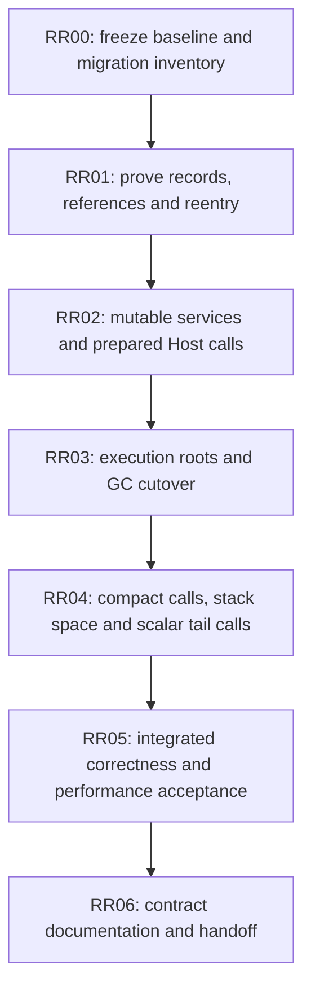

# Runtime, Host and GC Execution Plan

Status: RR00 completed locally on 2026-11-12; RR01 is next. RR02-RR06 are pending.
Production call/storage/collector migration has not started.

This is the single execution plan for the coordinated Runtime/Host/GC refactor.
The [Runtime design](runtime-refactor-design.md) owns the selected records and
flows; the [GC acceptance register](gc-redesign-plan.md) owns collector contracts,
inherited obligations and measurements. Its GCR labels are acceptance groups,
mapped below, not a second implementation sequence. The
[roadmap](implementation-roadmap.md#runtime-execution-model-review) locates this
work. [Current architecture](architecture/runtime.md) describes implemented code
until each migration checkpoint updates it.

## Outcome and scope

An ordinary script call uses prepared target/slot facts and explicit execution
storage. A Native call uses those protected slots, one prepared monomorphized
binding and a short mutable service context. Both use the same authoritative
execution root source owned by `RootDriver<ExecutionRoots>`. The existing
`kagari-gc` library replaces Runtime's collector through this model.

Preserve the completed single Runtime, detached immutable Program, exclusive
publication, standard-library detachment, generated scalar execution and typed
errors. Do not repeat D00-D05, CM00-CM04 or TC00, reintroduce a VM wrapper, or put
source/MIR analysis into Runtime. Standard-library implementations remain outside
Runtime, including its tests and examples.

Included changes are mutable Runtime entrypoints, prepared Host bindings and
codecs, scoped/stored/Host-root reference carriers, complete execution roots,
managed installation state, coherent collector cutover, compact call storage,
stack-space exhaustion and the first synchronous scalar self-tail-call path.
Remove unused Native payload extraction and the unused PanicPolicy API at their
assigned checkpoints. Keep actual ownership, loan, cancellation, cleanup and
source-free verification contracts at the boundary that owns them.

The full collection library, enum niches/Option/Result layouts, value structs,
shared declaration-ID redesign, R13 type-only code retention, general JIT/AOT
deoptimization, managed/mutual/async tail calls and GC pacing research retain their
existing owners. This plan does not require implementing them to migrate Runtime.

## Order and build boundaries



| Phase | Main ownership change | Reviewable exit | GC acceptance group |
| --- | --- | --- | --- |
| RR00 | Freeze costs and affected consumers | Matched baseline, root/API inventory and selected checks | Remaining GCR00 measurement inputs |
| RR01 | Fix reference/source and service lifetimes | Compiled bounded proofs using the intended records | GCR00 representations; GCR01 required gaps; GCR02 proof |
| RR02 | Replace shared-reference mutation and repeated call preparation | One mutable entry model and prepared binding protocol; current heap still owns objects | Host side of GCR02/GCR03 |
| RR03 | Transfer the complete managed graph to kagari-gc | One production collector and one complete execution root source | GCR03 and integrated GCR02 proof |
| RR04 | Finish common-call storage and stack accounting | Bounded stack use, explicit exhaustion and eligible self-tail reuse | Execution portion of GCR04 |
| RR05 | Validate real consumers and measured costs | Selected local acceptance plus separately recorded CI results | Remaining GCR04 acceptance |
| RR06 | Transfer lasting contracts and remove migration material | Architecture/spec/API docs agree with code; follow-ups have owners | GCR05 |

Each phase depends on the preceding exit. RR02 changes invocation ownership before
RR03 changes the managed graph; it does not first port the old collector or
duplicate its root packs under kagari-gc. RR01 freezes the slot/carrier/service
contracts both phases implement, so RR03 changes storage ownership rather than
inventing another Host protocol. RR04 refines the established call layout; it does
not reopen root ownership or introduce another frame representation.

Keep review checkpoints building. RR03 is the largest coordinated integration
window: Value, object providers, frames, statics and Native consumers cannot be
switched independently while referring to one graph. Its work steps below are
parts of one cutover, not independently complete replacement products. Before that
window, RR00/RR01 must list exact affected consumers. If a temporary build failure
is unavoidable, record the command, representative diagnostic, cause and repair
step here before proceeding. Repair it within RR03; do not defer it to RR05 or
hide it behind ignored tests, unchecked adapters or compatibility facades.

Move files when their responsibility changes, following the
[target tree](runtime-refactor-design.md#target-crate-and-file-ownership).
Do not start with a repository-wide rename or create empty future modules.
Runtime stays the only execution crate; kagari-gc stays language-independent.

## RR00: Baseline and finite inventory

**Task:** establish comparable measurements and concrete migration boundaries.
This phase performs no call-model or collector replacement.

Inspect current code and existing tests, then record:

- The path from Host binding to script entry, internal script call, direct Native
  entry, return, reentry, park/resume and publication. Identify existing fast paths
  to preserve, repeated preparation to remove and actual dynamic checks to retain.
- The genuine roots and managed edges: active/parked slots, call locals, pending
  results/waits, Host roots, payload fields, captures, type/application environments,
  installation publication and statics. Name their current and target owners.
- Public consumers of shared-reference mutation, Value/handles, Native codecs,
  NativeTake and PanicPolicy. Include SDK, derive, codegen/ABI, CLI/web, examples and
  existing stdlib consumers where affected; list actual files/targets after audit.
- The selected local test names/fixtures and source-free/actual-native coverage.
  Existing NC/library gaps are separate; record a pre-existing failure before
  attributing it to this migration. Do not restore privileged providers to run it.

Reuse `core_calls` for complete warmed Host calls. Add the missing internal-call
measurement at its existing semantic owner: a script loop that really invokes an
empty/scalar Native callback, independently verifying callback count and results.
Keep compilation, installation and binding outside execution timing. Separate raw,
typed scalar, borrowed-object and owned-converter routes; the last includes real
conversion costs. Reuse existing allocation instrumentation and workload helpers.

Record machine, toolchain, profile, features, parallelism, cache state, workload,
sample method, allocation count/bytes and baseline revision. Preserve matched
binaries or reproducible checkouts under ignored `target/`; retain the method and
results in [performance-baseline.md](performance-baseline.md). Freeze latency
regression tolerances from repeated baseline variation before changing execution.
Historical figures from different machines or call routes are context only.
Inherited GC performance gates remain at their existing acceptance owner.

**Exit:** concrete consumer/root inventories, a small selected contract set and
repeatable matched measurements exist. The warm empty/scalar Native target is
zero call-local heap allocations, zero Host-root leases and zero fixed-mapping
rebuilds; measure it separately from outer Host entry and owned conversions.
Latency improvements remain unclaimed until measured. Record actual frame,
value, source and execution-control memory, not only `size_of::<ScriptFrame>()`.

Current whole-call measurement command:

```text
cargo test -p kagari-runtime --release --test core_calls core_only_script_and_native_calls -- --ignored --nocapture --test-threads=1
```

## RR01: Compile the reference and reentry model

**Task:** prove the selected data structures can express real transfers and Rust
borrowing before changing all Runtime consumers.

Use the intended Runtime-owned records and the existing kagari-gc protocol:

```text
ScopedValue<'gc>  -> Gc<'gc, AnyObject> during a closed access scope
StoredValue      -> Edge<AnyObject> in traced state
RootedValue      -> Root<AnyObject> for an escaping Host lifetime

RootDriver<ExecutionRoots>
  -> ExecutionStorage: active + parked frames, slots, locals and pending state
```

Scalars remain inline and scalar banks remain eight bytes per entry. Tags and
managed targets have private checked construction. A physical GC object tag does
not establish a script nominal type. Keep existing managed-slot initialization
until a separate verified liveness-map change is justified.

Implement three bounded proofs, strengthening existing owner fixtures:

1. Copy an argument, overwrite a managed field, retain to Host and return a managed
   result. Publish the new edge before retiring its source; a failed write leaves
   the old destination intact. Include slot growth/reuse and the root-source
   cursor/publication requirements, not just fixed-slot access.
2. Compile and exercise Native -> script -> GC -> Native return with the actual
   service/slot-view shape. Release Scope and payload/frame loans before callbacks
   or collection; protect the pending result until commit. Include trap/unwind
   cleanup and demonstrate that the whole callback is not inside a GC scope.
3. Reclaim an unrooted object/closure/environment/static cycle, while a genuinely
   retained computation keeps its selected body and can make current inner calls.
   Assert payload destruction and retained state, not merely collection success.

These are integration proofs of the selected records, not a second miniature
Runtime. Separate proof heaps may coexist with the current production heap; no
value or graph crosses between them. Remove proof-only scaffolding once the same
oracle exercises the production route in RR03. Source-free and full Runtime
integration claims wait for that route.

If opaque carriers, erased providers or Runtime layouts need GC support, implement
only the concrete missing protocol at kagari-gc's owner. Do not add language IDs,
field semantics, take/tombstone states or a new collector algorithm there.

**Exit:** the three proofs compile and pass, complete root/source mutation rules
and actual sizes are recorded, and the Native service lifetime works without
per-call field extraction, pervasive RefCell or scattered raw pointers. RR03's
consumer list and build/repair boundary are concrete. Unresolved proofs block
cutover; they do not justify an unchecked production fallback.

## RR02: Mutable Runtime services and prepared Host entry

**Task:** establish one invocation/registration model while the current collector
still owns the production graph.

Change call/execute/drive/collect and binding-preparation mutation to explicit
mutable Runtime access. Split immutable code/entry registries from mutable memory,
control, Host resources, tasks and loans. Synchronous reentry lends those services
for the nested operation; it cannot publish an update. Runtime remains Send and
not Sync. Read-only queries remain shared-reference operations.

Keep useful Arc code/binding retention. Prefer immutable entry borrowing; permit
one necessary descriptor pin across arbitrary callbacks when its lifetime is
clearer, and measure it. Remove RefCell guards from operations now exclusively
borrowed; keep bounded justified cells and zero-sized Rc thread-affinity markers.
Do not replace ownership checks with a blanket UnsafeCell or a new generic service
framework.

Implement the selected binding/call split:

```text
PreparedNativeBinding { monomorphized erased entry, checked contract }
NativeCallSite       { binding locator, argument locations, result destination }
NativeCall           { services, origin, application, locations, pending, mark }
PendingReturn        = Unset | Unit | Scalar(bits, repr) | ManagedLocal(slot)
NativeMark           { local_top, loan_top, logical_call_top }
```

One erased entry decodes the complete pack. Prepare fixed type/codec mappings at
binding or actual closed generic application, with an explicit validity owner.
Custom per-value conversions still execute and retain their effects/order.
Use private small error status and the existing typed RuntimeError; script
Result::Err is ordinary data. Scoped object outputs stage through call context;
do not force a Host Root or an owned `'static` result merely to express lifetimes.

Replace obsolete raw/typed call protocols and update their real consumers in this
phase. Exact public builder names follow this same model. Remove unused
PanicPolicy and its exports; preserve real unwind cleanup and existing fault
containment at GC/provider/completion and machine-code boundaries. Keep NativeTake
until RR03 removes its complete storage machinery.

**Exit:** preparation occurs once per fixed binding/application, actual empty,
scalar, borrowed and owned-converter callbacks use one protocol, and synchronous
reentry compiles through the exclusive service model. Post-call cancellation/error
precedence and result commit order are preserved. Current heap ownership is still
explicit; any old root-pack/storage costs awaiting RR03 remain named here rather
than claimed eliminated. Default consumers build and selected Host/SDK/source-free
and actual-native regressions pass without an alternate legacy entry API.

## RR03: Authoritative execution storage and coherent GC cutover

**Task:** replace Runtime's managed graph and root owners once, through the model
proved in RR01 and the Host boundary established in RR02.

Implement these dependency-ordered work steps within the cutover window:

1. Give `RootDriver<ExecutionRoots>` the sole persistent execution source. Move
   active/parked storage, managed slots, local temporaries, Native logical records
   and pending return/wait state into it. Scheduler/control uses checked execution
   IDs or genuine roots. Preserve independent execution retirement and reuse rules.
2. Replace old Value/reference transport with scoped/stored/Host-root carriers.
   Wire argument copy, field mutation, return and Native result commit to the
   proven publication operations. Common script entry/return saves/restores stack
   marks; direct Native entry uses caller slots and a lightweight logical record.
   Remove duplicated frame root sets, cloned argument root packs and per-copy Root
   leases. No complete ScriptFrame is required for a direct Native call.
3. Migrate actual struct/enum/array/String/closure/interface/Future and native
   payload providers plus application/type environments. Immutable Program code
   remains edge-free; revision/static/capture reachability uses managed state.
   Publication roots keep current installations; lookup indexes do not keep every
   retired revision alive. Preserve real retained code backing where required.
4. Integrate task/observer/slice, shutdown and backend/ABI consumers with the new
   ownership. A running synchronous callback cannot park. A completed callback
   that must pause stores its protected completion and never runs again on resume.
   Refresh all retained frame links after actual park/publication, retaining exact
   admitted bodies and current ordinary inner-call selection. Preserve supported
   compiled execution and capability fallback at their actual entry boundary.
5. Remove Opaque::take, NativeTake, takeable descriptors, moved-object tables,
   extraction-only accounting/validation and take-only consumer tests/examples.
   Preserve general owner/generation/loan validation, sweeping accounting and
   exactly-once destruction. Remove the old collector, foreign graph traversal,
   obsolete stores and compatibility paths after all consumers use the new graph.

Each call has one result/cleanup sequence: retain callback/encoder outcome, apply
the existing post-call precedence, commit a successful result once, then retire
locals/loans/logical records. Reentry owns only its nested execution suffix;
execution retirement owns the entire execution. Return publishes into caller
storage before callee protection disappears. Failures preserve completed effects.

Use existing GC allocation, barriers, collection and safepoint mechanisms. Keep
explicit and pressure-driven collection at valid boundaries after loans end, and
the existing progress policy when allocations stop. Do not put an unconditional
GC step on every scalar/Native call or introduce a parallel pacing counter.

**Exit:** one production collector owns the complete graph; no mirrored execution
roots or old-heap adapters remain. The RR01 proofs now run through actual Runtime
entrypoints. Selected tests establish managed aliasing, foreign/stale rejection,
GC during reentry, cancellation/trap/unwind cleanup, independent parked retirement,
retained-body/current-inner-call reload and actual-native/fallback behavior.
The full affected consumer set builds; no RR03 build break is carried forward.
Inherited NC gaps and R13 remain separately identified, not silently closed.

## RR04: Compact calls, stack space and scalar self-tail calls

**Task:** finish the hot execution path on the established storage model.

Keep ordinary frame records small: exact body/environment, replaceable prepared
links, PC/phase, stack bases, return destination and an optional uncommon-state
index. Reuse scalar/managed/local backing storage and put rare state in a reusable
pool. Remove per-call window registration, duplicated body/dependency ownership
and generic fallback preparation where the admitted call already proves it.
Measure total frames/control/root/source capacity; do not trade a smaller frame
for a larger hidden allocation. Relocate generated scalar regions and generator
paths together if their owner changes.

Replace the logical script-depth quota with VM stack-space accounting in one
API/spec/test change. At phase entry freeze the ceiling/configuration/error shape
from actual frame/slot sizes. Count empty frames, outgoing arguments and alignment;
use fallible growth within the admitted ceiling. Distinguish StackOverflow from
allocation failure. Keep separate protection for Native/Rust-stack reentry and
supported compiled entry; it is not a new per-script-call depth counter.

Then implement only verified synchronous scalar self-tail candidates with the
ordinary fallback. Reuse the frame and slots, preserve argument snapshots and
parent return destination, and define debug elision/fallback explicitly. Reject
pending cleanup or other ineligible cases. Candidate metadata must be verified
on the source-free route; update lowering/bytecode contracts only where needed.
Do not broadly change bytecode specialization or enum layouts.

During an uninterrupted activation publication cannot occur, so an eligible
self-tail call need not check a version or lock each iteration. After a genuine
park/resume, refreshed call links still implement current-target selection;
reusing an old body's entry is permitted only when that target is still selected.
Other target/version cases use ordinary call behavior unless separately proved.

**Exit:** ordinary empty/Native calls meet the frozen regression gate, zero-slot
and larger-frame recursion exhaust VM space correctly, Native reentry remains
protected, and eligible deep recursion has bounded physical frame/slot use.
Argument permutation, checked traps, cancellation, nested return targets,
ineligible fallback and forged candidate metadata reach their intended layer.
Compare explicit loop, ordinary recursion and tail replacement at identical
inputs. Managed, mutual, async and compiled tail-call optimization stays deferred.

## RR05: Integrated correctness and measured performance

**Task:** close acceptance using the real migrated routes, not proof adapters.

Reuse passing evidence for unchanged code. Run the selected representative
boundaries not already covered after the last relevant change: source-free loading,
Host mapping and borrowing, actual compiled execution/fallback, managed effects,
GC/roots, task cancellation/parking, observer boundaries, reload and destruction.
Use an application-owned external Native provider with a managed edge and a script
callback through the public Host API. This proves the library boundary without
rebuilding Vec/HashMap/HashSet or adding a Runtime stdlib dependency.

Repeat RR00's matched release workloads. Report whole Host calls and internal
Native/script calls separately, preparation versus warmed execution, raw/scalar/
borrowed/owned routes, allocations/root leases/mapping rebuilds, stack memory and
managed allocation/collection/retirement. Include active incremental and sustained
collection, not just collection-disabled allocation. Reconcile inherited GCR gates
at their existing owner; new call results do not replace those denominators.

**Exit:** selected local checks pass, agreed call/memory/GC gates have measured
results, and required CI scope is explicitly passed or pending. A missed gate
requires diagnosis of ownership, repeated preparation or useful GC work before
further local tuning. Do not declare full acceptance from a local sample, move a
failing denominator, or claim an unmeasured speedup. Finish or explicitly rescope
required work with the user; do not silently transfer it to an unrelated plan.

## RR06: Documentation and handoff

**Task:** make the implemented model understandable without reconstructing this
conversation or reading every helper.

Update architecture/runtime and its call/reload walkthroughs, embedding/execution/
memory contracts and API examples. Show complete Host -> script, script -> script,
script -> Native -> script/GC, return/failure, park/resume and publication paths
with the actual owning records. Identify each real check, allocation, root transfer
and lifetime pin; distinguish prepared facts from dynamic input validation.

Update GC authoring/integration documentation and remove obsolete extraction,
shared-mutation and old-collector descriptions. Transfer only unresolved work to
its existing owner: NC receives the proven general Host contract; R13, broader tail
calls, enum layouts and backend deoptimization retain their current queues.
Do not replay completed crate/library detachment or reconstruct libraries here.

**Exit:** implementation, architecture, specs and public examples agree. All
required acceptance and carried errors are resolved before declaring the refactor
complete. Move lasting results to their owners, keep completed ledgers in Git,
and retire this execution plan and superseded design material. Retire the GC
acceptance register only when its own remaining obligations have been resolved
or explicitly transferred with a named owner.

## Checkpoint procedure and progress

At each phase start, read its current status, relevant design/contracts, Git status
and affected diffs. Preserve unrelated work. At its exit record concrete changes,
selected test/performance evidence, unrun CI and any carried issue at this owner.
Use the repository task template for the next implementation task; directories or
API spelling alone do not justify reopening the selected architecture.

For implementation checkpoints, inspect handwritten imports, ownership, visibility,
re-exports, generated boundaries and effective LOC, then run:

```text
uv run --locked scripts/check_structure.py
cargo fmt --all -- --check
cargo clippy --workspace --all-targets -- -D warnings
git diff --check
```

Run the small affected contract set selected in RR00 and directly impacted
regressions. Update exact target/filter commands when modules move. Complete
selected cases skipped by an earlier build failure. Full-workspace tests and
exhaustive feature/backend/platform matrices are CI-only. Documentation-only
checkpoints need content/link/diff checks, not builds or Clippy.

Commit only when requested. Implementation commits name the active checkpoint,
for example `Plan-Phase: RR03`; include the mapped GCR acceptance group when it
changes. Disclose any explicitly recorded intermediate build failure in the
commit body. No phase is complete while its exit conditions remain unmet.

### RR00 audit and selected acceptance (2026-11-11)

Baseline starts at `7b05d2ed` with a clean worktree. The preceding consolidation
and session-clock removal are already implemented. Runtime has no dependency on
kagari-gc or stdlib; its 468 source files still use the in-crate collector.
The RR00 diff adds measurements/opt-in diagnostics only. It changes no production
execution, reference or collection contract. Measurement results and frozen call
gates belong in [the performance record](performance-baseline.md).

#### Current execution paths and work placement

- Host binding: `native/function_handle.rs` and `native/function_handle/cache.rs`
  prepare typed handles; `execution.rs` plus `native/function_handle/execution.rs`
  select the current route and admit external values. Conversion lives in
  `native/conversion/arguments.rs` and `native/conversion/context.rs`.
- Internal script call: `frame/calls.rs`, `frame/admission.rs` and
  `frame/values.rs` consume linked locations, allocate a reusable window and
  push `ExecutionFrame`. `module/linked_execution/calls.rs` already supplies final
  current targets: preserve that direct path and scalar banks. Admission still
  mixes dynamic owner/phase/depth/value checks with redundant prepared work.
- Direct Native: `frame/native.rs::invoke_prepared_native` borrows caller slots
  and pins the existing links without a new frame. Explicit Native frame entry
  uses `start_native_entry` for observer/entry transitions. `native/binding.rs`
  owns pre/post polls, result checks/adaptation and host-call observation.
  `native/typed.rs::invoke` rebuilds a Value pack, rechecks mappings and registers
  a copied pack; `native/conversion/arguments.rs` repeats checks and pack rooting.
  Raw/flat callbacks already avoid that typed wrapper: keep their fast path.
- Return: `frame/returns.rs` and `frame/transfer.rs` adapt before retiring the
  callee, then publish the destination in a closed transition. RR02/RR03 must
  preserve callback/converter outcome, post-call precedence and exactly-once commit.
- Reentry: `executor/native.rs` pushes a suffix into the shared session and
  `ExecutionStack::drop` retires that suffix. No frame/bank/payload loan may span
  arbitrary callback execution. The new mutable service view must express this
  lending without retaining `&Runtime` behind new interior mutation.
- Park/resume: `frame/owned.rs`, `frame/waiting.rs`, `session/owned.rs`,
  `session/group.rs` and `scheduler.rs` retain waits/results and refresh links
  for every retained frame. Running synchronous Native callbacks cannot park;
  completed callbacks must keep their completion and must not execute twice.
- Publication: `loading.rs`, `publication.rs`, `module/staging.rs` and
  `module/dispatch/bindings.rs` exclude synchronous activity and prepare links
  atomically. Retained body identity and current inner calls remain separate.

Paths in this inventory are relative to `crates/kagari-runtime/src/` unless a
crate is named. File movement follows the existing design's target tree.

#### Complete root and edge inventory

| Existing owner and contents | RR03 target and lifetime rule |
| --- | --- |
| `resource.rs::frame_values`, `frame/values.rs::Window`: active and parked managed/scalar banks, exact program, environment, invocation and Native application | `RootDriver<ExecutionRoots>` owns the only execution storage. Scalars stay eight bytes; managed transfers publish stored edges. No per-frame mirror or Host lease. |
| `session/store.rs`, `session.rs::SessionState`: frame stacks, root program, pending wait, queued Future/factory, factory output, initializer state | Execution storage scans frame dependencies and pending state, including independently parked sessions. Control uses checked execution IDs. |
| `frame/waiting.rs`: awaitable, protected result, captures; `session/group.rs`: child executions | Execution-owned stored edges and checked child IDs; retire only the owned suffix/execution. |
| `scheduler.rs`, `scheduler/tasks.rs`, `task/store.rs`: queued invocation, task output and delivery roots | Traced pending state under execution/task ownership; external delivery retains a genuine Host root. Producer threads carry completion/ready data, never heap borrows. |
| `gc/roots.rs`: RootSet/RootedValue, conversion scratch roots, typed object/callable/interface handles | Escaping ownership becomes kagari-gc Root; transient arguments/results become source slots/local marks. Preserve foreign/stale rejection. |
| `gc/storage.rs`, `gc/fields.rs`, `gc/arrays.rs`, `gc/buffers.rs`, `gc/future.rs`, `gc/native.rs`: struct/enum/tuple/array/String/cell/range/interface/closure/Future/native payload references | Runtime object providers trace ordinary library edges; field writes publish before replacement. Language tags/nominal/layout checks remain Runtime-owned. |
| `execution_metadata.rs` and its environment/group/application/interface stores; `native/stored_callable.rs`, `native/stored_selection.rs`, `native/payload/managed.rs` | Managed application/environment/provider state; all outgoing references traced. Immutable checked code may be Arc-pinned but cannot hide managed edges. |
| `module/collection.rs`, `module/state.rs`, `module/state/initialization.rs`, `module/installation.rs`, retained program leases | Publication roots keep installation/current revision/statics. Retained computations keep selected revisions. Indexes do not root every retired version; object/closure/environment/static cycles must be collectible. |
| `host.rs`, `host/scoped.rs`, `host_scope.rs`, payload loans and temporary mutations in `frame.rs` | Rust host resources remain outside the script heap. Scoped loans exclude collection/reentry and are retired on all exits; roots prove liveness, never access authority. |

Current `gc/collection.rs` snapshots roots and jointly traverses Object/Program
nodes, then `execution_metadata.rs` expands foreign metadata stores. RR03 replaces
that complete graph once; porting only objects would leave hidden retention and
an incomplete source. Initialization/candidate authority, owner/generation checks,
checked numerics, cancellation and disposal quarantine remain required.

#### Finite consumer/build boundary

RR02 owns entry signatures and adapters in Runtime `execution.rs`, `executor.rs`,
`native/context.rs`, `native/typed.rs`, `native/functions.rs`,
`native/adapter.rs`, `native/conversion/`, `native/function_handle/`,
`native/typed/loans.rs` and `host_scope.rs`; their Runtime callers move with them.
RR03 owns `value.rs`, `gc.rs`/`gc/`, `resource.rs`, `frame.rs`/`frame/`,
`session.rs`/`session/`, `execution_metadata.rs`/`execution_metadata/`,
`module/state.rs`, `module/collection.rs`, scheduler/task/observer/debug owners,
`backend.rs` and `jit_abi.rs`. No public forwarding API is retained.

External consumers to compile at each applicable boundary:

- SDK `crates/kagari/src/{runtime,context,engine,program}.rs` and
  `runtime/tests/embedding/{typed_calls,scoped_calls,offline_functions,offline_nominal,async_execution,native_provider_reset,runtime_transfer}`;
  feature-isolated artifact/native consumers stay CI-owned.
- `crates/kagari-derive/src/{value,schema}.rs` generated conversions/projections;
  `crates/kagari-codegen/src/`, `crates/kagari-codegen-cranelift/src/{emit,scalar}.rs`
  and `crates/kagari-abi/src/` native entry/link contracts. Preserve machine-code
  unwind containment, independent ABI verification and capability fallback.
- `crates/kagari-cli/src/`, `crates/kagari-web/src/`, SDK examples and
  `benchmarks/lua-comparison`: update actual Runtime calls, values and conversions.
- `crates/kagari-stdlib/src/foundation/` and
  `tests/execution/native_boundary/`: update public Native authoring consumers,
  without installing stdlib into Runtime or reconstructing deferred collections.

Unused PanicPolicy occurs only in Runtime `context.rs` and SDK `context.rs`:
remove those declarations/exports in RR02 and update the exact reexport allowance.
NativeTake occurs in `native/payload/take.rs`, `native/payload.rs`,
`native/storage.rs`, `gc/native/take.rs`, `gc/native/tests.rs` and stdlib
`tests/execution/native_boundary/native_boundary_payload.rs` plus its `take.rs`:
remove extraction-only storage/accounting/tests in RR03, preserving ordinary loans,
owner/generation validation and exactly-once disposal. NativeData's blanket take
implementation is not a reason to retain take.

RR03 is one coordinated build window. RR01 proofs use a separate heap; no old
Value can cross into it. No build break has yet been introduced. If the cutover
breaks a target, record its diagnostic and repair here before advancing RR04.

#### Selected checks and pre-existing limits

RR00's new manual `core_calls::internal_calls` workload samples internal script,
raw empty/scalar, typed empty/scalar, borrowed payload and owned String routes.
Its match-based counter uses builtin literal matching, avoiding installation of
operator/iteration libraries just to measure the core. One explicit String
constructor declaration is an application provider, with no stdlib dependency.
Atomic callback counts and result sums distinguish real callbacks from loop-only
work; that common atomic operation is included in every Native timing.

The selected recurring Runtime filters are `native::tests::offline_host`,
`native::tests::native_execution`, `frame::values::tests`,
`interpreter_tests::native_wait::async_native_completion_contract`,
`interpreter_tests::owned_drive` and `interpreter_tests::execution::frames`.
These sample source-free admission, actual machine code, foreign/stale handles,
slot growth/reuse, cancellation/cleanup, saved completion and current inner calls.
RR01 additionally selects kagari-gc `root_source`, dynamic/ownership and graph
oracles as its concrete provider protocol changes require. SDK selections are
`existing_typed_handles_select_current_implementations_and_keep_closure_bodies`,
`scoped_native_calls_accept_compatible_reloaded_descriptors`,
`offline_host_facades_preserve_linking_and_backend_call_traces` and
`task_owns_a_live_runtime_across_message_receive_awaits` (not a workspace sweep).
New uncovered production proof/stack/tail contracts belong at their semantic owner.

Known inherited NC collection/library scenarios are unavailable after detachment;
RR00 does not restore privileged providers or claim those pass. R13's finer
code/type retention and general/managed/mutual/async/compiled tail optimization
remain deferred. Full workspace/platform/backend feature matrices are CI-only.
RR00 exit is satisfied locally. The final seven-process release set contains 770
valid timing samples across ten routes, plus zero/one/10000-call allocation
controls. All callback counts and independent results pass. The largest
process-median spread is 4.76%; the frozen paired latency ceiling is 1.10. Raw
empty/scalar batches retain 76 requests / 3784 bytes at all three call counts.
Typed scalar adds 65 requests for one callback, two Host root registrations and
five Runtime mapping preparations per internal callback. No improvement is claimed.
The performance owner records exact environment, binary/lock hashes, summaries,
setup times, memory accounting limits and the paired comparison method.

Six selected release Runtime contracts pass using the exact names below, without
running the whole library/workspace suite:

```text
native::tests::offline_host::callback_arguments_and_result_obey_the_declared_representation
native::tests::native_execution::native_reentry_preserves_the_callers_frame_and_shared_execution
frame::values::tests::register_arguments_survive_growth_reordering_and_repeated_sources
frame::values::tests::retiring_an_outer_window_does_not_unroot_a_suspended_inner_window
interpreter_tests::native_wait::async_native_completion_contract
interpreter_tests::owned_drive::resumed_frames_select_current_direct_recursive_shared_and_module_calls
```

Run them with `cargo test -p kagari-runtime --release --lib <filter> -- --exact`,
or pass these exact names to the reported release library binary with `--exact`.
The latter six-filter invocation ran all six (651 other cases filtered out).
The two manual measurement tests also pass across all seven processes; the
separate feature-enabled diagnostic run passes. Workspace all-target Clippy,
workspace fmt, structure (1855 Rust files, zero violations), fixture `kg fmt
--check` and diff checks pass. New imports/paths and feature-only diagnostic
ownership were reviewed; no visibility widening, new reexport, unsafe operation,
compatibility layer or structural exception was introduced. The source-free /
actual machine-code contract sampled here uses installed native test entries;
SDK generated-code/source-free and broader platform/backend acceptance remain
selected for later changed boundaries and CI. No inherited library failure is
silently closed. The temporary fixture setup failures (receiver access, missing
String declaration, comparison provider and match statement syntax) were repaired
before measurement; no build/test failure is carried.

**Next task (RR01):**

```text
Task: Prove scoped/stored/Host-root carriers and exclusive Native service reentry.
Context: RR01; Runtime execution/value/Host owners and kagari-gc source protocol.
Expected behavior: Copy/replace/return/retain publish before source retirement;
Native -> script -> GC -> Native uses short loans; unrooted code/static cycles die.
Scope: Three bounded proofs on a separate paired heap and concrete missing GC
protocol only. No old/new graph crossing or production collector replacement.
Validation: Focused carrier/source/reentry/cycle oracles, sizes, structure/fmt,
workspace all-target Clippy and diff checks. Source-free production proof is RR03.
Known intermediate errors: None. RR02-RR06 and CI matrices remain pending.
```
