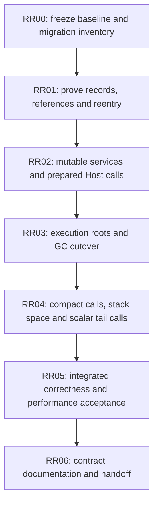

# Runtime, Host and GC Execution Plan

Status: RR00-RR04 completed locally. RR04 exits on 2026-11-14 with compact actual
frame/source reuse, one Native protocol, VM-byte/Native-stack limits and verified
scalar self-tail replacement. One final ordinary image meets all ten frozen
paired-median latency gates, with selected lifecycle and local checkpoint checks
passing. RR05 is next; RR06 remains pending. Phase completion is not a passing CI
or final whole-cost/GC acceptance claim. The
[RR03 exit audit](#rr03-production-proofs-and-local-phase-exit) and
[RR04 exit audit](#rr04-local-phase-exit-and-rr05-entry) supersede historical
intermediate errors and open-gate statements in the ledger below.

Runtime owns one ManagedMemory/RootDriver<ExecutionRoots> and separate
ResourceState. Actual managed providers, active/parked slots, Native pending/local
state, publication/static/revision roots and genuine escaping Host roots now share
kagari-gc. The old collector, raw Value, mirrored RootSet/metadata graph stores and
Native extraction APIs are removed. Exclusive mutable services and prepared
Native/Host bindings remain the RR02 protocol. Resource/session attribution and
opt-in diagnostics observe actual commits and storage operations. Default workspace
all-target Clippy and selected diagnostic/AOT/serde/JIT consumer checks pass.
Inherited NC provider gaps, R13, full CI/Miri and RR05 whole-cost performance work remain
explicit; no standard-library reconstruction is part of this cutover.

This is the single execution plan for the coordinated Runtime/Host/GC refactor.
The [Runtime design](runtime-refactor-design.md) owns the selected records and
flows; the [GC acceptance register](gc-redesign-plan.md) owns collector contracts,
inherited obligations and measurements. Its GCR labels are acceptance groups,
mapped below, not a second implementation sequence. The
[roadmap](implementation-roadmap.md#runtime-execution-model-review) locates this
work. [Current architecture](architecture/runtime.md) describes implemented code
until each migration checkpoint updates it.

## Outcome and scope

An ordinary script call uses prepared target/slot facts and explicit execution
storage. A Native call uses those protected slots, one prepared monomorphized
binding and a short mutable service context. Both use the same authoritative
execution root source owned by `RootDriver<ExecutionRoots>`. The existing
`kagari-gc` library replaces Runtime's collector through this model.

Preserve the completed single Runtime, detached immutable Program, exclusive
publication, standard-library detachment, generated scalar execution and typed
errors. Do not repeat D00-D05, CM00-CM04 or TC00, reintroduce a VM wrapper, or put
source/MIR analysis into Runtime. Standard-library implementations remain outside
Runtime, including its tests and examples.

Included changes are mutable Runtime entrypoints, prepared Host bindings and
codecs, scoped/stored/Host-root reference carriers, complete execution roots,
managed installation state, coherent collector cutover, compact call storage,
stack-space exhaustion and the first synchronous scalar self-tail-call path.
Remove unused Native payload extraction and the unused PanicPolicy API at their
assigned checkpoints. Keep actual ownership, loan, cancellation, cleanup and
source-free verification contracts at the boundary that owns them.

The full collection library, enum niches/Option/Result layouts, value structs,
shared declaration-ID redesign, R13 type-only code retention, general JIT/AOT
deoptimization, managed/mutual/async tail calls and GC pacing research retain their
existing owners. This plan does not require implementing them to migrate Runtime.

## Order and build boundaries



| Phase | Main ownership change | Reviewable exit | GC acceptance group |
| --- | --- | --- | --- |
| RR00 | Freeze costs and affected consumers | Matched baseline, root/API inventory and selected checks | Remaining GCR00 measurement inputs |
| RR01 | Fix reference/source and service lifetimes | Compiled bounded proofs using the intended records | GCR00 representations; GCR01 required gaps; GCR02 proof |
| RR02 | Replace shared-reference mutation and repeated call preparation | One mutable entry model and prepared binding protocol; current heap still owns objects | Host side of GCR02/GCR03 |
| RR03 | Transfer the complete managed graph to kagari-gc | One production collector and one complete execution root source | GCR03 and integrated GCR02 proof |
| RR04 | Finish common-call storage and stack accounting | Bounded stack use, explicit exhaustion and eligible self-tail reuse | Execution portion of GCR04 |
| RR05 | Validate real consumers and measured costs | Selected local acceptance plus separately recorded CI results | Remaining GCR04 acceptance |
| RR06 | Transfer lasting contracts and remove migration material | Architecture/spec/API docs agree with code; follow-ups have owners | GCR05 |

Each phase depends on the preceding exit. RR02 changes invocation ownership before
RR03 changes the managed graph; it does not first port the old collector or
duplicate its root packs under kagari-gc. RR01 freezes the slot/carrier/service
contracts both phases implement, so RR03 changes storage ownership rather than
inventing another Host protocol. RR04 refines the established call layout; it does
not reopen root ownership or introduce another frame representation.

Keep review checkpoints building. RR03 is the largest coordinated integration
window: Value, object providers, frames, statics and Native consumers cannot be
switched independently while referring to one graph. Its work steps below are
parts of one cutover, not independently complete replacement products. Before that
window, RR00/RR01 must list exact affected consumers. If a temporary build failure
is unavoidable, record the command, representative diagnostic, cause and repair
step here before proceeding. Repair it within RR03; do not defer it to RR05 or
hide it behind ignored tests, unchecked adapters or compatibility facades.

Move files when their responsibility changes, following the
[target tree](runtime-refactor-design.md#target-crate-and-file-ownership).
Do not start with a repository-wide rename or create empty future modules.
Runtime stays the only execution crate; kagari-gc stays language-independent.

## RR00: Baseline and finite inventory

**Task:** establish comparable measurements and concrete migration boundaries.
This phase performs no call-model or collector replacement.

Inspect current code and existing tests, then record:

- The path from Host binding to script entry, internal script call, direct Native
  entry, return, reentry, park/resume and publication. Identify existing fast paths
  to preserve, repeated preparation to remove and actual dynamic checks to retain.
- The genuine roots and managed edges: active/parked slots, call locals, pending
  results/waits, Host roots, payload fields, captures, type/application environments,
  installation publication and statics. Name their current and target owners.
- Public consumers of shared-reference mutation, Value/handles, Native codecs,
  NativeTake and PanicPolicy. Include SDK, derive, codegen/ABI, CLI/web, examples and
  existing stdlib consumers where affected; list actual files/targets after audit.
- The selected local test names/fixtures and source-free/actual-native coverage.
  Existing NC/library gaps are separate; record a pre-existing failure before
  attributing it to this migration. Do not restore privileged providers to run it.

Reuse `core_calls` for complete warmed Host calls. Add the missing internal-call
measurement at its existing semantic owner: a script loop that really invokes an
empty/scalar Native callback, independently verifying callback count and results.
Keep compilation, installation and binding outside execution timing. Separate raw,
typed scalar, borrowed-object and owned-converter routes; the last includes real
conversion costs. Reuse existing allocation instrumentation and workload helpers.

Record machine, toolchain, profile, features, parallelism, cache state, workload,
sample method, allocation count/bytes and baseline revision. Preserve matched
binaries or reproducible checkouts under ignored `target/`; retain the method and
results in [performance-baseline.md](performance-baseline.md). Freeze latency
regression tolerances from repeated baseline variation before changing execution.
Historical figures from different machines or call routes are context only.
Inherited GC performance gates remain at their existing acceptance owner.

**Exit:** concrete consumer/root inventories, a small selected contract set and
repeatable matched measurements exist. The warm empty/scalar Native target is
zero call-local heap allocations, zero Host-root leases and zero fixed-mapping
rebuilds; measure it separately from outer Host entry and owned conversions.
Latency improvements remain unclaimed until measured. Record actual frame,
value, source and execution-control memory, not only `size_of::<ScriptFrame>()`.

Current whole-call measurement command:

```text
cargo test -p kagari-runtime --release --test core_calls core_only_script_and_native_calls -- --ignored --nocapture --test-threads=1
```

## RR01: Compile the reference and reentry model

**Task:** prove the selected data structures can express real transfers and Rust
borrowing before changing all Runtime consumers.

Use the intended Runtime-owned records and the existing kagari-gc protocol:

```text
ScopedValue<'gc>  -> Gc<'gc, AnyObject> during a closed access scope
StoredValue      -> Edge<AnyObject> in traced state
RootedValue      -> Root<AnyObject> for an escaping Host lifetime

RootDriver<ExecutionRoots>
  -> ExecutionStorage: active + parked frames, slots, locals and pending state
```

Scalars remain inline and scalar banks remain eight bytes per entry. Tags and
managed targets have private checked construction. A physical GC object tag does
not establish a script nominal type. Keep existing managed-slot initialization
until a separate verified liveness-map change is justified.

Implement three bounded proofs, strengthening existing owner fixtures:

1. Copy an argument, overwrite a managed field, retain to Host and return a managed
   result. Publish the new edge before retiring its source; a failed write leaves
   the old destination intact. Include slot growth/reuse and the root-source
   cursor/publication requirements, not just fixed-slot access.
2. Compile and exercise Native -> script -> GC -> Native return with the actual
   service/slot-view shape. Release Scope and payload/frame loans before callbacks
   or collection; protect the pending result until commit. Include trap/unwind
   cleanup and demonstrate that the whole callback is not inside a GC scope.
3. Reclaim an unrooted object/closure/environment/static cycle, while a genuinely
   retained computation keeps its selected body and can make current inner calls.
   Assert payload destruction and retained state, not merely collection success.

These are integration proofs of the selected records, not a second miniature
Runtime. Separate proof heaps may coexist with the current production heap; no
value or graph crosses between them. Remove proof-only scaffolding once the same
oracle exercises the production route in RR03. Source-free and full Runtime
integration claims wait for that route.

If opaque carriers, erased providers or Runtime layouts need GC support, implement
only the concrete missing protocol at kagari-gc's owner. Do not add language IDs,
field semantics, take/tombstone states or a new collector algorithm there.

**Exit:** the three proofs compile and pass, complete root/source mutation rules
and actual sizes are recorded, and the Native service lifetime works without
per-call field extraction, pervasive RefCell or scattered raw pointers. RR03's
consumer list and build/repair boundary are concrete. Unresolved proofs block
cutover; they do not justify an unchecked production fallback.

## RR02: Mutable Runtime services and prepared Host entry

**Task:** establish one invocation/registration model while the current collector
still owns the production graph.

Change call/execute/drive/collect and binding-preparation mutation to explicit
mutable Runtime access. Split immutable code/entry registries from mutable memory,
control, Host resources, tasks and loans. Synchronous reentry lends those services
for the nested operation; it cannot publish an update. Runtime remains Send and
not Sync. Read-only queries remain shared-reference operations.

Keep useful Arc code/binding retention. Prefer immutable entry borrowing; permit
one necessary descriptor pin across arbitrary callbacks when its lifetime is
clearer, and measure it. Remove RefCell guards from operations now exclusively
borrowed; keep bounded justified cells and zero-sized Rc thread-affinity markers.
Do not replace ownership checks with a blanket UnsafeCell or a new generic service
framework.

Implement the selected binding/call split:

```text
PreparedNativeBinding { monomorphized erased entry, checked contract }
NativeCallSite       { binding locator, argument locations, result destination }
NativeCall           { services, origin, application, locations, pending, mark }
PendingReturn        = Unset | Unit | Scalar(bits, repr) | ManagedLocal(slot)
NativeMark           { local_top, loan_top, logical_call_top }
```

One erased entry decodes the complete pack. Prepare fixed type/codec mappings at
binding or actual closed generic application, with an explicit validity owner.
Custom per-value conversions still execute and retain their effects/order.
Use private small error status and the existing typed RuntimeError; script
Result::Err is ordinary data. Scoped object outputs stage through call context;
do not force a Host Root or an owned `'static` result merely to express lifetimes.

Replace obsolete raw/typed call protocols and update their real consumers in this
phase. Exact public builder names follow this same model. Remove unused
PanicPolicy and its exports; preserve real unwind cleanup and existing fault
containment at GC/provider/completion and machine-code boundaries. Keep NativeTake
until RR03 removes its complete storage machinery.

**Exit:** preparation occurs once per fixed binding/application, actual empty,
scalar, borrowed and owned-converter callbacks use one protocol, and synchronous
reentry compiles through the exclusive service model. Post-call cancellation/error
precedence and result commit order are preserved. Current heap ownership is still
explicit; any old root-pack/storage costs awaiting RR03 remain named here rather
than claimed eliminated. Default consumers build and selected Host/SDK/source-free
and actual-native regressions pass without an alternate legacy entry API.

## RR03: Authoritative execution storage and coherent GC cutover

**Task:** replace Runtime's managed graph and root owners once, through the model
proved in RR01 and the Host boundary established in RR02.

Implement these dependency-ordered work steps within the cutover window:

1. Give `RootDriver<ExecutionRoots>` the sole persistent execution source. Move
   active/parked storage, managed slots, local temporaries, Native logical records
   and pending return/wait state into it. Scheduler/control uses checked execution
   IDs or genuine roots. Preserve independent execution retirement and reuse rules.
2. Replace old Value/reference transport with scoped/stored/Host-root carriers.
   Wire argument copy, field mutation, return and Native result commit to the
   proven publication operations. Common script entry/return saves/restores stack
   marks; direct Native entry uses caller slots and a lightweight logical record.
   Remove duplicated frame root sets, cloned argument root packs and per-copy Root
   leases. No complete ScriptFrame is required for a direct Native call.
3. Migrate actual struct/enum/array/String/closure/interface/Future and native
   payload providers plus application/type environments. Immutable Program code
   remains edge-free; revision/static/capture reachability uses managed state.
   Publication roots keep current installations; lookup indexes do not keep every
   retired revision alive. Preserve real retained code backing where required.
4. Integrate task/observer/slice, shutdown and backend/ABI consumers with the new
   ownership. A running synchronous callback cannot park. A completed callback
   that must pause stores its protected completion and never runs again on resume.
   Refresh all retained frame links after actual park/publication, retaining exact
   admitted bodies and current ordinary inner-call selection. Preserve supported
   compiled execution and capability fallback at their actual entry boundary.
5. Remove Opaque::take, NativeTake, takeable descriptors, moved-object tables,
   extraction-only accounting/validation and take-only consumer tests/examples.
   Preserve general owner/generation/loan validation, sweeping accounting and
   exactly-once destruction. Remove the old collector, foreign graph traversal,
   obsolete stores and compatibility paths after all consumers use the new graph.

Each call has one result/cleanup sequence: retain callback/encoder outcome, apply
the existing post-call precedence, commit a successful result once, then retire
locals/loans/logical records. Reentry owns only its nested execution suffix;
execution retirement owns the entire execution. Return publishes into caller
storage before callee protection disappears. Failures preserve completed effects.

Use existing GC allocation, barriers, collection and safepoint mechanisms. Keep
explicit and pressure-driven collection at valid boundaries after loans end, and
the existing progress policy when allocations stop. Do not put an unconditional
GC step on every scalar/Native call or introduce a parallel pacing counter.

**Exit:** one production collector owns the complete graph; no mirrored execution
roots or old-heap adapters remain. The RR01 proofs now run through actual Runtime
entrypoints. Selected tests establish managed aliasing, foreign/stale rejection,
GC during reentry, cancellation/trap/unwind cleanup, independent parked retirement,
retained-body/current-inner-call reload and actual-native/fallback behavior.
The full affected consumer set builds; no RR03 build break is carried forward.
Inherited NC gaps and R13 remain separately identified, not silently closed.

## RR04: Compact calls, stack space and scalar self-tail calls

**Task:** finish the hot execution path on the established storage model.

Keep ordinary frame records small: exact body/environment, replaceable prepared
links, PC/phase, stack bases, return destination and an optional uncommon-state
index. Reuse scalar/managed/local backing storage and put rare state in a reusable
pool. Remove per-call window registration, duplicated body/dependency ownership
and generic fallback preparation where the admitted call already proves it.
Measure total frames/control/root/source capacity; do not trade a smaller frame
for a larger hidden allocation. Relocate generated scalar regions and generator
paths together if their owner changes.

Replace the logical script-depth quota with VM stack-space accounting in one
API/spec/test change. At phase entry freeze the ceiling/configuration/error shape
from actual frame/slot sizes. Count empty frames, outgoing arguments and alignment;
use fallible growth within the admitted ceiling. Distinguish StackOverflow from
allocation failure. Keep separate protection for Native/Rust-stack reentry and
supported compiled entry; it is not a new per-script-call depth counter.

Then implement only verified synchronous scalar self-tail candidates with the
ordinary fallback. Reuse the frame and slots, preserve argument snapshots and
parent return destination, and define debug elision/fallback explicitly. Reject
pending cleanup or other ineligible cases. Candidate metadata must be verified
on the source-free route; update lowering/bytecode contracts only where needed.
Do not broadly change bytecode specialization or enum layouts.

During an uninterrupted activation publication cannot occur, so an eligible
self-tail call need not check a version or lock each iteration. After a genuine
park/resume, refreshed call links still implement current-target selection;
reusing an old body's entry is permitted only when that target is still selected.
Other target/version cases use ordinary call behavior unless separately proved.

**Exit:** ordinary empty/Native calls meet the frozen regression gate, zero-slot
and larger-frame recursion exhaust VM space correctly, Native reentry remains
protected, and eligible deep recursion has bounded physical frame/slot use.
Argument permutation, checked traps, cancellation, nested return targets,
ineligible fallback and forged candidate metadata reach their intended layer.
Compare explicit loop, ordinary recursion and tail replacement at identical
inputs. Managed, mutual, async and compiled tail-call optimization stays deferred.

## RR05: Integrated correctness and measured performance

**Task:** close acceptance using the real migrated routes, not proof adapters.

Reuse passing evidence for unchanged code. Run the selected representative
boundaries not already covered after the last relevant change: source-free loading,
Host mapping and borrowing, actual compiled execution/fallback, managed effects,
GC/roots, task cancellation/parking, observer boundaries, reload and destruction.
Use an application-owned external Native provider with a managed edge and a script
callback through the public Host API. This proves the library boundary without
rebuilding Vec/HashMap/HashSet or adding a Runtime stdlib dependency.

Repeat RR00's matched release workloads. Report whole Host calls and internal
Native/script calls separately, preparation versus warmed execution, raw/scalar/
borrowed/owned routes, allocations/root leases/mapping rebuilds, stack memory and
managed allocation/collection/retirement. Include active incremental and sustained
collection, not just collection-disabled allocation. Reconcile inherited GCR gates
at their existing owner; new call results do not replace those denominators.

**Exit:** selected local checks pass, agreed call/memory/GC gates have measured
results, and required CI scope is explicitly passed or pending. A missed gate
requires diagnosis of ownership, repeated preparation or useful GC work before
further local tuning. Do not declare full acceptance from a local sample, move a
failing denominator, or claim an unmeasured speedup. Finish or explicitly rescope
required work with the user; do not silently transfer it to an unrelated plan.

## RR06: Documentation and handoff

**Task:** make the implemented model understandable without reconstructing this
conversation or reading every helper.

Update architecture/runtime and its call/reload walkthroughs, embedding/execution/
memory contracts and API examples. Show complete Host -> script, script -> script,
script -> Native -> script/GC, return/failure, park/resume and publication paths
with the actual owning records. Identify each real check, allocation, root transfer
and lifetime pin; distinguish prepared facts from dynamic input validation.

Update GC authoring/integration documentation and remove obsolete extraction,
shared-mutation and old-collector descriptions. Transfer only unresolved work to
its existing owner: NC receives the proven general Host contract; R13, broader tail
calls, enum layouts and backend deoptimization retain their current queues.
Do not replay completed crate/library detachment or reconstruct libraries here.

**Exit:** implementation, architecture, specs and public examples agree. All
required acceptance and carried errors are resolved before declaring the refactor
complete. Move lasting results to their owners, keep completed ledgers in Git,
and retire this execution plan and superseded design material. Retire the GC
acceptance register only when its own remaining obligations have been resolved
or explicitly transferred with a named owner.

## Checkpoint procedure and progress

At each phase start, read its current status, relevant design/contracts, Git status
and affected diffs. Preserve unrelated work. At its exit record concrete changes,
selected test/performance evidence, unrun CI and any carried issue at this owner.
Use the repository task template for the next implementation task; directories or
API spelling alone do not justify reopening the selected architecture.

For implementation checkpoints, inspect handwritten imports, ownership, visibility,
re-exports, generated boundaries and effective LOC, then run:

```text
uv run --locked scripts/check_structure.py
cargo fmt --all -- --check
cargo clippy --workspace --all-targets -- -D warnings
git diff --check
```

Run the small affected contract set selected in RR00 and directly impacted
regressions. Update exact target/filter commands when modules move. Complete
selected cases skipped by an earlier build failure. Full-workspace tests and
exhaustive feature/backend/platform matrices are CI-only. Documentation-only
checkpoints need content/link/diff checks, not builds or Clippy.

Commit only when requested. Implementation commits name the active checkpoint,
for example `Plan-Phase: RR03`; include the mapped GCR acceptance group when it
changes. Disclose any explicitly recorded intermediate build failure in the
commit body. No phase is complete while its exit conditions remain unmet.

### RR00 audit and selected acceptance (2026-11-11)

Baseline starts at `7b05d2ed` with a clean worktree. The preceding consolidation
and session-clock removal are already implemented. Runtime has no dependency on
kagari-gc or stdlib; its 468 source files still use the in-crate collector.
The RR00 diff adds measurements/opt-in diagnostics only. It changes no production
execution, reference or collection contract. Measurement results and frozen call
gates belong in [the performance record](performance-baseline.md).

#### Current execution paths and work placement

- Host binding: `native/function_handle.rs` and `native/function_handle/cache.rs`
  prepare typed handles; `execution.rs` plus `native/function_handle/execution.rs`
  select the current route and admit external values. Conversion lives in
  `native/conversion/arguments.rs` and `native/conversion/context.rs`.
- Internal script call: `frame/calls.rs`, `frame/admission.rs` and
  `frame/values.rs` consume linked locations, allocate a reusable window and
  push `ExecutionFrame`. `module/linked_execution/calls.rs` already supplies final
  current targets: preserve that direct path and scalar banks. Admission still
  mixes dynamic owner/phase/depth/value checks with redundant prepared work.
- Direct Native: `frame/native.rs::invoke_prepared_native` borrows caller slots
  and pins the existing links without a new frame. Explicit Native frame entry
  uses `start_native_entry` for observer/entry transitions. `native/binding.rs`
  owns pre/post polls, result checks/adaptation and host-call observation.
  `native/typed.rs::invoke` rebuilds a Value pack, rechecks mappings and registers
  a copied pack; `native/conversion/arguments.rs` repeats checks and pack rooting.
  Raw/flat callbacks already avoid that typed wrapper: keep their fast path.
- Return: `frame/returns.rs` and `frame/transfer.rs` adapt before retiring the
  callee, then publish the destination in a closed transition. RR02/RR03 must
  preserve callback/converter outcome, post-call precedence and exactly-once commit.
- Reentry: `executor/native.rs` pushes a suffix into the shared session and
  `ExecutionStack::drop` retires that suffix. No frame/bank/payload loan may span
  arbitrary callback execution. The new mutable service view must express this
  lending without retaining `&Runtime` behind new interior mutation.
- Park/resume: `frame/owned.rs`, `frame/waiting.rs`, `session/owned.rs`,
  `session/group.rs` and `scheduler.rs` retain waits/results and refresh links
  for every retained frame. Running synchronous Native callbacks cannot park;
  completed callbacks must keep their completion and must not execute twice.
- Publication: `loading.rs`, `publication.rs`, `module/staging.rs` and
  `module/dispatch/bindings.rs` exclude synchronous activity and prepare links
  atomically. Retained body identity and current inner calls remain separate.

Paths in this inventory are relative to `crates/kagari-runtime/src/` unless a
crate is named. File movement follows the existing design's target tree.

#### Complete root and edge inventory

| Existing owner and contents | RR03 target and lifetime rule |
| --- | --- |
| `resource.rs::frame_values`, `frame/values.rs::Window`: active and parked managed/scalar banks, exact program, environment, invocation and Native application | `RootDriver<ExecutionRoots>` owns the only execution storage. Scalars stay eight bytes; managed transfers publish stored edges. No per-frame mirror or Host lease. |
| `session/store.rs`, `session.rs::SessionState`: frame stacks, root program, pending wait, queued Future/factory, factory output, initializer state | Execution storage scans frame dependencies and pending state, including independently parked sessions. Control uses checked execution IDs. |
| `frame/waiting.rs`: awaitable, protected result, captures; `session/group.rs`: child executions | Execution-owned stored edges and checked child IDs; retire only the owned suffix/execution. |
| `scheduler.rs`, `scheduler/tasks.rs`, `task/store.rs`: queued invocation, task output and delivery roots | Traced pending state under execution/task ownership; external delivery retains a genuine Host root. Producer threads carry completion/ready data, never heap borrows. |
| `gc/roots.rs`: RootSet/RootedValue, conversion scratch roots, typed object/callable/interface handles | Escaping ownership becomes kagari-gc Root; transient arguments/results become source slots/local marks. Preserve foreign/stale rejection. |
| `gc/storage.rs`, `gc/fields.rs`, `gc/arrays.rs`, `gc/buffers.rs`, `gc/future.rs`, `gc/native.rs`: struct/enum/tuple/array/String/cell/range/interface/closure/Future/native payload references | Runtime object providers trace ordinary library edges; field writes publish before replacement. Language tags/nominal/layout checks remain Runtime-owned. |
| `execution_metadata.rs` and its environment/group/application/interface stores; `native/stored_callable.rs`, `native/stored_selection.rs`, `native/payload/managed.rs` | Managed application/environment/provider state; all outgoing references traced. Immutable checked code may be Arc-pinned but cannot hide managed edges. |
| `module/collection.rs`, `module/state.rs`, `module/state/initialization.rs`, `module/installation.rs`, retained program leases | Publication roots keep installation/current revision/statics. Retained computations keep selected revisions. Indexes do not root every retired version; object/closure/environment/static cycles must be collectible. |
| `host.rs`, `host/scoped.rs`, `host_scope.rs`, payload loans and temporary mutations in `frame.rs` | Rust host resources remain outside the script heap. Scoped loans exclude collection/reentry and are retired on all exits; roots prove liveness, never access authority. |

Current `gc/collection.rs` snapshots roots and jointly traverses Object/Program
nodes, then `execution_metadata.rs` expands foreign metadata stores. RR03 replaces
that complete graph once; porting only objects would leave hidden retention and
an incomplete source. Initialization/candidate authority, owner/generation checks,
checked numerics, cancellation and disposal quarantine remain required.

#### Finite consumer/build boundary

RR02 owns entry signatures and adapters in Runtime `execution.rs`, `executor.rs`,
`native/context.rs`, `native/typed.rs`, `native/functions.rs`,
`native/adapter.rs`, `native/conversion/`, `native/function_handle/`,
`native/typed/loans.rs` and `host_scope.rs`; their Runtime callers move with them.
RR03 owns `value.rs`, `gc.rs`/`gc/`, `resource.rs`, `frame.rs`/`frame/`,
`session.rs`/`session/`, `execution_metadata.rs`/`execution_metadata/`,
`module/state.rs`, `module/collection.rs`, scheduler/task/observer/debug owners,
`backend.rs` and `jit_abi.rs`. No public forwarding API is retained.

External consumers to compile at each applicable boundary:

- SDK `crates/kagari/src/{runtime,context,engine,program}.rs` and
  `runtime/tests/embedding/{scoped_calls,offline_functions,offline_nominal,async_execution,native_provider_reset}`
  and public consumer children `tests/async_facade/{typed_calls,runtime_transfer}.rs`
  and `tests/artifact_features/{host_interfaces,native_results}.rs`;
  feature-isolated artifact/native consumers stay CI-owned.
- `crates/kagari-derive/src/{value,schema}.rs` generated conversions/projections;
  `crates/kagari-codegen/src/`, `crates/kagari-codegen-cranelift/src/{emit,scalar}.rs`
  and `crates/kagari-abi/src/` native entry/link contracts. Preserve machine-code
  unwind containment, independent ABI verification and capability fallback.
- `crates/kagari-cli/src/`, `crates/kagari-web/src/`, SDK examples and
  `benchmarks/lua-comparison`: update actual Runtime calls, values and conversions.
- `crates/kagari-stdlib/src/foundation/` and
  `tests/execution/native_boundary/`: update public Native authoring consumers,
  without installing stdlib into Runtime or reconstructing deferred collections.

Unused PanicPolicy occurs only in Runtime `context.rs` and SDK `context.rs`:
remove those declarations/exports in RR02 and update the exact reexport allowance.
RR03 has removed NativeTake, Opaque::take and takeable registration, their
extraction-only consumers and the moved-object table. Ordinary payload loans,
owner/generation validation and exactly-once collection/shutdown disposal remain.
NativeData registration grants checked fixed-data editing only.

RR03 is one coordinated build window. RR01 proofs use a separate heap; no old
Value can cross into it. The production heap-owner switch has opened that window;
current consumer build errors and their repair owners are recorded below and must
be resolved before advancing RR04.

#### Selected checks and pre-existing limits

RR00's new manual `core_calls::internal_calls` workload samples internal script,
raw empty/scalar, typed empty/scalar, borrowed payload and owned String routes.
Its match-based counter uses builtin literal matching, avoiding installation of
operator/iteration libraries just to measure the core. One explicit String
constructor declaration is an application provider, with no stdlib dependency.
Atomic callback counts and result sums distinguish real callbacks from loop-only
work; that common atomic operation is included in every Native timing.

The selected recurring Runtime filters are `native::tests::offline_host`,
`native::tests::native_execution`, `frame::values::tests`,
`interpreter_tests::native_wait::async_native_completion_contract`,
`interpreter_tests::owned_drive` and `interpreter_tests::execution::frames`.
These sample source-free admission, actual machine code, foreign/stale handles,
slot growth/reuse, cancellation/cleanup, saved completion and current inner calls.
RR01 additionally selects kagari-gc `root_source`, dynamic/ownership and graph
oracles as its concrete provider protocol changes require. SDK selections are
`existing_typed_handles_select_current_implementations_and_keep_closure_bodies`,
`scoped_native_calls_accept_compatible_reloaded_descriptors`,
`offline_host_facades_preserve_linking_and_backend_call_traces` and
`task_owns_a_live_runtime_across_message_receive_awaits` (not a workspace sweep).
New uncovered production proof/stack/tail contracts belong at their semantic owner.

Known inherited NC collection/library scenarios are unavailable after detachment;
RR00 does not restore privileged providers or claim those pass. R13's finer
code/type retention and general/managed/mutual/async/compiled tail optimization
remain deferred. Full workspace/platform/backend feature matrices are CI-only.
RR00 exit is satisfied locally. The final seven-process release set contains 770
valid timing samples across ten routes, plus zero/one/10000-call allocation
controls. All callback counts and independent results pass. The largest
process-median spread is 4.76%; the frozen paired latency ceiling is 1.10. Raw
empty/scalar batches retain 76 requests / 3784 bytes at all three call counts.
Typed scalar adds 65 requests for one callback, two Host root registrations and
five Runtime mapping preparations per internal callback. No improvement is claimed.
The performance owner records exact environment, binary/lock hashes, summaries,
setup times, memory accounting limits and the paired comparison method.

Six selected release Runtime contracts pass using the exact names below, without
running the whole library/workspace suite:

```text
native::tests::offline_host::callback_arguments_and_result_obey_the_declared_representation
native::tests::native_execution::native_reentry_preserves_the_callers_frame_and_shared_execution
frame::values::tests::register_arguments_survive_growth_reordering_and_repeated_sources
frame::values::tests::retiring_an_outer_window_does_not_unroot_a_suspended_inner_window
interpreter_tests::native_wait::async_native_completion_contract
interpreter_tests::owned_drive::resumed_frames_select_current_direct_recursive_shared_and_module_calls
```

Run them with `cargo test -p kagari-runtime --release --lib <filter> -- --exact`,
or pass these exact names to the reported release library binary with `--exact`.
The latter six-filter invocation ran all six (651 other cases filtered out).
The two manual measurement tests also pass across all seven processes; the
separate feature-enabled diagnostic run passes. Workspace all-target Clippy,
workspace fmt, structure (1855 Rust files, zero violations), fixture `kg fmt
--check` and diff checks pass. New imports/paths and feature-only diagnostic
ownership were reviewed; no visibility widening, new reexport, unsafe operation,
compatibility layer or structural exception was introduced. The source-free /
actual machine-code contract sampled here uses installed native test entries;
SDK generated-code/source-free and broader platform/backend acceptance remain
selected for later changed boundaries and CI. No inherited library failure is
silently closed. The temporary fixture setup failures (receiver access, missing
String declaration, comparison provider and match statement syntax) were repaired
before measurement; no build/test failure is carried.

**Next task (RR01):**

```text
Task: Prove scoped/stored/Host-root carriers and exclusive Native service reentry.
Context: RR01; Runtime execution/value/Host owners and kagari-gc source protocol.
Expected behavior: Copy/replace/return/retain publish before source retirement;
Native -> script -> GC -> Native uses short loans; unrooted code/static cycles die.
Scope: Three bounded proofs on a separate paired heap and concrete missing GC
protocol only. No old/new graph crossing or production collector replacement.
Validation: Focused carrier/source/reentry/cycle oracles, sizes, structure/fmt,
workspace all-target Clippy and diff checks. Source-free production proof is RR03.
Known intermediate errors: None. RR02-RR06 and CI matrices remain pending.
```

### RR01 proof and checkpoint (2026-11-12)

The test-only `execution/model` owner compiles the selected source/carrier/service
records against kagari-gc, added as a dev dependency. No old Value, object or
metadata reference crosses into the proof heap. The current production collector
and public Native APIs are unchanged. The bounded carriers exercise Unit/i64/
erased managed transport; full language variants/nominal admission remain cutover
work, not a new physical-tag type system. No missing collector protocol has yet
been identified.

The source scans managed, local, dependency and pending banks for all live
executions. Stable execution coordinates/generations and captured bank frontiers
survive relocation, truncation and reuse; all incoming edges publish before slot
commit. Scalar banks/initialization and logical records contain no hidden edges.
A checked slot facade lends only branded handles; no stored edge/source can be
extracted. The field proof uses the existing EdgeField publication protocol.

NativeCall borrows short exclusive services and stores locations/marks/pending
status. Source/payload loans end before nested callbacks or collect. The lending
probe calls a real prepared scalar script through the existing interpreter, then
enters a nested Native callback which stages a new managed result and collects
before returning. Only scalars cross between the independent heaps; it is not a
second bytecode interpreter or production collector integration claim. The
code-cycle proof stores real immutable Program backing in managed revision state
and exercises a retained closure plus compatible publication in the existing
interpreter: old closure/current helper returns 120, fresh closure returns 220. RR03 must
replace proof scaffolding with the same oracles on the single production graph,
including actual Native -> script -> collection and retained-old/current-inner-call
selection. Existing production reload/reentry regressions remain independent
oracles; the proof does not silently declare their future integration complete.

The selected mechanism follows [JNI 25 local/global references](https://docs.oracle.com/en/java/javase/25/docs/specs/jni/design.html#global-and-local-references):
call-local protection retires with its boundary; escaping retention is explicit.
Kagari uses a nonmoving, single-owner collector and Rust scoped borrows, rather
than JNI thread-affine handles or moving-reference indirection. The existing
library source publication/cursor contracts, not the analogy, define correctness.
No callback-wide Scope, field extraction, raw Runtime pointer or new RefCell is
introduced. The three model tests pass in debug and release; existing GC
`frame_reuse_new_frontiers_and_reentry_preserve_all_live_roots` and
`scoped_graph_edits_and_frame_slots_need_no_per_object_roots` also pass. No missing
GC protocol or carried build error was found. Full-graph/call integration remains
RR03 and does not follow from these bounded proofs.

Measured aarch64 record sizes: ScopedValue/StoredValue/RootedValue are 16 bytes
each for the bounded Unit/i64/managed variants; scalar bank entries stay 8 bytes.
PendingReturn is 16, NativeStatus is 8, NativeMark is 24, NativeCall is 128,
Location is 40 and ExecutionRoots is 32 bytes. These are actual compiled proof
records, not final full-language Value/frame claims. The reentry witness grows
to 4096 managed slots and 1024 scalar/initialization cells and reports 74864
reserved bytes across its banks/logical records, excluding source directory,
code and collector backing. Location currently carries a complete external
execution identity; compact internal locations remain RR04 work rather than an
unmeasured packing claim.

The cleanup oracle verifies a second finish cannot republish, post-call
cancellation wins over a converter error, completed effects survive, nested cleanup
preserves outer locals, failed destinations stay unchanged, and error/unwind
retires every local/logical suffix. An explicitly retained Host value is the only
Host root in the transfer proof; the reentry proof enforces max_roots=0. Payload
destruction counts and final object counts are asserted, including independent
pending retention and the entire code/static cycle.

Workspace all-target Clippy, structure (1860 Rust files, zero violations), fmt,
fixture formatting and diff checks pass. Changed imports, unsafe proofs,
visibility, ordinary modules and effective LOC were reviewed; no reexport or
structure exception was added. The transfer/cursor/foreign-root proof also passes strict-provenance Miri on
nightly-2026-10-22 (1.101.0-nightly, aarch64-apple-darwin):

```text
MIRIFLAGS=-Zmiri-strict-provenance cargo +nightly-2026-10-22 miri test --locked -p kagari-runtime --lib execution::model::tests::tagged_transfers_publish_before_releasing_sources_and_survive_cursor_reuse -- --exact
```

This selected run checks executed unsafe paths, not arbitrary providers or the
full platform matrix. Miri reports the expected ignored-opt-level warning and
a future-incompatible auto-trait recursion-depth warning while evaluating the
existing Runtime: Send graph (rust-lang/rust#159228). Stable workspace Clippy
remains clean. RR02's service/ownership split owns reviewing that recursive owner;
no blanket recursion allowance or manual Send assertion is added to hide it.
The library's pinned Linux graph-model/CI matrix remains separate.

RR01 exit is satisfied: the bounded records, root mutation/retirement, exclusive
service lending and code-cycle oracles compile and pass, with measured sizes and
no production graph bridge. RR03 must promote/replace the proof records and rerun
these same assertions through actual single-heap Runtime transitions; it cannot
retain this separate graph as an implementation fallback. RR02 has not started.

### RR02 exclusive services and prepared calls (completed locally, 2026-11-12)

One mutable entry model now covers Runtime execute/call/drive/collect, binding
preparation, NativeCall, ConversionContext, ScriptInvoker, Host scopes and
scheduler/task/branch activations. ExecutionSession owns the exclusive Runtime;
ExecutionStack owns its plain FrameStack suffix/admission records and alone
retires them. Resume installs cleanup ownership before fallible link refresh.
Initialization failure retires its stack/session before its owned execution.
Immutable descriptor pins may span callbacks; no Runtime field extraction,
shared-to-mutable pointer cast or generic forwarding service layer was added.
Native ABI bits/identifiers are unchanged; opaque helper pointers originate from
exclusive native invocation, with no live frame/bank/payload view across it.

NativeBinding has one private erased Fn(&mut NativeCall) -> Result<(),
Box<RuntimeError>> entry. Returned-value authoring adapts to this same staging
protocol. PendingReturn is private Unset/Unit/Scalar/Managed; duplicate staging
rejects, and post-call error/cancellation wins before destination commit. The
existing staged-result test collects before callback completion, verifies the
first result survives and the lease disappears after commit. Managed staging
still uses an old-heap Host lease until RR03; it is not a zero-root claim.
PanicPolicy and its SDK export are removed. NativeTake remains until RR03.

LinkedNativeFunction/closed NativeApplication own monomorphized mapping
preparation. Function<A, R> returns a sealed PreparedHostCall<A, R> retaining one
exact PreparedFunction selection, rather than erasing the Rust proof and checking
it on every invocation. Ordinary handles still select current code; explicitly
prepared calls/queued factories retain exact bodies. Weak binding caches retain
neither dead handles nor old code. Fixed Rust mappings prepare on a cache miss;
live signature/identity transport remains part of actual selection, without a
last-body cache. Actual value/owner/phase/loan checks and custom conversion effects
remain dynamic. Typed interface/enum calls consume the same checked argument
credential; dynamic variant conversion prepares at its real boundary.
PreparedArguments rejects foreign Runtime/lexical owners before converter effects.
The Native declaration test independently observes three mapping effects at
binding, no additional mapping across duplicate binding/two ordinary calls/a
cloned exact call, and six encode/three decode effects. A compile-fail example
rejects substitution of a prepared call's result mapping.

ArgumentView/ValueHandle carry checked locations, not persistent heap references.
NativeOperationGuard lends the same mutable call through reentry and retires its
mark on return/error/unwind. Host path/field converters clone immutable metadata
before lending Runtime. HostCallGuard borrows loan tables only briefly;
HostResourceScope owns plain marks and roots. Ref/RefMut read/edit callbacks
explicitly receive the same mutable HostScope before their checked Rust reference,
allowing nested shared script reads while rejecting conflicts. HRTBs prevent
reference escape. HostViewLoan retains only its scope reservation/frame mark over
the callback. Actual pointer-loan admission checks thread before projection.

Runtime TaskStore/GroupStore and scheduler queues/failure/state are ordinary
exclusive fields, including cancellation/retirement/close mutation. Selected
records detach before callbacks; focused turn/execution cleanup guards retain
admission without holding resource-field borrows. Native module installation now
uses the initial-publication gate before staging: the existing real Host callback
test rejects even an empty install batch before registry changes. Registration
remains append-only and rejects duplicate entry/storage/type owners.

Remaining cells are bounded and owned: the observer slot permits a mutable
observer plus read-only Runtime callback, with recursive use checked;
StagedReload holds a shared candidate diagnostic; thread/quarantine/publication
cells own admission state. Legacy heap, ResourceState frame values/accounting and
SessionStore/SessionState participate in old root/loan access and move together in
RR03. Thread-safe completion/wake/cancellation controls do not own script storage.
No old/new production graph crossing or collector adapter exists.

Ownership reference: Rust 1.99.1's [Sync contract](https://doc.rust-lang.org/std/marker/trait.Sync.html)
allows &mut T: Send for T: Send, so mutable entry alone does not enforce active
thread affinity. [JDK 26 JNI interface ownership](https://docs.oracle.com/en/java/javase/26/docs/specs/jni/design.html#jni-interface-functions-and-pointers)
provides the applicable attached-thread pointer rule; Kagari does not adopt Java's
concurrent VM or AttachCurrentThread model. Idle Runtime remains Send/not Sync;
active service guards have zero-sized Rc affinity markers, and admission records
its thread. A real scoped-thread Runtime reborrow rejects execution/allocation/GC
before effects, and actual Host pointer projection rejects before its callback.
Mapping reference: the [Rust monomorphization guide](https://rustc-dev-guide.rust-lang.org/backend/monomorph.html),
accessed 2026-11-12 with local Rust 1.99.1, collects concrete generic instances
before execution. Kagari keeps that concrete Rust mapping attached to its checked
binding while retaining dynamic reload selection and value/authority validation.

Consumer coverage preserves semantics through the mutable model: SDK/CLI/web,
stdlib/derive, examples, benchmarks, codegen/ABI and source-free artifact routes
build. Invalid non-LIFO retirement is tested directly on private records; public
guards statically exclude it. Observer collection uses threshold-one ordinary
safepoints; Opaque/managed loan reentry exclusion has compile-fail witnesses.
Serde's alias snapshot test uses the same ConversionContext/StructDecoder for
child mutation plus actual GC, and retains visitor unwind/root cleanup. SDK async
fixtures lend Runtime explicitly; the manual outer-Host harness also passes it
into case closures. That harness dispatch-shape change must not be attributed to
Runtime in later paired timing analysis.

Local verification passes:

- `cargo check --workspace --all-targets` and all four implementation acceptance
  commands (structure: 1864 Rust files, zero violations, six exact existing
  exceptions; fmt; workspace all-target Clippy -D warnings; diff check).
- Runtime filters `native::tests::offline_host` (8), actual native reentry (1),
  `frame::values::tests` (9, one pre-existing ignored manual probe),
  `interpreter_tests::native_wait::async_native_completion_contract` (3),
  `interpreter_tests::owned_drive` (1), `interpreter_tests::execution::frames` (16),
  `frame::owned::tests` (4), `scheduler::` (3), Host scopes (11), session scopes
  (11), real callback publication denial (1), and rustdoc (34).
- All four RR00-selected SDK filters pass again after sealed Host preparation,
  plus scheduler IO/cached-result/retirement and retained-value Host-call coverage.
- Stdlib selected Native declaration mapping effects, prepared-body/current-inner
  reload/admission, conversion-order/foreign-credential, positive external shared
  read/reentry, managed initializer GC/cancellation and Serde snapshot/unwind pass.
- Strict-provenance Miri on nightly-2026-10-22 passes the actual external-pointer
  loan cleanup/thread-rejection case and generated sibling-field loan case.
  Miri ignores opt-level and reports the existing Runtime Send recursion-depth
  future warning (Rust issue 159228); stable Clippy remains clean.

Reproduction uses `cargo test -p <package> --lib <filter>` (Serde additionally
`--test native_schema`), `cargo test -p kagari-runtime --doc`, and the existing
strict-provenance Miri commands recorded with RR01. Full workspace tests and
exhaustive feature/backend/platform CI remain unrun; local phase exit is not a
CI result. Temporary E0308/E0596/E0499 consumer integration failures were repaired,
and no implementation build failure is carried.

Current diagnostic characterization uses Apple M1 Max/32 GiB, Rust 1.99.1,
workspace release/default parallelism with execution-diagnostics, prepared/warmed
workloads, one process, 3 warmups + 11 batches of 10000 internal calls. Command:
`cargo test -p kagari-runtime --release --features execution-diagnostics --test core_calls internal_script_and_native_calls -- --ignored --nocapture --test-threads=1`.
All callback/result oracles pass. Every route records zero fixed type/conversion
mapping rebuilds, including outer Host entry. Raw empty/scalar uses 40 allocation
requests/2056 bytes at 0/1/10000 callbacks; typed empty/scalar still register 20002
roots per batch (borrowed 30007, owned 30002). Their 10000-call allocations are
20685/50685 requests respectively: old pack/root storage still awaits RR03.
Active typed-empty storage reports Runtime4032/ResourceState416/SessionState992/
Frame392/Value16 bytes; two frames, four live eight-byte scalar entries, two
windows (208 bytes each), four root-directory entries and one metadata root.
Retained capacities are frame4/window4/scalar10/scalar-init8/session4/root4;
these are actual buffers in addition to record sizes. Diagnostic timings are
discarded; paired latency acceptance remains RR05 against unchanged RR00 frozen
binaries/gates. No speedup or zero typed-call allocation/root claim is made.

Inherited NC/library limits remain separate: the recursive iterator filter and
extra SDK `scoped_task_contract`/`sdk_owned_future_factory_contract` attempts stop
in source analysis before Runtime creation, with unknown Vec/Vec::from and
inference diagnostics. Source/provider selection is unchanged. They supply no
Runtime acceptance evidence; recovery belongs to existing native-collections
reconstruction, without restoring privileged providers. R13 remains deferred.

**Next task (RR03):**

```text
Task: Cut the complete Runtime managed graph and execution roots over to kagari-gc.
Context: RR03; RR01 carrier/source proofs and RR02 exclusive services are established.
Expected behavior: One authoritative RootDriver<ExecutionRoots>, protected slots
and scoped/stored/Host-root carriers; complete object/code/static/Native graph;
common return/cleanup ordering and no cloned frame/argument root packs.
Scope: Follow RR03's ordered cutover; include all providers and ABI/task consumers,
remove the old collector and NativeTake machinery. Keep NC/R13 deferrals.
Validation: RR01 proofs through actual Runtime; selected ownership/GC/reentry/
parked/reload/native contracts, call/root counts, structure/fmt/workspace Clippy/diff.
Known intermediate errors: None at RR02 exit. Any coordinated cutover build error
must name its repair step here and be resolved within RR03 before its phase exit.
```

### RR03 carrier/source cutover (in progress)

RR02 phase commit is `a1eb6919`. The working tree was clean at RR03 entry.
Start with the shared production carrier kernel, consuming it from the existing
RR01 transfer/source oracle rather than creating another proof representation.
It covers every ordinary scalar plus checked scoped/stored/Host-root managed
references. Source publication remains distinct from object initialization/mutation;
no old Value/HeapObjectId is imported into the new heap. Production Runtime still
uses the old graph until the complete providers/installations/execution integration
is ready. Intermediate new ownership code is not a second production collector or
an RR03 exit. No implementation error has been introduced at this entry.

Integration review must resolve module lookup through actual retained state, not
an expired numeric/pointer probe. The standalone collector intentionally has no
per-object generation/weak-address directory. Published installation roots and
scoped/stored/Host computation state must supply each live managed handle;
immutable code/type descriptors alone supply no mutable-state retention. Reuse
existing RootDriver/Scope operations rather than add an unchecked lookup API or
root every historical module row. The concrete execution/module consumer wiring
and its existing foreign/retired/cycle tests remain inside RR03.

The carrier kernel now lives at value/carriers.rs and the existing three RR01
oracles consume it, replacing their Unit/i64-only representation. Checked provider
construction couples the physical category to a concrete GcObject; private
representation mapping preserves every scalar bit and keeps tag/reference updates
coupled. Source import/publication/scan require explicit unsafe admitted-source
contracts; Host reopen validates the actual collector Root. The strengthened
existing transfer case covers all scalar tags, signed limits, NaN payload and
signed zero, plus managed category/foreign-root rejection. The three tests pass;
strict-provenance Miri on the transfer case passes (7.54s, same two known nightly
warnings). All three carriers remain 16 bytes, scalar banks eight bytes, and the
existing proof's actual backing remains 74864 bytes. These are component results,
not production Runtime cutover or complete memory/performance acceptance.

Physical ObjectKind now belongs to value/kind.rs rather than the retired-collector
owner; real storage/callable/equality consumers import it directly, with no alias
or forwarding reexport. The first production workspace check reported E0433:
kagari-gc was still dev-only after moving carriers out of the proof. Its dependency
now moves to ordinary dependencies; the workspace rerun and production consumer
wiring remain RR03-owned. Do not suppress unused integration code warnings or
claim RR02's clean Clippy result applies to this unfinished cutover.

TupleObject now initializes ordinary StoredValue fields through Init (not the
source-edge protocol), scans them with a resumable ordinal cursor and reports
owned capacity. StoredValue::get_field selects one field/tag exactly once through
Scope::follow; no stored edge or payload reference escapes and no Host root is
registered. StringObject owns immutable UTF-8 data as an edge-free provider. The
existing transfer scenario now protects its pending result through a tuple with
managed/scalar/String children, observes the children after real collection,
rejects a wrong physical downcast and out-of-bounds access, then reclaims the
whole suffix. It retains the original copy/overwrite/permutation/foreign/reuse
and exact native child destruction assertions. This is concrete provider coverage,
not language nominal admission or production source/graph completion.

After tuple integration the three model-owner tests and strict-provenance Miri
pass again (transfer case 7.75s); String's subsequent addition needs its selected
rerun. Structure passes 1867 Rust files, fmt/diff checks pass. Production workspace
checking now builds after the dependency repair, with nine unused-integration
warnings before the tuple/String additions. Workspace Clippy -D warnings fails
on the corresponding unwired carrier/provider code (11 dead-code findings after
tuple) and two redundant resize closures. The closures are repaired; unused code
is owned by the ongoing RR03 production wiring and is not suppressed or exported
to conceal it. No clean RR03 Clippy or complete collector-cutover claim is made.

Accounting review also identified that standalone ObjectCharge.units is currently
not aggregated by HeapStats (only indirect bytes are ledgered). Runtime's logical
heap-unit/peak/session attribution still needs an explicit owner during its
accounting cutover; do not silently replace that contract with byte pressure or
infer aggregate units from scan counts. Resolve this existing integration field
before RR03 exit, alongside provider disposal and quota/rollback coverage.

Accounting integration candidate: aggregate provider-declared ObjectCharge.units
in the existing allocation/mutation/retirement ledger, separately from object
count; Runtime combines these observations under its policy. Review exposed an
important unresolved constraint before implementing it: a forgotten unsafe mutable
loan may clear a Vec while retaining its capacity. Existing bytes remain balanced,
but its reported units (length) change without guard finalization. Scalar-field
proofs likewise must not silently change a charged quantity. A simple aggregate
would then drift, and recomputing after a forgotten edit cannot recover the prior
admitted charge. The RR03 accounting owner must reconcile the provider commit/
forget contract and existing independent forget/scalar tests before choosing the
counter's commit mechanism. Do not add a per-object cache, second charge callback,
new pacing counter or weakened test merely to conceal that gap. Allocation
rollback, failed growth, successful mutation, sweep and shutdown must balance the
same committed accounting; this is Runtime integration, not pacing research.

Latest RR03 component verification after String integration: the same three
model-owner tests pass; the exact strict-provenance transfer test passes again
in 7.82s with only the two previously identified nightly warnings. It checks
one Host registration despite scalar reopen/clone and fresh tuple/String creation,
physical kind preservation, correct UTF-8 contents and final graph retirement.
Structure now checks 1868 Rust files with zero violations and the same six exact
exceptions; fmt and diff checks pass. The two redundant-closure findings are
repaired. Production wiring is still incomplete and strict workspace Clippy's
unused-integration findings remain RR03-owned; it has not been relabeled passing.
No RR03 phase commit or production GC cutover is claimed.

Accounting resolution: reuse ObjectMut's existing admitted charge snapshot and
add an explicit accounting checkpoint while its exclusive object loan is still
held. Providers must checkpoint changed charge before lending a safe result that
may be forgotten; ordinary finalization checkpoints automatically. The checkpoint
does not retire the loan or clear its preinstalled scanner restart. A subsequent
unsafe parts/apply edit invalidates the checkpoint; finalization samples only
when dirty, avoiding a second charge hook after an explicit commit. The existing
forget test still clears the same Vec and forgets the same live guard, but commits
its changed logical charge first and checks the ledger before collection; its
independent scan/reclamation assertions remain. ScalarField already requires
charge-preserving edits, so its zero-finalization path stays unchanged.

Reference: Rust 1.99.1 [mem::forget safety](https://doc.rust-lang.org/std/mem/fn.forget.html)
and [Nomicon proxy leaks](https://doc.rust-lang.org/nomicon/leaking.html), accessed
2026-11-12. The applicable rule is establishing valid observable state before
returning a forgettable proxy, not relying on its destructor. Unlike Vec::Drain's
leak amplification, Kagari must additionally preserve exact committed resource
accounting. Ledger sums use u128 for multiple usize provider declarations; only
GC object count plus declared units are exposed, with Runtime retaining language
quota/peak/session attribution policy. No per-object charge directory is added.

Provider-unit aggregation and the explicit ObjectMut checkpoint are implemented.
The two quantities commit atomically after their checks; retirement validates both
before detaching ownership, and shutdown skips hooks while clearing the ledger.
A Dirty/Committed/Failed charge state prevents retrying an explicitly failed hook
from a later checkpoint or Drop. The new focused failure lifecycle reuses the
existing charge fault injector and asserts exact Provider/Faulted errors, one hook
attempt and exactly-once shutdown disposal; this is distinct from the existing
partial-retirement failure route. The existing forget case now checkpoints two
successive edits (96 -> 1 -> 0), still forgets the live loan, and independently
checks unchanged capacity, scan/reclamation and final zero accounting.

Selected local evidence: GC failures (7 before adding the new explicit-failure
case), pacing (4), the new explicit-failure test (1), refined forget checkpoint
case (1), Runtime model-owner tests (3), and scoped GC all-target Clippy pass.
Strict-provenance Miri passes refined forget (5.51s) and explicit failure (0.37s);
only its opt-level warning is present. Incremental append/removal passed before
its additional 96/93/0 unit assertions; that assertion rerun remains required.
Runtime's tuple/String source test now observes 21 declared units and final zero.
These component checks do not replace workspace Clippy or Runtime graph cutover.

The next storage step promotes the tested direct-source implementation to its
execution owner and replaces proof-only logical-call integers with a checked
result-location record. The same source implementation remains the sole new-heap
source used by the component tests; no mirror or old Value importer is added.
Production Runtime/source consumer wiring remains within this same RR03 window.

The direct source now lives at execution/roots.rs; the model's duplicate source
module is removed. NativeSourceMark is linear and source-owned: entry checks all
argument/result coordinates before pushing a private NativeRecord, finish reads
its result target from that record, and retirement consumes the exact local/call
suffix. The model no longer keeps another destination or unowned logical-call
integer. Whole-execution retirement rejects an active Native suffix without
mutating it. Existing nested Native/GC/cancellation/unwind coverage additionally
asserts invalid-coordinate admission leaves zero records/locals and rejected
whole retirement preserves the live record. All three model-owner tests pass.
Measured component sizes are scoped/stored/Host16, pending16, mark56, call96,
source32, scalar8, status8 and location40 bytes; retained backing is 74992 bytes
at the existing growth/reentry point. This replaces the smaller integer-only
proof record; it is not a compact-frame/whole-Runtime memory acceptance claim.

Latest selected verification also passes the incremental append/removal test with
its 96/93/0 unit assertions and scoped GC all-target Clippy. Structure passes
1868 Rust files, zero violations, six existing exceptions; fmt/diff pass. The
promoted source exposed one qualified std::array path formerly in a test-only
scope; it now imports array at module scope. Workspace all-target Clippy currently
fails on 28 dead-code diagnostics from the still-unwired new source/carrier/
provider components, with no other reported lint class. Those are ongoing RR03
wiring errors, not waived acceptance or a substitute scoped-Clippy pass.

Strict-provenance Miri passes the new Native source/reentry/cleanup route in
92.22s. Initial isolated execution stopped before this route in test compilation
setup (SourceDatabase::default -> current_dir/getcwd unsupported). The successful
rerun uses MIRIFLAGS='-Zmiri-strict-provenance -Zmiri-disable-isolation' with
nightly-2026-10-22 and the exact
execution::model::tests::exclusive_native_services_reenter_collect_stage_and_retire_only_their_suffix
filter. Disabling isolation permits that host cwd query; provenance checking
remains enabled. The two known Runtime auto-trait/opt-level warnings persist.
No RR03 phase exit, production graph cutover, paired latency acceptance or CI
matrix result is claimed. Actual Runtime source/provider/installation/consumer
wiring is the next mandatory work, not another parallel proof representation.

### RR03 production extraction removal

NativeTake, Opaque::take, takeable descriptors and the NativeData blanket take
implementation are removed from production and consumers. Fixed-data registration
still grants only its checked editing capability. The old collector's moved-object
set, permissive collection-only validation, extraction detachment helper and inert
identity charge/release path are deleted. Ordinary collection uses the same live
value validation as publication. Owner/generation, payload loans, active-operation
checks and exactly-once destruction remain at their existing owners.

This closes the independently removable extraction part of RR03 step 5 before
full graph cutover; it introduces no new collector or graph bridge. Steps 1-4 and
old-collector removal still depend on coherent source/provider/installation wiring.
Review confirmed that moving just the frame container would leave its admission
coupled to old-heap validation and metadata preparation; that migration still needs
the actual graph/source boundary, rather than another temporary storage owner.

Five extraction-only tests and related removed-API assertions are retired. The
existing native charge oracle now includes a 4096-byte reserved payload and exact
reclaimed bytes/units, one provider query and one destruction even after a second
collection. Opaque alias/loan/reload/managed-cycle coverage remains executable.
DTO derive and the scoped SDK example keep their conversion/shared-edit contracts.
Current specs, authoring design, testing owners and GC design no longer advertise
payload extraction or a future Taken/tombstone representation.

Local verification: Runtime native storage 6 tests, stdlib Opaque/payload 16 tests,
and the exact mixed DTO derive case pass. The initial 18-case collection selection
had 16 passes and two inherited contradictory wrong-tag witnesses: each asserted
rejection of a valid Value::Array immediately after accepting it. Both now wrap
the same array identity in Value::Struct; all 6 ownership-owner tests pass after
that repair. Other passing collection cases were not rerun. The scoped SDK example
runs with shared alias hp=71 after the edit. Workspace all-target check, fmt and
diff checks pass; structure reports 1865 Rust files, zero violations and the same
six exact exceptions. Workspace all-target Clippy still reports exactly the same
28 unwired-component dead-code errors, with no additional lint category; RR03 remains
open and has no phase commit. No timing gain or CI matrix result is claimed.


### RR03 production heap-owner cutover (open build window)

Runtime's old GcHeap field and its shared gc() accessor are removed. The sole
heap field is now ManagedMemory, which owns RootDriver<ExecutionRoots> for its
entire lifetime; ResourceState belongs directly to Runtime. GcHeapConfig moves
to execution::memory at its actual policy owner, with consumers importing it
there and no forwarding export. The old collector/provider source files still
exist for coordinated consumer replacement and eventual deletion; no old heap
instance is retained by Runtime and no legacy Value is imported into the new heap.
Actual frame/bank/pending/dependency ownership still needs to move into this source.
This is an ownership cutover in progress, not a working Runtime acceptance claim.

Explicit collection and Native collection services return the collector's actual
CollectionReport. gc_stats observes actual HeapStats. Allocation/limit failures
retain resource-error admission, closed memory retains cancellation, and other
collector failures quarantine Runtime with their typed GcError cause. GcError is
Copy/Clone because every variant owns only static diagnostic data. The existing
Runtime pressure frontiers stay at ManagedMemory: object plus committed provider
units, and committed indirect bytes. They start normal 1024-unit collector steps;
existing Roots/Mark/Sweep work continues without further allocations. An idle
below-pressure call does not enter either a collector step or the Runtime's
catch/unwind collection gate. No new allocation-debt clock or native-call GC poll
is introduced. Runtime resource peaks/attribution and all managed provider charges
remain part of the consumer migration rather than being synthesized from old rows.

The closed interpreter cursor now borrows heap, session and module-publication
services directly instead of a whole Runtime. Field and sealed primitive kernels
consume their actual heap service. An old tautological resources-pointer check
is removed; current_mut still performs session owner/generation/top admission
before a closed region. All three existing cursor tests passed before opening
the build window, covering Native completion/publication and forbidden collection
under an operand loan. Their current full-Runtime rerun awaits consumer repair.

A new memory-owner test covers the distinct incremental-progress contract:
4096 execution-source-owned UTF-8 strings exceed the one-unit start threshold;
a first step leaves work pending, and nine total normal steps finish one cycle
without any new allocations or source changes. All 4096 objects and their exact
provider units survive with zero Host-root registrations; the first and last
values decode correctly. Leaving the execution and explicitly collecting retires
all 4096 owners, with zero objects/units/Host roots. This is functional work-count
evidence, not a throughput or latency claim.

Because Runtime's library currently cannot compile, this exact checked-in test
and its production memory/source/carrier/string modules were compiled through a
temporary symlinked Cargo harness under target, with local kagari-gc/kagari-abi
dependencies, the workspace's opt-level=1 profile and default parallelism. No
permanent target, copied implementation, stub or warning suppression is added.
The same test passes strict-provenance Miri on nightly-2026-10-22 in 138.22s with
isolation enabled. The isolated harness reports unused integration components;
Miri also reports its usual ignored-opt-level warning. This evidence covers the
real memory component only, not Runtime entry, resource attribution or graph cutover.
Scoped kagari-gc all-target Clippy passes. Structure checks 1867 Rust files with
zero violations and the same six exceptions; fmt/diff pass.

The public Host carrier is now value::carriers::RootedValue, backed by the actual
kagari-gc Root representation; scalar/Unit values remain inline and managed clones
share one lease. Public Unit construction registers no root. Runtime reports,
Native/Host handles, scheduler/task consumers and SDK/web imports use this owner.
The old root-table wrapper is crate-private inside the orphaned collector. Runtime's
root_value(Value) minting and trace_roots()->Vec<HeapObjectId> entrypoints are
removed. There is no conversion from the old wrapper or old numeric object IDs to
the new RootedValue. Old Native/object decode, result staging and owning-view
operations still need protected source locations and short branded scopes; their
missing value()/root_value() calls now expose that required migration explicitly.
The memory-owner test passes again after this visibility/import cutover. Its Miri
evidence above covers the unchanged memory/source operations; the newly public
visibility and Unit constructor do not prove Host/Native integration.

Current carried build failure: cargo check -p kagari-runtime --lib reports 495
errors: 131 E0609 accesses to the removed gc field, 359 E0599 calls to removed gc(),
root_value(), old RootedValue.value()/set_metadata() and related services, and five
E0308 diagnostics. Two are interface-construction inference errors following
missing heap access; two are managed-builder Vec<!>/Value inference following
removed root reads; the last is Native ValueHandle::root still returning an old
root-table wrapper instead of the new GC Root carrier. These are RR03-owned
consumer errors, not grounds for an adapter between graphs. The associated
managed-builder future-incompatibility warning comes from the same diverging
inference and must be reevaluated after its real scoped conversion is implemented.

The required workspace all-target Clippy was attempted at the first heap-owner
switch and failed before lint acceptance: 431 production-library compile errors
and 1466 library-test compile errors across its feature/target union. The Host
carrier cutover above has since changed that error set; the current focused
library check is the 495-error result. No successful workspace Clippy is claimed.
Structure still checks 1867 Rust files with zero violations and six existing
exceptions; fmt/diff pass. Full Runtime tests are blocked by the library build,
and CI matrices remain unrun. Do not rerun unchanged failed targets merely to
refresh the log; restore their actual scoped/source/provider owners first.

Repair inside RR03 through protected source locations/scoped operations, actual
object and revision/static providers, Native conversion/result staging, and
execution/task/backend consumers. Move real active/parked frames, local/result
storage and managed dependencies into ExecutionRoots; the new heap field alone
does not complete that step. Preserve direct/current calls and genuine retained
computation/publication roots while replacing all old metadata graph owners.
Resolve these carried errors and all required affected builds/Clippy before RR03
exit. No Runtime test or CI pass is claimed for this intermediate tree; no phase
commit has been made.


### RR03 canonical source identity and dependency ownership

ExecutionRoots now mints SessionId for actual Runtime entry. The competing
SessionStore owner counter, generations and free list are removed; its control
records index by the source ID and compare the entire owner/index/generation.
No forwarding identity remains at session::store. For example, an ordinary Host
entry allocates one source execution, synchronous reentry shares that ID, parking
keeps it, and final synchronous/owned retirement removes it. Candidate execution
has its own source ID and restores its suspended parent's selection on exit.
Metadata admission failure retires its fresh source before reporting rejection.
Source retirement precedes dropping detached Rust owners so unwind cannot leave
a healthy heap with orphan execution roots. Faulted memory rejects new access;
its inert carriers can remain until heap shutdown while control/loan/waker cleanup
continues. Cleanup preserves an existing quarantine rather than replacing its
cause with the expected refusal to reopen the faulted heap.

The old heap's dynamic payload-loan check is removed from execution admission.
Actual new payload operations require the exclusive paired memory scope, which
must end before Runtime can be reborrowed for script entry. This is the selected
Rust borrow boundary; it is not an unchecked replacement heap accessor. Frames,
old operand windows and wait records still require their own RR03 consumer move.
Canonical IDs and empty source admission alone do not prove that full migration.

Internal code/environment/application references now have their own traced
Edge<AnyObject> vector in ExecutionStorage. DependencyId<T> is a non-owning typed
coordinate valid only in its owning frame/Native suffix. Publishing accepts an
already protected Gc<T>, reserves source capacity, publishes, then commits the
edge; reopening validates the source identity/cell and physical T. Internal nodes
need no language ObjectKind or Host Root registration. The complete source scan
captures five finite frontiers: four value banks and typed dependencies, using
coordinates across pauses. NativeSourceMark also records dependency_top and
validates both local/dependency bounds before retiring either suffix. Backing
accounting includes this vector. Existing cycle proof now keeps its computation
through a typed dependency and publication through a genuine typed Root<Object>,
rather than assigning code-state nodes a language Native tag. That proof's full
Runtime portion is still blocked by the coordinated build window.

The existing source-pressure test now exercises enter_execution/retire_execution
and transfers three distinct strings to typed dependencies: one prefix, one Native
suffix and one appended after Roots captured the dependency frontier. The latter
moves from an unscanned managed cell and clears that cell; an omitted publication
would lose its only covered reference. All 4096 objects survive nine service steps
without further GC allocations, with zero Host-root registrations. Whole-execution
retirement rejects the live Native suffix without mutation. Native retirement
then lets exactly two objects die while the prefix/managed bank retain 4094;
execution retirement releases those remaining objects and all provider units.
The generation-exhaustion test moves from the old allocator to ExecutionRoots and
proves the max-generation slot is never reused. Session metadata foreign/stale and
borrow-conflict cases use real source-issued IDs; they are typechecked but cannot
run until Runtime builds.

Both isolated production-source tests pass normally. Latest measured source
sizes on the existing 64-bit host/profile: SessionId 24, ValueLocation 40,
DependencyId<StringObject> 32, NativeSourceMark 48 and ExecutionStorage 192 bytes.
Source backing is 65744 bytes at the paused three-dependency point, including
value/pending/native/dependency Vec capacities. It excludes the source directory,
heap payloads and Runtime/session/frame control; this is not RR04 total-memory
acceptance. The same final tests pass strict-provenance Miri in 154.25s, with
isolation enabled, using the existing symlinked production-source harness. Its
unused integration warnings and Miri opt-level warning remain disclosed.

Current scoped build evidence: cargo check -p kagari-runtime --lib --tests fails
with 495 production-library and 1679 library-test errors from old heap/value/root
consumers. The canonical identity, metadata directory and revised cycle-proof
uses introduced no additional diagnostic in their changed lifecycle paths. This
is typechecking evidence only, not passing Runtime tests. The previously passing
source-free/Native/parked/reload contracts need their new Runtime reruns after
consumer repair. Required workspace Clippy remains build-blocked; CI is unrun.
RR03 remains open and uncommitted. Next work is real frame/value/Native conversion
and managed revision/provider integration through this source, not another heap
or an adapter for old numeric Value identities.


### RR03 conversion views and local result publication

The public owned-conversion traits now exchange ValueView rather than the old
numeric Value. A view carries inline scalars or a checked execution-source
coordinate; the selected representation/lifetime and scoped identity comparison
are recorded in the [reference design](runtime-refactor-design.md#runtime-reference-carriers-and-transfers).
ConversionContext owns an execution/local suffix, reuses an admitted execution
when present, and removes its own source on final Host-only retirement. Mapping
contexts create no source or value capability. Frame cleanup retires suffixes on
success/error/unwind, preserving quarantine causes. Successful child encoding
publishes its result into the parent's prefix before clearing child scratch.
Cycle tracking uses scoped identity without root/address-key registration.

NativeScalar, scalar/String adapters, ScriptValue and retained receiver encoding
now consume these views. Managed strings allocate in the actual new heap and
publish into locals; payload reads return owned data through a short callback.
Only genuine Host escape retains a Root. ScriptValue removes its old numeric
metadata-graph ProgramLease: immutable type facts remain ordinary owned metadata,
while the managed referent must trace actual computation/revision dependencies
when those providers are connected. This removal does not close that pending
provider obligation or the deferred R13 type-only backing question.

ScriptValue::decode also checks its requested Rust mapping before a custom
converter executes. The existing generic-handle scenario now asserts zero decoder
effects for an i32-to-custom-String mismatch and exactly one for a valid String.
Box conversion forwards the child's identity-preserving policy; the existing
cycle scenario wraps retained children in Box so that Rust-only indirection cannot
cause a false cycle. Both full Runtime regressions remain build-blocked and must
run before RR03 exit; they are not reported as passing.

A new source-owner test distinguishes discarded scratch from the exact returned
object, checks invalidated source coordinates, and proves zero Host registrations
until explicit escape. The child result survives scratch collection, then survives
execution retirement through its single genuine Host lease, and dies after release.
Its final retirement count is two owners (registration plus object), with object,
provider-unit and root counts independently zero. On the existing 64-bit host,
ValueView measures 48 bytes; this is a non-owning coordinate view, not a compact
operand/frame-size or allocation claim. RR04/RR05 must account for its actual use.
All three isolated production-source tests pass; the new test also passes strict-provenance Miri on
nightly-2026-10-22 with isolation enabled (0.55s). Existing isolated dead-code and
Miri opt-level warnings remain; this is not Runtime integration acceptance.

At the conversion-view checkpoint, `cargo check -p kagari-runtime --lib` failed
with 592 errors. Old heap/root
consumers remain, plus conversion consumers still using the replaced signatures
and a missing scoped semantic value matcher. That matcher must be implemented
against the actual new providers, not a false/unchecked fallback. Native argument
RootSet/Vec packs, result staging, composite/derive/Host/backends, managed providers
and real frame/source transfer remain RR03-owned repairs. No Runtime library-test
rerun is claimed after this conversion change. The earlier 1679-test-build-error
count belongs to the canonical-source checkpoint, not this tree. Required
workspace Clippy remains build-blocked by this same coordinated migration; no
acceptance or CI success is claimed. GC all-target Clippy passes, structure checks
1868 files with zero violations/six existing exceptions, and fmt/diff pass. No
latency improvement or phase completion/commit is claimed.


### RR03 immutable tuples and retained view imports

Fixed Rust tuple conversion now uses stack arrays for both converted views and
short scoped input handles, then publishes one actual TupleObject. Decoding reads
immutable members individually and publishes a managed child into locals before
its adapter can collect/reenter; it no longer copies the entire member Vec.
This does not eliminate the actual tuple field/source backing or establish the
unmigrated Native argument-pack cost gate. Tuple construction preserves the old
stable storable/ephemeral/Host-borrow facts, including nested tuple propagation.
HostRootObject and managed EphemeralObject are edge-free inert Host capabilities,
not Rust-state storage. Their wrappers cannot extend a table-owned loan or scope.

The Runtime-only EphemeralValueId remains inline in scoped/stored/rooted carriers,
without a GC object, root registration, scalar-bank payload or Host-loan authority.
Its declaration now belongs to value::ephemeral; consumers import that owner
without a forwarding alias. The physical managed-ephemeral category exclusively
holds Host loans/projections. This distinction lets tuple property preparation
avoid reading Host projection state and preserves temporary-versus-borrow rules.
No old numeric heap identity enters the new collector.

The existing source result-handoff test now returns a real new-heap tuple containing
UTF-8 text, an inline opaque temporary and u64::MAX. Discarded child scratch dies;
the tuple and its String survive source truncation/collection, then survive source
retirement through one genuine Host lease. Their member values and non-storable,
ephemeral, non-Host-borrow properties are asserted independently. Final collection
retires exactly three owners (lease, tuple, String), with roots/objects/units zero.
All three isolated production-source tests pass, and this strengthened test passes
strict-provenance Miri on nightly-2026-10-22 with isolation enabled (0.65s). The
symlinked harness now uses actual ephemeral/property/tuple modules as well; no
Host/Runtime implementation is copied, stubbed or disabled. Isolated Clippy has
64 unused-integration warnings only; it is not -D warnings/workspace acceptance.
On the existing 64-bit host, scoped/stored/rooted carriers remain 16 bytes each,
TupleObject is 32 bytes and ValueView is 48 bytes. These are representation sizes,
not complete frame/control memory or latency results.

The Host-provider test adds nested ordinary, Host-root, opaque-temporary and actual
Host-loan tuples, checking distinct boundary facts, traced member survival and
shared-lease/final-release cleanup. The failed Runtime check emits no diagnostic
in its new owner, but it cannot execute until the Runtime build is repaired. Existing Host-path
and interface assertions remain at their old owners until those providers move;
this is not a claim of zero-loss coverage or finished Host integration.

Object/Opaque/Interface encoding now imports genuine roots into conversion locals
instead of reopening old numeric Value. Opaque retains its exact prepared native
scope check. Interface decoding retains one genuine value root and its immutable
declared type facts; its old metadata-graph ProgramLease is removed. The actual
Interface provider must trace implementation/evidence/revision dependencies during
its pending migration, as for ScriptValue; R13 remains deferred. Missing providers
are not replaced with compatibility transport or unchecked type acceptance.


Current `cargo check -p kagari-runtime --lib --tests` fails with 530 production
library and 1748 library-test errors. The remaining ten production conversion
signature mismatches belong to Option/Result, functions, Object/Opaque decoding
and TaskValue, whose real providers/selection still require migration. Other
carried errors remain old heap/root consumers, the missing scoped semantic matcher,
and their dependent type errors; do not add an old/new Value adapter to close them.
No diagnostic occurs in the new tuple/property/Host-provider/source-test code in
this failed check, which remains partial typechecking rather than a passing build.
The two warnings are still the known managed-builder diverging inference and its
summary. Required workspace all-target Clippy remains build-blocked; its earlier
failed attempt is not rerun for these unchanged owning consumer failures. GC's
prior all-target Clippy pass is reused because this step changes no GC kernel.
Structure checks 1873 Rust files with zero violations and six existing exceptions;
fmt and diff checks pass. Full Runtime tests and CI matrices remain unrun, no
latency claim is made, and RR03 remains open/uncommitted. Continue with actual
managed installation/revision/static and remaining provider ownership, then the
frame/Native argument/result, task and backend consumers inside this same window.


### RR03 managed code/static providers and capture-cell mutation

The actual provider types now exist in module::managed: InstallationState,
RevisionState, StaticState (immutable binding container) and StaticCellObject.
Their fields are typed collector edges and StoredValue; no old Value/heap-ID graph
is copied into them. Published state has a coupled version/binding commit and
revocation; a revision owns its exact static bindings, materialized constants and
fixed linked dependencies. Constant/static member offsets are prepared once.
Cell initialization/failure releases its introducing-revision edge, while its
installation edge preserves the identity/current-call relationship. Owned failure
capacity is admitted before commit; shared immutable code is not counted as owned
provider backing. Registry/installation facts and physical installation pointers
are checked before linking, and initialized fields have resumable finite scanners.

Static cells are shared between immutable per-version binding containers. This
refines the selected record sketch for real staging: appending a new initializer
to the current binding container would retain an abandoned candidate through that
initializer. The r0:S / r1:S,T example, ownership rules, cold allocation tradeoff
and OpenJDK JDK 21+35 managed-static reference mechanism are recorded in the
[managed installation design](runtime-refactor-design.md#managed-installation-graph).
This remains the same RR03 scope, with no new language/reload feature. Attempt
identity/termination authority stays outside managed storage; before collection,
Runtime cleanup must commit detached initializer failure into the real cell.

The new script CellObject also preserves the existing physical ValueType contract,
storable-input requirement and input-before-target checking. Its one coupled
field publishes through StoredValue::publish_field, then commits without failure.
Fixed scan coordinates and published incoming targets permit scan continuation;
no Root, backing buffer or per-copy lease is created. Scalar/managed tag changes
remain atomic at the provider boundary. Semantic trap mapping, nominal checks
and actual bytecode/Native consumers remain at their existing owners.

The new source-owner regression keeps text solely through this actual CellObject,
rejects a wrong requested representation and a nested ephemeral tuple without
losing committed text, then changes the cell to u64::MAX and observes text
reclamation. It next creates a self-cycle, verifies survival while the execution
owns the typed dependency, and releases it by retiring that execution. Values,
error kind, object/root counts and provider units are asserted. All four isolated
production-source tests pass. The new case passes strict-provenance Miri on
nightly-2026-10-22 with isolation enabled (0.81s); its existing unused-integration
and opt-level warnings remain. This proves the actual capture-cell/field kernel,
not initializer-frame cleanup, staged publication or full Runtime execution.

At that provider-only step, ModuleStore/loading/publication and real frame/body
selection had not yet adopted these code/static providers. The integration below
supersedes the staging/publication part of this boundary. Existing ConstantPool,
static storage, ProgramLease and metadata traversal consumers still need coherent
replacement. The new provider definitions alone do not establish a publication
root or complete the managed graph; do not fill that gap by retaining every
revision, aliasing an old store or minting roots from bare ExecutableModule keys.
Wire candidate Revision roots and published Installation roots at staging's actual
authority, preserve selected source dependencies, and retire non-owning lookup
indexes at their real managed-owner retirement. Then migrate remaining object,
Native, frame/task/backend consumers and remove superseded stores within RR03.

At that provider-only step, `cargo check -p kagari-runtime --lib` still failed
with the same 530 carried consumer errors and two managed-builder inference warnings. It reports
no diagnostic in the new managed-provider code after repairing its constructor.
No Runtime tests, workspace Clippy or CI pass is claimed. The earlier 1748
library-test build errors belong to the preceding tuple checkpoint. Required
workspace Clippy stays blocked by those owning consumer build failures; unchanged
failed targets are not repeated merely for a fresh log. GC's prior all-target
Clippy pass is reused because this step changes no GC kernel. Structure/fmt/diff
results below remain required before the next checkpoint. RR03 stays open and
uncommitted; RR04-RR06 have not started.

Final checks for this provider step: structure checks 1878 Rust files with zero
violations and six existing exceptions; fmt/diff pass. Isolated source Clippy
reports 66 unused-integration warnings only (no lint suppressions and no -D
warnings claim). Actual installation/revision/static execution is still untested
and cannot be inferred from the four passing source/capture-cell cases.


### RR03 actual staging/publication roots and managed retirement

Loading now separates edge-free PreparedProgramMetadata from StagedProgram. The
metadata lease is installed before fallible static preparation; actual managed
admission then creates one candidate Root<RevisionState>. An initial load uses its
registered installation authority. Reload reopens the actual current publication's
Root<InstallationState> and checks the expected revision; neither path upgrades a
bare module descriptor/key into historical retention. Static binding preparation
reuses existing cells through that protected baseline and creates new supplier
cells only in the candidate's immutable container. The fixed revision dependency
vector is still empty until application/environment providers migrate; no old
metadata graph or Value buffer is imported into the new collector.

Publication validates stage/registry/expected-baseline authority and prepares
routes, rebound execution views and table capacity before the physical commit.
Initial publication obtains the installation root; compatible reload clones its
existing lease, publishes revision and bindings together and commits metadata
visibility without further fallible work. Candidate roots and old descriptors are
released after their loans end. Revocation clears the managed installation's
current edges and then disposes publications outside table/heap loans. When the
heap is faulted or closed, it revokes the table without reopening inaccessible
memory. Scheduler close preserves that error while attempting remaining cleanup;
Runtime Drop still attempts revocation before shutdown.

The real revision owns an inert retirement ticket, not a ProgramLease or store
reference. Staging reserves a no-allocation release credit before allocating it.
The actual GC destructor queues its root key; post-collection disposal prepares
exact member and unreferenced control-cell detachment before mutating indexes.
Allocation/borrow failure restores the notices; all detached owners are disposed
outside loans, and a panicking destructor does not skip the rest. A dead weak
candidate lease authorizes cleanup only when metadata failed before a managed
owner was admitted. This avoids making metadata indexes an extra root or deleting
managed revisions while a real computation still retains them. Store shutdown
disconnects the release port; tickets never access Runtime or managed peers.

Runtime full collection includes this metadata disposal in its elapsed report.
Safepoints retain the existing pressure/no-new-allocation progress policy. An
abandonment request is acknowledged at Idle -> fresh cycle only; releasing a root
after it was marked during an active cycle leaves another request pending. Failure
restores the acknowledged request. This replaces the acknowledgment previously
owned by the obsolete ProgramGraph walk, which the new driver never invoked.

Existing module tests now prepare/publish through ManagedMemory and collect real
managed owners before checking exact detached member keys. The staging scenario
adds a static initializer only to the abandoned candidate: its private cell/recipe
cycle must not become reachable from the current binding container. A retained
old-version scenario derives a genuine revision root from the current publication
before replacement, checks its exact old body and current inner selection, and
checks final publication revocation leaves zero objects, Host roots and provider
units. The old graph-value visitor and token-count liveness oracle are removed
from these scenarios. Staging tests distinguish immediate admission invalidation
from physical retention through a genuine revision root, preserve cross-thread
release/shutdown coverage, and replace old single-pass graph mechanics with an
actual pending-sweep/next-cycle abandonment scenario. The borrowed-store case
checks the actual collection preflight, preserving the pending request and then
successful cleanup; Rust now prevents calling an exclusive whole-Runtime entry
while its module loan is live. These tests remain blocked by the full library
build; changing their source is not passing behavioral evidence.

TaskScope's existing typed codec now imports its genuine root into a conversion
local and explicitly retains only for the escaping Rust handle. It preserves
installed type mapping and per-value checks. Task payload allocation, scope
lifecycle and the scoped semantic matcher still belong to the remaining RR03
consumer cutover; no task integration pass is claimed.

Remaining RR03 work is unchanged: actual active/parked frame and Native
argument/result storage, selected body/application/environment edges, remaining
managed providers, static initializer attempt cleanup, tasks/Host/backend/ABI
consumers, resource attribution and deletion of the orphaned collector/metadata
traversal. ProgramLease, ConstantPool and legacy static/control consumers still
exist in this non-building window and are not part of the new graph's roots.
No compatibility bridge, broad root cache or metadata-to-Root API is introduced.
RR03 remains open and uncommitted; RR04-RR06 have not started.


Validation for this integration step: `cargo check -p kagari-runtime --lib --tests`
still fails with 524 production-library errors and 1734 library-test errors, plus
the two carried managed-builder inference warnings. It reports no diagnostic in
the new managed/staging/retirement providers, the migrated staging tests or the
TaskScope codec. The old module constant/static-sharing test still has diagnostics
until those remaining public consumers migrate. These counts describe failed
builds, not acceptance or coverage. The new staging/root/retirement tests therefore
have not executed; no latency, Runtime test, workspace Clippy or CI pass is claimed.
Workspace Clippy remains blocked at the same RR03 consumer compilation boundary;
the prior standalone GC Clippy and source/capture-cell/Miri results apply to their
unchanged components only. Structure checks 1881 Rust files with zero violations
and the same six documented exceptions; fmt/diff checks pass. All required
integration/build errors remain owned by RR03 before any phase commit or RR04 work.


### RR03 nominal aggregate providers and source-owned DTO conversion

The actual enum and struct providers now live under value::aggregates, with tuple
storage moved into its own cohesive child. Existing code confirms that ordinary
structs/enums never retained mutable executable state through metadata tracing.
The new providers preserve that rule: only their StoredValue fields are managed
edges; immutable layout/provenance and detached failure origins remain Rust-owned.
Do not add revision/installation roots to plain data as a shortcut for the still
unmigrated callable/environment graph. R13 remains separately deferred.

EnumObject admits complete physical representations and storable children, scans
initialized fields resumably, and charges actual field capacity/units. Option and
Result codecs now return/consume ValueView, use stack inputs for their fixed field
counts and publish the selected payload into locals before custom decoding. Their
constructor checks the real scoped semantic payload before capturing a failure
origin or allocating. It consumes the layout's checked payload views directly,
without creating another temporary type-argument vector.

StructStorageLayout now prepares packed scalar offsets plus managed-cell indexes;
its old managed-ID byte offsets/reference list/combined arena size are removed.
StructObject owns compact scalar bytes and a typed StoredValue buffer. Managed
writes publish before replacement; fixed positions/capacity preserve scanner
continuation. Scalar field operations preserve narrow signed/unsigned domains,
Unicode scalar checks and full float/u64 payload bits, without changing tracing.
The immutable weak description cache moves to its metadata owner and is an
ordinary Runtime field, pruned after collection completion. The selected layout,
OpenJDK JDK 21+35 reference-map sources, custom ownership differences and allocation
tradeoff are documented in the
[aggregate design](runtime-refactor-design.md#aggregate-field-and-dto-ownership).
This replacement of the global struct byte arena can add one or two owned buffers
per instance; it has no measured allocation/throughput acceptance yet. Keep that
cost in RR05's actual allocation/footprint and field-path comparisons rather than
claiming scalar compression proves an overall win.

Scalar domain admission and the checked compact-byte codecs now have their real
value::scalar owners. The existing character codec oracle moves with the code;
its invalid/wide scalar writes still leave original bytes intact. Scalar transport
encode/decode now consumes/produces ScopedValue. The old frame/collector Value
callers and raw byte layout therefore expose their remaining migration as build
errors; do not adapt managed IDs or retain obsolete fields to make them compile.

Actual Host Object decoding, owning construction and field reads/writes now use
checked source views and short provider scopes. Field binding checks mappings in
a mapping-only ConversionContext, avoiding value-source admission for preparation.
The public ObjectBuilder intentionally retains initializer roots across contexts;
construction imports those genuine roots directly and retains one completed Object.
The DTO route instead uses a scratch Frame: StructEncoder stores local views and
promotes only the completed aggregate. StructDecoder snapshots all original fields
into source locals before a child callback, using execution/start/length coordinates
instead of a second value pack or RootSet. Success/error/unwind use the existing
single suffix cleanup owner. Duplicate/missing fields, constructor/member access,
actual nominal checks and mapping-before-encoder behavior remain at their owners.
ObjectType/AppliedReceiver legacy ProgramLease/admission consumers, Serde/derive
consumers, bytecode field transitions and the complete scoped semantic matcher
still need their coordinated repair; these source changes do not prove reload or
full Runtime execution yet.

Validation: the exact production source/tuple/cell/scalar modules and their six
existing tests pass through the ignored symlinked component harness. Its module
inventory follows the tuple split, adds the actual scalar children and normal
local kagari-types/kagari-contract dependencies, and adds no copied implementation,
stub, permanent target or lint suppression. The two existing scalar/byte-codec
witnesses also pass strict-provenance Miri on nightly-2026-10-22 with isolation
enabled (0.35s; unused-component and ignored-opt-level warnings). This validates
those kernels, not nominal provider construction, field mutation or DTO execution.
The prior full-pressure/capture-cell Miri evidence applies to their unchanged
mechanisms. Component Clippy finishes with 59 library unused-integration warnings
and 16 test warnings (9 duplicated), and no other lint category; it is not workspace
-D warnings acceptance.

Current `cargo check -p kagari-runtime --lib --tests` fails with 516 production
errors and 1748 library-test errors, plus the same two managed-builder inference
warnings. The new managed/aggregate/scalar providers have no reported diagnostic.
The converted constructor scopes still report the already-owned missing
value_check::matches_scoped; all language/Host/provider cases must be implemented
against their real owners, without a false/unsupported fallback. Representative
other remaining diagnostics are E0026/E0027 for old Managed{offset} patterns,
E0609 for old StructStorageLayout.size/references, and E0308 where old Value frames
still call scoped scalar codecs. Their owners are the actual frame/provider
migration and final orphaned-collector deletion inside RR03. No error is deferred
to RR05. No Runtime/nominal/DTO test, workspace Clippy, CI or performance pass is
claimed. RR03 remains open and uncommitted; RR04-RR06 have not started.

Final structural review for this aggregate step checks 1888 Rust files with zero
violations and the same six documented exceptions; fmt/diff pass. New handwritten
imports, source/control visibility, provider safety contracts and owned capacities
were reviewed. No re-export, include/path escape or structural exception is added.


### RR03 fixed-array storage and scoped bulk operations

The compact array table moves from the old collector to value::arrays::storage.
Primitive Vecs keep their narrow domains/bit patterns and Unit's zero backing;
managed buffers now contain actual StoredValue edges. No old-ID adaptation or
compatibility methods are added to the orphaned collector. ArrayObject enforces
fixed physical kind/length, storable inputs, publication before managed writes,
resumable scanning and actual owned-capacity/element charging. The opaque scoped
ArrayValues builder admits each input before storage and transfers scalar buffers
directly; traced buffers stage every incoming edge before destination mutation.

ConversionContext now supplies real array allocation, repeat, element access,
set, fill, equal-length copy and overlapping copy-within through the paired source.
Bounds/type checks and all fallible preparation precede commit. Semantic element
mismatches preserve their existing script-trap reasons; index failures remain
IndexOutOfBounds, and source owner/expiry validation precedes physical kind checks.
The existing bulk regression also checks value-before-index trap precedence and
wrong receiver classification. Preparation polls
in chunks of at most 1024 elements, with one final poll before indivisible GC
initialization/publication/commit; no callback or payload loan crosses a poll.
The [fixed-array design](runtime-refactor-design.md#fixed-arrays-and-bulk-mutation)
records commit semantics, the pinned Go 1.26.0 bulk-barrier comparison, owner and
scan validity rules, and the two-buffer traced preparation cost requiring RR05
measurement. No performance improvement is claimed.

Runtime's owning array constructors now accept genuine RootedValue inputs and
retain the completed array once; they validate the executable owner before type
preparation. Struct and array constructors share ValueInput at its actual conversion
owner, without an alias/re-export. The existing three bulk-array regressions move
from the orphaned collector into the scoped operation owner. Their distinct checks
remain: failed preparation/foreign source leaves values intact and releases
resources; checked range arithmetic and overlap; impossible Unit/byte capacity
rejects before object/root publication. Reusable source backing after failed
admission is not mistaken for a published managed object. These Runtime tests have
not executed because the coordinated build window is still open.

Three physical-storage tests add independent witnesses for narrow integer/domain
rejection, full u64/float bits and zero-backed length overflow; staged memmove and
invalid source range; and publication from an unscanned array tail to an already
scanned target before source replacement. They compile the actual production
storage/scalar/carrier modules through the existing ignored symlink harness. Its
small test-only Buffer owns and delegates to the real storage kernel; it supplies
no Runtime/nominal substitute. All three tests pass. The same three pass strict
provenance Miri on nightly-2026-10-22 with isolation enabled (5.15s; 17 unused
component warnings plus the ignored optimization warning). This is storage/GC
kernel evidence, not Runtime, nominal contract or complete ArrayObject acceptance.
Prior unchanged source/tuple/cell/scalar evidence is reused.

`cargo check -p kagari-runtime --lib --tests` still fails: 527 production errors,
1907 library-test errors and the same two managed-builder inference warnings per
target. The new array provider/storage/scalar modules and migrated array tests
have no reported independent diagnostic; the four new semantic call sites report
the already-owned missing value_check::matches_scoped. Representative other
failures are missing old PackedStorage::empty/snapshot/traced, private old-collector
mutation entrypoints and old Runtime::alloc_array Value/ID callers. These require
actual consumer migration and final old collector removal, not compatibility
wrappers, within RR03. The full matcher, Native source/result publication,
active/parked frames, callable/environment providers and resource attribution
remain required before RR03 exit. RR04-RR06 have not started; no phase commit.

Component Clippy finishes with 69 library dead-code warnings and 17 test warnings
(9 duplicated), and no other reported lint category. Required workspace Clippy
remains blocked by the recorded consumer build boundary; this is no substitute
for its eventual -D warnings acceptance. Structural review checks 1893 Rust files,
zero violations and the same six narrow exceptions. No production glob, deep
traversal, new re-export/include/path escape or structural allowance is added.
Final fmt/diff and local documentation-link existence checks pass; CI and
performance acceptance remain unrun.


### RR03 scoped integer ranges and Bound decoding

RangeValue is now the actual edge-free kagari-gc provider: immutable item/kind and
two endpoint bit fields, no per-instance indirect backing, managed dependency or
new iterator cursor. Its constructor consumes ScopedValue scalars and uses the
shared value::scalar::read_integer domain owner; the old numeric Value-specific
reader is removed directly. Shape and endpoint errors remain distinct RangeError
variants, mapped by Runtime to the existing InvalidRangeValue/scalar-domain
reasons. This keeps the physical model independent of Runtime state or error
context rather than importing a Runtime facade into the provider.

ConversionContext now constructs ranges, creates declared Bound variants and
decodes index Bounds through actual scoped providers/source slots. Input owner
validation precedes physical access. Range-bound projection releases its immutable
loan before enum construction and checks the closed bound's own definition table.
Index decoding preserves full u64 endpoints and validates the applied element even
for Unbounded. EnumVariantRef owns a direct lexical argument projection preserving
its generic bindings; the full matcher uses the same argument-expression selector.
No synthetic nominal Ty/Vec, Host lease, detached managed cell or new cache is
introduced for Bound inspection. The
[range design](runtime-refactor-design.md#immutable-integer-ranges) records these
ownership/checking rules; no new language feature or performance win is claimed.

The existing standard-library index-bound regression now imports actual report
roots into ConversionContext instead of reading old heap IDs. It still samples
Unbounded, Included(u64::MAX), Excluded(2^32), wrong element and foreign declaration.
Its complete program moves unchanged into the owning .kgr fixture and passes kg
fmt plus --check using the existing pre-cutover debug formatter. The Runtime build
window prevents executing this regression; no integration pass is inferred.

The existing range-domain test migrates with the real provider and strengthens
missing-endpoint/domain rejection to exact RangeError assertions. It passes via
the ignored symlink component inventory with the actual range/scalar/carrier
modules and ordinary local common/types/contract/GC dependencies, no copied code
or Runtime stub. The same witness passes strict-provenance Miri on
nightly-2026-10-22 with isolation enabled (0.18s, 19 unused-component warnings plus
the ignored optimization warning). This tests scalar domain/shape/bit handling,
not actual Runtime range allocation, Bound metadata or interpreter execution.
Prior unchanged array/source/tuple/cell evidence is reused. Component Clippy
finishes with 75 library dead-code warnings and 19 test warnings (10 duplicated),
with no other reported lint category; workspace -D warnings acceptance remains
blocked at the existing consumer build boundary.

The current Runtime library/test check still fails in RR03. Representative newly
exposed consumers pass old Value to scalar::read_integer, and the interpreter's
MakeRange still passes Option<&Value> to the scoped constructor. Repair those
through authoritative frame/source operations alongside the other Native/task/
backend consumers, not a Value-to-Gc adapter. The complete semantic matcher,
Host path/callable/environment providers, source result publication and resource
attribution remain required before the same RR03 exit. No phase commit or RR04
work is authorized by this component evidence. Final
`cargo check -p kagari-runtime --lib --tests` reports 535 production and 1915
library-test errors, with the same two managed-builder inference warnings per
target. No diagnostic is reported at the new range/scalar/layout projection owners.
Structure checks 1894 Rust files with zero violations and the same six exceptions;
fmt, diff and 81 local documentation targets pass. Imports (including the physical
Primitive trait), visibility, fixed leaf charge/scanning and lexical argument
ownership were reviewed; no re-export, include/path escape or exception is added.
CI/performance remain unrun. RR03 stays open and uncommitted.


### RR03 concrete Native providers and managed payload fields

NativePayload's safe trace(Value)/fallible charge protocol is removed directly;
it now selects automatic schema registration only. Concrete custom payloads use
GcObject's unsafe scan/state/charge/Drop contract. NativeData stays recursively
checked fixed data and gets its own edge-free DataObject<T> without requiring
external GcObject implementations for every data struct/array/tuple. There is no
old ID adapter, duplicate collector, blanket unsafe mutable payload loan or new
GC erased-layout protocol. All source/build failures from removed trait methods
remain owned by the same RR03 consumer cutover, not a compatibility queue.

The actual NativeObject moves to value::native. It is a script identity with
immutable applied type/registration facts, revision/operation scalars and ordinary
edges to concrete payload/executable dependencies. Each concrete payload keeps
its own typed physical descriptor and resumable cursor. This deliberately uses
two GC allocations rather than a monolithic erased scanner with a fixed-size
cursor buffer. The
[provider design](runtime-refactor-design.md#concrete-native-payload-providers)
records the pinned gc-arena unsafe tracing/Drop comparison, differing assumptions,
publication rules and concrete cost. The extra object/header/edge/follow is unmeasured;
RR05 must include allocation, footprint and borrowed-access latency and diagnose
any missed gate architecturally. Existing Box allocation does not prove equal cost.
Accepted inner allocations remain GC-owned garbage if later identity construction
fails; do not free a payload that completed graph effects might already retain.
Actual failure/destruction lifecycle coverage is required before RR03 exit.

NativeStorage owns the installation factory separately from the shared immutable
PayloadDescriptor retained by GC objects. Descriptor identity proves registration;
ordinary data no longer keeps a factory/captured Host values merely for access.
This adds one shared descriptor allocation at registration and is part of RR05
preparation/footprint measurement, not an object-local cache.
NativeStorage now holds immutable sealed Rust access codecs. Data factories borrow
the existing ConversionContext and return source views rather than create a
private root pack/temporary owning result. Direct NativeData construction stores
T inline without a temporary Any Box. NativeType::create_with constructs custom
GcObject providers through a branded, !Send NativeInit; no executing/collecting
Runtime service is lent, and object imports reject unstorable Host/ephemeral
values. Opaque read/edit reuse NativeContext's existing conversion/source, require
mutable services, validate exact registration/applied type/Rust payload and lend
only short HRTB references. Only explicit Host escape retains an owning root. Factory contexts require the
already checked TypeArgument; the optional raw-Ty/fallback remapping path is removed.
Revision exhaustion is checked before edits and retains ModuleValidation, not a
new quota error. Mapping-only field binding avoids value-source admission.
Owning constructors use uncounted scratch marks and retire their local result
after Host retention; factory result promotion keeps only the completed value.
Managed field codecs preserve their per-operation conversion budgets and suffix
cleanup, so a long-lived NativeContext cannot retain every overwritten field or
dropped temporary constructor result. A strengthened existing construction
scenario warms metadata, drops one temporary while the context stays alive, drains
any suspended cycle plus a fresh post-release cycle, then checks unchanged live
object count. This distinguishes source retention from physical layout counts;
it remains unexecuted with the other actual Runtime regressions below.

Managed<T> now owns private fixed StoredValue fields and implements its real GC
scanner/charge. The public builder retains initializer roots across contexts;
set checks mappings and complete encoded values, and finish imports them in one
scope. Whole replacement constructs a concrete payload, publishes its edge into
the original identity and commits revision while preserving aliases. Field reads
publish selected children to locals before arbitrary decoders; field writes
publish before coupled replacement and continue only at stable scan positions.
Fixed data edits catch user panic inside the provider transaction, commit unchanged
accounting, release all heap loans and then resume the panic. Actual invariant
failures still fault the collector. The old gc/native/managed implementation and
its now-unused registered_in helper are deleted, not forwarded to the new owner.

The existing managed-field regression uses mutable data/read services and its
complete program moves unchanged into the owning managed_payload.kgr fixture.
kg fmt and --check pass using the pre-cutover debug formatter. Its existing
alias/reentry/cycle/retained-callback/error/unwind/replacement assertions remain;
old physical-object counts are deliberately not guessed before real execution.
This Runtime/standard-library regression is unrun because Runtime does not build.
Native loan adapters, raw factory/argument/result source admission, stored callable/
Future/Task and remaining backend/host consumers still need their actual provider
migration. New NativeHeader dependency storage is not evidence that those callers
publish their edges: current data/Managed constructors have no implicit selected
callable capture; the existing explicit capture callers remain uncompilable.

One focused physical fixed-data test proves completed writes survive user Err and
panic, charge remains stable, collection stays healthy, and final root release
clears objects/units/backing. It passes natively and under strict-provenance Miri
on nightly-2026-10-22 with isolation enabled (0.55s, 19 unused-component warnings
plus the ignored optimization warning). It uses the actual NativeData contract,
DataObject and shared edit kernel through ordinary symlink module inventory;
no NativeObject/metadata/Runtime substitute is compiled. Prior unchanged source,
array and range witnesses are reused. This is not complete Native/managed/cycle
acceptance. Component Clippy finishes with 79 library unused-component warnings
and 19 test warnings (10 duplicates), with no other reported lint category.

Current `cargo check -p kagari-runtime --lib --tests` fails with 647 production and
2065 library-test errors, and no emitted warnings. The new Native storage/header/
data/managed/context/owning-handle owners report no independent diagnostic.
Representative carried errors are E0407/E0046 for old NativePayload trace/charge
implementations/registration policy, missing GcObject for Future/Task/callable
providers, old StorageContext runtime fields, and old collector NativeObject Box/
revision/payload APIs. Repair the actual consumers and remove the rest of the old
collector within RR03; do not reintroduce its transport or hide missing validation.
Workspace Clippy remains blocked at that compiler boundary; the component lint
run is no substitute for eventual workspace -D warnings acceptance. Final review
checks 1899 Rust files, zero violations and the same six narrow exceptions. Imports,
visibility, Source/GC borrow lifetimes, sealed codecs, initialized edges, mutation
commit order and owned capacity were reviewed; no re-export, blanket allowance,
include/path escape or new permanent test target is added. Fmt, local document
links and diff checks pass. Factory admission completes before user effects, with
its activation preserving prepared ownership through allocation. CI, performance,
phase exit and a phase commit remain unclaimed; RR04-RR06 have not started.


### RR03 once-only Task caches and source-owned typed packs

TaskPayload is now an ordinary GcObject with a fixed StoredValue result coordinate,
full TaskId checks and one Pending-to-Success/Failure commit. Incoming results
publish before the terminal state; even empty/failed coordinates charge scan work.
Failure backing is measured before entering mutation, then read in constant-time
charge. The old gc/task owner is removed directly. Runtime Task reads admit real
roots/source slots, and TaskWait publishes its successful result into a protected
caller coordinate before dropping its dependency lease. Admission clones the
existing genuine Task lease; no bare Value is promoted into a new root pack.
Public task identity/cancellation/spawn now consume RootedValue ownership through
mutable Runtime services. Actual Native and frame callers still require their
coordinated source migration, rather than a transport compatibility adapter.

ScopeStatus separates immutable identity/status from external ScopeControl. A GC
capability owns the former; Runtime/TaskScopeOwner own dispatchers, subscriptions
and member control. A retained closed capability must not keep arbitrary Host
captures alive or drop them in a GC provider. The existing scope contract now
checks dispatcher-capture release after owner drop/control drain while a script
capability remains retained, and uses genuine Task roots at its Host control
calls. The old mutable Host-root scenario becomes Host-handle drop: RootedValue
leases no longer expose mutable root cells. The current independent GC cache and
multiple-await/retirement contracts remain required, including their complete
consumer migration. These Runtime/SDK scenarios have not executed.

Task completion validates actual output root/type and transitive async safety,
then publishes cache and Host terminal report before waking dependencies. Error-only
cache publication is sealed cleanup after Runtime termination/quarantine when the
core remains healthy. Faulted/closed core admission stays closed with explicit
HeapUnavailable reporting; publication faults cannot produce a successful report.
The existing error-message backing regression moves to task/payload/tests and
adds exact duplicate-transition rejection/unchanged-accounting checks. It uses the
actual Task provider without a fabricated Native header. It is currently unrun.
The full semantic matcher and async_scoped graph checker are still absent, not
stubbed. Interfaces may hide Host receivers, so the async checker cannot be replaced
by ValueProperties::storable. Implement their real provider traversal within RR03.

The [design](runtime-refactor-design.md#task-caches-and-external-scope-control)
records the OpenJDK 21+35 terminal-result-before-completion mechanism and Rust
1.99.1 Weak ownership comparison, with Kagari's exclusive execution, independent
status retention, barriers and error-accounting differences. One extra Arc status
allocation per scope is unmeasured; RR05 must include complete control footprint.
No new scheduler or cancellation semantics are introduced.

Typed conversion now returns ArgumentValues execution/start/count coordinates.
Fixed tuples encode through stack scratch and the authoritative local source;
receiver/tail adapters share its admitted immutable prefix, with no RootSet or
copied managed-value Vec. The duplicate encode_arguments root-to-Vec helper is
removed. Full-pack actual type checks precede every custom decoder at the owning
boundary; subpack conversion reuses that admission without repeating fixed Rust
mapping preparation. Scoped Host receivers use actual EphemeralObject capability
reads followed by live Host validation after releasing payload loans. No Rust
reference spans execution/collection. A scratch mark retires failed append work;
a successful pack moves over discarded preparation cells while preserving already
published edges. Original inputs must be admitted before source growth can reuse
an expired coordinate. Argument banks retain reusable capacity and complete scalar
bits; no warm allocation or latency improvement is inferred before measurement.

The existing conversion-source witness now covers completed mixed/aliased pack
compaction, clearing the original value, exact scalar bits, rejected incomplete
suffixes and final cleanup/zero auxiliary roots. It passes through the existing
ignored symlink component harness and strict-provenance Miri on nightly-2026-10-22
with isolation enabled (0.69s; 19 unused-component warnings and the ignored
optimization warning). This is physical source/kernel evidence, not nominal or
full Runtime execution. The existing fixed-mapping/effect regression also now
checks a later bad argument prevents the first custom decoder's effect, then
round-trips a valid pack without new Host root registration; it is unrun until
Runtime builds. Prior unchanged physical kernel evidence is reused.

Current `cargo check -p kagari-runtime --lib --tests` fails with 576 production and
1993 library-test errors, with no emitted warnings. New Task/payload/status/source
pack/receiver owners report no independent diagnostic. The task storage owner
reports the intentionally missing matches_scoped and async_scoped. Representative
other failures are old Value Native argument/result APIs, Future capture and queued
FactoryEntry Vec/RootSet handoffs, frame TaskWait signatures and old heap accessors.
Changing typed pack producers does not close those consumers: queued work must
publish into its admitted execution before the conversion suffix retires, and
Native result publication must precede temporary cleanup. No queue may keep a
non-owning pack from a dropped context. Complete these and remove the remaining
collector/metadata owners within RR03; no error moves to RR04/RR05. Required
workspace Clippy remains blocked by that already recorded compiler boundary;
component tests are not its substitute. CI, performance, phase exit and a phase
commit remain unclaimed. RR04-RR06 have not started.

Final review for this step checks 1901 Rust files with zero violations and the
same six narrow exceptions. Imports, ordinary module ownership/visibility, no
production re-exports/globs/deep traversal, provider callback/drop boundaries,
source moves and accounting were inspected. No new structural allowance or test
target is added. Fmt and diff checks pass. Conversion-node admission stays at the
owning conversion boundary, before effects: appending/protecting an already
converted pack must not consume or preflight a second conversion-node allowance.
Required full Runtime, Host, Native, source-free, reload and async regressions
remain unrun, along with CI and performance acceptance.


### RR03 enum payload pack consumers

The authored/retained enum construction and ordinary enum conversion routes now
consume the actual ArgumentValues/source model. Declared variant selection and
full field type checks precede error-origin capture and physical allocation;
EnumObject retains the initialized fields. Dynamic payload preparation uses a
scope-local ScopedValue Vec and the provider's final StoredValue backing, matching
the already selected nominal aggregate preparation model. Existing fixed-arity
Option/Result construction keeps its stack-array path; no earlier specialization
is removed. These allocations/costs are not a measured performance claim.

Variant decoding snapshots every immutable payload field into source locals
before custom converters, then retires that scratch on success/error/unwind.
Encoding promotes only the completed enum into its parent; retained EnumVariant
construction creates one ScriptValue Host escape rather than an intermediate
owning result followed by another retention. Runtime's owning alloc_enum now
consumes genuine RootedValue inputs, while internal operations use source inputs.
The old heap-ID allocator route is replaced directly. No ID-to-root adapter or
new enum behavior is introduced. Existing nominal/DTO/variant/associated-origin
regressions remain the selected tests; they have not executed because Runtime
still does not build. No additional case duplicates those contracts.

`cargo check -p kagari-runtime --lib --tests` currently reports 576 production and
2010 library-test errors with no emitted warnings. The new enum routes only
report the already owned missing scoped semantic matcher; old ID callers and
Value-based Serde/fixture consumers now expose their own contract mismatch and
must be repaired during RR03. Structural review again checks 1901 Rust files,
zero violations and the same six exceptions. Fmt/diff pass. The generic source
pack kernel's preceding native/Miri evidence is reused; physical EnumObject is
unchanged and no complete enum/Runtime acceptance is inferred. No required
workspace Clippy/CI/performance result, phase exit or phase commit is claimed.


### RR03 source-owned borrowed Native callbacks

The borrowed adapter no longer materializes an owning Opaque<T> for a temporary
receiver. That old route retained another Host root, repeated mapping checks and
allocated NativeType/RustType/ProgramLease preparation for each call. NativeReceiver
now keeps the authoritative source coordinate plus shared immutable TypeArgument.
The binding/application checks the fixed Rust mapping once; full-pack actual value
admission still precedes owned conversion. After every owned converter finishes,
the actual loan revalidates source/registration/applied type/Rust codec and observes
the current payload. No detached script value or unchecked raw GC address is used.

LoanContext now holds only the existing ResourceState poll service. The real loan
kernel splits Runtime fields and borrows installed NativeStorage without cloning
its descriptor or constructing a NativeType. N=0 admits no external loan frame;
mixed requests prepare external capabilities and immediately install the linear
cleanup guard before any later heap error. Mutable NativeData still uses its real
fixed-data mutation transaction, commits revision before callback effects and
preserves writes on user Err or panic. All GC/source and external loans end before
result conversion, GC error attribution or resuming the original panic. There is
no shared-to-mutable Runtime cast, copied writable payload or new GC loan protocol.

Actual pair adapters require the second input to be external, so mixed
Native/external handling shares one admitted external pack with the short GC
payload interval; it does not need simultaneous mutable GC object loans.
External/external overlap, owner/generation and all-acquisitions-before-projection
checks remain at HostBorrowTable. Its known-size preparation uses an Option array
rather than a per-call Vec. Host frame/borrow accounting itself remains owned by
the existing control records; no claim of zero complete external-call allocation
follows. The [design](runtime-refactor-design.md#borrowed-native-and-external-host-loans)
records the Rust 1.99.1 disjoint-field borrowing mechanism and Java 21 JNI
critical-region comparison with differing ownership/GC assumptions.

The existing source-free mixed-pair integration scenario now also makes both
writes before a HostCallFailure, then reuses the same Native receiver and Host
place to distinguish preserved effects and released loan owners. Its complete
fixed program moves to scoped-mixed-packs.kgr and passes kg fmt/--check with the
pre-cutover formatter. The custom scalar conversion uses ValueView and the final
Opaque read uses mutable services. This integration test is unrun because Runtime
still does not build. Existing external pair conflict/error/unwind, fixed-data
panic/charge/cleanup, and nonescaping compile-fail witnesses remain the selected
owner coverage. Their unchanged physical Miri evidence is reused; no substituted
Runtime/provider stub or duplicate test matrix is introduced. Mixed panic and
complete Native invocation still require actual Runtime execution before RR03 exit.

`cargo check -p kagari-runtime --lib --tests` now reports 507 production and 1941
library-test errors, no emitted warnings. The new loan kernel and all borrowed
adapter arities report no independent diagnostic. Remaining diagnostics in
host/scoped.rs are the old Value-based scoped_view/narrow_scoped heap accessors;
the typed invocation owner still supplies old Vec<Value> to the new protected
ArgumentValues contract. Its full Native argument/result transition and Host
source scopes must be migrated rather than adapted back to heap IDs/RootSet.
The full matcher/async walker, frames, provider/environment consumers and orphaned
collector removal remain required in this same RR03 build window. No failure is
deferred to a later RR phase. Required workspace Clippy remains blocked by the
recorded compiler boundary. No Runtime, source-free, CI, performance, phase-exit
or phase-commit pass is claimed.

Final review checks 1902 Rust files with zero structural violations and the same
six documented exceptions. The new ordinary module owns the source/Native/Host
loan handoff; visibility, imports/macros, no added re-exports, effective LOC,
registration admission, borrowed metadata, mutation revision and cleanup ordering
were inspected. No exception, stub, separate test target or compatibility layer
is added. Fmt/diff and 119 local documentation targets pass. The mixed fixture's
conversion context stays alive while its views are used; final Host-scope input
transport still awaits the actual source-scope consumer migration. Prior unchanged
physical kernel evidence is reused; broad tests and CI remain unrun.


### RR03 Host temporary sources and linear scoped results

HostResourceScope now retains temporary values in its authoritative execution-local
suffix, with no Vec<RootSet> or managed-value root pack. Existing sessions reuse
their execution source; a detached Host scope owns and retires an independent
source. Genuine RootedValue inputs and protected packs are completely admitted
before growth can reuse a stale input coordinate. Import/protect copy into source
storage without registering Host roots; explicit retain is the owning escape and
rejects scoped Host/runtime ephemeral values before registration. Long tuple/path/
input traversals preserve cooperative polling. Teardown revokes Host reservations
before retiring locals and the surrounding execution. Healthy memory still cleans
up after cancellation/quarantine; faulted/closed memory is not reopened.

Ref/RefMut now carry invariant ValueView coordinates backed by actual EphemeralObject
providers. Scoped projection reopens the source through mutable Runtime admission,
copies inert capability facts and uses the existing checked Host loan owner. The
borrowed Native adapters use this same capability loader rather than a duplicate
GC-ID accessor. NativeContext's conversion cleanup shares the faulted/closed-memory
rule; no shared-to-mutable cast, taken payload or compatibility accessor is added.

Scoped execute owns one invocation mark and passes protected ArgumentValues plus
a linear ResultPlace to its backend. The backend publishes before callee scratch
ends and returns PublishedResult. Scope admission checks its exact destination and
escape policy, promotes the result into the parent prefix, then retires argument/
preparation storage. Error/unwind retires the unpublished suffix. The place/proof
are non-cloneable and !Send/!Sync, with a compile-fail ownership witness. For example,
a child conversion's String survives child cleanup and a later collection through
the parent source; explicit retain then creates one escaping root. The actual Native
pending-return and backend/SDK entry consumers still must adopt this same contract,
including their existing post-call error precedence, before RR03 exit.

ArgumentValues reads may borrow a live caller source through a shorter child
ConversionContext. The public lifetime bound requires the source to outlive that
context; paired source access admits heap/owner/generation/range. Reading caller
storage does not transfer retirement ownership. Native loans likewise accept an
admitted caller coordinate instead of requiring its source to equal child scratch.
Receiver prefixing admits its original receiver before growth, as it already does
the complete original tail. No foreign/stale source check is bypassed.

Immutable HostPathObject now owns inert path facts, its optional base edge and
labeled dynamic StoredValue fields. Resumable scanning covers every coordinate;
owned backing charge is O(1). Registry validation follows actual providers and
checks root/epoch/descriptor/input/result/access and existing dynamic label/storable
rules without Host callbacks under a source/GC loan. Old Host path construction/
callback/dirty-record consumers remain to be migrated; the new physical provider
is not a claim that those operations or async graph safety already work.

Existing owning scenarios were strengthened rather than adding a parallel suite:
Host-scope unwind (with/without session), nested cancellation and quarantine now
remove original Host roots and assert source-only survival/cleanup. The actual-pointer
loan scenario preserves shared/mutable conflicts, completed writes on Err/panic,
thread rejection before projection, cleanup/revocation and zero-sized independent
places. It now checks caller-source input through child conversion, publication
before child cleanup, source-only result survival and exactly one explicit escaping
root. Revocation assertions keep inert Host capabilities instead of resurrecting
removed bare heap IDs. The tuple/provider witness now traverses a Host path's base
and dynamic String/full-width scalar edges, preserving its independent reclamation
oracle. These Runtime scenarios remain unexecuted while the consumer cutover does
not build; no substitute Runtime/Host model is introduced to run them in isolation.

KagariValue's generated encoders/decoders now use ValueView and an explicit call
lifetime, reusing the actual struct/enum conversion helpers. The macro crate's
`cargo check -p kagari-derive` and scoped all-target Clippy pass. Existing struct/
field projections report no independent diagnostic after macro expansion; full
DTO, enum and external consumer acceptance still awaits Runtime build repair.

`cargo check -p kagari-runtime --lib --tests` reports 510 production and 1876
library-test errors, no emitted compiler warnings. No independent diagnostic is
reported in the new Host scope/result/path owners or the migrated actual-pointer,
field-projection and first Host-scope lifetime scenarios. Representative remaining
errors are old Runtime.gc accessors in host/path_calls.rs and native/host.rs, old
HostCallContext/SDK scoped signatures, Native argument/pending result dispatch,
frame/metadata/provider consumers and the orphaned collector. All remain owned by
RR03; none is deferred to RR04/RR05. The full matcher and async transitive walker
also remain required. Workspace Clippy is blocked by the same recorded compiler
boundary; selected Runtime/native/source-free tests, CI and performance are unrun.
Prior unchanged physical source/tuple/array/Native kernels retain their recorded
native/Miri evidence; it does not establish this new Host/Runtime integration.

Structural review checks 1905 Rust files with zero violations and the same six
documented exceptions. Fmt/diff and 151 local documentation targets pass. Review
inspects source ownership/visibility, imports and macro tokens, linear cleanup,
lifetime narrowing, full source admission and publication before retirement. No
re-export, structural exception, separate test target or obsolete API bridge is
introduced. RR03 remains open and uncommitted; RR04-RR06 have not started. Native
argument/pending-return/backend, Host call transport and remaining provider/frame
consumers still require integration in this same coordinated build window.


### RR03 scoped Serde streaming and snapshots

Review of the frame consumer confirmed that ExecutionValues still couples its
obsolete value/scalar banks with environment and method-selection graph roots.
A buffer-only replacement would leave metadata reachability behind. Its remaining
work includes the actual environment/application dependencies alongside source
admission; do not keep the old graph or claim direct frame scanning from the Host
scope conversion. This remains RR03 work, not a change of phase scope or a reason
to defer the Native argument/result handoff. While that coordinated dependency is
open, the existing Serde consumers now use the established scoped value model.

Serde<T>, its scalar/text serializers and deserializer now consume ValueView.
Streaming tuple/variant encoders and sequence/variant visitors own the same local
suffix guard as native conversion. Frame/scratch/preserve visibility is confined
to crate::native for these actual streaming consumers; this is not a public scope
API or a re-export. Failure, unread payload and supported unwind retire their
suffixes. Outbound success promotes only the complete aggregate. Incoming tuple/
enum fields are snapshotted into authoritative local slots before arbitrary child
conversion, without Value Vec/RootSet snapshots or a GC loan spanning visitor code.
Struct visitors continue through the existing StructDecoder snapshot owner.

Dynamic tuple serialization prepares scoped fields before the final provider Vec;
fixed Rust tuples and Option/Result retain their stack path. Enum serialization
imports existing protected field coordinates directly rather than first copying a
second parameter pack. Variant visitors reuse their admitted layout for the name.
Long tuple/enum snapshot copies poll while the source remains closed to reentry;
no callback runs inside those loans. String/collect_str preserve pre-growth byte
charging and allocate the actual scoped StringObject without charging again.
All resulting backing/source costs remain unmeasured RR05 obligations.

Arity/mapping and node reservation precede child converters. Final aggregate
publication must not require the already spent child node budget again. The
existing conversion-limit scenario now checks successful tuple finalization at
the fully used budget and a one-node-short ResourceLimitExceeded at element 1,
which distinguishes child conversion from setup or a finalization-only failure.
The existing alias/GC/unwind and recursive-cycle scenarios now use actual public
mutable Object/Field access with retained Graph ownership instead of old heap-ID
reconstruction. Their original old-child snapshot, later-alias observation, panic
root cleanup, field-path/cycle rejection and final reclamation oracles remain.
Formatting/duplicate-field assertions now compare genuine root registrations.
Their complete fixed source programs move to serde_graph/serde_request/
serde_transformed.kgr and pass kg fmt --check using the pre-cutover formatter.
No parallel test suite, substitute Runtime or source-to-old-heap adapter is added.

`cargo check -p kagari-runtime --features serde --lib --tests` previously reported
536 production/1902 library-test errors; after this consumer migration it reports
510/1876, with no compiler warnings or independent Serde/dynamic-tuple diagnostics.
Existing enum-construction diagnostics still name the missing full matches_scoped
implementation; they predate this work. Selected external Serde roundtrip,
formatting/duplicate, limits and snapshot/cycle tests remain unexecuted because
Runtime still does not build. Their updated Rust consumers cannot be type-checked
past that dependency yet. No integrated correctness/performance/phase-exit claim
follows from error reduction. The Native/Host transport, full matcher/async walker,
frame/environment/provider migration and old collector removal remain required
inside RR03. Workspace Clippy remains blocked by that same compiler boundary;
broad CI and performance remain unrun. No phase commit or RR04 entry is claimed.

Structure checks 1905 Rust files with zero violations and the same six documented
exceptions. Review covers scoped ownership, ordinary modules/imports, narrowed
internal visibility, no re-exports, effective LOC, child effects, resource limits
and publication/cleanup ordering. Fmt/diff pass; unchanged physical kernel evidence
is reused without calling it proof of this Serde/Runtime integration.


### RR03 Native input views and source-owned completion

ArgumentValues now represents the actual Native/conversion input boundary: a
converted local prefix, borrowed prepared caller scalar/managed locations, or the
sealed Rust scalar stack slice. The old ArgumentView/ArgumentSlots and its optional
RootSet are removed. Source owner/generation/range, scalar initialization and full
semantic numeric domains are admitted before Native storage grows. Managed-base
arithmetic failure cannot fall through into scalar lookup. Empty source-backed
packs still validate their owner. Tails adjust an offset, and only locally produced
packs can compact over converter preparation. Scalar stack inputs carry only bits;
physical admission rejects any managed/ephemeral carrier regardless of its brand.

The typed Native adapter reads this same view directly, removing its Vec<Value>
copy and cloned argument root pack. The complete pack is checked before the first
converter. Scoped receiver target/access/storage admission stays at its Native
owner; owned Native/struct matching is not broadened to accommodate external Rust
receivers. The admitted decoder reuses that check while preserving resource counts,
left-to-right child effects and actual loan validation. Native conversion borrows
the already admitted source/owner, avoiding another active-session lookup/module
admission. The public Host/mapping constructors retain their own boundary checks.

NativeCall construction owns one Native source mark. The source reserves first,
then publishes an edge-free Unit pending cell and its logical record; that mark
covers the pending cell plus the local/dependency suffix. It replaces the former
RootedValue pending return without a second overlapping local mark. Input admission
and long-pack polling precede growth. set_result stages once; encode_result and
the typed encoder publish before child scratch retires. Healthy error/unwind
cleanup consumes the complete mark; faulted/closed memory is not reopened.

The invocation/completion dispatcher moves from LinkedNativeFunction into the
ordinary context/invocation module. NativeCall invokes its own admitted binding
once, including after body/encoding failure; no second invoke entry or automatic
retry can replay Rust effects. The existing body-error admission and post-call
cancellation precedence remain before result checking and ResultPlace commit.
Successful dispatch returns PublishedResult while Native protection is alive,
then Native cleanup may retire its pending cell. Direct scalar-to-Native reentry
uses this dispatcher without a script frame, with a caller conversion destination
that retires after owned scalar decoding. Repeated nested scalar callbacks do not
accumulate temporary result cells. NativeCall's collector accessor is removed;
remaining raw allocation/payload/stored-call consumers must use scoped services.
The sealed String byte-length primitive now reads the actual StringObject through
the same paired source/heap interval, returning scalar bits without a Host root.

This is not full Native entry acceptance. Frame/compiled-backend constructors and
result destinations, raw factories/arrays,
stored selections, Host transport and the interface result provider still require
migration in RR03. LinkedResultAdapter now consumes an admitted conversion context;
its actual scoped make_interface_applied implementation is a named remaining
provider boundary, not an old-heap bridge or fallback. Logical origin/dependency,
observation/slice/completed-continuation and final stack-space policy must also be
integrated before exit. Current source/control costs, including the generic pending
cell, are unmeasured and remain subject to RR04/RR05's compact-call and complete
footprint gates. No allocation, latency, memory or phase-exit pass is inferred.

The existing source-pressure witness now starts collection before creating the
Native pending cell. It moves still-white objects out of the unscanned managed
suffix into that cell/dependencies behind captured frontiers, clears the original
roots and verifies all 4096 objects survive without more GC allocation. Nested
pending cells are distinct; retiring the inner full-width scalar preserves the
outer managed result. Native retirement reclaims exactly its pending result and
two dependencies while the execution prefix remains. The smaller existing
conversion/source witness checks the same nested-cell/cleanup mechanism alongside
its retained result, alias/scalar compaction and explicit Host escape. No new test
binary or mirrored Runtime model is introduced. The existing RR01 test-only service
prototype is updated to stage through the same physical source cell once and keep
its caller destination separate; it still requires the actual Runtime route at exit.

The three actual ManagedMemory source tests pass in the existing isolated production
module harness. After strengthening the captured-frontier scenario, its focused
rerun passes too. The changed smaller conversion/suffix witness passes strict-
provenance Miri with nightly-2026-10-22 on aarch64-apple-darwin (0.72 s; 19 expected
isolation dead-code warnings plus the Miri optimization warning). These are physical
source/kernel results. Native adapter invocation, the updated scalar/stored-call
consumer fixture, RR01's real interpreter reentry and full Runtime tests remain
unexecuted while Runtime does not build. Unchanged object/array/loan kernels retain
prior focused evidence; no broader CI or performance result is claimed.

The current `cargo check -p kagari-runtime --lib --tests` reports 559 production
and 1965 library-test errors, no emitted compiler warnings. New input, pending,
conversion-result, typed invocation, source and sealed primitive modules report
no independent diagnostics. Error counts increased at consumers of the removed
ArgumentView, NativeCall.heap and LinkedNativeFunction.invoke APIs; representative
owners are frame/native.rs, frame/cursor/primitives.rs, native/context/references.rs,
raw Native helpers, Host calls and old tests. The full matches_scoped/async walker,
remaining metadata/providers, authoritative frame consumers and old collector
removal still belong to this same RR03 cutover. No error moves to RR04/RR05.
Workspace Clippy remains blocked by the same incomplete consumer boundary. RR03
remains open and uncommitted; RR04-RR06 have not started.

Structural review checks 1907 Rust files with zero violations and the same six
existing documented exceptions. Fmt/diff and 151 local documentation targets pass.
Review covers source/record ownership, ordinary module boundaries, production and
macro imports, no new re-exports, effective LOC, pending publication, complete-pack
admission, arithmetic bounds, once-only invocation and linear cleanup. No allowance,
compatibility entrypoint, disabled check or unsupported-success path is introduced.

### RR03 source-owned shared capabilities and raw Native views

Shared Native formals now validate the live capability through HostBorrowTable or
HostRegistry before logical type matching. A changed Rust view/Host token/path is
an actual immutable GC provider published directly into the Native-owned suffix.
The first actual change copies the original parameters into a local source pack;
already shared/ordinary owned arguments retain the borrowed input view. Original
caller slots and unique capabilities are unchanged. Complete source admission
precedes pack growth, with cooperative polling in long loops. Dynamic path aliases
preserve the base, access epoch and labeled arguments. Their scoped preparation
Vec plus provider Vec is unmeasured and belongs in RR05's full footprint gate.

For example, a caller's mutable Host token passed to a shared formal produces a
shared alias in this Native call, so ValueHandle/argument forwarding cannot regain
mutable access. Collection sees both actual providers through source fields. The
caller can still use its original unique token after return; leaving its Host
frame revokes both, even if a genuine root retains the alias wrapper. The existing
Host alias scenario now asserts source-only liveness after dropping initial Host
ownership, unchanged unique token, already shared no-alias behavior, exact token
identity, foreign Runtime rejection, revocation through the actual narrowing
service, root registrations and final object reclamation. This scenario remains
unexecuted at the Runtime build boundary.

ConversionContext distinguishes a logical mismatch from failed admission instead
of catching ModuleValidation and guessing another receiver representation. The
Native receiver fallback may run only on a successful false result; type-generation,
resource and collector failures propagate. The obsolete Runtime narrow_host_argument
and conversion-owned narrow_scoped entrypoints are removed, with no forwarding API.

ValueHandle now keeps a ValueView coordinate and declared type, with mutable call
services for source admission. Explicit root() preserves the storable-only boundary.
Raw payload reads open actual NativeObject/payload providers under one closed scope
and use the header's retained physical codec, not a cloned descriptor or current
replacement registration. NativeStorage shares that same codec read implementation.
Operation guards hold only coordinates across arbitrary Rust/script reentry and
reopen the actual provider to clear its active flag on return/error/unwind. Cleanup
bypasses cancellation checks; faulted/closed memory is not reopened and a cleanup
failure quarantines Runtime. Actual recursive-operation, GC and panic regressions
remain required; no new Runtime stand-in or test harness is introduced.

The obsolete static Value NativeOutput protocol is removed. Inferred scalar
callbacks use NativeScalar directly; arbitrary value callbacks return a higher-
ranked ValueView tied to the Native call. ValueResult is only an inference marker,
with the same callback/pending-result dispatch protocol. Existing registration
callbacks and their field-free payload fixture are migrated, and the existing
Markdown/inheritance scenario uses this inferred view output adapter. The standard
library's existing generic identity helper now returns the same call-lifetime view;
its full consumer test still awaits dependency repair. No additional standard-library
scope or compatibility model is introduced.

The current `cargo check -p kagari-runtime --lib --tests` reports 512 production
and 1895 library-test errors, with no emitted compiler warning diagnostics. There
are no independent diagnostics in the new shared Native owner, raw value services,
ValueHandle, inferred output adapters, scoped Rust narrowing or migrated registration
scenario. This does not establish successful Runtime compilation. Host views still
contain the old matches_host_identity consumer; remaining failures also include
raw factories/enum/array/stored calls, full scoped type/async matching, actual code/
interface/Future providers, frame/backend/Host consumers and old collector/tests.
They all remain RR03 obligations. Workspace Clippy is still blocked by that same
consumer cutover; prior failure evidence is reused, not reported as a new pass.
No Runtime behavioral test, new Miri run, allocation/latency/footprint result or CI
pass is claimed in this increment. Unchanged physical-kernel evidence is reused;
the migrated Host and operation/Native routes must execute after build restoration.

Structural review checks 1907 Rust files with zero violations and the same six
existing exceptions. Fmt/diff checks pass. A content/link check of all modified
Markdown files under docs verifies 792 local path targets (anchors and external
links are outside this check). Review covers production/macro imports, narrow
internal visibility, no re-exports, effective LOC, field-free NativeData safety,
source lifetime/publication, precise admission failures and non-cancellable guard
cleanup. No broad exception, collector bridge, fake success or compatibility output
protocol is added. RR03 remains open and uncommitted; RR04-RR06 have not started.

### RR03 raw Native aggregates and conversion handoff

Raw Native enum/array allocation, enum field reads and diagnostic-origin forwarding
now consume actual scoped providers and return ValueView. One private Native service
opens a short conversion and consumes it on success, promoting only the completed
value into the enclosing Native suffix before its preparation retires. It advances
the existing source mark; no Host root, cloned argument pack or additional result
placeholder is allocated. Error/unwind retires the whole conversion suffix. Host/
mapping conversions cannot claim this Native-parent handoff. Child encoders and the
final transfer share the physical compaction mechanism; managed views are admitted
before growth/retirement, while scalar results retain their inline fast return.

For example, allocating Some(array) imports its protected array field into an
actual EnumObject, then transfers that object's local cell to Native ownership.
The returned view survives later allocation/collection until Native cleanup. A
managed enum field read transfers only that child, after declared type, variant
identity and bounds checks. It no longer lends/clones an old whole-enum snapshot.
Origin forwarding copies the target layout/payload with the original carrier's
Arc<ErrorTrace>; it does not recapture the forwarding site. Dynamic payload loops
poll cooperatively. Their scoped field Vec plus final provider Vec, and managed
transfer scope costs, remain unmeasured for RR05. Runtime::make_enum_member now
requires mutable services and genuine owning Host inputs/result, sharing the same
scoped constructor without making a bare Value an owning transport.

`cargo check -p kagari-runtime --lib --tests` currently reports 509 production and
1892 library-test errors, no emitted compiler warning diagnostics. New Native
aggregate/transfer entrypoints have no independent diagnostics. The existing full
matches_scoped boundary remains missing; native conversion/enumerations diagnostics
point to it, not an unsupported fallback. Remaining owners include actual metadata/
closure/interface/Future and frame/backend/Host consumers, Native factories/stored
calls, legacy aggregate call sites and old collector/tests. No error is carried
past RR03. Workspace Clippy remains blocked at the same consumer build boundary;
prior evidence is reused. Existing physical source/aggregate evidence is unchanged;
no new Runtime test, Miri run, latency/allocation/footprint or CI pass is claimed.

Structural review covers consuming suffix ownership, source publication, callback
loan boundaries, scalar fast return, cancellation/error/unwind cleanup, variant/
origin semantics, ordinary modules, visibility, production imports and effective
LOC. No re-export, structural exception, RootSet bridge, static Value adapter or
unsupported-success path is introduced. RR03 remains open and uncommitted.

Structure checks pass for 1907 Rust files with zero violations and the same six
existing exceptions. Fmt and diff checks pass; existing documentation path targets
are unchanged. RR04-RR06 have not started, and no phase acceptance/commit is claimed.

### RR03 explicit Native revision origins

Inspection of the remaining environment/operation/factory chain identified a
prerequisite: ExecutableModule and the old metadata IDs describe a body but do
not protect its RevisionState. The implemented Native input/result scopes now
need that real state edge as well. This is the existing RR03 retained-body/current-
inner-call requirement, not a new weak-object locator, collector directory or
parallel ownership queue. Environment/selected-operation and Native factory
consumers still require their full migration; the body origin does not close them.

RevisionSource now resolves Current publication, Execution dependency or a genuine
Host revision root in one paired source/heap scope, checking exact program identity.
It never falls back from an expired/mismatched retained origin to current state.
Semantic module/candidate/session checks remain at the caller; physical retention
cannot undo candidate revocation. NativeCall construction requires an explicit
origin and admits its original source before growth. Current/independent-source
bodies publish one typed dependency in the Native suffix; failed publication before
construction rolls back the entire mark. Same-execution synchronous children reuse
the caller's already protected dependency, without copying an edge or a Host lease.
That dependency coordinate also identifies the admitted source for conversion.

For example, after r0 -> r1 publication an admitted r0 body still resolves through
its protected source. Asking current publication to authenticate the r0 descriptor
rejects, as does using r0's source as r1. Direct scalar Native reentry still performs
ordinary selection first and reuses parent state only for the selected matching
version; a new version reopens actual current state. Body admission itself registers
no Host root. This is not a zero-root claim about the remaining old selected-call
path. Staged publication uses the same genuine-root/program-identity authentication
before its coupled installation commit. Native control/source footprint and latency
remain unmeasured and subject to RR04/RR05 acceptance.

The existing stale-candidate publication scenario is strengthened instead of adding
a duplicate suite: it retains r0 through an actual execution dependency, checks both
mismatch directions and distinct current state, preserves publication-baseline
rejection, collects while r0 remains protected with unchanged Host root registrations,
then retires the source and checks actual module reclamation/expired coordinates.
The direct scalar Native fixture supplies its explicit origin too. These actual
Runtime tests remain unexecuted until the RR03 consumer build is restored. Unchanged
source scanning/compaction/pressure and Miri evidence is reused, not claimed as a
new Native state or publication test pass.

`cargo check -p kagari-runtime --lib --tests` reports the same 509 production and
1892 library-test errors, with no emitted compiler warning diagnostics. Revision
origin, Native admission and the strengthened staging scenario have no independent
diagnostics. Native context's old stored-call/factory tests still have their existing
collector/payload failures. Full scoped type/async matching, actual metadata/closure/
interface/Future providers, frame/backend/Host consumers, remaining raw factories/
stored calls and old collector/test removal remain RR03 obligations. No broken
build is carried to RR04 and no CI or performance result is inferred. Workspace
Clippy remains blocked at this unchanged consumer boundary; prior evidence is reused.

Structural review checks 1908 Rust files with zero violations and the same six
existing exceptions. Review covers source/body lifetime, inherited versus owned
suffixes, rollback, program identity/admission separation, callback loan boundaries,
publication/retirement, production imports, private visibility and effective LOC.
No re-export, compatibility collector API or blanket allowance is introduced.

Fmt/diff checks pass. Existing documentation path targets are unchanged. The next
same-phase consumer boundary is frame/values and admission: replace the remaining
ExecutionValues/window banks and ResourceState.frame_values with source marks,
then wire ordinary/prepared Native entry and backend result destinations through
those admitted frame coordinates and RevisionSource. This is RR03's existing
execution-storage dependency, not a new phase or deferred acceptance item.
RR03 remains open and uncommitted; RR04-RR06 have not started.


### RR03 authoritative frame suffixes and payload-free Unit

Frame storage now belongs to ExecutionRoots instead of ResourceState.frame_values.
ExecutionValues, its independent Window directory/generation/allocation order and
its separate scalar/managed banks are removed. An ExecutionFrame owns one linear
FrameStorage mark; short FrameSlots views derive bank coordinates from that mark.
The same execution retains its full owner/index/u64 generation identity. Ordinary
nested frames do not register another independently recyclable window. Actual
admission, interpreter/backend and return consumers still require migration below;
this storage-owner replacement is not a runnable Runtime checkpoint.

For example, a Native callback entering a parent script frame and a child frame
now appends to the same scalar/managed/local/dependency source. A child cannot
retire its parent, and the enclosing Native result cannot be consumed while its
script frames remain active. Retirement checks both frame and Native nesting,
exact scalar/managed suffix lengths and retained local/dependency prefixes. It
then truncates those banks without allocating a root pack or running cancellation
checks. Whole-execution retirement still owns parked frame storage. FrameStack
cleanup now releases control loans before lending memory for ordinary pop, and
uses disjoint ResourceState/ManagedMemory services for bulk retirement.

Frame allocation first checks original argument coordinates, arity, target
representation/domain and inherited revision identity before any source growth.
It reserves all physical banks, initializes in bounded chunks and rolls back all
new lengths if polling fails. Actual executable relations must be supplied as
scoped revision/dependency edges; no old metadata ID or empty environment fallback
is accepted. Parameter publication uses incoming source barriers and eight-byte
scalar payloads with independent initialization flags. Borrowed/reordered arguments
name prepared caller locations rather than copied Value windows. Typed erased
metadata dependencies can publish Gc<AnyObject>, whose scoped protection has
already been established; reopening a typed dependency still downcasts normally.

Unit is now an explicit payload-free prepared operand in both the normal allocator
and bounded preparation fallback. It consumes neither scalar nor managed capacity,
and cannot be mistaken for a ScalarSlot. Unit definitions/copies still consume
one logical PC/slice unit and preserve the existing polling loop; Unit returns and
prepared Native arguments do not index a nonexistent scalar cell. Managed fields
with scalar content types remain managed. OperandSlot/ScalarSlot now belong to
module/execution/operands.rs, imported directly without forwarding re-exports.
The former unused-Char assertion relied on physical aliasing with Unit; that alias
no longer exists. Its owner now checks zero-backed Unit and separate Char storage;
backward-join, parameter and actual reused-slot lifetime assertions remain.

Read-only frame capacity/accounting uses RootDriver.inspect_source, a higher-ranked
immutable callback that cannot return a source borrow or obtain heap capabilities.
Mutation still requires the paired scope/publication protocol. Diagnostic snapshots
report source directory/control backing, active/parked banks, Native records and
typed dependencies, with collector/root-channel metadata separately. Total Runtime
frame/control footprint, warmed allocations and latency remain unmeasured.

Selected local evidence on aarch64-apple-darwin, workspace dev defaults (isolated
actual-module harness opt-level=1), default features/parallelism:

- Four actual ManagedMemory/source tests pass, including the new nested-frame
  suffix witness. It checks cancellation-style initialization rejection/complete
  rollback, child-first retirement, full u64 bits, fresh initialization on reuse,
  GC survival/reclamation, independent executions and zero Host root registrations.
  It fails compilation initially on a nested mutable test borrow; a local result
  coordinate fixes that test construction. Strict-provenance Miri on
  nightly-2026-10-22 passes this witness in 1.03 seconds.
- All eight actual allocation/layout selections pass, reusing the seven unchanged
  passing results and rerunning the repaired Unit/capture case. Mixed storage
  capacity is checked against the actual source banks; capture classification uses
  the real CellObject provider. Normal and budget-fallback Unit layouts are covered.
  The Unit/capture case also passes strict-provenance Miri in 0.74 seconds on that
  same pinned nightly (24 isolated dead-code warnings plus Miri's profile warning).
  The harness uses symlinks to production modules and ordinary namespace files,
  with no fake Runtime, collector or metadata provider. It emits 24 expected unused
  item/dead-code warnings because complete Runtime consumers are outside that harness.
- `cargo test -p kagari-gc --doc inspect_source` passes its new borrow-escape
  compile-fail case; this is not a rerun of all collector doctests.

`cargo check -p kagari-runtime --lib --tests` currently fails with 570 production
and 2114 library-test diagnostics, with no emitted compiler warnings. Additional
errors are exposed old consumers of removed window/bank APIs. The original
frame/values test module remains connected under cfg(test), rather than silently
omitting its unmigrated cases. Representative failures are ResourceState.frame_values
in frame admission/cursor, missing ExecutionValues/window operations in that owner
suite, and old Value/GcHeap return/factory/metadata interfaces. Frame source,
FrameSlots/FrameArguments and prepared layout production modules have no independent
diagnostics. Those old tests must migrate their distinct current contracts; removed
independent-window/hole semantics must not become compatibility APIs.

Structural review checks 1910 Rust files: zero violations, the same six documented
exceptions. Imports, source loans, linear retirement, failure rollback, metadata
ownership, cold diagnostics and effective LOC were reviewed; no blanket exemption,
Host-root bridge, shared-to-mutable cast or per-call field extraction is added.
Workspace Clippy remains blocked by the same Runtime consumer build boundary;
its prior failure is reused, not reported as passed. Fmt/diff checks pass. Existing
document path targets remain valid; no link destination changed. Exhaustive CI is
unrun.

Next repair ordinary frame admission to supply actual revision/environment/
invocation edges without retaining frame-control loans during allocation/polling.
The corresponding environment/invocation routes require their real managed providers
first; an empty dependency list cannot bridge those consumers. Then migrate the
cursor's closed source loan and return/result destinations. Actual
metadata/closure/interface/Future providers, full scoped type/async matching,
backend/Host consumers, remaining raw factories/stored calls and old collector/test
removal remain required in this same RR03 cutover. No integration failure moves to
RR04/RR05. RR03 remains open and uncommitted; RR04-RR06 have not started.


### RR03 cold frame views and exclusive slot transfer

The next consumer repair connects public frame slot access to the authoritative
source. ExecutionFrame.read_slot no longer imports an old heap Value. It returns
a pointer-free ValueView whose public lifetime borrows both the frame and Runtime.
Owned scalar/tag/coordinate metadata can be copied through RootDriver.inspect_source;
no Edge, payload reference, mutable source loan or Host root is returned. Managed
values are reopened only through the paired source later. Full execution owner,
directory generation, bounds, logical slot lifetime and prepared domains remain
checked. Uninitialized scalar/managed observations still produce Unit.

For example, cold inspection of a managed string slot keeps a coordinate to the
frame's source, rather than registering another root or returning HeapObjectId.
A host cannot keep that public view live while mutably collecting/reentering the
same Runtime. Copying one current-frame slot into another instead uses the new
FrameStack.copy_slot, which admits both logical lifetimes and performs one closed
source read/publication. FrameStack.write_slot accepts an already protected view
and requires &mut Runtime. The old ExecutionFrame shared-Runtime setter is removed;
existing interpreter/backend/manual-driver callers must migrate to the appropriate
closed cursor or mutable stack boundary, rather than gain a compatibility setter.

The transfer splits memory and ResourceState and holds a short frame-control loan
only during collection-free physical access. No converter, observer, cancellation
callback, payload callback or arbitrary execution runs while those loans overlap.
Source publication precedes the destination commit; completion PC updates only on
success. Frame storage/domain failures retain InvalidFrameRegister quarantine;
foreign/stale explicit input views are admission errors, and collector faults and
resource/lifecycle failures retain their normal error mapping. The private transfer
input distinguishes logical slots from explicit views and admits the prepared
location before entering memory. Owner/logical errors are decided with a shared
control loan so trace capture can still inspect the frames; only the closed
physical transfer takes the short mutable control loan. No RootedValue clone,
per-call extraction or
shared-to-mutable cast is introduced.

The environment audit confirms why this does not yet wire complete frame entry:
OperationGroupStore/ApplicationStore still own legacy records. EnvironmentStore
has since been removed by the source-owned admission below; its old consumers
still require that protocol. TypeEnvironment carries semantic identity plus
immutable type facts. Those facts cannot authenticate a kagari-gc edge.
Actual managed environment/application/
selection providers and protected source access must precede their frame admission
routes. Rooting all dynamic environments through a published revision, registering
per-frame Host roots, or supplying an empty dependency list would violate the
selected reachability model; none is used as a bridge.

Selected evidence on the same aarch64 dev/default-feature actual-module harness:

- The existing nested-frame/source witness now reads its actual managed string
  through the cold descriptor query, checks full u64 and uninitialized scalar
  observations, foreign Runtime/source rejection, stale coordinates and an
  independent execution. Collection still retains and then reclaims the string
  with zero Host root registrations. The native test passes, and strict-provenance
  Miri on nightly-2026-10-22 passes in 1.10 seconds.
- A focused physical-operand test covers the distinct payload-free Unit rule:
  zero-bank read/write, wrong representation rejection, no initialization or
  overwrite of a neighboring scalar cell, and full execution-generation rejection
  after an empty source entry is reused. It uses actual Source/FrameMark/operand
  modules, not a mock frame or collector. Native execution and strict-provenance
  Miri pass (0.23 seconds for Miri). Namespace-only harness files bind production
  modules by symlink; 25 unused/dead-code warnings plus Miri's profile warning are
  expected while full Runtime consumers are absent.
- The public cold-view lifetime has a compile-fail rustdoc at read_slot. It remains
  unrun until Runtime builds; the source-level kernel/Miri results do not establish
  public FrameStack write/copy, debug, backend, Host or Native integration acceptance.

`cargo check -p kagari-runtime --lib --tests` currently fails with 625 production
and 2193 library-test diagnostics, with no emitted compiler warnings. The additional
consumer errors follow the removed Frame setter and the old Value consumers of
read_slot. Representative remaining boundaries are debug snapshots expecting old
RootSet/Value, executor dispatch expecting old enum variants and Frame setters,
frame admission/cursor using removed frame_values, and old metadata/provider/ABI
services. New access/source/view/FrameSlots production modules have no independent
diagnostics. Original owner tests remain connected and require migration, not
suppression. All errors remain owned by RR03; none is deferred to RR04/RR05.

Structural review checks 1912 Rust files with zero violations and the same six
exceptions. The review covers production/test import scopes, source inspection,
view lifetime, logical/domain admission, error mapping and commit order, control
loan boundaries, private visibility and effective LOC. Fmt/diff checks pass.
Workspace Clippy remains blocked by the same Runtime consumer build boundary;
prior failure evidence is reused, not counted as a pass. Unchanged source/layout
and collector checks retain their earlier focused evidence; exhaustive CI remains
unrun. Warm allocation, total frame/source/control footprint and latency acceptance
are unmeasured. RR03 remains open and uncommitted; RR04-RR06 have not started.


### RR03 source-backed interpreter regions and return snapshots

The interpreter cursor now enters ManagedMemory's paired source scope, admits the
current frame banks and typed exact-revision dependency, and checks the supplying
program identity. It no longer borrows ResourceState.frame_values or GcHeap.
Code/session/type facts are borrowed separately from transient source access. Calls,
layout application, literal allocation, tuple replacement and arbitrary Native
callbacks end the closed-region loans before taking mutable Runtime services.

Scalar execution still lends the payload/initialization slices once for the whole
generated segment. ScalarCursor contains only those slices, code/PC and admitted
boundary facts; individual scalar instructions do not look up source directories
or reconstruct values. The generated operation arms and their common checked
payload, trap, branch and PC-publication rules are unchanged. Cancellation,
observer, allocation-progress and abandoned-candidate boundaries retain the existing
logical instruction loop. The generator's --check confirms all three regions match.
No latency or warmed allocation result follows from this structural change.

Closed field/index/copy/return and sealed string-length operations consume actual
ScopedValue/providers. Struct writes retain storability, field mutability/type,
receiver layout and physical-store checks in their original order. Array writes
retain original base/index/value evaluation and complete element admission before
bounds/commit, borrowing the element contract without another Arc clone. These
nominal checks deliberately call the still-missing full matches_scoped owner;
physical representation or ValueProperties are not substitutes for that contract.
The new cursor handlers therefore remain non-building at that existing integration
boundary. No false matcher or unchecked write is introduced to restore a build.

The sealed Native string-length body keeps pre/post cancellation precedence,
including a post-body rejection before result/error admission or destination commit.
Its closed check reuses the admitted session and defers sticky termination/trace
capture until frame/source/session loans end. It invokes no supplied callback and
allocates no script object. Actual Rust payload loans remain closed HRTB operations
that exclude mutable Runtime services; the old collector's native-borrow counter
is not recreated inside this cursor. Persistent declared operation/Host-loan checks
remain with their actual providers. General Native callbacks still use the ordinary
transition/protocol and are not promoted to sealed execution.

Literal warm reads now follow the frame's actual RevisionState and its member
constant offsets/initialized fields, without a Root lease or copied constant pool.
A cache miss exits to RevisionState::constant, then publishes the result into the
frame before its completion-PC commit. Tuple replacement likewise copies the actual
immutable tuple membership under a short source scope, polls the added copy loop,
allocates one replacement object and publishes before the successor safepoint.
No frame-control loan crosses those cold allocations/polls. The old ConstantPool
still remains in public read_constant/module-record consumers; its removal requires
the actual public body-retention migration, not a metadata-ID-to-Root adapter.

ReturnValue no longer transports old bare Value/heap IDs. Scalars are complete
inline payloads. A non-scalar return snapshots into a local cell owned by the
callee's FrameMark before adaptation can overwrite an argument/local alias. This
cell, not the packet or a Host lease, is the GC root. The explicitly retained Host
route takes a genuine RootedValue and authenticates it through Scope on import.

The public opaque packet can survive a driver step, so its source token includes
full execution identity, a return-record index and a nonwrapping u64 sequence.
Looking it up also checks the consumer's expected execution and current frame depth;
a packet from another independently live execution cannot be imported as a return
merely because depths match. For example, return string a, replace
its original slot by b, pop that frame, then reuse the same depth/local/record index
for another return: a's old packet must not authenticate the new cell. Frame marks
save/truncate the return-record suffix with their local/dependency suffixes. Only
produced non-scalar returns allocate records; ordinary calls and scalar returns
retain no per-frame window/generation directory. Records contain no GC pointer or
second Value; scanning continues through the existing local bank. Source backing
and diagnostic accounting include the record Vec. Identity exhaustion fails before
publishing a result rather than wrapping or reusing an old token.

Mechanism comparison: [Wasmtime v39.0.1 rooting](https://github.com/bytecodealliance/wasmtime/blob/v39.0.1/crates/wasmtime/src/runtime/gc/enabled/rooting.rs#L246-L289)
authenticates scoped handles with store identity/index/generation;
[scope exit](https://github.com/bytecodealliance/wasmtime/blob/v39.0.1/crates/wasmtime/src/runtime/gc/enabled/rooting.rs#L444-L506)
retires a LIFO suffix and changes its generation to prevent ABA. Its GC references
live in store-owned root storage. Kagari applies that stale-handle mechanism only
to produced return packets: frame-local source cells already own protection, and
records carry coordinates rather than another root/value. Kagari also checks the
expected execution/current callee and uses nonwrapping u64 sequences. Wasmtime's
moving/drop-barrier assumptions and u32 packing do not establish Kagari's collector,
generation-width or performance contracts; its scope-exit field extraction is not
adopted. This justifies the additional return control record without reinstating
ordinary-call Window registration.

Selected local evidence on the same aarch64-apple-darwin actual-module harness,
dev opt-level=1, default features/parallelism:

- Two return-owner tests pass. They assert original-string survival after slot
  overwrite/GC with zero Host roots, current-frame rejection during a nested frame,
  independent-execution rejection at matching depth, same-index reuse rejection, reclamation on retirement, inline full-u64 transport
  without a local cell, and independent genuine Host retention/foreign-heap rejection.
  The Host case initially expected one retired owner; the collector retires the
  released root entry and payload separately, so the precise assertion is two,
  alongside independent object/root-registration counts. Strict-provenance Miri
  on nightly-2026-10-22 passes both tests in 0.90 seconds. The explicit expected-
  execution argument was added during ownership review and the affected tests/Miri
  rerun; authenticating storage alone does not authenticate this return consumer.
- All four affected ManagedMemory/source regressions pass, including pressure and
  mutation behind captured frontiers, frame/Native retirement, conversion suffixes
  and capture-cell reclamation. The harness binds actual production modules with
  namespace files/symlinks and has no fake Runtime or provider. It emits 25 expected
  unused/dead-code warnings, plus Miri's profile warning under interpretation.
- Current measured physical sizes here are ReturnValue=48 bytes and
  ExecutionStorage=232 bytes; the latter now includes the empty return-record Vec
  and sequence. Return records/backing are counted, not hidden in a Frame-only
  claim. Full frame/control/root/source memory and matched throughput are unmeasured.

`cargo check -p kagari-runtime --lib --tests` fails with 602 production and 2177
library-test errors and no emitted compiler warnings. In the changed cursor/source/
return-packet/revision owners, the only independent production diagnostics are the
two existing missing matches_scoped calls in field/array writes. That does not
prove full borrow/type checking after the matcher/provider boundary is restored.
The Runtime tests remain unexecuted. Common return/native/static/factory consumers
still use removed ReturnValue materialization/general APIs and old bank/heap paths;
they must publish into caller protection before consuming these frame-owned tokens.
Actual metadata/closure/interface/Future providers, full scoped type/async matching,
frame admission, backend/Host and old collector/store/test removal all remain RR03
requirements. No integration failure moves to RR04/RR05.

Structural review checks 1914 Rust files: zero violations, the same six documented
exceptions. Review covers generated/non-generated import scopes, branded source
loans, scalar slice ownership, token owner/generation/ABA checks, root publication,
error/PC ordering, callback/poll boundaries, diagnostic backing and effective LOC.
Fmt/generator/diff checks pass. Workspace Clippy remains blocked at the same Runtime
consumer compiler boundary; prior failure evidence is reused, not passed. Exhaustive
CI is unrun. RR03 remains open and uncommitted; RR04-RR06 have not started.


### RR03 return publication and synchronous reentry ownership

Task: migrate the common ordinary-return storage transition, completed Native
return reads and source ownership of synchronous reentry results. RR03 remains
open. This is part of the existing frame/callback/output cutover, not a new phase
or a change to RR04 dependencies.

The previous common return popped its callee before materializing a bare Value.
That order is invalid with the new snapshot: for `f()` returning string a, a is
protected by f's local cell, and retiring f expires that cell/token. Common ordinary
return now validates the current suffix and immediately preceding caller, checks
the prepared destination and publishes a into that caller's authoritative bank
before consuming the callee mark. Type/coordinate rejection leaves the caller and
callee protection unchanged. Inline scalars still register no root. Source/control
loans end before error admission/trace capture. Existing completion-PC behavior
for discarded destinations is preserved. Completed Native-frame return reads now
use FrameSlots/source protection instead of removed heap/bank/materialize APIs;
Native invocation/preparation itself is still an old consumer to migrate.

A synchronous Native-to-script reentry ending its local FrameStack is not yet a
Host escape: the Native caller still owns the execution source. ReturnValue can
transfer its managed snapshot/record into the surrounding retained prefix before
retiring the adjusted callee mark. The parent can have script depth zero while a
Native mark owns that prefix. This does not register a Host root, clone the value
into a second root store or add per-call Window generations. Actual Host completion
retains its escaping result before retirement. The factory completion route takes
that RootedValue directly, matches its actual scoped value and moves the same root
into the queued Future instead of rooting it again. Full Future/type matching is
still blocked by the existing missing provider/matcher work.

ReturnAction::Complete now carries the protected ReturnValue, so a Native/backend
consumer must import into its own source destination rather than require a bare
Value. The interpreter DriveOutcome/output routes are still old and currently
report this intentional type mismatch. Do not restore materialize/general or add
a raw-ID/Host-root compatibility bridge to clear it. Shared result adaptation,
interface wrappers and static initializer commit are also not yet migrated. They
remain RR03 owners, alongside exact managed metadata/closure/interface/Future
providers, full scoped type/async matching, admission and old heap/store removal.

Native/conversion cleanup is part of the same return ownership contract. Otherwise
reparent a, retire the surrounding Native/local scope, then reuse its local/record
coordinates for b could let a's packet observe b. NativeSourceMark and LocalMark
now save their return-record prefix. Native/local retirement and conversion result
preservation/pack relocation remove preparation return records before coordinates
are reused. The nonwrapping sequence remains monotonic across cleanup. Records
still contain only coordinates; the existing local bank is the sole GC root.
The token's expected execution, current depth and exact record identity remain
checked. No executable metadata/provider or Host authority guarantee is weakened.

Selected local evidence (same aarch64 actual-production-module harness, dev
opt-level=1/default features and parallelism; no fake Runtime/provider):

- Three return-owner tests pass. The existing snapshot witness now verifies failed
  scalar/nonadjacent destination admission, unchanged scalar/init state, successful
  caller publication, collection after callee retirement and exact original text.
  It also checks parent-frame reentry survival and expiration on parent retirement.
- A distinct Native/conversion lifecycle witness checks depth-zero Native ownership,
  collection with zero Host roots, local retirement/result preservation, exact values,
  Native retirement and same local/record/Native-coordinate reuse rejection. It is
  distinct from ordinary frame return and genuine escaping Host retention.
- All three return tests pass strict-provenance Miri on nightly-2026-10-22. All four
  affected ManagedMemory/source regressions also pass, including 4096 strings under
  pressure, captured-frontier publication, conversion/capture-cell and frame/Native
  cleanup. The focused harness emits its existing 25 unused/dead-code warnings;
  Miri additionally emits its profile warning.
- Measured here: ReturnValue 48, ExecutionStorage 232, NativeSourceMark 64 bytes
  (the Native mark was 56 before adding its return-record prefix). Source backing
  in the pressure witness remains 65808 bytes. These are physical component sizes,
  not full frame/Runtime footprint, throughput or warm-allocation acceptance.

`cargo check -p kagari-runtime --lib --tests` fails with 596 production and 2185
library-test diagnostics and no emitted compiler warnings. The new source/packet/
publication/reparent/completed-Native-return code has no independent production
diagnostic. Missing matches_scoped, removed adaptation/static APIs and the
ReturnAction/DriveOutcome output mismatch still prevent Runtime execution and may
suppress subsequent type/borrow errors. Test-count changes are not semantic progress
or coverage evidence. `cargo clippy --workspace --all-targets -- -D warnings` was
run and fails at the same Runtime consumer build boundary; it is not passed.
No phase commit is made while these failures remain. RR04-RR06 have not started;
exhaustive CI and matched performance/whole-memory acceptance are unrun.

Structural review: `uv run --locked scripts/check_structure.py` checks 1914 Rust
files with zero violations and the same six existing documented exceptions.
`cargo fmt --all -- --check` and `git diff --check` pass. The ordinary operand writer
is now crate-visible solely for its actual return-transition consumer; it remains
at its owning module, without a forwarding facade or re-export. Review covered
new restricted mark-field access, typed source loans, prefix retirement/ABA,
publication/error/control ordering, scalar/init preservation and effective LOC.
LocalMark also adds one return-prefix usize; whole-activation memory and matched
performance still require the later acceptance run. The design and GC register
now describe this parent/Native/conversion ownership and the remaining build gap.


### RR03 activation-owned completion consumers

Task: finish the return consumer ownership cutover started above. The previous
partial common return acquired a Host root when its local stack ended. That is
unnecessary for a typed result decoded immediately or a Native reentry published
to its caller, and owned completion then rooted the same output again. The
activation, not its last script frame, must protect the completed value through
its actual consumer. This refines the existing source/Native design, without a
new phase, compatibility API, second queue or relaxed GC/provider requirement.

Common local-stack completion now transfers the snapshot into the activation's
prefix even at script depth zero. Executor::run requires a completion consumer
inside that live activation; run_slice consumes its packet there too and returns
DriveOutcome<R> carrying only the consumer's owned result. It does not copy a
return token or root it again to keep an output enum alive. Owned execution moves
one RootedValue through its terminal callback and retirement. FrameStack::with_result
ends its source loan before a higher-ranked ValueView consumer can allocate,
collect or reenter; the view cannot escape that callback. FrameStack::retain_result
is the explicit Host escape. Retained packets authenticate the heap and move the
same Root lease, while scalars remain inline. The factory queue retains only at
its existing independently owned Future boundary.

For `f() -> String`, typed entry keeps f's result in that prefix while the Rust
String decoder consumes it; a Host report explicitly retains its escaping value.
A Host scope instead publishes into its own ResultPlace before the backend ends.
The native ScriptInvoker contract now takes ArgumentValues plus ResultPlace and
returns PublishedResult, the same linear source protocol used by NativeCall.
There is no bare Value or temporary Host lease in that backend result contract.
The interpreter, pinned, closure and interface entry argument signatures now take
the existing source pack. Typed entry's intermediate Vec<Value>/rooted argument
copy is removed. Selected entry borrows its already prepared lexical signature;
only an actual missing closed signature is prepared at the dynamic boundary.
Complete arity/value checks remain, with bounded polling for large preflight packs.
Host reentry consumes the source pack and retains only its checked escaping result.
Ordinary/current selection and exact retained computation policy are unchanged.

The compiled scalar entry also returns RootedValue directly. Its decoder belongs
to jit_abi/scalars.rs, separate from unsafe Runtime polling helpers; it converts
the existing Unit/Bool/I32 C ABI to inline values, with no fake Runtime or heap ID.
I32 bounds remain checked, Bool retains the current nonzero ABI interpretation,
unknown tags reject, and payload rejection still precedes expected-representation
rejection. Native trap/status precedence, pre-entry-only fallback, code ownership,
product validation and runtime/helper ABI identifiers are unchanged. The former
public bare-Value decoder is replaced directly; no forwarding alias is retained.

Selected evidence: the three actual-module return tests pass natively and under
strict-provenance Miri (nightly-2026-10-22, aarch64, same dev/default-feature harness).
The existing Host witness now begins with a source return after the last script
frame, collects with zero Host registrations, explicitly retains, retires that
execution, verifies survival, then moves the retained packet with exactly one
registration and rejects foreign import/retention. Full u64 scalar retention also
stays inline. A distinct scalar ABI owner test passes natively/Miri: unknown tags
and both I32 overflow boundaries were not covered by the existing actual-native
wrong-representation fixture. It checks decoded representations/bits and zero
object/root counts. It does not duplicate the actual-native status/lifecycle tests.
The harness uses actual production modules and emits unused/dead-code warnings
(24 in the latest module set, plus Miri's profile warning); no warning-free or full
Runtime test claim is made. The four unchanged source regressions reuse their
passing evidence; no new performance or whole-memory result follows.

Current `cargo check -p kagari-runtime --lib --tests` fails with 590 production and
2252 library-test diagnostics. Synchronous executor completion, typed/owned Host
consumers, the Source-to-ResultPlace backend and scalar decoder have no independent
production diagnostic, but dependent error recovery may hide later errors. Runtime
execution is still untested. The driver await result remains an old Value;
primitive paths and raw selected/stored/closure consumers still use removed models.
Shared result adaptation/static publication, full scoped type/async matching and
actual managed metadata/closure/interface/Future providers remain RR03 owners.
Diagnostic preview/body-retention/old ConstantPool and backend control consumers
must also finish their source migration. Do not restore materialize/general, raw
ID roots, disabled checks or primitive slow-path substitutions to clear errors.
Test errors increased because old consumer/test backend signatures now mismatch
the canonical source protocol; counts are not coverage or phase progress metrics.

Workspace all-target Clippy was rerun after these consumer/ABI changes and fails
at the same Runtime build boundary (including the 2252 library-test errors);
it has not passed. Structure checks 1916 Rust files with zero violations and the
same six documented exceptions. Fmt and diff checks pass. Structural review covered
replacement public argument/result signatures, explicit owner imports, source
loans ending before consumer execution, once-only publication, scalar ABI payload/
representation rejection order, no duplicate Host lease, and effective LOC. The
new ABI module separates pure scalar decoding from unsafe Runtime helper entry;
it has an actual backend consumer and no compatibility re-export. ABI and Runtime
integration, exhaustive CI, matched latency/allocation and whole-memory acceptance
remain unrun. RR03 remains open/uncommitted; RR04-RR06 have not started.


### RR03 scoped value operations and primitive publication

The existing cutover remains a phase-local hard switch. Value, providers, frames,
statics and Native consumers must ultimately refer to one actual managed graph.
The current non-building window is large; prioritize closing the existing consumer
migration and restoring a building review checkpoint before opening further
optimization work. No compatibility gc() accessor, old-ID-to-Root bridge, second
production collector or disabled validation is an acceptable way to restore it.
RR03's exit still requires every affected consumer to build; RR04 remains pending.

Value equality/identity, builtin ordering, structural hashing and bounded previews
now read actual scoped String/Tuple/Enum/Native providers. Public Host comparison/
preview accepts RootedValue and mutable Runtime admission; Native primitive bodies
read their existing source ArgumentValues directly. No field snapshot or per-node
Host root is created. Scalar equality preserves IEEE NaN and signed-zero behavior;
nominal enum equality keeps registry/installation, applied types and variant identity
through the existing EnumVariantRef comparison. Object/interface/function domains
remain explicit rather than falling back to allocation equality.

Comparison traversal keeps the current member cursor and stores only unfinished
siblings, retaining left-to-right short circuiting without recursive Rust calls.
Flat tuples and single-child chains need no traversal Vec allocation. It polls
Resources every 1024 members; long string comparison polls between 4096-byte
chunks. Those polls cannot execute code or service GC while immutable payloads are
borrowed. The scoped handles/worklist do not cross a collector step. Hashing still
uses the existing KeyPart transcript and DefaultHasher, with checked scratch
reservation and early rejection of an impossible 65536-part bound. Finish bounded
polling for its retained owned-string preparation/final standard hasher writes
before RR03 acceptance; no warmed allocation/throughput improvement is claimed.

Bounded formatting retains depth 64, one-MiB output, scalar/Unicode spelling and
non-executing mutable-object previews. It polls execution through its supplied
non-heap progress callback. Detached ResultFailure inspection instead uses the
same fixed bounds without changing completed execution's cancellation/termination
state; it never calls user formatting. ResultFailure and Host origin forwarding
now import actual retained enum providers. Native interface debug_preview uses its
existing root directly. No old GcHeap supplies these operations.

The removed heap directory's index:generation preview cannot be kept as a Runtime
object locator. Gc now delegates Pointer formatting to its existing NonNull carrier,
so object previews use Type@<opaque pointer text> without another per-object ID,
registry or header field. This is diagnostic text, never retention/admission or a
persistent identity; allocation reuse after collection is permitted. Standard
[Rust Pointer documentation, 1.99.1](https://doc.rust-lang.org/std/fmt/trait.Pointer.html)
describes that formatting contract and its lack of persistent/unique identity.
Kagari's nonmoving protected allocation, not the text, supplies live identity.

Mechanism comparison: [Rust TypeWalker at 58cf8f9c35b355199727627d07ae34a4e2846d67](https://github.com/rust-lang/rust/blob/58cf8f9c35b355199727627d07ae34a4e2846d67/compiler/rustc_type_ir/src/walk.rs)
uses an explicit stack, reverse child order and a visited set for shared interned
type substructure. Reuse explicit work ownership and ordered traversal, not its
semantic deduplication: Kagari must inspect each selected value occurrence and
preserve NaN/non-comparable member behavior. Kagari's immutable aggregates and
collection-free scoped handles differ from compiler arena references. Holding a
cursor rather than eagerly reading siblings preserves first-mismatch short circuit.
No speed claim or SmallVec/cache dependency follows from this comparison.

Runtime primitives now consume ArgumentValues and a caller ResultPlace and return
PublishedResult. Their conversion suffix ends after publication; comparison enum/
Option and String allocation use existing source-backed constructors. Direct
primitive invocation remains direct in PreparedHostCall. Pre/post cancellation
checks run before publication even when the body fails. String join validates the
whole array contract/fields before checked reservation and copies in UTF-8-safe
bounded chunks under one collection-free scope. Assert avoids reading message
payload on true and copies a false message with bounded polls. The obsolete global
old-heap native-borrow check is removed at prepared Host selection; exclusive
Runtime admission, closed payload HRTB loans and actual provider/Host guards own
that boundary.

Existing char, enum reload/installation, NaN/object-domain, hashing and join owner
tests are migrated to actual providers and retained/source inputs. The enum-domain
interface fixture still requires its real managed interface owner; its assertion
remains connected, with no fake tagged object or ignored test. A new deep aggregate
witness distinguishes native-stack independence, short circuit before a later
non-comparable object and the separate formatting depth bound. The existing hash
witness now samples the part-limit rejection before unbounded scratch allocation.
These Runtime tests have NOT run: their package still fails to build. The former
join test's foreign old heap-ID route is retired; foreign retained-source admission
belongs to the Host scope/ownership owner and is not counted as primitive coverage.

The scoped-value checkpoint failed to build the Runtime package. The new value
kernels/primitive implementation/Host result consumers had no independent
production diagnostic; this does not establish full type/borrow/integration proof
while dependent metadata/provider errors remain. The Native consumer update below
records the current validation results. In the changed owner tests, the
remaining interface fixture is the expected Value-to-RootedValue mismatch. Full
scoped type/async matching, managed metadata/closure/interface/Future providers,
frame admission, cold dispatch/Native/await/backend/old-store consumers remain
RR03 work. Keep all carried failures in this phase, not RR05. No phase commit or
whole Runtime/GC/performance acceptance is claimed.


### RR03 Native call consumers and direct frame publication

RR03 remains the coordinated cutover; its build failures must be repaired before
RR04 or a phase completion commit.

NativeCall raw selected calls now consume ValueView inputs, preserve one source
pack before reentry and publish through ResultPlace. The short conversion uses the
selected lexical owner for complete scoped parameter/result checks, then reparents
only the result into the enclosing Native mark. Scalar calls lend their stack pack
and decode before temporary-source retirement; the existing direct non-generic
Native path remains direct. Intrinsics also stay direct and do not construct an
extra PreparedFunction. The old PreparedFunction bare-value/root-vector execution
helper and duplicate LinkedCallable bare-value matchers are removed. Checked raw
arguments now use the same scoped matcher, preserving admission failures separately
from logical mismatch. Protected matching is owned by value_check: conversion,
checked-argument and shared-alias admission reuse its closed source read. The latter
two no longer open a conversion-local mark merely to inspect an already protected
input; no callback, managed allocation or output retention occurs in that read. Stored-selection receiver/provider and callable/metadata
retention still require their actual managed owners; this change does not claim
zero whole-call roots while those owners remain unmigrated.

ResultPlace now has source-cell and frame endpoints. A frame endpoint borrows only
stack-local copies of bank coordinates and prepared destination facts. Its closed
publication uses the existing operand writer, including scalar domain/initialization
checks and managed-edge publication. Discard still authenticates the source/frame,
without adding a result local. PublishedResult is linear and checked against the
exact borrowed descriptors, with no frame directory, per-frame generation, Root,
unchecked access or mutable Runtime/payload loan across the callback. Prepared
Native callbacks and native entry frames now use NativeCall::new/invoke with
ArgumentValues over their original parameter locations and direct frame publication.
The body origin is the admitted execution dependency. The generic entry's old
publish_native_application/GcHeap reference remains an explicit build error pending
the actual application/environment graph, rather than silently dropping that edge.
The existing stored-call backend witness now uses the five-argument ScriptInvoker
and publishes while its activation still owns the return packet; full execution of
that witness awaits the same provider migration.

The new publication witness lives under value/place/destination and owns a distinct
Native-pending-to-caller lifecycle. It checks exact UTF-8 content after real collection
following Native suffix retirement, one pending local with no extra destination
local, no Host root, scalar rejection without changing its previous initialized
value, expired-source rejection even for discard, exact-descriptor proof admission
and final collection after frame retirement. Existing operand-domain/Unit and
source-return tests remain their separate owners; no duplicate type/domain matrix
is added. Runtime's package still fails to compile, so this witness was executed
through the existing bounded ordinary-module harness using symlinks to the actual
Destination/test, source, operand, layout, carrier and provider modules. No fake
Runtime, type matcher or provider is present; the wrapper/Native entry/reentry paths
are outside this kernel evidence.

Local native command: cargo test --manifest-path target/rr03-memory-check/Cargo.toml
--lib native_publication_writes_caller_banks_before_suffix_retirement -- --nocapture.
One selected test passed (25 filtered), Rust 1.99.1/aarch64-apple-darwin, dev opt-level
1 and default parallelism/features; the isolated subset emitted 25 dead-code
warnings. The same single witness passed with nightly-2026-10-22 and
MIRIFLAGS=-Zmiri-strict-provenance; Miri emitted the subset warnings plus its usual
ignored-optimization warning (26 total). No throughput or whole-Runtime memory
claim follows. The earlier Gc pointer-identity ownership witness also passed its
default Miri invocation (without the strict-provenance flag); do not relabel that
separate run as strict Miri. The four qualified-path findings from its terminal
structure check are fixed without visibility/re-export exceptions.

The tracked owner command after build repair is cargo test -p kagari-runtime --lib
native_publication_writes_caller_banks_before_suffix_retirement -- --nocapture;
the ignored harness is only a way to execute that exact transport/provider subset
inside this temporary non-building window. It is not an alternative Runtime test
suite or an RR03 exit criterion. Full Native callback/reentry/unwind, generic
application dependencies, closure/interface/Future graph, return adaptation,
statics and remaining old consumers still belong to RR03. Hashing's bounded-progress
obligation also remains open. No phase commit, RR04 start or integrated performance
acceptance is claimed.

Final local checks for this consumer update: structure passes (1922 Rust files,
zero violations, six unchanged documented exceptions); cargo fmt --all -- --check
and git diff --check pass. Required cargo clippy --workspace --all-targets --
-D warnings still fails in kagari-runtime with 552 production and 2195 library-test
diagnostics. No unused-import or other independent diagnostic remains in the new
call/publication/protected-read consumer code, but the missing full matches_scoped
implementation remains directly referenced at value_check and its other owners;
the old matcher also still expects legacy Value. In frame/native, the two carried
errors are the generic application's old publication method and Runtime.gc field.
The stored-selection owner tests still require payload/managed-provider migration
and legacy Value/heap assertions; only their ScriptInvoker transport was updated.
Dependent failures can suppress later diagnostics, so these results are not a
complete integration/borrow/lint proof. Full workspace tests and exhaustive
feature/backend/platform checks have not run locally and remain CI scope after
RR03 builds. No CI result is claimed.

### RR03 actual retained bodies and source-owned admission

ProgramLease formerly counted metadata retention without retaining the new managed
revision. It now owns Root<RevisionState>; clones share one registration/root and
distinct diagnostic retention kinds may share an authenticated existing root.
Retentions exposes a separate diagnostic-only RetentionRegistration for execution
lifetimes. Session admission authenticates its original revision before any source
growth, publishes one initial dependency and rolls back failed publication/store
admission. SessionState stores that coordinate, not a Host lease. Whole-execution
retirement removes source storage before dropping controls; it does not re-retire
frame suffixes after the execution is gone.

RetentionOrigin is explicit Current, Admitted or Retained(&ProgramLease). Admitted
requires an actual frame/root or top Native dependency, checked by typed target
and full program identity inside a closed paired scope. The generic Native record
stores a coordinate only. Fresh ordinary selection excludes that untyped candidate:
an old r0 Native body can call the newly selected r1 without misusing r0's origin.
An exact Native conversion instead uses its pending body's source. No global
ID-to-Root table or retained-to-current fallback is introduced.

Host PreparedFunction and installed machine-code artifacts retain actual revision
roots at escape/installation. Internal Native-to-script calls lend a sealed
SelectedCall with its origin, rather than preparing a temporary owning function
on each reentry. NativeType/RustType/ObjectType escaping preparation now receives
the conversion's real origin; scoped Rust reservations share the descriptor's
existing lease. The SDK's current native installation supplies Current explicitly.
These are Rust API replacements; unpublished ABI/format identifiers stay unchanged.

Existing retention tests now assert physical old-revision survival, shared root
registrations across clones/kinds, foreign origin rejection and final reclamation.
The session-store tests create bodies from the actual Runtime source, including
foreign Runtime and conflicting-borrow negatives. The stale-publication test also
places an old Native body under another program's admitted root: exact old access
succeeds, a mismatched retained origin rejects without quarantine, and a fresh
ordinary selection reads the new publication without registering a Host root.
These Runtime tests remain UNEXECUTED because their package does not build.
The removed shared-reference collection-reentry retention test depended on mutation
through &Runtime, which the exclusive API forbids. Scoped-loan/GC reentry rejection
and foreign/stale/last-drop assertions retain their existing semantic owners.

The existing execution_source_survives_pressure_and_pending_steps_without_new_allocation
witness now admits an independent execution after the collector captured its root
frontier, copies a real typed dependency before clearing the old source, retires
every original execution and verifies exactly that dependency survives, then is
reclaimed on final retirement. Nested Native origins are distinct and restore on
retirement; duplicate binding and expired coordinates reject. Native and strict-
provenance Miri each pass this one witness (25 filtered) through the existing
ordinary-module harness of the actual source/carrier/provider modules. Commands:

```text
cargo test --manifest-path target/rr03-memory-check/Cargo.toml --lib execution_source_survives_pressure_and_pending_steps_without_new_allocation -- --nocapture
MIRIFLAGS=-Zmiri-strict-provenance cargo +nightly-2026-10-22 miri test --manifest-path target/rr03-memory-check/Cargo.toml --lib execution_source_survives_pressure_and_pending_steps_without_new_allocation -- --nocapture
```

Native used Rust 1.99.1/aarch64-apple-darwin, dev opt-level 1, existing default
features/parallelism and warm dependency artifacts. Miri used the pinned nightly
and ignored optimization. The subset emitted 25 dead-code warnings natively and
26 warnings under Miri including ignored optimization. It protected 4096 strings
over nine service steps. Observed sizes: ScopedValue/StoredValue/RootedValue=16,
TupleObject=32, SessionId=24, ValueLocation=40, ValueView=48, DependencyId=32,
NativeSourceMark=64, ExecutionStorage=232 bytes. The original execution's retained
source backing was 65872 bytes, including the Native origin record capacity; the
independent execution and full Runtime footprint are excluded. This component
evidence proves no integrated allocation, latency or memory gate. Unchanged
publication/operand/provider proofs reuse prior native/Miri evidence.

Current local structure passes (1922 Rust files, zero violations, six unchanged
documented exceptions), formatting and diff checks pass. Required workspace
all-target Clippy fails with 551 Runtime library errors. The selected actual
stale-publication test command fails to compile with 2202 library-test errors:
old Runtime.gc/frame_values/metadata-store consumers, incomplete matches_scoped,
closure/interface/Future/application providers and legacy test transports remain.
The selected test does not run; no CI result is claimed. A duplicate SelectedCall
import/type collision and fresh-selection Native-origin bug found during this
review are fixed. No diagnostic is reported at the revised source/retention/session-
store/staging-test declarations, but early dependent failures are not a full
borrow/lint proof.

```text
cargo clippy --workspace --all-targets -- -D warnings
cargo test -p kagari-runtime --lib module::staging::tests::stale_candidates_cannot_overwrite_a_new_publication
```

RR03 remains open and uncommitted. Frame dispatch/allocation must propagate actual
selected origins, especially nested retained calls under a different session root;
the new sealed call's scope authentication alone is insufficient. Real environment,
operation/application, closure/interface/Future/stored-selection edges, async/full
type matching, bounded hashing progress and old collector/store removal remain in
this same phase. Restore a building consumer checkpoint before adding RR04 work;
no failure is deferred to RR04/RR05. RR04-RR06 have not started.

### RR03 executable metadata providers and environment source admission

Environment, operation-group and application nodes now have actual GcObject
providers under execution_metadata/managed. Their immutable descriptors contain
only checked code/type facts; typed adjacency owns supplying revision/environment/
dictionary/application edges. Operation membership retains its dictionary without
self-ID edges. Required relationships resolve only through explicitly protected
scope inputs and actual descendants, with exact identities/member admission and
physical-target deduplication. No old-ID-to-Root table or legacy graph import is
introduced. These are the existing RR03 metadata-graph owners, not a new phase or
the deferred declaration-ID/R13 redesign.

Runtime::alloc_environment now requires a destination execution plus actual
MetadataSource inputs and returns AdmittedEnvironment (TypeEnvironment facts plus
DependencyId<EnvironmentObject>). It authenticates original sources before growth,
publishes the actual node before returning. EnvironmentStore is removed:
EnvironmentIds assigns a distinct domain and never-reused sequence number for
immutable-fact/cache identity, with checked exhaustion. It stores no records and
neither participates in collector marking/detachment nor keeps the graph alive.
Physical source owner/slot/generation checks remain separate. A Rust descriptor
snapshot can outlive collection without granting heap authority. Environment
inspection reads the actual source graph and checks supplying program availability
after releasing heap/source loans; revoked candidates remain unavailable.
The explicit destination execution does not itself own a temporary lifetime.
Frame/Native/preparation integration must adopt and retire per-call dependency
suffixes after transfer, rather than accumulate transient environments in a
session prefix. This is part of the existing frame/admission/root-ownership work.

Fact enumeration uses fallible visitors. Graph traversal, duplicate/target search,
child reads and adjacency publication poll execution without invoking user code.
Each provider first creates valid empty adjacency, then uses ordinary mutation
publication/charge admission to fill bounded prefixes before exposing the node.
On cancellation, a partial prefix remains scannable but unpublished and the real
execution error propagates; no synthetic success or cancellation-as-GC-fault
adapter is used. New allocations may be floating garbage during an already active
cycle, as with other failed constructions; no physical reachability is inferred
from semantic identities. Failed attempts never reuse their assigned identity.
Semantic IDs, source identity and physical GC type checks remain separate.

The environment owner tests now cover real parent edges across independently
retired executions, one genuine Host root retaining/reopening the graph, no stale-
source fallback even while that root exists, pure fact snapshots outliving actual
GC nodes, foreign/stale/mismatched rejection without allocation/quarantine, metadata-
only collection pressure and handles outliving Runtime. Identity-domain separation
and sequence exhaustion are asserted at their new owner; actual source foreign,
bounds/generation and retirement checks retain their existing source owners.
The removed table's slot-recycling/out-of-bounds matrix is obsolete. Shared-reference
table-loan/sweep scenarios belong to the removed ownership model and are replaced
by source admission and the existing scoped GC borrow/retirement owners. This
samples the new environment mechanisms; operation/application, mixed metadata
cycles and actual generic Native/reload/parked consumers remain required.

Selected owner command: cargo test -p kagari-runtime --lib
execution_metadata::environments::tests. Its final attempt fails at package
compilation with 2262 library-test errors, so NONE of these migrated tests executed.
The final required workspace all-target Clippy also fails; final diagnostics and
structural checks are recorded below. No isolated fake Runtime/provider model or
cached pre-cutover rlib is substituted to obtain passing integration evidence.
Unchanged execution-source/provider kernel evidence is reused, not relabeled as
tests of this new metadata graph. No new Miri, CI or performance pass is claimed.

Existing consumers still pass bare EnvironmentId/TypeEnvironment or call the
removed shared-reference allocator. Generic environment transport, dictionary/
application allocation, frame dispatch/admission, native applications, callable/
interface/Future/stored selections and the old collector/metadata walk must move
to these actual sources in RR03. In particular, the old walk's ID-only environment
access no longer has a record table; replace that walk rather than restoring
strong/weak rows or an ID lookup bridge. The changed fact visitor protocol also
leaves old Vec-based enumeration consumers as build errors.
No carried error moves into RR04/RR05. RR03 remains open and uncommitted.

This implementation adds immutable descriptor Arc ownership, typed adjacency
tags and temporary preparation vectors. Their total footprint, cold/warm
preparation and cache ownership must be measured through real
consumers in RR05; no per-call allocation or latency improvement is inferred from
the provider layout. Standard-library rebuild and other declared deferrals stay
with their original owners.

References consulted for the ownership decision: OpenJDK JDK 21+35
[ClassLoaderData](https://github.com/openjdk/jdk/blob/jdk-21%2B35/src/hotspot/share/classfile/classLoaderData.hpp)
separates the lifetime-determining weak holder from its managed-reference handle
list. Kagari keeps lifetime identity separate from actual traced references too,
but uses one exclusively driven heap and concrete metadata providers rather than
metaspace/class-loader unloading or concurrent handle-list traversal. Rust 1.99.1
[Weak](https://doc.rust-lang.org/std/sync/struct.Weak.html) does not retain its inner
value, but still retains its allocation block. Since every new environment read
already requires an actual source, a weak fact directory would add backing and
maintenance without supplying necessary authority or lookup. A monotonic identity
supply is sufficient; source generations still authenticate physical lifetime.
This is an internal environment identity change, not the deferred shared
declaration-ID redesign or a new collector weak-reference facility.

Final local checks for this update: structure passes over 1927 Rust files (zero
violations, six unchanged documented exceptions); cargo fmt --all -- --check,
relative documentation target checks and git diff --check pass. Required cargo
clippy --workspace --all-targets -- -D warnings fails with 599 library and 2262
library-test errors. Additional migration diagnostics come from the removed
EnvironmentStore, callers of the former allocator/ID validation and Vec-based
metadata visitors; existing matcher/frame/Native/callable/old-heap errors remain.
No diagnostic is reported at the new managed-metadata or rewritten environment
declarations/tests, but dependent failures can suppress later borrow/lint errors.
This is not a building checkpoint or a memory-safety proof of the new providers.
The new Runtime tests and mixed metadata/Native/cycle paths must execute after
consumer repair, with appropriate Miri coverage; unchanged source-kernel Miri
evidence does not cover these constructors. Full workspace/feature/backend/platform
tests remain CI-only and unrun. No CI result or phase completion commit is claimed.

Adjacency charge is explicit in the providers. Shared immutable descriptor
backing, whole Runtime metadata pressure/accounting and preparation-suffix cleanup
still require integration/review before RR03 acceptance; RR05 must then measure
the complete footprint and costs. Do not hide that backing in a smaller frame or
count a source-free kernel as the full graph. RR04-RR06 have not started.


### RR03 preparation suffixes and dictionary production (2026-11-13)

Task: close the environment/dictionary ownership gap inside the existing RR03
cutover. This is still one non-building integration window; no RR04 work or phase
exit is claimed.

LocalMark now records the typed-dependency boundary as well as local/return tops.
Conversion scratch retirement therefore releases temporary metadata instead of
keeping every prepared environment until the session ends. It also checks the
captured frame/Native depths before changing any bank: an outer conversion mark
cannot truncate an active child call. The existing source/conversion witness now
keeps a prefix dependency, drops a child-only dependency, verifies exact survivor
contents/reclamation and rejects retirement across a live nested Native call.
The added mark fields are part of the still-unmeasured complete call footprint.

ProtectedGraph shares the actual scoped traversal for metadata inspection and
dependency resolution. EnvironmentSnapshot copies immutable record/dictionary
facts from one authenticated graph read. Member lookup and transport reuse that
snapshot; they do not reopen the old heap for every member. A derived object's
constructor separately reopens the supplied sources for actual edge publication.
The snapshot is preparation-local pure data, not a cache, root directory or
capability. TypeEnvironment no longer has ID-to-GcHeap operation accessors.
Environment queries also compare the exact type descriptor with the actual node,
including selection from a supplied protected graph rather than a global index.

OperationGroupStore and the old GcHeap dictionary owner/allocation/accessor
implementation are removed. OperationGroupIds supplies never-reused semantic
nonces, independently of physical execution source generations. AdmittedOperationGroup
pairs immutable dictionary facts with its actual typed dependency; copying facts
cannot reopen a retired source. Runtime dictionary allocation authenticates
sources before slot growth, builds fallible indexes with polling, allocates the
actual provider and publishes one execution dependency. It creates no Host root.
The obsolete collector/walker still references removed stores and must be deleted
as the remaining consumers migrate; those are carried compile failures, not a
second usable dictionary implementation.

The receiver-table producer now accepts an explicit destination execution and
protected sources. It reads parent environment facts through those sources,
publishes generated environments and the resulting dictionary in the same
preparation suffix, and retains their actual edges. Reused prepared dictionaries
are authenticated. Native receiver selection uses explicit prepared/table cases;
it does not fall back from expired evidence to current publication. Production
callers still need to pass their real frame/Native/retained origins. The enclosing
preparation owner must adopt/retire the suffix on all exits; this API does not
justify accumulation in a long-lived session prefix. Remaining table/member/type
fact preparation cancellation boundaries must be reviewed with that integration.

The migrated dictionary owner tests retain the selected-member/whole-receiver
visibility distinction, exact member bounds, missing/wrong supplying-source
rejection, independent execution retirement, fact/source mismatch and automatic
metadata-only collection pressure. Old slot recycling and RefCell-lock scenarios
are replaced by the current nonce/source contracts, rather than retained as tests
of removed storage. Existing application/revision-cycle and associated-output
integration scenarios remain connected and pending migration. The environment
transport scenario now uses the actual receiver-table producer and dictionaries:
lookup keys transport, lexical providers remain old, unchanged-publication reuse
allocates no new node, and preparation retirement releases the derived environment.
Its complete programs live in the formatted metadata dictionary fixtures.

Validation and limits:

- The strengthened actual-source conversion witness passes natively and with
  strict-provenance Miri. The directly affected caller-bank publication regression
  also passes natively. Commands use the existing ignored actual-module harness:
  cargo test --manifest-path target/rr03-memory-check/Cargo.toml --lib
  conversion_result_survives_child_scratch_and_host_retention -- --nocapture;
  MIRIFLAGS=-Zmiri-strict-provenance cargo +nightly-2026-10-22 miri test with the
  same manifest/filter; and the native filter
  native_publication_writes_caller_banks_before_suffix_retirement. Each runs one
  passing test. This compiles the actual source/storage/carrier modules, without
  a substitute Runtime. It does not compile or prove the new metadata providers,
  dictionaries, language selection or full Runtime lifecycles.
- Source proof execution used Rust 1.99.1 / aarch64-apple-darwin, the workspace
  development profile (opt-level 1), default features/parallelism and warm
  dependency artifacts. Miri uses the pinned nightly above. There is no latency,
  complete footprint or integrated performance claim.
- cargo test -p kagari-runtime --lib execution_metadata:: --no-fail-fast fails
  during compilation (2223 library-test errors at this attempt); no owner test
  executes. Workspace all-target Clippy with warnings denied also fails at the
  Runtime boundary (608 library / 2223 library-test errors). Representative
  diagnostics remain no field gc on Runtime in old invocation/metadata consumers,
  unresolved OperationGroupStore/EnvironmentStore in the obsolete walker, and
  missing execution/source arguments at callers of the migrated receiver-table
  producer. Restore those callers through their actual admitted sources and
  complete the managed application/callable graph; do not reintroduce a store.
  Old .gc consumers, removed-store walkers, application/closure/
  interface/Future providers and frame/Native/Host admission remain RR03 repair
  owners. Shared-environment preparation still has its old signatures/cache path.
  Full selected Runtime, Native/reentry/reload and backend checks must run after
  those consumers build. CI and RR05 performance gates remain pending.
- The structure checker reports 1927 Rust files, zero violations and the same six
  narrow exceptions. Workspace formatting, both dictionary fixture format checks,
  relative links in the plan/design/GC register and git diff --check pass. The
  existing pre-cutover kg binary is used only for fixture formatting, never as
  Runtime execution or new-provider evidence. Changed handwritten production
  imports/visibility and test-only scopes were reviewed; no new re-export,
  include, structural exception, test binary or compatibility bridge is added.

No phase commit is made. RR03 still requires a building complete consumer graph,
required local checks and actual Runtime contract evidence before RR04. Retained
metadata backing/temporary graph vectors and dictionaries remain in the RR03
accounting review and RR05 whole-footprint measurements. Standard-library rebuilding
and the plan's other declared deferrals are unchanged.


### RR03 source-owned applications and witness preparation (2026-11-13)

Task: continue the existing metadata consumer cutover, without changing the phase
or its build exit. ApplicationStore and its GcHeap owner/allocation/accessors are
removed. Runtime alloc_application publishes an actual ApplicationObject into an
explicit destination execution, returning its record/identity with a typed source.
Semantic applications and admitted computations stay distinct: only the latter
retain an exact selected body. Both resolve their environments/adapters through
actual protected nodes, not a global ID table. An old selected body cannot use
current publication as a substitute source after reload. Read APIs authenticate
the source, exact record and identity, or select only inside an explicitly supplied
actual graph. Genuine Host application roots support intentional escaping retention.
They are not introduced into internal calls or caches.

The three identical nonce allocators are consolidated into Runtime's MetadataIds,
with distinct family-specific ID wrappers. The central supplier has no descriptor
rows or weak allocation backing. Its domain/nonwrap test replaces the duplicate
environment/dictionary supplier tests; physical source generation checks remain
separate and each family's source lifecycle tests remain at that owner. This
supersedes the earlier per-family EnvironmentIds/OperationGroupIds implementation,
without adding a compatibility alias, persistence/version change or another
managed owner. The existing recorded identity/Weak source comparison applies to
this same mechanism; there is no new recovery/index design.

The structural adapter producer now publishes its applied environment, semantic
application and singleton dictionary with actual edges in one preparation suffix.
Selected/shared/forwarded witness binding and nested construction dependencies
share the growing source-candidate list. The vector owns no roots: the enclosing
frame/Native/preparation suffix remains responsible for all success/error/unwind
cleanup. Forwarded operation lookup and inherited construction facts use scoped
environment snapshots. No trait search, current fallback for expired evidence,
per-witness Host root or old heap accessor is added to those preparation paths.
Their outer Native/frame/Host consumers still need real origin propagation and
preparation lifetime adoption before these become runnable entrypoints.

Witness caching keeps the existing bounded DescriptorIndex (128 entries). A
cache's pure IDs are reusable only when the current actual input graph supplies
the exact required dictionaries and members. Missing optional backing is a cache
miss; original input admission and execution/poll errors do not become misses.
Publication validates the new actual backing and its program dependencies. An
expired optional entry may be replaced in place without extending the eviction
queue; a duplicate with available backing still fails. This retains the sound
reuse opportunity without making the cache a GC owner or ID-to-Root bridge. It
introduces no weak registry or unbounded source directory. Shared/native/method/
interface cache migration remains required in RR03. Warm behavior and the cost of
scoped graph reads/subgraph/program snapshots are unmeasured RR05 obligations,
not a claim of allocation-free or zero-preparation generic calls.

Owner coverage is updated in the existing tests. Application cases use real
Runtime sources and typed Host roots for environment/dictionary retention,
last-lease release, optional collection pressure, foreign/reused/mismatched input
rejection and exact retained-body/current-publication separation. Retired
RefCell-lock/root-table corruption scenarios are not tests of the new model;
source rejection now checks unchanged heap state and continued valid access.
The dictionary scenario additionally binds a checked concrete fixture witness,
checks live-cache reuse/duplicate rejection, retires the backing, reconstructs
under the same cache key and checks release without cache-owned GC roots. Fixed
programs reuse the existing rr01 and formatted metadata dictionary fixtures. The
existing application/revision-cycle and associated-output integration scenarios
remain connected and unexecuted; an acyclic source test does not close them.

Current validation:

- cargo check -p kagari-runtime --lib --tests and the selected metadata tests fail
  at the ongoing Runtime compiler boundary. The latest targeted witness-cache test
  attempt reports 2185 library-test errors; no selected test executes. The earlier
  broad metadata filter also failed during compilation. New tests are not passing
  Runtime or provider evidence. Unchanged source/storage Miri results are reused
  only for their previously executed paths; no new Miri/CI/performance pass is
  inferred from pure-identity or metadata compilation.
- Workspace all-target Clippy with warnings denied was run and fails at the same
  boundary (605 library / 2185 library-test errors). Remaining owners include obsolete store/walker references,
  outer calls with old execution/source signatures, native selected/application
  and shared-environment preparation, interface/closure/Future providers, full
  value matching and frame/admission/backend consumers. Restore those through
  actual sources within RR03; do not add a compatibility facade or move errors to
  RR04/RR05. New allocation APIs do not establish their caller cleanup lifetime.
- The structure checker reports 1928 Rust files, zero violations and the same six
  narrow exceptions. Workspace formatting, relative links in the plan/design/GC
  register and git diff --check pass. Changed handwritten imports, visibility,
  test-only scopes and responsibilities were reviewed. There is no new re-export,
  include, compatibility bridge, structural allowance or test binary. The identity
  helper owns one concrete supply used by all three metadata families.

RR03 remains open and uncommitted. The phase's complete graph, selected actual
Runtime contracts, metadata accounting, required local acceptance and separately
identified CI scope still govern its exit. RR04-RR06 have not started.


### RR03 shared preparation and escaping Host environments (2026-11-13)

Task: replace the shared-call environment/cache consumer and its Host preparation
owners within the existing RR03 build window. Shared preparation now takes an
explicit execution plus actual source candidates, authenticates caller facts,
binds witness/construction dependencies through the same source list, snapshots
dictionaries for key transport and publishes AdmittedEnvironment. The selected
body still determines binder order; lexical types/providers remain in their
original scope. There is no trait search or old-heap environment accessor.

ProtectedGraph has one exact environment lookup using the semantic nonce and type
descriptor. A required lookup fails when absent; optional cache backing may be
missing. Runtime copy_environment_in authenticates every original input before
source growth and copies only a node already in that protected graph. The new
coordinate belongs to the destination suffix. It allocates no environment object
or Host root; an old source handle stays expired even when another source keeps
the same environment alive. Missing optional cache backing permits reconstruction,
whereas invalid original inputs, mismatched facts and polling failures remain
errors. The shared cache preserves the existing 128-entry bound, in-place expired
replacement and live-duplicate rejection. No cache becomes a root or ID recovery
service. Validate-only reads now avoid unused dictionary snapshots; graph/program
availability work remains and has no warm-cost acceptance claim.

Host EntryBinding prepares shared metadata inside a ConversionContext, retaining
the escaping environment before that suffix retires. PreparedFunction retains its
actual selected-body ProgramLease and an optional genuine environment root,
validated against the exact entry facts. Its LinkedCallable metadata no longer
retains an old RootSet transport. SelectedBinding keeps relationship evidence;
prepare still selects the current body. Same-publication environments share the
existing root lease. Cross-publication normalization copies/retains under a short
conversion suffix before temporary sources retire. Closure-target initializers use
their closure root as the environment graph owner rather than a second entry root.
The fixed Rust A/R preparation/checks stay in place. These are source ownership
changes, not a claim that Function/closure conversion or every backend now works.

Native selected_method must pass actual environment ownership to the changed
internal promotion API; no empty root/source is supplied to hide that missing
integration. Frame/shared-call entry, Native application, retained closure/Future
and pinned/nested backend consumers still must propagate exact body and environment
origins through admission. Preparation must begin inside, or be adopted by, its
frame/Native owner, preserving candidate/cancellation/depth/error precedence.
The explicit SessionId alone does not establish a temporary cleanup lifetime;
script/Native callers cannot append every cache hit to a long session prefix.
All of this remains RR03 work, before stack/tail-call optimization.

Existing environment lifecycle cases now use the actual Host promotion API and
check independent source copying, missing optional backing, exact fact rejection,
and old-handle rejection after same-execution suffix reuse. The added shared-cache
scenario uses a verified generic call contract from the existing memory diagnostic
program. It checks actual binder/result facts, protected reuse without a new
managed object/root registration, exact derived-node reclamation, stale original
input rejection and fresh reconstruction with the same cache key. The complete
program was extracted into metadata/applications.kgr and formatted; the diagnostic
reuses that fixture. It introduces no new workload or performance comparison.
Matched RR05 measurements must use the same authored input for both revisions.

Validation:

- cargo test -p kagari-runtime --lib execution_metadata::environments::tests and
  the directly affected Host filter
  relative_function_bindings_keep_declarations_across_live_alias_retarget both
  fail while compiling the Runtime library tests (2179 errors). No selected test
  executes. Existing source-kernel/Miri evidence is reused only for its unchanged
  physical source paths; it does not prove these new Runtime or metadata paths.
- Workspace all-target Clippy with warnings denied is run and still fails at the
  Runtime compiler boundary (599 library / 2179 library-test errors). Representative
  remaining failures are old Value/closure conversion APIs, removed collector/store
  references, Native selected-method promotion's missing actual ownership input,
  old frame argument/metadata allocation and missing scoped value matching.
  No failure is deferred to RR04/RR05, and no cached pre-cutover Runtime binary or
  unchecked adapter is substituted. Required actual Native/reentry/reload/backend
  acceptance and the declared CI scope remain unexecuted.
- The structure checker reports 1928 Rust files, zero violations and the same six
  narrow exceptions. Workspace formatting, the extracted fixture's kg fmt --check,
  relative links in the plan/design/GC register and git diff --check pass. The
  existing kg binary is used only to format the fixture, not to execute new Runtime
  code. Changed handwritten imports/visibility, test-only scopes, root owners and
  effective LOC were reviewed. No re-export, structural allowance, include module,
  compatibility facade or test binary is added.

The extra escaping root, source-coordinate copies, preparation vectors and
availability walks belong in the complete footprint/preparation measurements.
There is no per-call allocation, root or latency improvement claim. Complete
metadata accounting, remaining providers/caches/consumers and the phase's local
checks/contracts still govern RR03 exit. No phase commit or RR04 entry is made.

### RR03 Native application and stored-selection sources (2026-11-13)

Task: move Native application/callback consumers off legacy root packs and heap
lookups, within the existing coordinated build window. ApplicationRecord now
includes actual NativeApplication and StoredSelections providers. Native binding
application resolves Forward operations from an authenticated EnvironmentSnapshot,
binds selected receiver environments in the same preparation suffix and publishes
real application edges. Required environment edges carry exact type facts, so an
equal semantic ID with a different type descriptor cannot authorize publication.
The bounded Native cache checks the application's actual protected dependencies;
an expired optional backing is replaceable in place, while invalid original
sources/polling remain errors. Pure cached facts never reopen managed state.

NativeCall distinguishes closed bindings from applied entries. PendingReturn
admits original arguments, body and application before source growth, then copies
the application into its Native dependency suffix. Constructor publication failure
rolls back the whole new mark. Conversion contexts propagate that application
source and the independently authenticated body coordinate. Generic Native frame
preparation runs inside a conversion owner through callback/result publication.
The frame's admitted environment now pairs facts with its actual source; remaining
old frame/interface/closure producers must supply real capabilities, not rebuild
them from IDs or pass an empty source.

For example, a generic Native entry can forward an operation whose environment
was prepared by its caller. Previously application/selection consumers recovered
records from the old heap and retained temporary root packs. Now the application
provider owns that operation's environment and NativeCall owns a typed edge to
the application. Retiring the original independent source during the Rust callback
must leave the Native edge usable; dropping the Native mark releases that edge.
The new source-free owner test uses an actually installed closed Native function
with an explicit valid application to isolate this lifetime rule. Its callback
retires the independent original source, collects, reads the environment through
the Native dependency and stages an exact scalar result. It then checks expired
original admission, unchanged Host root registrations and post-call reclamation.
This is a new Native mark/application interaction, not proof of generic forwarding
or the complete graph. The test has not executed at the current compiler boundary.

Ordinary raw/scalar callback selection now runs under its enclosing conversion's
preparation mark. It protects input values before source growth, uses actual
environment sources and transports them for the selected body. CallSelection
contains immutable facts plus exact body/environment coordinates; the former
CallableOwner::Pinned/root-pack branch is removed. Child result publication
precedes both conversion suffix retirements. SelectedMethod capture retains only
its genuinely escaping environment root before scratch cleanup. Rust mapping
checks no longer construct a temporary PreparedFunction/body lease just to produce
an ordinary relationship. Its later calls still select current implementations.

Ready callback signatures previously fell back to resolving TypeArguments at every
selection. Each immutable LinkedCallable now owns a OnceLock of checked signature
facts: closed link staging prepares it, applied binding initializes its applied
facts, and selection clones the prepared signature. The link and Runtime registry
scope own validity; this does not cache a selected ordinary body or add a global
signature table. Hand-built internal records can prepare once on their first use.
No timing or warm-allocation improvement is claimed without a runnable Runtime.

Native result factory allocation now uses StorageContext with the same conversion
and returns a source-backed ValueView. Fixed data uses NativeData; concrete traced
results use allocate_result_with/NativeInit, never detached safe payload tracing.
Nonempty stored callback lists publish an ApplicationObject with actual program
and environment edges, and the Native header publishes one optional typed edge to
that object before preparation retires. call_stored_values follows only this edge
from its admitted Native argument, protects its inputs, selects current code and
uses the same result/cleanup protocol. It does not inspect arbitrary payload
children, scan the whole execution by semantic ID or create temporary Host roots.
Empty lists create no selection application. AdmittedApplication's scoped resolve
is now crate-visible for this concrete provider publication consumer, preserving
its exact ID/record check rather than duplicating a weaker coordinate-only check.

Remaining repairs before RR03 exit:

- The sealed SelectedCall already carries body/environment sources, but the old
  backend-to-frame seam still discards them. Complete actual frame admission and
  preparation-mark adoption before accepting any callback/reload lifecycle.
- Attach general Native applied-type/declaration/revision backing, and fixed
  staged revision metadata dependencies. A revision is still a leaf in metadata
  availability queries; only its immutable linked metadata adjacency may expand,
  never unrelated mutable statics/script values to recover an environment by ID.
- Migrate actual closure/interface/Future and remaining traced payload/task/ABI
  consumers; complete candidate/scoped value checks and remove the old collector,
  stores and walkers. Old NativePayload implementations with trace/charge must
  become real GC providers, not gain empty NativeData implementations.
- Reconcile immutable descriptor/selection backing, adjacency and preparation
  accounting. Each applied Native cache hit still allocates an ApplicationObject;
  nonempty stored selection lists add a managed node. Signature Arc/control copies,
  source copies, graph/program snapshots and conversion setup all belong in the
  complete preparation/footprint measurements. None is hidden as shared/zero-cost.

Validation: workspace all-target Clippy with warnings denied still fails compiling
Runtime (578 library / 2160 library-test errors). Representative remaining owners
are removed Value/collector/store APIs, old frame allocation, missing scoped
matching, callable/interface conversion, and Future/composition tracing. The new
Native source/allocation paths report no independent primary compiler diagnostic;
this is not a successful build or evidence for paths suppressed by earlier errors.
The structure check passes with 1930 Rust files, zero violations and the same six
narrow exceptions. Workspace formatting, relative document links and git diff
--check pass. cargo test -p kagari-runtime --lib native::application::tests fails
while compiling the library tests (2160 errors), so no selected test executes.
No new Miri, performance or CI result is claimed, no failure is carried into RR04,
and RR03 remains incomplete and uncommitted.

### RR03 generated Host fields and shared field access (2026-11-13)

Task: remove old Value/root-pack transport from generated Host field codecs and
the actual frame field transition. GeneratedField's snapshot function now returns
a ValueView tied to its ConversionContext; decode accepts an independently
borrowed ValueView. Exact generated Rust field identity, inline pointer provenance,
shared/exclusive loan checks and conversion-before-write ordering are unchanged.
Displaced Rust values still drop after the exclusive loan ends.

read_scoped_field now takes ResultPlace and publishes a completed field result
before conversion/Host loan retirement. A nested struct creates a scoped Host view
in the conversion's actual local suffix; a leaf snapshots its owned scalar/handle
under a shared Rust loan. Neither route creates a temporary Host root/RootSet for
transport. The conversion's ephemeral allocator preserves Runtime-only scalar
temporaries without allocating a source cell. Host capability validity still comes
from the live reservation/loan, independently of wrapper retention.

Frame field preparation no longer reads ResourceState.frame_values or calls the
old GcHeap. Ready and cold script fields share frame/fields/access over actual
OperandWindow/StructObject providers. Pure prepared field operands are Copy; no
frame/source loan survives Host execution or conversion. Reads lend the actual
frame result destination, and completion PC commits after physical publication
without another fallible post-write admission. Region storage-error translation
and this closed completion helper are now frame-visible for their two concrete
consumers; no facade, re-export or structural exception is introduced.

The shared scalar writer previously extracted payload bits without checking the
original tag. An unavailable Unit could therefore supply zero bits before an
otherwise valid scalar domain check. Admission now checks carrier and exact domain
before receiver/layout access. The ready route performs this once; the cold route
checks before fallible layout preparation and reopens inputs for physical access.
The added owner test covers Unit, a boolean with zero bits, the wrong integer
carrier, an out-of-domain i8, and valid signed/u64 boundaries. This isolates tag
erasure rather than duplicating the numeric kernel's arithmetic matrix.

The existing source-free generated-field lifecycle scenario now publishes into a
test-owned actual execution source, retained until all field results are consumed.
It preserves cross-publication layout checks, mutable/shared alias restrictions,
loan conflicts, current parent replacement, disjoint-path writes and a String
surviving collection after child conversion cleanup. Root-registration assertions
cover both projected views and owned leaf reads. It uses generated-field proofs
from the actual registered Rust types; no unrestricted Rust pointer is exposed to
script and no fake collector/matcher makes the scenario pass.

Validation: cargo test -p kagari-runtime --lib fields:: fails compiling the library
tests (2134 errors), so neither the migrated lifecycle case nor the scalar guard
test executes. Workspace all-target Clippy with warnings denied also fails at the
same Runtime boundary (560 library / 2134 library-test errors). The changed field
paths' remaining primary diagnostic is the missing full value_check::matches_scoped
used by the shared non-scalar writer. Its closure/interface provider dependencies,
general frame admission and the other recorded consumer repairs remain in RR03;
there is no permissive or default-reject matcher substitute.

Structure reports 1931 Rust files, zero violations and the same six narrow
exceptions. Workspace format and git diff --check pass. Changed imports, scoped
visibility, handwritten module structure, ownership and effective LOC were
reviewed. Prior source-kernel/Miri evidence applies only to its unchanged executed
paths. No new Runtime, Miri, performance or CI acceptance follows, and RR03 remains
incomplete without a phase commit or RR04 entry.

### RR03 callable providers and scoped matching (2026-11-13)

Task: replace closure capture snapshots and connect actual provider matching in
the existing coordinated cutover. ClosureRecord now owns immutable target,
capture-type and once-prepared signature facts, with no script Value pack or root.
ClosureObject owns its initialized captures, optional environment and optional
exact revision edge. Generated/explicitly retained bodies keep exact backing;
ordinary named function values keep a checked current-selection route and do not
keep their original mutable revision alive. A named value's actual environment
still retains its independently required graph. No retained-to-current fallback or
semantic-ID-to-Root recovery is added. This preserves the existing distinction
between named function relationships and generated closures, including zero-capture
generated bodies.

Script closure creation now reads the allocating frame's actual source views and
publishes through ResultPlace before its conversion suffix retires. Native closure
construction checks its exact lexical owner/import and prepared signature. Capture
type checks dereference mutable cells through the actual provider. Closure scanning
is resumable; initialization/copying inside Init remains indivisible. Bounded
semantic polling is not a bound on arbitrary allocator, initializer or Drop time.
The existing frame/PreparedClosure invocation consumers still require source-aware
selection and capture handoff; their removed snapshot APIs remain build errors.

InterfaceObject now traces its receiver, fixed typed metadata dependencies and
optional receiver-specific parent views. InterfaceDescription enumerates fixed
bindings/environments/result adapters, excluding memoized operation IDs. Metadata
lookup follows only that fixed adjacency and actual parent views, never arbitrary
receiver payloads. Generic Dependencies publication preserves the complete owner's
charge when appending adjacency, including interface receiver/parent capacity.
Semantic description preparation/cache ownership, parent-view publication, old
InterfaceStore removal and method consumers remain unfinished; allocation alone
does not establish interface behavior or complete accounting.

The full scoped matcher reads actual scalar, tuple, range, array, struct, enum,
Native, interface, closure and Host capability providers. TypeView function child
and resolved-tree operations preserve lexical owner/environment/closed provenance.
Scalar/flat tuple traversal allocates no traversal Vec; only unfinished outer
siblings need scratch. Arrays, struct/enum initialization, shared field/index
mutation, factory results and Task result type checks now call this matcher.
Storage failures and execution errors remain distinct; no default-success or
default-reject implementation stands in for a valid provider family. The separate
transitive async graph walker is still missing (task/storage.rs references
value_check::async_scoped); top-level storability cannot replace it.

Closed matching, Host path validation/narrowing, Host scope publication and managed
metadata traversal now use ResourceState::poll_closed. It observes sticky errors
and cancellation without capturing traces or committing termination under a
source/control loan. Their Runtime/Native/Host boundaries admit execution errors
after releasing those loans and before suffix cleanup. Ordinary boundary polling
retains its existing sticky-termination behavior. Array fill/copy/copy-within now
finish type/length/range preflight in one source interval, reserve temporary quota
after releasing it, and reopen the original protected inputs for staged commit.
Quota preparation is non-reentrant and does not mutate those objects, so semantic
checks remain valid and need not repeat. Only pure counts/ranges cross the boundary. Branded ArrayValues scratch is
created inside the commit interval. Failed preflight precedes quota admission; preparation
and cancellation failures still leave the destination unchanged and release quota.
This change does not claim all legacy closed polling sites have been repaired.

The actual closure lifecycle scenario uses the fixed metadata/closure.kgr fixture
and checks capture survival after independent-source transfer, no per-copy Host
root, stale-source rejection, exact retained body versus named-current selection,
and old revision release while a named value/pure record survives. It does not
replace the retained-closure/current-inner-call execution oracle. The existing
sticky cancellation scenario now checks that matching with frame/source loans
returns an unadmitted cancellation, then records its first trace/termination only
after those loans end, and releases storage before a fresh root execution. These
Runtime scenarios remain unexecuted while the package does not build.

Validation: workspace all-target Clippy with warnings denied fails at the Runtime
compiler boundary (556 library / 2140 library-test errors). Representative remaining
owners are old gc()/Value consumers, removed closure snapshot/select APIs, legacy
interface/Future stores, missing async_scoped and exact frame/Native/Host admission.
All remain RR03 repairs; no failure is deferred to RR04/RR05. The selected command
is:

```text
cargo test -p kagari-runtime --lib -- captured_values_and_exact_body cancellation_is_sticky bulk_failure_preserves_slots copy_within_validates --nocapture
```

It fails compiling library tests with the same 2140 errors; none of the four
selected scenarios executes. Existing bulk-failure and copy-within accounting
scenarios remain the direct regression owners for the quota boundary change and
must run after build repair. No source-kernel harness substitutes for these actual
Runtime tests.

Structural review checks changed imports (including nested/test scopes), lexical
type provenance, provider ownership/visibility, source-error admission, handwritten
modules, re-exports and effective LOC. Structure reports 1937 Rust files, zero
violations and the same six narrow exceptions; workspace fmt and git diff --check
pass. No facade, compatibility alias, production stub, structural exception or
extra test binary is introduced. No new Miri, CI or performance result is claimed;
signature/capture metadata, temporary graph vectors, R13 backing and complete
owned-capacity/footprint acceptance remain open. RR03 is incomplete/uncommitted,
and RR04-RR06 have not started.

### RR03 actual frame admission sources (2026-11-13)

Task: close the selected Native/Host-to-frame source handoff before completing the
remaining callable consumers. The backend previously entered a sealed SelectedCall
but then passed only its LinkedCallable facts to FrameStack, losing its exact body
and environment sources at the next boundary. push_selected_call now consumes the
sealed selection itself. Prepared Host entry supplies its retained ProgramLease
and actual environment root to that same route. No ordinary current selection is
performed again at exact admission, and no Host root is registered for transport.

FrameDispatch now requires an explicit RevisionSource and carries optional actual
metadata plus source-backed environment facts. Ordinary prepared routes supply
their selected current body's origin; low-level exact push_callable requires a
matching already-admitted body, rejecting a detached descriptor rather than
falling back to current state. The remaining old closure/interface/Future/static
producers have not yet supplied those new fields and remain compiler-visible
repairs, not compatibility defaults.

Admission's physical storage transaction now uses FrameSlots::allocate on the
authoritative banks. Original body/environment/metadata sources are resolved before
growth. Environment input may name an application graph rather than a direct
environment node; ProtectedGraph authenticates its exact facts and supplies the
actual node. The frame publishes a new typed environment dependency within its own
mark. Distinct supplying metadata is traced too; an identical direct environment
node is not duplicated. Same-execution admitted bodies borrow their actual prefix
only after pointer identity checks. Failed environment publication retires the
unpublished frame suffix, and initializer admission failure releases that storage.

Depth/error services and metadata availability checks run without a borrowed frame
control vector. Closed bank growth/copying uses poll_closed; execution error
admission occurs after releasing storage loans. A parameter-check ConversionContext
ends before frame admission: its LocalMark cannot retire across a live child frame.
The frame instead copies directly from original protected sources, so it does not
inherit an about-to-expire conversion coordinate or require another cleanup mark.

The ordinary shared-call consumer now provides actual caller/selected revision and
environment sources to shared environment preparation. Its argument check uses
the complete scoped matcher with the caller's lexical scope, preserving the
distinct permitted scoped-Rust receiver path. Shared-entry policy stays in
frame/calls, outside the generic bank copier. Preparation dependencies are owned by
the existing caller frame; the callee receives its own environment coordinate.
No warmed latency/allocation improvement follows from these source changes. Graph
availability/read scratch and complete Native application reuse/accounting still
need integrated review and RR05 measurements.

The existing environment graph lifecycle scenario now publishes into an independent
actual frame suffix, retires the original parent/child executions, checks continued
frame access without Host roots, then retires the frame and checks coordinate
expiration while genuine Host ownership survives. It strengthens the existing
source lifecycle oracle rather than adding a duplicate test or alternative Runtime.
It does not execute script frame admission; the real stored-selection callback
scenario remains the selected end-to-end owner.

Remaining immediate repairs are candidate value-graph admission (admission.rs still
references the removed gc()/all_managed path), actual closure capture/selection and
interface/Future/static producer handoffs, method application sources and complete
Native entry/return consumers. Preserve candidate transitive-data provenance and
its established error order; source identity or a valid top-level type alone is not
that proof. Do not restore a collector getter, bare-ID recovery table or permissive
candidate/async predicate. All failures remain inside RR03, before its phase exit.

Validation: cargo clippy --workspace --all-targets -- -D warnings fails at the
Runtime compiler boundary (556 library / 2146 library-test errors). The selected
command is:

```text
cargo test -p kagari-runtime --lib -- actual_parent_edges_survive stored_selections_select_current --nocapture
```

It fails compiling library tests with 2146 errors; neither selected scenario
executes. Representative diagnostics are removed gc()/all_managed in candidate
argument admission, missing FrameDispatch origin/metadata fields and old pure
environment/capture/interface/Future inputs. They identify owning repairs, not
waived checks or deferred RR04 errors. No new Miri, CI or performance result is
claimed. Existing passing physical-source evidence remains limited to its executed
paths and does not validate this new admission code.

Changed imports/nested scopes, private source inputs, dependency/mark ownership,
visibility/re-exports, handwritten modules, control responsibilities and effective
LOC were reviewed. Structure checks 1937 Rust files with zero violations and the
same six documented exceptions. Workspace fmt, 84 relative document link targets
and git diff --check pass. No exception, stub, compatibility facade or additional
test binary is introduced. RR03 remains incomplete and uncommitted; RR04-RR06
remain pending.


### RR03 selected closures and external provider fields (2026-11-13)

Task: complete source-backed closure call handoff and migrate the public stored
callback consumer, within the existing coordinated RR03 build window. No phase
exit, RR04 work or compatibility model is introduced.

SelectedClosure seals one actual source, pure ClosureRecord, selected owner/target,
exact RevisionSource and environment source. Named relationships select current
once per synchronous activation; generated/retained computations use the original
ClosureObject body edge. RevisionSource::Closure authenticates that actual edge
and complete program identity without current-publication fallback. FrameArguments
reads captures directly from the original provider and authenticates even an empty
capture prefix before growth. Frame admission checks actual Cell contents for
mutable captures, physical parameter slots and prepared semantic signatures; it
creates no capture Vec or Host-root pack. Native captures remain forbidden.

CallableHandle owns the selection and reuses its prepared signature. Scalar Rust
mapping compares parameter types through an iterator, without a temporary Ty Vec.
ScriptCall separates the selection-reference borrow from its source lifetime;
reentry needs no Arc/lease clone merely to shorten a source loan. Dynamic arguments
are admitted before source growth and completed results move into the invoking
Native suffix. Closed Native closures with neither captures nor an environment
enter NativeCall directly through its existing argument/completion/publication
protocol; other targets enter an admitted frame. This is not a measured speedup.
Native argument-prefix admission and tuple replacement now use poll_closed inside
the paired source loan. Their outer owners admit cancellation/termination only
after those loans end, before cleanup; trace capture cannot inspect a currently
borrowed frame/source through these polls. Existing Native cancellation and tuple
execution scenarios remain the behavioral owners and must run after build repair.

StoredCallable is an actual immutable, resumably scanned GcObject with one
Edge<ClosureObject> and an accounted unit. CallableHandle::store requires NativeInit
and returns a scoped Gc for an enclosing provider edge. NativeCall::callable_payload
follows the actual provider's selected child, publishes its closure in the Native
source and ends all loans before selection/execution. The obsolete PreparedClosure
raw-Value descriptor is removed; old factory/test imports are compiler-visible
migration work, with no forwarding alias.

Host Function conversion accepts actual ValueViews and genuine RootedValues.
Named Functions retain their relationship; preparation freezes an exact
ClosureObject only when the computation escapes. Exact objects preserve identity
and share immutable signatures. Prepared Host closures still own their genuine
closure root plus ProgramLease. A stored callback adds a managed node and edge;
these costs remain in RR05's complete construction/call/retention measurements.

Environment transport formerly required its source's old mutable revision to be
live. A scalar-generic named function could therefore keep its actual environment
but fail to select a compatible replacement after old-body collection. Transport
now admits immutable source identity facts, the actual environment graph, checked
publication mapping and the selected live target separately. Sticky execution and
foreign-runtime checks precede transport. No ID lookup recreates the old body or
substitutes metadata facts for executable authority.

The application-owned [artifact provider](../crates/kagari/tests/support/native_provider.rs)
now stores a StoredValue and Edge<StoredCallable> in its own GcObject. NativeInit::value
admits original storable inputs under the GC brand. The existing carrier types and
object-field initialization/read/scan operations are public for this concrete
consumer; source-bank operations, managed tags and representation constructors
remain private. Unsafe initialization/scanning and GcObject obligations remain the
provider's responsibility. NativeCall::value_payload shares exact source/header/
physical-provider admission with callable projection, publishes managed children
into its Native suffix and leaves scalar results inline. Collection/reentry follows
after the loans end. Callback output arrays use source-backed views without a root
per result. The SDK/stdlib test packages directly depend on kagari-gc for their
actual provider types; no Runtime stdlib dependency or forwarding export is added.

Coverage follows existing semantic owners. The Native callable lifecycle tests now
check independent stored-provider/frame sources, captured String survival, source
expiry and cleanup without additional Host roots, plus Host-root teardown/foreign
rejection while pure descriptor facts remain held. The removed RefCell-snapshot
mutation prohibition is replaced by actual source protection and successful
mutation while holding pure facts. The closure lifecycle owner adds named generic
environment transport after verified old-body reclamation, freezes the actual
selected computation and checks empty-prefix source expiry. Existing stored-callback
and source-free application-provider scenarios use actual providers, GC-before-call,
result 42, baseline-relative object/root counts and exactly-once provider destruction.
The fixed [stored callback program](../crates/kagari-stdlib/tests/fixtures/native/stored_callback.kgr)
is a formatted fixture. These scenarios have not executed at the Runtime build
boundary; source changes do not establish their assertions.

Remaining repairs stay within RR03: actual candidate allocation provenance and
transitive data admission, async retained-data traversal, queued task factories and
Future claim/result providers, interface/parent/cache consumers, remaining Native/
stdlib providers, backend/ABI/Host/reflection consumers and old collector/store/test
removal. Candidate ownership is not implied by type/source identity, and immutable
wrappers must not hide external mutable descendants. Async data traversal must
preserve its actual data policy rather than treating all executable metadata/statics
as captured values. No shallow predicate, stub or GC getter bridge closes either
gap. The full consumer graph must build and selected actual Runtime routes must
execute before RR03 can exit or be committed.

Validation for the current core source changes: cargo check -p kagari-runtime --lib
fails with 501 compiler errors; workspace all-target Clippy fails with 501 library /
2065 library-test errors. There is no primary diagnostic in the migrated selection,
callable, carrier, Native provider projection/initialization or Host conversion
paths; this is partial compiler evidence, not a passing build. Representative
remaining failures are removed PreparedClosure in factory/tests, removed gc() and
all_managed in candidate admission, missing async_scoped and old frame/interface/
Future/backend inputs. The earlier 507/2071 Clippy result included six new Native
argument-pack lifetime errors; explicit short reborrowing fixes those diagnostics.

Selected local commands:

```text
cargo test -p kagari-runtime --lib -- native::callable::tests named_generic_selection_transports captured_values_and_exact_body cancellation_of_an_active_session executes_tuple_literal_return --nocapture
cargo test -p kagari-stdlib --lib -- stored_callbacks_trace_captures_through_an_ordinary_native_payload --nocapture
cargo test -p kagari --no-default-features --test artifact_features -- source_free_application_payload_traces_closures_and_arrays --nocapture
```

The Runtime command fails compiling library tests (2065 errors); the stdlib and
source-free commands fail compiling the Runtime library (501 errors). None runs a
test. The independent source-free consumer remains required after build restoration
and fixture emission; no artifact regeneration or source-free execution success is claimed here. Workspace
Clippy cannot reach the new stdlib/SDK provider consumers while Runtime fails.
Structure checks 1938 Rust files with zero violations and the same six exceptions.
Workspace fmt, 130 relative document targets, fixture fmt --check using the
existing pre-cutover kg binary and git diff --check pass. Changed imports/nested
scopes, carrier visibility, provider
ownership/scan state/charge, linear sources, module boundaries, reexports and
effective LOC were reviewed; no new exception, include or test binary is introduced.
CI, Miri, full Runtime/native behavior and RR05 performance/whole-footprint gates
remain unrun. RR03 remains incomplete and uncommitted; RR04-RR06 remain pending.


### RR03 direct aggregate instruction publication (2026-11-13)

Task: migrate the interpreter's remaining aggregate constructor/pattern consumers
and plain nominal Host construction to the actual managed graph. This remains
RR03; it neither starts stack/tail-call optimization nor changes its build exit.

FrameStack now owns cold tuple, struct, enum, array and repeated-array construction,
plus enum variant tests/payload reads. The interpreter delegates source slots and
destinations rather than collecting old Values and recovering objects through gc().
The obsolete executor aggregate module and ExecutionFrame's old array allocators
are removed. Layout/type preparation remains at its checked owner; it consumes no
source analysis. Instruction-local Inputs validates original logical lifetimes and
physical representation before layout preparation. It owns only temporary Location
coordinates tied to the unchanged active frame. One closed source operation reads
actual providers, applies the canonical scoped semantic matcher/physical storage
checks, publishes the result directly into the destination and then commits the
instruction's completion PC. No field root pack, per-result Host lease, conversion
mark across a frame or alternate frame storage is introduced.

Struct/enum fields retain their supplying TypeViews; scalar domains and managed
nominal types are both checked. Tuple membership continues to track ephemeral/Host
properties. Arrays build actual packed storage directly, including bounded repeat
chunks; zero repeats still admit the original value. Enum tests preserve nominal
variant comparison, and payload reads check variant and bounds before publishing
the actual selected child. Destination aliases remain valid because incoming
publication precedes replacement. Invalid initializer shapes/types preserve
ScriptTrap/InvalidHeapTargetIndexOrPayload; array contract failures retain their
array trap. Closed polls defer cancellation admission until source loans end.

Plain Host alloc_struct and alloc_enum now live in objects/aggregates.rs, consume
RootedValue slices and return genuine Host roots. Source/storability validation
precedes foreign-layout admission. Semantic checks occur before physical allocation
and retain the existing invalid-initializer trap class. These constructors do not
create ConversionContext or require a live mutable revision for immutable nominal
layout facts. A retained old layout can therefore construct data after old-body
collection, without resurrecting a mutable revision or acquiring an executable
lease. This removes the old struct-ID result API directly; remaining old Host/test
consumers must migrate inside RR03 rather than receive an alias or compatibility
collector. Array Host helpers and remaining reflection/field consumers retain their
separately recorded migration obligations.

Enum error-origin capture follows semantic payload admission with no source,
payload or frame-control loan. Original frame coordinates or genuine Host roots
protect unchanged inputs until construction; only readonly detached trace capture
intervenes, so semantic matching is not repeated. Bounded physical input reads
still authenticate the actual source in each GC interval. Temporary Location and
scoped-field Vecs remain allocation costs and have not been measured; removing
old roots is not a claim of a universally cheaper constructor.

Coverage reuses the semantic owners rather than adding a new Runtime harness.
Four existing interpreter array-index, struct-field, tuple-return and struct-return
scenarios use formatted [execution fixtures](../crates/kagari-runtime/tests/fixtures/execution/).
Tuple/struct results are collected before inspection, assert actual typed values
(and struct/field names), then release roots and check baseline-relative object/root
cleanup. The existing Host initializer test preserves foreign-layout rejection,
exact initializer trap reason, unchanged committed objects/units/root counts and
successful cleanup. Its duplicate wrong-schema read/write checks remain owned by
the field/lifecycle scenarios. The old-layout lifecycle test verifies compatible
field access, actual old mutable-revision reclamation, new construction using that
retained layout, continued absence of the old revision, incompatible-schema
rejection without mutation, actual values and final root release. These tests are
source-migrated but have not executed. Other stale raw-Value/GC consumers in the
same test file remain explicit RR03 errors; no coverage is claimed from compiling
only selected new functions.

Validation and remaining repairs are recorded after the selected commands below.
Candidate allocation provenance must be integrated into these actual constructors
along with the other providers; neither immutable type facts nor source membership
is a substitute. Transitive async admission, Future/factory/interface/backend/Host
consumers and old collector/store removal still belong to this same RR03 window.
RR04-RR06 remain pending and no phase commit is made.


Selected validation:

```text
cargo test -p kagari-runtime --lib -- executes_array_index_access executes_struct_field_access executes_tuple_literal_return executes_struct_literal_return allocation_rejects_foreign_layout_and_invalid_initializers objects_retain_old_layouts_and_require_equal_schemas --nocapture
cargo test -p kagari-stdlib --lib -- array_literals_repeats_and_empty_arrays_preserve_native_access_and_aliases enum_factories_preserve_nominal_identity_payloads_and_empty_unit_distinction --nocapture
```

The Runtime command fails compiling library tests (2054 errors), and the stdlib
command fails compiling the Runtime library (478 errors); none of these selected
scenarios executes. Required workspace all-target Clippy also fails with 478
library / 2054 library-test errors. No primary diagnostic is reported in the new
frame/Host aggregate modules, migrated layout module or six changed owner-test
functions. That is partial compiler evidence, not a building Runtime or passing
behavioral tests. Remaining diagnostics include old scalar/cell/range/static/path/
reflection dispatch, candidate/async admission, raw interface/Future/factory values,
deleted metadata stores and remaining old Host/test consumers. All retain their
RR03 repair owners; none is deferred to RR04/RR05 or hidden by aliases/unchecked
adapters. The source-free/native/reload and broader Runtime acceptance scope still
must run after build restoration. No new CI, Miri or performance result is claimed.

Changed Rust imports/nested scopes, private instruction/source records, object/
layout lifetimes, mutation/PC ordering, visibility/reexports, module boundaries and
effective LOC were reviewed. Structure checks 1939 Rust files with zero violations
and the same six documented exceptions. Workspace fmt and git diff --check pass.
The four fixtures pass kg fmt --check using the existing pre-cutover formatter;
this is formatting evidence, not execution by the migrated Runtime. Relative
links in the five affected ownership/design/spec/plan documents are checked locally.
No new exception, include, public reexport, test runner or production collector
bridge is introduced. RR03 remains incomplete and uncommitted.


### RR03 capture cells and range consumers (2026-11-13)

Task: move capture-cell and range instructions plus standard Native range projection
to actual providers, preserving existing argument/effect/error ordering. This is
RR03's consumer migration, not RR04 optimization or a new execution representation.

Cold source/destination admission is extracted from frame/aggregates.rs into the
focused frame/instruction.rs owner. It authenticates logical lifetimes/physical
sources before preparation, lends one paired scope and publishes/commits through
the current frame. Aggregate policy remains in its own handlers. Cell/range
operations have at most two inputs; their coordinates use fixed stack storage
rather than introducing a Vec allocation for every capture access. Arbitrary
aggregate arities retain one fallible location buffer. This is instruction-local
scratch with no cache, persistent source registry, independent roots or frame
layout. Aggregate physical/scoped buffers and type-argument preparation still have
real costs; no latency/allocation reduction is claimed without RR05 measurement.

MakeCell, ReadCell and WriteCell now use CellObject directly. Source contracts,
storability and ExpectedCaptureCell/InvalidCellValue/InvalidCaptureCell ordering
remain explicit. A tagged cell's invalid incoming value precedes target-contract
validation; a non-cell receiver still reports ExpectedCaptureCell. Reads publish
the selected child into the destination before an aliased slot is replaced.
Writes use the existing incoming edge barrier and coupled mutation with stable
scan continuation. The effect handler checks cancellation immediately before
mutation and has no fallible postcommit admission before completion-PC commit.
The unused unrooted Runtime capture-cell helpers are removed directly. CellObject
now charges one provider unit for its one stored field, with no indirect backing;
the prior omitted charge is corrected at the representation owner.

MakeRange reads endpoints in authored order, reifies the existing lexical range
type and uses the ordinary edge-free RangeValue provider. Shape failures and narrow
integer-domain failures retain distinct typed reasons, including full-width u64.
RangeBound copies the actual immutable scalar descriptor out of its source scope,
checks the actual closed range/Bound application, selects a declared member and
validates its payload before detached error-origin capture. The final enum uses
stack payload scratch and direct destination publication, with no Host root pack.
Neither instruction executes callbacks or retains source/control loans across
metadata preparation/trace capture.

NativeCall::range_bound promotes the canonical converter's completed result into
its Native suffix. Standard range start_bound/end_bound bindings use their once-
prepared argument/result TypeArguments and this operation. Their old Value/heap
reads, copied endpoint Vecs and separate EnumSymbols preparation are removed;
Native post-call precedence and result commit remain in the one invocation model.
This does not rebuild the standard collection library or introduce a new boundary.

Coverage reuses actual owners. The existing cell lifecycle case retains contract/
storability rejection, unchanged committed contents, scalar replacement, self-cycle
collection and zero Host roots; it now asserts the cell's committed logical unit
until retirement, then zero. The existing captured-object/counter GC integration
scenario retains result 43, checks automatic collection after a recorded baseline
and compares final object/unit/root counts after cleanup. The existing index-bound
fixture now produces valid full/included/excluded bounds through range projection,
while preserving empty wrong-type and foreign-owner rejection. It checks u64::MAX,
2^32, collection before decoding and final root/object cleanup. The direct enum
literal positive samples move to this range route; direct enum construction remains
covered at its existing factory owner. Full-range projection uses an explicit
RangeBounds<u64> generic witness because an unconstrained full range alone leaves
Bound<T> unresolved; no language inference rule is changed.

The fixed bounds fixture passes formatting/typechecking with the existing
pre-cutover kg binary. This is source/format evidence only, not execution or a
successful build of the migrated Runtime. The source-produced Native bound route
is the selected integration sample; direct source-free RangeBound opcode admission/
execution still requires its own real Runtime evidence before RR03 exit. Existing
physical RangeValue domain/shape coverage remains at its owner.

Remaining static-state work must migrate readiness, begin/commit, cycle poison,
initializer return and failure cleanup together. Managed static providers are
already present, but their consumers still use the old metadata-cell/attempt model;
do not bridge old Ready(Value) state into new cells or infer completion from a
ready-only accessor. Detached failure notifications must be materialized through
actual protected cells before source retirement/collection without changing tracing
from shared interior state. Candidate allocation provenance, transitive async
admission, Future/factory/interface/backend/remaining Host/old collector consumers
also remain required inside RR03. No error is deferred to RR04/RR05, and no phase
commit is made.


Selected validation:

```text
cargo test -p kagari-runtime --lib -- capture_cells_preserve_contracts_and_retire_cycles integer_endpoints_preserve_full_domain_and_validate_shapes executes_array_index_access executes_tuple_literal_return --nocapture
cargo test -p kagari-stdlib --lib -- closures_keep_captured_objects_and_cells_alive_across_collection index_bounds_validate_the_applied_type_even_without_a_payload --nocapture
```

The Runtime command fails compiling library tests (2039 errors); the stdlib command
fails compiling the Runtime library (463 errors). No selected scenario executes.
The tuple/three-element-array filters sample both inline and arbitrary-arity input
storage after extraction; cell and range filters retain their independent provider
oracles. Required workspace all-target Clippy fails with 463 library / 2039 library-
test errors. There is no primary diagnostic in the migrated instruction/cell/range/
aggregate modules, CellObject or Native range boundary. This is partial compiler
evidence, not a passing build or proof of Runtime/native behavior. Clippy cannot
reach the changed standard range consumers while the Runtime library fails.
Remaining diagnostics still identify old static initialization/return, scalar/path/
reflection dispatch, candidate/async admission, interface/Future/factory and legacy
metadata-store/Host/test consumers; all remain RR03-owned repairs.

Changed imports, local/nested scopes, instruction/provider ownership, publication
and PC ordering, private visibility, module boundaries, reexports and effective LOC
were reviewed. Structure checks 1943 Rust files with zero violations and the same
six documented exceptions. Workspace fmt, 131 relative document targets and git
diff --check pass. The bounds fixture passes kg fmt --check and kg check using the
existing pre-cutover binary, with the explicit generic full-range witness noted
above; those tools do not validate execution by this migrated tree. No new exception,
include, public reexport or test runner is added. No Miri, CI, latency/allocation or
complete collector integration result is claimed. RR03 remains incomplete and
uncommitted; RR04-RR06 remain pending.


### RR03 static transitions and cleanup (2026-11-13)

Task: move lazy static readiness, begin/return/commit, cycle failure and retirement
onto actual managed cells together. This continues RR03; its exit is not satisfied.

Frame static operands now follow their admitted RevisionState binding container.
The initializer source follows that caller's actual binding cell to its fixed
introducing-revision recipe, and admission gives the child its own exact body edge.
It does not append another recipe dependency to the parent. Return validates the
semantic result while the child source is live, publishes directly into the cell,
clears the recipe and retires the child. It introduces no Host result root or old
Value materialization. For example, after r1 replaces r0, a first read can still
execute r0's fixed initializer; success releases r0 when its frame ends even while
the r1 caller continues. Ordinary calls inside that initializer still select current
implementations under the existing selection contract.

InitializationAttempt now holds only a first completion/cause, origin and shared
dirty signal. The frame and initializing cell share this edge-free control record.
A swallowed recursive read records failure and cannot later commit Ready. Failure
notification never changes tracing: installation, recipe and stored value remain
physically scanned. Before collection/admission Runtime gathers failure witnesses
from real frame control, releases the control loan, then materializes failures
through actual protected sources. Frame cleanup also settles before source release,
including cancellation, observer failure and execution quarantine. Detached owned
execution cleanup releases frames in reverse source order. Faulted/closed collector
state is terminal; cleanup cannot reopen it. Failure capacity is admitted before
commit. The dirty flag is a notification, not another GC pacing counter.

The metadata StaticBinding directory now holds only immutable owner/slot/lineage
facts for transactional staging. It no longer stores phases, values or attempts.
The old ready/replace/snapshot machinery is removed directly. Host read/write and
snapshot APIs borrow Runtime exclusively, and ready snapshots return RootedValue.
A snapshot protects its managed data independently without granting cell mutation.
Host old-descriptor access follows current publication and maps preserved contracts
to current member/slot positions; this is necessary after module/static reordering.
Exact admitted frame accesses retain their own bindings instead. Neither path
recovers a GC object from a nonowning revision/cell ID.

Coverage stays at the existing real Runtime/static owners. Tests now seed through
actual cell publication, retain foreign-input/type/error-order checks and assert
snapshot-root lifetime and replacement reclamation. The existing reload/reordering
case now reads/writes through the still-live old descriptor after slot movement.
The initializer return case also checks exact old-body entry and collection after
success while the current caller remains active. Cycle/cancellation/quarantine/
observer/depth-rejection and retired-cell/callback cycles keep their independent
state, value, depth and root cleanup assertions. Callback source moves to a fixed
formatted fixture. No substitute Runtime or separate integration runner is added.

Removed cases were specific to deleted storage: shared metadata-store borrowing
across a write/return, mutable metadata-cell binding corruption and inserting an
unrooted foreign old Value into that store. Their required current contracts remain
at actual ownership/publication checks, actual semantic-cell corruption/cleanup,
foreign Host-input rejection and the existing generic collector invalid-edge tests.
The bounded failure-text assertions move into the existing cycle owner. Expired
raw Value testing is not retained: genuine RootedValue ownership cannot expire while
held, and source-generation retirement remains covered at its execution owner.

Selected local commands:

```text
cargo test -p kagari-runtime --lib module::state::tests --no-fail-fast
cargo test -p kagari-stdlib --lib --no-fail-fast -- source_and_decoded_statics_are_lazy_shared_on_reload_and_keep_fixed_recipes initialization_precedes_rhs_and_index_once_with_unused_read_effects_preserved cycles_and_traps_poison_only_started_cells_without_replaying_effects managed_return_gc_observer_failure_and_cancellation_settle_initializer_frames --nocapture
```

The Runtime command failed before execution with 2004 test-library compiler errors;
two newly exposed obsolete report-field assertions were subsequently repaired.
Final workspace all-target Clippy reports 456 library / 2002 test-library errors,
with no primary diagnostic in the migrated static state/access/initialization/tests,
managed cell/revision source, frame/static or ResourceState modules. The stdlib
selection fails compiling Runtime with 456 errors; no selected scenario executes.
Representative remaining failures are removed gc()/all_managed candidate admission,
missing async_scoped, old interface/Future/factory/backend/Host and collector/metadata
consumers. They all remain RR03-owned; no failed consumer is deferred to RR04/RR05.
Static stdlib/source-free execution and ordinary-current-helper selection still
require real integration evidence before RR03 exit.

Changed handwritten imports/local scopes, private visibility, source provenance,
publication/cleanup order, module ownership and effective LOC were reviewed. The
structure checker passes 1945 Rust files with zero violations and the same six
narrow exceptions; workspace fmt and git diff --check pass. The callback fixture
passes kg fmt --check using the existing pre-cutover binary, which is formatting
rather than current Runtime execution evidence. Documentation links are checked
locally. No new reexport, include, structural exception or collector bridge is added.
The attempt Arc, failure-witness scratch and Host contract mapping are unmeasured
costs included in RR05's whole-Runtime footprint/latency work. No Miri/CI or performance
acceptance is claimed. RR03 stays incomplete and uncommitted; RR04-RR06 remain pending.


### RR03 canonical scalar and integer Native consumers (2026-11-13)

Task: migrate canonical scalar instruction execution and heap-dependent numeric
helpers to the established frame/Native storage. This is RR03 consumer repair;
RR04's call layout, stack quota replacement and tail recursion have not started.

Unary/Binary/Convert/Numeric and slot-based PredicateBranch now use the existing
closed instruction owner. It checks input lifetimes before preparation, reads the
actual banks, and publishes a result before marking the instruction complete.
Branches release the source loan before PC admission/mutation. At most two operand
coordinates remain inline. Equality follows the actual scoped comparison providers,
without copying two Host roots; arithmetic reads inline ValueViews. The obsolete
executor/value_ops.rs dispatcher and old slot read/write use in these arms are
removed. Generated typed scalar regions retain their existing payload kernels and
physical frame layout. No alternate execution representation or root pack is added.

Representation now owns one scalar-bit projection shared by ScopedValue and
ValueView, preserving sign-extended i32/i64, full u64, Unicode char and IEEE bits.
Numeric helpers consume those inline views and share exact integer-domain admission
with scoped callers. Arithmetic/operation error precedence, narrow-width contracts,
checked conversion failure, NaN and signed zero remain explicit at their owners.
Integer method arithmetic no longer takes a heap: it returns its scalar/overflow
facts, with None for checked overflow. The installed integer Native binding owns
Option/overflowing tuple construction through ordinary call providers. For example,
127i8 + 1i8 under overflowing_add computes (-128, true) in the scalar owner, then
publishes that tuple into the Native suffix. NativeCall::allocate_tuple delegates
to the existing fixed tuple adapter, rather than adding a new tuple implementation.
Fixed/dynamic tuple handoffs use closed cancellation polls and publish before local
retirement. Comparison/hash/preview loops likewise defer termination/trace recording
until physical loans end; they do not call poll_execution under a payload/source loan.

Existing numeric owner tables migrate to scalar views while keeping independent
expected values/error kinds/messages, narrow-domain rejection, float NaN/negative
zero and integer overflow flags. The former heap-tuple unit assertion moves to its
actual integration owner: allocating_numeric_results_survive_collection_and_traps_
release_execution_roots already checks retained narrow/wide overflowing carriers,
Option results, collection and trap cleanup. It is still a build-gated consumer,
not passing evidence. The source/decoded scalar field-overflow case now uses real
argument sources, explicit result consumption and genuine Host retention; it keeps
before=1/value=127i8/after=0 checks after the trap and collection, and adds unchanged
root-registration assertions across failed/successful calls. Its fixed program moves
to a formatted fixture. The simple arithmetic execution result uses the canonical
converter. No duplicate numeric matrix, new runner or substitute Runtime is added.

Selected local commands:

```text
cargo test -p kagari-runtime --lib --no-fail-fast -- numeric:: interpreter_tests::execution::frames::executes_simple_arithmetic_function --nocapture
cargo test -p kagari-stdlib -p kagari --lib --no-fail-fast -- control_predicates_preserve_nan_polarity_and_observable_bools allocating_numeric_results_survive_collection_and_traps_release_execution_roots --nocapture
```

The first command fails compiling Runtime tests with 1973 errors; the second fails
compiling Runtime with 436 errors. No selected case executes. Required workspace
all-target Clippy reports 436 library / 1973 test-library errors, with no primary
diagnostic in the migrated numeric/compare, frame/scalar_ops/instruction, carrier/
view/scalar projection, Native tuple boundary or numeric field-overflow owner.
This is compiler progress, not integration/semantic/performance acceptance. Legacy
Host path arithmetic still supplies old Values; other numeric parsing/reduction and
enum library consumers remain coordinated RR03 repairs once Runtime builds. Candidate
provenance/transitive async admission, interface/Future/factory/backend and old
collector/metadata consumers still block the full graph cutover. No error is carried
past RR03's exit or hidden behind a compatibility adapter.

Changed production/test imports and macro scopes, numeric/tuple ownership, source
lifetimes, error/PC/publication order and effective LOC were reviewed. Structure
checks 1945 Rust files with zero violations and the same six narrow exceptions;
workspace fmt and git diff --check pass. The fixed numeric fixture passes kg fmt
--check using the existing pre-cutover binary; that is formatting evidence only.
Affected document links are checked locally. No reexport/structural exception is
added. Conversion entry, tuple allocation and canonical instruction latency/footprint
remain RR05 measurement obligations; no improvement is inferred from fewer root
operations in source. No Miri, CI or complete collector integration result is claimed.
RR03 stays incomplete and uncommitted; the goal remains active through RR06.


### RR03 actual Host paths and durable dirty ownership (2026-11-13)

Task: migrate typed Host path construction, callbacks, canonical instructions and
dirty retention to actual providers. This implements the RR01 scoped/escaping
carrier model; RR03 remains a coordinated, non-building graph cutover.

Public path APIs now accept genuine RootedValue inputs. host_root_value wraps a
registered capability, and make_host_path_view returns the actual HostPathObject
under genuine Host ownership. The old detached HostPathViewHandle and duplicate
make_host_path_view_from_value entrypoint are removed directly. Registry validation
still checks owner/root/type/epoch/access and every typed base/dynamic argument.
Callback contexts expose effective access, labeled ValueViews and an opaque actual
base value. inspect_path projects one component into the invocation's source rather
than constructing a recursive detached description. Rust Host object state remains
outside the heap. RootedValue gains inline scalar getters through the same
Representation projection as ValueView; they expose no managed reference or ID.

ReadPath/SetPath/ModifyPath/MakePathView now use frame/paths.rs. Complete receiver,
index and RHS source admission precedes snapshot growth; one HostResourceScope owns
the copied values through callbacks and synchronous reentry. No source/control/
payload loan spans Host code, preparation or trace admission. Reads validate escape
and publish directly to the caller before Host scope retirement, without a Host
result lease. Owned text publishes directly into that suffix. More general managed
results use HostCallContext::convert_value, which delegates to the canonical
converter and the Host scope's existing ResultPlace handoff before child cleanup.
The original arithmetic/trap, borrow-conflict, once-only evaluation and post-callback
termination precedence remain explicit. An absent required result quarantines;
there is no fake successful fallback.

Prepare callbacks borrow HostPathMutationRecord<ValueView>. After preparation,
Runtime rechecks the root capability, retains base/argument/old/new values into a
HostPathMutationRecord<RootedValue>, reserves ledger capacity, then executes the
existing infallible commit and publishes its record once. Rejected preparations
release reservations without changing target/ledger. Durable roots are required
ownership, not an execution argument RootSet. Detached reports clone those roots'
leases; clearing Runtime's ledger does not invalidate a held report. A base root
traces the actual full path graph. HostRegistry's old foreign gc_roots expansion is
removed; the old collector/descriptor consumers must migrate rather than receive
an adapter. Borrowed or otherwise nonstorable previous values still reject before
preparation. Invalid/foreign source inputs remain typed path errors; Host borrow,
cancellation and quarantine failures preserve their distinct kinds.

The existing atomic_host_path example uses scoped callback values and genuine Host
inputs/results. Existing conflict/retry, borrowed-result rejection, preparation
failure and event-order owners are migrated, preserving exact values/error kinds,
unchanged state/ledger on failure and root-registration baselines. The existing
managed-array preparation case still forces GC inside the actual callback and
checks old/new elements 1/2. It now constructs the old array through the canonical
callback converter, checks that preparation adds no Host root registrations, and
checks actual object counts. A detached dirty snapshot keeps both arrays alive
after ledger clear; releasing it permits reclamation. Foreign array ownership is
rejected with TypedPathValidation before mutation. No replacement Runtime harness,
parallel test binary or duplicate path matrix is introduced.

Selected local commands:

```text
cargo test -p kagari-runtime --lib --no-fail-fast -- heap_path_temporaries_survive_collection_during_write_preparation host_borrows_and_path_operations_share_conflicts_and_release_before_retry path_callback_borrows_cannot_escape_in_read_results read_validation_and_preparation_failures_leave_the_target_and_ledger_unchanged executes_path_read_prepare_commit_and_dirty_records_in_order --nocapture
cargo run -p kagari-runtime --example atomic_host_path
```

The selected Runtime tests fail during compilation; none executes. The example
fails building Runtime with 404 errors and is not run. Required workspace all-target
Clippy reports 404 library / 1973 test-library errors, with no primary diagnostic in
the migrated Host definitions/path/scope providers, frame path/instruction handlers,
scalar projections or the selected managed callback scenario. This is partial
compiler evidence only. Compared with the preceding scalar step, production library
errors decrease, while the remaining old path/native/Host test consumers still need
their new signatures. Old collector references to the removed detached path handle,
external Host adapter Value callbacks, remaining path contract/opcode/backend
fixtures and native consumers all remain RR03-owned. Candidate provenance, transitive
async admission and interface/Future/task/factory consumers also remain required.
No integration error is deferred past RR03 or hidden behind an old-heap facade.

Changed production/test/macro imports, visibility, generic record roles, source/
result lifetimes, Host borrow release, commit ordering and effective LOC were
reviewed. Structure checks 1947 Rust files with zero violations and the same six
narrow exceptions. Workspace fmt and git diff --check pass; affected document links
are checked locally. No reexport, include, compatibility alias or structural
exception is added. Input/context metadata buffers, converter preparation and durable
root/ledger costs remain explicit RR05 whole-Runtime measurement obligations. No
latency/allocation improvement, Miri, CI or complete collector acceptance is claimed.
RR03 remains incomplete and uncommitted; RR04-RR06 remain pending.


### RR03 external Host callbacks and detached traces (2026-11-13)

Task: migrate the existing external-ID Host adapter, logical-root trace capture and
its direct consumers to protected Native inputs and linear result publication.
This remains within the coordinated RR03 cutover; no phase exit or commit is made.

The old external callback accepted raw Value IDs, built another root pack and
read the old collector during signature/trace work. It now borrows ValueViews from
the existing Native/caller source, authenticates the complete input pack, checks
prepared TypeArguments and declared passing/effect policy, then acquires Host
loans. Closed source/payload reads end before borrow-table errors, executing
callbacks or execution-error trace admission. Callback post-poll keeps sticky
termination ahead of business errors, including swallowed reentry failures.
Managed success enters the existing Native pending ResultPlace before Host locals
and reservations retire. No old-ID recovery or alternate Native invocation path
is added. HostResourceScope's pack validation is shared by explicit protection and
the adapter, preserving all-original-input admission before local growth.

Authoring now uses native::host::callback around the HRTB context/view callback,
then the ordinary ModuleBuilder::bind. The old raw-closure Host adapter is removed.
The explicit for<'call> Fn expectation is necessary for inference on the local
Rust 1.99.1 compiler: passing closures directly through generic NativeAdapter
bounds produced E0277, while the explicit factory typechecks in migrated callers.
The [Rust Reference higher-ranked bounds](https://doc.rust-lang.org/reference/trait-bounds.html#higher-ranked-trait-bounds)
(consulted 2026-11-13) supplies the lifetime-universality mechanism; local compiler
diagnostics supply the inference evidence. The factory prepares NativeBinding::scoped
and does not add a runtime forwarding protocol or retain a call lifetime.

For example, a Host callback builds [7] through convert_value, collects while its
Host scope is active, then returns the array. Conversion first publishes into the
Host suffix; the adapter publishes into Native pending storage before Host cleanup;
the outer real driver retains a RootedValue before its frame retires. On a business
error, the callback locals retire instead. The existing temporary/error scenario
now checks both outcomes, actual array contents after collection, unchanged root
registrations inside conversion, one explicit outer result lease, and reclamation
after that result is dropped. It replaces the old detached stale-Value oracle;
it does not weaken it to successful collection alone.

Host traces select the logical root's option and call list through reentry.
Control admission ends before actual provider capture; detached append/outcome
writes happen after payload loans end. Capture retains the existing limits:
10,000 calls, 32 argument snapshots, 256-character symbols/strings, tuple depth 4,
16 fields per tuple and shared 128-value budgets. Scalars preserve complete float
bits. Other values become opaque diagnostic labels without roots or provider
callbacks. Error completion surrounds pending-place/Host-scope creation, callback execution
and result publication; failures in any of those steps finish the admitted record
after local cleanup. Successful capture happens after result publication while
the callback source is still protected. This restores the old adapter's all-error
completion shape without its raw result escaping source cleanup. Error outcomes
copy only RuntimeErrorKind, so cancellation/quarantine
does not require reopening unavailable managed data. Missing admitted trace/session
records quarantine rather than silently disappearing. Disabled/full tracing does
not prepare symbols or inspect values.

HostCallContext and HostResourceScope now lend protected UTF-8 through read_string;
Converter and Host access share StringObject's physical read owner. The HRTB read
cannot return the borrowed text or access exclusive Runtime while it is lent. CLI,
Web and the compiler-free AOT logger use this route and native::host::callback.
Web locks its Rust queue before lending and copies only the existing bounded
prefix; it never clones the complete script String just to enforce output caps.
The SDK language-contract/embedding logger helpers use the same authoring shape.
These are consumer migrations, not standard-library reconstruction.

Existing registration, source-free/offline binding, conflict/reentry, expired-loan,
callback error/managed-return, replay and trace-order scenarios use actual providers
and the existing real Native driver. The shared fixture invoke helper now accepts
genuine Host roots, imports through ConversionContext and retains the actual return
before source cleanup. Remaining raw-Value users of this helper are explicit RR03
consumer repairs; no compatibility overload or replacement harness is introduced.
No complete Kagari source fixture was added in this step.

Known intermediate errors: the candidate_protected wrapper now selects the exact
candidate program identity outside control loans and opens actual protected views,
but candidate_scoped is still missing. Allocation provenance and transitive data
inspection must be implemented before it can execute. A newly allocated tuple,
enum, interface or Native payload can contain an older mutable object, so wrapper
allocation stamps, nominal matching and ValueProperties::storable cannot replace
the data walk. NativeInit permits concrete custom traced providers; inspecting only
registered Managed fields would miss their actual data edges. Candidate admission,
receiver reads/writes and final publication must share the actual ownership rule
(the old readable_location also enforced this on mutable-object reads), with async
capability rejection following mutable descendants. This is a required RR03 design/
integration repair, not an external blocker, optional rejection or deferred RR04
feature. No boolean-success/rejection stub was installed. Old frame candidate
admission, interface/Future/task/backend and obsolete collector consumers still
require migration in this same phase.

Local validation on MacBookPro18,2 / aarch64-apple-darwin, Rust 1.99.1
(58cf8f9c3, LLVM 23.1.1), development opt-level 1, default features/parallelism,
warm target cache:

- Structure check: 1,948 Rust files, zero violations, six unchanged narrow
  exceptions. Reviewed new public module ownership/imports, HRTB callback and
  closed-read responsibilities, no new reexport/include/LOC exception.
- cargo fmt --all -- --check and git diff --check pass. The four edited documents have
  122 existing relative file links, all resolving after this update.
- Required cargo clippy --workspace --all-targets -- -D warnings fails: 386
  Runtime library errors / 1,943 Runtime library-test errors. No primary diagnostic
  remains in the migrated adapter, tracing, String/Host reads, Host registration,
  offline Host tests, Host scope tests or shared invoke helper. This is partial
  compiler evidence, not a passing build or a proof that every path was checked.
- cargo check -p kagari-cli -p kagari-web fails in Runtime with the same 386
  library errors, before either output consumer builds. Their behavior is unrun.
  The AOT example and SDK logger consumers remain dependency-gated as well.
- The selected real Runtime test command below must execute after build repair;
  it fails compilation with 1,943 library-test errors and executes no tests.
  None of its contracts has passed in this step.

```text
cargo test -p kagari-runtime --lib --no-fail-fast -- native::tests::host_registration native::tests::offline_host session::tests::trace_ declared_borrows_conflict_during_callbacks_and_release_after_failure callback_values_survive_collection_and_retire_at_their_own_boundaries host_callbacks_observe_replayable_root_inputs host_trace_keeps_invocation_order_across_reentry --nocapture
```

The fallible invocation interval owns its nonowning view list; it is not borrowed
from an outer closure capture with an invariant call lifetime. Moving that Vec
into the interval adds no second pack or allocation. Its original Native/caller
source remains responsible for protection.

The external adapter's nonowning argument Vec, actual source/type/capability
checks and optional trace allocations remain RR05 measured-cost obligations.
No speedup, allocation target, Miri result or CI acceptance is claimed. Full
workspace tests and exhaustive matrices remain CI-only. RR03 stays incomplete
and uncommitted; RR04-RR06 and the complete goal remain pending.


### RR03 physical data-edge inspection and Task output admission (2026-11-13)

Task: close the erased-provider inspection gap needed by actual async/candidate
admission, then wire Task output validation to the shared data owner. This is
production integration inside RR03, with its build/phase exit unchanged.

Root cause: a custom Native payload can keep private managed edges without a
ManagedSchema. A separate list of known fields would miss them; scanning the full
retained executable graph would instead treat a closure's code/static state as
captured data. The existing GcObject scanner already owns complete physical edges.
Scope now exposes closed inspect_edges through that same registered dispatch.
Runtime decides which nodes represent data. No second tracer, heap-ID lookup,
provenance recovery or Runtime policy in kagari-gc is introduced.

The inspector's EdgeVisitor mode admits each actual target and lends a same-scope
Gc identity without marking or a Host root. Its shared Scope excludes mutation/GC;
ControlFlow stops visits/checkpoints without fabricating a provider error. A
caller-owned EdgeInspector reuses aligned pointer-free Copy state across objects,
separate from the collector's active cursor/workspace. Its external capacity is
observable. Each scanner turn has a 1,024-unit allowance, provider bound/progress
checks and a checkpoint, even with no outgoing edges. Indivisible providers may
exceed the allowance, as during collection. Gc equality/hashing use allocation
identity only inside the invariant scope; no address/ID becomes a durable handle.

Reference mechanism: [OpenJDK 21+35 iterator.hpp](https://github.com/openjdk/jdk/blob/jdk-21%2B35/src/hotspot/share/memory/iterator.hpp)
(consulted 2026-11-13) separates physical oop-field iteration from its consumer and
GC-specific iteration services. Kagari reuses provider dispatch while retaining
Rust scope brands, nonmoving storage, pointer-free resumable state and exclusive
heap ownership. It does not import JVM concurrency/safepoints or mutable oop slot
addresses. This is a concrete generic protocol gap for the Runtime migration,
not a collector algorithm change or evidence for a speedup.

Task output still checks its declared closed type first. value_check::data then
walks actual objects with one scope-local identity set, pending queue and reusable
scanner scratch. It rejects HostRoot/HostPath/Ephemeral descendants and tuples
containing inline Runtime temporaries, including through mutable/private payload
links. No verdict survives an admission operation. Pure revision/environment/
application/operation-group nodes terminate executable metadata paths; actual
interface receivers, closure captures and ordinary payload fields remain data.
Runtime visit callbacks only enqueue targets; later node checks run after that
provider scan. poll_closed runs between turns and every 1,024 outgoing edges,
including indivisible scans. The Task boundary admits errors only after source/
payload loans end.

For example, a private payload retains a mutable link. The link first points to
ordinary text, then to itself, then to a registered Host descriptor. The data walk
accepts the first two graphs and rejects the third. Pointing it back to text must
accept again; neither the first acceptance nor the rejection is cached. An inline
Runtime temporary hidden inside a tuple also rejects when reached through that
private link. The scoped Runtime graph-owner test uses this lifecycle and checks
zero added roots and eventual reclamation. It does not substitute for actual
Native/Future/Task invocation, whose existing owner scenarios remain required.

Local evidence (MacBookPro18,2, aarch64-apple-darwin, Rust 1.99.1, default Cargo
parallelism/features, development opt-level 1, warm target cache):

- New standalone ownership scenario passes. It enumerates 2,049 erased provider
  fields with aliases, stops after an exact third visit, restarts reusable scratch,
  observes cancellation at the second checkpoint of 2,049 empty dynamic fields,
  preserves an already paused collector cursor/phase/workspace/root count, and
  checks final payload destruction. The existing shared scoped-read scenario also
  passes; eight incremental and five direct-root-source regressions pass.
- Focused inspect_edges doctests pass: executable leaf usage and compile-fail
  mutation while visiting. Provider error/panic marking containment is checked by
  the existing focused failures target, not a new duplicate scenario.
- Strict-provenance Miri passes the new ownership scenario on
  nightly-2026-07-27 (cargo 1.99.0-nightly). Miri ignores profile optimization;
  this is memory/aliasing evidence, not performance evidence.
- Final structure check passes across 1,951 Rust files with zero violations and
  six unchanged narrow exceptions. Reviewed closed callback ownership, scanner
  state/visibility, scope-only identity hashing and ordinary module/import paths;
  no new reexport/LOC exemption. Formatting and git diff --check pass; 129 relative
  file links across the five updated documents resolve.
- Required workspace all-target Clippy fails with 385 Runtime library / 1,942
  library-test errors. No primary diagnostic is reported in the new inspector,
  data walker/test or migrated Task output consumer. The missing async_scoped
  implementation is replaced by the actual walk; candidate_scoped is still
  missing. Old collector/store, interface/Future/backend/frame and remaining
  consumer errors are still RR03-owned.
- The focused Runtime data-walk test fails compilation with those 1,942 test
  errors and executes no scenario. No full Task/Native/runtime or CI acceptance
  follows from the standalone results.

```text
cargo test -p kagari-gc --test ownership scoped_edge_inspection_preserves_marking_and_supports_closed_cancellation -- --nocapture
cargo test -p kagari-gc --test incremental --test root_source --no-fail-fast
cargo test -p kagari-gc --test failures scan_errors_and_panics_fault_without_sweeping_a_partial_mark -- --nocapture
cargo test -p kagari-gc --doc inspect_edges
MIRIFLAGS=-Zmiri-strict-provenance cargo +nightly-2026-07-27 miri test -p kagari-gc --test ownership scoped_edge_inspection_preserves_marking_and_supports_closed_cancellation -- --nocapture
cargo test -p kagari-runtime --lib value_check::data::tests::async_data_walk_rechecks_mutable_private_cycles_and_hidden_capabilities -- --nocapture
```

The inspection visitor adds a mode branch to physical edge service; the data walk
adds transient queue/set/scanner capacity. Their costs remain in RR05 matched
measurements and whole-footprint accounting; no latency/root/allocation win is
inferred. Generic edge inspection does not establish candidate allocation ownership
or candidate-specific Future/Task/scope rejection. Candidate entry, mutable receiver
access and final publication still need that coherent rule. Remaining capture/queue/
Future and interface consumers must adopt the actual source/data model before RR03
can exit. There is no external blocker, phase commit or RR04 entry.


### RR03 cold computations, atomic claims and source-owned waits (2026-11-13)

Task: replace Future capture extraction/root packs and raw async completion values
with genuine computation ownership and caller-owned result storage. This remains
inside the open RR03 integration window; no phase exit or checkpoint commit.

The previous Future payload owned a pure recipe together with a raw captured Value
array. Claim removed that array from the heap, then built an execution root pack
before running converters/submission. Keeping the array in a consumed Future would
instead retain captures through every surviving alias. The replacement separates
one-shot state from computation lifetime:

```text
NativeObject -> FuturePayload { cold: Option<Edge<ColdObject>> }
ColdObject   -> exact revision, captured StoredValues, fixed metadata dependencies
               + immutable Arc<ColdFuture> producer/type/code facts
claim        -> one Root<ColdObject>, acquired before FuturePayload.cold becomes None
```

ColdObject is an actual scanned/charged provider. Its immutable recipe contains no
script values. Native recipes check argument count, Script recipes capture exactly
one actual ClosureObject, and Composition recipes capture two Futures. Creation
checks phase/static restrictions and declared Future storage/type before publishing
all captures in one async-data batch. Shared descendants use one admission-local
visited set and inspector workspace. The original sources remain live until the
new header is published in the caller's local/frame destination.

ClaimedFuture is linear and private: a cloned metadata lease does not authorize
resubmission. Claim snapshots fallible recipe/source facts and retains the source
before detaching the edge. Pair claim admits both live states and reserves both
roots before changing either field; duplicate operands or a consumed second input
leave the first unclaimed. This is the required once-only Future transition, not
revived general Native payload extraction/tombstones or an old-ID recovery service.

Native start decodes a source-owned argument prefix, reserves the existing operation
before converter/submission effects, and transfers selected metadata to its pending
operation. After successful decoding/submission, ColdObject releases capture edges
and their charged backing. Completion converts against that same actual revision/
metadata source and publishes through ResultPlace before conversion cleanup. A
Future constructed during that conversion projects only fixed executable metadata
from the old cold node; it cannot retain unrelated old captures as metadata.

Script construction prepares ClosureRecord once, checks its Future output and
publishes that same record through the ordinary closure allocator. Interpreter
MakeFuture passes original Slot coordinates and writes directly to its destination.
Resume reads closure captures directly from the claimed ColdObject, with no copied
argument/root pack or conversion suffix crossing the new frame. The admitted frame
owns body, environment and captures before claim retirement. Current ordinary inner
call selection remains unchanged; retained resume bodies do not fall back to current.

Each execution now reserves two Pending cells: awaitable and completion. Await pins
its original input before clearing dead frame operands. Task waits retain the actual
Task there and copy its terminal cache into the completion cell before releasing the
wait lease. Native/group waits publish there too; after their computation source
owns the graph, the consumed Future header is released from the awaitable cell.
Successful completion checks its declared output and copies to the caller frame,
or snapshots an activation-owned ReturnValue at depth zero, before clearing Pending.
No per-wait Host root bridges these transfers. Return records still authenticate
execution generation, current depth and snapshot sequence; later wait-cell reuse
cannot change an already returned packet. Trap/session retirement owns source cleanup.

Structured pair reservation retains one actual cold graph. A temporary parent-local
prefix exposes its two input sources during read-only preflight and branch reservation;
it is retired on success/failure before any child executes. Reserved branches have
an explicit nonexecutable queue state. Both claims are moved infallibly into those
pre-reserved queues after atomic detach; the composition then releases its captures.
No extra branch awaitable root or per-capture root pack is created. On startup, a
queued claim rechecks its actual graph because another alias may have mutated it
while parked. Immediate claim/start does not repeat the claim's data admission.
Policy output construction and group output acceptance still have old consumers
and remain RR03 repairs, not a completed composition integration claim.

Parking now checks actual Managed/Local/Pending data under one closed source walk,
after ending control inspection. Typed executable dependencies remain metadata;
private payload/cell/interface/capture descendants remain data. Existing top-level
nonstorable values prevent parking, while invalid hidden descendants retain their
ScriptTrap behavior. Native/payload/source loans cannot cross the closed interval,
and execution-error admission happens after it. All loops use inert closed polling;
no successful proof is cached across a poll/callback/queued interval.

Reference mechanism: [OpenJDK 21+35 CompletableFuture AsyncSupply](https://github.com/openjdk/jdk/blob/jdk-21%2B35/src/java.base/share/classes/java/util/concurrent/CompletableFuture.java)
(consulted 2026-11-13) separates the submitted computation from its dependent Future
and clears producer references during execution. Kagari applies the lifetime
separation with explicit Edge/Root/source transfer, an exclusive Runtime and a
linear claim; it does not adopt JVM concurrency, CAS or ForkJoin scheduling. The
additional ColdObject/Arc and one source root per claimed computation are deliberate
costs. RR05 must measure construction/claim/queue/cancel/completion costs and full
physical/source/control backing, alongside unchanged ordinary Native hot-path gates.
No performance or allocation improvement follows from this source migration alone.

Validation and limits (MacBookPro18,2, aarch64-apple-darwin, Rust 1.99.1, default
features/parallelism, development opt-level 1, warm target cache):

- Required workspace all-target Clippy fails with 321 Runtime library / 1,867
  library-test errors. No primary diagnostic is reported in the new Future
  storage/claim/conversion, Script Future, waiting/parking/data walk, Pending slots,
  return test or pair admission sources. This is compiler feedback, not a passing
  Runtime build. Representative remaining errors are frame admission's removed
  gc()/all_managed calls, missing candidate_scoped, old factory PreparedClosure and
  raw Value packs, PairContext/group outputs and remaining interface/backend stores.
- Structure passes across 1,956 Rust files with zero violations and six unchanged
  narrow exceptions. Reviewed production/test scopes, actual codec/source ownership,
  linear claim/mark retirement, closed error handling and ordinary imports/modules.
  publish_closure now serves a real preprepared-record consumer and checks exact
  program/module ownership; there is no forwarding API or new reexport exemption.
  Formatting and git diff --check pass.
- The selected Runtime owner command below fails compilation with 1,867 errors;
  zero scenarios execute. The migrated Future storage lifecycle checks source roots,
  capture release/reclamation, origin absence and atomic pair failure. The existing
  waiting-commit witness now performs a valid Generic cell mutation from text to a
  registered Host descriptor, rather than corrupting a Unit cell with an ephemeral
  value. It must reject parking after poll, preserve trace/activation and cancel once.
  The added return-owner case covers the distinct frameless async completion path:
  Pending clears only after source snapshot, later cell overwrite leaves the packet
  unchanged, and retired/reused execution coordinates reject with zero Host roots.
  These are required unexecuted cases, not replacement Runtime acceptance harnesses.

```text
cargo test -p kagari-runtime --lib --no-fail-fast -- native::future::tests frame::waiting::tests::waiting_commit_rechecks_graph_after_poll_mutation frame::transfer::tests::async_completion_transfers_pending_cells_to_activation_snapshot value_check::data::tests --nocapture
```

Prior standalone inspector/Miri evidence is reused unchanged, not relabeled as
Future/Runtime evidence. Full Runtime reload/cancellation/native/source-free/backend
integration, candidate provenance/receiver/final-publication checks and removal of
remaining old stores remain RR03 requirements. CI exhaustive tests, RR05 measurements
and RR04-RR06 remain pending. No external blocker or phase completion is recorded.


### RR03 factory queues and composition output consumers (2026-11-13)

Task: continue closing actual async consumers, without restoring raw Value/root-pack
adapters. The previous turn changed authoritative storage/claim/wait code and checked
it; this turn extends that model to closure/ordinary factories, their final converters
and pair policy outputs. RR03 is still non-building, incomplete and uncommitted.

Ownership diagnosis: an encoded argument pack belongs to a ConversionContext suffix,
but an owned factory starts after that suffix ends. Keeping a conversion mark across
a live frame violates the existing retirement invariant. Recreating a RootSet would
add a separate ownership registry. ExecutionRoots now uses its previously unused
value-bank position (formerly named Dependency) for Queued data; typed executable
dependencies remain the existing separate edge bank. All four data banks still scan
through the same RootDriver. No fifth Vec or second root source is added.

QueuedArguments is a linear execution/sequence/count token. Only an empty, frameless,
non-Native invocation can reserve a queue. Complete original pack admission and async
data validation precede growth; publication uses ordinary source barriers. Errors
retire any partial queue before leaving the closed operation. The token borrows into
ArgumentValues without another value Vec or Host lease. Factory entry copies inputs
to its frame, then clears Queued while the callee frame remains live; frame/local
marks never own that independent bank. Session retirement handles abandoned queues.
Even empty queues validate ownership, and sequence exhaustion/reuse cannot revive
an old token. Parking includes Queued data in the same closed transitive walk.

AsyncFunction scheduling now converts against its selected actual body/environment,
then hands the pack to that queue. Executable environment evidence is published in
the invocation's typed dependency prefix before conversion scratch/frame entry, so
it survives factory-frame and Future retirement until final output conversion. The
completion callback checks the same active execution and uses its admitted body and
that environment source; it does not reopen the current publication or recover a
Root by code/environment ID. These are genuine source edges, not additional Host
roots or a cached graph-safety verdict.

A closure factory validates actual async data and selects its named relationship
once when queued. It freezes that selection through the existing retained closure
publisher; an already exact closure shares its original lease. Future output shape
and nonsuspending/zero-explicit-parameter rules remain checked. On startup the
captured data is checked again after the queued interval. Exact rooted closure entry
now borrows its capture/body/environment graph directly, checks the shared closure
argument contract and publishes the frame's edges before releasing the supplying
root. It does not append an unowned local closure copy that would retain every
capture until execution end. Named roots cannot bypass selection through that exact
entry. RootedClosure revision/environment sources follow genuine object edges and
still perform physical and full program-identity admission.

For example, a queued factory holds a closure capturing text. After frame admission,
the frame keeps the text and exact executable dependencies; dropping the temporary
closure root permits the closure object itself to collect. Later, a factory result
is copied from its protected ReturnValue directly into Pending and queued as source
state. It no longer acquires an intermediate Host result root just to begin the one
Future layer. Final escaping Host output retention remains explicit and unchanged.

PairContext now lends exclusive Runtime services privately while exposing only
synchronous policy operations, never a script invoker/driver. Output observation
clones an existing RootedValue lease; scalar fields remain inline and an escaping
managed field obtains its own real lease. Tuple construction validates closed child
types over actual roots and uses TupleObject; enum construction reuses the ordinary
Host aggregate owner. Variant forwarding admits the actual nominal source, checks
matching payload scopes and publishes through EnumObject, copying the same optional
diagnostic Arc (including absence). There is no raw enum snapshot or old heap getter.
Join/TryJoin use this root-based API and the scoped Native result setter. The
structural change splits these read/allocation operations into composition/context.rs;
the parent owns policy types and Native orchestration.

Task and group results now share value_check::data::async_result: nominal matching
precedes transitive data safety, and error admission occurs after closed loans end.
Group branches still close before selected output publication; callback faults,
parent termination and cleanup precedence are unchanged. The internal invalid-result
message is now the shared async result type diagnostic. This migration does not
complete Interface dispatch/admission, Interface factory receiver/argument queues,
raw owned function entry or old collector/store removal; those remain RR03 repairs.

This applies the already documented OpenJDK 21+35 AsyncSupply lifetime separation to
Kagari's explicit execution source; no new scheduler/concurrency algorithm is added.
The separate queue bank is custom because Rust conversion suffixes and frame suffixes
have different lifetimes, and Kagari requires explicit source publication. Real costs
include queue capacity/copies, token/record control space, the invocation environment
edge, data-walk scratch and any escaping policy field/result leases. They remain RR05
whole-footprint/matched performance obligations. Zero extra Vec *fields* is not a zero
allocation claim; no speedup or warm Native target is inferred from these changes.

Local validation (MacBookPro18,2, aarch64-apple-darwin, Rust 1.99.1, default Cargo
features/parallelism, development opt-level 1, warm target cache):

- Required workspace all-target Clippy fails with 290 Runtime library / 1,831
  library-test errors. No primary diagnostic remains in queued storage/pack handoff,
  the migrated closure/ordinary factory paths, direct rooted closure admission,
  invocation environment transfer, composition context/policy owner tests, group
  output acceptance or shared async result admission. Interface factory still fails
  on gc().validate_async_values and its raw Vec<Value> argument pack. Frame admission
  still fails on gc()/all_managed; candidate_scoped and remaining interface/backend/
  raw entry/old store consumers remain unresolved in this same phase.
- Structure passes across 1,959 Rust files with zero violations and six unchanged
  narrow exceptions. Production/test imports, closed callback/error intervals,
  queue/mark lifetimes, visibility and actual edge sources were reviewed. No new
  reexport, compatibility alias, LOC exception or validation waiver. Formatting and
  git diff --check pass.
- Selected owner tests below fail compilation with 1,831 errors and execute zero
  scenarios. They remain required after RR03 repair. A queue-owner scenario covers
  conversion retirement, collection while queued, frame transfer before queue clear,
  exact text after collection, stale/same-size/empty queue admission, exhaustion and
  reclamation with no Host roots. A real Runtime rooted-closure case uses the existing
  metadata fixture, checks no local copy, drops the closure root and observes the
  captured text through its actual frame after collection. The existing environment
  lifecycle case now distinguishes a completion dependency in the invocation prefix
  from one retired with a frame. The existing source-free composition test preserves
  its origin pointer/absence oracle and checks exact error kinds for payload and
  nominal failures, scalar value after GC, shared observation lease and final cleanup.

```text
cargo test -p kagari-runtime --lib --no-fail-fast -- execution::roots::queued::tests native::composition::tests value::closures::tests::retained_host_closure_admission_releases_the_object_after_frame_copy execution_metadata::environments::tests::actual_parent_edges_survive_independent_sources_and_only_genuine_host_roots_reopen_them --nocapture
```

No new standalone GC/Miri/performance or CI result is claimed. Actual typed scheduled
calls, paired Native execution, reload, cancellation and one-layer output behavior
still need the real Runtime graph to build and their existing integration owners to
execute. Full-workspace/exhaustive tests remain CI-only. There is no external blocker;
RR04-RR06 and the complete goal remain pending.


### RR03 interface table preparation and receiver-owned parent views (2026-11-13)

Task: replace the remaining boxing/upcast producer model with actual InterfaceObject
sources while preserving the method/application consumers' explicit RR03 repair
boundary. The previous turn changed real factory/queue/policy code and acquired
compiler evidence. This turn moves immutable interface descriptions to their semantic
owner and wires Host, interpreter and linked Native result construction. No RR03 exit,
phase commit, RR04 entry or Runtime integration pass is claimed.

Root cause: old preparation returned a snapshot combining shared table facts, raw
receiver Value and parent snapshot IDs. Its description cache lived inside the old
collector; a pure environment ID was then read from a global store. That lifetime
cannot express a shared immutable description while preserving per-receiver views
and genuine backing under kagari-gc. InterfaceDescription/Method/Parent/ResultBinding
now belong to objects/interfaces/description.rs. The remaining legacy snapshot type
contains only the unmigrated consumer model; it is not an alternate production path.
No forwarding reexport or old heap accessor is introduced.

Runtime owns a weak DescriptionCache, pruned at completed collection boundaries.
Keys retain exact module/table/view, supplied type provenance, construction identity
and incoming operation dictionary identity. The latter uses the existing application
key contract; equal type arguments alone cannot merge different checked witnesses.
Preparation reads the incoming environment snapshot once for both constructions and
operations. A generic hit is usable only if copy_environment_in can authenticate its
actual environment in the supplied fixed graph. Otherwise it rebuilds from those
sources, not from the cached environment ID. A nongeneric description remains shared
without a managed binder. Pure keys/type/code facts still have backing costs; weak
descriptions are not a zero-total-retention or R13 type-retention acceptance claim.

PreparedInterface carries the Arc plus an optional admitted environment coordinate.
The conversion owner keeps that dependency until the new InterfaceObject publishes
all actual revision/environment/binding edges. It admits original data before growth,
checks heap/Host boundaries and the concrete semantic receiver, then publishes into
its local source. ResultPlace transfers the final value to the frame before scratch
retires. Host make_interface/upcast_interface now take and return genuine RootedValue
ownership through mutable Runtime; applied/bound construction belongs to the scoped
conversion owner, with no raw-Value compatibility entrypoint.

Both bytecode construction forms use the same frame/source publication path. A
Declared target binds its supplied operation/construction witnesses through the
existing construction_dependencies owner before preparing the table; the previous
canonical dispatch discarded these fields. Bound construction follows only the
caller's admitted ConstructionScope capability and that selection's actual backing.
Neither form searches Runtime implementations or re-resolves source typing. For
example, constructing a generic wrapper behind a trait uses the bytecode's checked
witnesses and lexical argument facts, then protects the resulting dictionary edges
before the allocating frame/context can retire. Linked Native result adapters now
call that same description/publication service.

Parent views are optional typed edges in each InterfaceObject. Upcast follows the
original object's fixed metadata graph, including retained old body/environment
sources, independently of the conversion context's current publication. It prepares
the selected checked parent binding, publishes a distinct receiver view and only
then fills the original cache position. The provider rejects self/wrong-slot/duplicate
publication, mismatched table/type/owner and a different actual receiver before any
mutation. Managed receivers compare physical identity; scalar receivers compare
representation and bits without granting language object identity. The incoming edge
is shaded before commit; fixed positions/charge permit scanner continuation. Cached
escaping parents recheck the actual receiver against current Host ownership/schema.
No source/payload/control loan crosses preparation, callbacks or error admission.

For example, boxes of 7 and 23 share a description. Their upcasts share parent table
facts but own different parent objects and retain 7/23 respectively. Publishing the
23 parent into the 7 box fails with an empty cache. Repeating a valid upcast reuses
that box's cached object. Dropping the Host parent result does not remove its owner's
cache edge; dropping the last child/parent root eventually releases both views and
weak descriptions. Ordinary method selection/reload rules still belong to the
unmigrated method consumers, not to a mutable description cache.

Reference mechanism: [OpenJDK 21+35 klassVtable.hpp](https://github.com/openjdk/jdk/blob/jdk-21%2B35/src/hotspot/share/oops/klassVtable.hpp)
(consulted 2026-11-13) separates verified class table storage from transient accessors
and receiver objects; accessors cannot assume a direct table loan survives GC.
Kagari uses immutable checked facts plus explicit managed edges and closed Rust
scopes. JVM redefinition can adjust method entries; Kagari instead keeps retained
computation sources exact while ordinary calls select current code. No JVM method
pointer, concurrent table mutation, safepoint protocol or dynamic trait search is
imported. Cache validity and parent ownership follow these Kagari-specific rules.

Validation/limits (MacBookPro18,2, aarch64-apple-darwin, Rust 1.99.1, default Cargo
features/parallelism, development opt-level 1, warm target cache):

- Required workspace all-target Clippy fails with 269 Runtime library / 1,882
  library-test errors. No primary diagnostic remains in the migrated description/cache,
  scoped construction/upcast, parent provider, frame transition, Native result adapter
  or selected owner-test bodies. This is compiler feedback, not a passing build.
  Actual method selection/application/result adaptation and Interface factory still
  use legacy snapshots/Value carriers. Old
  parent_snapshot and method result paths still call removed prepare_interface_snapshot
  or make_interface_applied. They must migrate through actual sources in RR03, rather
  than receive aliases. Candidate provenance/frame admission, raw owned entry, value
  identity/reflection and remaining backend/old collector consumers remain unresolved.
- Structure passes across 1,961 Rust files with zero violations and six unchanged
  narrow exceptions. Reviewed production/test imports, actual construction-service
  visibility, weak facts versus managed edges, publish-before-commit and full provider
  charge. No new reexport/LOC exemption, unchecked facade or compatibility alias.
  Formatting and git diff --check pass.
- The selected existing owner scenarios below fail Runtime compilation and execute
  zero tests. Parent-publication failure now checks genuine foreign-root rejection,
  wrong receiver, bounds/self/duplicate cases, an unchanged empty cache on failure and
  survival through only the receiver's cache. Sharing/retirement and reload-generation
  cases now inspect actual providers and independent root/origin/value oracles.
  A distinct generic lifecycle case keeps a cached Arc alive after retiring its source,
  checks managed binders reclaim and stale coordinates reject, then verifies rebuilding
  from new sources and reuse only when an actual protected environment is supplied.
  Pure cache facts must neither root nor recover that retired managed state.
- Fixed programs are [interface-parents.kgr](../crates/kagari-runtime/tests/fixtures/metadata/interface-parents.kgr)
  and [interface-descriptions.kgr](../crates/kagari-runtime/tests/fixtures/metadata/interface-descriptions.kgr).
  Each passes fmt --check and check using the existing target/debug/kg executable.
  This prebuilt formatter/compiler was not rebuilt from the non-building RR03 graph;
  its results establish fixture formatting/setup evidence, not new Runtime/CLI/Native
  acceptance. Existing boxed-scalar identity, method/witness, Host and actual interpreter
  cases still require migration/execution. Legacy snapshot-ID cases are not current
  source/ownership acceptance and must be retired/consolidated when that store leaves.

```text
cargo test -p kagari-runtime --lib --no-fail-fast -- execution_metadata::interfaces::tests::rejected_parent_publication_keeps_the_cache_empty_until_valid_upcast execution_metadata::interfaces::tests::shared_descriptions_keep_receiver_views_separate_and_retire_after_last_root execution_metadata::interfaces::tests::interface_descriptions_do_not_merge_reloaded_implementation_generations execution_metadata::interfaces::tests::cached_generic_description_requires_actual_environment_backing --nocapture
```

Generic misses can rebuild table/binder facts when only a weak description survives;
that correctness cost, the witness-aware key, parent objects/edges, source/target
scratch vectors and complete Rust/cache/GC backing remain RR05 measurements. This
step claims no latency/root/allocation win. Prior generic GC/Miri evidence is unchanged
and is not relabeled as Interface provider or Runtime evidence. Full-workspace and
exhaustive tests remain CI-only. There is no external blocker; RR03 stays open and
RR04-RR06 plus the whole objective remain pending.


### RR03 method facts, Host leases and receiver dictionaries (2026-11-13)

The previous goal turn answered a strategy question and made no implementation
progress. This turn resumes the open RR03 source cutover; it does not exit or commit
the phase. The prior selected interface test process was terminal with 1,882 build
errors and no executed scenarios; no live build was restarted on a timeout.

**Ownership and behavior.** Previously a method view borrowed snapshots,
applications and admitted computations from global stores. Descriptions also held
dictionary IDs and per-method successful-None cells. An operation such as resolving
`Child(7)`'s inherited Read method therefore mixed receiver ownership, checked table
facts and executable selection under old store loans. The migrated route keeps the
actual parent InterfaceObject in the Host handle, immutable table/member facts in
MethodFacts, and the selected code/environment in a separately rooted computation.
Reading a receiver still yields 7; a fresh ordinary call after reload selects the
current implementation, while an admitted call retains its selected publication.

- MethodInvocation carries pure selection/application facts and nonowning source
  coordinates. Every read authenticates explicitly supplied interface, dictionary
  and application graphs. An OperationId/ApplicationId alone cannot open a store,
  promote a root or supply a current-publication fallback. Operation members share
  their immutable group without copying a member/signature into another box.
- MethodFacts inspection does not select executable code. Generic application and
  receiver-dictionary preparation use it; admission/explicit code inspection creates
  MethodView. Ordinary selection occurs at admission, then ApplicationObject retains
  the exact selected body and transported environment. Phase/candidate revocation
  checks and strict application record kinds remain in the actual route.
- Closed metadata publication can copy authenticated targets into an execution's
  dependency suffix without a Host root. Existing immutable metadata readers share
  the same source admission engine. No Runtime/executing service or payload loan is
  available in these callbacks; errors are admitted after the closed interval.
- A receiver owns one optional dictionary edge. Required forwarded Native methods
  reuse it; a miss binds only the checked table's original protected metadata.
  Methods needing no dictionary authenticate the relationship without allocating
  one; their requirement flag is prepared with the checked method rather than
  rescanning Native imports on each use. Descriptions no longer hold dictionary-ID
  or per-method None caches. The
  object scanner, metadata traversal, charge and mutation barrier cover this fixed
  position, including publication after its former hole was scanned.
- Host method APIs now take mutable Runtime and genuine RootedValue input. Inherited
  resolution roots the actual selected parent. Interface, semantic application and
  admitted computation leases are separate; admitting a clone cannot pin a body in
  the reusable live handle. Receiver inspection returns explicit Host ownership.
  Conversion result adaptation uses actual result views and protected bindings,
  publishing its local result before caller cleanup.
- The bounded method cache contains nonowning application IDs. Actual protected
  backing permits a source copy; absent backing causes rebuild/replacement, while
  duplicate live publication still fails. Independent receiver graphs need not
  share a managed application merely because their facts share a key. This differs
  from the old program-rooted application store; consolidate its private-ID tests
  around current ownership and externally observable behavior during the remaining
  consumer migration. Do not reintroduce a strong historical-context cache to meet
  an obsolete private-ID assertion.

The mechanism continues the recorded OpenJDK 21+35 table-facts/transient-accessor
comparison, with Kagari's exclusive closed Rust scopes and explicit source edges.
It adds no second collector, snapshot compatibility layer or unrestricted Host
reference. Removing old store access is not a performance result: source graph
inspection, suffix copies, cache misses, pure Arc/key retention and explicit escaping
leases still require matched RR05 lifecycle/footprint measurements.

**Verification.** On the same stable 1.99.1 (58cf8f9c3), aarch64 MacBookPro18,2,
dev opt-level 1/default features/parallelism and warm-cache environment:

- `uv run --locked scripts/check_structure.py`: 1,963 Rust files, zero violations,
  six unchanged documented exceptions. Reviewed production/test imports, ordinary
  module boundaries, provider responsibilities and effective LOC; no re-export or
  broad exception was added.
- `cargo fmt --all -- --check` and `git diff --check`: passed.
- `cargo clippy --workspace --all-targets -- -D warnings`: still fails in RR03,
  currently 233 library / 1,871 library-test errors. The migrated method facts,
  Host selection/application services, dictionary provider and selected owner
  scenario bodies have no primary diagnostics. These counts do not prove their
  runtime behavior; still-dependent caller errors remain visible.
- The selected `cargo test -p kagari-runtime --lib --no-fail-fast --
  execution_metadata::interfaces::tests::receiver_dictionary_publication_keeps_actual_edges_until_last_interface_root
  execution_metadata::interfaces::tests::parent_cache_and_prepared_method_keep_views_until_last_root
  --nocapture` command fails at compilation with 1,871 errors; neither scenario ran.
  The first replaces obsolete two-ID-cell assertions with real edge publication,
  wrong-description/duplicate rejection, source retirement and dictionary lifetime.
  The second preserves parent reuse/receiver/type assertions and now checks actual
  live-versus-admitted selection after reload, foreign-root rejection and final
  lease cleanup. It reuses the existing parent fixture and semantic test owner.

**Remaining RR03 integration.** Frame/Native method callers still use the removed
single-argument view/admit entry, raw Value packs and old result return service.
They must pass actual sources, read the receiver directly, and publish all required
relationship, semantic application and computation dependencies before their parent
source retires. A computation's body edge alone does not retain the receiver's
relationship proof. FactoryEntry::Interface still needs the existing Queued bank
rather than Vec<Value>/RootSet. Source-inspection callers need mutable Runtime.
Generic/native application tests and old snapshot/cache private-ID tests remain to
migrate/consolidate at their owners; none is ignored or disabled. Candidate data
provenance, reflected identity/remaining raw entry/backend consumers and obsolete
collector removal remain RR03 requirements. Selected actual Native execution,
reload/cancellation/reentry tests are still build-gated; exhaustive tests remain
CI-only. No performance, CI, phase completion or external blocker is claimed.
RR04-RR06 and the complete goal remain pending.


### RR03 complete method computations and Frame/Native handoff (2026-11-13)

The preceding turn made source progress. This turn continues RR03; no phase exit,
commit or RR04 entry is claimed. The prior required Clippy/test processes were
terminal, not waiting on an external system. Their remaining failures are repairs
inside this phase.

**Completed source boundary.** A body's retained revision was insufficient for a
method invocation: after a Host handle retired, a callee still needed the original
interface relationship and applied result contract. For `Child(7).read()`, the
admitted computation now owns the actual parent interface, semantic application,
selected body and optional transported environment. MethodFacts enumerates these
fixed relationships, and ApplicationObject publishes real edges resolved only
inside the supplied graph. Description pointer identity selects an actual provider;
it never recovers a root or managed object from an old snapshot/store. Operation
methods retain their actual dictionary instead of manufacturing an interface.

- An admitted application's direct body source authenticates the exact program
  identity. Execution and Host application origins reopen this edge, with no
  current-publication fallback. The body lookup inspects only the admitted record's
  bounded direct metadata positions, not receiver data or a historical code table.
- Host-to-Frame entry borrows the receiver field directly as an argument prefix.
  Explicit arguments retain their original ArgumentValues storage. Admission copies
  the complete computation once into the new frame's dependency suffix and rebinds
  its descriptor there; it also publishes the frame's typed body/environment
  coordinates. No receiver Vec, per-argument Host roots or old RootSet is created.
- Native interface calls pass their converted pack and caller ResultPlace through
  the shared ScriptInvoker protocol. Selection freezes before argument conversion.
  Return adaptation ends all frame/control loans before nominal matching or boxing.
  It validates the original result first, reserves a frame-owned destination before
  conversion scratch, publishes there and creates the return packet after scratch
  retirement. Shared returns also use actual providers and lexical type arguments.
  Discard, trap, cancellation and depth cleanup remain common frame transitions.
- Candidate frame admission now reads the original receiver/captures/pack through
  the same source interface rather than old raw heap getters. It still depends on
  the unfinished candidate_scoped/provenance policy; this is an explicit RR03 build
  error, not a success stub or relaxed candidate check. Ordinary allocation admits
  every source/domain before bank growth through FrameSlots::allocate.
- Installed generic method evidence now owns a real environment root. Its witnesses,
  construction capabilities and binders are published from the member's actual
  lexical lease, and supplied explicitly when applying a receiver method. The input
  groups arguments, witnesses and sources together; no root metadata setter remains.
- Escaping Interface values now retain their actual lexical program lease as well
  as their value root. Member inspection borrows that exact source after reload;
  it does not reopen current code for old metadata. Clones share leases. This adds
  real Host retention where required and remains part of RR05 whole-footprint costs.
- Interface factories use the existing Queued bank for explicit arguments. Their
  method computation owns the receiver; frame admission reads that field directly.
  Start rechecks parked data (the shared parking check includes Queued arguments,
  followed by receiver inspection), enters the selected computation, then retires
  the queue after frame publication. Completion retains its actual lexical body and
  optional applied environment in the invocation prefix, checks the same execution
  identity and uses those sources after factory-frame retirement. It does not add
  a capture root pack or fall back to whichever publication is current at completion.

The additional ownership reference is
[OpenJDK 21+35 BoundMethodHandle.java](https://github.com/openjdk/jdk/blob/jdk-21%2B35/src/java.base/share/classes/java/lang/invoke/BoundMethodHandle.java):
its bound arguments reside in dedicated object fields alongside invocation-form
state. The applicable mechanism is one retained bound computation rather than
caller-owned argument lifetimes. Kagari instead uses explicit GC edges and source
suffixes, and separates reusable live relationships from admission-time selection;
JVM handle creation/dispatch and safepoint assumptions are not adopted.

**Validation and limits.** Same stable 1.99.1 (58cf8f9c3), aarch64 MacBookPro18,2,
dev opt-level 1/default features/parallelism and warm-cache environment:

- `uv run --locked scripts/check_structure.py`: 1,963 Rust files, zero violations,
  six unchanged narrow exceptions. Reviewed closed-source callbacks, source/record
  visibility, ordinary module boundaries, explicit imports and effective LOC. No
  re-export, blanket allowance or alternate Runtime test harness was introduced.
- `cargo fmt --all -- --check` and `git diff --check`: passed. The existing prebuilt
  `target/debug/kg fmt --check` accepts the new
  [interface queue fixture](../crates/kagari-runtime/tests/fixtures/metadata/interface-queue.kgr).
  This is formatter evidence only; its custom Native provider is prepared by the
  existing owner test, which has not run against the non-building Runtime.
- Required `cargo clippy --workspace --all-targets -- -D warnings` still fails:
  190 library / 1,816 library-test errors. Migrated computation, method handoff,
  Native interface/binding/queue/return bodies and the three selected lifecycle
  scenario bodies have no primary diagnostics. Other scenarios in the same test
  modules still contain explicit old-model errors; file-wide acceptance is not
  claimed, nor does absence of a primary diagnostic prove runtime behavior.
- Selected `cargo test -p kagari-runtime --lib --no-fail-fast --
  frame::values::tests::method_frame_keeps_its_complete_computation_after_host_sources_retire
  execution_metadata::applications::tests::admitted_application_retains_exact_body_without_using_current_as_an_old_source
  native::interfaces::asynchronous::tests::queued_interface_admission_is_exact_while_retained_method_handles_stay_live
  --nocapture` fails at compilation with 1,816 errors. None of these scenarios ran.
  The new frame-owner scenario covers the distinct parent-retirement handoff: all
  Host method/interface leases drop, receiver bits remain 7 and method metadata is
  readable from the frame until pop, with no additional Host registration. The
  exact-body owner scenario now uses a genuine admitted method and retains its
  old/current-source rejection and source-retirement oracles. The queue scenario
  preserves old/fresh publication selection, rejection of another installation,
  cancellation and dequeue retention; weak actual computation records replace
  obsolete global-store counters. Its complete fixed program moved into the
  existing crate fixture directory. No case is ignored or disabled.

**Remaining RR03 work.** Bytecode interface call facts and dispatch still use old
snapshot/raw-value consumers and need actual lexical preparation sources plus a
scoped receiver-to-frame handoff. Source-inspection/backend/SDK consumers still
need the changed mutable/rooted interfaces. Candidate allocation provenance, other
raw execution/reflection/value consumers, remaining semantic test migrations and
old collector/store removal remain required. Complete Native execution, reentry,
reload, cancellation and GC lifetime evidence remains build-gated. Result-adapter
scratch cells, repeated graph admission at distinct boundaries, Host computation
leases, lexical retention and cache reconstruction are concrete RR05 cost items;
no speed, allocation or footprint win is inferred. Exhaustive tests remain CI-only.
There is no external blocker; RR03 remains open, with RR04-RR06 and the full goal
pending.


### RR03 bytecode calls, fixed links and adopted preparation (2026-11-13)

The previous goal turn made source progress; this turn continues the open RR03
cutover. No prior build remained live, and no external blocker, phase exit or
commit is recorded.

**Root causes and source ownership.** The old bytecode route borrowed the caller
frame while preparing calls, read receivers as raw Value, and recovered witness
records through the old collector. Its closed link facts also lacked actual managed
backing in the new RevisionState. Simply changing accessors would rebuild fixed
dictionaries on each call. Separately, appending preparation into a caller/session
prefix left it alive across repeated calls. These are the existing plan's link and
preparation boundaries, not a new strong historical-context cache.

- Closed interface call facts prepare once under the actual staged revision root.
  One temporary execution source protects the build. Linking resolves and publishes
  the finite typed dependency graph into RevisionState before that source retires.
  It rejects foreign program dependencies. Static binding preserves this graph;
  scanning, backing charge, partial-prefix publication and cancellation cleanup
  cover the same initialized adjacency. The former unused untyped dependency Vec
  is replaced, rather than maintained alongside another graph.
- Metadata queries follow only those fixed revision relationships, never constants,
  mutable static data or arbitrary receiver graphs. Ordinary inner calls still
  select current implementations. Fixed links retain verified witness relationships,
  not a permanently selected ordinary body or every dynamic instantiation.
- Scoped interface call preparation uses the actual caller environment snapshot
  for operation-slot lookup and binds checked construction/operation evidence into
  its destination suffix. Cache hits require actual dependencies in the incoming
  graph; missing optional backing rebuilds the facts, while stale/foreign original
  sources and polling errors remain errors. Replacement preserves the existing
  bounded index's position; duplicate live publication still fails. The removed
  generic old-collector descriptor publisher has no replacement compatibility API.
- Bytecode dispatch ends control loans before preparation. Interface selection
  authenticates/upcasts the original protected receiver, verifies lexical view
  compatibility, applies method facts and admits one body/environment. A child
  conversion preserves just that computation into the outer preparation prefix.
  Callee argument admission reads the concrete field from the computation's actual
  interface edge. Dictionary-selected calls keep their original physical parameter
  sources. Neither path builds a receiver pack or a temporary Host root.
- A prepared transition transfers its local/dependency/return prefix to the one
  new callee FrameMark. Adoption checks owner/execution, adjacent frame depth,
  Native depth and all tops before consuming the preparation mark. Failure before
  frame entry retires the prefix; frame retirement owns successful preparation.
  This also bounds adjacent shared/closure call preparation that uses the same
  transition. No separate frame/window registry or compatibility storage is added.

The primary ownership reference is
[OpenJDK 21+35 cpCache.hpp](https://github.com/openjdk/jdk/blob/jdk-21%2B35/src/hotspot/share/oops/cpCache.hpp):
resolved call/field relationships reside with their constant-pool resolution table,
and call appendices use resolved references. This supports distinguishing fixed
execution links from optional dynamic caches. Kagari instead links checked witness
facts through explicit revision edges; it does not adopt Java lazy resolution,
bytecode rewriting or concurrent volatile-publication assumptions. Link preparation
cost, fixed backing and graph-walk costs still need RR05 measurement.

**Required data-policy correction.** An admitted interface computation now owns an
actual receiver. Therefore the former rule treating every ApplicationObject and
all typed execution dependencies as pure metadata was no longer sufficient.
Application policy distinguishes receiver-owning computations from metadata-only
semantic/Native/selection records. Parking checks typed dependency cells alongside
Managed/Local/Queued/Pending values, with one fresh visited set, and uses the physical
provider scanner for receiver-owning nodes. Revision/static metadata remains outside
captured data. A valid boxed durable Host receiver kept solely by a computation
must still reject async retention. This correction closes a consequence of the
previous ownership change; it neither weakens candidate policy nor admits scoped
Host data. Candidate allocation provenance/candidate_scoped remains unfinished.

**Verification.** Same stable 1.99.1 (58cf8f9c3), aarch64 MacBookPro18,2,
dev opt-level 1/default features/parallelism and warm-cache environment:

- `uv run --locked scripts/check_structure.py`: 1,965 Rust files, zero violations,
  six unchanged exceptions. Reviewed production/test paths, closed scopes,
  visibility, ordinary modules and effective LOC. New modules own fixed-link
  publication and the frame-source lifecycle test; no re-export or broad exception.
- `cargo fmt --all -- --check` and `git diff --check`: passed. Both new fixed
  fixtures pass the prebuilt `kg fmt --check`:
  [interface witnesses](../crates/kagari-runtime/tests/fixtures/metadata/interface-witnesses.kgr)
  and [Host receiver](../crates/kagari-runtime/tests/fixtures/metadata/host-interface-receiver.kgr).
  Prebuilt `kg emit` plus offline `kg disasm --list-functions` also accepts the
  witness program and shows its concrete main plus shared generic forward body.
  This checks fixture/frontend setup only; it is not a rebuilt Runtime, custom
  Native-provider, source-free execution, backend or performance result. The
  temporary artifact is disposable and is not part of acceptance.
- Required workspace all-target Clippy still fails with 168 library / 1,773
  library-test errors. The migrated call/link/preparation/data-policy bodies and
  selected owner scenarios have no primary diagnostics; unrelated scenarios in
  their modules still contain explicit carried old-model errors. No file-wide or
  runtime behavior acceptance follows from this observation.
- Selected command: `cargo test -p kagari-runtime --lib --no-fail-fast --
  execution::roots::frames::tests::adopted_call_preparation_retires_with_the_callee_and_preserves_its_caller
  objects::application::tests::witness_preparation_reuses_checked_selections_and_retires_with_its_program
  value_check::data::tests::async_execution_checks_receiver_data_owned_only_by_an_admitted_computation
  --nocapture`. It fails at compilation with 1,773 errors; no selected scenario
  executed. The source-owner scenario covers one-time adoption, wrong
  nesting rejection, dependency preservation, GC survival and complete callee
  retirement while its caller value remains readable. The existing witness
  scenario now checks fixed-link reuse, scoped warm reuse, 128-entry eviction,
  independent source retirement, old witness survival through a real environment
  lease after reload and release of the old managed revision. Weak actual records
  replace old global-store counts; the redundant three-version loop is removed.
  The data-owner negative scenario uses an installed Host type, checked source
  fixture, normal nominal interface boxing/admission and a dependency-only source,
  so rejection reaches the intended data policy. No alternate Runtime harness,
  ignored case or disabled check is introduced.

**Remaining RR03 integration.** Candidate allocation provenance, raw execution and
reflection/value consumers, Source/SDK/backend signatures, remaining semantic test
migration/consolidation and old collector/store removal remain required. Existing
full Native, reload, cancellation, reentry and source-free behavioral tests remain
build-gated; exhaustive test matrices are CI-only. Fixed link graph traversal,
preparation marks/adoption, duplicate dependency positions and actual backing costs
are RR05 measurement/diagnosis items, not inferred wins. RR03 remains incomplete and
uncommitted; RR04-RR06 and the full goal remain pending.


### RR03 candidate allocation provenance and actual data policy (2026-11-13)

**Task/context.** Preserve restricted candidate initialization after replacing the
old heap's allocation-owner directory. The undefined candidate_scoped call has
been replaced by real provider-backed admission. RR03 remains in its coordinated
non-building window; RR04 cannot start.

**Model and causal example.** A candidate may construct and mutate its own nested
array, but cannot return a newly constructed wrapper that conceals an ordinary
mutable array, even if a previous admission of that wrapper succeeded. The old
collector checked allocation ownership in an object-ID side map. New Runtime
providers now hold one optional CandidateOrigin Arc: registry identity and exact
program-root ModuleKey only. A candidate session creates those pure immutable
facts; allocation producers capture them for arrays, structs, cells, closures,
interfaces and Native identities. Ordinary allocations have no candidate origin.
Independent sessions for the same exact staged program compare by facts, not Arc
identity or SessionId. Different versions/installations reject. Payload replacement
preserves original provenance. Facts never retain code, a session, a managed edge
or a Host root. No generic GC tag/epoch, weak-handle facility, compatibility getter
or parallel ownership directory was added. This is a local representation of the
existing candidate ownership rule in the selected Runtime-provider architecture;
it does not change the GC algorithm or introduce a new candidate capability model.

**Data and access paths.** Candidate and async policy share the actual physical
scanner, fresh batch-local pending/visited storage and closed cancellation polling.
Candidate policy separately rejects Cold/Future, Task and scope payloads as well
as external/scoped Host descendants. Mutable language providers require matching
birth facts. Immutable String/tuple/enum/range wrappers still inspect children;
revision/environment/group metadata is excluded, while admitted interface
computations still inspect their receiver graph. Thus an opaque private payload,
mutable alias, cyclic data or a receiver held only through computation dependencies
cannot substitute a top-level tag or an old admission verdict for current data.
Nominal matching remains a separate check.

Direct Host root imports and array/struct/Native operations now validate candidate
data, including Native mutable data/managed fields and borrowed receiver admission
before acquiring loans. Cold instruction operands and fast field/index kernels
check physical access; the latter did not pass through the former, so both owners
are covered. Field/index write input admission still precedes target mutation.
Candidate return graphs are rechecked after result adaptation and before caller
publication/callee retirement. Conversion checks typed values, raw Native suffix
handoff and explicit Host retention before escape. Errors/termination are admitted
outside source/control/payload loans, and no check registers a temporary Host root.
Source/reflection/debug old consumers still require their own coherent migration;
this entry does not claim all execution consumers have been audited or accepted.

**Coverage selection.** The existing session Host-result scenario now uses the
actual callback adapter, RootedValue inputs and ordinary frame driver. It retains
an ordinary nested array, rejects it as a candidate callback result, constructs a
fresh nested candidate array, forces collection, then reenters a second session
for that same candidate. It checks exact nested values and mutation, rejects direct
import of the ordinary array, publishes, and checks that the ordinary array's
original value remains unchanged. The existing async private-cycle scenario remains
an independent policy oracle. One new data-owner scenario checks exact allocation
identity across independent installations and observes private alias edits after
a successful cyclic admission; ordinary mutable data stays valid for async policy
while rejecting for candidate policy. This is a low-level graph-policy oracle,
not an alternate Runtime execution harness. No fixed Kagari source, test binary,
ignored case or fixture regeneration was added.

**Costs/limits.** An optional Arc field in each affected provider and one immutable
fact allocation per candidate session replace the old side map. This still costs
space/refcount work; provider padding, facts retained by objects after sessions,
closed visited workspace and repeated access/transfer checks need RR05's complete
footprint and matched latency measurements. Scalar operand access returns before
candidate-owner lookup. There is no new preparation cache or assumed speedup.
Final candidate/publication behavior, actual Native/reentry execution and code
retirement remain build-gated, including the remaining raw/reflection consumers.

**Validation.** Stable rustc 1.99.1 (58cf8f9c3), arm64 MacBookPro18,2; dev opt-level
1, default features/parallelism, warm existing target cache. These are compile and
structural checks, not execution/performance results:

- `uv run --locked scripts/check_structure.py`: 1,966 Rust files, zero violations,
  six unchanged documented exceptions. Reviewed ordinary module boundaries,
  production/test imports, narrow visibility, inline Native allocation facts,
  effective LOC, provider ownership and closed scanner/poll intervals. No re-export
  or structural allowance was added.
- Required `cargo clippy --workspace --all-targets -- -D warnings` still fails:
  168 library / 1,756 library-test errors from carried old-model consumers. The
  migrated candidate bodies and selected candidate/data scenarios have no primary
  compiler diagnostics. That is not integrated type/semantic acceptance.
- Selected `cargo test -p kagari-runtime --lib --no-fail-fast --
  candidate_host_results_reject_nested_old_objects_but_accept_candidate_allocations
  candidate_walk_checks_birth_identity_and_rechecks_private_mutable_aliases
  async_data_walk_rechecks_mutable_private_cycles_and_hidden_capabilities --nocapture`
  remains blocked at library-test compilation; no selected test executed.
- `cargo fmt --all -- --check` and `git diff --check`: passed. All 92 relative
  documentation link targets across the execution plan, design and GC register
  exist. No Miri, actual Native/Runtime, source-free execution, performance or CI
  matrix acceptance is claimed. Full-workspace tests and exhaustive matrices
  remain CI-only.

**Remaining RR03.** Restore the affected consumer graph: raw execution/result
entrypoints, old Value/type/reflection/debug/hash/query paths, SDK/source/backend
signatures and semantic test migration/consolidation; then remove the old collector,
its ownership map and central foreign metadata traversal. Run the selected actual
Runtime lifecycle/GC/borrow/reload/candidate/source-free/backend regressions and all
required local checks before RR03 exit/commit. No compiler failure is an external
blocker or deferred RR04/RR05 repair. RR03 is incomplete and uncommitted; the full
goal and RR04-RR06 remain active/pending.


### RR03 rooted Host submission and callable Source consumers (2026-11-13)

**Task/context.** Replace remaining raw Host entry inputs and source-query heap
getters with the authoritative carrier/source model. This is continued RR03 work,
not its exit or a smaller replacement goal.

**Ownership and selection.** Low-level Host start/execute/Future/interface APIs
now consume RootedValue inputs. The ordinary execute report API retains its
existing zero-argument restriction; this migration does not invent argument
passing for that entry. Owned submission resolves the current checked function
route once, validates its original genuine root inputs against prepared lexical
parameter facts, then publishes them directly into the first callee's physical
banks. FrameArguments has a borrowed root-slice alternative for this specific
admission boundary. It promises no ValueView coordinates and cannot be used as
an arbitrary Native argument view. No old Value, argument root-pack clone or
per-argument lease crosses the submission.

For example, a Host submits run([0]), releases its array root and collects before
driving. The admitted frame's stored array edge must keep that input alive. Later
compatible publication does not replace the queued/admitted frame body; its
ordinary recursive/local/module/shared calls still select current implementations.
Owned start no longer selects in both its public path wrapper and frame push.
The first frame consumes the selected exact body from its actual admitted source.
Shape, storability, foreign/stale handle, nominal type, phase, cancellation, driver
and publication admission remain required before execution or parking.

The Host interface entry now admits one method computation before entry and uses
its actual retained-body session. The receiver is read from that computation's
interface edge, not prepended to a copied argument/root pack. Explicit Host inputs
are copied once into a conversion-owned argument prefix; the former import-each-
view followed by another pack copy has been removed. That suffix lives through
frame argument publication and result consumption; failure/unwind retires it.
Native task spawn/cancel services also accept genuine roots under exclusive
Runtime access. This does not add a new scheduling or Native dispatch protocol.

**Source and access.** value_source_target now requires mutable Runtime for its
closed managed read. Closure/Future observation reads actual providers without
claiming or polling a computation. A consumed/composed Future still reports
NoObservedBody from its actual header's owner; it neither guesses a current body
nor fabricates source. Diagnostic tokens contain immutable source observations,
not receiver roots or executable admission. Observation applies candidate data
policy to the supplied root. The existing readonly frame observation API retains
its active-session, actual borrowed-frame pointer and installation checks.

Mutable binding, owned resume and close operations no longer consult the removed
collector's erased Native-borrow state. Exclusive Runtime/payload loan boundaries
exclude that overlap; explicit owner-thread/lifecycle/driver checks remain.
Publication still requires its idle synchronous boundary and live permit. Actual
Native operation and scoped Host borrow validation remain in their own owners;
this is not removal of loan, generation or capability admission. Public input
storage errors now share Runtime's managed_input_error classifier: foreign,
invalid-root, index and representation input failures are ModuleValidation;
allocation/limit/lifecycle faults keep their existing handling. Errors discovered
inside an admitted graph still use managed_memory_error and quarantine as required.

**Related repairs.** Corrected an accidental previous mechanical update that had
matched StaticCellObject::alloc as CellObject::alloc and supplied an invalid extra
candidate-origin argument. Static initialization ownership remains unchanged.
Prepared scalar constants now use ScopedValue directly. The existing physical
instruction budget diagnostic names actual StoredValue cells and PublishedResult
proofs instead of removed PrimitiveResult and old Value constant containers;
its instruction-size assertion remains. No old API alias or disabled check was
introduced to recover compilation.

**Coverage selection.** Strengthened the existing owned-drive/reload integration
scenario rather than adding a parallel execution harness. It now submits a genuine
array parameter, asserts no additional Host registration at submission, drops the
input root, collects, and then checks the retained data, exact final value 145,
three once-only Native effects, old admitted recursive state, current inner calls
and final depth/Runtime health. The two fixed products are now ordinary fixtures:
[submitted calls](../crates/kagari-runtime/tests/fixtures/owned/submitted-calls.kgr)
and [replacement](../crates/kagari-runtime/tests/fixtures/owned/submitted-calls-next.kgr).
No backend/platform combination was added or sampled out by this change.

The existing Source scenario still verifies current routes, exact closure/frame
observations, source-only history and release of old executable admission. It now
constructs the closure through the actual provider/source converter and enters
that original root. Its deliberate CRLF source witness remains byte-authored.
The existing cold observation scenario now executes the real verified factory,
reads its actual Future contract before claim, checks that observation registers
no root, claims through the real claim owner and confirms the previous diagnostic
token is unchanged while fresh observation has no body. Its ordinary fixed program
is [cold observation](../crates/kagari-runtime/tests/fixtures/source/cold-observation.kgr).
These assertions are authored but remain unexecuted until the affected graph builds.

**Verification.** Same stable rustc 1.99.1 (58cf8f9c3), arm64 MacBookPro18,2,
dev opt-level 1/default features/parallelism, warm target cache:

- `uv run --locked scripts/check_structure.py`: 1,966 Rust files, zero violations,
  six unchanged documented exceptions. Reviewed imports/paths, ordinary module
  ownership, narrow visibility, linear suffix cleanup, exact source/selection
  boundaries and effective LOC; no structural allowance or re-export was added.
- `cargo fmt --all -- --check` and `git diff --check`: passed. All 95 relative
  documentation targets across the three active documents exist. Each of the three
  fixed fixtures passes the prebuilt kg fmt --check individually. That is fixture
  formatting/parser setup evidence, not a rebuilt Runtime or execution result.
- Required workspace all-target Clippy fails with 145 library / 1,713 library-test
  errors. No primary diagnostics remain in these migrated bodies or selected
  owner scenarios; other tests in those files still carry explicit old-model
  consumers. The prior candidate turn's 168 / 1,756 counts were compile diagnostics,
  not behavior coverage or a performance baseline.
- Selected command: `cargo test -p kagari-runtime --lib --no-fail-fast --
  source::tests::current_routes_exact_values_frames_and_source_only_history
  source::tests::cold_future_observation_is_exact_and_does_not_claim_the_body
  interpreter_tests::owned_drive::submitted_arguments_and_resumed_frames_preserve_retained_and_current_calls
  module::execution::tests::physical_instruction_budget --nocapture`. Compilation
  fails with 1,713 errors; none of these scenarios executed. No actual Native,
  source-free Runtime, Miri, latency, memory or CI acceptance is inferred. Full
  workspace tests and exhaustive matrices remain CI-only.

**Remaining RR03 and next boundary.** Reflection/debug/raw Value/type/query/hash
consumers, old central metadata/store traversal and collector removal, affected
SDK/backend signatures and semantic test consolidation remain in this phase.
The debugger's old code attempted to register roots from a readonly observer
callback. That cannot borrow the new exclusive memory source. Its repair must
prepare actual retained binding snapshots at the Runtime boundary while preserving
readonly observer execution restrictions; it must not expose mutable Runtime to
a callback holding frame views or add a shared collector facade. The snapshot
request/lifetime contract still needs implementation and integration tests. This
is an internal migration dependency, not an external blocker or an RR04 deferral.
Resolve the complete affected build and run actual selected lifecycle/borrow/GC/
reload/source-free/backend/candidate tests before RR03 exit. Root-slice admission,
remaining preflight repeats and snapshot backing still require RR05 full-footprint
and matched performance measurement. RR03 remains incomplete and uncommitted;
RR04-RR06 and the entire original goal remain pending.


### RR03 reflection publication and requested diagnostic roots (2026-11-13)

**Ownership and behavior.** Reflection now reads actual Struct/Array/Tuple/Range,
interface and Host providers in one closed scope. Script helpers borrow prepared
caller banks and publish through ResultPlace before the scope ends; they create no
Host result root or conversion-local result cell. Host reflection uses genuine
RootedValue inputs and explicitly retains escaping results. In-place setters share
the original receiver lease; tuple writes allocate a new tuple. Storability, wide
index rejection, field mutability/nominal checks, bounds, candidate data policy and
cancellation/error precedence remain at the common physical operation. The slow
primitive dispatcher uses the frame's selected body/environment when constructing
ConversionContext, preserving old-body result facts after reload.

A paused debugger previously tried to register roots from a readonly callback.
Runtime now asks whether that event needs bindings, captures actual live frame cells
under its exclusive source scope, then calls the readonly observer. DebugSession
makes each pause decision once; continuing instruction events do not capture roots.
The capture's scope-local map shares one genuine lease for aliases of an actual
managed target, checks consistent tags and is discarded before observation. It is
not an ID lookup service or a cache across mutation/GC. An RAII guard releases the
installed temporary capture on return/error/panic. DebugBinding/WatchValue contain
RootedValue; detached pauses independently retain captured identities after frame
retirement. Watches authenticate roots with mutable Runtime access; descendants
remain shared mutable objects. Value-bearing debug records no longer derive Rust
PartialEq, because opaque managed roots supply no structural object equality.

**Architecture evidence.** OpenJDK jdk-21+35
[GetLocalObject](https://github.com/openjdk/jdk/blob/jdk-21%2B35/src/hotspot/share/prims/jvmtiEnv.cpp)
uses a controlled frame operation; its
[local-variable operation](https://github.com/openjdk/jdk/blob/jdk-21%2B35/src/hotspot/share/prims/jvmtiImpl.cpp)
checks actual frame/thread state and protects an escaping object with a caller JNI
handle after the temporary operation. The relevant mechanism is an authenticated
frame read plus independent tooling retention. Kagari uses exclusive RootDriver
access and opaque Host leases with readonly observation; it does not adopt JVM
suspension, VM threads, deoptimization or JNI. The request hook and one-event alias
sharing are custom choices for Kagari's existing ownership model, not evidence of
OpenJDK deduplication or a measured performance improvement.

**Coverage.** Existing reflection tests now exercise actual provider graphs, wide
indices without mutation/allocation, shared setter identity, tuple replacement and
retention after collection. Runtime helper scenarios retain their authored-bytecode
checks and use fixed [field](../crates/kagari-runtime/tests/fixtures/reflection/field-helper.kgr),
[index](../crates/kagari-runtime/tests/fixtures/reflection/index-helper.kgr) and
[place](../crates/kagari-runtime/tests/fixtures/reflection/place-assignment.kgr) programs.
Existing debugger checks use [live](../crates/kagari-runtime/tests/fixtures/debug/live-bindings.kgr),
[lexical](../crates/kagari-runtime/tests/fixtures/debug/lexical-bindings.kgr) and
[branch](../crates/kagari-runtime/tests/fixtures/debug/branch-bindings.kgr) fixtures.
The live scenario now checks detached alias retention across GC and foreign-runtime
rejection. One additional actual-observer unwind case checks that temporary capture
roots and the activation are released after a panic, against a warmed baseline.
The existing publication owner test additionally checks scoped direct publication,
scalar-domain rejection without overwrite, caller lifetime after Native suffix
retirement and zero scratch cells/Host registrations. No alternate Runtime harness
or new exhaustive matrix was introduced.

**Evidence and limits.** On the same rustc 1.99.1/arm64 MacBookPro18,2, dev opt-level 1,
default features/parallelism and warm target cache, structure checked 1,969 Rust
files with zero violations and six unchanged exceptions. Formatting and diff checks
passed before the small capture-helper extraction; they must be refreshed below.
All six fixtures individually pass the prebuilt formatter's fmt --check. Prebuilt
emit/disasm verifies the field/index programs reach reflect_set_field,
reflect_get_field and reflect_set_index. This is setup evidence, not execution of
the new Runtime. Required workspace all-target Clippy reports 129 library / 1,675
library-test errors. The selected reflection owner/helper, live/lexical/step/trap,
observer-unwind and publication tests cannot compile (1,675 errors); no case ran.
The optimized/source-free debugger matrix, actual Native/backend/SDK integration,
Miri, CI, latency and complete footprint acceptance remain unexecuted/unmeasured.
The subsequent library-only check still reports 129 errors and no new capture/helper
diagnostic. RR03 is incomplete and uncommitted; obsolete collector/central-store,
remaining raw consumers and affected external APIs must be repaired in this phase.
RR04-RR06 have not started. These are internal migration dependencies, not an
external blocker. There is no Runtime, GC or performance acceptance claim.


### RR03 shared revision constants and obsolete frame guards (2026-11-13)

**Cause and ownership.** Interpreter constants already use RevisionState's traced
single-assignment fields. The remaining Host read_constant used a second legacy
ConstantPool containing unrooted Value IDs and OnceLocks; LinkedFunction and
ModuleRecord also retained that obsolete pool. Host reads now require the existing
RetentionOrigin contract (Current, Admitted or a genuine retained ProgramLease),
resolve that actual revision under the exclusive source scope and use the same
RevisionState::constant operation. A returned RootedValue explicitly owns escaping
Host retention. A module descriptor cannot recover an older revision merely because
an unrelated frame/root keeps it alive. The duplicate pool/Arc fields and their
constant-only fault variants are removed, without an API alias or ABI/format bump.

For example, two Host reads of one string literal observe the same actual object
from that Runtime's revision. After compatible reload, reading the old descriptor
with Current fails; a supplied genuine old-body lease still reads the original
object. Dropping that body releases its unescaped constants while an escaped string
root survives independently. Another Runtime's descriptor/root cannot grant access.
The existing shared-verification/private-instance test now asserts these boundaries,
actual cached identity, stable live object/root counts after repeated reads, private
static state and final one-object reclamation after the last escaped root drops.
Its two existing public-path consumers now supply the appropriate current/retained
origin and inspect scalar results through the owning carrier.

The public frame begin_native_mutation/end_native_mutation API had no production
consumer or language opcode. Its Value/NativeMutation vector was an obsolete
collector lease owner; no replacement registry is introduced. Parking still rejects
Running Native frames, active Native source records, Host scopes, initializer work
and transitive non-parkable data. Scoped mutable payload loans cannot coexist with
exclusive Runtime parking access. The existing foreign-frame regression now tests
the actual FrameStack mutation API, unchanged array contents/PC after rejection,
frame-only retention after dropping the Host root and reclamation after activation
retirement. Its removed assertion exercised only the removed API. The driver trap
regression now uses an actual ArgumentValues pack and verifies session/depth cleanup,
unchanged Host-root count and post-collection object count against the installed
baseline. The unused private validate_heap_payloads old-collector helper is removed.
Prepared backend entry arguments now use the same RootedValue contract as raw
interpreter entry; readonly-observer trap dispatch borrows its driver mutably.

**Carried graph error.** Removing ModuleRecord.constants leaves the old
module/collection.rs ProgramGraph tracer referring to that removed field, alongside
its already invalid StaticBinding.state/failed_attempt consumers. That tracer is
reachable only from the obsolete collector, not Runtime's actual collection path.
Its removal belongs with the old collector/MetadataTrace/ID-table cutover inside
RR03. Do not restore a second constant store or fake edges to repair it.

**Validation.** Required workspace all-target Clippy still fails: 124 library /
1,645 library-test diagnostics. No primary diagnostic remains in the changed
constant/provider/driver bodies, their migrated owner scenarios or the migrated
foreign-frame scenario. Other tests in the same files still use the old collector.
These counts describe compiler errors only. The selected Runtime owner tests are
build-gated; no Runtime execution, GC integration, Miri, backend, CI, latency or
footprint acceptance follows. Full workspace tests and exhaustive matrices remain
CI-only. RR03 remains incomplete and uncommitted; RR04-RR06 remain pending.


### RR03 actual prepared nominal matching (2026-11-13)

Removed the remaining Runtime.matches_type_in/matches_type_view and
TypeArgument.matches raw-Value readers; they depended on Runtime.gc and were no
longer production consumers. Existing rooted/protected matching now reads actual
providers through the common scoped matcher. A prepared TypeArgument's successful
OnceLock<NominalAdmission> still supplies complete immutable nominal identity:
its scoped fast check reads the actual StructObject/EnumObject layout and preserves
cross-installation rejection and compatible old/new layout admission. The proof
retains immutable descriptors, not executable revision roots. Missing proof uses
full lexical matching, with no extra source/root pack or duplicate preparation.
Cancellation is checked before either provider read. The legacy heap-only matcher
still belongs to the old collector removal, not a Runtime execution route.

The existing installation-nominal regression now exercises genuine struct/enum
roots through both cached prepared matching and direct full lexical scoped matching.
It retains nested generic scope, foreign installation, detached optional-cache and
compatible-reload assertions. The existing type-origin lifecycle regression now
constructs a real operation dictionary plus parent/child environment providers
through Runtime preparation APIs and its actual execution source. Retiring that
preparation reclaims the three providers and expires their source coordinates;
thread-transferred immutable type facts still match actual tuples/structs without
reviving those environments. No new matrix or test harness was introduced.

Required workspace all-target Clippy now reports 118 library / 1,618 library-test
errors; no primary diagnostics remain in these migrated matcher/type-origin owners.
The remaining production diagnostics are obsolete collector, central metadata/store,
ProgramGraph and heap-only raw matcher consumers. This is compiler migration
progress, not passing Runtime/GC tests or measured speed/memory improvement.
The selected command below compiles the Runtime library-test target before filters;
its remaining legacy consumers still prevent execution. Full workspace tests and
exhaustive backend/platform/feature matrices remain CI-only.

```text
cargo test -p kagari-runtime --lib --no-fail-fast --
  reflection::tests interpreter_tests::helpers::reflection
  debug_session_resolves_breakpoints_and_inspects_live_locals
  debug_session_hides_inner_binding_after_lexical_scope
  debug_session_supports_step_into_and_trap_pause_events
  requested_binding_capture_releases_temporary_roots_on_observer_unwind
  native_publication_writes_caller_banks_before_suffix_retirement
  verified_code_is_shared_but_runtime_linkage_and_instances_are_private
  public_paths_remain_rooted_and_generation_pinned_after_identity_import
  retained_namespace_bindings_follow_current_declarations_not_retargeted_aliases
  driver_admits_resource_errors_before_frames_unwind
  frame_access_rejects_a_foreign_context_before_changing_slots_or_program_point
  installation_nominals_reject_cached_fallback_and_nested_lexical_admission
  nominal_type_origins_keep_bindings_without_retaining_execution_parents --nocapture
```

The refreshed structure check passes: 1,969 Rust files, zero violations and six
unchanged exceptions. cargo fmt --all -- --check and git diff --check pass; all 107
relative documentation targets exist. The selected command above fails during
compilation with 1,618 errors; none of its scenarios ran. New production imports,
ordinary modules, narrow visibility, no new re-exports/allowances, effective LOC,
actual-source lifetimes and unwind/parking cleanup were reviewed. The same stable
rustc 1.99.1/arm64 dev-profile/default-feature/default-parallelism warm-cache scope
applies; no workload timing was performed.

RR03 remains the owning repair phase and has not reached its exit or phase commit.
The next cut removes the now-unreachable old graph owners after auditing/migrating
their distinct tests and affected external consumers. Do not remove lifecycle,
source-free/native, host-loan or reload coverage just to obtain a library build.


### RR03 Runtime root, Host boundary and Native revision consumers (2026-11-13)

**Migration and consolidation.** The old gc/tests/gc_ownership.rs used naked Value
IDs, mutable RootSets and a shared collector getter. Its still-current Runtime
contracts now live under the existing tests/runtime_substrate owner, in an ordinary
ownership child module. Foreign value/type rejection and identity admission share
one stronger scenario with unchanged target data/accounting assertions. Genuine
array roots share one registration across clone/thread transfer, survive collection,
release after the last cross-thread drop and can be dropped after Runtime disposal.
Host temporary sources retain data after the original Host root drops, reject a
foreign import without poisoning the Runtime and release their suffix. A real
external-ID callback retains/imports a captured root through the actual Native frame
driver; its successful result and final root/object/session/depth counts are checked.
No alternate Runtime implementation, new runner or disabled test target is involved.

The two existing substrate graph tests now use actual array/struct/tuple fields.
A sole tuple root keeps both aliases of one struct and its array alive; a reflected
write is observed through the other alias after collection, and final root release
returns object/root counts to the installed baseline. Live Host root/path wrappers
are rejected as default aggregate payloads, but an explicit diagnostic tuple retains
their actual wrappers without storing Rust Host state in the script heap. The old
trace_roots API and its invalid tag/root-replacement demonstrations are not recreated.

Shared Host fixture preparation now registers its declarations, root and path in
the consuming Runtime; it no longer constructs a descriptor in another Runtime and
then destroys its capability owner before the intended assertion. Reflection's
existing category test shares that real preparation. Interface fixture helpers use
RootedValue inputs/outputs and call the actual provider constructor. Old Value/Gc
fixture callers are explicit remaining compile errors, not compatibility adapters.
The existing interface retention test is moved to the substrate ownership owner:
its actual receiver array survives reload through the interface edge, the old
implementation remains live until the interface root drops, and incompatible/foreign
construction is rejected. Immutable descriptor observations never become GC roots.

The old HostBorrowTable::validate_no_escape(heap, Value) had no production caller.
It is removed; the existing Host borrow scenario now exercises actual scope import,
result validation and explicit retain on both direct and tuple-nested live loans.
Both escape attempts must return HostBorrowEscape without another registration;
default aggregate construction rejects the loan, and after scope retirement a new
scope rejects the still-rooted wrapper as ExpiredHostBorrow. A GC wrapper's lease
cannot extend a Host reservation. Loan tables/token checks remain unchanged.

The old reserved-empty-string and configurable-byte-threshold scenarios are combined
at the Runtime substrate owner. A real empty StringObject with reserved capacity
triggers byte-pressure collection only when automatic collection is enabled, remains
readable through its root, finishes pending work without new allocation and releases
its bytes after the root drops. The Native revision exhaustion scenario is moved
from the old collector to value/native/tests.rs: it constructs a registered fixed
payload through NativeType/Opaque, edits through Opaque::edit, collects, sets only
the revision scalar to its finite boundary and proves the next public edit rejects
before its user closure runs. Payload value, revision, accounting and Runtime health
remain unchanged; releasing the identity reclaims its header and payload.

**Removed-model versus current coverage.** Naked stale-ID/tag fabrication and
mutable old RootSet replacement are removed API demonstrations, not a reason to
reintroduce public ID lookup or mutable RootedValue. Current low-level identity and
source mechanisms keep their own tests at these owners:

| Current mechanism | Existing owning evidence |
| --- | --- |
| Root serial/block reuse and finite exhaustion | [root unit](../crates/kagari-gc/src/root.rs), generations_survive_block_recreation_and_reject_exhaustion |
| Foreign/shutdown admission and cross-thread release | [ownership](../crates/kagari-gc/tests/ownership.rs), foreign_and_shutdown_handles_are_rejected_without_address_access and owning_handles_and_the_idle_heap_can_transfer_between_threads |
| Released-root history does not become scan work | Same ownership target, released_root_history_does_not_increase_empty_collection_work |
| Execution source reuse, reentry, Host-root unwind and shutdown | [root source](../crates/kagari-gc/tests/root_source.rs), frame_reuse_new_frontiers_and_reentry_preserve_all_live_roots and host_roots_scope_unwind_foreign_access_and_shutdown_share_the_same_owner |
| Actual retained-code leases, foreign origins and final-thread drop | [ProgramLease owner](../crates/kagari-runtime/src/module/retention.rs), foreign_and_released_modules_cannot_register_retention and cloned_leases_pin_one_registration_until_the_last_cross_thread_drop |

This is a mechanism-specific mapping, not zero-loss coverage of every old spelling
or internal record corruption. The remaining old root-table/collector tests have
not yet been removed wholesale. Outstanding non-storable/corrupted graph, charge,
async traversal and old InterfaceStore tests must be audited at their actual owners
before those implementations disappear. Do not count a library-only build as that
audit or silently drop actual Native/source-free/reload/borrow scenarios.

**Verification.** Same rustc 1.99.1 (58cf8f9c3), arm64 MacBookPro18,2, test/dev opt-level 1,
default features/parallelism, warm target cache. The six named kagari-gc tests above
pass locally (one library unit, three ownership, two root_source); this is actual
core evidence, not Runtime/GCR03 acceptance. Reproduction:

```text
cargo test -p kagari-gc --lib --test ownership --test root_source --no-fail-fast --
  generations_survive_block_recreation_and_reject_exhaustion
  foreign_and_shutdown_handles_are_rejected_without_address_access
  owning_handles_and_the_idle_heap_can_transfer_between_threads
  released_root_history_does_not_increase_empty_collection_work
  host_roots_scope_unwind_foreign_access_and_shutdown_share_the_same_owner
  frame_reuse_new_frontiers_and_reentry_preserve_all_live_roots --nocapture
cargo test -p kagari-runtime --lib --no-fail-fast -- tests::runtime_substrate
  reflection::tests::reports_production_value_category_names
  value::native::tests::native_revision_survives_collection_and_rejects_edit_exhaustion
  host::tests::host_borrows --nocapture
```

The Runtime command fails during compilation with 1,430 library-test errors; none
of its scenarios executed. Required workspace all-target Clippy reports 118 library /
1,430 library-test errors, with no primary diagnostic in the migrated bodies and
selected scenarios. The new test-helper contract exposes remaining obsolete
path_view_value/Value consumers intentionally; it must not be patched with a heap
getter. No Miri, actual Runtime/native/backend execution, CI or performance result
is claimed. Full workspace tests and exhaustive matrices remain CI-only. RR03 is
incomplete and uncommitted; RR04-RR06 remain pending, with no external blocker.


Final local structural review for this batch: 1,970 Rust files, zero violations,
six unchanged exceptions; fmt and diff checks pass. All 113 relative targets in
the three active documents exist. Reviewed changed imports (including nested test
helpers), ordinary module placement, narrow/private provider access, effective LOC,
source/loan ownership, cleanup and the coverage consolidation above. No structural
exception, re-export, unsafe production shortcut or test exclusion was added. The
sole structure finding was missing spacing between two local compile-time trait
assertion helpers; it is fixed. No semantic source changed after the recorded
Clippy/Runtime compile results.


### RR03 obsolete collector and metadata-owner removal (open integration)

The next coherent cut deletes Runtime's unreachable legacy GcHeap/ID directory,
RootTable/RootSet, InterfaceStore/MetadataCache, ProgramGraph/MetadataTrace and raw
Value carriers. Production Runtime already uses ManagedMemory and actual provider
sources; these old public/private owners cannot be retained as a second product.
There is no root-ID recovery facade or replacement metadata registry. Native/backend,
SDK/stdlib, feature diagnostics and remaining tests still using these removed APIs
must migrate in RR03. Build failures remain explicitly owned here, with no RR04 exit.

The old collector tests were audited by mechanism before deletion. Genuine roots,
Host/Native lifecycle, interface receiver/old-body retention and wide-index failure
precedence move to their existing Runtime/provider owners above. Actual array
capacity/element-width/Unit-ZST/traced-cell charge now has an independent Rust-Vec
oracle at the storage owner. Actual NativeType/Opaque construction checks stable
payload charge, no release-time charge calls, rejected charge admission and exactly
once payload disposal. Runtime collection failure checks quarantine before sweep;
post-fault reflection retains EngineFault classification. The existing data-walk
owner already checks mutable private cycles, aliases, hidden Host/scoped descendants
and rechecks after edits; no old async-ID graph fallback remains necessary.

Old object-directory relocation/occupancy counters and u32 object-ID recycling were
implementation-specific. Current paged storage/history maintenance, root serial/
lease checks, scanner failure/partial-sweep protection and charge/destructor failures
remain at kagari-gc ownership/root_source/metadata/failures tests. Runtime shared
array/struct/tuple aliases and independent retained program leases remain separate
integration obligations. Old mutable RootSet/metadata replacement, bare-ID/tag
forgeries and a metadata-only interface snapshot surviving its wrapper are removed
model tests. Actual interface/provider tests retain parent publication, independent
receiver caches, generic environments, method/application edges, hot-reload identity,
foreign inputs and inspection error kinds under objects/interfaces. Immutable facts
and diagnostic observations do not become execution roots merely to preserve old
private storage assertions. This mapping is not blanket zero-loss sampling or a
performance/CI acceptance claim; old directory visit counts do not close RR05.


**Removal result and actual-source repair (2026-11-13).** The default Runtime
production library builds after the old graph deletion. No old collector getter,
raw Value alias, ID-to-root map, central metadata walk or second constant pool was
introduced. MetadataEdge is now the finite direct typed relationship set consumed
only inside supplied actual provider graphs. Unused old root-discovery, descriptor
trace, wrapper-prefix and receiver-dispatch branches are removed. Physical proof
queries used only by tests are test-scoped; their Runtime implementation remains
the same real source/GC path. Collection timing uses the existing platform clock,
including its browser/Worker capability boundary.

The retained interface tests now live at objects/interfaces/tests.rs, beside their
actual semantic owner. They preserve parent/dictionary/application publication,
independent receiver caches, generic managed environments and hot-reload identity.
The remaining application publication case is rewritten around actual admitted
providers, expired/foreign source rejection, duplicate protection, an explicitly
retained application and an optional pure cache that cannot retain receivers or
recover expired nodes. Deleted standalone InterfaceStore generation and metadata-
only wrapper recycling assertions belonged to the removed model; current root/source
identity and lifetime tests retain their own lower-level owners. No active test
binary or production validation was disabled to get the library build.

The public array_access example now uses rooted inputs and conversion-owned views.
It runs successfully through array mutation, bounds rejection, collection and reads.
The offline_host example uses the real public Native frame driver, scoped callback,
caller/source arguments and retained return boundary. Its first migrated execution
exposed a real bug: nested manual entry during candidate initialization reopened
Current publication although the candidate body was already admitted. That returned
ModuleValidation("foreign, expired or mismatched execution origin"). begin_execution
now uses the existing matching-admitted-or-current selection origin; Host/mapping
ConversionContext preparation also borrows that source before allocating a suffix.
Native/retained sources remain exact, unpublished bodies outside candidate admission
still reject, and ordinary inner call routing remains live/current. This replaces
misplaced current-state reopening without adding a candidate-specific collector
facade or an extra root/preparation pack.

After the repair offline_host runs successfully: decoded source-free declarations,
actual external-ID callback result 42, exact Host trace outcome/input data,
candidate initialization result 42, compatible publication and final Host-root/depth/
execution-ID cleanup assertions all pass. This is an existing concrete regression
witness, not a parallel harness. rooted_values is migrated and compiles, but its
five timing loops were not run. It now reports complete Runtime collection elapsed
time/retired owners/provider units against the installed baseline, rather than old
collector live_objects/reclaimed_units fields. Those demo observations would not be
a matched baseline or RR05 performance acceptance. The existing core_calls internal
Native unit callback now returns a scoped Unit view; no benchmark timing was run.

**Current verification.** Same rustc 1.99.1 (58cf8f9c3), arm64 MacBookPro18,2,
dev/test opt-level 1, default features/parallelism and warm target cache. Default
cargo check -p kagari-runtime --lib passes; workspace Clippy gets past the Runtime
production library and all three Runtime examples/core_calls compilation. The last
pre-source-fix workspace run still fails with 825 Runtime library-test diagnostics,
74 stdlib library diagnostics and 1,047 stdlib library-test diagnostics. Remaining
SDK/backend/tool consumers are not inferred to build merely because dependency
compilation stops there. The refreshed post-fix results are recorded below.

Two selected NativeData doctests pass, including current managed-capability field
rejection (E0277 at the actual NativeData field bound, not an unresolved old-ID
import). Two selected frame/readonly-observer lifetime compile-fail doctests pass.
Seven targeted current GC failure/history contracts pass (six failures, one metadata):
initialization error/panic, failed growth charge, scanner failure before sweep,
once-only destruction after panic, explicit charge failure without retry, partial
retirement charge panic, and historical page/root-slot reclamation. These augment
the prior six unchanged root/source contracts; they do not prove arbitrary unsafe
providers, actual Runtime lifecycle tests, Miri, source-free backend execution,
performance gates or CI. The selected Runtime owner command remains build-gated;
its filters did not execute and no unit-test success is inferred from the examples.

```text
cargo test -p kagari-gc --test failures --test metadata --no-fail-fast --
  initialization_error_and_panic_release_the_reserved_page_and_root
  failed_growth_preserves_contents_and_committed_charge
  scan_errors_and_panics_fault_without_sweeping_a_partial_mark
  destructor_panic_consumes_each_owner_once_and_cleanup_can_finish
  explicit_charge_failure_is_not_retried_by_drop
  charge_panic_disposes_partial_retirement_before_releasing_its_pins
  high_and_scattered_survivors_release_historical_pages_and_root_slots --nocapture
cargo test -p kagari-runtime --doc native::payload::data -- --nocapture
cargo test -p kagari-runtime --doc -- frame:: session::ExecutionObserver --nocapture
cargo run -p kagari-runtime --example array_access
cargo run -p kagari-runtime --example offline_host
```

The structural check at the cut passes for 1,945 Rust files, with zero violations
and six unchanged exceptions. fmt and diff checks pass and the three active docs'
existing relative targets still resolve. Lint-only simplifications preserve polling,
source-scope boundaries and error precedence; no blanket lint/structure allowance or
re-export was added. RR03 still owns remaining legacy API/test, stdlib/backend/SDK,
feature diagnostics and integrated lifecycle repairs. Full workspace tests and
exhaustive feature/backend/platform runs remain CI-only. No phase exit/commit,
RR04 entry or entire-goal completion is claimed; there is no external blocker.


**Refreshed cut evidence.** The post-source-fix required workspace Clippy run reaches
stdlib/SDK consumers and still fails with 825 Runtime library-test errors, 74 stdlib
library errors and 1,047 stdlib library-test errors. There are no Runtime production-
library, Runtime example or core_calls compile/lint errors in that run. The old
Runtime library's 118 errors are resolved by deleting the replaced graph, not by
ignoring validation/tests or adding a compatibility owner. Passing dependency
compilation is not a full SDK/backend/stdlib build claim. Both actual examples and
the two pairs of selected doctests above are separately observed local successes.

A directly affected execution-diagnostics library check also builds, with warnings:
the old MetadataValidation/window/bank/argument/root event variants no longer have
production emitters, and PackedStorage.backing_bytes has no current consumer. These
old counters cannot be reported as measured zero preparation/root work. Their
measurement consumers and source-owned instrumentation must be reconciled inside
RR03 before exit; complete matched cost accounting remains RR05's acceptance task.
Feature diagnostic tests still use old Value/MetadataRoot APIs and require migration.
This is a known internal repair, not an external blocker or an allowed CI deferral.
The check was `cargo check -p kagari-runtime --lib --features execution-diagnostics`;
no exhaustive feature matrix or feature-Clippy success is inferred.


Final review after the source-admission repair: structure checks 1,945 Rust files
with zero violations and six unchanged exceptions; fmt and diff checks pass. All
115 relative documentation targets in the three active documents resolve. Changed
production imports/paths, ordinary module ownership, direct relationships, private
visibility, effective LOC, removed-model test consolidation and actual-source/error/
unwind boundaries were reviewed. No new exception or re-export was added. The
phase remains RR03, with all required consumer/integration repairs outstanding as
listed above; there is no phase commit or passing-workspace/CI claim.


### RR03 standard providers, bounded Native scratch and retained object access

The standard-library production graph now builds without the old Value/heap
getters. Arrays use checked actual sources; enums validate the same nominal member
identity before publishing children. Empty/single-payload enum helpers use stack
slices, retaining the general payload-shape error route. Strings lend fixed input
sets together, including aliases, under closed immutable payload access. Owned
output encoding stages into the existing pending cell. These operations use the
same physical providers and local publication as Host conversion, without a new
collector, compatibility getter or temporary Host root table.

The migration exposed a lifetime defect in a mechanical port: retaining every
`next`/callback result until one Native activation ends would accumulate an entire
traversal's intermediates. Native scratch now borrows the original invocation's
prepared function, arguments and mutable pending-result record. Only its admitting
owner retires the Native source. Each higher-ranked lend owns a linear local/return/
metadata suffix; ordinary return, error, cancellation and unwind retire it through
the same execution cleanup owner as conversion. A region may preserve one completed
view. Repeated reductions replace one protected state cell before retiring each
step, rather than registering roots or keeping prior accumulators. Array equality,
terminal traversal, numeric aggregation and lazy filter/skip/chain loops use these
bounded regions. For example, a managed fold from `"a"` through 32 callback results
keeps its cursor, one current state and current-step scratch; the previous step's
discarded payloads are collectible before the next step. This is an ownership
claim checked below, not a latency/allocation measurement.

The lifetime mechanism was checked against Rust 1.99.1 (58cf8f9c3, 2026-10-13),
installed `library/std/src/thread/scoped.rs:141-173`, and the
[primary scoped-thread source](https://doc.rust-lang.org/src/std/thread/scoped.rs.html#141-173).
That implementation separates an enclosing environment from a fresh invariant
scope and closes it before returning. Kagari reuses the higher-ranked lifetime
boundary, not its threads, Arc scope allocation or joining algorithm: it is one
exclusive Runtime, an existing RootDriver source and stack-owned borrowed records.
State replacement/publication and optional result preservation are Kagari's finite
source protocol, validated against actual collection and nonescape witnesses.

Lazy adapters are now reviewed GcObject providers: two immutable stored-value
fields and an optional edge to a concrete StoredCallable are initialized inside
NativeInit and scanned resumably. Scalar counters remain Cells, and all provider
loans end before invoking callbacks. Task capability reads/cancellation consume
actual views; only the queued factory acquires required durable closure ownership.
An exact supplied Host factory can share its existing lease. No task policy,
standard-library product rebuilding or layout/ABI identifier change is included.

The existing Host-object example exposed a separate real reload failure. A queued
old factory returned its valid Player after publication, but `Runtime::get` reopened
its old layout through current publication and rejected the origin. ObjectType now
supplies its actual retained revision lease for synchronous object access. This
uses ordinary Program admission, preserving candidate and nested-dependency checks;
it does not grant a retained-callable exception to unrelated code. The same example
checks old field read/write, current ordinary calls, retained async results and final
session/depth cleanup. Installation/layout providers remain managed after collection;
`Runtime::close` retires scheduling, not the heap, so the obsolete total-heap-zero
example assertion was removed. Independent graph/root-release tests remain required.
The session example also had a stale negative witness: changing two display labels
to `main` cannot make the separately verified entry capability ambiguous. It now
asserts that the existing entry still returns 42 rather than the alternate body's 43.

Browser results now import their genuine roots into a Host source and borrow only
a bounded UTF-8 prefix. Scalar decimal wire output is unchanged; unsupported char
uses the existing opaque-kind representation instead of falling through a panic.
The string test constructs through installed conversion, drops the root, collects,
and checks both object and root counts at baseline. End-to-end baselines collect
both before admission and after terminal conversion: a probe showed preparation and
terminal providers otherwise left different legitimate deferred destructor work.
No raw IDs, addresses or live Runtime state cross the JS boundary.

Actual local evidence (default Cargo profiles/parallelism, macOS aarch64, Rust
1.99.1; no timing claim):

- `cargo check -p kagari-stdlib --lib` passes without diagnostics.
- `cargo test -p kagari-runtime --test core_calls native_scratch_replaces_managed_state_and_retires_on_all_exits -- --nocapture`
  passes. The one actual Native lifecycle scenario checks alias UTF-8 reads,
  protected array child/bounds access, one-state replacement, per-step garbage
  collection, shared pending-result staging, error/unwind cleanup, cooperative
  mid-loop cancellation and successful reuse with a fresh context. It uses the
  existing actual-call target and generic String provider, not a second harness
  or standard provider inside Runtime. Failed initial source preparation lacked
  the explicit String import; the corrected fixture reaches actual execution.
- `cargo test -p kagari-runtime --doc native::context::scratch -- --nocapture`
  passes its nonescape compile-fail witness. Existing core root/source/failure,
  NativeData and other lifetime evidence remains unchanged.
- `cargo test -p kagari-web --lib --no-fail-fast -- protocol::tests tests::main_output_and_rooted_results_cross_the_owned_boundary --nocapture`
  initially passed three protocol cases and failed the old pre-collection root
  baseline. The failing end-to-end case alone was repaired and rerun successfully;
  it also samples actual Native String trim, output, scalar/string/tuple/char wire
  forms and source cleanup. This is default/source-feature host execution, not a
  browser/wasm or exhaustive feature result. The direct bounded-string construction
  case now uses source preparation; a no-source string execution is not newly proven.
- `cargo test -p kagari-codegen-cranelift --lib --no-fail-fast -- finalized_code_and_installed_runtimes_move_execute_and_release_on_other_threads cranelift_backend_compiles_scalar_mir_and_products_outlive_the_backend --nocapture`
  passes both selected actual-native contracts. Installation supplies Current as
  its explicit origin; scalar return/root assertions use real handles and stable
  registration baselines, not the obsolete heap's zero-root assumption.
- `cargo run -p kagari --example scoped_execution` and `cargo run -p kagari --example host_objects`
  execute successfully after the repairs above. The latter is the retained-layout
  source regression; these runs do not replace the outstanding owner tests.

Mandatory workspace Clippy was rerun after the implementation changes and still
fails: the latest reachable diagnostics include Runtime lib tests (825), stdlib
lib tests (972), library_measurements (12), SDK async_execution (20) and the Lua
benchmark target (19). Earlier runs also exposed other SDK/integration/CLI/benchmark
consumers; their absence from a later parallel build's diagnostics is not evidence
of repair. The current production libraries and the selected targets above compile;
full workspace/test and execution-diagnostics migration remain RR03 obligations.
No failing target is disabled or deferred to RR04/RR05. Diagnostic emitter/accounting
reconciliation remains open as recorded above. Final structural/fmt/diff review is
recorded below; no phase exit, phase commit, performance, Miri or CI pass is claimed.

Final review for this consumer cut: structure checks 1,949 Rust files with zero
violations and six unchanged exceptions; fmt, both new fixture formatting checks
and diff checks pass. All 116 relative documentation targets in the three active
documents resolve. Changed production/test scopes, imports, source/loan ownership,
private module boundaries, source publication and cleanup, provider scanning and
effective LOC were reviewed; no new re-export or structural exception was added.
The next RR03 work remains the existing owner-test/consumer migration and diagnostic
source/counter reconciliation. There is no external blocker or phase commit.
The directly affected `cargo run -p kagari-runtime --example offline_host` also
passes after the pending-record/scratch changes, retaining its candidate-body
Native result of 42 and source-free artifact/Host trace/cleanup assertions.

### RR03 source-owned frame and Native/JIT test consumers (open integration)

The next test-consumer cut replaces `frame/values/tests.rs`'s deleted ExecutionValues
window model with production FrameSlots/FrameStorage admission under a real Runtime
revision. Preparation uses the installed current revision, the Runtime's paired
source and ResourceState; no independent heap/window store or compatibility alias
is recreated. The current cases retain independent scalar oracles: unavailable Unit,
full u64 and F64 bit patterns (including negative zero/NaN), i8 range/carrier rejection,
a sole managed frame edge surviving collection, char tagging, validation before any
partial frame, and reordered/repeated arguments across an 8,192-slot bank growth.
Retired source coordinates are rejected before destination growth could reuse them.
The actual method-frame computation/source-retirement scenario remains at this owner.

Old/current coverage consolidation is explicit:

| Old window witness | Current owner or replacement | Deliberate removal/limit |
| --- | --- | --- |
| Per-window generation exhaustion and foreign/reused window IDs | ExecutionRoots and standalone root-source owner/generation/exhaustion tests; new frame-source admission cases | The separate window directory/generation product no longer exists. Do not recreate it or claim an internal FrameSlots coordinate remains an escaping capability after frame reuse. |
| Hole trimming and retiring an outer window while an inner one remains | `execution/memory/tests.rs::frame_suffixes_rollback_initialize_and_retire_without_window_roots` and `execution/roots/frames/tests.rs` | Same-execution frames are linear suffixes; arbitrary independent execution retirement remains valid. Old hole compaction assertions are retired, not implemented by a second frame store. |
| Scalar initialization/bit preservation, char transfer, failed scalar admission and argument growth | Three focused source-owned frame cases | Keep values, exact physical/domain tags, unchanged caller data and empty banks after rejected admission. No bare old Value/ID oracle remains. |
| Native application cache eviction with a selected-environment-only edge | Strengthened `native/application/tests.rs::active_native_application_outlives_its_original_execution_without_host_roots` | The actual Native source retains both distinct environments after 160 pure-cache publications evict the original key and its independent source retires. It checks actual environment records and unchanged Host roots, then baseline reclamation. Old category counts of 128/130 cached heap environments were tied to the removed rooting cache. |
| Complete method computation surviving Host source release | Existing current `method_frame_keeps_its_complete_computation_after_host_sources_retire` | Preserved source-backed frame/provider assertions and expiry after frame retirement. |

Native context tests now construct the stored-selection header through registered
NativeData, a scoped NativeContract and an actual StoredSelections provider. The
fixture's ordinary selected targets remain real installed Native bindings; its
payload owns the complete old graph. Frame entry uses the existing rooted Host
submission path, so dropping the original Host payload after admission really leaves
its first callee's copied edge as protection. No private FrameDispatch visibility is
widened for tests. Staged completion checks source survival and exactly-once staging;
an escaping result is now a genuine Host root and is explicitly dropped before its
collection check. Negative arity/type, foreign-owner, wrong backend result and
candidate boundaries remain. Candidate manual Native admission supplies the real
old body lease so the negative reaches policy rather than failing at an unrelated
expired-current-origin lookup. The typed scalar selected call still checks current
publication, and only the successful hash invocation may increment its effect count.
The obsolete post-drop raw-ID invocation witness is replaced by current source
expiry/owning-return contracts, not by copying an ID back into a Root.

JIT/fallback fixture output assertions now inspect actual owning scalar results.
The Unit case imports its root through an actual Host source. The native-installation
fixture takes exclusive Runtime access and keeps its explicit Current origin. The
fixed remainder and stateful-closure programs moved to `.kgr` fixtures. The stale
`jit_policy_disablement_falls_back_before_native_entry` case duplicated the complete
native-artifact case and did not disable any extant policy; it is retired. The native
artifact/status/backend/results oracle and both distinct observer-fallback witnesses
remain, including the case whose claimed complete debug metadata cannot authorize
an observer bypass. No execution permission matrix is reintroduced.

The old window fragmentation measurement cannot meaningfully run against a linear
stack. Its existing measurement module now has `frame_storage_timing` and
`frame_storage_counts`: real nested-frame top replacement and independent-execution
retirement/replacement controls. Prepared input scalars are inline Host carriers and
register no roots. Independent-owner setup/retirement legitimately differs from an
ordinary nested call, so labels and work are separate; these figures cannot be
reported as matched old WINDOW speedups. Per-phase allocation deltas compare warmed
cycles without asserting that independent execution admission must allocate zero.
The counts' total includes Runtime/module preparation while their phase snapshots
bound the storage cycle. Neither manual control has run; the existing matched actual
call and full owned-lifecycle workloads remain the RR05/GCR04 acceptance owners.

Validation is still compile-gated. Two scoped `cargo check -p kagari-runtime --lib --tests`
runs exposed and repaired wrong scalar accessors, a missing ArgumentValues import,
an attempted private storage observation and an attempted private frame-dispatch
access. The latest selected-target type-check reports 602 Runtime diagnostics, down
from 825 before this cut; absence of a primary diagnostic in these edited files is
not a passing crate or a proof that every body was checked after global errors.
Mandatory workspace Clippy also remains failed (the preceding run reported Runtime
628, stdlib 972, native_schema 31, async_execution 20, library_measurements 12 and Lua
benchmark 19). These are reachable diagnostics, not an exhaustive error inventory or
an acceptance metric. The edited unit cases and manual controls have not executed;
previous actual-call/source/core/SDK/web/Cranelift evidence is reused for unchanged
paths. No tests are ignored or disabled to conceal the build failure; existing manual
measurement ignores retain their original purpose. Remaining consumer migration and
diagnostic source/counter reconciliation stay inside RR03. No phase commit or CI,
Miri, performance or phase-exit pass is claimed.


Final review for this test-consumer cut: mandatory workspace Clippy was rerun and
still fails. Its latest reachable jobs report SDK lib tests (780), CLI toolchain
(3), Lua binary and binary-test targets (19 each), runtime_storage (3), and SDK
examples host_reentry (9), source_modules (8), regenerate_feature_artifact (7),
foundation_baseline (5), architecture_baseline (5). Other known failing targets
were not all reached in that parallel invocation; their earlier diagnostics remain
open. The scoped Runtime test build still reports 602, with no passing-unit claim.
Structure checks cover 1,949 Rust files with zero violations and six unchanged
exceptions. fmt, both new fixture format checks and diff checks pass. Production
and test scopes, imports/paths, actual ownership, module privacy and effective LOC
were reviewed; attempted private access was removed rather than widened. There
is no new re-export, compatibility entrypoint or structural exception. Only test
consumers and their fixtures/measurement controls changed in this cut; no previous
production correctness or performance evidence is broadened by this review. RR03
remains open, without a phase commit or external blocker.

### RR03 borrowed argument lifetimes and foreign-source rejection

The existing actual Native-scratch lifecycle scenario now also submits a foreign
Runtime's live string view through public FrameStack::push. This exposed two
different defects. First, tying the argument slice borrow to ValueView's invariant
source lifetime rejected a short local argument array at compile time (E0521).
FrameArguments now carries those lifetimes separately; its source still protects
each view. This changes no root ownership and creates no argument pack/allocation.
Second, after compilation, the foreign source was classified as an EngineFault,
quarantining the local Runtime. ArgumentError now distinguishes invalid explicit
Host views/roots from admitted prepared packs and receiver/capture providers.
Foreign heap, invalid root/index and representation errors from explicit inputs
become ModuleValidation; provider/source corruption, invalid destination layouts,
allocation and execution failures retain their existing fault/limit/cancellation
paths. Physical bank validation still completes before growth/publication. The
matcher and frame allocator share that argument provenance rather than repeating
checks or flattening all managed errors into input failures. A stale unused local
in the preceding Native unit-consumer migration was also removed.

Actual local reproduction and verification:

- `cargo test -p kagari-runtime --test core_calls native_scratch_replaces_managed_state_and_retires_on_all_exits -- --nocapture`
  first reproduced E0521, then EngineFault versus expected ModuleValidation. It
  now passes (one selected case). The oracle checks empty frame storage, zero
  depth and a healthy Runtime after rejection, followed by the existing successful,
  cancelled, caught-unwind and fresh-context Native calls and GC baseline checks.
- Structure checks pass over 1,949 Rust files (zero violations, six unchanged
  exceptions); fmt and diff checks pass. Source/prefix lifetimes, closed loan
  boundaries, imports, privacy and effective LOC were reviewed. No new public
  reborrow capability, root registry, compatibility path or exception was added.
- Workspace Clippy was run and still fails on consumer migration. This invocation
  reached Runtime unit diagnostics (603, including the now-removed unused local),
  stdlib units (972), native_schema (31), Lua binary (19), host_interfaces example
  (4) and async_tasks example (2). These are reachable diagnostics, not an exhaustive
  count; earlier failing SDK/other targets remain open. The unit frame/matcher
  assertions are still build-gated. CI, Miri and performance gates have not run.

RR03 remains open. This correction does not authorize RR04, a phase commit or a
passing-workspace claim; consumer migration and diagnostic reconciliation remain
the next integration work.

### RR03 execution-frame consumers and static loan boundary

Execution-frame tests now use original protected views or the existing rooted
Host submission path. Their admission matrix still distinguishes foreign input,
arity, cancellation, depth and candidate-policy precedence, with exact error kind
and diagnostic, unchanged Host registrations, empty stack and restored depth.
Candidate inputs are protected before candidate entry so import cannot reject at
an unrelated layer. Both source guards are declared after their dependent owners
and retired explicitly; their invariant view lifetimes must also be sound on
unwind, not just on the successful path.

The removed arbitrary raw prefix/window combination has no current public route.
Its replacement enters a real one-parameter frame and supplies a corrupt prepared
bank location to another admission. Its source-free fixture supplies the concrete
array parameter contract so preparation can reach this intended boundary. It
requires EngineFault/quarantine, unchanged
caller frame/depth and no new Host registration. This is distinct from the actual
foreign-input recovery case. Nested scopes now write arrays through the exclusive
slot owner, drop all original Host roots and conversion locals, and read array
contents through their still-admitted frames after collection. Retiring the nested
scope must reclaim exactly its array, retain the outer array and restore the final
object/registration baseline after outer retirement. No bare object identity is
kept as a post-retirement access capability.

Logical scalar-slot tests release inspection loans before calling FrameStack's
exclusive write operation, then reacquire the current frame. Their physical reuse,
initialization, invalid jump/read/write and overflow-before-commit assertions are
preserved. Source-free selected-origin assertions use current scalar views and the
five-argument script invoker. Observer/session cleanup tests compare genuine Host
registration baselines rather than assuming installed managed providers require
zero roots. Ending a suspended session releases its frame inspection before
retirement and reacquires the candidate's frames afterwards.

Native completion cursor tests retain exactly-once callbacks, failure-before-first
definition of a reused destination, and destination-free completion before the
successor. They inspect canonical scalar return packets and move their two fixed
programs to ordinary formatted fixtures. The old test that collected through a
shared Runtime while retaining a mutable operand-store borrow is retired: that
store no longer exists, and current exclusive ownership statically forbids the
operation. Its replacement evidence is the existing real read_slot compile-fail
contract, which rejects collection while a source-backed frame view is live. No
new shared collector or interior-mutability escape is added to recreate the old
failure. The remaining bounded RR01 transfer/service tests use exact scalar
tag/payload oracles; their scaffold removal still requires the same oracles on
actual Runtime routes, as required by RR03's exit.

Interpreter frame/static/reload consumers now read actual owning scalar returns,
write static cells from genuine Host carriers, and check old/current revision
presence at the module owner before and after the retained lease retires. They no
longer depend on the old collector's reclaimed-module classification. The
runtime_storage example likewise reads live object/Host-registration snapshots
after explicit collections, outside its timed intervals. Its reload control
compares the installation's actual registration baseline after the saved closure
retires instead of expecting a globally root-free installed Runtime.

Local verification and limits:

- `cargo test -p kagari-runtime --doc frame::ExecutionFrame::read_slot -- --nocapture`
  passes its one selected compile-fail case with E0502 at the intended collection
  call while the original view remains live.
- `cargo check -p kagari-lua-benchmark --example runtime_storage` passes using the
  default feature set. It checks the actual Runtime/SDK/stdlib example graph;
  diagnostics-feature accounting and timing workloads have not run.
- The latest `cargo check -p kagari-runtime --lib --tests --message-format=json`
  still fails with 523 Runtime unit diagnostics. The edited owners have no primary
  diagnostic in this run, but their unit cases have not executed; global errors
  can prevent later analysis. Earlier checks exposed and repaired a nonexistent
  HeapStats field, an incomplete InstructionOrigin and cross-source guard drop
  ordering. The diagnostic count is not acceptance or coverage evidence.
- Mandatory workspace Clippy still fails. Its final invocation reaches Lua
  binary/binary-test (19 each), CLI toolchain (3), async_execution (20),
  artifact_features (39), and examples host_interfaces (4), async_tasks (2),
  foundation_baseline (5), source_modules (8). Review invocations also reached
  SDK units (780), architecture_baseline (5), regenerate_feature_artifact (7),
  execution_completion (5) and host_reentry (9). Runtime/stdlib/SDK units were not
  all reached in the final parallel invocation; their known errors remain open.
- Structure checks pass over 1,949 Rust files with zero violations and six
  unchanged exceptions. fmt, both new fixture format checks and diff checks pass.
  Imports, test-only scopes, actual source ownership, control-loan release,
  visibility and effective LOC were reviewed. No new re-export, widened visibility,
  compatibility route, handwritten include or structural exception was added.

RR03 remains open without a phase commit or external blocker. This consumer cut
does not claim a passing unit/workspace suite, Miri/CI results, measured speedup or
RR04 admission. Remaining Runtime/stdlib/SDK consumers, diagnostics reconciliation
and actual production proof replacement still belong to RR03.

### RR03 owned parking order and provider fault containment

Review of the [execution contract](spec/execution.md) and the pre-cutover owner
found a concrete ordering regression. With two frames, where the earlier frame
now hides a Host capability behind a mutable provider and the later frame has a
Running Native restriction, checking every control frame first returned a declined
transition instead of the earlier graph trap. FrameStack now preserves frame order:
check that frame's control state, validate its direct retained operands, then walk
its descendants. One closed AsyncDataWalk shares visitation across all frames,
followed by actual local/queued/pending roots and typed computation dependencies.
Return snapshots already live in the Local bank. Frame ranges validate their
execution identity and physical bounds; scalar-only frame runs poll in bounded
batches. This restores existing semantics rather than adding a new admission cache
or preparing copied root packs. Frame policy stays at FrameStack; physical data
checks stay at the data-walk owner.

The actual source and a shared control inspection overlap only during this closed
GC-provider read. Neither executing Runtime services nor error admission runs with
those loans. Both end before Runtime maps errors/captures traces. Review also found
that DataWalk called the public inspector without containing a provider panic.
Its visit/checkpoint closures are engine work, so a panic from this inspection is
now returned as a provider fault and quarantined through the existing error path.
The public GC inspector still propagates application-callback panics. This change
does not claim that readonly inspection itself changes the collector's phase to
Faulted; Runtime quarantine independently prevents further execution/GC services.

Owned tests no longer depend on the removed retention_probe/window store or old
NativePayload tracing methods. They construct a registered Native header through
NativeType/NativeInit and an actual one-edge-per-node provider. Checked EdgeField
mutation hides a valid Runtime Host root through a second genuine alias; a fresh
park must reject it. The earlier-frame/later-control-marker scenario retains its
ScriptTrap, trace, depth and readiness assertions. Provider panic still requires an
error and quarantine rather than a declined transition, and Runtime destruction
must drop the payload exactly once. The direct nonstorable case uses an actual
transient tuple with an inert Runtime ephemeral, replacing the old unchecked write
of an incompatible raw Value into a heap slot.

The shared/disjoint/cyclic/scalar parking control now counts actual provider scan
starts, verifies operation-local deduplication across frame aliases, compares Host
registration baselines, and checks object reclamation/destruction after owner
retirement. Old per-window/proof/frame/root/edge category counters are not recreated.
The new provider count excludes Native headers and executable metadata, so it is
not an equivalent whole-heap object/edge counter. Its optional timing is an
instrumented-provider control, with a different graph layout from the old cell/tuple
probe; it has not run and cannot establish matched RL02 speedups or RR05 acceptance.
Remaining execution-diagnostic emitter reconciliation still belongs to RR03.

The existing actual Native-scratch lifecycle case now covers two independent owned
executions sharing the incoming string after its Host root retires. Both park;
collection and retirement of the first must leave the second resumable. The second
executes its actual Native entry, returns `ax`, explicitly retains/decodes the result,
and retires to the original object/Host-registration baseline. Existing foreign
input, scoped scratch, GC, error/unwind, cancellation and subsequent reuse checks
remain in this same prepared fixture, without another provider implementation or
test binary.

Local verification:

- `cargo check -p kagari-runtime --lib` passes after the frame-order repair.
  The subsequent actual integration test also builds the final production changes.
- `cargo test -p kagari-runtime --test core_calls native_scratch_replaces_managed_state_and_retires_on_all_exits -- --nocapture`
  passes (one selected case), including the new actual park/independent retirement/
  resumed Native completion and baseline reclamation path. Its deliberate caught
  scope-unwind diagnostics are expected; no provider-fault test pass is inferred.
- Scoped Runtime test checking and mandatory workspace Clippy still fail. The
  final Clippy invocation reports Runtime units (502), stdlib units (972), SDK
  units (780), native_schema (31), library_measurements (12), foundation_baseline
  (5) and architecture_baseline (5). Other known failed consumers remain open.
  These are reachable diagnostics, not an exhaustive inventory or acceptance metric.
  The migrated owned/graph-policy unit cases have not executed, including the
  ordering and provider-panic negatives; no primary diagnostic in their edited
  owners does not prove a passing unit build or complete later analysis.
- Structure checks pass over 1,950 Rust files with zero violations and six
  unchanged exceptions. fmt and diff checks pass. The new provider fixture is an
  ordinary test child module; imports, visibility, source/control lifetimes, unsafe
  initialization/publication/scanning/destruction and effective LOC were reviewed.
  No production re-export, compatibility API or structural exception was added.

RR03 remains open with no phase commit or external blocker. CI/Miri, instrumented
parking timing, matched performance gates and the remaining consumer graph have
not passed; RR04-RR06 remain dependent on RR03 integration acceptance.

### RR03 operation dictionaries and registration consumers

Operation-group consumers now distinguish surviving immutable facts from the
actual provider graph. The old operation/application/environment test formed a
cycle through a dynamically rooting method cache; that cache back-edge no longer
exists. Its replacement publishes an actual semantic application, retains one
genuine application root, retires the preparation execution, and reloads the
supplying program. Both selected-member and whole-receiver environments must
remain queryable through the rooted application with the exact dictionary/signature
facts. The retired original dictionary source must reject access. Dropping the
last application root must retire its application/environment/dictionary graph
and old supplying revision even while pure descriptors, snapshots and a published
cache identity remain in Rust. This tests current retention/cache ownership;
it does not claim that the removed dynamic-cache cycle still exists or close the
separate actual cycle/proof obligations.

Associated-type selection now borrows the real interface provider and publishes
its dictionary/environment into an explicit execution. After that execution
retires and collection returns to baseline, a retained TypeBindings snapshot still
resolves the associated projection and its lexical owner. Reusing those pure
dictionary facts in a new EnvironmentRecord remains valid. Actual publication
must reject either missing sources or the expired original source without heap
changes. The old assertion that merely adding collected facts must fail belonged
to the removed ID-to-object lookup model; the capability check now lives at the
actual publication boundary. Its fixed program moved to a formatted fixture.

HeapStats now derives PartialEq/Eq: all fields are inert integer/Phase observations.
This retains the complete before/after oracles already used by metadata rejection
and managed-cache tests, including pressure/peak/cycle observations, rather than
discarding fields to make tests compile. It adds no ownership or mutation API.
The allocation-rejection test uses genuine Host inputs, checks the precise
InvalidSequenceBufferOrPayload trap, preserves resource counters and the complete
heap snapshot, and reads the original array's length/element through a live
conversion source. A scoped check exposed that Vec<i32> is not a FromKagari mapping;
the test now uses the actual array read API rather than adding a new mapping.
The old post-GC raw-ID/free-slot equality branch is retired: owning roots cannot
act as expired weak IDs. Current allocator reuse remains at the standalone
incremental collector owner; no Runtime object-ID facade is restored.

Native registration/transfer tests now use fixed empty NativeData payloads and
scalar ValueViews. External member binding uses the explicit Host callback adapter
and one shared call lifetime, retaining declared policy/adapter mismatch checks,
catalog import/installation atomicity and destination-thread preparation assertions.
The existing quarantined-retention negative writes from a current Unit Host carrier.
Source-free export-route tests inspect owning scalar returns, preserve public/private
selection and typed/prepared/owned-drive paths, and compare the installation's
registration baseline. Their complete fixed program also moved to a fixture.

Local verification and remaining limits:

- `cargo test -p kagari-gc --test incremental allocation_during_sweep_survives_and_dead_pages_are_reused_safely -- --nocapture`
  passes its one selected allocator-owner case. It covers allocation during sweep,
  retained value correctness, release of dead backing and later safe allocation;
  it is not a claim that Runtime exposes or preserves the old slot identity model.
- `cargo check -p kagari-runtime --lib --tests --message-format=json` still fails,
  reporting 423 Runtime unit diagnostics. The edited owners have no primary
  diagnostic in this run; the unit scenarios above have not executed and global
  errors can prevent later analysis. Counts are not acceptance/coverage evidence.
- Mandatory workspace Clippy remains failed. Its latest reachable jobs report
  Runtime units (423), stdlib units (972), host_trait_table (6) and scoped_host (4).
  Earlier SDK/backend/other consumer failures remain open even when not reached
  in this parallel invocation. No unchanged known failure was treated as repaired.
- Structure checks pass over 1,950 Rust files with zero violations and six unchanged
  exceptions. fmt, both new fixture format checks and diff checks pass. Imports,
  test-only scopes, actual source/root ownership, module visibility and effective
  LOC were reviewed. No re-export, compatibility API, new test binary, visibility
  widening or structural exception was added.

RR03 remains open without a phase commit or external blocker. Prior actual Native/
owned/SDK/web evidence is reused for unchanged paths; CI/Miri, remaining consumer
repairs, diagnostic emitter reconciliation and performance acceptance remain pending.

### RR03 layout, callable and compiled-entry consumers

The layout tests now borrow genuine Host roots through ConversionContext instead
of extracting detached Value/struct IDs. Physical slot tests own nominal layout,
field index, mutability and carrier-domain rejection; public allocation and
reflection tests own semantic field typing. For example, assigning a tuple with
the wrong nested nominal to a field reaches InvalidReflectiveWrite at reflection,
while an out-of-domain i8 carrier reaches ModuleValidation at the physical setter.
Both keep the original field/value and accounting intact. Empty arrays with the
wrong declared element application remain a distinct semantic rejection case.
Full HeapStats/ResourceCounters snapshots retain before-commit failure oracles.
Scalar coverage uses independent expected tags/bits for signed/unsigned limits,
char limits, NaN payloads and negative zero, rather than deriving expectations
from the same accessor being checked.

The old struct-directory relocation test is now a current-provider retention test:
only a parent tuple root keeps each selected Empty/Small/Packed/String graph alive.
Child Host roots are dropped before collection. Mutation, collection and later
allocation growth must preserve exact contents and float bits; dropping the tuple
roots returns object and registration counts to baseline. This retains aliasing,
scanning, mutation and cleanup coverage. It does not assert compaction offsets,
expired raw struct IDs or old directory/free-slot identity, which no longer exist.
Core physical page reuse remains covered at its collector owner as recorded above.

Closure consumers allocate through the actual scoped closure producer, explicitly
retain only escaping Host values and borrow them through a Host source that
outlives the nested execution activation. The tests inspect actual admitted frame
publication/target and real return packets. Named functions and named locals must
select the current body, generated zero-capture bodies remain exact, and ordinary
inner calls of an old generated body select the current helper. Detached observation
tokens must not retain old code. A named Function remains callable after its old
revision collects, with current source-free observation/preparation. The capture
classification case now executes all three actual admissions: ordinary named,
explicit retained, and a selected computation frozen before reload. It checks the
captured argument slot and results 9/8/8 after the helper changes from +1 to +2.
A scoped check found an attempted use of ConversionContext's native-private
execution_id method; the test uses its imported value's genuine source location
instead. No visibility was widened and no PreparedClosure facade was restored.

Selected Native default/override tests now use the five-argument invoker contract.
The nested pinned call publishes its result into the original caller's ResultPlace
inside with_result, before its activation source retires. Scalar callback reuse
still checks separate compiler-selected declarations, binding targets and codecs;
return assertions inspect the real scalar packet. Script/native interface conversion
uses actual rooted interfaces and prepared TypeArguments. Encoded identity is
checked by comparing original/encoded managed targets in one closed paired scope,
without escaping pointers or creating another Host root. Cross-installation
rejection, same-installation compatible reload and nested script-trait provenance
remain distinct checks.

Module-record retirement now checks the actual module registry and existing weak
binding probes after collection, rather than the removed reclaimed_modules report
field. Forged descriptors submit an explicit current origin and remain rejected.
Type/export rejection tests preserve the complete heap snapshot, including genuine
publication/ObjectType leases, instead of asserting that every kind of root is zero.
Compiled-entry consumers similarly compare pre-call root registrations and actual
Unit results while preserving ABI/ownership/result-validation, cancellation,
observer, trace, reentry and exactly-once executable-owner assertions. Dropping the
last installed product must release its one retained-program registration. The
invalid-entry and failed-reload baselines precede the rejected operations. Complete
fixed closure, selected Native, interface and module-record programs moved to eight
ordinary formatted fixtures; no new test binary or fixture framework was added.

Local verification and remaining limits:

- `cargo check -p kagari-runtime --lib --tests --message-format=json` still fails,
  now reporting 319 Runtime unit diagnostics (previous recorded cut: 423; the layout
  cut reported 378). No primary diagnostic remains in the edited owners in the
  latest run. These unit tests have not executed; unresolved global errors can
  prevent later analysis, so this is not a passing test/build or coverage claim.
  The largest remaining owners are objects/application tests (75), interpreter
  interface execution (75), Native wait (39), typed Host path mutation/contracts
  (24/23), Host path helpers (17), owned cleanup (16), publication (13) and execution
  sessions (9). Representative failures still name removed Value/collector APIs,
  metadata root transport and old invoker/make_future signatures. All repairs and
  subsequent actual selected execution remain RR03-owned.
- `cargo clippy --workspace --all-targets --message-format=json -- -D warnings`
  still fails. This invocation's reachable jobs report artifact_features (39),
  kagari-lua-benchmark (38), host_interfaces (4), toolchain (3) and async_tasks (2).
  Its early parallel failures do not establish that the previously recorded Runtime,
  stdlib, SDK or other consumer errors have been repaired. Workspace Clippy has not
  passed, and diagnostic-feature reconciliation remains inside RR03.
- Structure checks pass over 1,950 Rust files with zero violations and the same six
  documented exceptions. `cargo fmt --all -- --check`, individual
  `target/debug/kg fmt --check <fixture>` checks for all eight new fixtures, and
  `git diff --check` pass. A first attempt to pass all fixture paths to one kg fmt
  command was rejected because that CLI accepts only one path; the individual
  checks completed. Imports/test-only scopes, effective LOC, source/activation drop
  order, visibility and helper ownership were reviewed. No production re-export,
  compatibility path, widened visibility or structural exception was introduced.

This consumer-only cut reuses earlier actual Native/owned/SDK/web/collector evidence
for unchanged production paths. No new actual unit execution, timing, Miri or CI
result is claimed. RR03 is still open with no phase commit or external blocker;
full consumer repair/build, integrated proof coverage, actual selected tests and
mandatory acceptance must complete before RR04 starts.

### RR03 publication, session and Host path consumers

Publication consumers now create an exact closure through the real scoped producer
and retain it in an explicit execution source without a synchronous activation.
That source, like parked storage, does not prevent publication. The actual selected
closure still cannot enter during the publication guard; after publication it may
enter its retained old body, and its source is explicitly retired before shutdown.
The existing checks for hidden/nested admissions, parked resume, scheduler turns,
observers, stale/foreign targets, candidate errors and unwind release remain.
Session retirement now receives mutable Runtime so its actual source cleanup runs.

The old publication-with-native-payload-borrow negative depended on shared Runtime
access through the removed collector callback. Current payload reads borrow Runtime
exclusively and cannot overlap publication entry. Its replacement is a compile-fail
example at HostResourceScope::read_string: calling begin_publication from that
read closure must fail Rust's borrow check, while the separate existing text-escape
example rejects returning the borrowed str. No runtime borrow counter or collector
facade was restored. Publication rustdoc now describes this static boundary rather
than promising the removed ensure_no_native_borrow error. Foreign-target rejection
remains a runtime assertion. Metadata staging/destruction uses an actual unrooted,
edge-free GC provider with an inert external Drop counter: stage/recheck/abandon
must leave the count at zero, and explicit collection must advance it exactly once.
This preserves a direct host-destruction oracle without relying on stale array IDs.

The atomic generated Host-pack test reads the original protected ArgumentValues
and publishes Unit to its supplied ResultPlace. Shared capability weakening uses
the actual Host borrow table and publishes its new ephemeral provider into that
same live source. Collection must preserve it without any additional Host root
registration. Conflicting pack rollback, shared/shared and disjoint-field loans,
completed writes on business errors, caught unwind and subsequent fresh loan
acquisition retain their concrete 109/68 state assertions.

Session consumer migration preserves foreign-thread checks on entry, collection
and actual managed allocation, complete unchanged HeapStats/ResourceCounters, and
candidate effect rejection before Host descriptor lookup. Candidate tuple values
are allocated/retained through an admitted current conversion and submitted as
real Host roots; dropping the candidate session still forbids later static writes.
The existing session-peak test keeps its nonzero logical occupancy/peak expectations
(3 then 2 for fresh roots), now checks the actual rooted array length after GC and
returns objects/registrations to the installation baseline after dropping it.
It has not executed. Source inspection reconfirms the earlier RR03 accounting gap:
core provider_units are ledgered, but Runtime ResourceCounters/session peak
attribution still do not consume those managed commits. Do not weaken the peak
oracle to accept zero, relabel that field as a scan counter, or defer its owner
integration beyond RR03. The assertion may expose further accounting work once
this unit target builds; it is not claimed to pass.

Interpreter Host-path fixtures use the explicit Host callback adapter and genuine
registered Host-root carriers. Reentry keeps its returned owning array alive across
collection, reads its length/value through ConversionContext, then verifies that
dropping the returned root restores registrations. Path adapter validate/read/
prepare ordering, exactly-once commit, dirty records, quarantine after a commit
panic, checked native/fallback rejection after faults and linked portable path
contracts remain explicit. Scalar reports use owning scalar accessors. Cleanup
checks compare real installation/product root baselines instead of asserting that
all graph roots are zero. The reentry/reload case also compares live objects after
collection with its pre-execution baseline. Two complete fixed programs moved to
ordinary formatted Host fixtures; structural bytecode witnesses remain explicit IR.

Local verification and remaining limits:

- `cargo test -p kagari-runtime --doc read_string -- --nocapture` passes two selected
  compile-fail cases: publication during a payload read reports E0500/E0501, and
  returning borrowed text reports a lifetime escape. An initial narrower filter
  matched zero cases because rustdoc includes the impl lifetime in its test name;
  that zero-case invocation is not passing evidence. No actual unit execution is
  claimed for the publication/session/pack/path scenarios above.
- `cargo check -p kagari-runtime --lib --tests --message-format=json` still fails,
  reporting 276 Runtime unit diagnostics (previous cut: 319). No primary diagnostic
  remains in this cut's edited owners in that run, but global errors can prevent
  later analysis. Removing the helpers' unresolved Value import initially exposed
  additional child Host-path errors; those consumers were migrated in this cut,
  including the Option returned by array_element. Counts are not acceptance metrics.
  The largest remaining owners are application tests (75), interpreter interface
  execution (75), Native wait (39), typed Host path mutation/contracts (24/23), and
  owned cleanup (16). Current source inspection also retains the accounting repair
  above as RR03-owned work, independently of compilation diagnostics.
- `cargo clippy --workspace --all-targets --message-format=json -- -D warnings`
  remains failed. This invocation reached Runtime units (276), stdlib units (972),
  scoped_host (4), native_schema (31) and async_execution (20). Previous SDK,
  benchmark/backend and other consumer failures remain open even when this parallel
  invocation stops before them. No workspace Clippy or diagnostic-feature pass is
  claimed.
- Structure checks pass over 1,950 Rust files with zero violations and the same six
  exceptions. fmt, each of the two new fixture format checks and diff checks pass.
  Imports/test-only scopes, effective LOC, actual root/source ownership, static
  payload-loan exclusion, activation/source retirement and the small provider's
  edge-free scanning/destruction contract were reviewed. No compatibility API,
  re-export, widened visibility, test binary or structural exception was added.

RR03 remains open with no phase commit or external blocker. Integrated unit
execution, Runtime accounting, diagnostic emitter reconciliation, remaining consumer
builds, required CI/Miri and matched performance acceptance have not completed;
RR04-RR06 stay dependent on RR03's actual exit conditions.

### RR03 Native wait and owned retirement consumers

Native wait fixtures now pass genuine owning inputs to start_fixture and inspect
owning scalar results directly. The actual Native array reader borrows ValueHandle's
original protected view and calls NativeCall::array_element; it does not recover a
raw array ID or prepare a second conversion just to read an element. Synchronous
entry rejection prepares a real source-backed argument pack, preserving rejection
before producer submission. Completed and concurrently claimed Future aliases now
check the precise FutureHasAlreadyBeenAwaited trap; provider submission failure
checks its exact Provider reason. Existing cold creation, captures across GC,
producer start counts, immediate/queued completion, capacity-before-submission,
cancellation precedence, late endpoints, teardown and cleanup-quarantine checks
remain at their existing owners.

The parked live/dead-array test no longer queries an expired raw object ID. It first
collects while the dead scalar array's sole Host root remains live, stabilizing
unrelated garbage. It then drops exactly that root and collects again, without
execution or managed allocation between the two snapshots. Objects and root
registrations must each decrease by exactly one. If a dead parked operand still
retains that array, the object-count assertion fails. The live alias remains writable
through an actual ConversionContext while parked; resume must read 42, and the alias
must still read 3 after success, cancellation or receiver retirement. Terminal
collection returns objects/registrations to the fixture baseline. This preserves
specific dead-slot reclamation evidence without introducing weak object-ID transport
or asserting a moving-collector directory identity.

Owned cleanup fixtures now drop temporary Future/String Host inputs immediately
after frame admission. They copy only the String slot's real ValueLocation for a
non-owning observation, then park the actual frame. A closed paired scope reads the
exact saved text after collection, so another Host String root cannot conceal a
missing frame edge. Each concurrent parked source also has its actual one-frame
control record checked. Retirement must make every original source coordinate fail
with GcError::Index, restore the root baseline and release sessions/depth/operations;
no frame_values window directory is recreated. Initializer unwind similarly checks
that the admitted source itself has expired even though no frame was published.
The Reply adapter implements current call-lifetime IntoKagari and returns its value
in the actual conversion source.

A pending typed Native operation legitimately owns one ColdObject root for its
later result conversion and exact lexical provider. The fixture's parked baseline
accounts for these actual pending operations rather than claiming all roots vanish
while waiting. Final release still requires the original installation-only baseline.
Queued Reply and control-waker destructor faults must cancel both parked siblings,
expire their actual sources, preserve exactly-once drop/cancel counts, avoid conversion
or continuation, and leave late completions stale. Completion/cancellation between
pending poll and park commit, publication-time producer notifications, successful-poll
hook destruction and Runtime teardown retain their distinct assertions.

Adjacent consumer repairs keep semantic owners separate: static initialization
rejects Future construction/await before inspecting the supplied slot/type; namespace
and update-admission failures preserve a complete heap snapshot; publication helpers
compare real installation-root baselines; object-type binding compares actual object
counts while allowing its genuine leases. Abandoned candidate snapshots now go through
Runtime's admitted snapshot entry. Environment transfer asserts the actual child and
frame execution owners instead of requiring equality on typed source capabilities.
Poll::Ready(None) is matched without deriving equality for linear return packets.
The discarded-output FromKagari fixture uses a borrowed ValueView. The immutable
metadata Send/Sync test removes its assertion on the deleted unbranded Value type;
it does not classify a scoped/owning carrier as an immutable descriptor or restore
that old transport. No production carrier equality/visibility API was added solely
for these tests. Bytecode witnesses remain explicit typed IR; no new fixed Kagari
program, test binary or fixture framework was added in this cut.

Local verification and remaining limits:

- `cargo check -p kagari-runtime --lib --tests --message-format=json` still fails,
  now reporting 207 Runtime unit diagnostics (previous recorded cut: 276). The
  remaining primary owners are application tests (75), interpreter interface
  execution (75), typed Host path mutation/contracts (24/23), their two legacy
  parent imports, and eight macro-span diagnostics from those consumers. No primary
  diagnostic appears in this cut's edited owners in that run; unresolved global
  errors can still prevent later analysis. The migrated wait/cleanup/adjacent unit
  cases have not executed, so source review and compile progress are not passing
  behavioral or integrated-cutover evidence.
- `cargo clippy --workspace --all-targets --message-format=json -- -D warnings`
  remains failed. This invocation reaches Runtime units (207), stdlib units (971),
  allocation_contracts (42), host_reentry (9), source_modules (8),
  regenerate_feature_artifact (7), async_facade/execution_completion (5 each) and
  toolchain (3). One shared publication-helper repair is also consumed by other
  crates; these counts do not close the remaining SDK/stdlib/backend/benchmark or
  diagnostic-feature migration. Earlier failures not reached here stay open.
- Structure checks pass over 1,950 Rust files with zero violations and six unchanged
  exceptions. `cargo fmt --all -- --check` and `git diff --check` pass. Imports and
  test-only scopes, effective LOC, original-source coordinates, scope/activation
  drop order, real pending-provider roots and exact cleanup/error assertions were
  reviewed. No compatibility API, re-export, visibility widening or structural
  exception was added.

No new actual execution, Miri, CI or performance result is claimed. Earlier
production-path evidence is reused for unchanged code. RR03 remains open without
a phase commit or external blocker; consumer integration, Runtime accounting,
diagnostic emitters and actual selected acceptance still precede RR04-RR06.

### RR03 typed Host path consumer completion

The remaining typed Host path contract/mutation consumers now submit genuine
RootedValue inputs and read owning scalar results through typed accessors. Path
facts are observed through HostCallContext::inspect_path on an imported actual
provider, rather than methods on a detached HostPathViewHandle. Root/path
non-storability is checked under the real GC scope. Borrowed index inputs stay in
the call's source and must reject before publishing a path; no rooted Host-borrow
transport or independent borrow table hides the lifetime boundary.

Review of the old implementation clarified the label contract before migration:
HEAD's validate_dynamic_arguments checked caller-supplied TypeId labels and value
storability; dynamic_args_for_descriptor already assigned labels from the descriptor
for raw-value call routes. It did not infer an index's semantic type from its carrier.
Current public path construction likewise derives labels from the descriptor.
Therefore replacing the old wrong-label test with a bool value would silently add
a new payload-typing requirement. The retained wrong-label negative instead builds
an actual physically valid HostPathObject with one wrong stored TypeId, then submits
its genuine root to Host source import. All other root/schema/access/arity/storability
facts remain valid. Import must reach validate_path_scoped and reject the mismatch
with TypedPathValidation before publishing the source value. Source inspection
caught that import itself owns this check; the test no longer unwraps a rejected
import merely to attempt inspect_path afterward. Ordinary inspection still verifies
the exact root, descriptor, result/access, index label and scalar value. This
preserves the existing admission guarantee without adding a type-resolution layer,
unsafe boundary bypass or compatibility API. The current label owner is stated in
host-interop.md.

Mutation consumers preserve completed-effect/error precedence. Cancellation during
an infallible prepared commit still leaves hp=20 and one dirty record before the
next safepoint reports Cancelled; a fresh session can read that committed value.
An unstorable previous Host root is created/protected through the callback's real
source and cannot escape via the durable ledger. Arithmetic failures preserve the
original target and avoid prepare/commit/dirty effects. Panic during commit still
quarantines only its Runtime and prevents subsequent allocation/read/write entry.
Its existing pre-fault array is inspected only by a closed physical GC read as an
independent state oracle; no executable service is admitted after quarantine.
Root checks use real capability/installation baselines, including the test's
explicit Host inputs. The existing ordering, readonly, invalid-root/schema,
conflicting-loan and retry assertions remain, and no obsolete path object getters
or old collector accessor is restored.

Local verification and remaining limits:

- `cargo run -p kagari-runtime --example atomic_host_path` builds and executes the
  actual registered adapter route. Assertions establish the initial readonly read
  (10), writable commit (20), readonly write rejection with unchanged state, one
  dirty record with 10/20 old/new values, healthy Runtime, ledger clearing and a
  subsequent writable commit (30). Output is `readonly view preserved hp=20;
  writable path updated hp=30`. This is functional evidence for those sampled
  public routes, not execution of the migrated unit negatives, GC/reentry or panic
  scenarios and not a performance measurement.
- `cargo check -p kagari-runtime --lib --tests --message-format=json` still fails,
  reporting 159 Runtime unit diagnostics (previous cut: 207). The remaining primary
  owners are application tests (75), interpreter interface execution (75), their
  eight macro-span diagnostics and the legacy interpreter-execution parent import.
  The edited typed-path owners have no primary diagnostic in this run; unresolved
  global errors can still prevent later analysis. Their unit cases have not run.
- `cargo clippy --workspace --all-targets --message-format=json -- -D warnings`
  remains failed. This invocation's reachable jobs report SDK units (780),
  kagari-lua-benchmark (38), source_modules (8), regenerate_feature_artifact (7),
  foundation_baseline/architecture_baseline (5 each) and toolchain (3). Earlier
  Runtime/stdlib and other failed consumers remain open even when not reached by
  this parallel invocation. No workspace Clippy or diagnostic-feature pass is claimed.
- Structure checks pass over 1,950 Rust files with zero violations and six unchanged
  exceptions. fmt and diff checks pass. Changed test-only imports/paths, effective
  LOC, real provider/source ownership, label rejection layer and closed quarantine
  observation were reviewed. No re-export, visibility widening, production
  compatibility path, test binary, new fixture or structural exception was added.

RR03 remains open with no phase commit or external blocker. The remaining consumer
builds, actual integrated unit acceptance, Runtime accounting and diagnostic-emitter
reconciliation still gate RR04. No new Miri/CI result or performance claim is made.


### RR03 application and interpreter interface consumers

The default Runtime library-test target now builds. Application tests and the
interpreter interface execution owner use genuine Host inputs, explicitly
protected metadata sources, ArgumentValues and results retained before execution
retirement. Fixed programs moved to owning metadata/execution fixtures. Ordinary
method handles select current bodies without preparing an environment merely for
inspection; explicit admission freezes a computation and its transported binder,
witness and construction environment. The impl-reordering scenario now executes
the retained relationship after dropping its Host owners and collecting: its
current ordinary Read call returns 17 after the implementation changes by +10.
The separate exact admission still selects the original body/environment, and
candidate initialization still rejects that external exact computation.

Cache tests follow the previously accepted nonowning-index contract. Two receiver
handles reuse application facts only when preparation receives the actual first
application graph. Type arguments, supplying type scopes and publications still
distinguish applications. Churning 160 type applications evicts the bounded index
without retaining those providers; an admitted frame independently keeps the
original semantic node reachable, and retiring its suffix invalidates its source.
These checks replace the obsolete strong-cache/independent-graph ID-sharing
assumptions; no global metadata lookup, historic-context root or adapter returned.
Native-default application release and Runtime teardown remain separate cases.

Actual execution exposed a publication bug: a Host environment root could retain
an abandoned candidate's witness graph physically, and validation correctly
rejected it, but alloc_environment accepted the same record and sources. The
allocator had authenticated physical coordinates and explicit Revision inputs,
without admitting transitive executable providers. Environment, application and
operation-group allocation now use the existing closed graph admission before
allocating/publishing their destination. That operation releases its source loans
before Runtime checks executable availability; physical publication subsequently
resolves the supplied targets in its own closed scope. It adds no Root lease or
lookup table. The retained-provider negative requires StaleHandle and unchanged
full HeapStats on rejection; publishing the candidate permits reconstruction and
subsequent validation. This is a local admission defect in the chosen ownership
model. The additional preparation traversal is not claimed free or optimized;
complete metadata preparation costs remain part of RR05's required measurement.

Running the previously build-gated metadata owners also identified stale test
baselines: root release notifications and dead staging/preparation objects were
being compared before and after collection. Those tests now collect before their
measurement interval. The selected-witness graph still has exactly four managed
nodes (two consuming environments, dictionary and its checked table environment),
not three. An exact-body test also shadowed a live borrowed selection with its
admitted clone, leaving the original Host root alive until scope exit; it now
explicitly drops that original owner. Neither adjustment changes production
retention or weakens dictionary sibling-access and exact-body/source rejection.
Successful effect-only operations in earlier migrated tests now explicitly discard
their owning result. Four newly reachable Runtime test Clippy findings were fixed
at the actual borrowing/slice consumers.

Local verification and remaining limits:

- `cargo test -p kagari-runtime --lib objects::application::tests -- --nocapture`
  passes all eight cases after the admission repair, including the exact
  StaleHandle/unchanged-HeapStats abandoned-provider negative and the published
  reconstruction positive. The initial run was 7/8; that failure motivated the
  production repair rather than an expectation change.
- `cargo test -p kagari-runtime --lib
  interpreter_tests::execution::interfaces -- --nocapture` passes 19 cases:
  concrete/source-free instruction ingress, wrong nominal inputs, actual dispatch,
  source argument/result boxing, static Self-bound signatures under GC pressure,
  frame/descendant and retained closure reload, nominal provenance, and candidate
  isolation. These are default interpreter/Host routes; they do not establish the
  exhaustive backend matrix or performance acceptance.
- `cargo test -p kagari-runtime --lib execution_metadata:: -- --nocapture` passes
  22 cases covering source identity/retirement, dictionary member visibility,
  actual dependency retention and optional-cache reconstruction. The first run
  passed 16 and failed six baseline/lifetime assertions; the second passed 20,
  identifying the still-live shadowed Host selection and confirming the four-node
  dictionary graph before the final 22/22 run. Exact counts were retained after
  inspecting their actual owners.
- The 21 fixtures referenced by these two migrated consumer owners were formatted
  and checked with `target/debug/kg fmt` / `fmt --check`. Existing witness and
  interface fixtures are reused, and the identical Tag program shares one fixture.
- Mandatory workspace Clippy still fails: the latest reachable jobs report SDK
  units (780), benchmark (38), source_modules (8), regenerate_feature_artifact (7),
  architecture_baseline/foundation_baseline (5 each), and toolchain (3). Earlier
  standard-library/test/other consumer failures remain open when that parallel
  invocation does not reach them. An earlier invocation reached four Runtime unit
  lints, now repaired; absence of Runtime diagnostics in the latest failed run is
  not a standalone all-target Runtime or workspace pass.
- Structure checks pass over 1,950 Rust files with zero violations and the six
  unchanged documented exceptions; fmt and diff checks pass. Changed imports,
  test-only scopes, effective LOC, direct provider/record lifetimes and receiver
  argument ownership were reviewed. No production compatibility path, visibility
  widening, re-export, test binary or structure exception was added.

RR03 remains open and uncommitted. Default Runtime units can now execute, so the
previously build-gated selected cleanup/reentry/static/Host owner cases still need
their planned runs. Standard-library/SDK/backend/benchmark and diagnostic consumers,
Runtime accounting and diagnostic reconciliation continue to gate RR04. No new
Miri, CI or performance result is claimed.


### RR03 selected wait, parking and cleanup acceptance

Restoring the default Runtime unit target made the earlier lifecycle migrations
executable. Native wait passes four cases, including live alias mutation across
collection, exact duplicate-await rejection, provider submission and cancellation
errors, retired admissions and a deliberately panicking cleanup provider. The
publication owner passes five cases covering nested/hidden activations, parked
publication, source preparation unwind, foreign publication and actual Native/
observer exclusion. Static initialization passes four cases, including old recipe
release, semantic return validation and retry-PC behavior, depth-before-attempt and
swallowed-cycle/candidate isolation. The return test now measures a collected
publication baseline before activation, rather than pending staging root releases.

The parking owner passes all four cases, including frame-order trap precedence,
private Native provider mutation/cycles, scanner panic containment and one data
scan per distinct object across frame depths/aliases. The existing transition
probe now collects after publishing its fixture inputs into frames and before
resetting scan counters. This drains dropped Host inputs and establishes the
parked graph as the only value owner before measurement. No KAGARI_PARK_TIMING
measurement was requested/run; these scan/cleanup assertions are functional proof.
The data-walk owner independently passes its three mutable-private-graph,
receiver-only computation and candidate-birth-identity cases.

Typed Host paths initially passed 18/20. The two failures were deferred root-release
and staging-garbage baselines, not loss of the protected arrays or an escaped dirty
payload. The GC-during-prepare case now collects before the baseline, then still
reads exact old=1/new=2 arrays during the callback and proves ledger/snapshot
ownership through subsequent collections. The unstorable previous-value negative
still rejects before prepare; explicit collection then proves both its temporary
object and temporary Host-root registration are gone. Only those two failed cases
were rerun, both passing. The other 18 retain their passing evidence, including
commit panic quarantine, atomic cancellation/effects, arithmetic/dirty ordering,
borrow escape/conflict, descriptor labels, schema and foreign-input rejection.

Owned cleanup initially failed six cases at its uncollected fixture baseline.
After fixing that baseline, the existing pending-poll cancellation race exposed a
real regression: AsyncDataWalk used execution cancellation polling while proving
parking safety. A cancellation arriving after Poll::Pending consequently aborted
the source handoff, despite the established readiness contract. Parking proofs now
use their specific commit checkpoint: reject Runtime fault or already admitted
termination, but leave a newly signaled cancellation for the next drive. All
ordinary/candidate/async admission walks keep poll_closed cancellation behavior.
Both modes still use one closed visited graph and check provider health throughout;
no cached proof, executing callback or second root set was added. The execution
spec and design distinguish this existing commit boundary explicitly.

All seven owned-cleanup cases now pass. The completion-ready/cancel-ready race
retains its exact readiness assertions, and later polling observes Cancelled before
conversion. Payload/control-waker/hook Drop faults still quarantine, drain siblings,
expire original frame source coordinates, remove active registry/session state and
run cancellation/destruction exactly once; teardown contains queued faults. The
quarantined assertions distinguish immediate source retirement from collector
registration reclamation: each dropped TypedPending queues one cold-source root
release, and those physical slots remain registered until shutdown because
quarantine forbids further GC service. Tests assert that exact bounded count,
expired sources and cleared logical owners; they do not bypass quarantine to force
a collection. HeapStats.root_registrations now documents its existing pending-release
semantics. Core root-release/shutdown tests own physical notification processing.

Commands are scoped `cargo test -p kagari-runtime --lib <owner> -- --nocapture`,
using `interpreter_tests::native_wait`, `frame::owned::tests`,
`value_check::data::tests`, `tests::owned_cleanup`, `publication::tests` and
`module::state::tests::initialization`. The two repaired typed-path cases use their
individual names. Expected injected panics are caught by the assertions; they are
not failed test results. This is selected default Runtime evidence, not a complete
633-case unit run, workspace test run, Miri/backend/platform matrix or speedup.
Remaining consumer/accounting/diagnostic work still belongs to this open RR03.


Final checks for this batch: structure (1,950 files / zero violations / six existing
exceptions), fmt and diff checks pass. Workspace all-target Clippy still fails;
this invocation reaches stdlib units (971), SDK units (780), benchmark (19),
library_measurements (12), architecture_baseline/foundation_baseline (5 each) and
toolchain (3). Other earlier failed consumers remain open when not reached.
The JSON output does emit completed non-fresh Runtime library and library-test
artifacts with no Runtime findings, establishing those two checked targets only.
The full affected consumer graph and required workspace check are not passing.
No phase exit/commit, external blocker, new Miri/CI result or performance claim.


### RR03 standard-library schemas and basic execution consumers

The independent native_schema target now uses current public Runtime carriers.
The custom Leaf codec returns ValueView in the conversion's call lifetime and
reads an explicit view. Its parent-mutation hook owns a genuine RootedValue rather
than a bare heap ID; ordinary declared reflection performs the child-field update
before collection. DTO readers still return the pre-mutation immediate-child
snapshot. The mixed opaque DTO uses exclusive NativeContext access; its deliberately
mismatched NativePayload registration still rejects the wrong concrete storage
identity before publishing a mapping. No tracing callback or old heap facade was
restored. The Serde limit scenario explicitly ends its first conversion context
before starting an unrelated context, instead of leaving a shadowed mutable
Runtime borrow alive through the rest of the test.

The schema/Serde roots and object assertions now compare against a collected live
publication baseline. Failed depth/format/duplicate/cycle operations explicitly
collect while the conversion context remains alive, then require temporary object
and root reclamation. Snapshot unwind retains exactly the original Host ownership
across GC and remains usable afterward. This accounts for deferred release of the
existing temporary ObjectType/reader leases; it does not claim those conversions
are root-free or eliminate their preparation costs. Their actual transient roots
remain relevant to the plan's full conversion/metadata cost measurements.

Shared stdlib logging now accepts scoped ValueView arguments/results through the
public native::host::callback authoring route. String observations use closed
read_string callbacks, and synchronous reentry uses a pack protected by the Host
call's own suffix. Shared script invocation accepts genuine RootedValue inputs.
Basic collection/scalar execution, numeric commit observation, debug watch/reentry,
source-free cross-module fixtures and prepared Native entry tests now consume
owning results or inline scalar observations. Known tuple outputs are decoded to
independent Rust tuple expectations instead of constructing another expected heap
tuple. Observer state stores owned i32 snapshots, not frame-bound ValueViews.
The optimization comparison independently requires an I32/U64 scalar carrier and
compares both kind and value, preserving the unsigned-shift case alongside signed
traps/source spans. Native fixture installation requires the actual mutable Runtime.
These unit owners remain build-gated by other consumers; no execution pass follows
merely from their migration or absence of their primary compiler diagnostics.

The installed Host callback and offline declaration owners also use the explicit
Host authoring route. Wide array-index and UTF-8 slice tests retain real input
roots, inspect the unchanged array through scoped length/element reads, and retain
owning String results. The empty wrong-Future-storage probe uses recursively
checked fixed data; it still exercises storage-role rejection without inventing an
unneeded custom GC provider. Fixed programs moved to owning fixtures; generated
numeric-width/operator scales stay in their existing Rust generator. The duplicate
stored-callback fixture path was corrected to its real stdlib fixture owner.

The ignored library_measurements target now builds against owning Host inputs,
current interface invocation and scoped array/counter inspection. Argument/root
preparation stays outside the measured sort interval; workloads, warmups, samples,
manual allocator and independent Rust sorting oracle are retained. Its setup
record groups publication baseline, runner and method identities. The old
allocated_objects/reclaimed_objects counters are absent from the new collector;
the output now explicitly labels managed_objects_delta as net resident managed
allocations (including unswept garbage), not cumulative allocation activity.
This is not a replacement proof for the required allocation/root-count gates:
RR03 diagnostic reconciliation and RR05 cost acceptance still own those measurements.
The manual timing workload was not executed and is not counted as a passing test.

Local evidence and limits:

- `cargo test -p kagari-stdlib --test native_schema -- --nocapture` initially
  passed 12/16. All four failed cases were diagnosed at their baseline/release
  assertions; their exact counters were retained after explicit collection, with
  object-reclamation assertions strengthened where appropriate. Individual reruns
  pass depth/incomplete initialization, bounded formatting/duplicate-field effects,
  Serde snapshot alias mutation/unwind, and recursive-enum cycle rejection. The
  other 12 keep their passing evidence: source-free schema admission, duplicate
  Rust identity, Char domains, DTO isolation/alias updates, mixed opaque access,
  Serde representation/directional capabilities and conversion/error-path limits.
- `cargo test -p kagari-stdlib --test library_measurements --no-run` builds the
  ignored executable. `cargo clippy -p kagari-stdlib --test native_schema --test
  library_measurements -- -D warnings` passes both selected targets. This scoped
  pass supplements, rather than replaces, required workspace Clippy.
- `cargo check -p kagari-stdlib --lib --tests --message-format=json` still fails:
  915 unit diagnostics and 42 allocation_contracts diagnostics. The migrated
  logging/basic-execution/numeric/debug/prepared/source-program/registration and
  wide-index/installed/offline owners have no primary diagnostic in this run;
  unresolved global errors can still prevent later analysis. Largest remaining
  owners include Native boundary/GC/payload consumers, runtime_boundary native
  conversion, sessions, interface consumers and collection mapping. They remain
  this same RR03 build window, including callers of the now-scoped logging helper.
- Required workspace all-target Clippy still fails. This parallel invocation
  reaches benchmark bin/test jobs (19 each), host_reentry (9), source_modules (8),
  regenerate_feature_artifact (7), execution_completion/async_facade (5 each) and
  toolchain (3). Earlier stdlib/SDK and other failed consumers remain open even when
  not reached; the two scoped target passes do not close that workspace failure.
- Structure checks pass over 1,950 Rust files with zero violations and the six
  unchanged documented exceptions. fmt and diff checks pass. Test scopes, ordinary
  imports, effective LOC, actual alias/provider ownership and semantic rejection
  layers were reviewed. Existing cross-target fixture helpers keep their existing
  justified paths; no visibility widening, re-export, compatibility facade, new
  test binary, ignored acceptance case or structure exception was introduced.
  Ordinary changed execution/schema/index fixtures were formatted and checked
  with kg fmt / fmt --check; generated numeric scales remain inline for their
  concrete scale/oracle requirement.

RR03 remains open and uncommitted, with no external blocker. Remaining consumers,
Runtime commit/session accounting and diagnostic reconciliation still gate RR04.
The sampled schema acceptance does not replace complete consumer acceptance. No
new CI/Miri result, timing number, paired performance claim or phase exit is inferred.

### RR03 Native authoring and GC consumer migration

The strategy clarification made no source change; this continuation resumes the
same open RR03 cutover. Native boundary, execution GC, Native interface/artifact,
removal/resource and thread-transfer consumers now use the authoritative carriers.
A scalar report is observed through RootedValue's inline accessor; managed reads
import genuine roots into a ConversionContext or project a protected Native field.
There is no replacement heap getter or detached-value transport.

For example, Counter<i32> receives [42] as a protected Native argument. Its custom
provider initializes a StoredValue within NativeInit's GC brand, scans that one
field with retry-safe budget state, and projects it into Native locals before any
subsequent array read. Collection occurs after the payload loan ends. The retained
result is passed back through an actual script entry after collection, with 42 as
an independent oracle; final collection checks exactly two payload drops and the
collected publication's object/root baseline. The former traced default-factory
scenario was consolidated into this generic explicit-constructor scenario: safe
fixed-data factories cannot return detached GC edges. Generic nominal application,
child survival, destructor counts and missing-explicit-payload rejection remain;
removed factory transport is not a compatibility contract.

Array alias mutation uses the existing typed NativeContext/ScriptValue route and
checked ConversionContext mutation. Raw Native array reads still cover every
scalar element declaration. Bulk fill/copy rejection checks the complete unchanged
array before later valid mutations, and a retained array's struct child is read
through declared reflection after collection. These typed contextual handles own
real Host roots; this migration makes no root-free or performance claim for them.

The Native singleton helper likewise uses the existing contextual tuple converter,
while raw generic identity/selected-call helpers return source views directly.
Interface reload coverage retains its old receiver, invokes the current method
with it, then checks old executable rejection after actual root release/collection.
Artifact admission failures and completed scalar invocations compare collected
root registrations against their real publication/installation baseline.

Execution GC tests now inspect owning array/debug-binding results through scoped
length/element operations. Typed closure handles reject another Runtime, remain
callable through collection, and release their retained graph when dropped. The
removed API's post-root-drop bare-Value probe is replaced by graph reclamation;
current stale-source/owner/generation rejection remains at its existing Runtime
and GC semantic owners. Retained old and newly created closures independently
return 41 and 42 across publication. Recursive frame cleanup and actual compiled
scalar safepoint assertions retain their cycle/depth/reclamation requirements.

Thread transfer keeps the non-Sync Cell and Rust thread-ID channel in an explicitly
edge-free GcObject, constructed through allocate_result_with. Its destructor never
reads a managed peer. It is not incorrectly marked NativeData: that recursive
contract excludes interior mutation and owned channel state. The existing two
thread hops, pinned callback, observer ownership and final destructor-thread
assertions are retained. Removal tests retain their original nonzero resource
expectations (current 3/peak 4, then an array unit); these are still unexecuted and
may expose the already recorded Runtime commit/accounting gap. They were not
replaced by zero or merely successful execution.

Local evidence and limits:

- `cargo test -p kagari-stdlib --lib --no-run --message-format=json` still fails
  with 694 compiler diagnostics. Native boundary parent, execution/gc, Native
  interface, artifact, resource and transfer owners have no primary diagnostic in
  this output. This is not an independent build/pass for those modules: other
  errors can prevent later analysis. Their migrated scenarios have not executed.
  Remaining large owners are Native GC/payload/program cycles, runtime_boundary
  conversion, sessions, collection mapping, statics and conversion adapters.
- Forty-eight existing scalar report comparisons across adjacent consumers now
  read owning scalar results directly and keep their original independent expected
  values. Other mechanisms in those files remain open; this mechanical batch
  does not claim their owners are migrated or accepted.
- Ordinary fixed programs moved to 32 owning Native/GC fixtures, all formatted
  and checked individually using the existing `target/debug/kg fmt` / `fmt --check`.
  That pre-cutover executable supplies formatting evidence only. Generated scalar
  array scales and the concrete removal inspection-function fragment stay inline.
- Structure, fmt and diff checks pass. Changed imports, ordinary test scopes,
  visibility, effective LOC and provider ownership/destruction were reviewed.
  There is no new Rust test binary, re-export, compatibility facade, widened
  visibility or structural exception.
- Required `cargo clippy --workspace --all-targets -- -D warnings` still fails
  on unmigrated SDK and other consumers. The latest invocation reports 884 error
  messages across the reached jobs, including generic reload, Host interfaces,
  async iteration/handlers/factories, artifact features and Cranelift preparation.
  Previously recorded failures remain open when a parallel invocation does not
  reach them. No scoped or whole-workspace Clippy pass is inferred.

RR03 remains incomplete and uncommitted, without an external blocker. Restore the
remaining consumer build graph, wire Runtime commit/session accounting, reconcile
diagnostic emitters and execute selected actual production acceptance before its
phase commit or RR04 entry. RR04-RR06, CI/Miri and matched performance gates remain
pending; prior passing evidence is reused only for unchanged contracts.

### RR03 GC cycles, provider faults and opaque construction consumers

The preceding continuation made source progress; this one continues RR03's same
consumer cutover. Native GC/program-cycle/provider-fault and opaque-payload parent
consumers now use actual Runtime sources and roots. Their Rust owners no longer
produce primary diagnostics in the latest failed stdlib unit build, but those
integrated tests still have not executed.

A script now constructs the complete tuple/Option/Vec/HashMap cycle before returning
its genuine Host result. After collection, a script inspection returns 42 from
that retained graph; dropping a separately returned garbage set must restore the
same live object/provider-unit observations, and releasing the cycle must restore
the collected publication baseline. This replaces the old extra Host heap-tuple
allocation and layout-specific six-object/twelve-unit expectations. The deep
10,000-node struct/Option chain retains its independent 20,001 data-object delta;
it is not replaced by a successful-return assertion. Typed data surviving reload
still rejects scalar/wrong-installation element substitution after its executable
revision retires; scoped reads and same-type writes use the actual stored contract.

Callback-cycle fixtures expose an ordinary checked script link entry rather than
mutating private closure captures through a heap getter. A sole right callback
root reaches both obsolete programs through their cross-linked arrays, and both
must retire after its release. The one-program callback still enters its exact old
body while its ordinary answer() call returns the new 99. Generic operation
closures keep actual environment adjacency. Arc<ClosureRecord> observations remain
pure facts after all value roots are released; old body/state validation must fail
without quarantining or changing resource counters. The removed make_closure and
capture-snapshot reconstruction APIs are not restored. Current publication and a
real retained callback are the positive controls at their respective boundaries.

Fault payloads are explicit bounded GcObject providers initialized through
allocate_result_with. Their fault flag deliberately violates the scanner contract;
marking failure checks unchanged object/provider/backing ownership, no payload
sweep, EngineFault and quarantine. Root-release notices may retire already-dropped
preparation leases before the scanner fails, so the test distinguishes that service
from its still-retained payload root. Destructor failure checks the collector's
actual provider error, exactly-once disposal, subsequent rejection and shutdown
without duplicate drops. It does not assert that a faulted heap has already swept
all unrelated storage. The reloaded-static case keeps its current installation
and verifies disposal after both static arrays are explicitly cleared.

Opaque Counter constructors now use NativeType::create_with and an edge-free
provider; Edge initializes/scans one StoredValue inside the fresh GC brand. The
child-bearing test enters through a real generic Native wrap call, so it cannot
transport an independently detached GC edge into a Host factory. A foreign input
must reject before publication while its original child stays alive; the retained
same-heap parent keeps its child until final release, observed by destructor count.
Foreign NativeType construction has a panic initializer as an independent witness
that ownership validation precedes initializer effects. There is no fourth detached
Counter to destroy on this rejected route; the three successfully initialized
providers must each drop once. A fixed PlayerState also has an explicit edge-free
provider solely to check that read-only payload registration rejects editing even
with the same Rust mapping as checked NativeData storage. No edit capability or
unchecked conversion is added.

Nested loans that previously depended on shared NativeContext runtime rejection
now fail Rust borrowing. Existing mutation/error/unwind tests keep committed scalar
writes and healthy reads. Two Opaque::read rustdoc cases explicitly reject payload
reference escape and overlapping Runtime collection; these replace the removed
nested read-context operation witness without reopening shared Runtime mutation.
The existing cross-thread NativeType/opaque case retains its old scope, constructs
through that retained type in the new context, then requires retirement and two
payload drops after all real leases end. Opaque method consumers observe the owning
scoped scalar result and use the actual mutable NativeContext loan.

Local evidence and limits:

- `cargo test -p kagari-runtime --lib value_semantics::tests:: -- --nocapture`
  passes five cases: Char value semantics, nominal enum identity across private
  edits, NaN/unsupported object comparison, deep short-circuit comparison with
  formatting-depth rejection, and bounded String output/debug escaping. The String
  boundary assertions moved from the old heap-level stdlib probe to their Runtime
  semantic owner; exact 1 MiB acceptance, oversized output and debug quote overhead
  retain independent value/error oracles. Existing deep formatting coverage is
  reused, not duplicated. Mutable cyclic-struct preview remains an unexecuted stdlib
  integration scenario.
- `cargo test -p kagari-runtime --doc 'native::payload::Opaque<T>::read'` executes
  and passes both compile-fail cases. These are lifetime/loan evidence, not GC cycle
  or whole Native integration acceptance.
- `cargo test -p kagari-stdlib --lib --no-run --message-format=json` still fails
  with 518 diagnostics. GC parent/program-cycle/provider-fault, opaque-payload parent
  and opaque method owners have no primary diagnostics in this run; global errors
  can still suppress later analysis. Remaining large consumers include
  runtime_boundary/native_conversion, sessions, collection mapping, statics, Native
  conversion/adapters, Host nominal access and owned library execution. Complete
  those builds and execute the migrated cases within RR03.
- Required workspace all-target Clippy still fails: the reached jobs report
  1,327 compiler errors, including 518 stdlib units, 780 SDK units and the reached
  execution_completion/host_reentry/source_modules/artifact-regeneration examples.
  No current changed owner has a primary diagnostic in that invocation. This is
  not a workspace pass, and earlier failures remain open when not reached.
- Fifteen fixed Native/GC programs moved to owning formatted fixtures. Individual
  `target/debug/kg fmt` / `fmt --check` checks pass. The pre-cutover CLI also checks
  the core-only callback-cycle, mutable-struct and nested-layout fixtures. Its
  standalone check of the collection cycle fails on missing std HashMap/HashSet,
  and the deep-chain check fails on unavailable Range iteration. That invocation
  does not install the test helper's complete foundation catalog; it is not an
  integrated source-admission result. The other stdlib/custom-provider programs
  still require their real test registration, not a declaration stub or regenerated
  standard artifact. The formatter executable supplies formatting evidence only
  for those programs.
- Structure checks pass over 1,950 Rust files with zero violations and the six
  existing documented exceptions; fmt and diff checks pass. Reviewed changes stay
  in ordinary test/provider modules and the current Opaque rustdoc. No new Rust test
  target, re-export, widened visibility, compatibility owner or structure exception
  is introduced. Snapshot/cell lifetimes, scan budgets, same-heap initialization,
  fixed provider charges and peer-free destruction were reviewed.

RR03 remains incomplete and uncommitted with no external blocker. Managed-field
and other remaining consumers, Runtime commit/session accounting, diagnostic
emitter reconciliation and actual production proof replacement still gate its exit.
RR04-RR06 and whole-goal acceptance remain pending; there is no new CI/Miri,
performance measurement or integrated GCR03 completion claim.

### RR03 managed fields, conversion packs and collection observers

The preceding GC/payload continuation made source and focused Runtime-validation
progress. This continuation migrates the remaining managed-field owner, public
Native conversion tests and collection sort/lazy-iterator/failure observers inside
the same open RR03 build window. No production compatibility entrypoint is added.

Managed construction now checks incomplete/failed initialization against collected
publication and retained-callback baselines. Aliases still observe committed scalar
writes after errors and unwind, and an externally held callback keeps its cycle
alive until that last owner ends. Stored old/current callbacks independently return
42/43 across publication; after the old object and field binding are released, old
executable validation must fail while the current callback still returns 43. The
remaining current graph is released against a cold equivalent publication baseline.
The independent-installation generic-field test isolates the new publication's
object growth while the old value remains protected, then checks that releasing all
payloads removes their data graphs while their explicit field/type bindings remain.
These integrated assertions remain unexecuted until the consumer build is repaired.

Replacement retains the same fixed schema and callback but changes its String from
"built" to "replaced". It records retained provider units before preparing the new
payload and collects after commit, then requires exactly three additional String
units along with hp=20 and the replaced alias field. This does not assert unchanged
physical occupancy immediately after swapping providers: old backing may still be
unswept then. Transient allocation/peak cost remains a measurement obligation, and
the separate Runtime ResourceCounters/session attribution gap is still open. The
already retained nonzero removal/session counter assertions are not weakened.

Conversion adapters now return ValueView<'call>, and argument packs are views of
actual source prefixes. Dropping a Copy pack is not cleanup; the existing complete
argument-arity test ends its conversion scope before checking object reclamation.
Complete-pack validation still precedes custom encode/decode effects. The foreign
mapping rejection uses a valid pack belonging to the foreign context, so it cannot
pass merely because the pack itself belongs to the wrong source. Owning encode
failure/unwind tests still require temporary cleanup while the outer context is
alive, preserve scope reuse and read the protected String after a real collection.

Inline scalars have no heap owner. The foreign-root test therefore uses a live
foreign managed tuple with the correct expected Rust mapping, rather than expecting
a foreign inline i32 to fail. The narrow unsigned witness uses the actual i64
carrier with value 256, so failure reaches the u8 domain rather than an unrelated
representation mismatch. The formerly equivalent zero/one-length array probes now
separately cover wrong array category and an actual one-member tuple's arity.

The explicit Children<T> test provider snapshots every immediate array element into
source locations before invoking custom child decoders; it does not replace that
snapshot with lazy alias-sensitive reads or another owning root pack. Its retained
Node adapter uses an explicit Host root. The recursive enum's array field is obtained
through the public contextual variant conversion, mutated through checked array
operations and kept by the enclosing source. Owned conversion still rejects the
cycle; after repair, the retained third node decodes as the three-child parent,
which distinguishes the original backedge from an empty leaf without exposing a
private enum ID. The final source scope and root must both end before cyclic graph
reclamation is checked. No automatic Rust Vec identity/conversion is introduced.

Collection probes now pass genuine retained inputs and inspect arrays/declared
fields through public scoped operations. Sort failure still checks the complete
key multiset, three completed payload effects and callback termination. Guarded
slot writes, push and nested sort keep separate authored source witnesses, validate
unchanged contents, and now also check final collected cleanup. Lazy iterator
results decode to independent Rust Option/tuple values (including 200/21 after one
failed callback). Old/fresh zip results remain 111/131 versus 210/230 after reload,
with old executable retirement after both owning iterators and result scopes end.
The shared scalar run helper decodes its bool/i32 output before Runtime teardown;
it no longer returns a detached heap Value from a destroyed Runtime.

Local evidence and limits:

- `cargo test -p kagari-runtime --lib
  native::conversion::context::arrays::tests:: -- --nocapture` passes three cases:
  complete bulk-failure atomicity and foreign input rejection, copy-within bounds/
  temporary-charge cleanup, and repeat-allocation length/byte-capacity rejection
  before publication with a wide unsigned positive control. This exercises the
  actual Runtime conversion/root source, but not the still-unrun stdlib call routes.
- `cargo test -p kagari-stdlib --lib --no-run --message-format=json` still fails
  with 405 diagnostics. The migrated managed-field, runtime_boundary conversion,
  library_collections, mapping and list-failure owners have no primary diagnostics
  in that run; unresolved global errors may still prevent subsequent analysis.
  Their integrated scenarios have not run. Largest remaining owners are sessions,
  statics, Native conversion/Host adapters, Host nominal access, owned library and
  Native session/interface-method consumers. They remain RR03-owned repairs.
- Required workspace all-target Clippy still fails. This invocation reaches 780 SDK
  unit errors plus benchmark/toolchain and foundation/architecture/source-module/
  artifact-regeneration examples (846 messages across those reached jobs). It does
  not reach stdlib units; their separately observed 405 errors remain open. Earlier
  failed targets are not counted as fixed merely because a parallel run stops first.
- Twenty-two authored conversion/managed/collection programs or declaration modules
  moved to owning fixtures and individually pass the existing `target/debug/kg fmt`
  / `fmt --check`. The formatter is pre-cutover formatting evidence only. Concrete
  generated arity tables and the typed after-failure inspection fragment remain
  inline; the deliberately incomplete completion input retains its authored bytes.
  No fixture template language or new Rust test target is added.
- Structure passes over 1,950 Rust files with zero violations and the six existing
  exceptions; fmt and diff checks pass. Imports, test-only glob scope, visibility,
  effective LOC, source-prefix ownership, snapshot order, root retirement and
  publication-versus-data baselines were reviewed. No re-export, visibility widening,
  compatibility storage model or structure exception was introduced.

RR03 remains incomplete and uncommitted, with no external blocker. Restore the
remaining consumer graph, execute these selected real routes, complete Runtime
commit/session accounting and reconcile diagnostic emitters before its phase exit.
RR04-RR06, full CI/Miri and matched performance acceptance remain pending. The
three local array tests do not close the integrated GC or performance gates.

### RR03 typed Native, external Host and static-state consumers

Typed Native conversion, Host adapter and static-initialization tests now consume
source views and genuine escaping roots. This continues the same coordinated RR03
hard switch: no old Value/collector facade, shared-reference execution service or
parallel root store is retained. These stdlib scenarios have not executed because
the complete library-test target still fails to build.

Typed output/signature validation still precedes custom conversion effects, while
data-dependent output rejection preserves completed callback effects. Conversion
limits retain active-session termination and inactive-session recovery assertions.
Collected publication baselines replace removed collector internals; retained
tuples/results remain readable after collection, and a live foreign managed result
is rejected at Host-scope admission. Object/field handles retain their genuine
metadata ownership instead of being forced into an artificial zero-root baseline.

Host callbacks use the exclusive HostCallContext/ValueView protocol. Trace values,
deterministic input, candidate configuration/service policy, cancellation precedence
and unwind recovery keep their independent assertions. Host roots enter through
the validated Runtime registry; adapters import real rooted wrappers. Path facts
come from declared projections and public inspection. A shared HostRoot argument
has no embedded readonly flag, so its borrow guard establishes exclusion; actual
HostPath arguments additionally expose their narrowed access. These test adapters
may create genuine temporary roots and do not establish a root-free fast path.

The root/path scenario checks effects 10 -> 15 -> 20, rejects writes through the
readonly projection without changing 20, then calls through the original writable
path and requires 25. That last operation demonstrates preserved caller capability
after shared argument weakening, replacing the removed private payload getter.
Foreign roots with identical object numbers are rejected both at local registry
wrapping and when importing a valid wrapper created by the other Runtime; neither
failure may change the host state. No unchecked foreign local wrapper is fabricated.

Static snapshots now use explicit mutable Runtime access, and snapshot Ready values
are real owning carriers. Task factories/capabilities use the owning spawn API;
before-start versus after-start cancellation, durable initialization failure,
once-only effects, current inner calls and prepared-native fallback remain asserted.
The readonly initializer observer recognizes actual admitted initializer frames
using immutable checked module-slot/function identities. It no longer asks a shared
Runtime reference to prepare a mutable static-state snapshot. Nested helper frames
remain covered by the initializer frame below them. Automatic collection requires
a cycle count greater than the collected startup baseline. A separately loaded
fresh program's publication roots are isolated from temporary execution cleanup.

Local evidence and limits:

- `cargo test -p kagari-stdlib --lib --no-run --message-format=json` fails with
  317 diagnostics, down from the preceding 405-diagnostic build. Typed Native,
  Host adapter and statics have no primary diagnostics in this run; global errors
  can still prevent later analysis, and these scenarios have not executed. Largest
  remaining owners include sessions, Native Host/nominal/session boundaries, owned
  library and interface-method consumers. They must be repaired within RR03.
- Workspace all-target Clippy fails with 79 diagnostics in reached SDK examples,
  async facade, CLI toolchain and benchmark jobs. This run stops before the SDK
  unit and stdlib targets; their previously recorded errors remain unresolved,
  rather than being counted as fixed because they were not reached.
- Twenty-one fixed Native/Host/static programs now live in owning fixtures and
  pass individual `target/debug/kg fmt --check` checks. This pre-cutover formatter
  establishes authored formatting only. Generated static variation tables remain
  inline; changed fixed candidate programs use complete explicit fixtures.
- Structure passes over 1,950 Rust files with zero violations and the same six
  exceptions; fmt and diff checks pass. Imports, visibility, effective LOC,
  observer service access, retained ownership, cleanup baselines and callback
  borrowing were reviewed. No compatibility API, re-export, visibility widening,
  additional test binary or structural exception was added.

RR03 remains incomplete and uncommitted. Consumer integration, actual selected
execution, Runtime commit/session accounting, diagnostic emitter reconciliation
and production proof replacement still gate its exit. RR04-RR06 remain pending;
no new CI/Miri, performance or integrated GC acceptance result is claimed.

### RR03 reentry, owned execution and prepared function consumers

Execution-session, owned-library, prepared interface-method and Native-function
boxing consumers now use the authoritative argument/source and escaping-root
model. Host callbacks prepare reentry packs in their invocation suffix, read text
through closed access and retain only genuinely escaping results. The reentry
array remains readable after nested collection and after the outer call returns;
releasing its final Host root must restore the collected publication baseline.
Foreign managed roots fail at public import, and an independently retired local
module fails at reentry admission. The removed detached heap Value expiry probe
is not reconstructed: the new public carrier owns its root. The same test now has
a same-Runtime fixed-array positive control with the correct array signature.

Nested termination still cannot be swallowed by a Host callback. Temporary arrays
are protected across collection, Host borrows remain exclusive during reentry and
are released after cancellation/depth failure, and trace names/depths remain
independent oracles. Collection-based cleanup is checked after a terminated session
ends, when executing services are allowed again. Recoverable nested arithmetic
traps preserve the outer input and return 42. A genuine old-revision lease keeps
ordinary reentry through an old descriptor valid across collection; its inner call
selects current code (observations 7, 9, 9), and releasing the lease permits actual
old executable retirement.

Owned execution decodes scalar results and detached Rust event text before the
source ends. Its two sliced runs retain array outputs [9, 1], exactly six "step"
events, readiness/wake behavior, persistent depth protection and abandoned-frame
cleanup. The collection-loop scenario keeps a genuine Vec root while interleaving
an unrelated call and mutation. Normal completion still returns 24; invalidation
stops before the second item, cancellation requires the Cancelled kind, and every
exit permits a later append before final collected data/root cleanup. These stdlib
routes remain unexecuted behind the complete unit-target build boundary.

Interface member preparation now has explicit mutable Runtime access. Iterator
results remain 20, 22, None across collection, associated object fields remain 42
after interface release, and hidden-member/signature rejection remains intact.
Cleanup releases member/method/field metadata handles as well as data roots.
Duplicate old method bindings must retain the old executable until the last binding
ends while ordinary calls select the current default body. Native boxing preserves
the independently counted once-only String callback across sliced return, checked
generic nominal applications and live named Native entry behavior after obsolete
program retirement. Independent publication growth is isolated from data cleanup.

The candidate-array scenario belongs to Runtime's generic array-operation owner:
it used no standard-provider implementation. It is moved from stdlib into the
existing Runtime array test module, using a checked source-free empty program and
actual array allocation rather than loading an unrelated standard catalog. A view
admitted before the phase switch reaches each operation's candidate guard directly;
set/fill/copy-within/length/element operations and a fresh old-root import must all
reject with ExecutionPhaseViolation without changing counters. Candidate-local
allocation/mutation remains valid after collection. After session exit the original
array must still contain 7 and accept a write to 9. Final teardown restores the
publication's object/root baseline. The obsolete stdlib test module and sole-use
array source fixture are removed; no duplicate test or public escape hatch remains.

Local evidence and limits:

- `cargo test -p kagari-runtime --lib
  native::conversion::context::arrays::tests::candidate_heap_mutations_cannot_modify_preexisting_arrays
  -- --nocapture` passes the moved actual candidate-operation scenario. The three
  previously passing unchanged array cases retain their existing evidence.
- `cargo test -p kagari-stdlib --lib --no-run --message-format=json` still fails
  with 212 diagnostics, compared with 317 before this continuation. The changed
  session/owned/interface-method/boxing owners have no primary diagnostics; global
  errors may still gate later analysis. Their behavioral assertions have not run.
  Largest remaining owners are Native Host, nominal Host, synchronous Native
  control, Host objects, conformance and enum/storage consumers. These repairs and
  subsequent actual selected executions remain inside RR03.
- Required workspace all-target Clippy fails; its final invocation reaches 860
  diagnostics, including the still-unrepaired 780 SDK unit errors and SDK examples/artifact
  features, CLI toolchain and benchmark consumers. It does not reach stdlib units;
  their separately observed 212 errors are not treated as passed or deferred.
- Fourteen owning session/iterator/interface/boxing fixtures individually pass
  `target/debug/kg fmt` and `fmt --check`. The pre-cutover formatter establishes
  formatting only. Numeric variation and compact scalar backend witnesses remain
  inline; the interface-body replacement checks its unique authored anchor.
- Structure passes over 1,949 Rust files with zero violations and the same six
  exceptions; fmt and diff checks pass. Changed imports, visibility, effective LOC,
  closed text/payload access, argument-pack lifetime, retired-code admission and
  metadata-versus-data cleanup were reviewed. There is no new compatibility layer,
  visibility widening, re-export, test target or structural exception.

RR03 remains open and uncommitted with no external blocker. Remaining consumer
builds, actual integration proofs, Runtime commit/session accounting and diagnostic
emitter reconciliation precede its exit and RR04. No new CI/Miri or performance
acceptance is claimed; RR04-RR06 and full-goal completion remain pending.

### RR03 enum, storage and Host-object consumers

Enum factories, typed Host objects, storage/identity and generic interface
application consumers now use ValueView conversion and genuine escaping roots.
Nominal/variant/payload rejection, public access, readonly fields, aliased mutation,
source-free enum/Host construction and exclusive Runtime thread transfer retain
their existing routes. Collected publication and metadata-handle baselines replace
obsolete exact-zero heap assertions. Explicit member/type/field handles are released
where cleanup means complete teardown; assertions with live bindings include those
owners instead of treating their roots as leaked data.

The second enum payload converter collects after the first Object has transferred
into the protected conversion pack. It carries only the expected object count,
not another root that could hide missing protection. The one additional Item must
remain live during conversion; the deliberate ModuleValidation error must contain
the converter's own message, and final collection must restore the metadata baseline
without publishing a partial enum. Empty versus unit-bearing variants still return
0/1, and the retained aliased Item returns 43. Old variant/field/application handles
must keep actual retired executables valid until their final owner ends.

Storage coverage no longer asks the removed collector for a root traversal list.
Opaque object identity remains equal for a retained alias across collection and
different for distinct objects; array type reflection still returns "array".
The tuple/record/array/String graph includes an inline unit field. Its revision
already owns the two String constants; execution adds four data objects. Releasing
the tuple and sibling roots while keeping only its leaf must leave one additional
array, still containing 1, then return to the publication baseline after release.
Private record fields are projected by checked script entries, not privileged Host
reflection. The two-object struct/Option cycle must retain the same backedge identity
through collection and reclaim after its last Host root ends. These real graph
oracles replace diagnostic traversal order, not an independent root table. Absent
custom-set removal still completes one iteration and releases its data graph.

Generic interface applications retain checked closed-witness rejection, scalar
42 and aliased object 43, delayed closure retention and current operation selection
across reload. Complete cleanup ends both nested conversion contexts and explicit
member/field/method handles. Warm operation descriptions belong to the actual
receiver revision; an equivalent cold publication retires that owner before the
publication-baseline comparison. Applying old lexical evidence to a new receiver
still retains the old executable through that receiver's descriptor graph until
the receiver publication and its handles retire. No compatibility owner is added.

Conformance ownership was checked by actual compilation/execution, not syntax alone.
The initial attempt to run seven scenarios without standard providers exposed two
real dependencies: numeric `<` requires matching PartialOrd and fixed-array `.len()`
uses its standard method. Those two unchanged source scenarios remain in stdlib.
Five provider-independent entry/failure/debugger scenarios move into Runtime's
existing interpreter test tree and pass there. The debugger clones its requested
pause before mutable watch authentication, collects, then checks array [4, 8] and
private Point fields x=4/y=8 through Runtime-internal protected access. No public
reflection permission is widened. The source/source-free and prepared-fallback
entry matrices remain intact; this is relocation, not extra smoke coverage.

Local evidence and limits:

- `cargo test -p kagari-runtime --lib
  interpreter_tests::execution::conformance:: -- --nocapture` passes all five final
  Runtime scenarios. After fixture extraction/formatting, the affected two debugger
  cases also pass with the `interpreter_debug_conformance_` name filter. They are a
  rerun of that subset, not seven distinct passed cases. The two standard-dependent
  scenarios remain unexecuted behind the stdlib consumer build boundary.
- `cargo test -p kagari-stdlib --lib --no-run --message-format=json` still fails
  with 153 diagnostics, compared with 212 before this continuation. Changed enum,
  storage, Host-object, generic interface-application and stdlib conformance owners
  have no primary diagnostics; global errors can still prevent subsequent analysis.
  Their assertions have not run. Native Host/nominal/control, function/callback,
  reflection and remaining application/resource consumers are RR03-owned repairs.
- Workspace all-target Clippy fails with 79 diagnostics in reached SDK examples,
  async facade, CLI toolchain and benchmark jobs. This invocation does not reach
  SDK unit or stdlib targets. The previously observed 780 SDK unit errors and the
  separately observed 153 stdlib errors remain unresolved.
- Ten authored enum/interface/debugger/index/storage fixtures individually pass
  `target/debug/kg fmt` / `fmt --check`; this pre-cutover formatter establishes
  formatting only. The generic reload replacement checks its unique `self.value`
  anchor. No fixture template system or new test binary is introduced.
- Structure passes over 1,950 Rust files with zero violations and the same six
  exceptions; fmt and diff checks pass. Imports, visibility, effective LOC, source
  loan intervals, provider-independent placement, actual metadata-cache ownership
  and collected cleanup baselines were reviewed. No compatibility API, re-export,
  visibility widening or structural exception was introduced.

RR03 remains incomplete and uncommitted, with no external blocker. Remaining
consumer builds and selected real executions, Runtime commit/session attribution,
diagnostic emitters and actual production proof replacement still gate RR04.
CI/Miri, matched performance and RR04-RR06 acceptance remain pending.

### RR03 complete Host signatures and Native control consumers

External Host signature and synchronous Native control consumers now use the
actual scoped-source/escaping-root protocol. The seven composite-signature rows
construct valid good/bad values through checked script factories, preserving
nested tuple/array, applied Some/None and Result payload/owner distinctions. The
additive reload keeps their original installation identity. Echo results preserve
array identity and String/enum contents; bad inputs must precede callback effects,
while a bad callback result preserves the completed effect. Deliberately bad
results captured by installed Host callbacks have genuine Host ownership for the
service lifetime, not a detached managed value or hidden root table. Collected
per-call checks distinguish those intentional owners from temporary return roots.

The composite echo retains its result before the Native source ends, survives
callback collection and the original Host input's release, and still contains 7.
A live foreign tuple with the matching declared array type fails before callback
effects. Releasing the final genuine result root then restores the publication
baseline. The obsolete probe that collected an unrooted raw Value and reused its
ID is removed: the public replacement owns a root and cannot expire that way.

The nested Host-borrow escape contract moves to Runtime's private Host protocol
owner, using a checked source-free Native declaration and actual frame driver.
The fixture uses a real borrow frame and the declared external type, with shared
and unique tokens in two nested tuple providers held only by execution storage.
Collection must retain exactly those three additional objects. Independent nominal
admission succeeds before an Owned call rejects with HostBorrowEscape, without
entering the callback. The matching Host-containing tuple is valid as a call
parameter but not as a closed script-heap array element: storage-contract admission
rejects it with ModuleValidation before payload construction. Host retention also
rejects escape. Failed Native admission preserves the enclosing borrow; scope exit
expires its token, and collection restores the actual object/root baseline. This
uses no new public constructor, compatibility payload getter or leaked Host root.

Native control callbacks use ValueView, protected reentry packs and explicit rooted
closure captures. Depth failure before effects, sticky cancellation, debug caller
offset/origin, recoverable nested trap, old closure result 41 after replacement by
42 and cancellation at observed boundaries retain their existing assertions.
Debug bindings read inline scalars from their requested owning snapshots. Cleanup
checks collection after terminal sessions end, against the actual publication
baseline; live diagnostic snapshots are released before complete-cleanup checks.

Actual source preparation identifies the test boundary. Six logging/control
scenarios need the standard String representation declaration: trying the default
Runtime source helper reports NativeApi/"missing or ambiguous native representation
declaration" before execution. They remain in stdlib with its real catalog and
implementations. No replacement String provider is added. The Native polling
scenario has no such dependency, moves to Runtime and passes there. Fixed authored
programs now contain their imports and load as-is; the remaining generated bool/
numeric witnesses carry their imports explicitly. No generic fixture template or
alternate invocation implementation is introduced.

Local evidence and limits:

- `cargo test -p kagari-runtime --lib
  native::host::tests::owned_composites_cannot_hide_frame_scoped_host_borrows
  -- --nocapture` passes both shared/unique paths in one actual Runtime test,
  including collection before admission, rejection, borrow lifetime and teardown.
- `cargo test -p kagari-runtime --lib interpreter_tests::native_control::
  -- --nocapture` passes the final provider-independent polling case. Cancellation
  occurs after exactly three completed iterations, and returning success after
  swallowing poll failure still terminates as Cancelled. A fresh session remains
  usable and collected roots/objects return to their baseline. The initial mixed
  ownership attempt did not pass its six logging cases; these stdlib scenarios
  remain unexecuted and are not included in the two passed Runtime cases.
- `cargo test -p kagari-stdlib --lib --no-run --message-format=json` still fails
  with 116 diagnostics, compared with 153 before this continuation. Changed Host
  signature and logging/control owners have no primary diagnostics; global errors
  may still prevent later analysis. Nominal Host, function/callback, reflection
  and remaining application/resource consumers still require RR03 repair and
  actual selected execution. No failed target is disabled or deferred to RR04.
- Required workspace all-target Clippy fails with 936 diagnostics in reached jobs:
  780 SDK unit errors, the 116 stdlib errors, foundation/architecture/source-module
  examples, CLI toolchain and benchmark consumers. Other previously recorded
  failed consumers remain open even when this parallel run does not reach them.
- Seven fixed Host/control programs individually pass `target/debug/kg fmt` and
  `fmt --check`; the pre-cutover executable establishes formatting only. Structure
  passes over 1,952 Rust files with zero violations and the same six exceptions;
  fmt and diff checks pass. Imports, visibility, effective LOC, source/provider
  boundaries, closed storage loans, Root ownership and borrow cleanup were reviewed.
  No re-export, visibility widening, test binary or structure exception was added.

RR03 remains incomplete and uncommitted. Consumer integration, Runtime commit/
session accounting, diagnostic emitter reconciliation and actual production proof
replacement still precede its exit. There is no external blocker or new CI/Miri,
performance or RR04-RR06 acceptance claim.

### RR03 function, callback and reflection lifecycle consumers

Bound-entry, typed closure/callback, reflection, resource-termination, retained
interface and source-free shared-application consumers now use actual roots and
source views. Ordinary handles must select current code while prepared calls and
returned closures keep their selected body. The existing 41/42 selection, 42/43
captured reentry, wrong signatures/public access, foreign Runtime, sticky resource
failure and recoverable ordinary-trap assertions remain. Retained interfaces still
return 43 from old data/current dispatch and 9 from new data across exclusive
Runtime thread transfer, with old executable retirement after the last alias ends.

The Native array/callable fold reads its fixed length once and each scalar element
immediately before invoking its mapper. Each closed array read ends before the
callback may execute or collect. This preserves lazy element observation rather
than copying the complete array into another preparation/root pack. Retained Host
callbacks keep their actual old capture program until replacement/release; ordinary
native payloads still trace StoredCallable captures through the existing provider.
Source-lowered type_of outputs decode to Rust "i32" and ("map", "set") values;
no second expected heap graph is allocated merely to compare those outputs.

Collected baselines include publication and live metadata owners. Scalar-only
calls compare retained object/provider units/root registrations with the actual
published baseline, replacing the obsolete collector's absolute-zero payload-unit
observation. This establishes retained cleanup only, not zero transient allocations,
execution-backing growth or session peak attribution. The separate ResourceCounters
commit/session integration gap remains open. Quarantined conversion/observer paths
retain their EngineFault precedence, ended execution root, zero depth/active calls
and forbidden executing services; they do not invoke collection after quarantine.
Nonquarantined failures and healthy follow-up calls must restore their collected
object/root baseline while retaining completed effects and the original trace.

The portable producer still removes its specialized Native import, retargets exact
operands to a checked SharedCall, rebuilds update evidence and round-trips the
source-free product. Warm shared calls must publish managed preparation. Creating
duplicate bindings must not increase collected objects, provider units or Host-root
registrations; named/boxed calls retain their checked lexical environment while
selecting current code. Warm preparation remains owned by the receiver publication,
and replacing that owner must retire its executable and restore the cold baseline.
These public aggregate observations replace removed environment-class counters;
actual environment identity/source reuse keeps its existing private Runtime oracle.
No counter getter, mirrored metadata owner or compatibility binding is restored.

The existing empty-provider/custom-core test explicitly uses no standard catalog
or implementation. It moves to Runtime's conformance owner and passes with actual
source-free round trips, typed Unit entry and an explicitly installed application
Native echo returning 42. Its retained GC state matches the publication baseline.
Other migrated scenarios retain their standard-provider/source-free routes and
remain unexecuted behind the stdlib unit-target build boundary; relocation is not
used to replace those dependencies with test providers.

Local evidence and limits:

- `cargo test -p kagari-runtime --lib
  interpreter_tests::execution::conformance::empty_provider_and_custom_native_calls_need_no_standard_installation
  -- --nocapture` passes the moved existing core-entry scenario. This is one actual
  Runtime case, not execution evidence for the still-unrun stdlib lifecycle cases.
- `cargo test -p kagari-stdlib --lib --no-run --message-format=json` still fails
  with 68 diagnostics, compared with 116 before this continuation. Changed parent
  function/callback, reflection, resource-termination, interface-handle and shared
  application owners have no primary diagnostics; global errors may still prevent
  later analysis. Nominal Host, remaining application/method/script-value consumers,
  numeric binding/assembly and conversion/payload leaves still require RR03 repair.
- Required workspace all-target Clippy fails with 71 diagnostics in reached SDK
  examples, async facade, CLI toolchain and benchmark jobs. This run does not reach
  SDK unit or stdlib targets: their previously observed 780 SDK unit errors and
  separately observed 68 stdlib errors remain unresolved, not silently passed.
- Sixteen fixed function/callback/reflection/interface/application programs moved
  to owning fixtures and individually pass `target/debug/kg fmt` / `fmt --check`.
  This pre-cutover formatter establishes formatting only. Generated answer/body
  variants and compact witnesses tied directly to Rust mapping assertions remain
  inline; retained-callback data replacement checks its unique [41] anchor.
- Structure passes over 1,952 Rust files with zero violations and the same six
  exceptions; fmt and diff checks pass. Imports, visibility, effective LOC, closed
  array reads, typed result ownership, publication-versus-data accounting and
  quarantine cleanup were reviewed. No public getter, re-export, visibility
  widening, test binary or structural exception was introduced.

RR03 remains open and uncommitted, with no external blocker. Remaining consumer
builds and selected executions, Runtime commit/session attribution, diagnostic
emitters and actual production proof replacement still gate its exit. RR04-RR06,
CI/Miri and matched performance acceptance remain pending.

### RR03 consumer build recovery and actual admission regressions

The default standard-library library-test target now builds. Remaining method,
application, ScriptValue, DTO, external-scope, nominal Host and float-binding
consumers use scoped source views, explicit result publication and genuine escaping
roots. Obsolete Value/heap getters, report object counts, direct parameter indexing
and payload-ID construction are removed from these owners. This closes the
previous 68-diagnostic stdlib unit build boundary; it does not close RR03 or the
independent allocation-contract target.

Actual execution exposed two implementation defects and supplied existing oracles
for their repairs:

- Binding `Pair<Item, Item>` compared a runtime-canonical TypeArgument ID directly
  with IDs in a publication's retained definition table. The same nominal type
  was rejected before method admission. Object application selection now reuses
  the existing identity admission's equivalence operation, as physical applied
  layout selection already does. Existing supplying-scope validation still rejects
  mixed incompatible Item layouts; both concrete and shared-layout rows pass.
  No new mapper cache, specialization or source-analysis dependency is introduced.
- A protected public parameter pack supplied f64 to an f32 Native import. Frame
  allocation treated the domain mismatch as admitted storage damage and quarantined
  Runtime. FrameArguments now distinguishes converted/public packs from verified
  frame-bank packs, without copying either pack. Public value/domain rejection is
  ModuleValidation; invalid admitted banks remain Storage/EngineFault errors. The
  existing float matrix now reaches every malformed carrier, checks its exact
  representation diagnostic, preserves clamp domain traps and verifies subsequent
  healthy calls, zero depth, no quarantine and collected publication baselines.
  Existing frame tests independently preserve the admitted-bank fault distinction,
  bank growth/reordering and no partial frame publication.

The retained Native scenario now enters through the public
`enter_pinned_execution_stack(prepared.selection())` capability. A detached old
ExecutableModule cannot reopen a retired publication through ordinary
begin_execution. Current nested entries still join the admitted old root; the
selected current callback returns 111 then 121 while the original Native frame
continues, after candidate/foreign admission rejects without callback effects.

Lifecycle observations are taken after actual collection and include publication.
The scoped InterfaceMember owns a genuine lexical revision lease until the final
duplicate ends. Its scalar receiver needs no persistent old environment afterwards.
Likewise, the portable scalar SharedCall scenario leaves no extra collected managed
objects/provider units/Host roots after preparation. Duplicate bindings and named/
boxed calls preserve that baseline and the original selected-type/current-code
behavior. This corrects the preceding unexecuted assumption that these scalar facts
must allocate managed environments or remain cached as old executable roots. The
private environment identity/reuse oracle remains separate; net retained state
still establishes no transient allocation or latency improvement.

Host nominal cases now use registered root handles, genuine rooted wrappers,
checked script tuple factories and public path construction/chaining. The tuple
factory executes synchronously inside with_host_scope: owned scheduler entry
correctly rejects external-ID values that cannot be parked. Equal object/type/
epoch/fingerprint fields across Runtime instances still grant no authority. Foreign
registration handles reject with TypedPathValidation; foreign managed arguments
reject before callback effects. Wrong nominal Host inputs and tuple outputs reach
the Host adapter's exact signature diagnostics and HostCallFailure, preserving the
before-input/after-output effect counts. Native import fixture lookup uses the
executable owner's definition table rather than comparing canonical Runtime IDs
with a source-free publication's local IDs.

The private real-token Host oracle now also checks shared and unique borrowed
values against another nominal type before callback effects. It retains nested
Owned-passing/retention rejection, storage-type rejection, expiry and cleanup.
Public external-payload scenarios retain actual read/edit conflicts, committed
writes on errors/panics, cancellation/depth cleanup and healthy reuse. Escaping a
branded view for a stale-value probe is no longer expressible; compile-fail scope
contracts and the existing private actual-pointer normal/unwind revocation oracle
cover that boundary without exposing a constructor or widening visibility.

Native control/debug cases retain their raw and decoded routes, trace/PC/epoch/
source-binding assertions, completed logging effects and sticky cancellation.
Debug snapshots are replaced before cleanup, and a cold equivalent publication
retires warmed String constants before object-baseline comparison. Current constant
ownership is not an execution-root leak. The method-frame proof similarly records
its cold collected publication baseline before constructing an interface, instead
of subtracting an assumed single lease from an undrained root-registration count.
The actual frame remains the sole owner after Host sources end and its copied
computation becomes invalid after frame/execution retirement.

Local evidence and limits:

- `cargo test -p kagari-stdlib --lib native_boundary_functions:: -- --nocapture`
  first runs 45 cases: 37 pass and eight fail. Five migration failures above now
  pass in their individual affected filters (`applications::admitted_native`,
  `interface_applications::generic_interface_constraints`,
  `method_applications::repeated_impl_parameters`,
  `selected_methods::selected_primitive_operations`, `shared_application::`).
  Passing unchanged cases are reused, not described as a fresh all-green 45-case
  run. Three cases still fail before Runtime creation with missing Vec/Vec::from:
  `interface_methods::interface_method_results_use_existing_native_and_inherited_adapters`,
  `interface_handles::typed_native_interfaces_keep_readonly_views_and_survive_collection`
  and `method_applications::nested_inherent_arguments_retain_nominal_results_and_selected_bounds`.
  These require actual queued NC providers, not replacement arrays/test providers,
  ignored tests or activating the deferred stdlib reconstruction in RR03.
- The same stdlib command with owner filters establishes all eight host_nominal
  cases (seven in the preceding run plus the repaired signature case), both float
  binding cases, five scoped conversion cases, the Packet identity case and the
  external registered-payload scope case. Their failed attempts above were
  repaired and affected cases rerun. Native callback owner: six pass; complete
  Host signature owner: both pass across the original run and repaired rooted case;
  scalar reflection: one passes. Native control owner first has four passing/two
  failing cases; both constant-lifetime cleanup cases pass their focused reruns.
- Runtime filters pass the strengthened actual Host-token oracle, all four frame
  value contracts across the original three and repaired method-frame rerun (the
  existing manual measurement remains ignored), the relative object alias/layout
  admission case and actual-pointer normal/unwind revocation. The Box-retained
  conversion cycle case also passes at its stdlib owner. Its deliberate
  Vec<Box<RetainedNode>> keeps a narrow documented Clippy allowance because removing
  Box would remove the adapter-indirection contract being tested.
- Twenty complete fixed programs move to owning fixtures, including two nominal
  tuple factories and the float carrier producer. All pass `target/debug/kg fmt`
  and `fmt --check`; this pre-cutover formatter proves formatting only. Full shared
  Pair and collecting Player variants have their own fixtures instead of fragile
  whole-function replacements; the remaining small reload anchors are checked.
- Required structure/fmt/diff checks pass with 1,952 Rust files, zero violations
  and six unchanged documented exceptions. Imports, visibility, effective LOC,
  input/admitted-source distinctions, scoped publication and retained owners were
  reviewed. No production glob, re-export, public getter, unchecked adapter,
  compatibility entrypoint, test binary or structural exception is added.
- Workspace all-target Clippy still fails. Its latest completed run reports 110
  diagnostics in reached SDK artifact/async execution and scoped/interface/async
  Host examples, CLI toolchain and benchmark consumers. An earlier run in this continuation also reaches the
  allocation-contract target's 42 migration diagnostics. Job selection can stop
  later targets: SDK units' previously observed 780 diagnostics and diagnostic
  feature consumers remain open; absence from a later log is not a passing build.

Remaining work stays inside RR03: repair the remaining affected consumer graph,
wire provider commits to Runtime session heap attribution, reconcile diagnostic
emitters and replace the remaining standalone proofs with actual production
oracles. Then run the still-required selected integration checks and local
acceptance before the phase commit. There is no external blocker or RR04 entry.
RR04-RR06, CI/Miri and matched whole-cost performance acceptance remain pending.

### RR03 SDK, source-free and allocation consumers

Standalone SDK async/artifact consumers, public Host examples, CLI toolchain
execution and the default Lua comparison target now consume RootedValue results
and scoped ValueView/ArgumentValues inputs. Native enum/propagation providers
publish slices from their existing call source; a nested residual no longer
registers an extra escaping root. Typed conversions return call-branded views,
and panicking argument packs no longer name the removed RootSet model.

The explicit Native-wait SDK scenario passes cold creation, independent waits,
cross-thread completion, duplicate/stale completion, cancellation, abandonment and
healthy reuse. The scheduler wake scenario also passes. Native preparation's
resume-body oracle initially stopped at disabled JIT policy; its Runtime now
explicitly enables that policy before testing the checked unsupported-body result.
The backend remains uncalled, synchronous execution rejects and the owned driver
still completes with 42. This is a fixture admission correction, not a weaker
fallback reason or a production policy change.

Async argument-converter panic cleanup still proves that execution_root is gone
and drain_retired_executions returns zero *before* collection or another driver
turn. Collection then services dropped root-release notices before comparing Host
registrations. Root registry observations include those notices; reading stats is
not synchronous owner cleanup. No factory or callback effect occurs. Normal async
Task examples retain notification-driven execution, shared external scope status,
completed effects, acknowledged scope cancellation and rejected late completion.
A cold equivalent publication separates constant/preparation retention from cleanup.

Default-feature source-free artifact tests preserve actual encoded/decoded Native
enums and residual selection, wrong contract/link rejection, original failure
origins, application payload destruction, async task/pair contracts and current
relative namespace/type/field bindings. Fixed source mappings use public declared
metadata. No raw payload getter, old root wrapper or unchecked conversion is added.
The source-enabled producer runs before these decoded consumers; this is not a
no-source feature-matrix result. Actual Cranelift execution returns 42 with Native
status, while the unsupported required-method entry returns 42 through interpreter
fallback.

The inherited interface allocation oracle exposed another scoped-ID defect:
resolve_interface_method checked a lexical method's parent against runtime-canonical
parent types. It now maps that already validated lexical parent through the existing
identity admission, preserving foreign-ID rejection and the actual retained product.
The public Rustdoc states its ID scope. No method-name search, table import,
specialization, compatibility ID alias or extra cache is introduced.

Allocation acceptance is adapted to the complete graph deliberately. The prior
collector's all-object observation excluded admitted-computation metadata; kagari-gc
counts it. The unprepared dynamic inherited Host entry currently publishes one
admitted computation per call: the no-collection experiment observes 1,000 extra
committed objects after 1,000 calls. It must not be described as allocation-free.
The public test keeps exact allocation/requested-byte equality for unused method
widths 1/8/32 and complete cleanup after receiver/publication retirement. Exact parent
reuse belongs to Runtime's existing provider oracle: direct repeated upcasts create
no extra objects, and repeated actual inherited invocations preserve the same cached
parent provider identity and restore collected occupancy. That strengthened owner
case also retains old admitted/current ordinary selection, foreign rejection,
computation expiry and final release. Detached immutable ApplicationRecord facts
are explicitly dropped before testing weak-description Arc disappearance; readable
facts alone grant no managed computation authority. The old cumulative *all heap*
zero-growth assertion is retired rather than silently relabeled as a parent count.
Full Host/admission allocation costs remain RR04/RR05 measurement work.

The scalar/array Native and script-call allocation contracts retain their strict
zero-allocator assertions. Public FrameStack slot writes replace mutable frame
loans across Runtime services, and parameter checks read the executable's actual
parameter_slots instead of obsolete positional registers. Heap arrays are prepared
in a live conversion source before measurement; all result publication and cleanup
checks use the new actual owners. No assertion is disabled or given a nonzero
allowance to hide allocation regressions.

Local evidence and limits:

- `cargo test -p kagari --test async_execution <filter> -- --nocapture` passes
  sdk_owned_native_wait_contract, sdk_scheduler_source_free_wake_contract and the
  corrected native::sdk_native_preparation_declines_resume_before_entry. The
  async_facade panicking_async_admission filter passes after preserving immediate
  retirement before servicing root notices.
- `cargo test -p kagari --test artifact_features source_free_ -- --nocapture`
  passes nine cases. Focused portable_artifact_executes_without_source_compilation
  and real_cranelift_compiles_portable_artifact_without_source also pass. The
  previously selected Native-enum case passes separately; it is not counted twice
  as additional coverage. Source/native/Serde/web/AOT/platform matrices remain CI.
- Scoped Host, private source-trait Host interface, retained Host reentry and stdlib
  host_trait_table examples run. Reentry verifies the actual logical chain
  main/notify/make, protected scratch after nested GC, returned array values 7/8
  and final object/root reclamation. The stdlib trait example uses its decoded
  script entry and ordinary typed binding to execute the actual Rust trait callback
  returning 42, instead of manually manufacturing a Native frame.
- `cargo test -p kagari-cli --test toolchain
  workspace_tools_preserve_semantics_and_agree_with_direct_sdk_checking -- --nocapture`
  passes the actual process/package/SDK agreement and before/after value assertions.
- The allocation_contracts target now builds. Its native_allocations filter passes
  both existing cases with `--nocapture --test-threads=1`. After 128 warmups, 100,000
  scalar Native calls and 1,000 array-read calls at lengths 0/16/16,384 each record
  zero allocations, reallocations, deallocations and requested bytes. Warm script
  entry/execution/return and borrowed-slice/window entry at 1,000 calls likewise
  record zero allocator activity and preserve the argument permutation/result.
  Unused-interface and inherited-interface width cases both pass all 1/8/32 rows;
  their whole dynamic Host routes allocate, with equal counts/bytes at each width.
  The fifth cached-library-default case still requires the unchanged queued Vec
  provider; it is retained, not replaced with another container or ignored.
- These are allocation-window results on Apple M1 Max/32 GiB, Rust 1.99.1
  (58cf8f9c3, aarch64-apple-darwin), workspace test profile/default Cargo target and
  build parallelism, one test thread, warmed counters/storage. Package defaults
  include Runtime Serde through the stdlib dev dependency; execution-diagnostics
  is off. Setup/compilation and warmups are outside accounting. Other builds may
  overlap, so elapsed values are not latency acceptance or a matched speedup.
- Runtime parent_cache_and_prepared_method_keep_views_until_last_root and
  invalid_interface_inspection_preserves_declaration_and_slot_error_kinds pass
  with the strengthened actual-call/cache assertions and scoped-ID repair.
- Default benchmark check builds. `cargo run -p kagari-lua-benchmark -- --check
  --workload=arithmetic --interpreter-only` and the separate `--execution-controls
  --check` smoke both pass their independent checksums/retirement assertions.
  `--source-forms --check` fails in analysis on its existing Vec<u8>/Vec::from
  workload, before runtime entry. Source forms and the NC-dependent allocation
  case are not rewritten to produce a passing reduced workload.
- PROFILE_DONE now labels completed cycles, live/root/backing deltas and before/
  after provider units. It no longer fabricates cumulative allocations from net
  objects. PROFILE_LAYOUT distinguishes actual StoredValue cells, Host carriers
  and scoped views; frame estimates remain active payload only. The benchmark
  guide distinguishes current observations from historical retired-collector
  cumulative tables. No throughput/profile-window performance run is claimed.
- Five complete fixed example/allocation programs move to owning .kgr files and
  pass kg fmt/fmt --check. Structure/fmt/diff checks pass (1,952 Rust files, zero
  violations, six unchanged exceptions). Imports, effective LOC, visibility,
  actual source/result lifetimes and assertion placement were reviewed; no public
  visibility widening, re-export or structural exception is added.
- Required workspace all-target Clippy still fails: the latest completed run has
  773 diagnostics, all in reached SDK unit-test consumers across 100 files. Earlier
  stopped jobs reported different consumer subsets; those counts are not a
  monotonic progress metric. Library/standalone consumer execution above is actual
  evidence, not a passing SDK-unit/workspace claim. Remaining diagnostic-feature,
  backend and optional consumer checks are still required in their designated scope.

RR03 remains open and uncommitted. Next repair the SDK unit consumer owners, wire
provider commits into session heap attribution, reconcile diagnostic emitters and
complete the outstanding real production proofs/selected integration acceptance.
The inherited NC gaps remain separate. No external blocker, RR04 entry, CI/Miri
completion or matched performance acceptance is claimed; RR04-RR06 remain pending.

### RR03 SDK unit consumers and retained public handles

The SDK async unit fixture now passes genuine RootedValue inputs directly to
owned admission and Future/Task services. It no longer unwraps a raw Value through
a heap getter or keeps a fixture-level raw-value accessor. Scalar assertions read
inline scalars; Unit, enum payloads and managed arrays use a protected conversion
source. Host callbacks use the explicit higher-ranked callback constructor, and
async output conversion returns its call-branded view. One-element borrowed
argument slices do not clone the existing Host root. These are consumer changes,
not another transport model or a new Runtime compatibility API.

The Task-cache scenario now drops the report result, collects, then actually
awaits the retained completed Task to recover its cached result. After dropping
the Task, that result remains readable through its own Host root. Dropping the
last result root must reduce both registrations and managed occupancy. This
replaces the removed raw-ID resurrection probe with actual cache survival and
reclamation. The scenario still depends on the queued Vec provider and has not
executed locally. Future-valued Task aliasing keeps the independent one-shot-state
oracle (drive one result, then reject the other alias); its redundant raw-handle
comparison is removed. No Future flattening or cleanup assertion is disabled.

The cross-route language-contract fixture constructs expected tuples/Strings
through ConversionContext, compares genuine roots, and returns the observer array
through an imported Host root. Post-call array assertions read its actual source.
Source-module Host logs retain scalar observations, not raw Value carriers.
Queued old source-module bodies are admitted before publication, then invoke the
current dependency. Revision release is checked against actual executable
validity, store membership and the exact loaded-member count, rather than the
removed per-class reclamation report. Numeric/float/checksum consumer helpers now
read the returned scalar domain and collect release notices before comparing the
installation's root-registration baseline. These unit owners have no diagnostics
in the latest reached compiler pass; their execution remains blocked by the rest
of the SDK unit target.

Public typed-handle and Tokio Runtime-transfer scenarios move, without duplicates
or ignored cases, from SDK unit modules into children of the existing async_facade
consumer target. They exercise only public SDK APIs; no new test binary, facade or
visibility widening is added. Test-only path attributes keep the helper files
under that existing target. Source fixtures stay in the owning tests/fixtures
hierarchy. Typed bindings are released before a cold equivalent publication and
collection compare the original object/root baseline; immutable diagnostic source
snapshots do not keep old executable authority alive.

Local evidence:

- `cargo test -p kagari --test async_facade interface_source_targets_ -- --nocapture`
  passes both authored-method/current-route and intrinsic-bridge cases. Retained
  historical source stays readable after the actual old executable is rejected
  as StaleHandle; current routes still identify their original receiver binding.
- Separate filters in that same target pass
  existing_typed_handles_select_current_implementations_and_keep_closure_bodies,
  async_typed_admission_retains_selected_factory_before_any_poll, and
  bound_calls_use_the_sdk_execution_context_and_return_retained_values. They keep
  current ordinary selection, retained closure/factory selection, scoped field/
  method operations, cancellation, unsupported policy and collected cleanup.
- The task_owns_a_live_runtime_across_message_receive_awaits filter passes in the
  same target. A real Tokio multithread worker receives commands across awaits,
  collects and mutates the retained array from 40 to 41/42, runs a healthy script,
  and transfers Runtime/module/root back. Releasing the final root restores both
  managed occupancy and registrations to the cold installation baseline.
- The three changed/new ordinary .kgr fixtures pass kg fmt and fmt --check.
  Formatting uses the preserved pre-cutover kg binary only as a source formatter.
- `cargo test -p kagari --lib sdk_async_block_capture_and_control_flow_contract
  -- --nocapture` cannot execute: the SDK lib-test compilation reports 315 errors
  in other remaining consumers. Representative causes are removed Value imports,
  heap getter/root_value calls and obsolete NativePayload trace/charge methods.
  Do not interpret the unit ports or successful standalone tests as a passing
  lib-test target. Vec-dependent async cases retain their unchanged source scope.
- Required workspace all-target Clippy likewise still fails in SDK unit consumers;
  the completed pass reports 315 errors across 61 files. Error counts describe
  that reached pass, not semantic coverage or a monotonic acceptance metric.
  Structure/fmt/diff checks pass; the structure check covers 1,952 Rust files with
  zero violations and six unchanged exceptions. Changed imports, test paths,
  effective LOC, source lifetimes and result/retirement responsibilities were
  reviewed; no structural exception or re-export is added.

RR03 remains open and uncommitted. Generic reload, Host interface, payload and
remaining heap-observation consumers still need migration; resource/session heap
attribution, diagnostic emitters and complete production-proof acceptance remain
RR03 obligations. No new Miri, CI, feature/platform matrix or performance result is
claimed. RR04-RR06 remain pending and there is no external blocker.

### RR03 generic reload, Host interfaces and managed Native results

Generic reload consumers now retain the actual returned RootedValue instead of
unwrapping raw Value and registering it again. Their scalar and interface-call
assertions use the corresponding scalar domain. Method IDs remain lexical to
one retained executable product: detached declaration paths are resolved once
in the old and new products, then each receiver uses its own product's ID.
Ordinary inner-call selection remains current. Source-free preparation still
uses the checked retained-demand path where required; no ID alias or method-name
fallback is introduced in Runtime.

The generic release oracle compares the current product against an independent
cold Runtime loaded with the same standard providers and current bytecode. After
releasing values and replacing the exercised publication with its cold equivalent,
full collection must match objects, provider units and root registrations. This
keeps complete graph reclamation assertions when current and previous versions
contain different amounts of metadata. It does not compare retained source/control
capacity or establish a memory-performance result. Trap/depth paths additionally
check immediate depth/root-execution cleanup before servicing dropped root notices.
These unit scenarios are ported and produce no diagnostics in the latest reached
compiler pass, but have not executed because the SDK unit target still fails.

Host interface callbacks now use the explicit higher-ranked authoring factory,
protected scalar/category reads, imported external roots and the ordinary scoped
reentry argument prefix. The existing ConversionContext::allocate_tuple operation
is public for a concrete authoring requirement: a raw Host method returns a tuple
containing an external Counter root and a scalar. The fixed-size constructor
protects fields in its actual source, returns a scoped view and adds no escaping
root itself. HostCallContext::convert_value publishes that result before child
scratch retires. Declared result/type/Host admission remains unchanged; there is
no collector getter, detached object constructor or unchecked storage entrypoint.
The design and Rustdoc describe that boundary.

The Host lifecycle test exposed its old cross-product method-ID assumption: the
old receiver still calls the new answer after reload, while the new receiver
must use the new product's method ID. That fixture now resolves both IDs from
their actual products. Explicit new interface construction uses the current
table; retained old interfaces continue to preserve their admitted dependencies.
The common callback oracle now requires HostBorrowConflict, and post-trap exclusive
borrowing verifies loan release. Final collection retires the old executable and
restores root registrations after releasing the interfaces.

Coverage changes are explicit. Safe public construction can no longer fabricate
a local HostRef payload from an inert borrow token, nor build a local tuple whose
child is a foreign raw Host-root ID. Those obsolete getter-based witnesses are
removed. Existing Runtime-owned owned_composites_cannot_hide_frame_scoped_host_borrows
covers actual shared/unique nested loan rejection and retention escape; its prior
passing evidence is reused, not rerun or relabeled as this SDK route. The SDK keeps
actual local nested Host-root result admission and tests a genuinely foreign
rooted tuple's ModuleValidation rejection without quarantine. That foreign-root
sample does not claim to recreate the removed forged-inner-ID case. Retained
interfaces still validate foreign data at actual make_interface admission.

Concrete Native result payloads now use ManagedStorage<()> with one declared
ScriptValue field instead of a Rust payload tracing raw Value. Construction and
reads use the existing prepared NativeType/field binding and typed Native context;
the actual provider owns the stored edge. The four generic result scenarios retain
their distinct scalar/interface, nested-array function/method and nominal-value
assertions. The invalid Rust body remains a low-level binding returning the wrong
scalar. Its strengthened oracle requires ModuleValidation, the converted-declaration
mismatch and a trace whose innermost function is wrong, proving it reached the
Native result boundary. These typed owned adapters may create owned conversion
handles; they are not the borrowed scalar zero-allocation route. Their complete
cost remains RR05 work.

The Host-interface and concrete-result public consumers move from SDK unit modules
to children of the existing artifact_features target, with no copies, ignored
cases, new binary or visibility widening beyond the required tuple constructor.
The Runtime-owned verified bytecode helper is shared through its existing test
path policy. Four complete fixed result programs move into ordinary .kgr fixtures.
The queued downcast plan and testing guide point to the actual consumer owner.

Local evidence and remaining limits:

- In `cargo test -p kagari --test artifact_features <filter> -- --nocapture`,
  five Host filters pass: host_associated_types_and_dynamic_interfaces_share_the_host_call_boundary
  (its existing source/decoded/Native rows), host_child_interfaces_upcast_through_precompiled_parent_bridges,
  rooted_host_interfaces_survive_gc_reentry_reload_and_trap_cleanup,
  interface_method_results_validate_nested_host_roots, and
  dynamic_host_calls_enforce_permissions_and_registered_output_contracts. The
  lifecycle case is rerun after strengthening the shared-borrow error-kind oracle.
- The concrete_native_results_construct_declared_interfaces_in_generic_calls
  filter passes all four named rows. Separate forged_native_result_conversions_are_rejected,
  native_result_conversion_validates_the_rust_body_value and
  native_registration_rejects_an_unimplemented_result_interface filters pass.
  The wrong-body case is rerun with the exact boundary/trace assertions; the
  temporary diagnostic print is removed. These are 12 distinct selected tests,
  not a source/native feature matrix or full artifact-target run.
- Four new ordinary fixtures pass kg fmt/fmt --check using the preserved formatter.
  Required structure/fmt/diff checks pass: 1,952 Rust files, zero structural
  violations and six unchanged exceptions. Imports, test-only paths, effective
  LOC, declared field ownership and scope/result publication were reviewed.
- `cargo clippy -p kagari --test artifact_features -- -D warnings` passes for
  the changed public consumer target; it is additional scoped evidence, not a
  replacement for the required workspace check.
- Workspace all-target Clippy still fails in the SDK lib-test target, reporting
  231 errors across 57 reached source files. Current owners include collection
  callback lifecycles, Cranelift preparation, error traces, provider-reset and
  remaining raw heap-observation consumers. The moved public targets compile and
  execute; the remaining unit target and generic cold-graph oracle do not have
  execution acceptance. Diagnostic-feature/backend/optional checks remain open.

RR03 remains open and uncommitted. Resource/session heap attribution, diagnostic
emitter reconciliation and complete production-proof/integration acceptance are
still required alongside remaining consumer repairs. Existing NC gaps are not
replaced with reduced workloads. No new Miri, CI, exhaustive feature/platform or
matched performance result is claimed; RR04-RR06 remain pending.

### RR03 SDK root observers, callback controls and shutdown

The ordinary source/array/float/numeric helpers now read actual inline scalar
results and compare root registrations after servicing dropped lease notices.
Their baselines include the installed publication and any intentionally retained
handles; no observer subtracts guessed metadata counts or recreates old root
classes. Allocation/cycle checks use completed_cycles, and the numeric carrier
pressure case compares against its pre-execution cycle count. Existing cold
publication replacement precedes complete object-occupancy comparisons for String
and numeric result cleanup. These unit scenarios are ported, not executed evidence
while the SDK lib-test target remains broken.

Hash/equality callback lifecycle control now imports the returned tuple, checks
its length and explicitly retains the controller interface. The temporary tuple
root is released; the controller's own graph must retain its container/state.
This replaces copied raw tuple children without a mirrored root pack. Trap order,
completed effects, guard release, nested reads, cancellation and healthy subsequent
mutation assertions remain. That HashSet scenario still depends on the queued
collection provider and is not claimed as locally passing.

Application-provider cleanup checks release call roots before replacing warmed
publication preparation with an equivalent cold product. They then compare full
objects/provider units and root registrations against the initial cold installation.
The existing failed-load cases still collect and require zero registrations and
released call depth; their negative root assertions are not removed. Cancellation
attempts keep fresh Runtime/token/observer state and check cleanup after the outer
execution session ends. Persistent-static payload state keeps its reload/current
helper and mutation assertions rather than using the cold-reset helper.

The standalone source_free_application_payload_traces_closures_and_arrays case
now also owns the existing shutdown contract. Its three normal graph cycles keep
exact destructor counts. A decoded retained_handler entry then returns a real
Native payload handle: collection while retained leaves the count at three,
Runtime destruction raises it to four, import into another Runtime rejects with
ModuleValidation without quarantine, and dropping the inert old lease leaves four.
The old unit teardown copy is removed. No public root setter or freed-ID lookup is
recreated. The source-enabled producer regenerates the ignored portable artifact;
this is not a new no-source feature-matrix result.

Error-trace consumers inspect the original rooted Err directly. Their reload
scenario checks that publication/collection retire the old executable independently
of the rooted plain Err, while the actual value and detached diagnostic retain
their original data/message/location/fingerprint. A plain enum layout grants no
executable lease.
This replaces the removed raw enum-ID validation probe with actual executable
retention and root cleanup. Composite Host callbacks use the higher-ranked factory,
scoped reentry arguments and direct import of the returned root. Inspection reads
protected array elements and decodes the nested record/String/Option/Result fields,
including their declared nominal types and exact Some/Ok variants. The prepared
route explicitly enables JIT policy so disabled policy cannot explain its result.
Its actual execution remains pending with the unit target.

The registration-documentation fixture's empty Rust tracing payload becomes the
existing fixed-data unit storage; it has no managed fields or runtime instances.
Independent engine/Runtime ownership checks construct a genuine String root through
ConversionContext, reject it through another Runtime's Host scope and decode it in
its original owner. Native preparation observers keep roots belonging to their
prepared execution and use checked Unit decoding. These are consumer ports, not
new collector facades or a change to language/Native ABI identifiers.

Local evidence and remaining limits:

- `cargo test -p kagari --test artifact_features
  source_free_application_payload_traces_closures_and_arrays -- --nocapture`
  passes the strengthened collection/shutdown/foreign-import/exactly-once assertions.
  The shared portable source fixture passes kg fmt and fmt --check.
- `cargo clippy -p kagari --test artifact_features -- -D warnings` passes for
  the changed standalone consumer. This supplements the required workspace check.
- Structure/fmt/diff checks pass: 1,952 Rust files, zero structural violations and
  six unchanged exceptions. Imports/paths, effective LOC, actual view/root lifetimes,
  negative-load cleanup and the consolidated shutdown oracle were reviewed. No
  re-export, structural exception or production visibility change is added here.
- Workspace all-target Clippy still fails: 124 SDK unit compile errors across
  38 reached files. Major remaining owners include Cranelift preparation,
  collection callbacks, enum payloads, interface identity/default arithmetic and
  remaining nominal consumers. No SDK unit execution, full workspace/feature CI,
  new Miri or performance acceptance is claimed. The normal source/Native feature
  producer was used; feature-isolated consumption remains CI-owned.

RR03 remains open and uncommitted. Continue the remaining consumers, then the
resource/session heap attribution, diagnostic emitters and outstanding production
proofs in this same phase. Original NC gaps remain separate; RR04-RR06 are pending.


### RR03 SDK default build recovery and selected lifecycle acceptance

Default SDK library/test consumers now compile against the single managed graph;
workspace all-target Clippy passes with default features. This closes the prior
124-error consumer build boundary, not RR03. Optional/diagnostic feature coverage,
resource/session heap attribution and outstanding actual production proofs remain
inside this phase. No phase commit or RR04 admission follows from a clean build.

Consumer and oracle changes:

- Enum construction now takes genuine rooted payloads. The existing layout witness
  checks script equality, reflected lexical `Option` identity versus standard
  `Option`, foreign Runtime/layout rejection, nested nominal payload rejection,
  changed-layout publication rejection and independent data reclamation. Releasing
  its last scalar-enum root removes exactly one managed object and one root lease;
  immutable layout facts can still construct a new instance.
- Correct the earlier diagnostic-snapshot assumption: a retained plain `Err` keeps
  its data/layout and detached failure trace, not an admitted executable revision.
  After publication and collection, the old executable is already stale while that
  value remains readable. The selected test verifies the old/new locations and
  fingerprints, then verifies final root cleanup. Plain enum/data facts must not be
  treated as the body lease owned by closures, Futures or admitted computations.
- External-ID callbacks use the higher-ranked Host adapter, checked scalar/view
  reads and explicit root import. Nominal path scenarios retain once-only receiver
  and argument evaluation, captured dynamic indexes, post-RHS reads and committed
  effects on failure. The interface receiver's expected external identity is now
  observed through an exact `HostBorrowConflict` when requesting unique access to
  object 7 during its existing shared reservation, rather than reading an old GC
  wrapper ID. Exclusive-method reentry likewise checks that exact error kind.
- Native/ordinary interface and arithmetic consumers take genuine rooted values.
  Callback/interface cleanup uses a fully collected baseline containing legitimate
  publication/prepared owners. Scalar results use inline accessors; typed Unit and
  composite results use the protected converter. No collector getter, raw-ID root
  recreation, compatibility callback or second invocation protocol is added.
- The numeric mutation callback retains its array through an existing genuine
  lease. After an out-of-range shift, protected element reads still observe
  `[7, 1, 2]`: the target is unchanged and both completed RHS effects remain.
  Caller and captured owners are both released before checking root cleanup.
  Scalar failures now assert the stable trap code and human-readable message;
  the structured error's Debug representation is not the message contract.
- The retained list-callback consumer now uses real owned admission and a bounded
  drive loop for nonempty inputs. Its protected snapshot still checks exact
  contents/order and mutation after callback failure/cancellation. It compiles but
  remains unexecuted because its Vec provider belongs to the inherited NC gaps.
- Actual Native code/page ownership and reload selection retain their original
  assertions. The safepoint witness creates a dead 65,536-element scalar buffer,
  then permits at most 256 actual Native entries to advance an automatic cycle,
  checking the selected 42/43 result and Native status at every entry. Completed
  cycles must increase before explicit collection; the final full collection must
  restore object/root baselines. The initial one-element/single-entry probe failed:
  a configured minimum of 1 neither overrides live-size growth thresholds nor
  guarantees one incremental cycle completes in one safepoint. This repairs the
  test's pacing assumption, not production pacing. Retired raw-array-ID probing is
  not reproduced: this composed oracle observes automatic progress and eventual
  complete-graph reclamation, not a freed object's identity at the first return.

Selected local verification uses `cargo test -p kagari --lib -- <filters>
--nocapture`, with these exact unique filter names:

- Six pass: `enum_values_retain_versions_and_reject_foreign_or_changed_payload_layouts`,
  `diagnostic_snapshots_survive_reload_without_retaining_script_values`,
  `rooted_child_and_parent_views_call_current_helpers_across_gc_and_reload`,
  `declared_methods_link_by_identity_and_evaluate_receiver_then_arguments_once`,
  `source_host_writes_commit_after_rhs_and_preserve_completed_rhs_effects_on_failure`,
  and `source_trait_reference_uses_explicit_binding_and_portable_abi`.
- Three pass after the two repairs above:
  `real_native_entries_keep_their_values_after_reload_and_collect_at_safepoints`,
  `failed_shift_keeps_target_and_completed_rhs_effects`, and
  `shifts_reject_negative_and_width_counts`. The first selection was six passes
  and two failures; only the failed/affected filters were rerun after repair.
- Twelve further cases pass: the ten cases selected by
  `runtime::tests::language::native_enums`,
  `source_and_encoded_mir_use_real_native_code_after_backend_and_program_drop`, and
  `scoped_native_calls_accept_compatible_reloaded_descriptors`. The enum cases cover
  scalar/array/nested/struct data, actual Native roundtrips, foreign variant/member
  and payload/index rejection; all retain complete-graph cleanup assertions.
- `shared_numeric_traps_preserve_effects_and_release_roots` fails before Runtime
  execution: `KG_RESOLVE_UNKNOWN_NAME` for `Vec::from`, followed by the dependent
  invalid indexed-assignment diagnostic. This is the recorded NC provider gap,
  not a passing arithmetic/cleanup result. Its remaining rows are unexecuted;
  preserve the scenario and do not substitute a reduced provider implementation.

There are 21 distinct passing selected cases and one inherited source-analysis
failure in this continuation. The normal source/Native test profile, default Cargo
parallelism/features/target and existing Rust 1.99.1 Apple M1 Max environment were
used; this is correctness evidence, not a latency or allocation measurement.
`cargo check -p kagari --lib --tests`, structure, fmt, workspace all-target Clippy
and diff checks pass. Structural review covers the changed test-only imports,
callback/source lifetimes, explicit result disposal, visibility and effective LOC:
1,952 Rust files, zero violations, six unchanged documented exceptions. No public
re-export, structural exception or new test binary is added. Earlier passing
standalone/SDK evidence remains applicable to unchanged code. No full-workspace
tests, exhaustive feature/backend/platform matrix, new Miri/CI or performance gate
is claimed. Resource/session attribution, diagnostic emitters and remaining actual
production proofs still gate RR03; RR04-RR06 remain pending without an external
blocker or phase commit.


### RR03 committed heap observations and session attribution

The default build recovery exposes the recorded accounting gap: ResourceCounters
currently see conversion scratch but not managed allocation/mutation/retirement.
Implement one readonly per-access/service report from the existing GC ledger,
including independent actual commit peaks. Runtime consumes it after physical
loans end, including unwinding, and attributes it to the active session. No query
repairs state, no shared resource owner/callback is installed in GC, and no second
pacing/accounting table is introduced. The explicit ResourceState loan follows
ManagedMemory services through loading, cleanup and provider operations.

The mechanism follows [OpenJDK 21.0.8+9 memory-pool peak observation](https://github.com/openjdk/jdk21u/blob/jdk-21.0.8%2B9/src/hotspot/share/services/memoryPool.cpp#L138)
by keeping physical usage separate from consumer peak policy. Unlike OpenJDK's
sampled, synchronized pool view, Kagari has an exclusive heap and must retain
commits that grow and shrink inside one access interval. Its detached interval
report and a borrowed [Rust Drop guard](https://doc.rust-lang.org/std/ops/trait.Drop.html)
transfer that information after source/payload loans end; no lock or arbitrary
observer runs in the allocator. The consulted Rust documentation is 1.100.0; the
local compiler remains 1.99.1, using the longstanding stable Drop contract.
Widen heap-unit counters to u128 to match the core's complete object/provider sum;
managed metadata contributes real occupancy. Temporary preparation remains a
separately owned component and is released independently.

Argument propagation initially broke `cargo check -p kagari-runtime --lib --tests
--message-format=json`: `module/staging/managed.rs` lacked the ResourceState
parameter and `native/host.rs` lacked the new memory-scope argument. Lower
staging/publication/cleanup now pass the same Runtime's resource loan explicitly;
private ManagedMemory fixtures have one resource owner per memory owner. Bounded
RootDriver-only proofs still use the core protocol without pretending to be
Runtime accounting. These build breaks are repaired in this same RR03 window.

The implementation uses the existing allocation/mutation commit observations to
keep interval peaks in the ledger. Collection/shutdown current occupancy still
comes from actual object/provider retirement. Failed access starts a fresh unchanged
report instead of exposing a prior session's commits. ManagedMemory's borrowed
Drop guard observes the report after every actual scope/step/collection, including
unwinding. Unchanged intervals skip ResourceCounters/session mutation. No arbitrary
callback, Arc-owned ResourceState, extra collector, compatibility entrypoint or
collector pacing change is introduced. Old HeapCharge/HeapChange preparation and
release APIs and their unused backing/extraction faults are removed; conversion
scratch has a focused guard that spans every consuming physical interval.

The existing fresh-root peak test first rejected the old absolute expectation:
actual occupancy was 6 rather than 3, because the installation has 3 managed units.
The repaired oracle preserves the independent nonzero array increments: +3, then
+2 in a fresh root. Each session begins at current installed occupancy, retains its
own exact peak across GC, and returns current occupancy to the same baseline after
its array dies. The Runtime-wide peak is preserved separately. This is not an
acceptance of zero or a reuse of the previous root's peak. The existing copy-within
owner additionally verifies a temporary +3 peak with unchanged committed array
occupancy. A distinct Runtime-owned unwind witness allocates an actual String,
unwinds the closed physical scope, checks exact string/wrapper units and current
indirect bytes, then reclaims it while retaining the session peak.

Selected local commands/results (17 distinct passing cases):

- GC: `cargo test -p kagari-gc --test pacing
  pacing_counts_reused_storage_and_committed_indirect_growth_only -- --nocapture`
  passes actual same-access grow/shrink peaks, failed preflight and shutdown
  observations. `cargo test -p kagari-gc --test failures --
  failed_growth_preserves_contents_and_committed_charge
  forgetting_a_mutable_loan_keeps_the_scanner_conservatively_invalidated
  --nocapture` passes both unchanged failure/forgotten-guard contracts.
- Runtime: `cargo test -p kagari-runtime --lib --
  root_heap_peak_counters_do_not_reuse_a_previous_roots_peak
  resource::mutation_resources native::conversion::context::arrays::tests
  --nocapture` passes seven cases. The final unwind assertions and
  `candidate_effect_limits_survive_nested_entries_and_release_with_the_session`
  then pass as a focused two-filter rerun, for eight distinct Runtime cases.
- Stdlib: `cargo test -p kagari-stdlib --lib --
  conversion_errors_and_panics_release_scratch_roots_and_restore_scope_depth
  native_operation_guards_release_on_unwind traps_release_frame_roots_and_call_depth
  --nocapture` passes all three. The trap's final counter now includes exactly the
  installed object/provider baseline, alongside its existing complete-graph and
  depth cleanup assertions. The caught panic messages are deliberate fixtures.
- SDK: `cargo test -p kagari --test artifact_features
  rooted_host_interfaces_survive_gc_reentry_reload_and_trap_cleanup -- --nocapture`
  passes actual external Host borrowing/reentry, GC, current reload and trap cleanup.
- Allocation contracts: `cargo test -p kagari-stdlib --test allocation_contracts
  warmed_scalar_and_array_read_boundaries_add_no_allocations -- --nocapture` and
  the same target's `warmed_script_argument_windows_match_borrowed_slice_allocation_cost`
  pass. The scalar boundary's 100,000 calls and array reads at lengths 0/16/16,384
  (1,000 each) report zero allocations, reallocations, deallocations and requested
  bytes. The script entry/window/execution/return/permutation owner also keeps zero
  allocation windows at 1,000 calls. Net registered roots/provider units remain
  unchanged; this is not a new cumulative diagnostic-event claim.

Allocation evidence uses Rust 1.99.1 (58cf8f9c3), Apple M1 Max arm64/32 GiB,
macOS 26.6.2, workspace test profile, default target/Cargo parallelism and the
commands' normal dependency features (stdlib dev serde; execution-diagnostics off).
Native samples warm 128 calls outside measurement; the script owner prepares both
routes before measured reuse. Default Runtime GC policy remains enabled. Builds
finish before sampling, with no overlapping compiler/profiler run. Compile time
is separate. No matched release latency, RSS or speedup claim follows. RR05 must
include the interval book-keeping and wider ResourceCounters/SessionState fields
in complete footprint and latency comparisons, not just the frame/value sizes.

Structure, fmt, workspace all-target Clippy and diff checks pass with default
features. Review covered changed handwritten imports/paths, source/resource owner
pairing, visibility, guard destruction order, effective LOC and mixed ownership:
1,954 Rust files, zero violations, six unchanged exceptions; no re-export or new
structural exception/test binary. The current Runtime spec, GC design and crate
guide describe the implemented observation contract.

One affected optional feature probe remains open. `cargo check -p kagari-runtime
--lib --features execution-diagnostics --message-format=json` passes with two
warnings: seven unemitted Event variants and unused array `backing_bytes`.
Adding `--tests` fails with 28 errors: 18 in `diagnostics/memory/applications.rs`,
nine in `diagnostics/memory.rs`, one in `native/tests/native_execution/lifecycle/probes.rs`.
The probes still reference removed MetadataRoot/Value/gc/root APIs and old
application/environment arguments; the lifecycle probe retains a raw Value::Unit
assertion. Repair these actual consumers and reconcile all event definitions and
emitters within RR03. Do not suppress warnings, fabricate zero events or defer the
integration to RR05. Existing NC-dependent container removal/peak scenarios remain
unexecuted at their recorded missing-provider source layer; their absolute
container-cost expectations require the concrete provider owner and are not
accounting acceptance from these passing fixed-array/String cases.

RR03 remains open and uncommitted. Diagnostic/optional integration and outstanding
actual production proofs still precede its exit; RR04-RR06, CI/Miri and matched
performance acceptance remain pending. There is no external blocker.

### RR03 diagnostic sources, events and backing consumers

The diagnostic consumer errors and unemitted-event warnings recorded above are
resolved. Preparation probes now admit real execution sources, retain their cold
products and retire only subsequent request suffixes. Method probes retain genuine
RootedInterfaceMethod handles; shared/witness/Native preparation borrows actual
environments, operations and revision sources. No MetadataRoot pack, raw Value or
compatibility collector/query has been restored. Retirement compares collected
object/provider-unit/root occupancy with the actual installation baseline. This
replaces retired per-class store counts; it does not claim per-class reclamation
or reproduce the old operation-group oracle. Same-product publication retains its
own closed witness. Complete Runtime teardown independently requires zero net
allocation bytes in every measured lifecycle.

Seven formerly disconnected diagnostic events now observe their actual owners:
closed metadata graph admissions, successful bank capacity changes, execution-root
directory/bank/dependency examinations, initialized bank cells, old bank capacity
offered to realloc, committed frame argument assignments and new Runtime scope
Host registrations. Examinations include holes/retries; realloc capacity is not
physical bytes copied. Registration deltas are sound because access cannot drain
release notices and collection cannot register roots; cloning/importing a lease
adds none. Ordinary builds compile out these observations. No second pacing,
root ownership or graph mutation mechanism is introduced.

`execution_backing` visits actual execution/control buffers without allocating;
the detailed `execution_usage` shares enumeration but allocates its output Vec.
The new owner test checks real source/graph/root/bank activity, cloned/imported
lease behavior and zero allocation for the fixed backing snapshot. Runtime inline
size already includes resource/heap/source headers. Initialized/reserved buffer
bytes and collector metadata are retained snapshots, excluding payloads, individual
Arcs, code, external resources and allocator overhead; they are neither peaks nor
RSS. The SDK enum-layout example describes StoredValue, RootedValue and ValueView
separately; its hypothetical niche models remain EL00 work, not an optimization.

Local verification (Rust 1.99.1, Apple M1 Max arm64/32 GiB, macOS 26.6.2,
workspace profiles, default Cargo target/parallelism, warm dependency cache):

```text
cargo test -p kagari-runtime --release --lib --features execution-diagnostics -- native_descriptor_retention executable_descriptor_retention frame_storage_counts closed_observations_count_real_sources_and_do_not_allocate_backing_snapshots --include-ignored --nocapture
cargo test -p kagari-runtime --release --lib --features execution-diagnostics type_only_provenance_retention_probe -- --ignored --nocapture
cargo test -p kagari-stdlib --test allocation_contracts -- warmed_scalar_and_array_read_boundaries_add_no_allocations warmed_script_argument_windows_match_borrowed_slice_allocation_cost --nocapture
cargo run -p kagari-lua-benchmark --features diagnostics -- --check --diagnostics --workload=arithmetic
cargo clippy --workspace --all-targets -- -D warnings
cargo clippy -p kagari-runtime -p kagari-lua-benchmark --all-targets --features kagari-runtime/execution-diagnostics,kagari-lua-benchmark/diagnostics -- -D warnings
cargo check -p kagari --all-targets --features kagari-runtime/execution-diagnostics
cargo clippy -p kagari --all-targets --features kagari-runtime/execution-diagnostics -- -D warnings
```

The first release selection passes four tests: Native applications 0/1/4/160,
method/shared/witness products 1/4/160, three nested/independent frame configurations
and the backing/event test. Warm/repeated extra retained bytes versus matched
control at 160 products plateau at 3,524,688 Native, 2,760,684 method, 222,312 shared
and 670,576 witness bytes; requests continue during repeated preparation. These
are prepared-lifecycle observations, not warmed execution or zero-preparation
claims. Retirement reaches the managed installation baseline; surviving Runtime
capacity/facts explain nonzero allocation-byte residue until zero-net teardown.
The provenance selection passes all twelve rows (1/16/128 times None/Layout/Type/
Native). Its first run exposed an obsolete assertion that retained Native products
could be ordinarily invoked after replacement. The existing backend contract and
default reload test require current-target matching: the probe now invokes each
product successfully before publication and checks exact ModuleValidation after
publication, while independently checking code/payload retention and final release.
An initial expected Display omitted the `module validation failed:` prefix; the
rerun corrects that expected message without a production behavior change.

Both ordinary allocation contracts pass after bank instrumentation: 100,000 warmed
scalar entries, array lengths 0/16/16,384 and script/permuted argument windows retain
zero allocation/reallocation/deallocation/requested bytes. Diagnostic arithmetic
runs and checks results; its warm whole-Host entry reports ten allocation requests,
four bank reservations, 86 initialized bytes and 32 reallocated-capacity bytes.
The report is still alive at sample end (62 net bytes); this is not a post-GC leak
measurement. Whole-entry bank reuse remains RR04/RR05 work. Instrumented runs do
not establish throughput or matched latency improvements; compilation is separate
from each measured execution body.

All listed build/lint commands pass. The original `runtime_storage` example builds
but its attempted run fails source analysis at missing Vec annotations/constructors
before Runtime execution; no substitute workload or provider was installed. Its
complete memory scenario remains unexecuted under NC ownership. Full feature/
platform matrices, CI/Miri, matched release latency and the complete RR03 actual
production-proof audit remain pending. RR03 is open and uncommitted; no RR04 work
or phase exit follows from diagnostic build recovery.


### RR03 production proofs and local phase exit

The final production audit closes RR03 locally. The original three RR01 proofs
now have actual Runtime entry/provider coverage; the fake NativeServices/Control,
simulated revision/static graph and independent script-heap bridge are removed.
The independent scalar-bit/tagged transfer/cursor/destructor regression moves to
`value/carriers/tests.rs`, retaining its small traced payload and exact bit/count
oracles. Its mock Kind gate is retired: actual CellObject failed-contract writes
and public foreign/type/bounds mutations independently check preserved destinations.
No production API, re-export, unchecked adapter or alternative collector is added.

| RR03 exit requirement | Current owner and evidence |
| --- | --- |
| One authoritative active/parked source | ManagedMemory owns the sole production RootDriver; ExecutionRoots owns managed/scalar/init/local/dependency/pending banks. Control stores checked coordinates or genuine roots. The pressure/cursor test retains 4,096 Strings through nine service steps, new banks and independently admitted sources. Existing parked retirement/wait tests recorded above exercise actual scheduling. |
| Argument/field/result publication | Actual frame transfer/ResultPlace tests publish before suffix retirement and reject expired coordinates/representation mismatches. Actual capture cells preserve old fields on invalid writes; public array mutations reject foreign/type/bounds errors without changing content/accounting. The warmed script argument/permutation contract still passes with zero call-local allocation. |
| Native -> script -> Native/GC -> return | The existing captured-callback test now makes three actual nested Native entries. Each stages a managed fixed-array result, collects before completion and reads the protected result; script then consumes it while the outer Native call retains the captured array/cell. Exact callback counts, result 42, division-by-zero trap, healthy reuse and complete root/object/depth cleanup pass. Existing post-call cancellation, conversion-unwind and pending-result tests above retain their distinct oracles. |
| Object/code-state cycles and selected bodies | Four program-cycle tests pass through actual checked argument-bearing invocation. Old/new programs round-trip through the source-free codec. A retained old closure returns 199 (old marker 100 + current helper 99); a fresh closure returns 299 (new marker 200 + helper 99). Single/cross-program cycles, generic environments and detached record facts release actual old revisions after the last genuine value root. Installation/static cross-cycles pass independently. |
| Providers, failure and exactly-once shutdown | Actual Native payload constructors retain children and reject foreign inputs before publication; borrow error/unwind remains reusable. Four actual provider-fault cases pass: scanner panic prevents partial sweep, destructor panic disposes both payloads once, clearing reloaded statics disposes once, and Runtime teardown destroys payloads despite Host leases. Current execution/session attribution follows actual commits and retirement. |
| Host, reload, async and native capability boundaries | Previously recorded selected SDK/stdlib/Runtime tests cover genuine Host paths/loans, synchronous reentry, actual Native/fallback, cold Futures, parked owned execution, cancellation, candidate authority, observer and retained-body/current-inner-call behavior. This audit adds three passing generic default/override/try-carrier reload cases. It does not infer the unexecuted Vec-dependent local-function case passed. |
| Complete affected build boundary and removal | Default workspace all-target Clippy passes. Runtime/Lua/SDK diagnostics and the SDK/CLI AOT-build/serde/JIT consumer combination build/lint locally. RootSet, MetadataRoot, NativeTake, NativeMutation, MetadataTrace, ProgramGraph and the old Value enum are absent from Runtime source. The remaining RootDriver references are the single ManagedMemory owner and its borrowed accounting guard (plus test-only kernels). |

The cycle tests' first run failed before their GC assertions because raw execute
rejects nonempty arguments. They now reuse the existing checked owned-entry test
helper; the actual language fixtures and cycle edges are preserved. The closure
marker/fresh-control assertions strengthen the same semantic scenario rather than
adding another test. Three SDK generic reload cases pass; the fourth selected
local-function scenario fails at its inherited Vec parameter/constructor source
analysis, before Runtime. That fixture is retained under NC ownership.

The optional native-consumer probe exposed one SDK AOT installation error, then
four CLI/example errors after the signature migration. AotBundle::install now
requires mutable Runtime and a Current revision origin after checking the exact
prepared Program and selected entry. CLI AOT output uses the ordinary protected
formatter; examples use the same mutable installation boundary. Windows-only AOT
consumers also use mutable session services, scalar rooted reads and collected
publication/compiled-lease baselines. These Windows consumers are reviewed ports,
not local execution evidence: loading/linking remains x86_64 Windows MSVC-only.
No new platform support, unsafe bypass or native restart/fallback behavior is added.

Additional local commands (same machine/toolchain and normal test profile/cache
as the diagnostic record; no timing or speedup claim):

```text
cargo test -p kagari --lib -- retained_local_function_values_call_current_bodies_and_clean_up_all_exits retained_generic_default_and_override_closures_use_current_operations_after_reload retained_generic_try_calls_use_current_carrier_operations --nocapture
cargo test -p kagari-runtime --lib -- cycles_between_retired_installation_cells_are_collectible_together execution_source_survives_pressure_and_pending_steps_without_new_allocation --nocapture
cargo test -p kagari-stdlib --lib program_cycles:: -- --nocapture
cargo test -p kagari-stdlib --lib -- function_arguments_call_captured_script_closures_synchronously payload_constructors_trace_children_and_reject_foreign_inputs_before_publication native_borrows_release_on_error_and_unwind --nocapture
cargo test -p kagari-runtime --lib -- tagged_transfers_publish_before_releasing_sources_and_survive_cursor_reuse capture_cells_preserve_contracts_and_retire_cycles native_publication_writes_caller_banks_before_suffix_retirement --nocapture
cargo test -p kagari-stdlib --lib native_boundary_gc::payload_failures:: -- --nocapture
cargo check -p kagari -p kagari-cli --all-targets --features kagari/aot-build,kagari/serde,kagari-cli/aot,kagari-cli/jit,kagari-runtime/jit
cargo clippy -p kagari -p kagari-cli -p kagari-runtime --all-targets --features kagari/aot-build,kagari/serde,kagari-cli/aot,kagari-cli/jit,kagari-runtime/jit,kagari-runtime/execution-diagnostics -- -D warnings
```

Results: 19 passing selected tests (3 SDK, 2 source/static, 4 program-cycle,
3 Native services/payload, 3 carrier/cell/destination and 4 provider faults), plus
the one explicitly unexecuted-at-Runtime NC scenario. Expected caught provider/
borrow panics are positive fault-containment assertions. The diagnostic checkpoint
adds its five passing release tests and two passing ordinary allocation contracts;
unchanged earlier evidence is reused. Both changed Kgr fixtures pass kg fmt --check.
Required structure/fmt/default workspace Clippy/diff checks pass: 1,952 Rust files,
zero structure violations, six unchanged exceptions. Review includes handwritten
imports and nested scopes, source/control separation, guard/lease destruction,
provider scans, visibility, effective LOC and test-only payload boundaries.

The finite consumer inventory has no known remaining RR03 compilation failure in
its designated local scope. Full-workspace tests, exhaustive feature/backend/
platform combinations and Windows AOT execution remain CI-only; current changes
have not been claimed CI- or Miri-validated. Required RR04 call/space/tail gates,
RR05 paired latency/complete footprint/inherited GC gates and RR06 lasting docs
remain outstanding. NC and R13 stay with their existing owners. RR03 phase
completion does not close these final acceptance requirements.

Next task: RR04 compact calls and stack-space accounting.
Context: one execution source and the exclusive Native/Host protocol are in place.
Expected behavior: reuse common-call backing, exhaust admitted VM space explicitly,
and replace only verified synchronous scalar self-tail calls without changing
argument snapshots, return targets, traps, cancellation or reload selection.
Scope: freeze actual frame/slot/configuration/error sizes at entry, then implement
storage/stack accounting before eligible self-tail reuse. Native Rust-stack and
compiled-entry protection remain separate; managed/mutual/async tails and enum
layouts stay deferred.
Validation: selected recursion/permutation/fallback/cancellation/source-free tests,
matched RR00 loop/ordinary/tail workloads and required local structure/fmt/workspace
Clippy/diff checks. Full CI remains distinct.
Known intermediate errors: none in the completed RR03 local build scope; inherited
NC source-analysis failures and unrun Windows/full CI are recorded above.

### RR04 entry: storage lifetime and space-measurement boundary

RR03 phase commit is `52ab7b58`; the worktree was clean at RR04 entry. The
single-source ownership model remains fixed. Existing design references for
compact control/value stacks and capacity reuse remain the pinned Lua 5.4.9,
Wasmi v0.51.1 and Rust 1.99.1 mechanisms in the design; no second frame/source
representation or alternate call semantics is selected.

The first source review identifies a concrete whole-Host entry cost, consistent
with the preceding arithmetic diagnostic's four warm bank reservations:
`ExecutionRoots::enter` constructs fresh bank Vecs before choosing a vacant row,
and `Slots::leave` removes/drops that row's complete ExecutionStorage. Ordinary
SessionStore cleanup preserves an already-empty frame Vec, while forced cleanup
detaches nonempty frames for destruction. Common frame bank push/pop already uses
suffix marks and preserves backing within an execution. Therefore inner-call reuse
and whole-entry reuse are different lifetimes; improving only FrameSlots cannot
remove source-bank recreation between independent Host invocations.

Before implementation, measure current actual frame/mark/control sizes and
initialized/reserved source/control capacity at the existing frame/real-call
measurement owners. Freeze stack ceiling/configuration/error shape from those
observations; old Windows 392-byte frame figures are historical, not this arm64
entry baseline. Count empty frames, arguments and alignment as well as managed/
scalar cells. Native Rust-stack reentry and compiled entry protection remain
separate. No stack ceiling or new layout is implemented by this entry record.

A candidate first storage refinement is reusing cleared bank capacity under the
same vacant execution-row owner. Its lifetime contract must clear every traced
edge/pending/dependency and retire the complete old generation before reuse;
capacity retention must be included in diagnostics and the final memory gate.
It must not retain an old body/application merely to make a cache hit. This
concrete candidate still needs measured footprint, source-cursor and stale-handle
review before implementation; it is not a zero-allocation or performance claim.
RR04 remains uncommitted; no new implementation failure or external blocker.

#### RR04 entry measurements and selected space contract

Rust 1.99.1 (58cf8f9c3/LLVM 23.1.1), Apple M1 Max arm64/32 GiB,
macOS 26.6.2 (25G83), workspace profiles and default Cargo target/parallelism:
the existing release frame diagnostic now returns nonallocating active/retired
backing snapshots outside its allocation-counter outputs. Actual inline sizes are
ExecutionFrame 592, FrameStorage 128, FrameMark 96, LocalMark/NativeSourceMark 64,
ExecutionRoots 32, ExecutionStorage 264, SessionState 848 and test ResourceState
288 bytes. Library diagnostic ResourceState is 272 and Runtime 4,704 bytes; the
test lifetime probe accounts for the extra 16 bytes, not another production owner.
Nested 32x8 and 256x128 frame-slot controls retain respectively 4,576 and 412,768
reserved buffer bytes while active, then 1,088 after retirement. Independent
256x128 controls retain 495,616 active and 69,632 retired bytes. These controls
admit actual FrameStorage, not complete ExecutionFrame records; their harness Vec
is outside Runtime. The actual typed-empty Native callback snapshot contains two
complete frames and 3,691 initialized/7,400 reserved execution/control buffer bytes,
plus separately described collector metadata, code/payloads and external overhead.

Freeze the VM-space contract before storage implementation: replace
max_call_depth with max_stack_bytes: NonZeroUsize, default 8 MiB per independently
owned execution. The cap admits concrete frame/control/rare-state and scalar/
managed/init/local/dependency/return/queued/pending buffer capacity, including empty
frames, outgoing arguments and alignment. Fixed Runtime/session directory headers,
managed payloads and immutable code are separately reported memory, not VM stack
capacity. Fallible geometric growth must stay inside the admitted cap; overflow or
an entry that cannot fit reports RuntimeErrorKind::StackOverflow, while allocator
failure reports RuntimeErrorKind::AllocationFailure. These must be distinct from
each other and cancellation, with cleanup and completed effects preserved. The
8-MiB default is a finite host policy (roughly 14,000 current empty frame headers
before other storage), not a copied Lua limit or Rust-stack guarantee. Separate
Native/Rust-stack protection still requires its own boundary proof before activation.
The old public quota remains implemented until the cohesive API/spec/test change.

The first cache will be one cleared ExecutionStorage owned by ExecutionRoots,
reused by the next independent admission. Retaining every retired row's largest
banks would multiply spare memory by historical peak concurrency (the 256-owner
control makes that cost concrete). One most-recent cache bounds idle retained
storage to one prior execution, preserves one physical root-source owner, and is
included in backing snapshots. Retirement clears every edge/cell/dependency/queue/
return/native/scalar state in the same closed retirement that invalidates the old ID; new admission
mints a fresh generation. This changes allocation lifetime, never managed liveness.
The source lifecycle reproduction currently fails as intended: replacement backing
is 32 bytes versus the prior 66,624, exposing bank recreation. It also checks reuse
below a paused root cursor, old queue/return/dependency rejection and exact final
heap reclamation. A temporary missing return_location argument was repaired before
that runtime failure was obtained.

Primary mechanisms were rechecked at the pinned Wasmi v0.51.1
[ValueStack](https://github.com/wasmi-labs/wasmi/blob/v0.51.1/crates/wasmi/src/engine/executor/stack/values.rs)
and Lua 5.4.9 [stack growth](https://www.lua.org/source/5.4/ldo.c.html#luaD_growstack):
reuse retained stack capacity, separate used positions from admission/growth, and
distinguish managed VM space from native call-stack protection. Kagari's cleared
cache has no raw pointer/upvalue semantics and retains no code or managed edges;
its generational source publication/cursor rules remain the existing GC protocol.
No custom collector, second stack representation or reusable Host-root pack is added.

Seven alternating paired ordinary processes compare the frozen RR00 image (SHA-256
dcad529e99a95332bce33e2883ee909136c3b9f144428bd80afcba985f669b7e) with RR03's
fresh default-feature release core_calls image (a4aa4182a10f9486df698c89e58ed90afb9d44cd60c5c41cc8fd544b11e3f1bb).
Each route has three warmups and eleven 10,000-call samples; all 1,540 timing
samples and callback/result oracles pass, with no compiler/profiler/other benchmark
overlap. Builds take 24.43 s ordinary and 24.12 s diagnostic, separate from samples.
The frozen paired median latency ceiling stays 1.10. RR03/RR00 paired median ratios
are 1.071 whole-Host empty, 1.196 script, 0.894 Native; internal script 1.902, raw
empty 2.076, raw scalar 2.199, typed empty 0.775, typed scalar 0.483, borrowed 0.768
and owned 0.532. Thus script/raw gates currently fail; typed wins do not close them.

The separate diagnostic run discards instrumented timings. Per 10,000 internal
calls it observes no metadata graph admissions or Native type-mapping rebuilds,
one outer Host registration (three for the borrowed setup), and 10,001 call
admissions/returns for scalar/empty routes. Native typed-empty still has two full
frames. The source review finds generic frame admission plus Native pending/loan/
result preparation on ordinary fallback calls; these are architectural review
targets, not measured individual cycle attributions. Cross-entry cache reuse can
remove repeated outer-bank preparation, but cannot by itself explain or fix a
twofold internal raw-call regression. RR04 must refine admitted common calls and
measure all denominators again; no threshold, workload or result oracle is relaxed.
The [paired entry record](performance-baseline.md#rr04-entry-paired-calls-macos-2026-11-14)
retains the matched method, full table, hashes and attribution limits.

#### RR04 cleared execution capacity reuse

ExecutionRoots now owns one reusable ExecutionStorage. Admission takes its cleared
capacity, reserves fallibly before initializing pending/managed cells and publishes
a new full execution identity. Failed preflight restores the still-empty cache.
Whole retirement refuses an active Native suffix, removes the old directory entry,
clears every bank, scalar/init/Native/dependency/return/queue state and replaces
the one cache. No object/code/application/Host lease is retained by that cache.
The new private storage child owns initialization/clearing; the RootSource scanner
and checked coordinate rules are unchanged. Diagnostics explicitly enumerate the
cleared reusable buffers rather than dropping their retained capacity from totals.

The lifecycle reproduction now passes, including capacity-overflow preflight
failure followed by successful reuse, row reuse below a paused root frontier,
expired queue/return/dependency coordinates, cleared scalar/init/pending values,
survival of only the new String and final zero heap occupancy. Separate source
pressure, exhausted generations, active Native application after original-source
retirement and machine-code reentry controls pass. The existing backing observer
also verifies zero initialized reusable entries, positive retained capacity,
unchanged reported reserved bytes across retirement and nonallocating summaries.
No new Kgr program or test binary is introduced; the new owner case covers this
previously absent capacity/cache/generation lifecycle, not just a new API spelling.

Measured release frame-slot controls retain the same active buffer capacities.
For nested 32x8 and 256x128 workloads, warm and repeated admission/replacement/
retirement phases add zero allocator requests and zero net bytes; teardown is
explicitly asserted zero-net. Retired reserved bytes now remain 4,576 and 412,768,
versus the previous 1,088, and are honestly reported. Independent 256x128 controls
retain 71,296 retired bytes versus 69,632: one 1,664-byte spare rather than 256
spares; warm/repeated phases each make 1,275 requests. Active capacity stays
495,616. ExecutionRoots grows from 32 to 296 inline bytes; the test Runtime grows
from 4,720 to 4,992 (including containment/alignment), with no extra payload box.
This exchanges bounded cache count/retained backing for repeated reservation; it
does not establish lower total memory or RSS.

Actual arithmetic diagnostics run successfully after the change. Warm whole-Host
entry now reports five requests/122 requested bytes, zero bank reservations and
zero reallocated-capacity bytes, compared with ten/290/four/32 before. Required
initialization remains 86 bytes; the live returned report still accounts for 62
net bytes at sample end. Whole-Host zero allocation and any latency improvement
remain unclaimed. No new matched ordinary timing set is inferred from these
instrumented allocation counts.

The submitted-arguments/owned-reload regression initially fails at its first root
snapshot (2 versus 3), before executing the reload assertions. Repeating that
single test with the RR03 roots implementation reproduces exactly the same failure;
the current file is restored afterwards. The snapshot counted unserviced dropped
construction leases, which start's automatic collection drained. Collecting before
the baseline fixes that oracle without changing the submission/root-release
assertions. The test then passes its retained-body/current-inner-call result 145,
three exactly-once Native effects and cleanup assertions. No production guard is
weakened to accommodate the old snapshot.

Local verification at this implementation checkpoint:

```text
cargo test -p kagari-runtime --lib -- retired_execution_capacity_reuses_without_edges_or_revived_coordinates execution_source_survives_pressure_and_pending_steps_without_new_allocation exhausted_generations_retire_session_slots --nocapture
cargo test -p kagari-runtime --lib -- retired_execution_capacity_reuses_without_edges_or_revived_coordinates active_native_application_outlives_its_original_execution_without_host_roots native_reentry_preserves_the_callers_frame_and_shared_execution submitted_arguments_and_resumed_frames_preserve_retained_and_current_calls --nocapture
cargo test -p kagari-runtime --lib submitted_arguments_and_resumed_frames_preserve_retained_and_current_calls -- --nocapture
cargo test -p kagari-runtime --release --lib --features execution-diagnostics -- retired_execution_capacity_reuses_without_edges_or_revived_coordinates closed_observations_count_real_sources_and_do_not_allocate_backing_snapshots frame_storage_counts --include-ignored --nocapture
cargo test -p kagari-runtime --release --lib --features execution-diagnostics -- frame_storage_counts closed_observations_count_real_sources_and_do_not_allocate_backing_snapshots --include-ignored --nocapture
cargo test -p kagari-stdlib --lib --test allocation_contracts --no-fail-fast -- function_arguments_call_captured_script_closures_synchronously warmed_scalar_and_array_read_boundaries_add_no_allocations warmed_script_argument_windows_match_borrowed_slice_allocation_cost --nocapture
cargo run -p kagari-lua-benchmark --features diagnostics -- --check --diagnostics --workload=arithmetic
cargo clippy -p kagari-runtime --all-targets --features execution-diagnostics -- -D warnings
```

All selected cases pass after the root-baseline correction: six distinct Runtime
source/generation/application/reentry/owned tests, two existing diagnostic owner
tests, one actual stdlib Native/script/Native GC scenario and two ordinary allocation
contracts. The final release diagnostic rerun includes the new zero-net teardown
assertion and component sizes; unchanged passing source/Native evidence is reused.
Scalar 100,000-call, array 0/16/16,384-element and script/permuted argument-window
contracts remain zero allocation/reallocation/deallocation/requested bytes. Required
workspace all-target Clippy, structure (1,953 Rust files, zero violations, six
unchanged exceptions), fmt and diff checks pass; scoped diagnostic Clippy passes.
No Miri, Windows/full CI or final paired latency gate is claimed for this change.

The next architecture refinement has a concrete owner/cause. Current
ExecutionModule::prepare_calls deliberately rewrites Native imports into the
unified ordinary-call path and sets native_calls=0 to avoid pinning an old callback
in the supplying caller. Do not re-enable that old physical fast path: ordinary
calls must still select current implementations. Refine the unified selected-call
path instead, preserving dynamic value/loan/candidate checks and one post-call
result/cleanup sequence. The component measurement also shows 176 bytes for
Option<MethodInvocation> and 104 for Option<StaticInitialization> in each 592-byte
frame; body is 16 and admitted environment 56 (24 bytes of facts). Review rare-state
pool ownership together with forced frame/session detachment, so cleanup survives
termination without a new hidden allocation/retention table. Actual size reduction,
the VM-stack API/spec/test migration, Native-stack protection and self-tail proof/
reuse are still required before RR04 exit. RR04 stays open and uncommitted; the
1.10 script/raw latency gates still fail at the recorded entry baseline.

#### RR04 selected Native calls and lazy source preparation

The unified ordinary-call transition now executes closed synchronous Native
targets directly after current-route selection. For a script loop calling a raw
scalar Native 10,000 times, the previous transition admitted/copied into/returned
from a complete 592-byte Native ExecutionFrame on every iteration. The selected
path instead lends the caller's existing banks, validates the same original
parameter domains before callback effects, and publishes through the existing
NativeCall/result protocol into the same caller destination. NativeCall still
owns its real traced pending/local/dependency suffix; no copied argument pack or
additional Host root is introduced. Pre-Native GC service remains conditional on
the existing collector service request, after source/control loans end.

SessionState owns a reusable Vec of 32-byte logical Native control entries
(immutable exact owner/import plus physical insertion depth). These contain no
managed references and do not replace the authoritative GC Native source record.
NativeActivation owns depth admission and linear removal across success, error
and unwind; it captures failures before removing the logical entry. ErrorTrace
merges logical entries with physical frames without allocating an intermediate
ordering array, preserving nested Native-to-script trace order. Session cleanup
also rejects live logical Native entries. The existing logical depth policy stays
in force until the single VM-space API/spec/test migration; this step does not
claim the new Native/Rust-stack guard.

An attached observer, an applied/generic environment or a suspending target keeps
the established physical admission/observation path, still using NativeCall.
DebugSession is the execution observer, so debug binding snapshots retain their
physical Native frame. This is one invocation protocol with explicit observation/
semantic requirements, not an old API or collector compatibility mode. The dead
caller-pinned LinkedNativeCall table, callback transition, closed-region dispatch
and physical Native preparation ordinal are removed. Actual fixed primitive
bindings still execute through the selected Native protocol; they are never
inferred from a name/signature. Reintroducing a caller-pinned shortcut would break
ordinary current-target semantics after reload.

Ordinary static script/Native calls no longer establish, adopt and retire an
extra LocalMark. They lend original caller arguments and let the callee/Native
protocol own new storage. Shared, closure and interface selection retain the
preparation mark because their semantic preparation can append dependencies or
temporary relationships; the immediately admitted frame adopts that prefix.
Physical argument checks and candidate/loan/type/result checks are preserved.

The strengthened existing Native completion test first fails with two physical
frames versus the required one. It now checks one physical caller, logical depth
two, complete Native/caller error frames, exact failed-result nonpublication,
once-only completion/discard and cleanup. The existing callback-trap owner retains
both decoded/encoded observed routes and adds only one source-free unobserved
route: a distinct merged-logical-trace mechanism, not an exhaustive format matrix.
Its three-frame trace still identifies choose/main, caller PC/epoch/span and the
completed effect. Observed routes retain breakpoint/trap bindings. Existing
shared/interface provenance, actual primitive, managed nested Native/script/GC,
retained closure, cancellation, Host reentry and caught callback-unwind owners
supply the remaining selected evidence; no new test binary or source fixture.

Local selected tests: six Runtime and ten stdlib tests pass, including the
expected caught panic witness (result 84, cleanup and no quarantine). Commands:

```text
cargo test -p kagari-runtime -p kagari-stdlib --lib --no-fail-fast -- native_publication_exposes_first_definitions_only_after_success native_without_destination_finishes_once_before_the_successor submitted_arguments_and_resumed_frames_preserve_retained_and_current_calls native_poll_observes_cancellation_and_return_cannot_swallow_it callback_depth_failure_precedes_effects_and_cleans_native_roots cancellation_in_callback_keeps_the_effect_and_is_sticky_only_in_its_session callback_trap_preserves_the_public_caller_origin_and_debug_frames host_reentry_returns_to_the_synchronous_native_caller native_callbacks_invoke_the_retained_closure_generation_after_replacement function_arguments_call_captured_script_closures_synchronously cancellation_at_observed_boundaries_cleans_callback_scopes runtime_primitives_follow_installed_bodies_and_exact_signatures selected_primitive_operations_use_checked_typed_arguments generic_interface_and_retained_closure_keep_their_environment_after_reload shared_calls_retain_the_callers_nominal_layout_generation native_operation_guards_release_on_unwind --nocapture
cargo test -p kagari-runtime --release --test core_calls --no-run --message-format=json
cargo test -p kagari-runtime --release --features execution-diagnostics --test core_calls internal_script_and_native_calls -- --ignored --nocapture --test-threads=1
cargo clippy --workspace --all-targets -- -D warnings
cargo clippy -p kagari-runtime --all-targets --features execution-diagnostics -- -D warnings
```

Structure (1,952 Rust files, zero violations, six unchanged exceptions), fmt,
diff, workspace all-target Clippy and diagnostic-feature Clippy pass. The ordinary
release build takes 25.31 s, excluded from timings. Seven rotated fresh-process
RR00/RR03/current triples produce 2,310 valid timing samples without overlapping
builds, profilers, diagnostics or another benchmark. Actual callback counts and
results pass; the full hashes/method/table are retained at the
[performance owner](performance-baseline.md#rr04-direct-selected-native-calls-macos-2026-11-14).
The current ordinary binary hash is
`c34320a384449444200cf1768950349f9b23376d6db9e4be25c9976c8f5bc7bb`.
It measures this uncommitted RR04 implementation, not the RR03 commit alone.

Relative to paired RR03, raw empty/scalar costs fall to 0.636/0.640 and typed
empty/scalar to 0.697/0.720. Relative to paired RR00, raw empty/scalar remain
1.323/1.413, internal script 1.807 and whole-Host script 1.202. The frozen 1.10
ceiling is unchanged and these rows still fail. Source-cache improvements and
typed wins do not waive them. Diagnostics show zero metadata graph admissions/
Native mapping rebuilds; empty/scalar batches have one outer Host registration
and 10,001 admissions/returns per 10,000 calls. The borrowed setup retains its
distinct three registrations and extra construction call. Native argument transfers fall to one outer transfer;
script retains 10,001. Ordinary raw/typed empty/scalar allocator requests match
between 1 and 10,000 callbacks (41 allocations, zero reallocations); two fixed
first-Native activation allocations remain compared with zero callbacks. Owned
conversion retains its real per-value allocation.

The actual typed-empty active snapshot now has one complete ExecutionFrame and
one 32-byte logical entry. SessionState grows from 848 to 880 bytes; library
Runtime remains 4,976 after the earlier cache addition. Initialized execution/
source/control backing is 3,195 bytes versus entry's 3,691; reserved backing is
7,656 versus 7,400 because four-slot frame capacity remains retained and the
session/logical directories are honestly counted. This is not a total-memory or
RSS reduction claim. No Miri, Windows/full CI or final performance acceptance is
claimed.

The missed gates still require architecture work. Eliminating a full Native
callee and its transfers measurably removes a large cost, while the ordinary
script path retains full general frame admission and its 280-byte uncommon
method/initializer fields. Prepared mappings are already stable; rebuilding them
is not the measured remaining cause. Next review the frame/rare-state pool with
forced detach cleanup, caller-protected same-body admission and source/return
transactions at their owners before another local shortcut. Individual remaining
cycles are not attributed without measurement. VM-space/error/API migration,
separate Native-stack proof and verified scalar self-tail replacement remain
required. RR04 stays open and uncommitted, with no external blocker.

The affected allocation-owner check initially fails because its manual driver
still expects execute_region to return NativeEntry and separately starts/finishes
the physical callee. It now expects the completed Safepoint transition; all value,
zero-allocation/reallocation/deallocation/requested-byte, provider-unit and root
assertions remain. The script-window comparison passes unchanged. Rerunning only
the failed scalar/array owner passes its 100,000 scalar and 1,000 array reads at
0/16/16,384 elements, all with zero counted allocator activity. These are selected
boundary costs, not whole-Host latency or a new performance-gate claim:

```text
cargo test -p kagari-stdlib --test allocation_contracts -- warmed_scalar_and_array_read_boundaries_add_no_allocations warmed_script_argument_windows_match_borrowed_slice_allocation_cost --nocapture
cargo test -p kagari-stdlib --test allocation_contracts warmed_scalar_and_array_read_boundaries_add_no_allocations -- --nocapture
```

Required workspace all-target Clippy passes again after the driver correction;
unchanged selected passing evidence is reused. No implementation failure remains
at this local checkpoint. RR04 exit work and failed frozen latency gates remain
as stated above; no phase commit is made prematurely.

#### RR04 compact frames and Runtime-owned uncommon control

ExecutionFrame now owns an optional eight-byte linear UncommonId instead of
280 inline bytes of optional MethodInvocation/StaticInitialization. On this
toolchain the complete frame falls from 592 to 320 bytes; the existing physical
instruction/frame budget owner asserts a 320-byte frame ceiling. Ordinary calls
allocate no uncommon pool entries. The pool is owned by ResourceState, outside
the managed graph, and contains the same pure method facts/static cleanup
authority as the former inline fields. All actual managed dependencies remain in
the frame source. UncommonId is private and non-Clone, with ownership consumed at
retirement; borrowed inspection cannot mint stale tokens. Existing complete
execution generations and capability/graph checks remain in place.

Ownership was chosen from the real forced-exit path: owned retirement removes
SessionState/frame-directory membership before releasing its detached frames.
Putting the pool in SessionState would lose access to method/static cleanup at
that point. The Runtime-owned pool survives that handoff. Normal root/nested
returns, static return, explicit pop, scope unwind, detached owned cleanup and
final session cleanup now retire uncommon control explicitly. Owned teardown
still releases every source before dropping any detached Rust control owner.
Static failure is materialized while the source is valid, and successful static
completion still retires the active marker. No pool/control/source loan crosses
Native callbacks, collection or reentry. Free entries keep backing only, not
method/static Rust owners or graph access.

The concrete mature reference is
[Lua 5.4.9 lstate.c](https://www.lua.org/source/5.4/lstate.c.html), whose CallInfo
storage retains and later frees unused control capacity. Kagari instead uses
one Runtime-owned indexed pool to handle independent parked executions and Rust
cleanup after detachment; it does not copy Lua's linked records, dynamic value
model or C-stack limit. Source ownership and retirement order above justify the
different pool owner. The pool has a free list and grows to concurrent uncommon
state demand, not ordinary frame depth or total historical calls.

The existing complete-computation method test now checks that its uncommon state
is live after Host sources retire and gone after pop; its graph-retirement
assertions are unchanged. The existing initializer drop/poison test checks live
state across normal abandonment, cancellation, quarantine and observer failure,
then zero live state with the original failed-cell/recipe/root assertions.
One focused new owner scenario uses the existing interface-parents fixture:
three real method activations survive GC, park, lose their Host leases, and are
destroyed through the owned drain that first detaches SessionState. Capacity is
reused without growth, live state becomes zero, copied application facts cannot
reopen retired source coordinates, root counts/depth restore and Runtime stays
usable. This covers previously absent detached pool cleanup, not another syntax
or success-only spelling. A test-only retained activation Option initially fails
Rust borrowing until it is explicitly dropped after successful parking; that
compile error is resolved, with no lifetime widening in production.

Selected local evidence after the implementation:

```text
cargo test -p kagari-runtime --lib -- parked_method_control_reuses_after_session_detachment method_frame_keeps_its_complete_computation_after_host_sources_retire initializer_frame_drop_poison_survives_termination_and_releases_recipe_edges initializer_return_checks_semantic_type_before_ready_and_retries_access_pc physical_instruction_budget --nocapture
cargo test -p kagari-runtime -p kagari-stdlib --lib --no-fail-fast -- bounded_application_indexes_do_not_retain_nodes_and_active_frames_keep_their_computation retained_method_transports_binders_witnesses_and_constructions_after_impl_reordering generic_interface_and_retained_closure_keep_their_environment_after_reload owned_retirement_drains_all_parked_roots_after_payload_drop_fault owned_retirement_drains_all_parked_roots_after_control_waker_drop_fault interface_method_results_use_existing_native_and_inherited_adapters interface_dispatch_collects_during_reentry_and_selects_current_default_code native_publication_exposes_first_definitions_only_after_success --nocapture
cargo test -p kagari-stdlib --lib -- interface_calls_preserve_associated_object_outputs_and_public_access inherited_generic_interface_bindings_require_checked_applications_and_keep_returns_alive --nocapture
cargo test -p kagari-stdlib --test allocation_contracts -- warmed_scalar_and_array_read_boundaries_add_no_allocations warmed_script_argument_windows_match_borrowed_slice_allocation_cost --nocapture
cargo test -p kagari-runtime --release --lib --features execution-diagnostics -- frame_storage_counts parked_method_control_reuses_after_session_detachment closed_observations_count_real_sources_and_do_not_allocate_backing_snapshots --include-ignored --nocapture
cargo test -p kagari-runtime --release --features execution-diagnostics --test core_calls internal_script_and_native_calls -- --ignored --nocapture --test-threads=1
cargo clippy --workspace --all-targets -- -D warnings
cargo clippy -p kagari-runtime --all-targets --features execution-diagnostics -- -D warnings
```

Five focused Runtime owners pass. The cross-boundary selection has six passing
Runtime owners (including contained payload/waker destructor faults) and the
passing real interface/GC/reload case. Its other stdlib test
interface_method_results_use_existing_native_and_inherited_adapters fails before
Runtime creation on UnknownName Vec::from at source bytes 62..71. This is the same
NC gap already recorded in the RR03 consumer ledger, selected again by mistake;
its fixture/provider/assertions remain unchanged and it is not rerun. Two
provider-independent interface associated-output/inherited-generic return owners
pass; they sample return adaptation without claiming coverage of the missing Vec
adapter. The two allocation owners pass unchanged: 100,000 scalar operations,
1,000 array operations at 0/16/16,384 elements and 1,000 script/permuted argument
windows retain zero counted allocator activity. Three release diagnostic owners
and the actual internal-call diagnostic pass. Workspace all-target/diagnostic
Clippy, fmt, diff and structure (1,954 Rust files, zero violations, six unchanged
exceptions) pass. Full CI/Miri/Windows remain unrun; inherited NC remains deferred.

Measured actual common Native backing is 2,923 initialized/6,568 reserved bytes,
versus 3,195/7,656 before this step. Runtime is 5,024 inline bytes versus 4,976;
ResourceState is 320, SessionState 880 and NativeCall 336. The common snapshot has
one 320-byte physical frame, one 32-byte logical Native entry and zero pool
capacity. Inline contained sizes must not be added twice. The new parked-method
owner actually retains four 288-byte pool slots (1,152 bytes), with two frames;
its complete execution/control snapshot is 2,194 initialized/7,400 reserved bytes
while parked and 1,464/6,088 after detached retirement, stable across three
iterations. Pool backing remains visible after all its Rust owners have retired.
This does not establish lower memory for every rare-heavy workload or RSS.
Frame-slot controls retain their previous backing/zero-net teardown results;
they admit FrameStorage, not full ExecutionFrames, so frame compaction is not
misattributed to their unchanged bank totals.

A separate ordinary build (24.13 s, excluded) and seven rotated fresh-process
RR00/direct-entry/pool triples produce 2,310 valid timing samples, with results
and callback counts checked and no overlapping compiler/diagnostic/profiler run.
Current hash is
`c64be31bba95f8200b75789e53aba3e61591a0fa1ff19a981b6a6e62258357da`;
the [performance owner](performance-baseline.md#rr04-uncommon-frame-pool-macos-2026-11-14)
retains full hashes/method/table. Internal script is 715.4 ns/call (0.952 of the
paired direct-entry binary), raw empty/scalar 602.9/679.7 (0.911/0.924).
Against RR00 these are still 1.702/1.205/1.306, and whole-Host script is 1.182.
The unchanged 1.10 gate still fails these four routes. The comparison measures
this complete layout/ownership change, not an isolated cache-line/cycle cause.
No fresh timing claim is inferred from instrumented diagnostic samples.

Next keep the frozen 8-MiB ceiling and perform the cohesive VM-space API/spec/
test/error migration, including empty frames, aligned/outgoing capacity, typed
StackOverflow versus allocator failure and separate Native/Rust-stack protection.
Shared uncommon slots need explicit execution attribution; unassigned retained
pool capacity is Runtime cache and must remain included in global diagnostics,
as for cleared source backing. Do not infer typed exhaustion by parsing GcError
display text or add a sticky side channel. Current max_call_depth remains in
force until that complete change. Current-call/caller-source admission remains a
concrete performance owner; smaller records do not eliminate its general work.
Verified scalar self-tail reuse and final latency acceptance remain required.
RR04 stays open/uncommitted with no external blocker; RR05/RR06 have not started.

#### RR04 bounded source/control space proof; public quota cutover pending

Task: prove and integrate committed-capacity accounting at every authoritative
bank and ordinary control-buffer growth owner before removing the old quota.
The public max_call_depth model and its Native/reentry protection remain in
force in this intermediate worktree. DEFAULT_STACK_BYTES applies the previously
selected 8-MiB source-space ceiling internally; the configured NonZeroUsize API,
script exhaustion tests and separate Native/Rust-stack guard are not yet complete.
This is part of RR04's uncommitted coordinated change, not a compatibility API or
a separate completed replacement model. Remove the old quota within RR04 once
the complete API/spec/consumer/test/guard change is proved.

Each actual execution source has one ExecutionSpace byte account shared with
its SessionState and any uncommon-state cleanup lease. The account contains only
a limit and atomic committed-byte count: no Runtime, heap, graph edge, ID lookup
or service capability. A private Arc permits those Rust owners to share the
account after session-directory removal without making Runtime non-Send; this
does not share the resource/session graph or restore shared Runtime services.
There is no per-common-frame Arc clone. SessionStorage groups admitted body and
its actual account during insertion, preserving complete source-ID checks.

Managed/scalar/initialization/local/pending/queued/dependency/Native/return bank
capacities, actual ExecutionFrame Vec capacity, frame-scope Vec capacity and
logical Native trace capacity now use the same checked account. Uncommon control
holds a linear SpaceLease charging its physical pool-entry size; it releases that
charge even after the source/session directory has retired. Shared unassigned
pool slots and the single cleared source cache remain Runtime cache, fully
reported rather than billed repeatedly to unrelated active executions. Fixed
source/session directory headers and optional diagnostic trace/snapshot data
remain separately described storage. This is not a process or managed-heap quota.

Warm sufficient-capacity reservations return before budget updates, allocations
or Arc cloning. Growth selects a bounded geometric capacity, falls back to the
exact required capacity near the ceiling, and allocates fallibly. A replacement
buffer's actual capacity is checked before moving original values or committing
the byte claim; failed growth preserves their values and graph. The previous
empty buffer drops only after the closed handoff. Temporary replacement backing
can coexist with old backing during allocation, as with a moving reallocation;
the ceiling bounds committed execution storage, not transient allocator peak or
RSS. No source/control loan or managed payload destructor crosses that handoff.

The direct primary references are Rust std 1.100.0 documentation
(0ef1bc386, 2026-11-09), read for stable mechanisms and tested here on 1.99.1:
[Vec::try_reserve_exact](https://doc.rust-lang.org/std/vec/struct.Vec.html#method.try_reserve_exact)
allows allocator overcapacity, so requested length alone cannot enforce a physical
capacity ceiling; [Arc thread safety](https://doc.rust-lang.org/std/sync/struct.Arc.html#thread-safety)
requires thread-safe contents for Send/Sync. Kagari uses the small atomic account
rather than Rc/RefCell or an Arc containing Runtime/GC state. The attempted Wasmi
0.51.1 source-page reopen is unavailable in the web tool; no new read or new
Wasmi implementation claim is inferred from it. Earlier recorded references
remain their own evidence.

GcError::SourceLimit is the language-independent report that an external source
owner refused capacity, distinct from allocator failure and collector fault.
Runtime maps it to RuntimeErrorKind::StackOverflow and GcError::Allocation to
AllocationFailure, with stable KG_RUNTIME_STACK_OVERFLOW/
KG_RUNTIME_ALLOCATION_FAILURE codes. Source size arithmetic uses the same typed
exhaustion report. Both kinds enter sticky session termination, propagate through
capability/group checks and retain the existing JIT resource-status transport;
no ABI identifier changes or error-display parsing are used. The existing
post-call poll/publication sequence remains the Native protocol.

The account's measured allocation is 32 bytes on this toolchain, including Arc
control; an allocator-counter assertion independently checks the diagnostic
size description. Diagnostics count it once through the source, including its
retired-cache form, not again through SessionState. Cleared source reuse keeps
the plain account too. Only Arc::get_mut on a uniquely owned retired account may
reset its limit/count; a still-held detached account forces a new account and
its old count stays unchanged. No managed graph is retained by this cache.
This preserves zero warm allocations in the nested frame-slot controls instead
of allocating an account on every independent admission that can reuse the cache.
The many-independent-owner control honestly pays for genuinely distinct accounts.

Four bounded owner tests cover: capacity rejection preserving values and lease
cleanup; deterministic allocator-capacity failure before real OOM with distinct
Runtime kinds; an actual RootDriver graph surviving failed dependency/bank growth,
uncaught source-error propagation and collection, then smaller-cache admission/
old-coordinate rejection/exact collection; and sticky exhaustion isolated to its
session with a usable fresh root. The detached-account witness prevents cache
reset while an old control owner still holds it. These are source/control proofs,
not claims that the final public script/Native limits or tail path exist.
The earlier cache lifecycle now reserves its scalar suffix through enter_frame
before filling the same 7/initialized witness, rather than bypassing the new
account with a direct Vec resize. Its astronomical request is now correctly a
SourceLimit; allocator failure has the independent deterministic Vec oracle.

Local selected verification:

```text
cargo test -p kagari-runtime --lib -- exhausted_capacity_preserves_values_and_detached_leases allocator_capacity_failure_has_a_distinct_runtime_kind source_capacity_failure_keeps_its_graph_and_retires_cached_capacity source_exhaustion_is_sticky_only_in_the_current_session retired_execution_capacity_reuses_without_edges_or_revived_coordinates parked_method_control_reuses_after_session_detachment initializer_frame_drop_poison_survives_termination_and_releases_recipe_edges --nocapture
cargo test -p kagari-runtime -p kagari-stdlib --lib --no-fail-fast -- source_exhaustion_is_sticky_only_in_the_current_session retired_execution_capacity_reuses_without_edges_or_revived_coordinates native_publication_exposes_first_definitions_only_after_success submitted_arguments_and_resumed_frames_preserve_retained_and_current_calls function_arguments_call_captured_script_closures_synchronously cancellation_in_callback_keeps_the_effect_and_is_sticky_only_in_its_session host_reentry_returns_to_the_synchronous_native_caller --nocapture
cargo test -p kagari-runtime --release --lib --features execution-diagnostics -- exhausted_capacity_preserves_values_and_detached_leases closed_observations_count_real_sources_and_do_not_allocate_backing_snapshots frame_storage_counts --include-ignored --nocapture
cargo test -p kagari-stdlib --test allocation_contracts -- warmed_scalar_and_array_read_boundaries_add_no_allocations warmed_script_argument_windows_match_borrowed_slice_allocation_cost --nocapture
cargo clippy --workspace --all-targets -- -D warnings
cargo clippy -p kagari-runtime --all-targets --features execution-diagnostics -- -D warnings
```

Seven final focused Runtime cases pass. The additional selected boundary command
passes four Runtime and three actual stdlib Native/GC/cancellation/reentry cases;
unchanged passing cases are reused rather than described as another full suite.
Both allocation contracts pass unchanged, retaining zero counted activity for
100,000 scalar operations, array reads at 0/16/16,384 elements and script/permuted
argument windows. Three release diagnostic owners pass, including the 32-byte
account oracle and zero-net teardown. Nested 32x8 and 256x128 frame-slot controls
retain zero warm/repeated requests, with active/retired reserved totals of 4,672
and 412,864 bytes. Independent 256x128 totals are 514,048 active/73,408 retired;
warm/repeated requests are now 1,530 versus the preceding 1,275 because 255 extra
concurrent accounts cannot use the single cache. These are measured costs, not
hidden by the frame-header improvement. ExecutionRoots/ExecutionStorage become
304/272 bytes, SessionState 896; frame stays 320 and test ResourceState 320.
The measured test Runtime remains 5,024 inline bytes. No fresh ordinary latency,
RSS or performance-gate acceptance is inferred from instrumented samples.

Workspace all-target Clippy, diagnostic-feature Clippy, fmt, diff and structure
(1,956 Rust files, zero violations, six unchanged exceptions) pass. Intermediate
test constructor/signature, borrow-scope and diagnostic integer-type compile
errors are repaired; the enlarged insertion arguments are grouped instead of
allowing Clippy, and the missing definition blank is fixed without an exception.
No implementation build failure remains at this checkpoint. Full CI, Miri,
Windows and inherited NC routes remain separately pending; no unrelated standard
providers were changed or known NC failures rerun.

Next complete the public byte-limit API/spec/test migration and actual
Native/Rust-stack guard together, then remove max_call_depth. Validate real
zero-slot/wider script exhaustion, sticky failure/cleanup and supported compiled
entry, including intended admission layers. Then implement verified scalar
self-tail replacement and rerun the frozen ordinary latency gate. Do not mark
RR04 complete merely because these bounded proofs/selected checks pass. RR04
remains uncommitted and active, with no external blocker; RR05/RR06 stay pending.

#### RR04 public byte limits and separate Native stack admission

RuntimeLimits now directly replaces max_call_depth with nonzero max_stack_bytes
(default 8 MiB) and max_native_depth (default 32). No old field, alias or depth
quota remains in Rust consumers. Root admission supplies the configured byte cap
to the authoritative source account; synchronous reentry shares it and parked
independent/group executions keep their own accounts. Group ancestry limits stay
independent. Removed the obsolete inherited-script-depth rejection scenario and
its now-unused async recursion fixture; the same owner retains cancellation,
atomic input claims and group-capacity coverage. This is removal of an obsolete
quota contract, not a claim that group execution was newly exercised locally.
Logical call-depth counters still describe frames/Native logical entries; their
hot-path maintenance remains an RR04 performance diagnosis item.

The public [execution control](spec/security.md#execution-control),
[runtime accounting](spec/runtime.md#execution-control-and-lifecycle-accounting)
and [execution](spec/execution.md#native-standard-calls) contracts now describe
the byte account, typed sticky StackOverflow/AllocationFailure, independent
Native guard and nonexecuting conversion boundary. Fixed Runtime/session directory
headers, global spare control capacity, managed payloads, immutable code and
transient replacement allocations are separately described storage. Active
uncommon entries lease their actual entry footprint; retained Runtime pool spare
capacity is not assigned repeatedly to individual executions. This is no RSS or
general heap quota. Nonexecuting Host/metadata preparation uses its own default
8 MiB account, while an active conversion uses that execution's account.

NativeCall owns a linear NativeStackMark during actual invocation; Drop releases
it on every Rust exit. The supported compiled-entry boundary has its own RAII
owner consuming the same mark. Neither holds a ResourceState/source/frame loan
across callbacks or the machine entry. Admission preserves the previous pre-call
cancellation poll, rejects the configured nested-entry ceiling, then uses
stacker 0.1.25 remaining_stack on native non-Miri targets to reserve 128 KiB for
error capture/cleanup. There is no grow/maybe_grow call or stack switching.
NativeStackOverflow has its own reason under RuntimeErrorKind::StackOverflow;
the existing sticky termination/result publication protocol remains authoritative.

Primary reference:
[stacker 0.1.25 remaining_stack](https://docs.rs/stacker/0.1.25/stacker/fn.remaining_stack.html)
and its [versioned source](https://docs.rs/crate/stacker/0.1.25/source/src/lib.rs).
The resolved crate source computes current stack pointer minus a lazily cached
thread-local OS stack limit and returns Option. Kagari uses this query mechanism,
not the crate's segmented-stack execution model. Unsupported/unknown-stack hosts,
Wasm and Miri retain count protection only. Arbitrarily tiny host stacks and
unbounded recursion inside a Rust callback remain host-owned; admission cannot
recover an already exhausted thread stack. Only the current supported scalar
compiled subset is covered, not general compiled calls/recursion or deoptimization.
Cargo.lock records stacker/psm and their build dependencies. No ABI identifier
or standard provider was changed.

New source-free execution fixtures prove actual mutually recursive zero-slot
frames and wider frames with eight live i64 arguments exhaust the same 16 KiB
budget at different physical depths. Both assert exact StackOverflow, trace/depth
agreement, complete root/object/depth cleanup, no quarantine and successful fresh
execution. The mutual empty route remains ineligible for the planned self-tail
path. Existing initializer coverage now configures byte space and asserts exact
StackOverflow before the initialization cell starts. Argument-admission cases
retain candidate/cancellation/space/arity/foreign-heap precedence and atomicity.

Reselecting candidate-before-cancel exposed an existing owner defect: argument
validation polled at index zero and DataWalk polled before checking the current
object's candidate birth identity. The unchanged HEAD owner had both operations.
The candidate argument walk now polls each subsequent 1,024-argument boundary;
the per-object candidate ownership check precedes its poll. Long graph scans and
edge batches remain cooperatively polled, and normal executing/parking policies
are unchanged. The existing failing precedence oracle now passes; the existing
private mutable-alias/cycle candidate oracle and actual Native cancellation owner
also pass. This does not promise an unbounded whole-graph traversal before any
cancellation checkpoint.

The actual Native -> closure -> script -> Native fixture reaches the configured
four-entry ceiling, then proves Native/logical depths zero, exact object/root
recovery and fresh Native execution. A second fixture is compiled before moving
the Runtime into a 256 KiB host thread, with a deliberately high 1,024-entry cap
so the OS-space branch is independently observable. The earlier dev sample with
cap 32 stops at peak 10 on this machine; the final profile-specific samples are
recorded below. Unknown-stack platforms skip only this OS-specific witness, not
the count/reentry test. The existing actual machine-entry test holds one outer
guard with max_native_depth=1, rejects compiled entry with exact
NativeStackOverflow, releases the outer mark and successfully returns 7 through
the installed C-ABI product. It checks frame/depth cleanup between attempts.

Two existing stdlib callback/reentry tests now select Native limits rather than
removed script depth. Reaching the new boundary materializes one/two log String
constants before rejecting Native entry. The first run's exact object assertions
failed (4/5 versus baseline 3), while root registrations were restored. These
constants belong to RevisionState, not execution locals. The tests reuse the
existing publish_unused_version helper before exact collection checks, assert
the old module is invalid, and retain effects/borrow/sticky-termination oracles.
The test-only helper is visible to its execution-test parent for this actual
sibling consumer; no production visibility or re-export was added. Both tests
now pass across their existing encoded/interpreter/fallback selections.

Selected local commands (ordinary workspace profiles/default target/parallelism):

```text
cargo test -p kagari-runtime --lib -- native_guard call_argument_admission_preserves_failure_precedence_and_atomicity vm_space_bounds_empty_and_wider_frames_and_unwinds_failure pre_attempt_space_rejection_leaves_cell_uninitialized --nocapture
cargo test -p kagari-runtime -p kagari-stdlib --lib --no-fail-fast -- native_guard call_argument_admission_preserves_failure_precedence_and_atomicity jit_native_execution_reports_installed_artifact pre_attempt_space_rejection_leaves_cell_uninitialized callback_native_stack_exhaustion_precedes_effects_and_cleans_roots host_reentry_cannot_swallow_root_termination_and_releases_borrows --nocapture
cargo test -p kagari-stdlib --lib -- callback_native_stack_exhaustion_precedes_effects_and_cleans_roots host_reentry_cannot_swallow_root_termination_and_releases_borrows --nocapture
cargo test -p kagari-runtime --lib -- candidate_walk_checks_birth_identity_and_rechecks_private_mutable_aliases native_poll_observes_cancellation_and_return_cannot_swallow_it --nocapture
cargo test -p kagari-stdlib --test allocation_contracts -- warmed_scalar_and_array_read_boundaries_add_no_allocations warmed_script_argument_windows_match_borrowed_slice_allocation_cost --nocapture
cargo test -p kagari-runtime --release --lib --features execution-diagnostics -- frame_storage_counts --include-ignored --nocapture
```

The initial selected command had the candidate precedence failure; the repaired
combined command passes ten Runtime cases. Its two stdlib object assertions were
then repaired and their focused rerun passes both. Two additional owner regressions
pass. The new fixture initially required an unavailable PartialOrd provider for a
needless comparison; replacing it with unconditional recursion reaches the same
Native guard without rebuilding standard providers. The three changed ordinary
Kgr fixtures individually pass the preserved kg fmt and fmt --check. An initial
multi-path formatter invocation was rejected and replaced by individual calls.

Both allocation contracts retain zero allocation/reallocation/deallocation counts
for warmed scalar calls, array reads at 0/16/16,384 elements and script/permuted
argument windows. These instrumented timings overlap builds and are discarded as
latency evidence. The release frame-slot control passes with frame 320,
ExecutionRoots 304, ExecutionStorage 272, SessionState 896 and test ResourceState
336 bytes; its test Runtime is 5,040 bytes (+16 from the preceding checkpoint).
Nested active/retired reserved capacity remains 4,672 and 412,864 bytes for 32x8
and 256x128; warm/repeated growth requests stay zero. Independent-owner backing
and teardown retain the preceding account costs and zero-net invariant. No new
ordinary paired latency or regression-gate pass is inferred.

Workspace all-target Clippy passes after replacing a test's Option guard with ?;
structure checks 1,958 Rust files with zero violations and six unchanged
exceptions; fmt and diff checks pass. No implementation build failure remains.
The release diagnostic-feature Native guard command also passes both cases:
`cargo test -p kagari-runtime --release --lib --features execution-diagnostics -- native_guard --nocapture`.
The 256 KiB thread with the deliberately high 1,024-entry limit stops at peak 11,
establishing OS-space admission independently of the count ceiling in this
optimized profile. The four-entry witness still stops exactly at four and
recovers. These are M1 Max/macOS results under the previously recorded 1.99.1
toolchain, not cross-platform stack-consumption guarantees. Full CI, Windows,
Wasm and Miri remain unrun; inherited NC
provider gaps and R13 remain deferred. Scalar self-tail replacement, common-call
performance diagnosis and the unchanged frozen latency gate still prevent RR04
exit. No phase commit, RR05 entry or goal completion is claimed.

Final source review keeps NativeStackMark construction private and the token
non-Clone, so another module cannot forge successful admission. Changed production
imports remain explicit and module-scoped; new modules have no re-exports,
handwritten include or path attributes. The test helper's parent visibility is
limited to its demonstrated sibling consumer. Diagnostic-feature all-target
Clippy and the final default workspace all-target Clippy pass; structure/fmt/diff
checks pass for the current source. No additional latency claim is made.

#### RR04 verified scalar self-tail candidates; frame reuse pending

FunctionMetadata now carries optional strictly increasing self_tail_calls PCs.
Compiler bytecode lowering derives them from checked MIR terminal pairs whose
last Call directly selects the same concrete function and whose Return uses that
exact result. Shared generic/protocol bodies, suspension and nonscalar frame/result
layouts are excluded. Module preparation removes candidates on closure/resume and
static-initializer entries. Placement remaps the original PCs once and retains a
candidate only when the unchanged final Call/Return pair survives; it cannot
invent eligibility by removing an unrelated operation. The original instructions,
source origins, debug metadata and fallback stay present.

Bytecode verification independently checks every candidate after ordinary
instruction/type/flow/access admission. It checks strict ordering/uniqueness,
bounds, direct same-module/same-function target, unchanged matching Return,
scalar-only storage/result and excluded entry protocols. It builds actual jump
targets from instructions rather than trusting the optional control-flow summary;
an independently entered following Return is rejected. Candidate validation makes
bounded linear scans of already limited module/function input and polls cancellation.
No analysis/source dependency enters Runtime. The
[bytecode contract](spec/bytecode.md#execution-model) owns the lasting metadata rule.

The KBC metadata record encoder/decoder, definition remapping and artifact record
limits retain the new table. Existing format/runtime ABI identifiers stay unchanged
under the unpublished-development policy; affected serialized products/caches are
disposable and must be rebuilt from their sources. Current artifact construction
and round trips create the new contract. There is no old-layout reader or alias.
Runtime currently executes the retained ordinary pair; this checkpoint does not
claim frame reuse or change trace/elision, cancellation/slice or debug behavior.

The new owning compiler fixture includes strict scalar self recursion, a scalar
loop and ordinary recursion control, a result adaptation, a merged-expression
tail position, a same-signature peer and a managed-argument/result route. Its
strict recursive body uses an early Return for the base case and ends with the
direct Call/Return pair. The original if-expression probe lowered to Call, Move
into a join slot, then Return and correctly produced zero candidates. That
merged-result route remains an explicit ineligible control, as allowed by the
design's first strict-pair recognition scope; no CFG merge/copy chasing or source
lowering rewrite is added here. This is not a language-wide tail-call guarantee.

Two new contract owners prove the candidate and its KBC loader round trip, and
seven distinct forgeries: out-of-bounds PC, duplicate PC, non-Call PC, same-signature
non-self target, a different returned slot, an independently entered Return and
managed storage. Each modified instruction stream first independently passes the
ordinary verifier with its candidate table removed; then the candidate is restored
and both direct verification and encoded source-free loading reject the exact
candidate error. The actual-edge witness deliberately leaves the optional jump
summary unchanged. An initial ordinary-verification probe failed publication
UpdateEvidence admission after intentional instruction edits; it now uses the
existing project_bytecode helper before that independent oracle. No verification
is disabled and no unrelated provider is installed to reach these failures.

Selected local validation:

```text
cargo check -p kagari-compiler --all-targets
cargo test -p kagari-compiler --lib -- scalar_self_tail_candidates_keep_the_verified_terminal_pair forged_tail_candidates_reach_source_free_validation --nocapture
cargo test -p kagari-bytecode -p kagari-compiler --lib --no-fail-fast -- scalar_self_tail_candidates_keep_the_verified_terminal_pair forged_tail_candidates_reach_source_free_validation ambiguous_origins builds_versioned_kbc_artifact_metadata scalar_recurrence_commits_to_homes_without_transport_instructions --nocapture
cargo test -p kagari-bytecode -p kagari-compiler --lib --no-fail-fast -- source_free_wire_rejects_missing_and_forged_instruction_origin_choices portable_program_codec_rebuilds_seals_and_preserves_canonical_lowering --nocapture
cargo test -p kagari-runtime --lib -- submitted_arguments_and_resumed_frames_preserve_retained_and_current_calls vm_space_bounds_empty_and_wider_frames_and_unwinds_failure --nocapture
cargo clippy --workspace --all-targets -- -D warnings
```

Compiler all-target check passes. The combined contract selection passes five
compiler cases (two scalar-placement controls, artifact construction and both
new candidate owners); its ambiguous_origins filter selected zero bytecode tests,
so the subsequent exact-name codec selection runs and passes one actual bytecode
wire test and one portable-MIR/canonical-bytecode codec owner. Both Runtime
regressions pass, sampling actual zero/wider space exhaustion and source-free
parked/current/retained call selection across publication. The new fixture passes
kg fmt; workspace all-target Clippy passes, as do structure (1,961 Rust files,
zero violations, six unchanged exceptions), fmt and diff checks. No performance,
allocation, optimized trace or bounded-tail-depth result is inferred. Full CI and
the inherited NC/R13/platform limits remain separately pending.

Next consume these facts once during Runtime preparation, prepare overlap-safe
scalar argument moves, and reuse the actual frame/slot suffix while retaining its
parent return destination. Bind current-self eligibility to the existing immutable
activation links and refresh it at genuine resume; different selected targets
must use ordinary current-target behavior. Exclude observation and uncommon cleanup,
preserve cancellation/slice boundaries, and add the bounded trace-elision marker.
Then prove actual deep/permuted/nested-return/trap/cancel/fallback behavior and
compare loop/ordinary recursion/replacement with measured storage and warmed costs.
The earlier ordinary call latency gate still needs architectural work and fresh
paired measurements. RR04 remains active/uncommitted; no RR05 entry or phase/goal
completion is claimed.

#### RR04 actual scalar frame replacement and local execution evidence

Runtime now consumes verified candidates once when preparing its internal
operations and scalar argument move plans. The canonical Call/Return pair remains
available. Tail sites own a plan table; a boxed TailLink carries current-self
eligibility only for candidate bindings, keeping ordinary direct bindings on
their existing representation. Binding and existing publication/resume rebinding
compare exact module/function identities once. The uninterrupted loop reads the
prepared Boolean, with no declaration lookup, lock or publication/version test.
Different selected bodies use the ordinary current-target call; new-body self
steps can then reuse their own frame. The broader cross-body replacement design
is explicitly distinguished from this plan's permitted ordinary fallback.

The closed cursor validates original scalar argument values/domains before any
destructive write, then executes a prepared parallel-move schedule. Unique
destinations permit a linear leaf-drain/cycle algorithm with one u64 scratch;
identity moves need no copy, duplicate sources and independent cycles remain
snapshots. It resets initialization to parameter homes, retains the current
frame's source/return marks, exact body/links and parent destination, and enters
PC zero. No frame, parameter Vec, LocalMark, independent root or uncommon-state
box is created per replacement. Polling stays at the logical Call and the next
body instruction; the retired terminal Return is skipped under the explicit
[execution exception](spec/execution.md#scalar-self-tail-replacement).

Primary reference: regalloc2 0.13.2
[parallel-move resolver design](https://docs.rs/crate/regalloc2/0.13.2/source/doc/ION.md).
It models overlap as dependencies, uses the unique-destination property to keep
cycles simple, and breaks cycles with scratch storage. Kagari uses a bounded
slot-to-slot schedule with leaf counts rather than machine register classes,
spilling or a general allocator. Prepared indices refer to this exact verified
scalar layout; no managed payloads or raw Rust references pass through the scratch.
The existing Lua 5.4.9 tail-call reference remains the frame/argument-reuse
mechanism, with Kagari's stricter typed/source/cleanup and current-target rules.

Observation, active Native-stack reentry, lexical environments and uncommon
cleanup retain ordinary call/return execution. A Boolean tail_calls_elided fits
ExecutionFrame's existing 320-byte budget and is copied to ErrorFrame/DebugFrame.
It records bounded lost history, not an eliminated-frame counter or fabricated
call chain. ErrorTrace display marks it; physical omitted_frames keeps its prior
meaning. Late observation reports existing elision and disables later replacement.
[Error reporting](spec/error-reporting.md#bounds-versions-and-source-positions)
and execution specifications own these contracts. ExecutionFunction is now 168
bytes versus 152, adding a cold plan-table header; candidate move arrays and
boxed tail bindings are additional cold metadata. Full code/Runtime footprint
acceptance remains RR05, not an inference from the unchanged frame header.

Actual source-free lifecycle evidence:

- A 100,000-step triangular sum retains one physical frame and 1,453 committed
  execution-account bytes. The explicit loop returns the same result. Two
  independent argument cycles return 2143 at 20,001 replacements with one/1,471;
  duplicated-source fanout returns 22 with one/1,453. A parent awaiting the deep
  sum receives exactly 5,000,050,017 through the inherited destination with
  two/1,480. Ordinary N=10 returns 55 with eleven frames/5,824 bytes. Active
  capacity stays fixed after replacement, with actual collection while parked.
- Exact overflow before replacement, overflow after a completed replacement,
  division by zero after a chain and ordinary-recursion StackOverflow retain
  real origins and the appropriate marker. Roots/objects/depth clean up and a
  fresh root returns 9. Ordinary exhaustion uses observed frames, not the peak
  admission counter: allocation can fail after entering the next depth guard
  but before publishing that frame (32 trace frames versus a peak guard count 33).
- Observation before entry keeps 31 frames for N=30; attaching just after the
  first replacement keeps 30 surviving/ordinary frames. The debug snapshot
  reports one real frame, marker false/true and parameter n=30/29 respectively.
  Attaching cannot reconstruct the eliminated caller and performs no further reuse.
- Cancelling a parked optimized chain retires its one frame/source with the
  original trace marker and permits a fresh root. A distinct actual Native
  callback collects on every iteration, commits ten effects, then cancels;
  post-call polling preserves ten effects, the [step, counted] trace and the
  surviving script marker. A fresh root completes and commits effect eleven.
- Publishing v2 while an elided v1 chain is parked refreshes its next ordinary
  call to v2. Both exact bodies are observed simultaneously; v2 then reuses
  itself and returns 5,000,051,000 (one +1000 contribution), with at most two
  frames. After completion/collection the old module no longer grants entry.

Selected commands:

```text
cargo check -p kagari-runtime --all-targets
cargo test -p kagari-runtime --lib -- execution::tail --nocapture
cargo test -p kagari-runtime --lib -- tail_failure_keeps_the_real_origin_elision_and_complete_cleanup --nocapture
cargo test -p kagari-runtime --lib -- submitted_arguments_and_resumed_frames_preserve_retained_and_current_calls physical_instruction_budget parked_method_control_reuses_after_session_detachment initializer_frame_drop_poison_survives_termination_and_releases_recipe_edges native_guard_bounds_reentry_and_releases_on_failure --nocapture
cargo test -p kagari-stdlib --test allocation_contracts -- warmed_scalar_and_array_read_boundaries_add_no_allocations warmed_script_argument_windows_match_borrowed_slice_allocation_cost --nocapture
cargo test -p kagari-runtime --release --lib --features execution-diagnostics -- warmed_tail_replacement_allocates_no_iteration_storage_or_roots --include-ignored --nocapture
cargo test -p kagari-runtime --release --lib -- scalar_tail_loop_and_ordinary_recursion_timing --include-ignored --nocapture
cargo clippy --workspace --all-targets -- -D warnings
cargo clippy -p kagari-runtime --all-targets --features execution-diagnostics -- -D warnings
```

All six tail lifecycle owners pass using the five unchanged successes plus the
focused failure-owner rerun; five directly impacted prior regression owners pass.
The physical instruction/frame budgets remain 24/320 bytes. Both existing stdlib
allocation controls retain zero counted activity. The initial test setup had
three oracle mistakes, repaired without changing production semantics: it used
RuntimeError display instead of ErrorTrace display for the marker; it required
stable capacity even after deliberately enabling full-history growth; and it
equated peak admission guards with published physical frames on allocation failure.
The allocation probe initially expected a root frame at completion, but normal
return has already retired it. It now asserts the actual empty completion stack;
the separate parked-frame proof owns active-frame bounds. Its focused rerun passes.

The release diagnostic interval, after preparation and before activation teardown,
performs 10,000/100,000 replacements with zero allocator requests/bytes/net change,
new physical admissions/selections, bank reservations, metadata graph admissions
or Host roots. Capacity is 1,453 in both. Diagnostics explicitly count replacements,
parameter assignments and five initialization-byte resets per step; no copying
or reset cost is hidden as zero. Instrumented timings are discarded.

Seven fresh ordinary release processes compare loop, ordinary recursion and
replacement at identical positive inputs, 3 warmups and 11 rotated batches per
route/input (462 samples). Median process medians at N=16 are tail/loop/ordinary
2,080.6/1,312.6/12,501.5 ns; at N=1,024 they are
60,105.8/14,993.8/722,861.7 ns. Median within-process Tail/loop is 1.591/4.009 and
Tail/ordinary 0.166/0.083. Replacement improves this recursion control but remains
slower than the explicit loop. The
[tracked performance record](performance-baseline.md#rr04-scalar-self-tail-execution-macos-2026-11-14)
retains machine/toolchain/profile, image hash, preparation/build separation and
reproduction. This cfg(test) unit image is not the frozen core_calls integration
image, so these results cannot close the ordinary 1.10 regression gate.

Final default workspace and diagnostic-feature all-target Clippy pass. Three
new ordinary fixtures pass kg fmt/fmt --check. Structure checks 1,968 Rust files
with zero violations/six unchanged exceptions; fmt and diff checks pass. Changed
production imports are explicit/module-scoped, new modules use ordinary children,
and no re-export, handwritten include, path attribute, compatibility protocol or
collector was added. Tail state contains only code facts/scalar indices; GC/source
and parent-return ownership stay with the existing frame. CI, Miri/Windows/Wasm,
inherited NC provider gaps and R13 remain separately pending.

Next diagnose and repair the remaining ordinary-script/raw-call regressions on
this established model, then rerun the unchanged frozen paired latency gate.
Tail improvements cannot substitute for it. RR04 remains active and uncommitted;
RR05/RR06 remain pending, with no external blocker or goal/phase completion claim.

#### RR04 ordinary-call diagnosis and scoped admission consolidation

The ordinary post-tail integration image, independently rebuilt from the unit
tail probe, still fails four frozen routes: paired median candidate/RR00 is
1.198 for core/script, 1.749 for internal/script, 1.161 for raw_empty and 1.260
for raw_scalar. The unchanged ceiling is 1.10. Seven alternating fresh-process
pairs cover all ten routes with the original workload/value/callback oracles.
The [performance record](performance-baseline.md#rr04-closed-region-admission-macos-2026-11-14)
retains hashes, environment, timing scope, results and reproduction. This directly
confirms the remaining regression; tail-loop timing cannot substitute for it.

Architecture review corrects a possible misleading diagnosis: FrameMetadata's
inherited_body and FrameSlots::allocate already reuse a checked same-execution
body dependency. Runtime selection_origin can return that source for the current
program. Do not add a second body-root cache or report that existing reuse as
new work. A separate sampling run supports repeated physical scopes, but mixes
internal routes/setup and does not provide exact per-script attribution.

For `helper()` inside a script loop, execute_admitted_region previously called
validate_top, then current (which repeats validate_top), then validate_runtime's
separate source/bank inspection, before opening the paired scope whose operand
window checks those banks again. No callback or collector step separates these
checks. It now owns one checked SessionState loan, compares active session/scope,
borrows the actual top frame, and obtains its body and operand window together
under paired source access. The window retains that source loan for the closed
region. All full source generation, bank bounds, typed dependency and exact
program checks remain. Completed-point mutation follows successful bank/body
admission. Every callback, collector service and later region ends/reopens this
authority; public cold frame operations keep independent admission.

Primary mechanism references are Lua 5.4.9
[luaV_execute](https://www.lua.org/source/5.4/lvm.c.html), which carries interpreter
frame/PC state through internal transitions, and Wasmi v0.51.1
[call dispatch](https://raw.githubusercontent.com/wasmi-labs/wasmi/v0.51.1/crates/wasmi/src/engine/executor/instrs/call.rs),
which allocates a call frame and reinstantiates register access after possible
value-stack growth. Their internal execution differs from Host dispatch. Kagari
uses bounded Rust control/source loans, not persistent raw stack pointers;
managed publication, current-target selection and fallible quota admission retain
their own existing owners. This change consolidates one proven closed interval;
it does not yet move call/return storage transitions into that interval.

The existing foreign-Runtime frame witness now also invokes actual execute_region
and asserts the same rejection/state preservation. A focused scope witness invokes
the parent region while a nested same-session scope is active: it checks the exact
ExecutionUsedASuspendedFrameScope reason, unchanged parent PC, quarantine and final
root/depth cleanup. Its first run used invariant_reason, a deliberately selective
classification helper that excludes this fault, rather than inspecting ErrorReason.
The corrected independent oracle passes; production rejection was unchanged.

Selected validation:

```text
cargo check -p kagari-runtime --all-targets
cargo test -p kagari-runtime --lib -- native_publication_exposes_first_definitions_only_after_success native_without_destination_finishes_once_before_the_successor selected_fault_origin_survives_stripped_source_free_execution frame_access_rejects_a_foreign_context_before_changing_slots_or_program_point region_rejects_a_suspended_scope_before_advancing_its_parent suspended_session_frames_cannot_be_used_during_candidate_initialization owned_observer_initialization_and_replacement_obey_session_and_borrow_scopes execution::tail submitted_arguments_and_resumed_frames_preserve_retained_and_current_calls --nocapture
cargo test -p kagari-runtime --lib -- region_rejects_a_suspended_scope_before_advancing_its_parent frame_access_rejects_a_foreign_context_before_changing_slots_or_program_point --nocapture
cargo clippy --workspace --all-targets -- -D warnings
```

The combined selection passes thirteen owners, fails only that test oracle and
leaves one intentional manual timing owner ignored. The two negative-boundary
owners then pass their focused rerun, including the final placement of the
completed-point reset. Workspace all-target Clippy passes. Structure checks 1,968
Rust files with zero violations and six unchanged exceptions; fmt/diff checks
pass. Changed imports remain explicit/module-scoped, with no new re-export,
unsafe source API or additional execution representation. The paired bank/body
helper remains owned by FrameSlots and exposes only a branded operand window.

The consolidated candidate still fails four routes: 1.169 core/script, 1.622
internal/script, 1.156 raw_empty and 1.239 raw_scalar. Six other paired medians meet
the frozen ceiling. These are two separate comparisons against RR00, not a direct
paired pre/post attribution. This local consolidation is insufficient to close
RR04. Source review shows internal calls/returns still cross cursor, cold frame
admission/retirement, paired memory scopes and the outer driver, even for a scalar
helper. Next review that transition ownership and dynamic checks together, keeping
all loans closed before actual Native callbacks, GC, adaptation or suspension.
Do not replace missing architectural work with unchecked access, relaxed workload
oracles or a changed denominator. RR04 stays active/uncommitted; RR05/RR06, full
CI/Miri/platform evidence and the inherited NC/R13 obligations remain separate.

#### RR04 internal leaf transitions and edge-free Native completion

The closed executor can now enter/return from an ordinary scalar leaf without
round-tripping through the outer driver and reopening its physical source. This
uses the existing ExecutionFrame, FrameSlots::allocate, ReturnValue publication
and FrameStorage retirement. One shared from_storage constructor creates ordinary
control for both general and closed admission. No second frame representation,
unchecked source accessor, per-site cache or alternate return semantics is added.

Eligibility is finite: an ordinary session with no observer or active Native-stack
entry, a local static binding selecting the caller's exact module/version, live
module registration, and a non-generic, synchronous scalar-only callee requiring
no runtime links. Hidden initializers and Native semantic origins use ordinary
admission. The callee owns its real suffix/depth count; this is not inlining or
tail elimination. Links refreshed on real resume decide eligibility, so an old
body calling a new implementation uses the existing current-target path. Only an
accepted leaf acquires a Program clone across fallible control growth; Native and
semantic fallback do not pin another Program merely to classify the call.

Argument source/domain checks, quota growth and publication use the shared storage
transaction. Failure unwinds its depth entry, then admits the error after all
loans end. Return requires a scalar packet, the prepared parent destination, no
callee environment/uncommon state/links, and the same retained Program. That
Program pins code/layout while the edge-free control record drops. The caller's
return slot is published before callee storage retirement. Polling precedes slice
parking; the completed caller Call remains observable until preparing its next
instruction. Collection requests end the closed interval. The Lua 5.4.9/Wasmi
v0.51.1 references above explain the internal-transition mechanism; Kagari keeps
its Rust loans and checked fallible storage rather than their raw register model.

The existing source-free isolated-frame owner now additionally drives one
instruction at a time. It observes the real [main, callee] stack and original
argument 1, then the caller's completed Call with result 2, then final result 12.
Collection occurs while parked; depth/roots/objects clean up without tail elision.
The actual Native completion owner now stages before nested scratch/GC, rejects
a second setter while retaining result 7, and stages before its deliberate
second-callback error. It proves the caller's destination remains unavailable on
failure and effects remain once-only. This strengthens existing semantic owners
instead of adding duplicate fixtures.

Native result validation previously created a ConversionContext solely to call
check_value on an already protected pending result. Policy now belongs to
value_check::check_protected, shared by actual conversion and Native completion;
real conversion/adaptation still owns its required scratch. Scalar set_result
uses an explicit Unset/Scalar/Source state: only edge-free bits are inline, while
managed/encoded results retain the existing source cell. Nested temporary views
share that state. Final type/candidate checks and post-call cancellation still
precede caller publication. The reserved Native source cell/body/application
mark remains, so no hidden source-capacity reduction is claimed. The
[embedding contract](spec/embedding-api.md) and Native design describe this split.

The remaining raw-scalar cost exposed another misplaced physical interval:
matching two inline builtin facts required a paired heap/source scope. Both
scoped and scope-free builtin matching now use scalar::matches_builtin_payload,
including exact signed/unsigned carrier, narrow integer, Bool/Char and full-width
payload checks. Only a concrete builtin TypeArgument plus an inline ValueView
uses this path. Type provenance is validated and terminal collector phases are
rejected; managed, lexical and nominal matching still opens paired access.
The pressure/collection owner additionally compares scalar-access and actual
paired-access rejection after shutdown. The existing invalid converter witness
now asserts ModuleValidation and the precise declaration-mismatch diagnostic,
alongside its completed effect, healthy next root and GC cleanup checks.

Measured ordinary calls now pass nine of ten frozen denominators; core/empty
remains 1.107 against the unchanged 1.10 ceiling. Internal/script is 0.704 and raw
empty/scalar are 0.978/1.087. Four separate seven-pair comparisons, image hashes,
machine/toolchain/profile/setup separation and diagnostic limitations live in the
[performance record](performance-baseline.md#rr04-internal-leaf-transitions-and-native-completion-macos-2026-11-14).
Never combine passing denominators from different candidate images. The last
implementation change consolidates finish_return's duplicate current/validate_top
check within its already admitted, non-reentrant return interval; a fresh final
image and paired gate are still required before phase exit.

Selected local evidence so far:

```text
cargo test -p kagari-runtime --lib -- deterministic_frames_keep_caller_and_callee_storage_isolated vm_space_bounds_empty_and_wider_frames_and_unwinds_failure executes_direct_function_calls reload_preserves_active_old_epoch_while_new_calls_use_latest_epoch interpreter_debug_conformance_covers_stepping_and_run_to_cursor submitted_arguments_and_resumed_frames_preserve_retained_and_current_calls physical_instruction_budget execution::tail frame::cursor::tests native_guard_bounds_reentry_and_releases_on_failure --nocapture
cargo test -p kagari-runtime --lib -- native_publication_exposes_first_definitions_only_after_success native_without_destination_finishes_once_before_the_successor stored_selections_select_current_with_frame_roots_and_checked_calls candidate_host_results_reject_nested_old_objects_but_accept_candidate_allocations native_poll_observes_cancellation_and_return_cannot_swallow_it --nocapture
cargo test -p kagari-runtime --lib -- execution_source_survives_pressure_and_pending_steps_without_new_allocation native_publication_exposes_first_definitions_only_after_success deterministic_frames_keep_caller_and_callee_storage_isolated native_poll_observes_cancellation_and_return_cannot_swallow_it root_depth_peaks_follow_actual_frames_and_reset_between_roots physical_instruction_budget --nocapture
cargo test -p kagari-stdlib --lib -- failed_output_preserves_callback_effects_and_traps_release_conversion_roots typed_concrete_result_uses_the_compiler_selected_interface_adapter callback_trap_preserves_the_public_caller_origin_and_debug_frames --nocapture
cargo test -p kagari-stdlib --test allocation_contracts -- warmed_script_argument_windows_match_borrowed_slice_allocation_cost --nocapture
cargo test -p kagari-runtime --release --features execution-diagnostics --test core_calls -- internal_script_and_native_calls --ignored --nocapture --test-threads=1
```

The first selection passes seventeen owners (one manual timing test remains
intentionally ignored). The strengthened sliced frame owner and staged-Native
owner pass focused reruns. Five Native/candidate/cancellation owners pass; six
final return/pressure/frame owners pass. An additional nine-owner selection covers
six existing admission-precedence cases, actual candidate result traversal, sliced
frames and post-call cancellation. Three stdlib actual conversion/adapter/trace
owners pass; the two affected conversion owners pass again with the strengthened
negative oracle and shared scalar predicate. No unchanged broad suite is rerun.

The scalar/array allocation owner passes. The script-window allocation owner
initially failed because it expected every leaf call to yield a Call event. It
now slices immediately after the actual Call, checks three original parameters,
then slices after the straight-line callee Return to inspect result 42 and the
retired frame. Its separate entry and complete-return intervals still measure
1,000 real calls, compare borrowed-slice costs and require every allocation count
to be zero. The focused rerun passes. No observer disables the closed path and no
value/count/allocation oracle is removed. Whole-activation script reallocation
attribution remains RR05 work, distinct from this warmed internal interval.

Default workspace all-target Clippy passes after these changes; the final narrow
module-borrow fault mapping and return-admission image are being rechecked.
Structure checks 1,969 files with zero violations/six unchanged exceptions. No
production import glob, deep traversal, re-export, handwritten include or path
attribute is introduced. The new calls child owns closed-transition eligibility
and orchestration; generic slot-copy and return publication policies stay at their
existing owners. RR04 remains active/uncommitted until fresh gates and the final
local checkpoint pass. RR05/RR06 and required CI/platform scope remain pending.

#### RR04 local phase exit and RR05 entry

The final ordinary image SHA-256 is
`6a144de518b46cc49cefb67c19981a503959bd02d2b68cf6d54758853db5817f`.
Seven alternating fresh-process pairs against frozen RR00 yield paired median
ratios of 1.088 core/empty, 1.071 core/script, 0.790 core/native, 0.713
internal/script, 0.970 raw_empty, 1.083 raw_scalar, 0.442 typed_empty, 0.286
typed_scalar, 0.527 borrowed and 0.350 owned. All ten original denominators in
this one image meet the frozen 1.10 ceiling. Individual ranges can exceed 1.10;
the original rule is a paired median, not a worst-pair rule or significance claim.
The [performance record](performance-baseline.md#rr04-internal-leaf-transitions-and-native-completion-macos-2026-11-14)
retains the full environment, image identities, workload/oracles, sample method,
preparation/build separation and measured limits. No passing result is assembled
from different candidates. Logical depth is retained as the existing observable
diagnostic counter, without a script-depth quota; its cost is included here.

Exit review against RR04's finite requirements:

| Requirement | Authoritative local evidence |
| --- | --- |
| Ordinary empty/Native calls | Final ten-route same-image paired gate above; original values/callback counts pass. |
| Compact real storage and uncommon cleanup | ExecutionFrame remains 320 bytes; source/frame capacity and uncommon leases are counted; existing parked/detached method and initializer cleanup proofs remain applicable. |
| VM-byte exhaustion and typed cleanup | Actual zero/wider recursion and fallible source/control growth proofs pass; max_call_depth is removed and StackOverflow/AllocationFailure remain distinct and sticky. |
| Independent Native/Rust-stack protection | Counted/small-OS-stack actual reentry and supported compiled C-ABI entry proofs pass; scalar completion changes retain the same guard. |
| Actual tail replacement and fallback | Source-free 100,000-step sum remains one frame/1,453 committed bytes; permutations, duplicated sources, parent result, checked traps, parked cancellation, observation and current-target reload have passing owners. |
| Verified candidates | Checked lowering/placement, artifact round-trip and seven independently ordinary-valid forged-marker rejections pass at the source-free verifier owner. |
| Whole scope and cost honesty | Loop/ordinary/tail comparison, initialized/reserved capacity and warm actual Native/script allocation intervals are measured. General whole-entry/GC attribution remains assigned to RR05, not waived by these results. |

The final five-owner regression selection passes actual compiled Native
entry/cleanup, synchronous reentry, Native-effect tail cancellation, bounded deep
tail storage/permutation/parent return and parked v1-to-v2 current-target fallback:

```text
cargo test -p kagari-runtime --lib -- cancellation_after_native_effect_preserves_the_reused_chain_and_commits scalar_tail_replacement_bounds_real_frames_and_preserves_parallel_arguments parked_self_tail_chain_falls_back_to_the_current_body_after_publication native_calls_use_checked_frames_and_release_them_on_return native_reentry_preserves_the_callers_frame_and_shared_execution --nocapture
cargo clippy --workspace --all-targets -- -D warnings
cargo clippy -p kagari-runtime --all-targets --features execution-diagnostics -- -D warnings
uv run --locked scripts/check_structure.py
cargo fmt --all -- --check
git diff --check
```

These pass for the final production source; structure checks 1,969 Rust files,
zero violations and six unchanged narrow exceptions. Prior unchanged compiler,
tail trap/debug, quota/OS-stack, Native conversion/borrowing, candidate/GC and
allocation evidence is reused with its explicit scope. Handwritten production
imports, visibility, ordinary module children, uncommon/linear state ownership,
generated scalar dispatch and changed responsibilities were reviewed. No public
re-export, broad exception, compatibility collector/protocol, disabled verifier,
fixture provider replacement or stdlib reconstruction is added. There is no
remaining RR04 build/test failure or external blocker. The phase is ready for its
authorized Conventional Commit with Plan-Phase: RR04.

Required full-workspace/backend/platform CI and integrated Miri remain unrun;
this local exit does not claim them. RR05 owns final actual public external
provider integration, complete call/memory/GC denominator attribution, active and
sustained collection evidence and reconciliation of the existing GCR acceptance
register. R13, NC reconstruction, broader tails and backend deoptimization retain
their explicit deferred scope.

Task: close integrated correctness and measured whole-cost/GC acceptance.
Context: RR05; actual Runtime/Host/GC consumers and the existing GC acceptance register.
Expected behavior: original semantic, borrowing, cancellation, current/retained reload and destruction contracts hold on migrated routes with measured agreed costs.
Scope: public application-owned provider/callback/managed-edge proof; remaining representative boundaries and RR00/GCR workloads; no NC library rebuild or R13 migration.
Validation: reuse unchanged passing evidence; run only missing/affected local contracts, required workspace Clippy and matched whole-cost measurements; record CI separately.
Known intermediate errors: none carried from RR04; inherited provider gaps and missing whole-entry/GC measurements remain explicitly owned by RR05 or their deferred plan.
